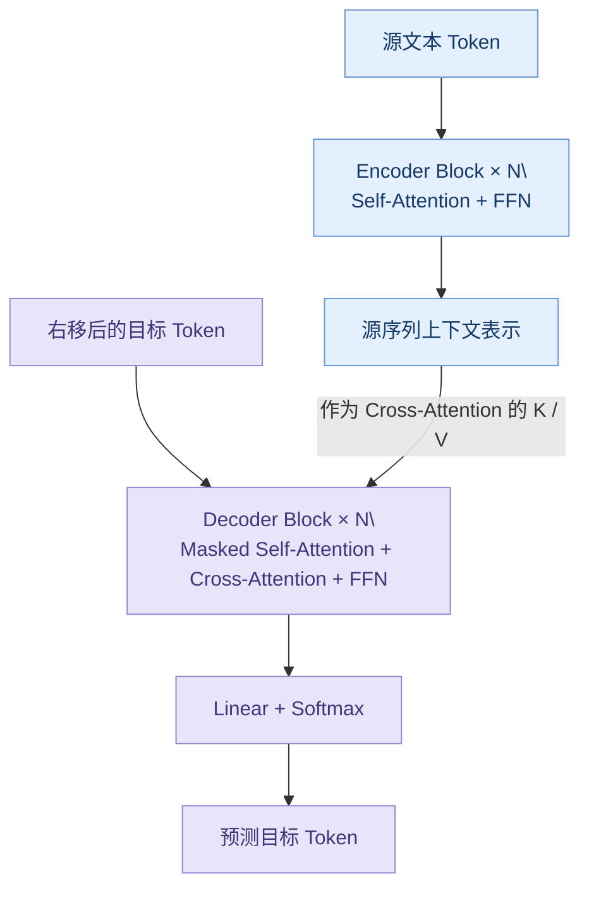
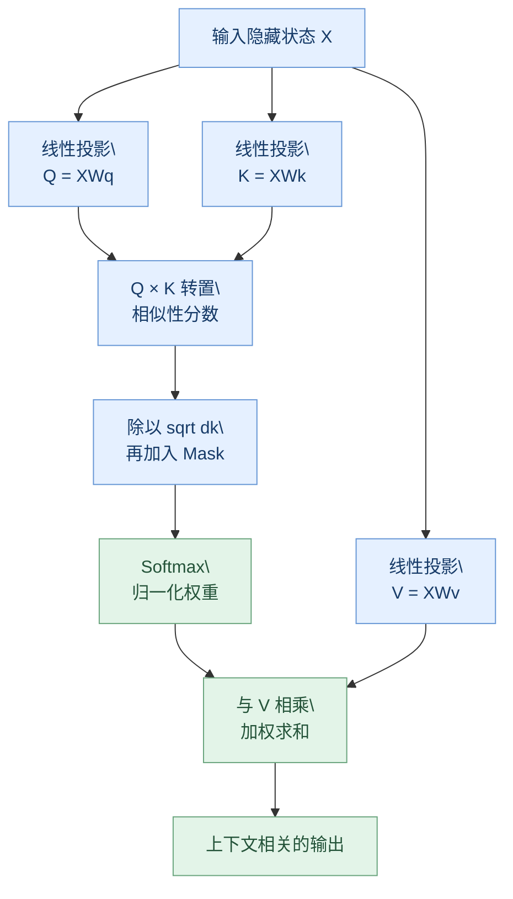
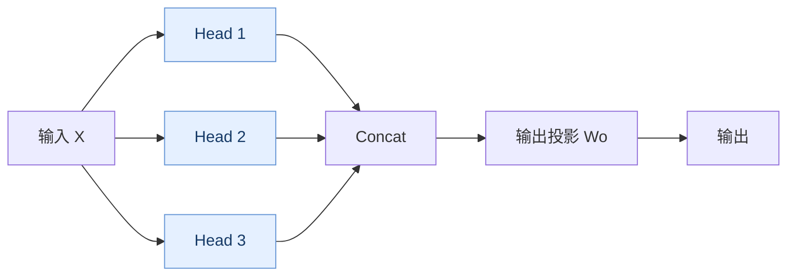
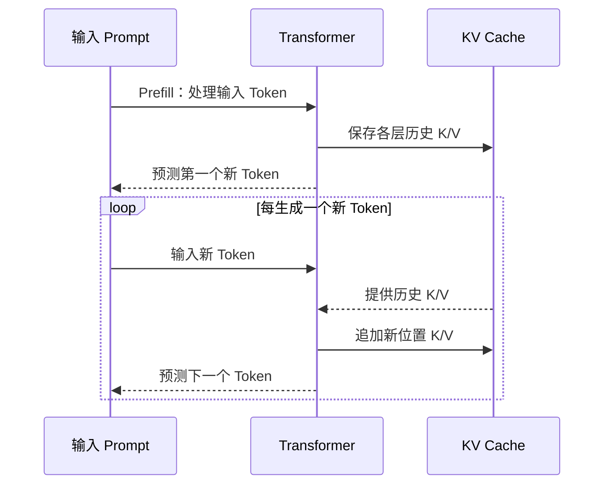
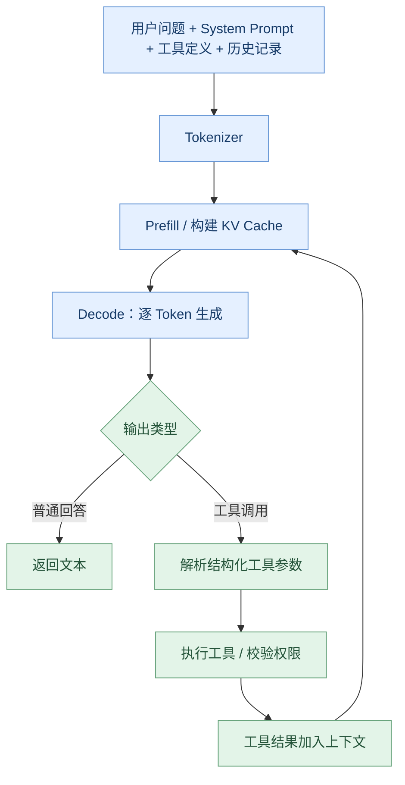

# 01｜Transformer：从注意力机制到大语言模型
> **学习状态**：系统学习中 · **难度**：基础 → 进阶 · **面向岗位**：大模型应用 / 企业级 Agent 工程师  

> **预计学习时间**：4–6 小时（含动手实验）  

> **学习目标**：能解释 Transformer 的整体结构、手算一次 Attention、区分三类架构，并说明 KV Cache 与 Agent 性能的关系。

## 目录
1. [先建立整体认识](#1-先建立整体认识)

2. [Transformer 为什么出现](#2-transformer-为什么出现)

3. [Transformer 的整体架构](#3-transformer-的整体架构)

4. [输入如何进入模型](#4-输入如何进入模型)

5. [Self-Attention：最核心的机制](#5-self-attention最核心的机制)

6. [Multi-Head Attention：为什么需要多个头](#6-multi-head-attention为什么需要多个头)

7. [Mask、残差连接、归一化和 FFN](#7-mask残差连接归一化和-ffn)

8. [三种 Transformer 架构](#8-三种-transformer-架构)

9. [现代 LLM：RoPE、GQA 与 KV Cache](#9-现代-llmropegqa-与-kv-cache)

10. [完整生成流程与 Agent 的联系](#10-完整生成流程与-agent-的联系)

11. [动手实验：实现 Self-Attention](#11-动手实验实现-self-attention)

12. [企业工程注意事项](#12-企业工程注意事项)

13. [高频面试问题](#13-高频面试问题)

14. [知识自测与参考资料](#14-知识自测与参考资料)

**---**

## 1. 先建立整体认识
**一句话理解**：Transformer 是一种以注意力机制为核心的神经网络架构，能根据序列中不同位置之间的关系，生成包含上下文信息的表示。现代许多 LLM 都采用 Transformer 或其变体。

以句子“**这台设备出现故障，它需要维修**”为例，模型处理“它”时，需要利用前面的“设备”来理解指代关系。Self-Attention 让每个位置都能根据当前任务，对允许访问的其他位置分配不同的注意力权重。**注意力权重不是人工写死的规则，而是由训练学习到的投影矩阵和输入共同决定。**

```mermaid

flowchart LR

    A[输入文本] --> B[Tokenizer\<br/>转换为 Token ID]

    B --> C[Token Embedding\<br/>向量表示]

    C --> D[位置编码或位置机制]

    D --> E[多层 Transformer Block]

    E --> F[输出投影 / LM Head]

    F --> G[下一个 Token 的概率分布]

    G --> H[采样或贪心选择]

    H --> I[生成文本]

    classDef blue fill:#e5f0ff,stroke:#6696d5,color:#173b68;

    classDef green fill:#e3f4e8,stroke:#69a47d,color:#245339;

    class A,B,C,D,E,F blue;

    class G,H,I green;

```



> **图 1：现代 Decoder-only 语言模型的简化推理流程。** 位置机制在具体模型中可能作用于注意力内部（如 RoPE），并不总是直接与 Embedding 相加。

### 本章知识地图
\| 层次 | 关键问题 | 掌握标准 |

\|---|---|---|

\| 输入层 | 文本如何变成向量？ | 能解释 Token、Embedding、位置信息 |

\| 核心计算 | Attention 到底在算什么？ | 能解释 Q/K/V 和 Softmax |

\| 网络结构 | 一个 Block 有什么？ | 能解释 MHA、FFN、残差、Norm |

\| 生成方式 | 模型为什么逐 Token 输出？ | 能解释因果掩码和自回归 |

\| 推理优化 | 为什么长上下文耗显存？ | 能解释 KV Cache 与复杂度 |

\| Agent 工程 | 为什么工具很多、历史很长会变慢？ | 能联系上下文管理和推理成本 |

## 2. Transformer 为什么出现
在 Transformer 之前，序列建模常使用 RNN、LSTM、GRU。它们按时间步处理序列，训练中的时间维并行性受到限制；长距离依赖虽然可以通过门控机制缓解，但仍是重要挑战。2017 年的论文 **[Attention Is All You Need](https://arxiv.org/abs/1706.03762)** 提出以注意力机制为核心的 Encoder–Decoder 架构，不依赖循环或卷积来进行主要序列建模。

\| 比较维度 | RNN / LSTM | 标准 Transformer Self-Attention |

\|---|---|---|

\| 序列内计算 | 时间步之间有依赖 | 训练时可并行计算多个位置 |

\| 长距离信息交互 | 经过多个时间步 | 单层中可直接建立位置间关联 |

\| 典型瓶颈 | 顺序计算 | 长序列 Attention 计算与存储 |

\| 长度为 n 的全注意力矩阵 | 不适用 | 每个头通常有 n × n 个权重 |

**重要区分**：Transformer 的**训练阶段**可以并行处理一个序列中的多个位置；自回归 LLM 的**生成阶段**通常仍需按顺序预测新 Token。因此“Transformer 完全并行生成”是错误的。

## 3. Transformer 的整体架构
原始 Transformer 是 **Encoder–Decoder** 结构：Encoder 读取源序列，Decoder 根据已生成内容以及 Encoder 输出逐步生成目标序列。原始论文中的 Decoder 包含 Masked Self-Attention、Cross-Attention 和 FFN。



> **图 2：原始 Transformer Encoder–Decoder 的简化结构。** 实际每层还有残差连接、归一化等组件。

### 一个 Transformer Block 中有什么？
- **Self-Attention**：使一个 Token 的表示能够融合其他允许访问位置的信息。

- **FFN / MLP**：对每个位置的隐藏表示执行非线性变换，增加表达能力；通常位置之间共享参数。

- **Residual Connection（残差连接）**：将子层输入与子层输出相加，帮助深层网络训练。

- **Layer Normalization（层归一化）**：稳定网络训练。不同模型可能使用 LayerNorm 或 RMSNorm，也可能采用 Pre-Norm 或 Post-Norm。

原始 Transformer 采用 Add & Norm（Post-Norm）设计；现代 LLM 常使用不同的归一化布局，不能把原始结构当作所有模型的唯一实现。

## 4. 输入如何进入模型
假设输入是：`设备运行正常`。

1. **Tokenization**：Tokenizer 把文本映射成 Token ID。Token 不一定是一个字或一个词。

2. **Embedding**：每个 ID 通过可学习的 Embedding 表映射为长度为 `d_model` 的向量。

3. **位置信息**：仅有 Token 向量不足以显式表达顺序；原始 Transformer 使用正弦/余弦位置编码，很多现代 LLM 在注意力计算中使用 RoPE。

4. **进入多层 Block**：逐层融合上下文信息，得到每个位置的隐藏表示。

如果批量大小为 `B`，序列长度为 `T`，隐藏维度为 `D`，则典型隐藏状态形状为：

```text

input_ids:     [B, T]

embeddings:    [B, T, D]

hidden_states: [B, T, D]

```

## 5. Self-Attention：最核心的机制
### 5.1 先理解 Q、K、V
可以用**图书馆检索**作类比：

- **Query（Q）**：我当前想找什么信息？

- **Key（K）**：每条信息提供什么检索线索？

- **Value（V）**：匹配后真正要汇总的信息内容。

这是帮助理解的比喻；在模型里 Q、K、V 都是从输入向量经可学习矩阵投影得到的数值张量，而不是自然语言问题、标签或原文。



> **图 3：Scaled Dot-Product Attention 的计算过程。**

### 5.2 核心公式

```math
\mathrm{Attention}(Q,K,V)
=
\mathrm{softmax}\left(
\frac{QK^{\top}}{\sqrt{d_k}}+M
\right)V
```
  
其中：

- `QKᵀ`：计算 Query 与各 Key 的点积相似度。

- `d_k`：单个注意力头中 Key 的维度。

- `√d_k`：缩放点积，避免维度增大时分数幅度过大、Softmax 易饱和。

- `M`：可选掩码；被禁止访问的位置通常加上很大的负值。

- `Softmax`：将分数转换为非负、总和为 1 的注意力权重。

- 最后乘以 `V`：对 Value 向量进行加权求和。

### 5.3 一个可以手算的例子
假设某个 Query 对三个 Token 的**缩放后分数**为 `[2, 1, 0]`：

$$

\mathrm{softmax}([2,1,0])\approx[0.665,0.245,0.090]

$$

如果三个 Value 分别为 `v₁, v₂, v₃`，输出为：

$$

y=0.665v_1+0.245v_2+0.090v_3

$$

因此，模型不是简单“选择一个词”，而是对多个位置的信息做连续的加权组合。以上数字是教学示例，不代表真实模型对任何句子的注意力分布。

### 5.4 复杂度为什么与上下文长度有关？
对标准全注意力，长度为 `T` 的序列需要构造每个头的 `T × T` 位置关联。在固定头维度时，注意力分数计算随序列长度大致呈 **O(T²)** 增长。实际实现可能使用 FlashAttention 等方法减少显存读写或避免显式存储完整注意力矩阵，但不代表标准全注意力的算术复杂度自动变为线性。

## 6. Multi-Head Attention：为什么需要多个头
单个注意力头只在一种学习到的投影空间中建立关系；多头注意力允许模型在多个不同的子空间并行计算关联，然后将结果拼接并再次投影。

$$

\mathrm{head}_i=\mathrm{Attention}(QW_i^Q,KW_i^K,VW_i^V)

$$

$$

\mathrm{MultiHead}(Q,K,V)

=\mathrm{Concat}(\mathrm{head}_1,\ldots,\mathrm{head}_h)W^O

$$



**注意**：不能断言“第一个头专门处理语法、第二个头专门处理语义”。某些头可能呈现可解释模式，但并非固定分工，也不能保证每个头都有独立的人类可读功能。

## 7. Mask、残差连接、归一化和 FFN
### 7.1 Causal Mask：防止偷看未来
对于自回归生成，位置 `t` 只能关注 `t` 及其之前的位置。以四个 Token 为例，`✓` 表示允许关注：

\| Query \ Key | T1 | T2 | T3 | T4 |

\|---|:---:|:---:|:---:|:---:|

\| T1 | ✓ | × | × | × |

\| T2 | ✓ | ✓ | × | × |

\| T3 | ✓ | ✓ | ✓ | × |

\| T4 | ✓ | ✓ | ✓ | ✓ |

> **图 4：因果注意力掩码。** 训练时虽然可以同时计算多个位置，但每个位置不能访问未来 Token 的真实内容。

### 7.2 Padding Mask 与 Causal Mask 的区别
- **Padding Mask**：避免注意力关注补齐用的无效位置。

- **Causal Mask**：避免注意力关注未来位置。

- 两者解决的问题不同，必要时可组合使用。

### 7.3 残差与归一化
一个常见的 **Pre-Norm** Transformer Block 可抽象为：

$$h'=h+\mathrm{Attention}(\mathrm{Norm}(h))$$

$$h''=h'+\mathrm{FFN}(\mathrm{Norm}(h'))$$

残差连接帮助信息和梯度通过深层网络；归一化改善数值稳定性。FFN 在每个 Token 位置上独立应用相同的非线性网络，通常包含升维、激活和降维。

## 8. 三种 Transformer 架构
\| 类型 | 典型模型 | 注意力特征 | 典型任务 |

\|---|---|---|---|

\| Encoder-only | BERT | 通常双向注意力 | 分类、特征提取、编码 |

\| Decoder-only | GPT、Qwen、Llama | 通常因果注意力 | 对话、代码、文本生成 |

\| Encoder–Decoder | T5、BART | Encoder 双向，Decoder 因果，跨注意力连接两侧 | 翻译、摘要、序列到序列 |

**容易混淆的地方**：原始 Transformer 的 Decoder 有 Cross-Attention，因为它要读取 Encoder 的输出；而常见的 **Decoder-only LLM 不需要一个独立的 Encoder**，其 Block 也通常没有对应的 Encoder–Decoder Cross-Attention。

## 9. 现代 LLM：RoPE、GQA 与 KV Cache
### 9.1 RoPE：让注意力感知相对位置
原始 Transformer 将位置编码加入输入表示。RoPE（Rotary Position Embedding）则通过与位置有关的旋转变换作用于 Q、K，使点积中包含相对位置信息。它是现代 LLM 常见的位置机制，但不同模型的实现细节可能不同。

### 9.2 MHA、MQA、GQA
- **MHA**：每个 Query Head 有对应的 K/V Head。

- **MQA**：多个 Query Head 共享一组 K/V Head。

- **GQA**：Query Head 分组共享 K/V Head，位于 MHA 与 MQA 之间。

GQA/MQA 的重要工程价值是减少 K/V 缓存的规模，通常有利于推理效率；具体收益取决于模型和服务实现。

### 9.3 KV Cache：为什么可以加速逐 Token 生成
生成第 `t+1` 个 Token 时，过去 Token 的 Key、Value 不必在每一步重新计算。KV Cache 存储过去位置的 K/V，新步骤只需要计算新 Token 的相关投影，并与历史缓存进行注意力计算。



> **图 5：自回归生成与 KV Cache。** 这是单个请求的简化示意，真实推理引擎还会处理批处理、缓存分页与调度。

**显存近似估算**（普通全长度缓存，不考虑滑动窗口、缓存量化及其他额外开销）：

$$

\mathrm{KV\ Bytes}\approx 2\times L\times B\times T\times H_{kv}\times D_{head}\times S

$$

其中 `L` 为层数，`B` 为批量大小，`T` 为缓存长度，`H_kv` 为 K/V 头数，`D_head` 为头维度，`S` 为每元素字节数。前面的 `2` 分别对应 K 和 V。

**举例（假设值）**：32 层、1 个请求、4096 Token、8 个 KV Head、每头 128 维、FP16（2 字节）：

```text

2 × 32 × 1 × 4096 × 8 × 128 × 2

= 536,870,912 Bytes ≈ 512 MiB

```

这仅是 KV Cache 估算，不包含模型权重、激活、框架和其他显存开销。并发请求增加时，缓存总需求也会显著增加。

## 10. 完整生成流程与 Agent 的联系
一个基于 Decoder-only LLM 的 Agent 回合，底层仍然依赖 Token 预测：



> **图 6：Agent 工具调用循环的概念示意。** 工具执行和权限校验由应用程序负责，不是 Transformer 自动执行外部操作。

**你需要建立的联系**：

- 工具描述过多 → 输入 Token 增加 → Prefill 开销可能增加。

- 历史对话不断增长 → 上下文更长 → KV Cache 显存占用上升。

- 输出很长 → Decode 步骤增加 → 用户等待时间可能变长。

- Agent 多轮调用模型 → 多次推理 → 延迟与成本叠加。

- 上下文裁剪、摘要、按需加载工具、检索相关信息 → 可能减少无效 Token，但需要防止关键信息丢失。

## 11. 动手实验：实现 Self-Attention
以下实验只依赖 PyTorch，不需要下载大模型权重。将代码保存为 `attention_demo.py` 后运行。

```python

import math

import torch

# 固定随机种子，方便复现实验

torch.manual_seed(42)

# B=1, T=4, D=8

x = torch.randn(1, 4, 8)

d_model = x.shape[-1]

# 演示用可学习投影参数（此处随机初始化，没有经过训练）

w_q = torch.randn(d_model, d_model)

w_k = torch.randn(d_model, d_model)

w_v = torch.randn(d_model, d_model)

q = x @ w_q

k = x @ w_k

v = x @ w_v

# [1, 4, 4]：每个 Query 与每个 Key 的匹配分数

scores = q @ k.transpose(-2, -1) / math.sqrt(d_model)

# 上三角（不含对角线）为未来位置

future_mask = torch.triu(

    torch.ones(4, 4, dtype=torch.bool), diagonal=1

)

scores = scores.masked_fill(future_mask, float('-inf'))

weights = torch.softmax(scores, dim=-1)

output = weights @ v

print('Q shape:', q.shape)

print('Attention weights shape:', weights.shape)

print('Output shape:', output.shape)

print('Attention weights:\n', weights[0].round(decimals=3))

print('Each row sum:', weights.sum(dim=-1))

```

**预期观察**：

1. `Q` 形状为 `[1, 4, 8]`。

2. 注意力权重形状为 `[1, 4, 4]`。

3. 输出形状为 `[1, 4, 8]`。

4. 每一行的权重之和接近 `1`。

5. 右上角被 Mask 的位置权重为 `0`。

**进阶实验**：去掉 `future_mask`，比较 Attention 权重变化；再尝试把输入长度从 `4` 增加到 `128`、`512`，观察分数矩阵的形状如何变化。注意这里使用的是随机权重，**不能**从结果推断真实语言理解能力。

## 12. 企业工程注意事项
\| 现象 | 与 Transformer / 推理机制的联系 | 可尝试的工程措施 |

\|---|---|---|

\| 首 Token 延迟高 | Prompt 很长、Prefill 耗时、模型调度开销 | 缩短无效上下文、检查排队与网络耗时、Prompt Cache |

\| 输出速度慢 | Decode 顺序生成、计算与显存带宽限制 | 测量 Tokens/s、优化批处理与推理引擎 |

\| 长文档 OOM | 权重、KV Cache、激活及其他显存共同占用 | 分块处理、GQA 模型、缓存管理、降低并发 |

\| Agent 越聊越慢 | 历史记录与工具结果不断累积 | 上下文压缩、记忆摘要、按需检索 |

\| 并发性能不稳定 | 多请求争抢显存、计算资源与调度容量 | 请求队列、并发限制、批处理、压测 |

> **性能分析原则**：不要把“慢”全部归因于 Transformer。实际 Agent 的总耗时还可能来自网络、模型服务排队、工具调用、OCR、数据库、文件解析与重试。需要分别记录阶段耗时。

## 13. 高频面试问题
**Q1：Transformer 为什么比 RNN 更容易并行训练？**  

答：Self-Attention 可同时计算序列中多个位置之间的关系，不依赖逐时间步更新隐藏状态；但自回归生成仍有逐 Token 的顺序依赖。

**Q2：Q、K、V 分别是什么？**  

答：输入隐藏状态经过不同线性投影得到的张量；Q 用于匹配，K 用于被匹配，V 提供加权聚合的信息。

**Q3：为什么 Attention 要除以 `√d_k`？**  

答：维度增加时点积分数幅度可能变大，使 Softmax 饱和并影响梯度；缩放有助于稳定训练。

**Q4：Self-Attention 和 Cross-Attention 的区别？**  

答：Self-Attention 的 Q/K/V 来自同一序列表示；Cross-Attention 的 Q 来自一个序列、K/V 来自另一个序列的表示。

**Q5：为什么 Decoder-only 模型需要 Causal Mask？**  

答：自回归目标要求当前位置不能看到未来 Token，否则训练时会发生信息泄漏。

**Q6：Multi-Head Attention 的意义是什么？**  

答：通过多个学习到的投影子空间并行建模不同关联，再融合输出，提高表示能力。

**Q7：KV Cache 为什么提升推理速度，却增加显存？**  

答：它缓存过去位置的 K/V，减少重复计算；缓存张量随序列长度和并发请求增长，需要显存存放。

**Q8：MHA 与 GQA 有何区别？**  

答：GQA 让多个 Query Head 共享一组 K/V Head，通常可以显著减少 KV Cache 大小。

**Q9：Transformer 的 Attention 一定是 O(n²) 显存吗？**  

答：标准全注意力的逻辑分数矩阵有 n² 个元素，但 FlashAttention 等优化可避免显式存储完整矩阵；要区分数学计算量与实际显存复杂度。

**Q10：企业 Agent 的工具越多为什么可能越慢？**  

答：工具 Schema、历史记录、工具结果可能增大上下文，引起 Prefill 和缓存开销；多次模型与工具往返也增加总耗时。需要按实际链路测量。

## 14. 知识自测与参考资料
### 自测清单
- [ ] 能画出 Encoder–Decoder 的主要结构

- [ ] 能解释 Self-Attention 的公式与 Q/K/V

- [ ] 能解释 Causal Mask 的下三角结构

- [ ] 能区分 Encoder-only、Decoder-only、Encoder–Decoder

- [ ] 能运行 PyTorch Self-Attention 实验

- [ ] 能说明 KV Cache 的作用和显存估算方法

- [ ] 能把长上下文问题与 Agent 延迟、成本联系起来

### 必读资料（按建议顺序）
1. **Jay Alammar — The Illustrated Transformer（经典图解）**  

   https://jalammar.github.io/illustrated-transformer/  

   建议先看结构图，再看 Self-Attention 的逐步计算。

2. **Vaswani et al. — Attention Is All You Need（原始论文）**  

   https://arxiv.org/abs/1706.03762  

   重点阅读 Section 3（Model Architecture）与 Section 4（Why Self-Attention）。

3. **Harvard NLP — The Annotated Transformer（带代码注释的论文实现）**  

   https://nlp.seas.harvard.edu/annotated-transformer/  

   适合边看 PyTorch 实现边理解组件。

4. **Hugging Face — KV Cache Strategies（官方文档）**  

   https://huggingface.co/docs/transformers/kv_cache  

   重点看 Cache 的作用、不同策略与显存权衡。

5. **Su et al. — RoFormer / RoPE（论文）**  

   https://arxiv.org/abs/2104.09864  

   理解旋转位置编码。

6. **Ainslie et al. — Grouped-Query Attention（论文）**  

   https://arxiv.org/abs/2305.13245  

   理解 MHA、MQA、GQA 的差异。

7. **Dao et al. — FlashAttention（论文）**  

   https://arxiv.org/abs/2205.14135  

   理解注意力的 IO 与显存优化。

8. **互动图解：Transformer Visual Guide**  

   https://sabari-ui.github.io/Transformers/  

   可交互查看注意力计算与不同架构。

### 建议的后续学习顺序
学完本章，继续学习 [`02-Tokenization.md`](02-Tokenization.md) → [`03-LLM-Inference.md`](03-LLM-Inference.md) → [`04-Structured-Outputs.md`](04-Structured-Outputs.md)。

**---**

**编写原则：区分原始 Transformer 与现代 LLM；区分教学示意与真实模型；所有性能结论均需结合模型、硬件与推理引擎验证。**
