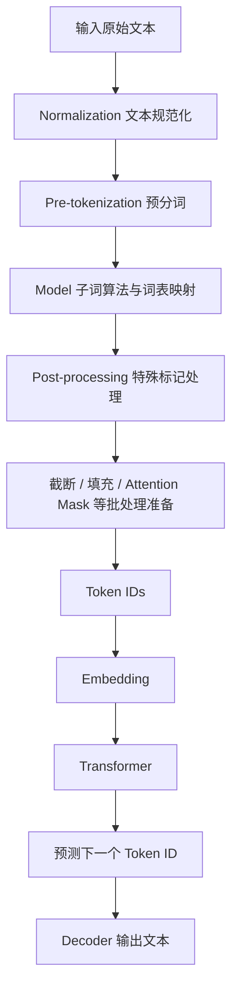
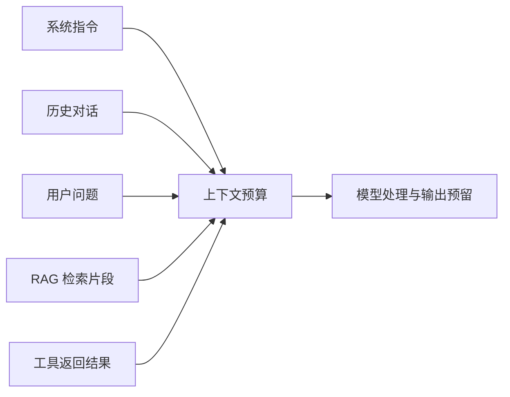
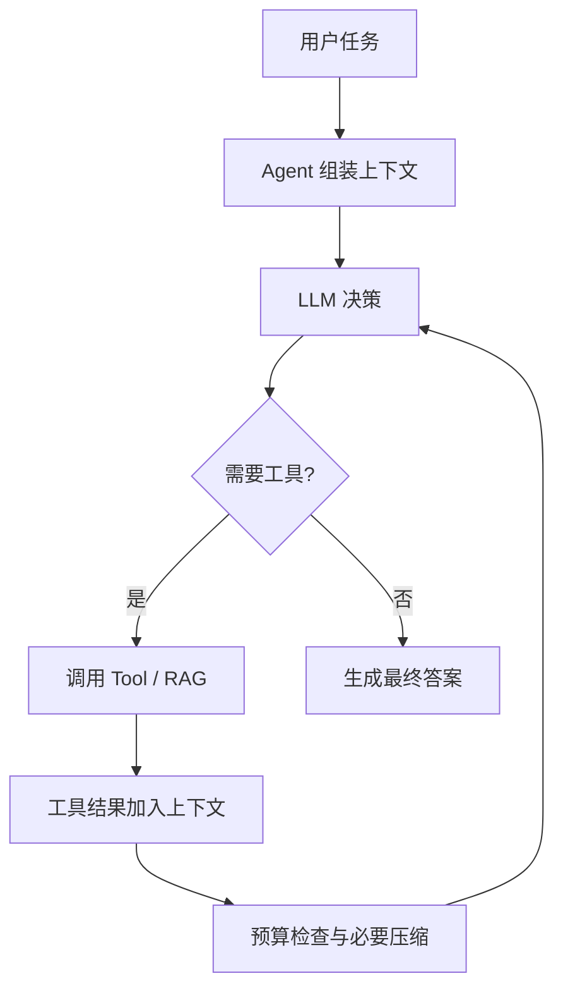
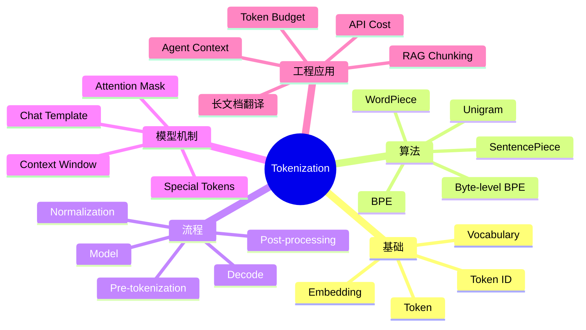

# 02 Tokenization：从文本到大语言模型可理解的 Token

> **学习状态：待整理 → 系统学习**  
> **所属模块：** 01-LLM-Fundamentals  
> **学习目标：** 理解 Tokenizer 的工作原理、主流子词算法、输入输出处理机制，以及它对 Transformer、RAG 和企业级 Agent 的影响。  
> **阅读方式：** 先建立直觉，再学习算法和处理链路，最后联系工程问题。本文不包含代码实践。

---

## 1. 为什么大语言模型需要 Tokenization？

人类直接阅读自然语言，但 Transformer 主要处理数值向量。模型不能把一段中文或英文字符串原样交给注意力层计算，而需要先把文本映射为离散符号的编号，再通过嵌入层转成向量。**Tokenization（Token 化）**正是文本与模型数值计算之间的桥梁。


**核心结论：** Token 并不天然等于“一个汉字”“一个单词”或“一个字符”。它是特定 Tokenizer 词表中的一个离散单位；不同模型的 Tokenizer 可能把同一文本切成不同数量的 Token。

> **术语注释｜Tokenization**：把文本切分并编码成模型可处理的离散单位的过程。**作用**：连接原始文本与神经网络输入。**应用**：模型训练、推理、上下文长度计算、API 计费和 RAG 文档切分。
>
> **术语注释｜Transformer**：以注意力机制为核心的神经网络架构。**作用**：建模序列中不同位置之间的关系。**应用**：大语言模型、机器翻译、文本理解及多模态模型。

## 2. 建立最重要的五个基础概念

### 2.1 Token、Token ID 与 Vocabulary

- **Token**：切分后的文本单位，可能是完整单词、子词、标点、空格关联片段，甚至是字节级表示。
- **Token ID**：Token 在词表中的整数编号；模型实际接收的是 ID 序列，而不是文字标签。
- **Vocabulary（词表）**：Tokenizer 能识别的 Token 与 ID 的映射集合。词表规模与实际输入长度存在权衡，并非越大越好。

例如，`unbelievable` 可能被一个 Tokenizer 视为一个 Token，也可能被拆成若干子词；实际切分必须以**具体模型及其 Tokenizer**为准。

### 2.2 字符、字节、单词和子词有什么区别？

| 切分粒度 | 思想 | 优点 | 主要限制 |
|---|---|---|---|
| Character-level（字符级） | 按字符切分 | 字符覆盖直观 | 序列可能很长 |
| Word-level（词级） | 按完整词切分 | 常见词表达直接 | 生僻词、词形变化及词表膨胀 |
| Subword-level（子词级） | 常见词整体保留，罕见词拆分 | 平衡词表大小与序列长度 | 切分依赖训练数据与算法 |
| Byte-level（字节级） | 基于文本编码字节建立基本单位 | 覆盖任意 UTF-8 文本更容易 | 特殊字符可能需要多个单位 |

现代 LLM 常采用**子词分词**或**字节级子词分词**。两者不是严格互斥：Byte-level BPE 就是在字节基础上学习子词合并规则。

> **术语注释｜LLM（Large Language Model，大语言模型）**：通过大规模数据训练、能够理解和生成语言的模型。**作用**：完成生成、问答、推理等任务。**应用**：对话助手、Agent、企业知识库。
>
> **术语注释｜Subword（子词）**：介于单字符与完整单词之间的切分单位。**作用**：处理罕见词、词形变化与开放词汇。**应用**：BPE、WordPiece、Unigram。
>
> **术语注释｜UTF-8**：一种 Unicode 字符编码方式。**作用**：把字符表示为字节序列。**应用**：字节级 Tokenizer、跨语言文本处理。

### 2.3 Encode 与 Decode

**Encode（编码）**通常表示把文本转成 Token ID 序列；**Decode（解码）**表示将 ID 序列还原成可阅读文本。二者并不意味着任意文本在所有规范化设置下都能逐字符无损往返：如果编码前做了小写化、去重音等有损规范化，原始表面形式可能已经丢失。

### 2.4 Tokenizer 不等于 Embedding

Tokenizer 负责**离散符号划分和编号**；Embedding 负责**把整数编号映射到连续向量**。这两层解决的是不同问题，不能混为一谈。

设输入 ID 序列为 $t_1,t_2,\ldots,t_n$，嵌入矩阵为 $E\in\mathbb{R}^{|V|\times d}$，则第 $i$ 个 Token 的嵌入为：

```math
\mathbf{x}_i=E[t_i]
```

其中 $|V|$ 是词表规模，$d$ 是嵌入维度。后续模型还会处理位置信息；具体实现因架构而异。

> **术语注释｜Embedding（嵌入）**：把离散 ID 映射成连续数值向量的技术。**作用**：让神经网络能够对 Token 进行计算。**应用**：Transformer 输入、语义检索（但输入 Token Embedding 与检索向量并非同一个概念）。

## 3. 主流 Tokenization 算法的演进与取舍

### 3.1 为什么词级分词不足以支撑现代 LLM？

假如词表只收录完整单词，遇到新词、专有名词、拼写变化和复合词时容易产生 **OOV（Out-of-Vocabulary，词表外词）**。若为了覆盖所有词形无限扩充词表，又会增加参数、存储和学习负担。子词方法通过组合较小单位来表示未完整收录的词，缓解这一矛盾。

> **术语注释｜OOV**：词表中不存在的词或单位。**作用/意义**：衡量词表覆盖不足问题。**应用**：Tokenizer 设计、多语言和专业术语处理。

### 3.2 BPE：Byte Pair Encoding

**BPE（字节对编码）**最初是压缩思想，后来被用于子词学习。它从较小的基础符号出发，反复统计训练语料中相邻符号对的频率，并将高频组合合并成新 Token，直到达到预设合并次数或词表规模。实际 Tokenizer 还依赖预分词规则、合并顺序及具体实现。

**教学示意（非真实模型词表）：**

```text
初始：l o w  /  l o w e r
合并 1：l + o → lo
合并 2：lo + w → low
结果：常见组合逐渐形成较长 Token
```

BPE 的价值在于：高频片段可被紧凑编码，罕见词可由多个较短单位组合表示。不过它不保证“每个自然语言词对应一个 Token”，也不保证所有语言压缩率相同。

### 3.3 Byte-level BPE：为什么能处理任意字符？

**Byte-level BPE（字节级 BPE）**从字节层面的基本单位出发，再学习合并规则。与仅依赖有限字符表的方案相比，它更容易覆盖任意 UTF-8 文本，减少因字符未收录而产生的未知字符问题。但一个中文字符、Emoji 或特殊符号可能对应多个字节，Token 数量并不固定。

> **术语注释｜Byte-level BPE**：以字节为基础单位执行 BPE 合并的分词方式。**作用**：提高文本覆盖能力。**应用**：多语言和开放域生成模型。

### 3.4 WordPiece：偏向词表匹配的子词算法

**WordPiece**与 BPE 一样采用子词思想，但训练准则不同；编码时通常使用最长匹配策略，将词分解为词表中可识别的片段。常见的 `##` 前缀表示该子词不是词的起始部分（这是特定 WordPiece 词表约定，不是所有 Tokenizer 的通用格式）。BERT 是其典型应用之一。

### 3.5 Unigram：概率式子词选择

**Unigram Language Model（Unigram 子词模型）**从候选子词集合出发，学习子词概率，并寻找能够较好解释训练语料的词表。对输入文本可比较不同切分路径，选择概率较高的分解；某些训练或数据增强方案还可从多个合理切分中采样。

### 3.6 SentencePiece 是什么？

**SentencePiece**是一个面向原始文本的子词 Tokenizer 工具包，而不是与 BPE、Unigram 并列的单一分词算法。它支持 BPE 和 Unigram 等模型，强调不依赖特定语言的空格分词预处理，并可用特殊标记（如 `▁`）表示空格信息。

| 方法 | 主要机制 | 典型特点 | 适合重点理解的问题 |
|---|---|---|---|
| BPE | 反复合并高频相邻单位 | 基于合并规则 | 高频子串如何形成词表 |
| Byte-level BPE | 从字节单位学习合并 | 字符覆盖能力强 | 多语言与生僻字符 |
| WordPiece | 子词词表与最长匹配 | 常见 `##` 续接标记 | BERT 如何处理词形 |
| Unigram | 概率模型选择子词组合 | 可比较不同切分 | 分词不确定性与概率 |
| SentencePiece | Tokenizer 工具框架 | 支持 BPE、Unigram | 原始文本、多语言与空格保留 |

**不要混淆：** SentencePiece 是工具/框架；BPE 和 Unigram 是其中可以使用的算法。实际项目应以模型发布的 Tokenizer 配置为准，而不是仅根据模型名称推断其算法。

**进一步阅读：** [Hugging Face Tokenizer 组件](https://huggingface.co/docs/tokenizers/python/latest/components.html) · [SentencePiece 官方仓库](https://github.com/google/sentencepiece) · [BPE 经典论文](https://arxiv.org/abs/1508.07909) · [Unigram 相关论文](https://arxiv.org/abs/1804.10959)

## 4. 从原始文本到 Token ID：完整处理链路

Hugging Face Tokenizers 官方文档将典型编码流水线分为 **Normalization → Pre-tokenization → Model → Post-processing**。具体实现可能省略或调整其中某些步骤。



### 4.1 Normalization：文本规范化

规范化可能包含 Unicode 规范化、大小写处理、去除重音或空白处理。**并非每个模型都会进行这些操作**；例如大小写敏感模型通常不能随意转小写。对法律、医学、设备型号等文本，规范化还可能影响精确字符串保真。

> **术语注释｜Unicode Normalization（Unicode 规范化）**：将视觉上或语义上等价的字符序列调整为某种标准形式，例如 NFC、NFKC。**作用**：降低表示差异。**应用**：文本预处理、搜索匹配；对型号、单位及特殊符号需审慎使用。

### 4.2 Pre-tokenization：预分词

按空格、标点、数字边界或字节规则将文本初步拆成片段，限制后续子词模型可跨越的边界。不同语言和模型使用的预分词策略差异很大。

### 4.3 Model：子词算法与词表映射

在预处理片段上执行 BPE、WordPiece 或 Unigram 等规则，并映射为 Token ID。这一步体现了 Tokenizer 的训练结果：词表与合并规则/概率参数通常来自预训练阶段。

### 4.4 Post-processing：添加特殊 Token

根据模型任务或消息格式添加必要的控制符号，例如序列起始、结束、分隔等。**特殊 Token 的名称和实际 ID 因模型而异**，不能把某一家模型的标记直接套用到另一家模型。

| 常见标记 | 常见含义 | 需要注意 |
|---|---|---|
| `BOS` | Beginning of Sequence，序列开始 | 不一定所有模型都显式使用 |
| `EOS` | End of Sequence，序列结束 | 与聊天轮次结束标记可能不同 |
| `PAD` | Padding，批处理补齐 | 用于对齐批次长度，不应视为有效内容 |
| `UNK` | Unknown，未知单位 | 字节级方案可能显著减少相关情况 |
| `CLS` | Classification，分类聚合标记 | 常见于 BERT 类模型 |
| `SEP` | Separator，序列分隔标记 | 常见于句对等输入任务 |
| `MASK` | 掩码标记 | 常见于掩码语言模型预训练 |

> **术语注释｜Special Token（特殊 Token）**：承担结构或控制功能的 Token。**作用**：表示边界、角色、任务或填充。**应用**：训练样本构造、聊天模板、模型停止条件。

### 4.5 Padding、Truncation 与 Attention Mask

- **Padding（填充）**：将批量输入补到相同长度，以便批处理计算。
- **Truncation（截断）**：当输入超出允许长度时，按策略丢弃部分 Token。错误截断可能删掉关键指令或文档证据。
- **Attention Mask（注意力掩码）**：向模型标识哪些位置应参与注意力计算，常用于屏蔽填充位置；它与因果注意力掩码并非同一概念。

> **术语注释｜Causal Mask（因果掩码）**：阻止自回归模型在预测当前位置时访问未来 Token。**作用**：维持逐 Token 生成约束。**应用**：Decoder-only LLM。

### 4.6 Decode：模型输出如何重新变成文本？

自回归模型通常逐步预测下一个 Token ID，经过解码器拼接和必要的字节/空格还原形成文本。实际输出还受停止标记、采样策略和聊天模板影响。因此“模型一次生成一个 Token”并不意味着“每次只输出一个字”。

**参考：** [Hugging Face 官方流水线](https://huggingface.co/docs/tokenizers/main/pipeline) · [Tokenizers 组件说明](https://huggingface.co/docs/tokenizers/python/latest/components.html)

## 5. Tokenization 如何影响 Transformer？

### 5.1 序列长度影响计算成本

设输入序列长度为 $n$，隐藏维度为 $d$。在标准全注意力的典型实现中，注意力分数矩阵大小随 $n^2$ 增长，其核心注意力计算量可粗略表示为：

```math
O(n^2d)
```

这不是整个 Transformer 的完整复杂度公式，也不代表所有优化注意力实现都必须显式存储完整的 $n\times n$ 矩阵；但它解释了**Token 数量为什么会显著影响长上下文推理的计算与资源需求**。

### 5.2 词表大小也影响模型设计

输入 Embedding 表的参数量约为 $|V|\times d$。词表更大可能让常见片段切分更短，却也增加嵌入表及部分输出层的规模。词表大小、覆盖能力、训练语料和平均序列长度之间需要权衡。

### 5.3 分词边界不等于语义边界

Tokenizer 根据统计规则拆分文本，不保证每个 Token 对应完整语义单位。Transformer 通过后续层在上下文中学习组合意义。因此不能根据 Token 切分外观直接判断模型是否“理解”某个术语。

## 6. Token 数量、上下文窗口与 API 成本

### 6.1 Context Window 是什么？

**Context Window（上下文窗口）**表示模型一次推理可处理的上下文容量，通常以 Token 计量。它可能包含系统消息、用户消息、历史对话、工具调用结果、检索内容和已生成输出；具体计量与输入/输出限制取决于模型服务商。



> **术语注释｜Context Window**：模型在一次处理过程中可利用的 Token 容量。**作用**：限制输入历史和可处理材料的规模。**应用**：长文档、长对话、RAG、Agent 工具链。

### 6.2 Token 预算怎么理解？

在共享上下文上限的简化场景下，可写成：

```math
T_{system}+T_{history}+T_{user}+T_{retrieval}+T_{tools}+T_{output\_reserve}\leq T_{limit}
```

这里的 $T_{output\_reserve}$ 是预留输出预算，而不是已经生成的 Token。实际 API 还可能分别规定最大输入与最大输出长度，并存在聊天模板、角色标记等额外开销。**不能只计算用户输入文字**。

### 6.3 Token 与字符数为什么不能简单换算？

同一段文本的 Token 数量会随模型词表、语言、空格、数字、符号、Emoji、JSON 结构以及聊天模板而变化。经验估算可用于粗略规划，但正式预算应使用对应模型的 Tokenizer 或服务商 Token Counting 接口。

### 6.4 API 费用的简化估算

当服务商分别按输入和输出 Token 计价时：

```math
Cost=\frac{T_{input}}{U}P_{input}+\frac{T_{output}}{U}P_{output}
```

其中 $U$ 是报价单位（例如每百万 Token），$P$ 是该单位价格。缓存命中、批处理、思考 Token、多模态计量等可能改变实际账单，须以具体服务商规则为准。

> **术语注释｜Token Budget（Token 预算）**：为提示词、历史、检索、工具输出和模型回复分配可用 Token 容量。**作用**：避免超限并控制成本。**应用**：企业 Agent、长上下文推理和高并发服务。

**参考：** [OpenAI Token 计数说明](https://cookbook.openai.com/examples/how_to_count_tokens_with_tiktoken) · [tiktoken 官方仓库](https://github.com/openai/tiktoken) · [Anthropic Context Windows](https://platform.claude.com/docs/en/build-with-claude/context-windows)

## 7. Tokenization 对 RAG 的影响

**RAG（Retrieval-Augmented Generation，检索增强生成）**将外部资料检索结果放入模型上下文，帮助模型基于证据回答问题。Tokenization 影响文档切块、上下文拼接和检索成本，但**语义检索质量不只由 Tokenizer 决定**。

### 7.1 Chunking 为什么不能只按字符数切？

如果每个 Chunk 固定 1,000 个字符，不同语言、标点和模型的实际 Token 数可能差异很大。工程中更稳妥的做法是：**以语义结构为主、Token 上限为约束**，优先保留标题、段落、表格与章节的完整性。

### 7.2 Chunk Size 与 Chunk Overlap

- **Chunk Size（块大小）**：每段检索文本的目标长度；过小可能缺上下文，过大可能引入噪声。
- **Chunk Overlap（块重叠）**：相邻块重复保留部分内容，减少边界处语义断裂；过大也会增加索引体积和重复证据。

> **术语注释｜Chunking（分块）**：把长文档划分成便于索引和检索的片段。**作用**：兼顾召回粒度与上下文完整性。**应用**：知识库、论文检索、企业文档问答。
>
> **术语注释｜Embedding Model（向量嵌入模型）**：将文本映射到语义向量空间的模型。**作用**：支持语义相似度检索。**应用**：向量数据库、RAG；其 Tokenizer 和最大输入长度可能不同于生成模型。

### 7.3 RAG 的双 Tokenizer 问题

一个常被忽略的工程事实：**Embedding 模型与生成 LLM 可能使用不同 Tokenizer**。因此文档切块既要满足嵌入模型的输入限制，也要满足最终生成模型的上下文预算；不能用一个模型的 Token 数替代所有模型的计数。

### 7.4 表格、公式与专业术语的特殊处理

对于技术规范、医疗设备文档、说明书等内容，表格结构、型号、单位和章节引用可能比普通段落边界更重要。分块时应尽量保留字段与数值的对应关系，避免把“设备型号—参数—单位”拆散；Tokenizer 只解决编码问题，不会自动保证文档结构完整。

## 8. Tokenization 对 Agent 的影响

### 8.1 Agent 的 Token 消耗来自哪里？

Agent 的一次任务可能包含系统指令、规划过程、工具参数、工具结果、RAG 片段、多轮历史和最终回复。每一轮都可能重新发送部分上下文，因此总消耗不一定等于最终回复的长度。



> **术语注释｜Agent（智能体）**：围绕目标组织模型推理、工具调用和状态管理的系统。**作用**：将“回答问题”扩展为“执行任务”。**应用**：企业工作流、自动化文档处理、知识检索。
>
> **术语注释｜Tool Calling（工具调用）**：模型以结构化方式请求外部函数或服务执行操作。**作用**：访问实时数据和外部能力。**应用**：检索、数据库、翻译、文件处理。

### 8.2 Context Engineering：上下文工程

**Context Engineering（上下文工程）**不是简单缩短 Prompt，而是决定每轮模型应该看到什么：哪些系统规则必须保留、哪些历史可以摘要、哪些工具结果可以截断、哪些检索证据必须原样保留。

企业级 Agent 通常需要考虑：

1. **优先级**：系统约束、用户目标和关键证据优先于冗长日志。
2. **可恢复性**：摘要不能丢失尚未完成的任务状态、工具参数和必要引用。
3. **结构化压缩**：长工具输出优先保留错误码、关键字段和证据位置，而非机械截断。
4. **预算预留**：为模型回复和后续工具调用保留余量。
5. **安全边界**：检索文档或工具输出中的指令不应被当成高优先级系统指令。

> **术语注释｜Prompt（提示词）**：向模型提供的任务说明和上下文。**作用**：约束目标、格式与行为。**应用**：问答、翻译、Agent 规划。
>
> **术语注释｜Context Engineering**：选择、组织、裁剪和维护模型输入上下文的工程方法。**作用**：在有限窗口中提高信息质量。**应用**：长对话、多工具 Agent、RAG。

### 8.3 Tokenization 与文档翻译 Agent

以企业文档翻译系统为例，Tokenization 至少影响四件事：**长文档分段大小、模型调用成本、跨段上下文保留、术语和结构信息的传递**。不过排版错乱、图像文字遗漏、表格结构丢失等问题，主要还涉及文档解析、布局重建和质量校验，不能归因于 Tokenizer 本身。

## 9. 模型与 Tokenizer 的兼容性

### 9.1 为什么不能随意替换 Tokenizer？

预训练模型的嵌入参数与其 Token ID 约定紧密绑定。即使两个 Tokenizer 的词表规模相同，相同 ID 也未必对应相同文本；直接替换可能导致模型理解严重异常。更改词表、添加新 Token 或调整分词规则通常需要相应的模型参数处理和训练适配。

### 9.2 Chat Template 与 Special Token

对话模型不仅接收自然语言内容，还可能依赖角色标记、消息分隔符和工具调用格式。**Chat Template（聊天模板）**负责把多轮消息序列化为模型预期的输入格式。使用错误模板可能使模型混淆角色边界、提前结束或输出异常。

> **术语注释｜Chat Template**：将 system/user/assistant/tool 等消息组织为模型训练时约定格式的规则。**作用**：保持角色、轮次和工具边界一致。**应用**：对话推理、Agent 工具调用、模型部署。

### 9.3 中英文、多语言、数字与 Emoji

不同语种和文本形态的 Token 效率可能差别明显；专业型号、路径、JSON、Unicode 特殊字符也可能产生意外的切分。对需要准确复制的序列号、计量单位和医疗器械型号，应在业务层增加**精确匹配校验**，不能仅依赖语言模型的生成能力。

## 10. 常见误区与工程注意事项

| 常见误区 | 更准确的理解 |
|---|---|
| 一个汉字就是一个 Token | 不同模型切分方式不同，不存在统一换算 |
| 一个英文单词就是一个 Token | 罕见词、复合词、空格前缀可能拆成多个 Token |
| Tokenizer 越大越好 | 词表规模与序列长度、模型参数量存在取舍 |
| SentencePiece 就是一种独立分词算法 | 它是支持多种子词算法的工具框架 |
| Tokenization 等于 Embedding | 前者产生离散 ID，后者映射为连续向量 |
| 输入字符没超限就一定能调用成功 | API 按模型特定 Token 和消息格式计量 |
| 只需计算用户问题的 Token | 系统消息、历史、工具结果等也可能计入 |
| RAG 按固定字符数切分即可 | 还要考虑 Token 上限、语义边界和结构完整性 |
| Tokenizer 能解决翻译格式错乱 | 格式保留主要依赖解析、结构映射、渲染和校验 |
| 换模型只要改模型名称 | 还需检查 Tokenizer、聊天模板、上下文和特殊标记 |

## 11. 高频面试题与参考回答

**Q1：Token 和词有什么区别？**  
Token 是模型词表中的离散单位，可能是字、子词、完整词、标点或字节组合；自然语言的“词”并不是 Tokenizer 必须遵守的边界。

**Q2：为什么主流 LLM 不直接按单词切分？**  
纯词级方案容易出现 OOV 和词表过大问题；子词算法可以用有限词表组合表示新词，在覆盖能力与序列长度之间取得平衡。

**Q3：BPE、WordPiece、Unigram 的主要区别？**  
BPE 侧重频繁相邻单位合并；WordPiece 使用其特定训练准则并通常在编码时做最长匹配；Unigram 建立子词概率模型并比较切分路径。具体实现仍需看模型的 Tokenizer 配置。

**Q4：SentencePiece 和 BPE 是什么关系？**  
SentencePiece 是 Tokenizer 工具框架，可以使用 BPE 或 Unigram 等算法；两者不处于同一分类层级。

**Q5：为什么中文和英文的 Token 计数不同？**  
因为模型训练语料、词表、编码单位和切分规则不同；字符数与 Token 数之间没有跨模型固定比例。

**Q6：Tokenization 为什么影响推理性能？**  
同样语义内容若被切成更长序列，通常需要更多上下文容量与计算；在标准注意力中，注意力相关计算与序列长度存在平方级关系。

**Q7：RAG 中如何设计 Chunk 大小？**  
优先按语义和文档结构划分，再用相关模型的 Token 上限约束，必要时设置适量重叠，并根据检索效果与生成质量评估调整。

**Q8：为什么 Agent 比普通单轮问答更容易消耗大量 Token？**  
Agent 往往重复携带历史消息、规划上下文、工具结果和检索材料，可能多次调用模型，因此累计输入量显著增长。

**Q9：为什么不能直接替换预训练模型的 Tokenizer？**  
Token ID 与模型嵌入权重有对应关系。随意替换会破坏映射，需要配套的模型适配和训练。

**Q10：如何防止长文档翻译时 Token 超限？**  
结合文档结构进行分段、按实际模型计数、预留输出空间、控制跨段上下文，并将术语表与格式信息以可控方式传递给各段处理流程。

## 12. 知识图谱与复习路线



**推荐复习顺序：**

1. 先解释清楚 Token、Token ID、Vocabulary 和 Embedding 的关系。
2. 再掌握 BPE 的合并思想，并能区分 WordPiece、Unigram、SentencePiece。
3. 然后画出完整 Tokenization Pipeline，理解特殊 Token 与 Chat Template。
4. 最后回答 Token 预算、RAG 切块、Agent 上下文管理和模型兼容问题。

## 13. 权威参考资料与原始论文

以下资料按“入门 → 原理 → 工程”排序；本文对算法及流水线的介绍主要参考 Hugging Face 官方文档、SentencePiece 官方资料及相关原始论文，工程章节是基于这些原理展开的设计分析。

| 类别 | 资料 | 推荐阅读重点 |
|---|---|---|
| 入门 | [Hugging Face LLM Course：Tokenizers](https://huggingface.co/learn/llm-course/chapter6/1) | Tokenizer 基础与算法比较 |
| 官方文档 | [Hugging Face：Tokenization Pipeline](https://huggingface.co/docs/tokenizers/main/pipeline) | 四阶段处理流水线 |
| 官方文档 | [Hugging Face：Tokenizer Components](https://huggingface.co/docs/tokenizers/python/latest/components.html) | Normalizer、模型、后处理、Decoder |
| 原始论文 | [Sennrich et al. (2016)：Neural Machine Translation of Rare Words with Subword Units](https://arxiv.org/abs/1508.07909) | BPE 子词思想 |
| 原始论文 | [Kudo (2018)：Subword Regularization](https://arxiv.org/abs/1804.10959) | Unigram 与子词采样 |
| 原始论文 | [Kudo & Richardson (2018)：SentencePiece](https://arxiv.org/abs/1808.06226) | 原始文本、多语言 Tokenization |
| 官方项目 | [Google：SentencePiece](https://github.com/google/sentencepiece) | 工具能力和算法支持 |
| 官方项目 | [OpenAI：tiktoken](https://github.com/openai/tiktoken) | Token 编码和计数 |
| 工程资料 | [OpenAI Cookbook：Count Tokens](https://cookbook.openai.com/examples/how_to_count_tokens_with_tiktoken) | API 消息 Token 预算 |
| 工程资料 | [Anthropic：Context Windows](https://platform.claude.com/docs/en/build-with-claude/context-windows) | 上下文窗口与长对话 |
| 工程资料 | [Anthropic：Token Counting](https://platform.claude.com/docs/en/build-with-claude/token-counting) | 调用前 Token 估算 |
| 可视化 | [OpenAI Tokenizer](https://platform.openai.com/tokenizer) | 观察文本切分差异 |

---

### 本章总结

**Tokenization 不只是“把句子切成词”**，而是决定文本如何映射为模型可处理的离散序列。理解它需要同时掌握**子词算法、编码流水线、特殊 Token、模型兼容性和 Token 预算**。在企业级系统中，它直接影响长文档处理、RAG 切块、Agent 上下文管理、调用成本和性能；但它不能替代文档结构解析、事实校验或翻译排版控制。
