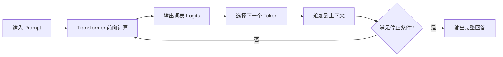
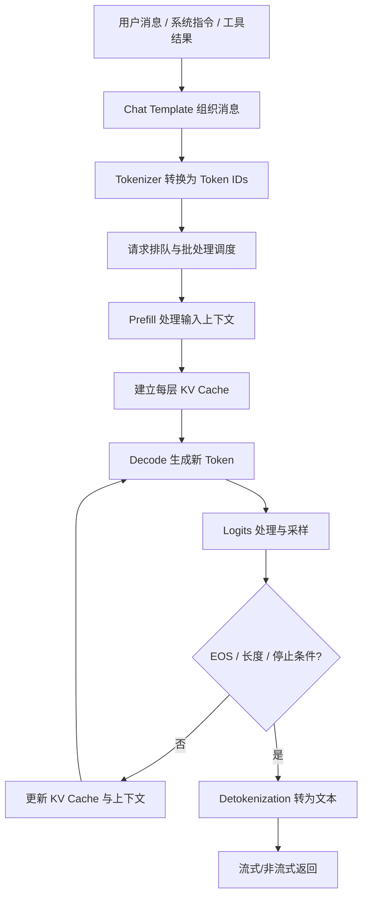
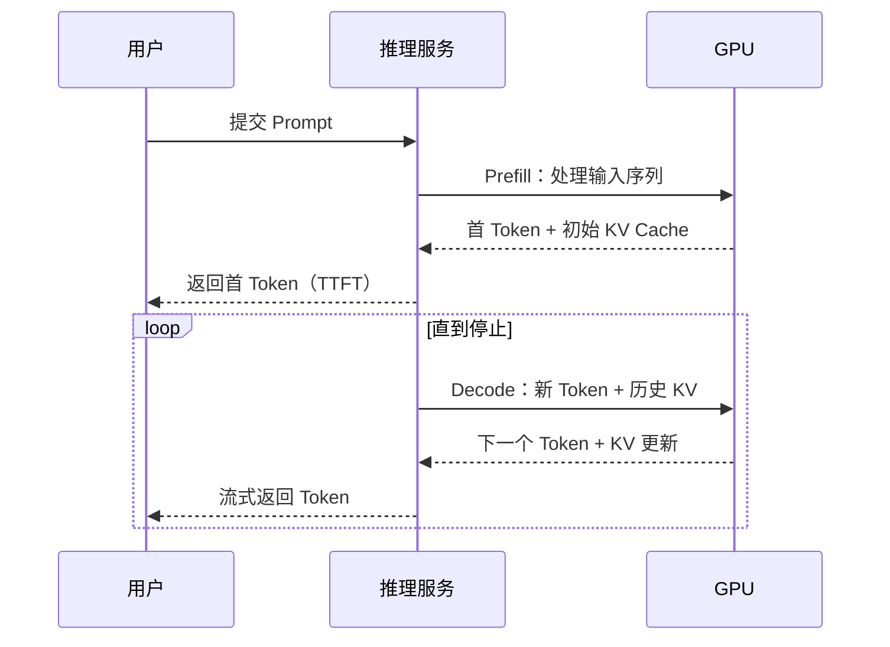
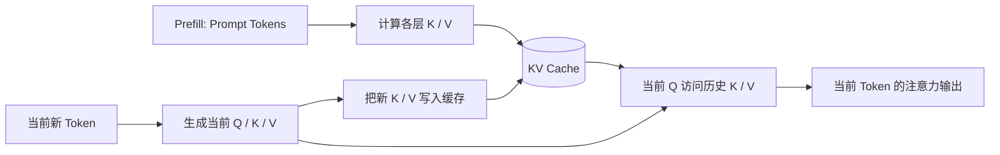
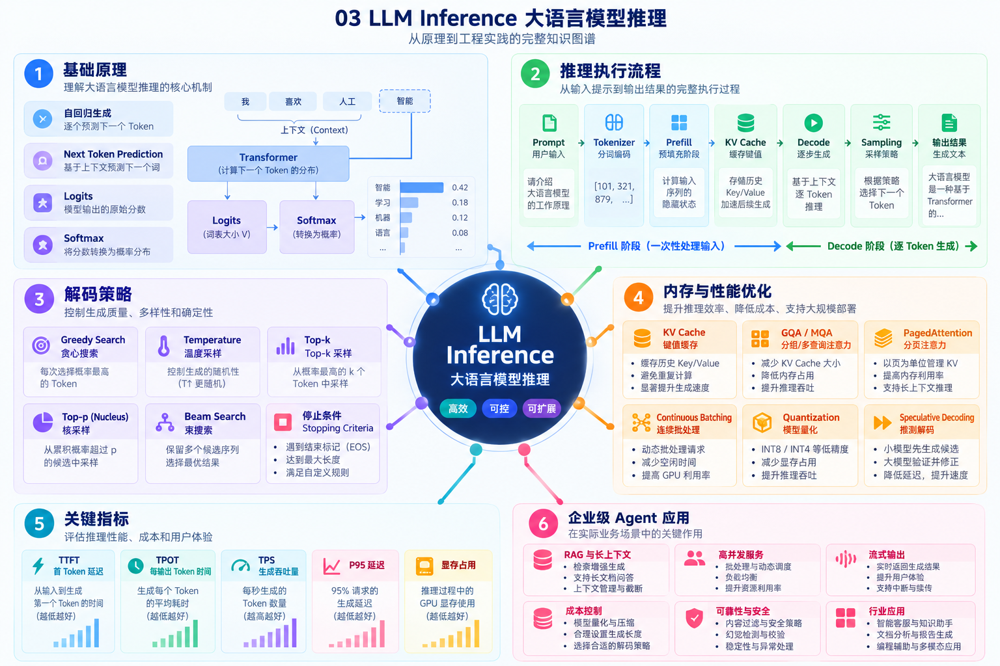
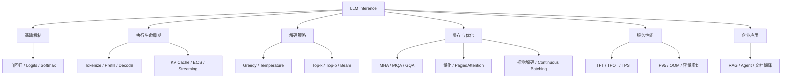

# 03 LLM Inference：从下一个 Token 预测到企业级推理服务

> <strong>学习状态：待学习 → 系统学习中</strong>
> <strong>所属模块：</strong> 01-LLM-Fundamentals
> <strong>学习目标：</strong> 理解推理的数学机制、Prefill/Decode、KV Cache、采样、推理服务与性能指标，能解释企业 Agent 中的延迟、显存和成本问题。
> <strong>阅读方式：</strong> 先理解单请求推理，再学习服务端调度，最后讨论优化取舍。本文不包含代码实践。

## 目录

1. [什么是 LLM Inference](#1-什么是-llm-inference)
2. [推理为什么是逐 Token 生成](#2-推理为什么是逐-token-生成)
3. [一次推理请求的完整生命周期](#3-一次推理请求的完整生命周期)
4. [Prefill 与 Decode 的本质区别](#4-prefill-与-decode-的本质区别)
5. [KV Cache：为什么不必重复计算历史](#5-kv-cache为什么不必重复计算历史)
6. [Logits、概率与解码策略](#6-logits概率与解码策略)
7. [结束条件与流式输出](#7-结束条件与流式输出)
8. [显存与算力的主要消耗](#8-显存与算力的主要消耗)
9. [推理加速与服务端调度](#9-推理加速与服务端调度)
10. [性能指标与容量规划](#10-性能指标与容量规划)
11. [企业级 Agent 场景与工程取舍](#11-企业级-agent-场景与工程取舍)
12. [常见误区和故障定位](#12-常见误区和故障定位)
13. [完整知识图谱与学习路线](#13-完整知识图谱与学习路线)
14. [高频面试题](#14-高频面试题)
15. [术语速查表](#15-术语速查表)
16. [权威资料与原始论文](#16-权威资料与原始论文)

---

## 1. 什么是 LLM Inference？

<strong>LLM Inference（Large Language Model Inference，大语言模型推理）</strong>：模型参数训练完成后，利用固定的权重，根据输入上下文计算输出的过程。对于典型的 <strong>Decoder-only（仅解码器）自回归语言模型</strong>，核心任务是反复预测“下一个 Token 的概率分布”，再按解码策略选出 Token，直到满足停止条件。

需要区分三件事：

| 概念 | 是什么 | 作用与使用场景 |
|---|---|---|
| Training（训练） | 使用数据更新模型参数 | 预训练、微调；与线上请求推理不同 |
| Forward Pass（前向计算） | 输入经过各层得到输出张量 | 每次推理都需要进行的核心计算 |
| Inference（推理） | 前向计算 + 解码策略 + 状态管理 + 输出 | 聊天、RAG、Agent 工具调用、文档翻译 |
| Serving（推理服务） | 为多个请求提供模型推理的系统 | 并发调度、显存管理、限流、监控与扩容 |

<strong>重要边界：</strong> 本文主要讨论自回归文本生成模型；Encoder-only 模型的分类/向量推理、Encoder–Decoder 模型的推理路径有所不同。

## 2. 推理为什么是逐 Token 生成？

自回归模型将输出序列的联合概率拆解为条件概率：

```math
P(y_1,\ldots,y_T\mid x)=\prod_{t=1}^{T}P(y_t\mid x,y_1,\ldots,y_{t-1})
```

这里的 $`x`$ 是输入上下文，$`y_t`$ 是第 $`t`$ 个输出 Token。<strong>Causal Mask（因果掩码）</strong>限制模型在当前位置访问未来位置，保证自回归条件成立。



> <strong>术语注释：</strong> <strong>Autoregressive（自回归）</strong>：每一步依赖此前已生成内容，适用于逐步生成文本。<strong>Causal Mask</strong>：屏蔽未来 Token 的注意力位置，防止“提前看答案”。<strong>Token</strong>：模型处理的离散文本单位，不等同于一个汉字或单词。

## 3. 一次推理请求的完整生命周期



<strong>阶段解释：</strong>

- <strong>Chat Template（对话模板）</strong>：将 system/user/assistant/tool 等角色转为模型训练时约定的消息格式；模板不匹配可能造成输出异常。
- <strong>Tokenizer（分词器）</strong>：将文本转为 Token ID；不同模型词表不同，输入 Token 数也可能不同。
- <strong>Scheduler（调度器）</strong>：决定何时、以何种批次执行请求；主要用于高并发服务。
- <strong>Detokenization（反分词）</strong>：将生成的 Token ID 转回可读文本；流式场景可能需要处理不完整字节或子词。

## 4. Prefill 与 Decode 的本质区别

| 维度 | Prefill（预填充） | Decode（逐步解码） |
|---|---|---|
| 主要任务 | 处理整个输入 Prompt，建立上下文状态 | 根据上下文反复生成后续 Token |
| 每次处理的 Token | 通常可并行处理较多输入 Token | 标准自回归解码通常每序列一步一个新 Token |
| 常见资源特征 | 更容易利用大规模矩阵运算，常偏计算密集 | 常受权重读取、KV Cache 访问与内存带宽影响 |
| 影响体验 | 主要影响首 Token 时间 | 主要影响后续 Token 的输出速度 |
| 典型优化 | Chunked Prefill、Prefix Cache、输入压缩 | KV Cache、批处理、量化、推测解码 |

> <strong>注意：</strong> Prefill 与 Decode 的瓶颈是典型趋势，不是绝对规律；模型大小、输入长度、并发量、硬件及算子实现都会改变瓶颈。



<strong>延伸概念：</strong> <strong>Chunked Prefill（分块预填充）</strong>把长 Prompt 拆成较小计算块，便于与其他请求的 Decode 交错调度；<strong>Prefill/Decode Disaggregation（预填充与解码分离部署）</strong>让两类阶段由不同资源池处理，用于更大规模的服务优化。

## 5. KV Cache：为什么不必重复计算历史？

<strong>KV Cache（Key-Value Cache，键值缓存）</strong>保存 Transformer 各注意力层历史 Token 的 Key 和 Value 表示。生成下一个 Token 时，历史 Token 的 K/V 可以复用，无须每一步重新计算整段历史的 K/V。

```math
\mathrm{Attention}(Q,K,V)=\mathrm{softmax}\left(\frac{QK^\top}{\sqrt{d_k}}+M\right)V
```

其中 $`Q`$ 是 Query（查询），$`K`$ 是 Key（键），$`V`$ 是 Value（值），$`d_k`$ 是 Key 的维度，$`M`$ 是注意力掩码。



<strong>为什么有用？</strong> KV Cache 以额外显存换取避免重复计算，长上下文生成时尤其重要。但上下文越长、并发请求越多，缓存占用越大。

### 5.1 粗略估算 KV Cache 大小

对于标准全量缓存、忽略额外管理开销的近似计算：

```math
\text{KV Bytes}\approx 2\times L\times N_{kv}\times D_h\times S\times B\times b
```

- $`L`$：Transformer 层数；$`N_{kv}`$：KV Heads 数量；$`D_h`$：每个 Head 的维度。
- $`S`$：缓存序列长度；$`B`$：并发序列数；$`b`$：每个缓存元素所占字节。
- 前面的 $`2`$ 分别对应 Key 与 Value。

<strong>例子（仅用于估算）：</strong> 32 层、8 个 KV Heads、Head 维度 128、序列长度 4096、1 个序列、每元素 2 字节，则 KV Cache 约为 <strong>512 MiB</strong>。实际使用还受缓存分配策略、模型架构、分块、碎片与运行时开销影响。

### 5.2 MHA、MQA、GQA 的区别

| 技术 | 全称 | 核心思想 | 作用与适用场景 |
|---|---|---|---|
| MHA | Multi-Head Attention，多头注意力 | 每个注意力头通常各有 K/V | 表达灵活，但缓存占用较高 |
| MQA | Multi-Query Attention，多查询注意力 | 多个 Q Heads 共享一组 K/V | 显著减少 KV Cache 与读取量 |
| GQA | Grouped-Query Attention，分组查询注意力 | 每组 Q Heads 共享一组 K/V | 在质量与推理效率间折中 |

<strong>补充：</strong> <strong>Prefix Caching（前缀缓存）</strong>可在条件满足时复用多个请求共有前缀的 KV；不等于所有语义相似请求都能复用。<strong>PagedAttention（分页注意力）</strong>按块管理 KV Cache，降低内存碎片与浪费；是推理服务的内存管理技术，而非改变语言模型训练目标。

## 6. Logits、概率与解码策略

模型输出通常是词表大小的 <strong>Logits（未归一化分数）</strong>，使用 Softmax 转为概率：

```math
P_i=\frac{\exp(z_i/T)}{\sum_j\exp(z_j/T)}
```

$`z_i`$ 是第 $`i`$ 个 Token 的 Logit，$`T`$ 是 Temperature（温度）。在 $`T>0`$ 的前提下，温度越低，概率分布通常越集中；越高，分布通常越平坦。<strong>Temperature = 0</strong> 在很多 API 中作为贪心解码的约定，并非直接代入上式计算。

| 策略 | 是什么 | 主要作用 | 常见场景与注意事项 |
|---|---|---|---|
| Greedy Search（贪心） | 每步选当前概率最高的 Token | 结果较稳定 | 结构化抽取、确定性任务；不保证全局最优 |
| Temperature（温度） | 缩放 Logits 后再计算概率 | 控制采样随机性 | 创意生成/稳健输出；不同 API 行为可能不同 |
| Top-k Sampling | 仅保留概率最高的 k 个候选 | 缩小候选范围 | 控制低概率 Token 被采样的机会 |
| Top-p / Nucleus Sampling | 保留累计概率达到阈值 p 的最小候选集合 | 动态调整候选集合 | 通用开放式生成 |
| Beam Search（束搜索） | 同时维护多个候选序列 | 搜索更高评分序列 | 翻译等任务；更耗算力，未必适合对话 |
| Repetition Penalty（重复惩罚） | 调整已出现 Token 的评分 | 减少重复输出 | 长文本生成；过强可能损害正确性 |
| Constrained Decoding（约束解码） | 限制可选 Token 满足语法或结构 | 提高格式合规性 | JSON、工具参数、枚举字段 |

### 6.1 为什么“低温度”不等于“绝对确定”？

实际输出还受并行数值计算、随机种子、模型版本、服务端实现、工具调用及提示词差异影响。对于严格格式任务，<strong>结构化输出约束 + 字段校验 + 失败重试</strong>通常比单纯降低温度更可靠。

## 7. 结束条件与流式输出

模型不会“理解自己已经说完”才停止；系统通常综合以下规则：

1. <strong>EOS（End of Sequence，序列结束标记）</strong>：模型输出约定的结束 Token。
2. <strong>Max New Tokens（最大生成 Token 数）</strong>：限制输出长度，避免无界生成。
3. <strong>Stop Sequence（停止序列）</strong>：当输出匹配指定文本或标记时停止；行为取决于具体接口。
4. <strong>结构化/工具调用边界</strong>：模型可能结束当前消息、交还控制权给工具执行器；不同 Chat Template 的标记不相同。

<strong>Streaming（流式输出）</strong>：服务端在完整回答生成前分批传输内容，降低用户等待完整结果的感知延迟。<strong>SSE（Server-Sent Events，服务器发送事件）</strong>是常见的单向服务端推送方式；它是传输协议选择，不是模型推理算法。

## 8. 显存与算力的主要消耗

一次模型推理的显存大体由以下部分组成：

```math
M_{total}\approx M_{weights}+M_{KV}+M_{activations}+M_{runtime}
```

- <strong>Weights（模型权重）</strong>：模型参数本身；参数量、精度、并行切分决定其占用。
- <strong>KV Cache</strong>：随序列长度与活跃请求数增加。
- <strong>Activations（中间激活）</strong>：前向计算过程中的临时张量；受批次与算子影响。
- <strong>Runtime Workspace（运行时工作区）</strong>：算子临时空间、CUDA Graph、内存池与碎片等。

### 8.1 模型量化

<strong>Quantization（量化）</strong>：用更低位宽表示权重或激活，以降低显存占用、改善带宽需求或计算效率。常见术语：

| 名称 | 解释 | 作用与限制 |
|---|---|---|
| FP16 / BF16 | 16 位浮点格式 | 常见推理精度；BF16 指数范围更大 |
| INT8 / INT4 | 8 位 / 4 位整数表示 | 常用于降低模型权重存储；可能有精度损失 |
| FP8 | 8 位浮点格式 | 在支持的硬件与内核上改善性能/显存 |
| GPTQ / AWQ | 训练后权重量化方法 | 主要减少权重占用；具体效果依赖模型与实现 |
| KV Cache Quantization | 对缓存的 K/V 使用低精度 | 降低长上下文缓存开销；可能影响质量或延迟 |

> <strong>工程提醒：</strong> “模型权重能放进显存”不代表“推理一定不会 OOM”；还必须预留 KV Cache、临时张量和并发空间。

## 9. 推理加速与服务端调度

### 9.1 主要技术路线

| 技术 | 是什么 | 解决的问题 | 适用场景 |
|---|---|---|---|
| Continuous Batching（连续批处理） | 运行中动态接纳、移除请求 | 减少静态批次等待，提高 GPU 利用率 | 多用户在线服务 |
| PagedAttention（分页注意力） | 按固定块组织与映射 KV Cache | 缓存碎片与内存浪费 | 长上下文、高并发 |
| Prefix Caching（前缀缓存） | 复用相同前缀的已计算状态 | 重复系统提示词的预填充开销 | Agent 统一 System Prompt |
| Chunked Prefill（分块预填充） | 将长输入预填充分块调度 | 避免长 Prompt 长时间阻塞其他请求 | RAG、大文档输入 |
| Speculative Decoding（推测解码） | 小模型/草稿机制提议多个 Token，再由目标模型验证 | 减少串行解码等待 | Decode 成为瓶颈时 |
| Tensor Parallelism（张量并行） | 将同一层张量计算分布到多设备 | 单卡装不下或需要更大计算能力 | 多 GPU 部署 |
| Pipeline Parallelism（流水线并行） | 不同层分布到不同设备 | 扩展大模型承载能力 | 多 GPU / 多节点 |
| Prefill–Decode Disaggregation | 将两阶段拆分至不同服务资源池 | 分别优化计算密集与内存访问密集阶段 | 大规模推理集群 |

<strong>注意：</strong> 这些技术存在取舍：更高吞吐不一定意味着单请求延迟更低；跨设备通信、批处理等待、草稿模型开销都可能抵消收益。

### 9.2 推理框架如何定位？

- <strong>Hugging Face Transformers</strong>：模型加载、生成策略、KV Cache 的通用学习与实验入口。
- <strong>vLLM</strong>：以高吞吐推理服务、KV Cache 管理、连续批处理等能力著称。
- <strong>TensorRT-LLM</strong>：NVIDIA 面向高性能 LLM 推理的优化与部署框架。
- <strong>SGLang</strong>：面向结构化生成与高性能服务的推理框架；具体功能随版本演进。

不要把“模型（Qwen/Llama）”“推理引擎（vLLM/TensorRT-LLM）”“API 服务层（鉴权、限流、监控）”混为一谈。

## 10. 性能指标与容量规划

| 指标 | 全称 | 如何理解 | 主要反映 |
|---|---|---|---|
| TTFT | Time To First Token，首 Token 延迟 | 请求开始到第一个输出 Token 的时间 | 排队 + 网络 + Prefill 等 |
| TPOT | Time Per Output Token，每输出 Token 时间 | 首 Token 后生成 Token 的平均耗时 | 解码速度 |
| ITL | Inter-Token Latency，Token 间延迟 | 相邻输出 Token 的时间间隔 | 流式输出流畅度 |
| TPS | Tokens Per Second，每秒 Token 数 | 单请求或系统整体 Token 速率，需注明口径 | 生成速度/系统吞吐 |
| E2E Latency | End-to-End Latency，端到端延迟 | 从请求发出到完整结果返回 | 用户总等待时间 |
| P95 / P99 | 第 95 / 99 百分位延迟 | 95% / 99% 请求不超过的延迟阈值 | 尾部体验与稳定性 |
| QPS | Queries Per Second，每秒请求数 | 单位时间完成的请求量 | 服务容量；需结合 Token 长度 |
| OOM | Out Of Memory，内存不足 | GPU/CPU 无法满足内存分配 | 资源容量或配置问题 |

单请求、输出 Token 数大于 1 时，常见的近似关系为：

```math
\mathrm{TPOT}\approx\frac{\mathrm{E2E}-\mathrm{TTFT}}{N_{out}-1}
```

> <strong>重要：</strong> 比较模型性能必须同时报告输入长度、输出长度、并发量、硬件、量化精度、是否流式，以及 P50/P95 等分位数。仅比较“每秒多少 Token”很容易得出误导结论。

## 11. 企业级 Agent 场景与工程取舍

### 11.1 RAG 问答

<strong>RAG（Retrieval-Augmented Generation，检索增强生成）</strong>：先从知识库检索资料，再把相关内容提供给模型生成回答。检索结果过长会拉高 Prefill 成本与 TTFT，因此需要检索质量控制、重排、去重与 Token Budget。

### 11.2 多轮 Agent 与工具调用

<strong>Agent（智能体）</strong>：模型结合规划、工具、状态和上下文完成多步骤任务。每次工具返回的长日志、网页正文或 JSON 都可能被追加到上下文，导致 KV Cache 增长、输入费用上升。常见策略是工具结果摘要、字段过滤、对话历史压缩和限制最大迭代次数。

### 11.3 企业文档翻译

文档翻译往往具有长输入、术语约束、结构化输出、质量校验和多轮修复特点。可以从三个维度设计：

1. <strong>质量</strong>：术语一致性、数字与单位保真、格式约束、分段上下文一致性。
2. <strong>效率</strong>：按段落或页面划分任务、控制批次与并发、避免重复翻译、缓存稳定的公共前缀。
3. <strong>可观测性</strong>：分别记录解析、排队、Prefill、Decode、校验与渲染耗时，避免把全部延迟归咎于模型。

### 11.4 本地小模型与云 API 如何选择？

| 维度 | 本地部署 | 云端 API |
|---|---|---|
| 隐私与数据驻留 | 可自行控制部署环境，但仍需安全治理 | 取决于供应商条款与部署区域 |
| 前期成本 | 需要硬件、部署、运维 | 低门槛，通常按量计费 |
| 延迟 | 受本地显存、并发与模型大小限制 | 受网络、排队和服务端性能影响 |
| 弹性扩容 | 需自行建设 | 通常更容易弹性扩容 |
| 质量 | 依赖可部署模型能力 | 可选择更大、更强模型 |

<strong>决策原则：</strong> 先明确隐私、质量、吞吐、成本和时延目标，再通过相同测试集和负载做评估；不要只看模型参数量。

## 12. 常见误区和故障定位

| 现象或说法 | 更准确的理解 | 排查方向 |
|---|---|---|
| “首字慢 = 模型生成速度慢” | 可能是网络、排队或 Prefill 慢 | TTFT 分段计时、输入长度、队列 |
| “KV Cache 不占显存” | KV Cache 随序列与并发增长 | 上下文长度、KV Heads、缓存精度 |
| “Temperature=0 一定完全复现” | 仍可能有数值与系统差异 | 固定版本、随机种子、运行环境 |
| “吞吐高就一定响应快” | 高吞吐可能牺牲单请求延迟 | 同时测 TTFT、TPOT、P95 |
| “INT4 一定比 FP16 快” | 速度取决于硬件、内核与反量化开销 | 实测目标设备和负载 |
| “上下文窗口越大越好” | 更长输入增加成本与资源压力 | RAG 过滤、压缩、分块 |
| “输出卡顿都是网络问题” | 可能是解码、批调度或流式缓冲 | ITL、服务端调度、代理层缓冲 |
| “本地 1.7B 一定能跑得流畅” | 还受量化、硬件、Prompt、并发影响 | 显存预算、TTFT、TPOT、吞吐 |

## 13. 完整知识图谱与学习路线

### 13.1 视觉知识图谱



> **图片说明：** 图片文件必须与本文一起上传至 `01-LLM-Fundamentals/03-LLM-Inference-assets/knowledge-map.png`；仅上传 `.md` 文件会显示图片失效。

> <strong>说明：</strong> 图片用于快速建立知识框架；精确术语、算法条件和公式以正文及官方资料为准。图片中的内容不替代技术定义。

### 13.2 推理知识图谱：关键概念及相互关系（Mermaid）

以下知识图谱直接写在 Markdown 中，不依赖外部图片，GitHub 可以原生渲染。

```mermaid
flowchart TB
    ROOT[LLM Inference 大语言模型推理]
    ROOT --> A[基本原理]
    ROOT --> B[请求执行]
    ROOT --> C[解码与控制]
    ROOT --> D[显存与加速]
    ROOT --> E[服务与指标]
    ROOT --> F[企业应用]
    A --> A1[自回归生成]
    A --> A2[Logits 与 Softmax]
    A --> A3[Causal Mask]
    B --> B1[Chat Template 与 Tokenizer]
    B --> B2[Prefill 处理输入]
    B --> B3[Decode 逐 Token 生成]
    B --> B4[KV Cache 复用历史]
    C --> C1[Greedy / Temperature]
    C --> C2[Top-k / Top-p / Beam]
    C --> C3[EOS / Stop / Streaming]
    D --> D1[MHA / MQA / GQA]
    D --> D2[PagedAttention 与 Prefix Cache]
    D --> D3[Quantization 与 Speculative Decoding]
    E --> E1[Continuous Batching]
    E --> E2[TTFT / TPOT / TPS]
    E --> E3[P95 / OOM / 容量规划]
    F --> F1[RAG 与 Agent]
    F --> F2[长文档翻译]
    F --> F3[成本 / 延迟 / 可靠性]
    classDef root fill:#1d4ed8,color:#fff,stroke:#1e40af,stroke-width:2px
    classDef group fill:#dbeafe,color:#1e3a8a,stroke:#60a5fa
    class ROOT root
    class A,B,C,D,E,F group
```



> <strong>阅读说明：</strong> 图中的英文缩写与技术方法均可在前文章节和第 15 节术语速查表中找到定义、作用和适用场景。

### 13.3 GitHub 可直接渲染的知识结构图



### 13.4 推荐学习顺序

1. <strong>建立直觉：</strong> 为什么模型不是一次性“写完全文”，而是不断预测下一个 Token。
2. <strong>理解阶段：</strong> Prompt 如何进入 Prefill，首 Token 如何产生，Decode 如何继续。
3. <strong>掌握关键优化：</strong> KV Cache、GQA、PagedAttention、量化分别解决什么问题。
4. <strong>理解输出控制：</strong> Temperature、Top-p、结构化解码与停止条件。
5. <strong>学习生产服务：</strong> Continuous Batching、Chunked Prefill、推测解码及分离部署。
6. <strong>形成工程判断：</strong> 用 TTFT、TPOT、P95、显存、成本评价 Agent 系统。

## 14. 高频面试题

<strong>Q1：LLM 推理和训练最大的区别是什么？</strong> 训练通常计算损失并更新参数；推理主要使用已训练权重进行前向计算和输出生成，线上服务还要处理调度与缓存。

<strong>Q2：为什么 Prefill 和 Decode 要区分？</strong> 前者并行处理输入并建立缓存，后者逐步生成新 Token，两者资源瓶颈与优化策略不同。

<strong>Q3：KV Cache 缓存了什么，代价是什么？</strong> 缓存各层历史 K/V，减少重复计算；代价是随上下文和并发增加的显存占用。

<strong>Q4：GQA 为什么能降低推理显存？</strong> 多个 Query Heads 共享一组 K/V，降低 KV Heads 数量，从而减少缓存体积与访存需求。

<strong>Q5：Top-k 和 Top-p 有何区别？</strong> Top-k 固定候选数量；Top-p 按累计概率动态确定候选集合。

<strong>Q6：为什么首 Token 慢，但后续输出很快？</strong> TTFT 包括排队、网络与 Prefill；后续生成通常使用已建立的 KV Cache。

<strong>Q7：为什么批处理能提高吞吐，却可能增加延迟？</strong> 批处理提升 GPU 利用率，但请求可能需要等待调度、竞争资源。

<strong>Q8：PagedAttention 解决什么问题？</strong> 将 KV Cache 组织成可管理的块，改善内存利用率与并发承载能力。

<strong>Q9：推测解码为什么能加速？</strong> 草稿机制提前提出候选 Token，目标模型并行验证；收益依赖候选接受率及额外开销。

<strong>Q10：如何定位文档翻译 Agent 响应慢？</strong> 将文档解析、检索、排队、Prefill、Decode、工具调用、校验和渲染分别计时，并结合 Token 数与并发量分析。

<strong>Q11：量化的收益与风险是什么？</strong> 主要减少权重或缓存内存，有时改善吞吐；但质量、延迟和硬件兼容性需要实测。

<strong>Q12：如何比较本地模型与云 API？</strong> 在相同业务数据与负载下比较质量、TTFT、TPOT、P95、成本、隐私和维护难度。

## 15. 术语速查表

| 缩写/术语 | 英文全称 | 中文与用途 |
|---|---|---|
| LLM | Large Language Model | 大语言模型；根据上下文执行理解与生成 |
| Token | Token | 模型处理的离散单位；决定输入输出长度 |
| Prefill | Prefill | 预填充；处理输入并构建 KV Cache |
| Decode | Decode | 逐步解码；生成后续 Token |
| KV Cache | Key-Value Cache | 键值缓存；复用历史注意力状态 |
| Q / K / V | Query / Key / Value | 注意力中的查询、键、值 |
| MHA | Multi-Head Attention | 多头注意力；多组注意力表示 |
| MQA | Multi-Query Attention | 多查询注意力；共享 K/V |
| GQA | Grouped-Query Attention | 分组查询注意力；降低 KV 成本 |
| EOS | End of Sequence | 序列结束标记 |
| TTFT | Time To First Token | 首 Token 延迟；首字体验 |
| TPOT | Time Per Output Token | 每输出 Token 时间；解码体验 |
| ITL | Inter-Token Latency | 相邻 Token 间隔；流式平滑度 |
| TPS | Tokens Per Second | 每秒 Token 数；需说明统计口径 |
| QPS | Queries Per Second | 每秒请求数；服务容量 |
| OOM | Out Of Memory | 内存不足；常见部署故障 |
| RAG | Retrieval-Augmented Generation | 检索增强生成；将外部资料加入上下文 |
| SSE | Server-Sent Events | 服务器发送事件；常用于流式返回 |
| GPU | Graphics Processing Unit | 图形处理器；常用于模型并行计算 |
| CUDA | Compute Unified Device Architecture | NVIDIA GPU 计算平台 |
| P95 / P99 | 95th / 99th Percentile | 尾部延迟分位数；衡量慢请求 |
| FP16 / BF16 | 16-bit Floating Point / Brain Floating Point | 16 位浮点精度格式 |
| FP8 | 8-bit Floating Point | 8 位浮点精度格式 |
| GPTQ / AWQ | Post-training quantization methods | 常见模型权重量化方法 |

## 16. 权威资料与原始论文

### 16.1 核心原理与生成策略

1. [Hugging Face：Generation Strategies](https://huggingface.co/docs/transformers/main/en/generation_strategies) — Greedy、采样、Beam Search 等生成方法。
2. [Hugging Face：Text Generation](https://huggingface.co/docs/transformers/main/en/main_classes/text_generation) — 生成参数、停止条件与配置。
3. [Hugging Face：LLM Inference Optimization](https://huggingface.co/docs/transformers/llm_tutorial_optimization) — 自回归推理与 KV Cache 的性能原理。
4. [Hugging Face：Caching Explanation（源码文档）](https://github.com/huggingface/transformers/blob/main/docs/source/en/cache_explanation.md) — KV Cache 的工作机制与张量结构。
5. [Hugging Face：KV Cache Strategies](https://huggingface.co/docs/transformers/main/en/kv_cache) — 静态、动态、量化、Offloading 等缓存方式。

### 16.2 推理引擎与高性能服务

6. [vLLM 官方文档](https://docs.vllm.ai/) — PagedAttention、Continuous Batching、Prefix Caching 等。
7. [vLLM 论文：Efficient Memory Management for Large Language Model Serving with PagedAttention](https://arxiv.org/abs/2309.06180) — 高并发 KV 内存管理。
8. [NVIDIA TensorRT-LLM 官方文档](https://nvidia.github.io/TensorRT-LLM/) — GPU 推理优化与服务。
9. [NVIDIA NIM：LLM Performance Metrics](https://docs.nvidia.com/nim/benchmarking/llm/metrics) — TTFT、吞吐、端到端延迟等指标定义。
10. [NVIDIA：Disaggregated Serving](https://github.com/NVIDIA/TensorRT-LLM/blob/main/docs/source/blogs/tech_blog/blog05_Disaggregated_Serving_in_TensorRT-LLM.md) — Prefill/Decode 分离部署。
11. [SGLang 官方文档](https://docs.sglang.ai/) — 高性能推理与结构化生成。

### 16.3 重要论文与进阶阅读

12. [Fast Inference from Transformers via Speculative Decoding](https://arxiv.org/abs/2211.17192) — 推测解码原理。
13. [GQA: Training Generalized Multi-Query Transformer Models from Multi-Head Checkpoints](https://arxiv.org/abs/2305.13245) — GQA 的方法与取舍。
14. [FlashAttention: Fast and Memory-Efficient Exact Attention with IO-Awareness](https://arxiv.org/abs/2205.14135) — 注意力计算的 IO 优化。
15. [The Curious Case of Neural Text Degeneration](https://arxiv.org/abs/1904.09751) — Nucleus Sampling（Top-p）的研究背景。

> <strong>阅读提示：</strong> 官方文档可能随着框架版本更新而变化；阅读时关注模型架构、软件版本、硬件和测试条件。以上资料用于支持原理学习，不表示所有功能在任意模型和环境中均可直接使用。
