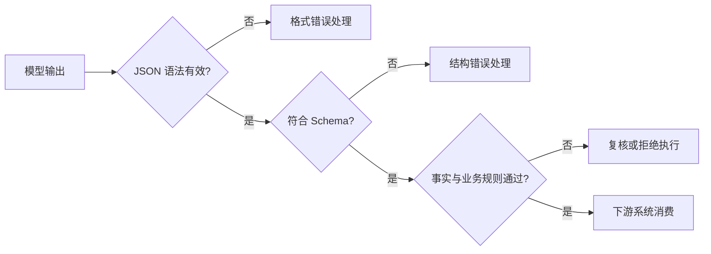
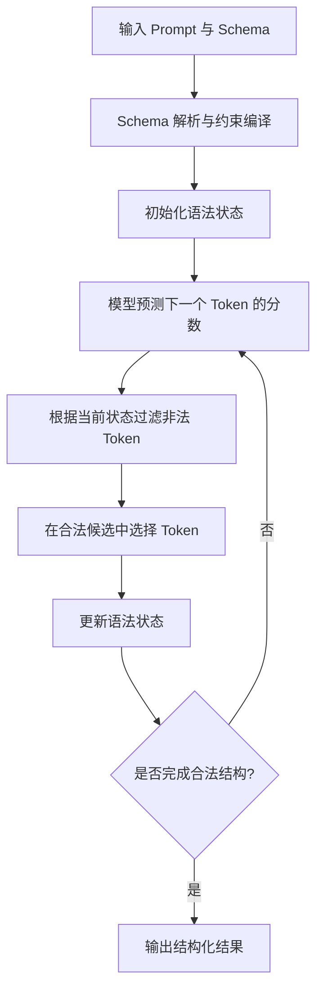
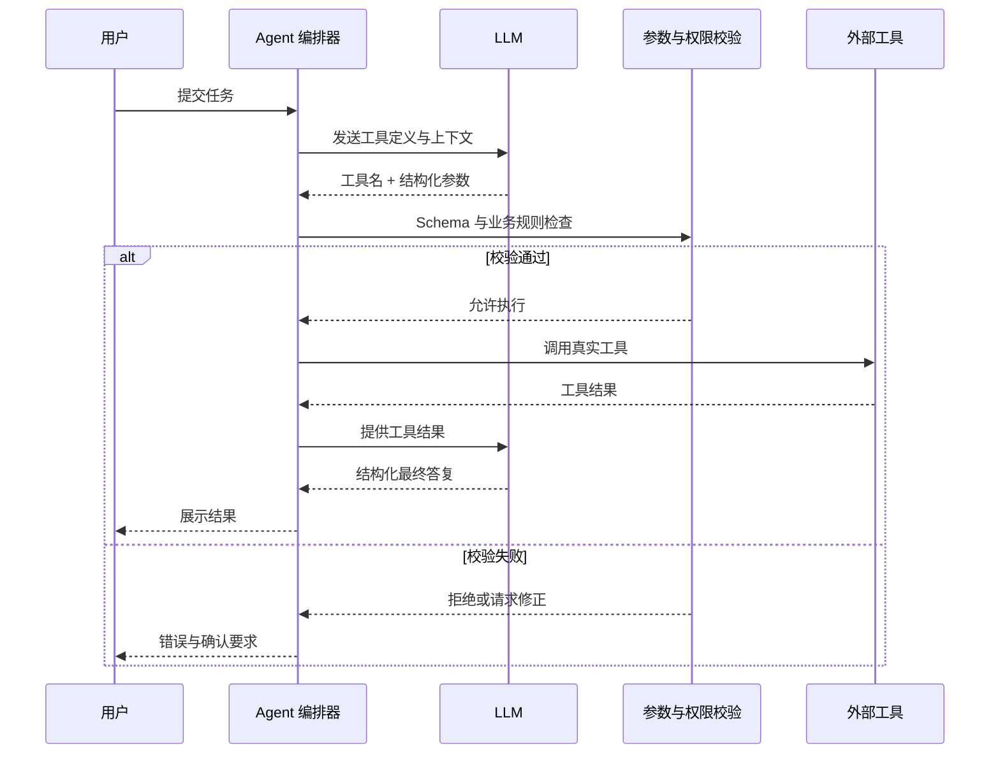
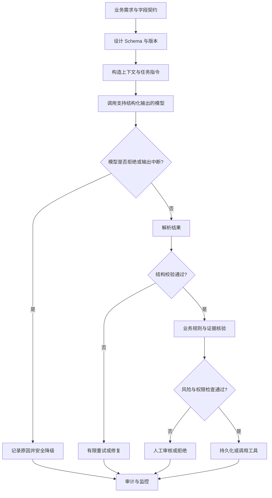
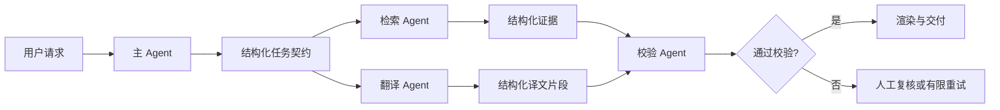
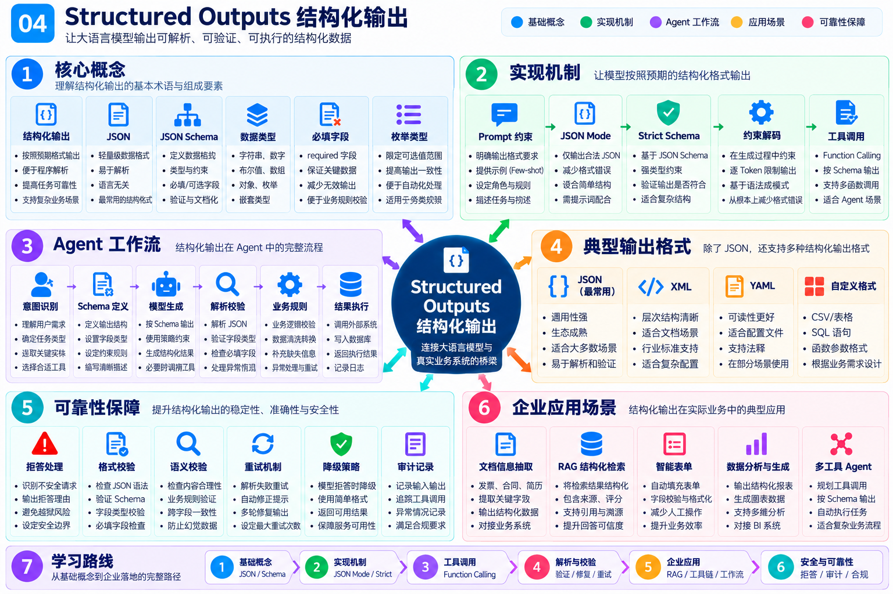
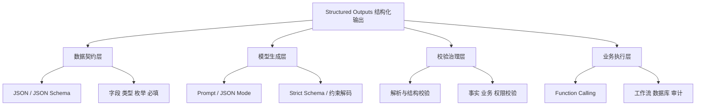

# 04 Structured Outputs：从自然语言生成到可靠的机器可执行数据

> **学习状态：** 待学习 → 系统学习中  
> **所属模块：** 01-LLM-Fundamentals  
> **学习目标：** 理解结构化输出的核心概念、约束解码原理、JSON Schema、工具调用边界、可靠性治理和企业 Agent 落地方法。  
> **阅读说明：** 本章侧重原理、架构、工程决策和面试，不设置代码实践；示例 JSON 仅用于说明数据结构。

## 阅读路线

1. [为什么需要结构化输出](#1-为什么需要结构化输出)
2. [核心概念与三种保证层次](#2-核心概念与三种保证层次)
3. [JSON 与 JSON Schema 基础](#3-json-与-json-schema-基础)
4. [从 Prompt 到约束解码的技术演进](#4-从-prompt-到约束解码的技术演进)
5. [约束解码的底层机制](#5-约束解码的底层机制)
6. [结构化输出与 Function Calling](#6-结构化输出与-function-calling)
7. [完整工程执行流程](#7-完整工程执行流程)
8. [异常处理与可靠性设计](#8-异常处理与可靠性设计)
9. [复杂 Schema 的设计原则](#9-复杂-schema-的设计原则)
10. [主流模型与推理引擎能力](#10-主流模型与推理引擎能力)
11. [企业级 Agent 应用](#11-企业级-agent-应用)
12. [性能成本与评估指标](#12-性能成本与评估指标)
13. [常见误区与安全边界](#13-常见误区与安全边界)
14. [知识图谱与学习路线](#14-知识图谱与学习路线)
15. [高频面试题](#15-高频面试题)
16. [官方资料与论文链接](#16-官方资料与论文链接)

---

## 1. 为什么需要结构化输出？

自然语言回答适合阅读，却不一定适合程序消费。例如用户希望 Agent 从医疗设备说明书中提取产品型号、适用范围、禁忌事项和证据页码。如果模型输出一段流畅文字，下游服务很难可靠地定位字段；如果模型输出格式稳定的对象，下游系统就能进行校验、存储、展示和审批。

结构化输出（**Structured Outputs**）的目标不是让回答“看起来像 JSON”，而是让模型与业务系统之间形成可约定、可检查的数据接口。

| 维度 | 自由文本 | 结构化输出 |
| --- | --- | --- |
| 面向对象 | 人类阅读 | 程序处理与人类审核 |
| 字段边界 | 依赖自然语言理解 | 明确键名与类型 |
| 稳定性 | 表达灵活，解析困难 | 受格式或 Schema 约束 |
| 适合场景 | 解释、创作、总结 | 信息抽取、工具参数、工作流状态 |
| 风险 | 字段遗漏、格式变化 | 结构可能正确但内容仍可能错误 |

> **术语注释｜Interface Contract（接口契约）：** 规定输入、输出的字段、类型、约束与异常行为。作用是让上游模型和下游程序以一致方式协作；常用于微服务、工具调用、Agent 工作流。

## 2. 核心概念与三种保证层次

必须区分三个层次：

1. **语法有效（Syntax Validity）：** 输出能被 JSON 解析器解析，例如引号、括号、逗号正确。
2. **结构有效（Schema Validity）：** 字段、类型、必填项、枚举等满足约定的 Schema。
3. **语义与业务有效（Semantic / Business Validity）：** 提取结果有事实依据、金额计算正确、日期可用、权限允许。

前两个层次可以借助约束解码与校验器增强；**第三个层次不能仅靠 JSON Schema 或约束解码保证**。例如 `confidence: 0.99` 结构上合法，却不代表模型真的有 99% 的可靠度。



> **术语注释｜Schema（模式）：** 数据结构的声明式约定，描述字段名、数据类型、必填要求和取值范围。用于 API 契约、数据验证和模型结构化输出。

## 3. JSON 与 JSON Schema 基础

### 3.1 JSON 是什么？

**JSON（JavaScript Object Notation）** 是一种轻量级文本数据交换格式。基本类型包括 `object`、`array`、`string`、`number`、`boolean` 和 `null`；JSON 本身不规定业务字段必须有哪些。

**示意数据（不是代码实践）：**

```json
{
  "device_model": "ABC-100",
  "risk_level": "medium",
  "warnings": ["仅限受训人员操作"],
  "source_page": 8,
  "requires_review": true
}
```

### 3.2 JSON Schema 是什么？

**JSON Schema** 是描述和校验 JSON 数据的声明式规范。它能够定义对象的字段、数据类型、必填项、枚举范围、嵌套结构等。官方参考：[JSON Schema Reference](https://json-schema.org/understanding-json-schema/reference)。

| 关键字 | 含义 | 典型用途 |
| --- | --- | --- |
| `type` | 数据类型 | 区分字符串、整数、对象、数组 |
| `properties` | 对象字段定义 | 约定输出键名 |
| `required` | 必填字段列表 | 防止遗漏核心字段 |
| `additionalProperties` | 是否允许额外字段 | 限制模型输出未定义键 |
| `enum` | 枚举值 | 限制风险等级、状态 |
| `items` | 数组元素规则 | 保证列表元素结构 |
| `minimum` / `maximum` | 数值上下界 | 约束数量与分数 |
| `pattern` | 正则模式 | 检查标识符形式 |
| `$ref` / `$defs` | 结构复用 | 管理复杂嵌套对象 |
| `anyOf` | 多种允许结构 | 表示若干合法分支 |

**Schema 示意（用于理解结构，不代表所有模型 API 都支持全部关键字）：**

```json
{
  "type": "object",
  "properties": {
    "device_model": {"type": "string"},
    "risk_level": {"type": "string", "enum": ["low", "medium", "high"]},
    "source_page": {"type": "integer"},
    "requires_review": {"type": "boolean"}
  },
  "required": ["device_model", "risk_level", "source_page", "requires_review"],
  "additionalProperties": false
}
```

**注意：** JSON Schema 是完整的开放标准；模型厂商的严格结构化输出通常只支持其中一个子集。某些模型服务要求对象字段全部列入 `required`，可选值则通过允许 `null` 表示。设计前应核对具体 API 文档，而不是把标准 JSON Schema 的全部能力当作模型能力。

> **术语注释｜Enum（Enumeration，枚举）：** 将字段限制在有限候选值中，避免模型输出不可识别的状态。用于风险等级、分类标签、工作流状态。
>
> **术语注释｜Nullable（可为空）：** 字段可以存在但取值为 `null`，用于表达未知或不适用；不同于字段完全缺失。

## 4. 从 Prompt 到约束解码的技术演进

| 技术方式 | 能保证什么 | 不能保证什么 | 适用场景 |
| --- | --- | --- | --- |
| Prompt 指定格式 | 提高符合格式的概率 | 不保证 JSON 合法或字段完整 | 低风险原型 |
| Few-shot 示例 | 帮助模型模仿结构 | 不保证严格遵守 | 复杂字段说明 |
| JSON Mode | 主要保证输出 JSON 语法有效 | 不保证满足指定 Schema | 简单 JSON 返回 |
| Structured Outputs / Strict Schema | 在受支持范围内约束输出符合 Schema | 不保证事实和业务正确 | 稳定数据接口 |
| Function Calling / Tool Use | 产生工具调用意图与参数结构 | 不代表工具已执行或有权限 | Agent 工具编排 |
| 后置校验与业务规则 | 检查结构、逻辑和授权 | 无法单独纠正所有事实错误 | 生产系统必需 |

**重要区别：** JSON Mode 主要解决“是不是合法 JSON”；严格结构化输出解决“是不是符合预设结构”。OpenAI 官方明确区分两者：[Structured Outputs](https://developers.openai.com/api/docs/guides/structured-outputs)。

> **术语注释｜Few-shot（少样本提示）：** 在提示中给少量输入输出样例，让模型模仿任务形式；用于提升格式一致性，但不构成硬性约束。

## 5. 约束解码的底层机制

### 5.1 为什么单靠提示词不能保证结构？

自回归模型每一步预测下一个 Token 的概率分布。如果只在 Prompt 中写“请输出 JSON”，模型仍可能生成多余说明、遗漏字段或输出不合法的符号，因为提示词改变的是生成倾向，而非强制限制候选 Token 集合。

### 5.2 Constrained Decoding 如何工作？

**Constrained Decoding（约束解码）** 在生成过程中，根据 Schema 或语法状态，限制当前可选择的 Token。概念上，它会先把格式要求转化为可跟踪的约束状态，然后在每一步生成时屏蔽不合法的候选 Token，使输出沿合法路径继续。



这类实现可能采用 **CFG（Context-Free Grammar，上下文无关文法）**、有限状态自动机或专门的 JSON 语法处理器。不同引擎的编译策略和支持范围不同，不能认为所有实现都使用同一种算法。

### 5.3 为什么约束解码不能保证事实正确？

约束器知道字段必须是字符串，却不知道某个设备型号是否真实存在；知道 `risk_level` 必须是 `low / medium / high`，却不能独立证明模型选择了正确等级。因此，约束解码解决的是**输出空间的形式限制**，不是事实核验。

### 5.4 性能与局限

约束编译可能产生首次请求开销，复杂 Schema 可能影响吞吐和延迟；某些高级 JSON Schema 规则不被服务端支持。推理引擎需要在严格性、性能和可维护性之间权衡。

> **术语注释｜CFG（上下文无关文法）：** 一种描述合法符号序列结构的形式文法，可表达嵌套结构；用于约束解码、编译器和解析器。
>
> **术语注释｜Token Masking（候选屏蔽）：** 将不符合当前语法状态的 Token 从采样候选中排除；用于减少生成非法结构的可能。

## 6. 结构化输出与 Function Calling

**Function Calling（函数调用）** 或 **Tool Use（工具使用）** 让模型表达“希望调用哪个工具，以及传入哪些参数”。模型通常**不会自行执行真实工具**；宿主应用接收调用请求、检查权限、执行工具并返回结果。



| 维度 | Structured Final Output | Function Calling |
| --- | --- | --- |
| 核心目的 | 规范最终回答的结构 | 规范工具选择与输入参数 |
| 消费方 | 前端、数据库、业务服务 | Agent 编排器、工具执行器 |
| 是否触发外部动作 | 不必然 | 通常会由宿主程序触发 |
| 关键风险 | 错误数据进入业务系统 | 错误参数触发真实操作 |

**企业级原则：** 对查询类工具可以相对宽松；对写数据库、发送消息、下单、审批等副作用操作，必须实施独立的权限检查、参数校验、幂等保护和必要的人工确认。

> **术语注释｜Side Effect（副作用）：** 调用会改变外部世界的状态，例如写入数据库、发送邮件、修改文件。其安全要求通常高于只读查询。
>
> **术语注释｜Idempotency（幂等性）：** 同一请求重复执行不会产生额外业务效果；用于避免重试导致重复写入或重复扣费。

## 7. 完整工程执行流程

生产系统中的结构化输出并非“模型返回 JSON → 直接执行”，而应形成明确的治理链路：



建议将输出契约划分为四层：

1. **传输层：** HTTP/API 状态、超时、流式中断与服务错误。
2. **格式层：** JSON 可解析、Schema 合规。
3. **语义层：** 字段含义、证据来源、数据一致性。
4. **执行层：** 权限、幂等、事务、审计和人工确认。

## 8. 异常处理与可靠性设计

| 失败场景 | 可能原因 | 建议策略 |
| --- | --- | --- |
| JSON 无法解析 | 非严格生成、输出中断 | 使用严格模式；检查完成状态；有限重试 |
| 字段缺失或类型错误 | Schema 未生效、接口兼容差异 | 服务端校验；拒绝不合规结果 |
| `enum` 合法但分类错误 | 模型理解错误 | 引入规则校验、证据与人工复核 |
| 模型拒绝 | 安全策略或任务不可执行 | 将拒绝作为独立分支，不强行解析 |
| 输出被截断 | Token 上限或超时 | 识别未完成状态，避免使用残缺对象 |
| 工具参数危险 | 指令注入、越权请求 | 最小权限、参数白名单、人工审批 |
| 重试产生重复操作 | 非幂等工具调用 | 幂等键、执行状态去重 |
| Schema 版本不兼容 | 上下游独立演进 | 版本号、兼容期与回滚策略 |

**特别注意：** 即便使用严格结构化输出，仍需检查拒绝响应、请求失败、输出截断及业务含义。严格模式不等于所有请求都会无条件产生符合预期的业务结果。

> **术语注释｜Retry（重试）：** 在临时错误时再次请求。只适合可恢复故障；必须设置次数上限，避免成本激增和重复执行。
>
> **术语注释｜Fallback（降级）：** 主流程失败时切换到更简单、更安全的策略，如返回待审核状态或人工处理。
>
> **术语注释｜HITL（Human-in-the-Loop，人在回路中）：** 在关键决策点引入人工审核，适用于高风险医疗、财务、合规和写入操作。

## 9. 复杂 Schema 的设计原则

### 9.1 字段要稳定、含义要单一

字段名应具有明确语义；不要把不同类型的信息混入一个字符串。例如，`source_page` 应存整数页码，而不是“第 8 页左右”；不确定时可用明确的未知状态或 `null`，但必须事先约定。

### 9.2 适当使用枚举和嵌套

枚举适合固定业务状态，但过多枚举可能降低适应性。嵌套对象适合复杂文档结构，但过深的嵌套会增加 Schema 维护和输出难度。

### 9.3 保留证据和不确定性

对信息抽取场景，建议包含 `source_page`、`evidence_text`、`review_required` 等字段。模型生成的 `confidence` 不应直接被解释为经过校准的真实概率。

### 9.4 Schema 版本管理

- **兼容变更：** 例如增加可选信息，需核对当前严格模式是否允许可选字段及客户端兼容策略。
- **破坏性变更：** 删除字段、改变类型或枚举值，通常需要版本升级。
- **治理建议：** 为 Schema、Prompt、模型版本、校验规则分别留存版本标识，方便追踪线上回归。

> **术语注释｜Backward Compatibility（向后兼容）：** 新版本能否继续被旧消费者正确处理；用于 API 升级、数据库迁移和 Agent 工作流演进。

## 10. 主流模型与推理引擎能力

以下是截至本手册整理时的**官方文档入口**；具体字段、支持模型和限制随版本变化，应以链接中的最新说明为准。

| 方案 | 核心能力 | 选型关注点 | 官方资料 |
| --- | --- | --- | --- |
| OpenAI Structured Outputs | 基于受支持 JSON Schema 子集的结构化输出 | 严格模式、拒绝与中断处理 | [官方指南](https://developers.openai.com/api/docs/guides/structured-outputs) |
| Anthropic Structured Outputs | JSON 结构化输出与严格工具参数 | Schema 限制、编译与缓存 | [官方文档（中文）](https://platform.claude.com/docs/zh-CN/build-with-claude/structured-outputs) |
| Anthropic Strict Tool Use | 对工具输入实施严格 Schema 约束 | 工具参数合法不等于工具调用安全 | [官方文档](https://platform.claude.com/docs/en/agents-and-tools/tool-use/strict-tool-use) |
| vLLM Structured Outputs | 在推理服务中支持 JSON、Regex、Grammar 等约束 | 后端兼容、版本变化、吞吐 | [官方文档](https://docs.vllm.ai/en/latest/features/structured_outputs/) |
| JSON Schema 标准 | 定义通用数据约束语言 | 标准能力不等于每家 API 全支持 | [官方参考](https://json-schema.org/understanding-json-schema/reference) |

### 10.1 本地部署为什么需要特别关注推理引擎？

模型权重本身不一定决定结构化输出的严格程度；服务框架是否支持约束解码、采用什么约束后端、如何处理流式生成、是否兼容特定 Schema，都会影响实际效果。部署 Qwen、Llama 等模型时，需把**模型能力**与**推理服务能力**分开评估。

### 10.2 Prompt 与硬约束如何配合？

Prompt 负责解释业务任务、字段含义和边界；Schema 负责限制输出结构；服务端校验负责拒绝非法数据；业务规则负责核实结果。四者互补，而不是互相替代。

## 11. 企业级 Agent 应用

### 11.1 文档翻译 Agent

可用结构化输出承载 `text_blocks`、`source_language`、`target_language`、`bbox`、`translated_text`、`terminology_flags` 和 `review_required` 等字段。排版系统依据结构化字段重建布局，校验模块检查漏译、数字、单位和型号。**Schema 只能确保字段存在及类型正确，不能保证译文准确或布局美观**，因此仍需 OCR/视觉检查与回归测试。

### 11.2 RAG 信息抽取

从检索证据中提取实体、关系、出处和页码，结构化输出可以降低下游解析成本。为避免“有格式的幻觉”，应要求返回证据片段、文档 ID 和定位信息，并进行独立校验。

### 11.3 Agent 工具调用

使用 Schema 约束工具名与参数结构；对敏感工具再做参数白名单、授权、限流和审计。模型选择工具只代表提出调用意图，不能替代业务系统的安全决策。

### 11.4 企业知识库与智能表单

将用户自然语言转为标准字段，例如 `request_type`、`department`、`priority`、`missing_fields`；系统可根据缺失字段追问，完成后再进入审批流程。

### 11.5 多 Agent 协作

主 Agent、检索 Agent、审核 Agent 可以共享版本化的消息契约，减少自由文本交接引发的歧义。跨 Agent 的状态字段应明确，例如 `status`、`next_action`、`evidence`、`error_code`。



## 12. 性能成本与评估指标

结构化输出的工程评价应同时覆盖**结构、语义、成本、延迟、安全**，不能只看 JSON 解析成功率。

| 指标 | 定义 | 说明 |
| --- | --- | --- |
| Parse Success Rate | JSON 解析成功请求占比 | 基础语法稳定性 |
| Schema Compliance Rate | 符合目标 Schema 的占比 | 字段与类型约束质量 |
| Field Accuracy | 关键字段正确比例 | 需要标注数据或证据核验 |
| Task Success Rate | 完成业务目标的请求占比 | 最重要的业务结果指标之一 |
| Retry Rate | 发生重试的请求比例 | 反映稳定性与成本 |
| P95 Latency | 95% 请求不超过的响应时间 | 衡量尾部延迟 |
| Tokens per Request | 单次请求平均 Token 消耗 | 评估 Schema 与 Prompt 成本 |
| Human Review Rate | 进入人工审核的请求比例 | 反映风险控制与自动化水平 |

**评估建议：** 使用固定的回归数据集，覆盖正常样本、缺失信息、模糊字段、超长输入、嵌套对象、拒绝输出、截断输出和恶意指令。对比不同模型时，保持 Schema、Prompt、输入集和判定规则一致。

> **术语注释｜P95（第 95 百分位）：** 95% 的请求延迟不高于该值，用于观察少数慢请求对用户体验的影响。
>
> **术语注释｜Regression Test（回归测试）：** 每次升级模型、Prompt 或 Schema 后重新运行固定测试，确认已有能力没有退化。

## 13. 常见误区与安全边界

1. **误区：** JSON 能解析就可以入库。**纠正：** 还需 Schema、业务与权限校验。
2. **误区：** 严格模式保证内容真实。**纠正：** 严格模式主要约束结构，不保证事实。
3. **误区：** 所有 JSON Schema 关键字都能用于模型 API。**纠正：** 通常只支持子集。
4. **误区：** Function Calling 就是模型直接执行函数。**纠正：** 真实执行由宿主系统控制。
5. **误区：** Schema 越复杂越好。**纠正：** 过度嵌套会增加维护与兼容成本。
6. **误区：** 输出 `confidence` 就能判断真假。**纠正：** 自报分数未必经过校准。
7. **误区：** 格式约束可以抵御提示注入。**纠正：** 结构合法的恶意参数仍可能触发危险操作。
8. **误区：** 失败就无限重试。**纠正：** 需要有限重试、幂等、成本上限和人工接管。

> **术语注释｜Prompt Injection（提示注入）：** 不可信输入试图改变模型原本的任务或规则。即使输出格式严格，仍需独立的权限和执行边界。

## 14. 知识图谱与学习路线

### 14.1 全景知识图谱



> 图片概括核心概念、实现机制、Agent 工作流、工具调用、可靠性保障与企业应用；具体技术限制和定义以正文与官方资料为准。

### 14.2 结构化输出技术分层图



### 14.3 学习顺序

**第一阶段：** JSON、JSON Schema、字段类型、必填项、枚举与嵌套。  
**第二阶段：** Prompt 约束、JSON Mode、Strict Structured Outputs 的差别。  
**第三阶段：** 自回归生成与 Constrained Decoding 的机制。  
**第四阶段：** Function Calling、参数验证与工具执行边界。  
**第五阶段：** 拒绝、截断、重试、降级、审计、Schema 版本治理。  
**第六阶段：** 将结构化输出用于 RAG、翻译 Agent、多 Agent 协作，并设计评估指标。

## 15. 高频面试题

**Q1：Structured Outputs 与 JSON Mode 有什么区别？**  
JSON Mode 主要保证合法 JSON；严格结构化输出在支持范围内保证符合指定 Schema。两者都不保证事实正确。

**Q2：为什么 Prompt 写“只输出 JSON”还会失败？**  
提示词影响模型生成概率，但不必然限制每一步候选 Token；严格模式通过约束解码或等效机制限制输出结构。

**Q3：Constrained Decoding 的核心思路是什么？**  
将 Schema/Grammar 转换为生成约束，按当前状态屏蔽不合法 Token，并持续更新状态直至完成合法输出。

**Q4：为什么模型输出符合 Schema，业务仍然可能出错？**  
Schema 检查结构与类型，不验证外部事实、用户权限、金额真实性和证据来源。

**Q5：Function Calling 和结构化最终回答有什么区别？**  
前者表达工具调用请求及参数，后者表达面向下游消费者的结果；真实工具执行由宿主程序完成。

**Q6：如何设计高可靠工具调用？**  
采用 Schema、业务规则、权限校验、幂等、超时、审计与高风险操作人工确认。

**Q7：如何处理模型拒绝或输出截断？**  
识别独立状态，不能把拒绝文本当成合法 JSON；截断结果不应直接执行，必要时有限重试或降级。

**Q8：复杂 Schema 对性能有什么影响？**  
可能增加约束编译、生成和维护开销；具体影响与模型、推理引擎和 Schema 复杂度有关。

**Q9：结构化输出如何帮助 RAG？**  
可以统一抽取实体、证据、来源与置信信息，方便检索结果融合和业务消费；仍需证据核验。

**Q10：文档翻译 Agent 为什么需要结构化输出？**  
翻译不仅有文本，还包含块 ID、坐标、页码、语言、术语、校验状态等信息；结构化输出便于排版重建与质量检查。

**Q11：如何衡量结构化输出的质量？**  
综合解析率、Schema 合规率、字段准确率、任务成功率、重试率、P95 延迟和人工审核率。

**Q12：怎样避免模型升级破坏下游系统？**  
固定 Schema 版本，建立兼容策略与回归测试，并保留可回滚的模型、Prompt、校验器版本。

## 16. 官方资料与论文链接

| 类型 | 资料 | 推荐阅读重点 |
| --- | --- | --- |
| 官方文档 | [OpenAI Structured Outputs](https://developers.openai.com/api/docs/guides/structured-outputs) | JSON Mode 与严格 Schema 的区别、支持范围、拒绝处理 |
| 官方教程 | [OpenAI Cookbook: Introduction to Structured Outputs](https://developers.openai.com/cookbook/examples/structured_outputs_intro) | 信息抽取、界面输出与工程场景 |
| 官方文档 | [Anthropic Structured Outputs（中文）](https://platform.claude.com/docs/zh-CN/build-with-claude/structured-outputs) | JSON 结构化输出、严格工具使用、限制 |
| 官方文档 | [Anthropic Strict Tool Use](https://platform.claude.com/docs/en/agents-and-tools/tool-use/strict-tool-use) | 工具参数约束与 Agent 场景 |
| 官方文档 | [vLLM Structured Outputs](https://docs.vllm.ai/en/latest/features/structured_outputs/) | 本地推理服务、JSON/Regex/Grammar 约束 |
| 开放标准 | [JSON Schema 官方文档](https://json-schema.org/docs) | Schema 的定义与设计 |
| 开放标准 | [JSON Schema Reference](https://json-schema.org/understanding-json-schema/reference) | `required`、`enum`、`items` 等关键字 |
| 开源 SDK | [OpenAI Node SDK Structured Outputs](https://github.com/openai/openai-node/blob/main/docs/structured-outputs.md) | 类型约束与 SDK 解析接口的设计 |

### 本章结论

**Structured Outputs 的价值是把语言模型纳入可治理的软件接口体系。** 真正的企业级可靠性来自 **Schema 契约 + 受约束生成 + 服务器端校验 + 业务与权限规则 + 审计回归** 的共同作用，而不是单独依赖模型返回一段 JSON。
