# 01｜Agent 的定义、边界与能力

> **所属章节：** 02-Agent-Fundamentals（Agent 基础与运行原理）  
> **学习目标：** 理解 Agent 的定义与运行机制，分辨 Agent 与 LLM、Chatbot、Workflow、RAG 的关系，判断企业业务何时适合采用 Agent。  
> **阅读建议：** 先看第 1、2、4、5 节建立整体认识，再阅读能力边界和工程判断；技术实现细节将在后续章节展开。

## 本章导航

1. [为什么需要 Agent](#1-为什么需要-agent)
2. [Agent 的定义与概念边界](#2-agent-的定义与概念边界)
3. [Agent 系统的组成与运行机制](#3-agent-系统的组成与运行机制)
4. [Agent 的核心能力](#4-agent-的核心能力)
5. [Agent 与相关概念的区别](#5-agent-与相关概念的区别)
6. [Agent 的自主性与控制权](#6-agent-的自主性与控制权)
7. [何时使用 Agent：企业工程决策](#7-何时使用-agent企业工程决策)
8. [典型企业案例：文档翻译 Agent](#8-典型企业案例文档翻译-agent)
9. [Agent 的局限与安全边界](#9-agent-的局限与安全边界)
10. [完整知识图谱与学习路径](#10-完整知识图谱与学习路径)
11. [常见误区与面试问题](#11-常见误区与面试问题)
12. [术语速查](#12-术语速查)
13. [官方资料与原始论文](#13-官方资料与原始论文)

---

## 1. 为什么需要 Agent

### 1.1 从“回答问题”到“完成任务”

传统的 **Large Language Model（LLM，大语言模型）** 通常接收输入并生成文本。它可以解释制度、总结材料、提出方案，但单次模型调用本身不等于已经完成业务操作。例如，模型可以告诉用户如何填写报销单，却不会仅凭生成一段文字就自动完成权限检查、表单提交与结果确认。

**Agent（智能体）** 的工程价值在于把语言模型的理解与推理能力，接入可执行的系统环境，使系统能够围绕目标选择行动、获取反馈、调整后续步骤，并在适当时机结束或交由人处理。

> **关键区分：** “模型能够描述如何做”与“系统实际做了并验证结果”是两个不同层次。Agent 的重点不是回答更长，而是能够在受控条件下推进任务。

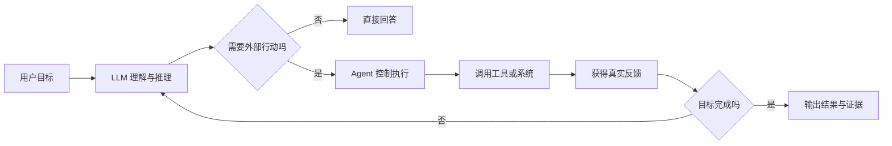

### 1.2 为什么不能把所有任务都做成 Agent

Agent 会引入额外的模型调用、工具执行、状态维护、权限校验、重试与观测成本。对于规则清晰、流程固定的任务，普通程序或固定工作流通常更稳定、更便宜、更容易测试。

因此，正确的工程问题不是“能不能用 Agent”，而是：**业务是否确实需要模型在运行时做动态决策？这种灵活性是否值得增加的成本和风险？**

---

## 2. Agent 的定义与概念边界

### 2.1 传统 AI 中的 Agent

在传统人工智能中，Agent 是能够**感知环境并采取行动**的实体。它根据观察与内部策略选择动作，以实现目标或改善评价指标。这一概念早于大语言模型。

例如，机器人通过传感器获取位置，决定转向并驱动电机；软件调度器根据任务队列和资源情况分配作业。它们不一定使用 LLM，但都可以在广义上被视为 Agent。

### 2.2 基于大语言模型的 Agent

**LLM-based Agent（基于大语言模型的智能体）** 将 LLM 用作理解、推理或行动选择的核心组件，同时由外部软件提供工具、状态、权限和执行环境。常见结构为：

**Agent 系统 = 模型能力 + 运行控制 + 工具与环境 + 状态与反馈 + 安全约束**

这是便于理解的工程分解，**不是各框架共同遵循的严格数学定义**。

### 2.3 不同机构的定义侧重点

| 视角 | 主要关注点 | 应当如何理解 |
|---|---|---|
| 传统 AI | 感知、行动、目标或策略 | Agent 不一定依赖 LLM |
| OpenAI 工程实践 | 模型、工具、指令及任务执行控制 | 关注是否能够实际完成业务流程 |
| Anthropic 工程实践 | Workflow 与 Agent 的控制流区别 | 关注步骤由预设代码还是模型动态决定 |
| Google Cloud 架构视角 | 模型、工具、知识、编排与运行环境 | 关注系统组成与企业集成 |
| 企业软件视角 | 可控性、权限、可观测性与交付结果 | 关注是否可安全、可靠地投入生产 |

> **注：** 这些是对官方资料侧重点的归纳，不应被理解为各机构逐字一致的正式定义。原始来源见文末参考资料。

### 2.4 Agent、AI Agent 与 Agentic AI

- **AI Agent（人工智能智能体）**：强调单个能够感知、决策和行动的系统或执行主体。
- **LLM Agent**：特指将大语言模型作为重要决策组件的 Agent。
- **Agentic AI（智能体式人工智能）**：更宽泛地强调 AI 系统的目标导向、多步骤行动和自主性，可能包含多个 Agent 与工作流。
- **Agent System（智能体系统）**：强调完整的软件实现，不仅包含模型，也包含工具、编排、状态、监控和安全机制。

这些词在业界使用并非完全统一，阅读文档时应结合作者给出的具体定义。

---

## 3. Agent 系统的组成与运行机制

### 3.1 Agent 不等于模型

一个 LLM API 负责推理与生成，但它本身通常不直接拥有数据库写权限、文件系统操作权限或企业审批权限。Agent 的执行能力来自周边系统的授权工具和运行框架。

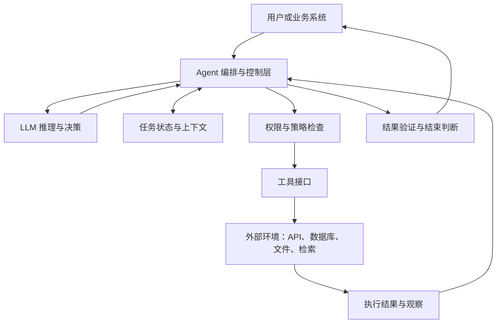

**主要组成说明：**

| 组成 | 作用 | 是否每个 Agent 都必须具有独立模块 |
|---|---|---|
| LLM（大语言模型） | 理解任务、推理、生成行动建议 | LLM Agent 通常需要；广义 Agent 不需要 |
| Instructions（指令） | 规定角色、目标、规则和边界 | 需要某种行为约束，但实现形式不限 |
| Tools（工具） | 访问外部信息或执行操作 | 并非所有 Agent 都必须调用外部工具 |
| State（状态） | 保存当前任务进度和中间结果 | 多步任务通常需要 |
| Context（上下文） | 提供当前决策所需的信息 | 必需的信息基础，未必是独立服务 |
| Memory（记忆） | 跨步骤或跨会话保留可复用信息 | 不是每个系统都需要长期记忆 |
| Orchestration（编排） | 控制调用顺序、分支、重试和终止 | 生产系统通常需要 |
| Guardrails（护栏） | 校验输入、输出和工具执行权限 | 生产环境非常重要 |

### 3.2 感知—决策—行动—反馈循环

Agent 的典型执行方式是一个带有反馈的循环，而不是固定的一次模型调用。

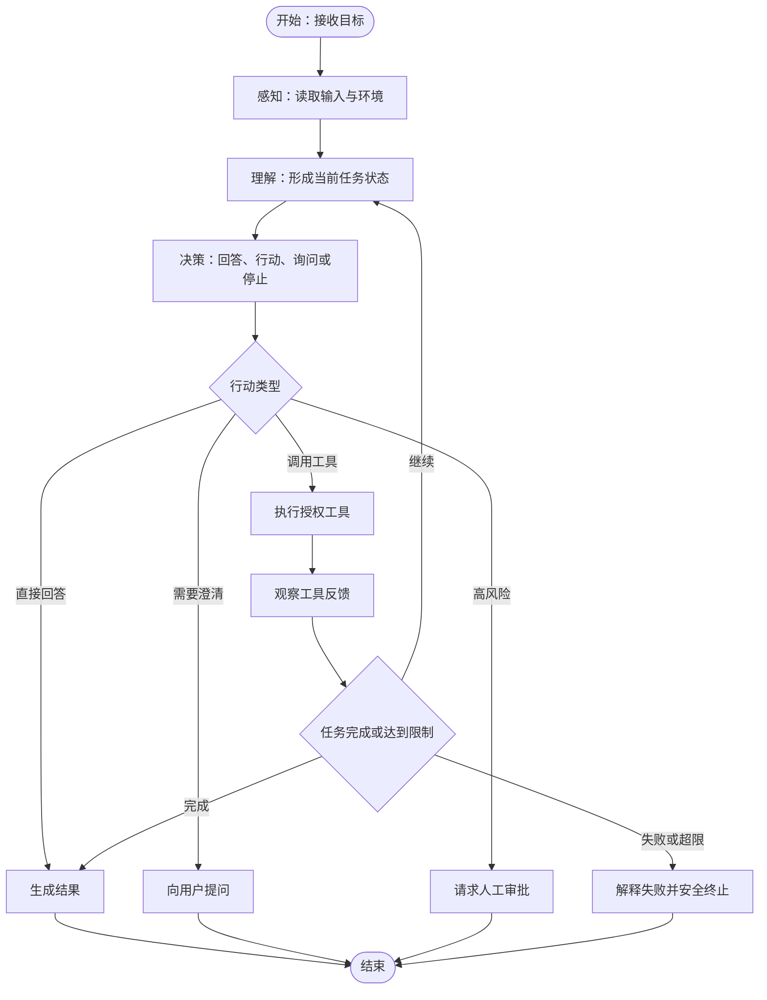

**执行过程中的关键概念：**

- **Goal（目标）**：希望达到的业务结果，例如“完成一份可交付的英文版技术文档”。
- **Task（任务）**：为达成目标而执行的具体工作，例如“提取表格文字”。
- **Observation（观察）**：工具返回的数据、错误或环境变化。
- **Action（行动）**：模型建议或系统决定执行的操作。
- **State（状态）**：记录当前进度、阶段、失败次数和中间产物。
- **Termination Condition（终止条件）**：任务完成、超时、达到预算上限、触发安全规则等。

### 3.3 Agent 的控制流由谁决定

必须区分两种控制权：**模型提出下一步建议**，与**执行系统批准并实施下一步行动**。即使模型可以动态选择工具，生产系统仍应验证参数、检查权限、限制次数，并记录执行结果。

这也是为什么企业级 Agent 通常需要独立的执行控制层，而不能直接把模型输出当作可信命令。

---

## 4. Agent 的核心能力

Agent 的能力不是单个开关，而是一组可以独立设计、组合和评估的机制。

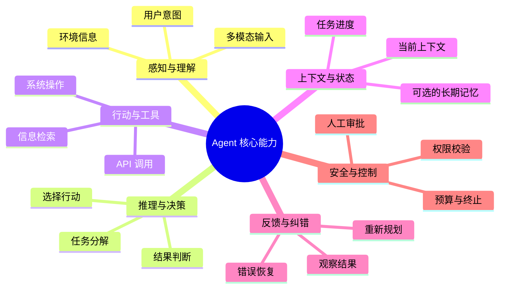

### 4.1 感知与理解（Perception and Understanding）

感知是获取用户输入、系统状态、文件内容、工具结果等信息；理解是从这些信息中识别目标、约束和任务含义。对于多模态 Agent，输入也可能包含图像、音频或其他信号。

**边界：** 感知到的信息可能不完整或错误，Agent 需要能够表达不确定性，而不是把推测当作事实。

### 4.2 推理与决策（Reasoning and Decision-making）

推理用于分析任务，决策用于确定下一步行动，例如回答用户、调用工具、请求更多信息或结束任务。复杂任务可能需要 **Planning（规划）**，即把目标拆分为多个可执行步骤；但简单 Agent 不一定需要显式规划模块。

### 4.3 行动与工具使用（Action and Tool Use）

行动可以是产生最终答案，也可以是调用搜索、数据库、翻译引擎、文档解析器等工具。**Function Calling（函数调用）** 通常指模型输出结构化的工具调用意图与参数，由宿主程序验证并实际执行；模型本身并不等于已经调用了外部系统。

### 4.4 上下文、状态与记忆（Context, State, Memory）

- **Context（上下文）**：本次模型决策可见的信息。
- **State（状态）**：当前任务执行到哪里、已经完成什么、下一步需要什么。
- **Memory（记忆）**：为后续决策保存的信息，可能仅存在于一次任务中，也可能跨会话持久化。

三者有关联，但并不等价。尤其是 **Memory 不是 Agent 的强制条件**；无长期记忆的 Agent 仍然可以完成许多任务。

### 4.5 反馈与纠错（Feedback and Recovery）

Agent 的优势之一是能够根据执行反馈调整后续动作，例如搜索失败后换查询词、图片翻译溢出后改布局、工具超时后选择降级路径。但如果没有明确的重试上限、失败分类和退出机制，这种循环也可能放大错误与成本。

### 4.6 安全与可控（Safety and Controllability）

**Human-in-the-loop（HITL，人在回路中）** 指在特定环节引入人工审核、批准或修正，尤其适用于财务支付、删除文件、修改生产数据库等高风险操作。

> **重要：** “具备某种能力”不代表“可以无限制使用这种能力”。企业级 Agent 的价值来自能力与约束的共同设计。

---

## 5. Agent 与相关概念的区别

### 5.1 一张图看清概念关系

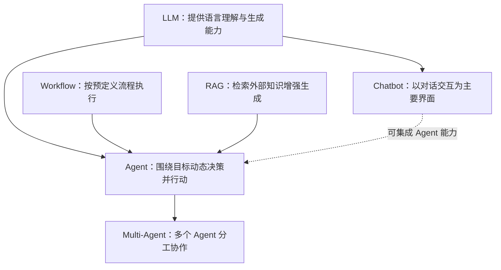

> **图示说明：** 箭头表示常见的能力组合关系，不表示严格的继承、包含或必要条件。例如 Agent 可以使用 RAG，但不要求每个 Agent 都使用 RAG。

### 5.2 核心概念对照表

| 概念 | 主要回答的问题 | 典型特征 | 与 Agent 的关系 |
|---|---|---|---|
| **LLM** | “生成什么内容？” | 根据输入预测和生成输出 | 可作为 Agent 的推理组件 |
| **Chatbot（聊天机器人）** | “如何与用户交互？” | 对话问答、多轮交互 | 是交互形态，可能具有 Agent 能力 |
| **Workflow（工作流）** | “按照什么既定步骤执行？” | 分支与步骤主要由程序预设 | 可以独立运行，也可以被 Agent 使用 |
| **RAG（检索增强生成）** | “从哪里获取外部知识？” | 检索后结合证据生成回答 | 是可集成的知识增强机制 |
| **Automation（自动化）** | “如何自动执行规则？” | 按规则或事件触发操作 | 与 Agent 可组合，动态性通常较低 |
| **Agent** | “为目标下一步该做什么？” | 动态选择行动、利用反馈 | 任务执行主体或系统 |
| **Multi-Agent（多智能体）** | “多个执行主体如何协作？” | 分工、协调、通信 | 多个 Agent 的组织方式 |

### 5.3 Agent 与 Workflow：最容易混淆的边界

Anthropic 在 *Building Effective Agents* 中将二者作为不同的系统设计模式进行讨论：

- **Workflow**：LLM 与工具按照预定义代码路径编排，主要由开发者预先确定控制流程。
- **Agent**：LLM 能够动态决定自身的流程和工具使用方式，在反馈中推进任务。

**示例：**

- 固定工作流：上传 PDF → 提取文本 → 翻译 → 导出 Word。步骤已明确，通常不需要 Agent 自主选择下一步。
- Agent 驱动：上传 PDF → 识别文档类型与复杂程度 → 动态选择解析方式 → 检查翻译和版式 → 根据错误类型选择修复路径 → 复验交付。

**两者不是非此即彼。** 一个可靠的系统可以采用“外层固定 Workflow + 局部 Agent 决策”的混合结构：把确定性步骤交给程序，把确实需要判断的部分交给模型。

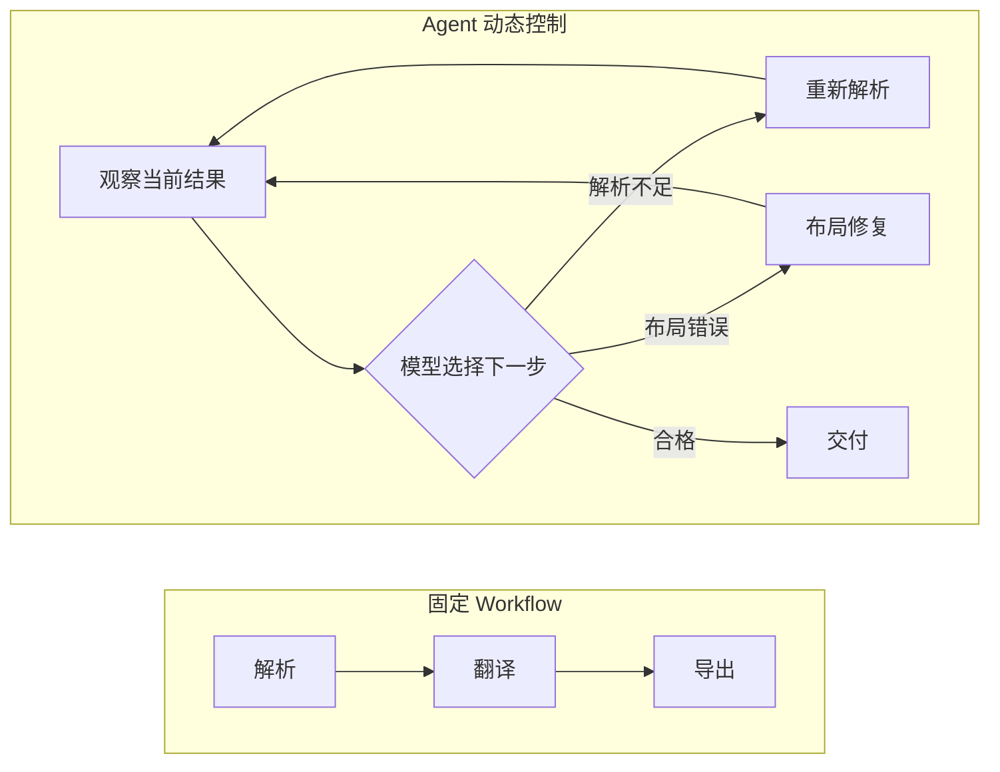

### 5.4 调用工具就一定是 Agent 吗

不一定。固定程序也可以调用工具；LLM 输出一次工具参数，也未必意味着存在自主任务执行循环。判断重点在于：**系统是否围绕目标，基于环境反馈，在受控边界内动态决定后续行动**。这是实用的工程判断标准，而不是唯一公认的学术定义。

---

## 6. Agent 的自主性与控制权

**Autonomy（自主性）** 指系统在多大程度上能够不依赖人工逐步指示，自行选择行动。自主性是连续维度，不宜机械地划分成统一的行业等级。

| 示例层次 | 谁决定下一步 | 人类角色 | 风险特征 |
|---|---|---|---|
| 建议型助手 | 用户决定是否行动 | 审阅与执行 | 直接执行风险较低 |
| 受控工具助手 | 模型建议工具，程序校验 | 对敏感操作审批 | 工具参数与权限需校验 |
| 多步骤 Agent | 模型在边界内选择后续步骤 | 监督、例外处理 | 可能出现循环、成本增长 |
| 长时运行 Agent | 系统持续响应任务与环境变化 | 设置策略、监控、干预 | 对状态、恢复和审计要求更高 |

> **注：** 上表是便于学习的工程示例，不是官方统一的 Agent 等级标准。

### 6.1 自主性不等于无限权限

模型可以选择“建议删除某个文件”，但是否有权限删除，应由系统独立决定。正确的架构是**决策权、执行权、审批权相互分离**。

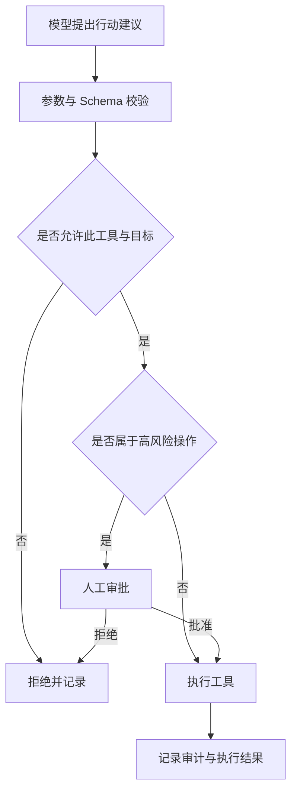

### 6.2 Agent 的结束机制

应当至少明确：成功条件、失败条件、最大步骤数、最大执行时间、费用或 Token 预算，以及何时升级为人工处理。否则，“自主执行”容易变成不可控的反复尝试。

---

## 7. 何时使用 Agent：企业工程决策

### 7.1 适合 Agent 的任务特征

1. **路径不确定**：完成目标需要根据实际结果决定下一步。
2. **环境变化**：工具返回、业务状态或用户条件会影响后续决策。
3. **需要多步协作**：涉及检索、判断、调用工具、验证等多个阶段。
4. **可验证结果**：能够判断是否达到目标，而不是只凭模型自我评价。
5. **可设置安全边界**：有权限控制、失败恢复和人工兜底。

### 7.2 不适合 Agent 的任务特征

规则完全确定、步骤固定、延迟要求极严、错误成本高且难以验证、没有足够权限治理或监控条件时，优先考虑普通程序、单次 LLM 调用或固定 Workflow。

### 7.3 工程选型决策图

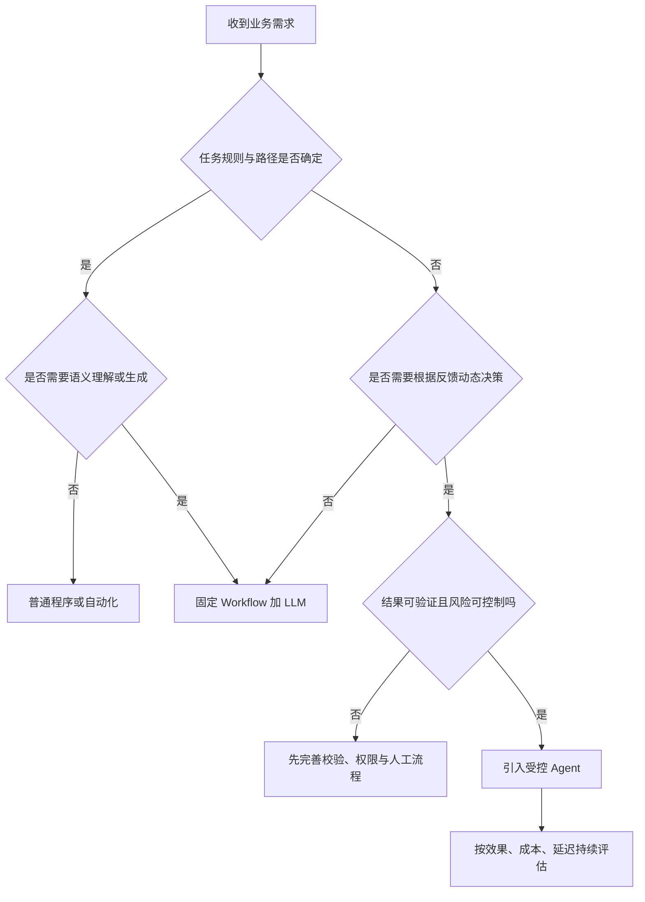

### 7.4 企业价值不只看“能不能跑通”

真正的交付能力还应包含：**任务成功率、结果正确性、人工介入率、成本、延迟、稳定性、可追溯性和安全性**。Agent 不应该只在演示中表现出色，还需要在异常输入、工具失败、权限不足和长任务中保持可控。

---

## 8. 典型企业案例：文档翻译 Agent

以企业技术文档翻译为例，用户目标通常不是“把文字翻译一下”，而是“交付一份内容准确、术语统一、格式可用的目标语言文档”。

### 8.1 固定流程可以解决什么

固定流程适合处理标准化输入，例如：文档解析 → 文本翻译 → 替换内容 → 导出文件。其优势是流程清晰、易于复现和测试。

### 8.2 Agent 在哪里产生额外价值

当输入文档的结构差异很大，可能出现扫描页、复杂表格、文字溢出、术语不一致、图文混排时，系统需要根据检查结果选择修复路径：

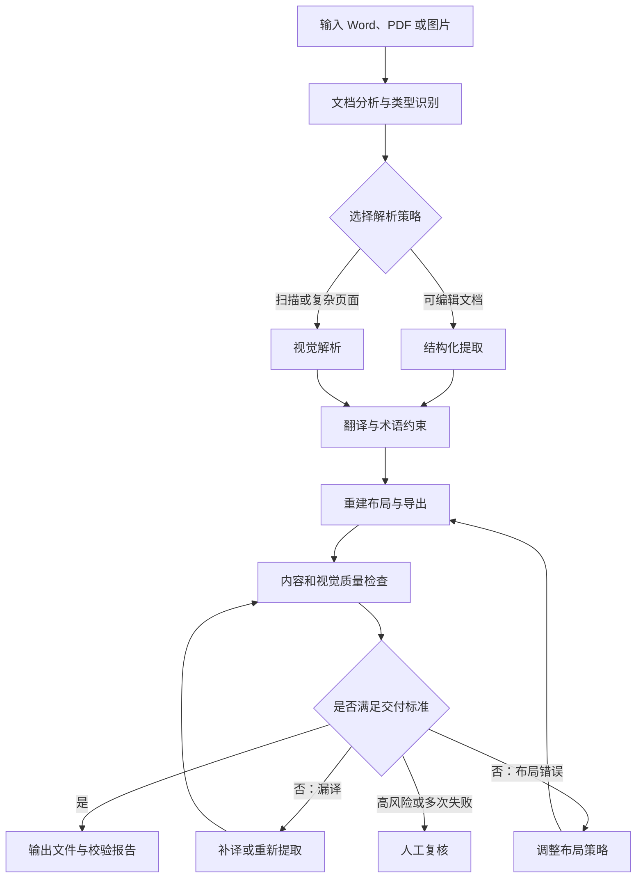

这里的 Agent 不必包办每一个步骤。更稳健的方式通常是：**确定性解析与导出流程 + 有边界的动态决策 + 独立校验 + 必要时人工复核**。

### 8.3 如何判断这个系统是否真的需要 Agent

关键不在于项目名称里有没有“Agent”，而在于运行过程中是否存在需要模型基于观察结果作出的动态选择。例如，如果每次都固定重试两次，可能只是普通程序逻辑；如果系统能够根据错误类别、文档类型和历史修复结果选择不同工具与策略，则更符合 Agent 式执行。

---

## 9. Agent 的局限与安全边界

| 风险或限制 | 可能表现 | 工程应对 |
|---|---|---|
| **Hallucination（幻觉）** | 编造事实、错误解释工具结果 | 检索证据、结构校验、独立验证 |
| **Prompt Injection（提示注入）** | 外部文档试图诱导 Agent 越权 | 区分指令与数据、权限隔离、输入审查 |
| 工具失败 | API 超时、数据库不可用 | 超时、重试上限、熔断、降级 |
| 错误累积 | 前一步误判影响后续执行 | 阶段检查、状态回滚、人工复核 |
| 无限循环 | 不断重试、无法结束 | 步数、时间与费用预算 |
| 数据泄露 | 向不该访问的工具发送敏感信息 | 最小权限、脱敏、审计 |
| 结果不可验证 | 模型声称成功但业务未完成 | 以外部系统结果和业务规则为准 |

**最小权限原则（Principle of Least Privilege）**：工具只获得完成当前任务必需的权限，不因为模型“可能需要”就开放全部资源。

**可观测性（Observability）**：记录关键输入、模型决策、工具调用、耗时、异常和最终结果，以便定位故障与评估效果；涉及敏感信息时应进行适当保护。

> **关键结论：** Agent 的智能程度与系统的可靠程度是两个不同维度。企业开发必须同时优化两者。

---

## 10. 完整知识图谱与学习路径

### 10.1 全景思维导图

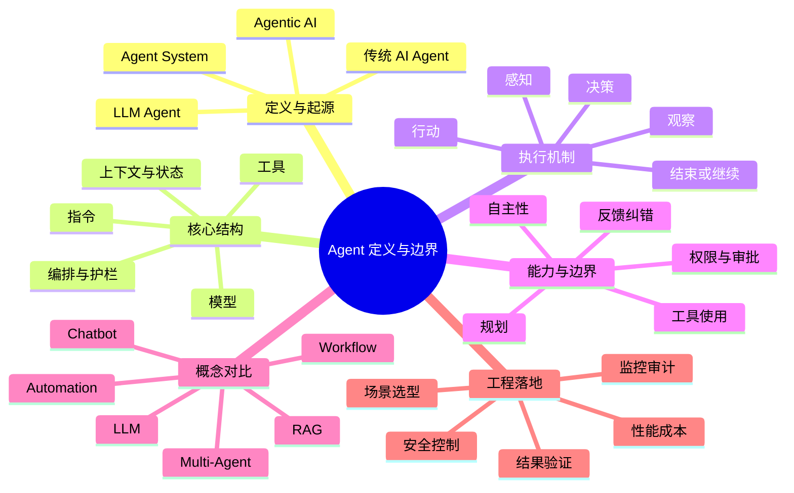

### 10.2 从定义到企业落地的因果链

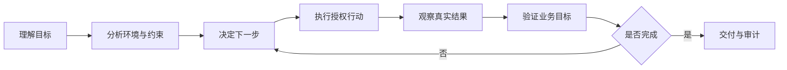

### 10.3 本节与后续章节的关系

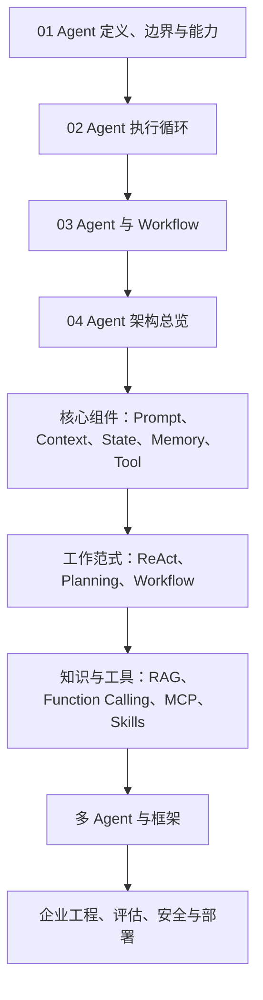

**学习顺序建议：** 先判断什么是 Agent、何时需要 Agent，再理解执行循环；之后分别学习组件、工作范式和工具能力，最后研究多 Agent 与生产工程。不要在第一节就把所有框架 API 和算法细节混在一起。

---

## 11. 常见误区与面试问题

### 11.1 常见误区

| 常见说法 | 更准确的理解 |
|---|---|
| “用了 LLM 就是 Agent” | LLM 可以只是一次性文本生成组件 |
| “能调用工具就是 Agent” | 固定程序也能调用工具，关键是目标驱动的动态控制与反馈 |
| “Agent 一定要有长期记忆” | 长期记忆是可选能力，任务状态更常见 |
| “Agent 一定比 Workflow 高级” | 两者适合不同问题，固定流程通常更可控 |
| “Agent 越自主越好” | 自主性必须与验证、权限和风险控制匹配 |
| “模型说完成就算完成” | 应由业务系统结果或独立校验确认 |
| “Agent 就是 ReAct” | ReAct 是一种工作范式，不是 Agent 的全部定义 |

### 11.2 高频面试问题

**Q1：什么是 AI Agent？与 LLM 有什么区别？**  
AI Agent 是围绕目标感知信息、选择行动并利用反馈推进任务的系统。LLM 提供理解与推理能力，而 Agent 还需要任务控制、执行环境和相应约束；广义 Agent 不一定依赖 LLM。

**Q2：Agent 与 Workflow 的核心区别是什么？**  
主要在于控制流是否由程序预先确定，还是由模型在运行时基于反馈动态决定。实际工程可以混合使用。

**Q3：Agent 是否必须具备规划、记忆和工具？**  
不必全部具备。不同任务对能力的要求不同；长期记忆和显式规划尤其不是普遍必要条件。

**Q4：为什么 Agent 需要执行反馈？**  
反馈让系统能够根据真实环境变化修正后续行动，而不是只依赖初始推测；同时也提供结果验证依据。

**Q5：如何避免 Agent 无限循环？**  
设置最大步骤、超时、Token 或费用预算、失败分类、重试上限以及人工升级机制。

**Q6：什么时候不应该使用 Agent？**  
当流程稳定、规则明确、风险难以控制或缺少结果验证机制时，优先使用普通程序或固定 Workflow。

**Q7：企业级 Agent 最重要的能力是什么？**  
不只是模型推理能力，还包括任务完成率、工具稳定性、权限治理、结果验证、成本控制与可观测性。

**Q8：如何判断一个“文档翻译 Agent”是否只是包装的 Workflow？**  
检查它是否真正根据文档类型、执行反馈与质量检查结果动态选择行动，而不是每次执行同一套预设步骤。

---

## 12. 术语速查

| 缩写或术语 | 英文全称 | 中文与用途 |
|---|---|---|
| Agent | Agent | 智能体；围绕目标感知、决策与行动的实体或系统 |
| AI | Artificial Intelligence | 人工智能 |
| LLM | Large Language Model | 大语言模型；负责语言理解与生成 |
| LLM Agent | Large Language Model-based Agent | 以大语言模型为重要推理组件的 Agent |
| Agentic AI | Agentic Artificial Intelligence | 强调目标导向和自主行动的 AI 系统范式 |
| Goal | Goal | 目标；期望实现的结果 |
| Task | Task | 任务；为实现目标而执行的具体工作 |
| Perception | Perception | 感知；获取用户输入和环境信息 |
| Observation | Observation | 观察；行动后的外部反馈 |
| Action | Action | 行动；Agent 或执行系统采取的操作 |
| State | State | 状态；当前任务进度与中间信息 |
| Context | Context | 上下文；当前决策可用的信息 |
| Memory | Memory | 记忆；为后续决策保留的信息 |
| Planning | Planning | 规划；将目标分解并安排步骤 |
| Workflow | Workflow | 工作流；预设的执行步骤与分支 |
| Orchestration | Orchestration | 编排；组织模型、工具、状态与流程 |
| Tool | Tool | 工具；向外部系统查询或执行操作的接口 |
| API | Application Programming Interface | 应用程序编程接口；软件之间的调用入口 |
| Function Calling | Function Calling | 函数调用；模型提供结构化工具调用意图与参数 |
| RAG | Retrieval-Augmented Generation | 检索增强生成；利用外部检索结果辅助生成 |
| HITL | Human-in-the-loop | 人在回路中；人工审批、纠正或接管 |
| Guardrails | Guardrails | 护栏；输入、输出、工具与权限的安全约束 |
| Prompt Injection | Prompt Injection | 提示注入；外部内容试图改变系统指令或行为 |
| Observability | Observability | 可观测性；通过日志、指标、轨迹理解系统运行 |
| ReAct | Reasoning and Acting | 推理与行动交替进行的一种 Agent 工作范式 |
| Multi-Agent | Multi-Agent System | 多智能体系统；多个 Agent 分工协作 |

---

## 13. 官方资料与原始论文

> 以下以**官方工程文档、研究机构原文及原始论文**为主。链接用于核对定义、边界和工程观点；不同机构的表述可能不完全一致。

### 13.1 首选精读

1. **OpenAI — A Practical Guide to Building Agents**：Agent 的工程定义、核心组成、适用场景与安全边界。  
   https://cdn.openai.com/business-guides-and-resources/a-practical-guide-to-building-agents.pdf
2. **Anthropic — Building Effective Agents**：Workflow 与 Agent 的区分、增强型 LLM、Agent 循环、系统复杂度的取舍。  
   https://www.anthropic.com/engineering/building-effective-agents
3. **Google Cloud — What are AI agents?**：AI Agent 的基础定义、组成能力与业务应用。  
   https://cloud.google.com/discover/what-are-ai-agents
4. **Google Cloud — Choose agentic AI architecture components**：企业架构中的模型、工具、数据与编排选型。  
   https://docs.cloud.google.com/architecture/choose-agentic-ai-architecture-components

### 13.2 深入阅读

5. **Microsoft Learn — AI agent adoption guidance**：企业采用 Agent 的治理与架构思路。  
   https://learn.microsoft.com/en-us/azure/cloud-adoption-framework/ai-agents/
6. **OpenAI — Building agents（开发者学习路径）**：Agent 开发中的工具、指令与执行模式。  
   https://developers.openai.com/tracks/building-agents
7. **LangChain — What is an agent?**：从框架视角理解 Agent 与工具执行循环。  
   https://www.langchain.com/blog/what-is-an-agent
8. **Yao et al. — ReAct: Synergizing Reasoning and Acting in Language Models**：推理与行动交替范式的代表性原始论文（2022）。  
   https://arxiv.org/abs/2210.03629
9. **Anthropic — Trustworthy Agents in Practice**：可信 Agent 的设计与治理议题。  
   https://www.anthropic.com/research/trustworthy-agents

### 13.3 阅读这些资料时的注意事项

- 不要把某家框架的 Agent 定义当作所有领域的唯一标准。
- 优先区分**概念定义**、**工程实践建议**和**具体框架实现**。
- 官方示例用于说明方法，不代表企业生产环境可以跳过权限、验证和审计。
- 具体 API、产品功能与文档路径可能随版本变化，使用时以官网最新内容为准。

---

## 本章总结

Agent 的核心不是“拥有多少工具”或“使用了哪一个框架”，而是**围绕目标，在环境反馈中选择行动并推进任务**。对于企业级 LLM Agent，模型负责提供推理能力，系统负责工具执行、状态管理、权限边界和结果验证；只有把智能决策与可靠工程结合起来，才能真正从“会回答”走向“会办事”。
