# 02｜Agent 感知—决策—行动—反馈循环

> **所属章节**：02-Agent-Fundamentals（Agent 基础与运行原理）  
> **学习定位**：从“Agent 是什么”进入“Agent 如何真正运行”。  
> **学习目标**：理解执行循环、运行时职责、工具反馈、状态传递、终止控制、异常恢复及企业级可观测性。  
> **前置知识**：LLM 基础、结构化输出、Agent 的定义与边界。  
> **阅读提示**：本篇以原理和工程设计为主，不包含代码练习；后续 ReAct、Planning、Workflow 章节再深入各工作范式。

---

## 阅读导航

1. [从一次回答到连续执行：为什么需要 Agent Loop](#1-从一次回答到连续执行为什么需要-agent-loop)
2. [执行系统由谁组成：Agent、模型与运行时](#2-执行系统由谁组成agent模型与运行时)
3. [一次完整运行的生命周期](#3-一次完整运行的生命周期)
4. [决策分支与工具反馈闭环](#4-决策分支与工具反馈闭环)
5. [State、Context 与 Memory 如何协作](#5-statecontext-与-memory-如何协作)
6. [执行状态机与终止条件](#6-执行状态机与终止条件)
7. [异常处理、重试、幂等与恢复](#7-异常处理重试幂等与恢复)
8. [长任务、检查点与人工介入](#8-长任务检查点与人工介入)
9. [企业级可观测性与评估](#9-企业级可观测性与评估)
10. [贯穿案例：文档翻译 Agent](#10-贯穿案例文档翻译-agent)
11. [知识图谱与学习路线](#11-知识图谱与学习路线)
12. [常见误区与面试问答](#12-常见误区与面试问答)
13. [术语速查表](#13-术语速查表)
14. [权威参考资料](#14-权威参考资料)

---

## 1. 从一次回答到连续执行：为什么需要 Agent Loop

### 1.1 一个关键区分：生成文本不等于完成任务

普通的大语言模型（**LLM，Large Language Model，大语言模型**）调用通常遵循“输入提示 → 模型生成 → 返回文本”。例如用户询问“什么是 KV Cache”，模型可以直接解释概念；这类任务不必访问外部系统，也不需要多轮行动。

但当用户提出“翻译这份文档、检查漏译、保留版式并导出 Word”时，单次生成不足以完成目标：系统必须解析文件、翻译、重建文档、检查结果，必要时修复并重新检查。这时需要**Agent Loop（智能体执行循环）**，让模型决策与外部行动形成闭环。

**核心定义**：Agent Loop 是由应用层执行系统驱动的迭代过程：准备上下文、调用模型、解释模型决策、执行允许的行动、接收环境反馈、更新状态，并根据终止条件继续、暂停或结束。

> **概念辨析**：LLM 的**自回归生成（Autoregressive Generation）**是在一次推理请求中逐 Token 预测；Agent Loop 则是应用层的**多轮决策与执行控制**。一次 Agent 运行可能包含多次独立的模型推理请求，二者不是同一层循环。

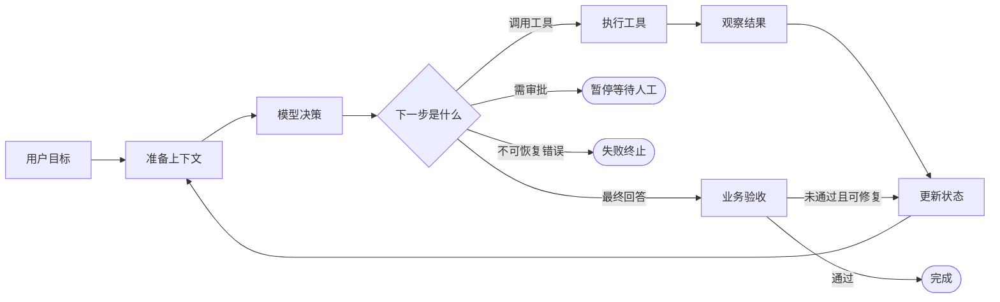

### 1.2 为什么需要循环，而不是一次性规划到底

现实环境不是静态的。搜索结果可能为空，接口可能超时，工具可能返回不完整数据，翻译后的版面可能溢出。Agent 需要利用每次行动的**Observation（观察结果）**修正下一步，而不是只依赖开始时的猜测。

循环带来三个关键能力：**动态适应**（根据新信息改变行动）、**闭环校验**（根据结果验证任务）、**有限自主**（在权限、预算和终止规则内运行）。但循环也会引入延迟、成本、错误传播和失控风险，因此必须由运行时施加约束。

### 1.3 Run、Turn、Model Call 与 Step

- **Run（一次运行）**：从接受某个任务到完成、失败或暂停的完整执行过程。
- **Turn（轮次）**：一次循环迭代的逻辑单位；不同框架的计数规则可能不同，不宜跨框架直接比较。
- **Model Call（模型调用）**：向模型发起的一次推理请求；可能返回文本、工具调用请求或其他结构化结果。
- **Step（步骤）**：业务或编排层定义的工作单元，可能包含零次、一次或多次模型调用。
- **Tool Call（工具调用）**：模型或程序请求执行某个外部能力，真正执行通常由运行时负责。

> **工程提醒**：不要假设“一轮 = 一个工具调用”。模型可能直接回答、一次请求多个工具、触发交接，或因格式错误重新生成。轮次、模型调用次数和工具调用次数应分别统计。

---

## 2. 执行系统由谁组成：Agent、模型与运行时

### 2.1 组件职责

| 组件 | 是什么 | 在循环中负责什么 | 不应误认为 |
|---|---|---|---|
| **Agent**（智能体） | 目标、指令、能力及决策策略的逻辑主体 | 决定如何围绕目标组织行动 | 只是一个模型 API |
| **LLM**（大语言模型） | 语言理解、推理和生成能力 | 根据上下文提出回答或行动请求 | 直接拥有系统权限 |
| **Runner / Runtime**（运行器 / 运行时） | 驱动执行循环的应用程序 | 调模型、分派工具、维护状态、检查终止条件 | 模型内部的推理模块 |
| **Tool**（工具） | API、函数、数据库、文件处理器等外部能力 | 读取环境或执行操作 | 模型凭空完成的真实行动 |
| **Environment**（环境） | 文件系统、业务服务、网页、数据库及外部世界 | 提供真实反馈并承受行动影响 | 永远可靠且不变化的上下文 |
| **Policy / Guardrail**（策略 / 防护约束） | 权限、风险控制与校验机制 | 限制不安全、不合规的操作 | 只靠提示词就能保证安全 |

**Harness（运行支架 / 执行框架）**通常指围绕模型的工具、上下文管理、运行循环、反馈、记录与安全控制等基础设施；不同厂商对 Harness 和 Runtime 的边界定义可能略有不同。

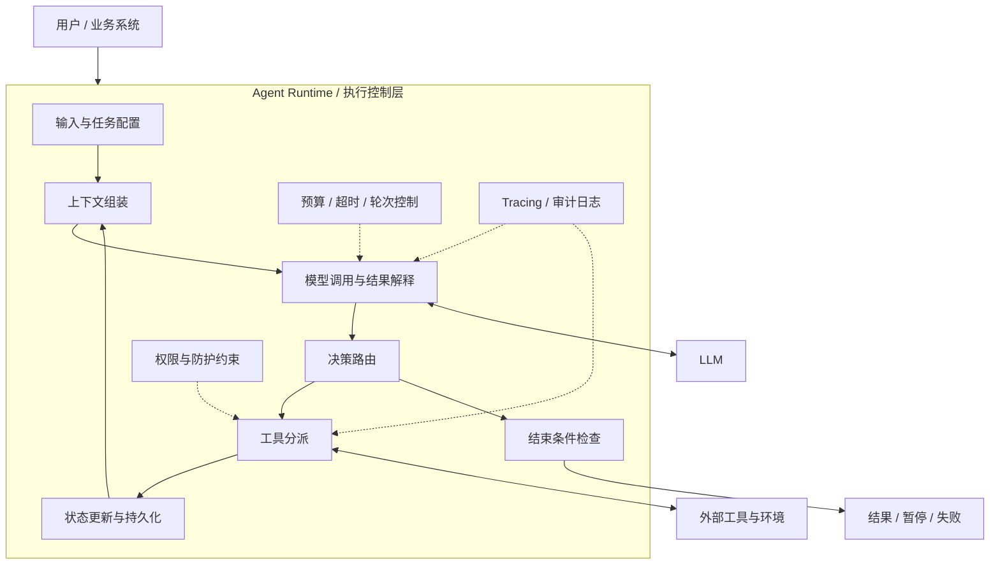

### 2.2 模型提议行动，运行时决定是否执行

当模型返回“调用 `search_documents` 查询相关制度”时，它表达的是一个**结构化工具调用意图**，不是已经访问数据库。运行时仍需要检查：工具是否存在、参数是否符合 Schema、调用者是否有权限、操作是否需要审批、是否超过预算，之后才真正调用工具。

这里的 **Schema（模式 / 数据结构约束）**用于定义工具参数字段、类型及必要约束。**Function Calling（函数调用机制）**让模型以结构化形式选择工具及参数；它并不意味着模型本身执行了函数。

### 2.3 三个容易混淆的“控制权”

1. **决策权**：下一步做什么，由模型、固定流程还是人工决定？
2. **执行权**：谁实际调用接口、修改文件或写入数据库？通常是受控的运行时。
3. **授权权**：谁允许高风险操作？通常由权限系统或人工审批决定，而不应由模型自行授予。

企业级设计应将这三种权力分离。尤其是删除文件、对外发送消息、支付、修改生产数据库等有副作用的操作，不应仅凭模型的一段自然语言就执行。

---

## 3. 一次完整运行的生命周期

### 3.1 七个基本阶段

| 阶段 | 输入 | 关键处理 | 输出 |
|---|---|---|---|
| ① 接收目标 | 用户请求、附件、业务上下文 | 明确任务与完成标准 | Goal / Task |
| ② 组装上下文 | 指令、历史、工具描述、当前状态 | 选择本轮模型需要的信息 | Context |
| ③ 模型决策 | 本轮上下文 | 生成下一步意图 | Answer / Tool Call / Handoff |
| ④ 执行行动 | 工具名、参数、身份权限 | 校验后执行外部操作 | Tool Result |
| ⑤ 观察反馈 | 返回值、异常、环境变化 | 解释结果与错误 | Observation |
| ⑥ 更新状态 | 新证据、中间产物、执行记录 | 保存进度并调整后续上下文 | New State |
| ⑦ 判断去向 | 完成标准、预算、错误、审批 | 继续、完成、暂停或失败 | Next Transition |

> **Goal（目标）**回答“最终要达成什么”；**Task（任务）**是为实现目标而执行的具体工作；**Success Criteria（成功标准）**定义如何判断交付达标。只有“模型认为完成”而没有业务验收，容易产生虚假完成。

### 3.2 一次多轮执行的时序图

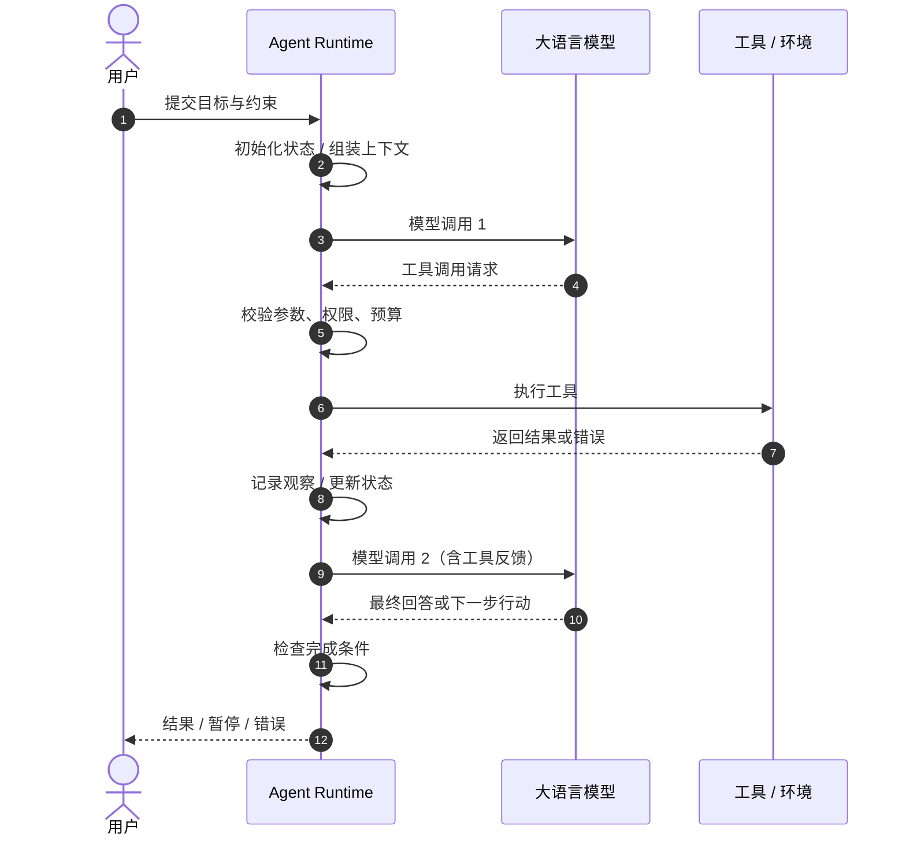

### 3.3 模型每轮能看到什么

模型并不会自动“记得”外部程序中发生的所有事情。运行时需要把必要信息重新组织为本轮输入，例如：用户目标、系统指令、前一轮工具输出、已完成步骤、当前错误、剩余预算和可用工具。

**Context Window（上下文窗口）**是模型单次请求可处理的 Token 范围；上下文无限堆积会造成成本上升、信息干扰及窗口耗尽。因此，应区分完整执行记录和本轮真正需要送给模型的上下文。

---

## 4. 决策分支与工具反馈闭环

### 4.1 常见决策类型

| 模型或系统结果 | 含义 | 运行时处理 |
|---|---|---|
| **Final Answer**（最终回答） | 模型认为可以直接返回 | 检查业务验收条件后结束或修复 |
| **Tool Call**（工具调用请求） | 需要外部能力 | 校验、执行、记录反馈、进入下一轮 |
| **Handoff**（智能体交接） | 将任务控制权移交给另一 Agent | 切换执行主体并传递必要上下文 |
| **Refusal**（拒绝） | 请求违反模型或系统约束 | 返回拒绝或进入人工处理 |
| **Invalid Output**（无效输出） | 格式或参数不符合约束 | 修复、有限重试或终止 |
| **Approval Required**（需要审批） | 高风险行动须授权 | 持久化状态并暂停 |

**注意**：以上是企业运行时需要考虑的完整分支集合，并非每个 Agent 框架都以同名事件或相同机制支持全部分支。OpenAI Agents SDK 的典型执行分支尤其包括最终输出、工具调用和 Agent 交接。

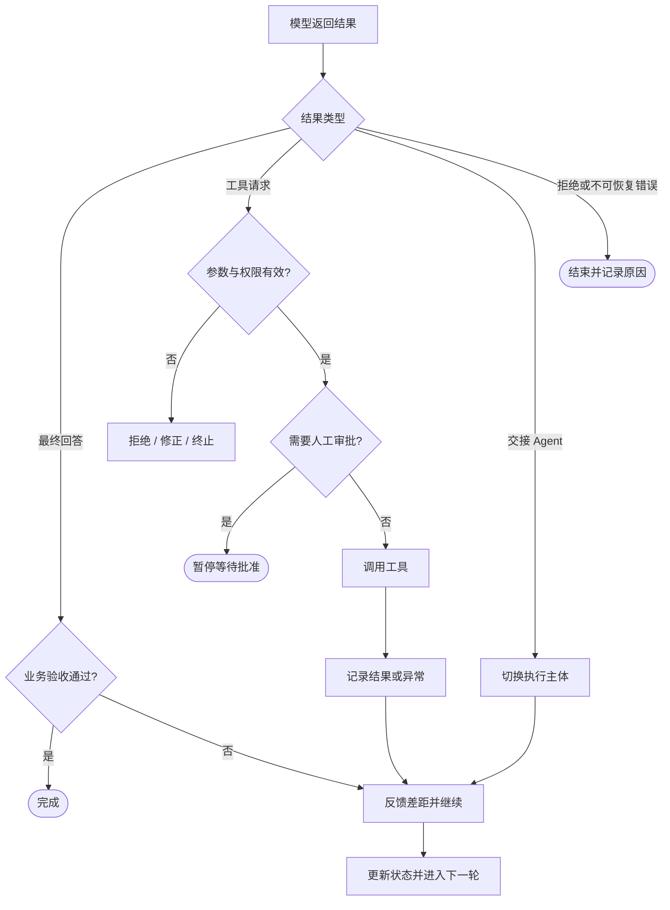

### 4.2 工具反馈为什么不可省略

假设模型要求“把中文文档翻译为英文”，翻译工具返回成功，并不代表最终文档可以交付。工具可能只完成文本翻译，却没有保留页眉页脚；也可能输出文件成功，但发生漏译。**Tool Success（工具成功）**、**Step Success（步骤成功）**与 **Task Success（任务成功）**属于不同层级。

反馈闭环的价值在于把真实执行结果转化为下一轮决策依据。例如：

- 查询工具返回空结果 → 换检索条件或向用户询问。
- 文件导出成功但版式评分不达标 → 重新排版。
- API 返回限流 → 等待后重试或切换备用服务。
- 操作需要额外授权 → 暂停，而不是绕过权限。

### 4.3 并行工具调用的额外约束

某些模型和框架允许在一轮中请求多个工具调用。此时需要关注：依赖关系、并发上限、结果关联、失败隔离、顺序一致性，以及多个工具是否同时修改同一资源。

**Tool Call ID（工具调用标识）**用于将工具执行结果对应回原始调用请求。多个工具的结果不能仅凭“返回顺序”推断归属。

---

## 5. State、Context 与 Memory 如何协作

### 5.1 三者的区别

| 概念 | 核心问题 | 典型内容 | 生命周期 |
|---|---|---|---|
| **State（状态）** | 任务现在进行到哪里？ | 当前阶段、待处理项、文件路径、工具结果、审批状态 | 通常与一次运行或工作流关联 |
| **Context（上下文）** | 模型本轮能看到什么？ | 指令、用户消息、工具描述、相关历史与摘要 | 每次模型调用时动态构造 |
| **Memory（记忆）** | 什么信息需要跨轮次或跨任务保留？ | 用户偏好、稳定业务事实、历史经验、可检索记录 | 可能跨会话持久化 |

**Checkpoint（检查点）**是某一时刻的可恢复状态快照，不等于 Memory；**Session（会话）**是关联消息和运行上下文的交互范围，也不等于一次 Run。

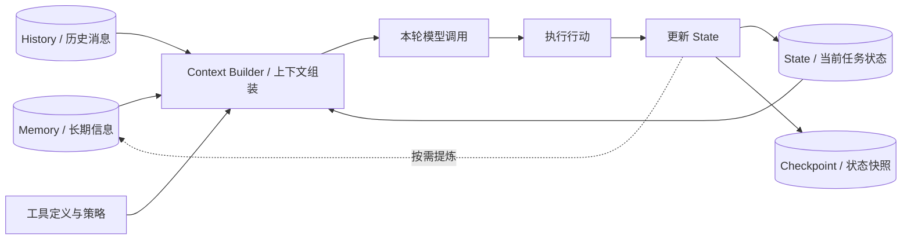

### 5.2 状态应该保存哪些信息

一个可恢复的企业 Agent 通常至少要记录：`run_id`（运行标识）、任务目标、当前阶段、已完成与待完成步骤、中间产物位置、工具执行记录、错误次数、预算使用情况、审批状态及最终结果。

这里的字段只是**概念示例**，不是某个框架的固定 Schema。不同系统可以使用数据库、对象存储、消息队列或工作流引擎保存状态。

### 5.3 上下文不等于日志全量回放

长期任务可能产生大量工具输出。每次都把所有历史原样送入模型，会增加 Token 成本并干扰决策。常见做法包括：摘要（Summarization）、检索相关历史（Retrieval）、只保留必要结果、结构化状态引用，以及按需读取原始产物。

**原则**：日志尽量完整以便审计；模型上下文尽量相关以便决策；状态尽量结构化以便恢复。

---

## 6. 执行状态机与终止条件

### 6.1 为什么要显式定义状态机

**Finite-State Machine（FSM，有限状态机）**是一种用明确状态和状态转换约束系统行为的模型。Agent 的语言决策具有不确定性，但运行时可以使用确定性的状态机管理其生命周期，避免“到底完成了还是还在运行”的模糊状态。

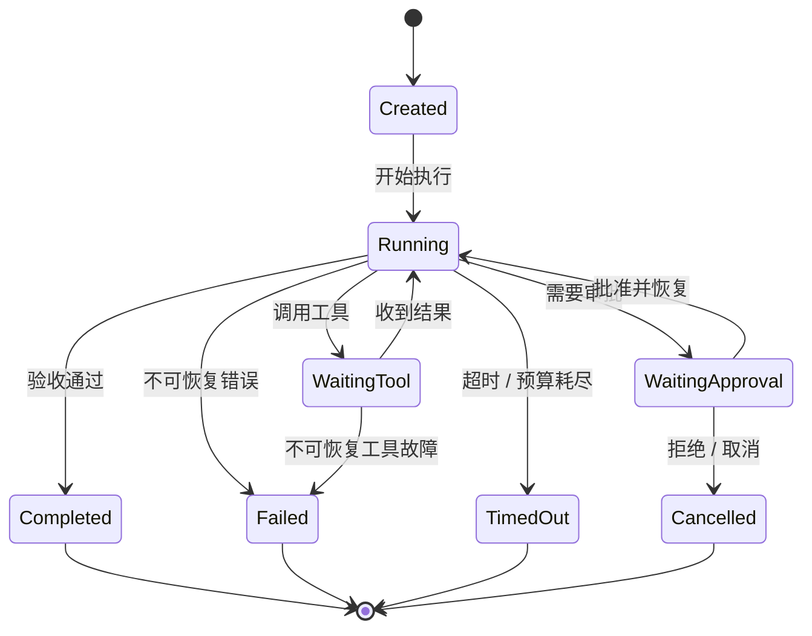

这是一种推荐的**工程抽象**，不是某个框架统一规定的状态枚举。实际系统还可能加入 `Retrying`（重试中）、`Suspended`（挂起）和 `Compensating`（补偿中）等状态。

### 6.2 五类重要的停止条件

1. **自然完成**：模型输出最终结果，并通过业务成功条件检查。
2. **次数限制**：达到 `max_turns`（最大轮次）或最大工具调用次数。
3. **时间与预算限制**：超过 Deadline（截止时间）、Timeout（超时）或 Token / 费用预算。
4. **安全与权限限制**：违反访问权限或安全策略。
5. **外部控制**：用户取消、人工审批拒绝或业务系统主动终止。

> **关键结论**：**Run Finished（运行结束）不等于 Task Succeeded（任务成功）**。一次运行可能因超时、拒绝或错误结束；即使模型给出“已完成”，仍可能未达到业务验收标准。

### 6.3 业务成功条件应当可验证

对于文档翻译，成功条件可以包括：所有必需章节完成翻译、目标语言一致、数字和型号未被错误改写、文件可打开、关键版式约束满足、必要审批已完成。不是所有质量维度都能被自动准确判断；低置信度场景应允许人工复核。

---

## 7. 异常处理、重试、幂等与恢复

### 7.1 故障应分类，而不是统一“再试一次”

| 故障类别 | 示例 | 推荐处理 |
|---|---|---|
| **Transient Failure（瞬时故障）** | 网络抖动、服务临时不可用 | 有上限的重试和退避 |
| **Rate Limit（限流）** | API 返回调用频率超限 | 遵循服务端限流信息，排队或退避 |
| **Correctable Error（可修正错误）** | JSON 参数缺字段、格式不合法 | 反馈具体错误，修正输入 |
| **Business Validation Failure（业务校验失败）** | 漏译、版式溢出、缺字段 | 回到相关步骤重新处理 |
| **Permission Failure（权限失败）** | 无权访问数据库 | 拒绝或请求合法授权 |
| **Irrecoverable Failure（不可恢复故障）** | 文件损坏且无备份 | 终止并提供诊断信息 |

### 7.2 Retry 与 Backoff

**Retry（重试）**指在失败后再次尝试操作。**Backoff（退避）**指在重试之间增加等待，避免短时间重复请求加重故障；常见形式是指数退避（Exponential Backoff），并配合随机抖动（Jitter）分散并发请求。

重试必须有上限，而且要考虑是否会产生副作用。对读取操作的重试通常比“转账、发邮件、删除文件”等写操作更容易控制风险。

### 7.3 幂等性：为什么不能盲目重试

**Idempotency（幂等性）**指同一操作重复执行时，系统最终效果与执行一次一致。例如按固定标识查询文件通常天然更接近幂等；“创建订单”若没有去重机制，重复调用可能生成多个订单。

**Idempotency Key（幂等键）**可以让业务系统识别同一个逻辑请求，避免因网络重试而重复产生副作用。它必须由实际执行系统或下游 API 支持，仅在提示词中写“不要重复执行”并不能保证幂等。

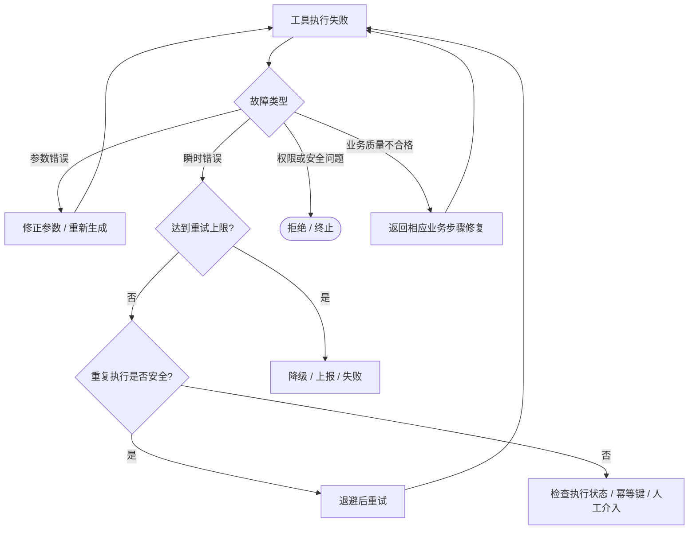

### 7.4 Checkpoint 与 Resume

**Resume（恢复执行）**是在中断后从保存的状态继续，而不是从头重新运行所有步骤。恢复时需要核对已完成动作、外部资源当前状态和幂等保障，避免“本地状态说未执行，但远端实际上已执行”的重复操作问题。

对于涉及多个外部系统的流程，可研究 **Compensation（补偿操作）**：例如先创建临时文件、后续失败时删除临时产物。补偿不是数据库事务回滚，可能失败，也不能保证所有副作用可逆。

---

## 8. 长任务、检查点与人工介入

### 8.1 长任务与普通对话的不同

**Long-running Agent（长时间运行的智能体）**可能跨越多个模型上下文窗口、进程重启或人工审批等待期。其核心挑战是：进度持久化、任务续接、外部环境变化、重复操作防护，以及如何判断真正完成。

Anthropic 关于长任务 Agent Harness 的文章特别讨论了进度记录、交接说明和在后续上下文中继续任务的设计思路。这里需要区分**模型上下文的续接**与**业务操作的可恢复性**：前者靠摘要与记录，后者还需要状态存储和副作用控制。

### 8.2 Human-in-the-loop（HITL，人在回路中）

HITL 指在系统执行过程中安排人工确认、审批、纠错或接管。适用于敏感数据外发、批量删除、金额变更、低置信度判断及无法自动确定的业务决策。

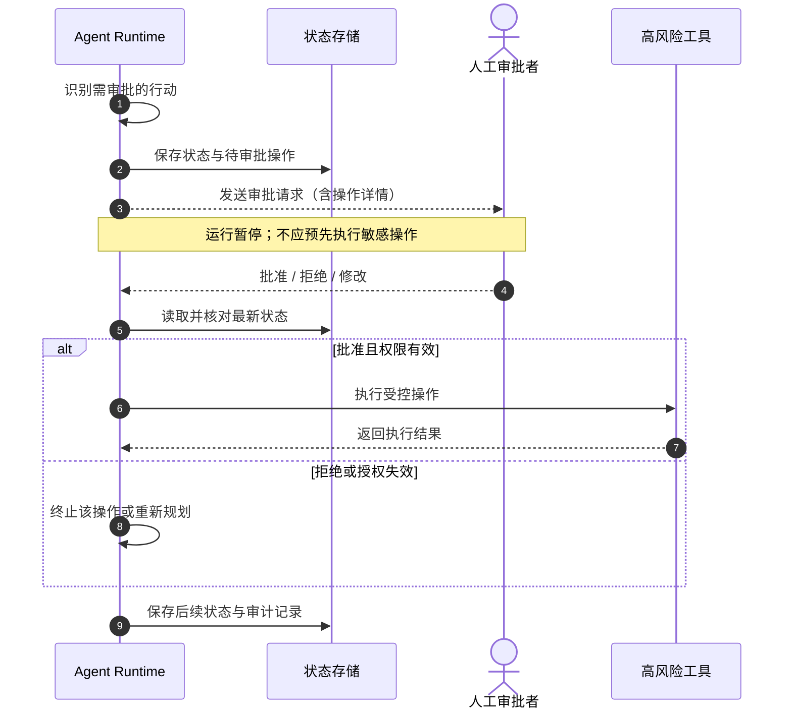

### 8.3 恢复执行时的四项核对

- **身份与权限**：恢复时权限是否仍有效？
- **外部状态**：文件、订单或数据库记录是否发生变化？
- **重复执行风险**：之前的操作是否已经成功但回执丢失？
- **剩余预算与截止时间**：恢复后是否仍允许继续？

---

## 9. 企业级可观测性与评估

### 9.1 为什么只看最终回答不够

Agent 可能输出一个看似正确的答案，但内部重复调用工具、耗费过多 Token、绕过必要检查或使用过期数据。因此，生产系统需要记录**做了什么、为什么做、执行结果是什么、消耗多少、在哪里失败**。

### 9.2 常见术语与指标

| 指标 / 概念 | 英文全称或含义 | 观察对象 |
|---|---|---|
| **Trace** | 执行追踪链路 | 一次 Run 的完整路径 |
| **Span** | 一段可观测操作 | 单次模型调用、工具调用、校验等 |
| **Latency** | 延迟 | 整体与分阶段耗时 |
| **Token Usage** | Token 使用量 | 输入、输出及缓存相关用量 |
| **Tool Success Rate** | 工具成功率 | 工具执行成功的比例 |
| **Task Success Rate** | 任务成功率 | 达到业务验收标准的比例 |
| **Retry Rate** | 重试率 | 重试频率与故障趋势 |
| **P95 Latency** | 第 95 百分位延迟 | 95% 请求的耗时不超过该值 |
| **Cost per Task** | 单任务成本 | 每个完成任务的资源费用 |

**Tracing（链路追踪）**是记录执行过程的技术手段；**Evaluation（评估）**是依据测试集、规则或人工判断衡量质量的方法。二者互补，但不等价。

### 9.3 推荐的追踪层级

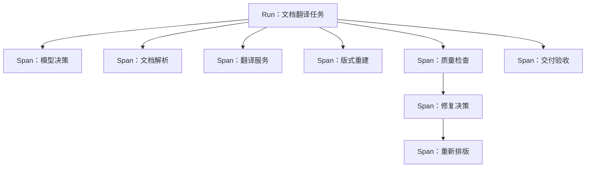

**安全注意**：Trace 中可能含有个人信息、内部文件、工具参数和访问令牌。日志必须进行脱敏、权限隔离和保留期限管理，不应为调试方便而无差别记录敏感内容。

---

## 10. 贯穿案例：文档翻译 Agent

### 10.1 任务定义

用户提出：“将中文技术文档翻译为英文，保留表格、图片、页眉页脚，检查漏译和版式错误，最终导出可编辑 Word。”

**任务目标**：交付可编辑、语言一致、内容完整且版式满足要求的英文文档。  
**运行约束**：限制最大修复轮次；不允许擅自修改原始文件；低置信度内容提交人工复核。

### 10.2 一次可能的真实执行路径

| 顺序 | 运行时动作 | 新观察 | 对下一步的影响 |
|---|---|---|---|
| 1 | 识别文件类型与结构 | Word，含表格、图片和页眉 | 选择 Word 解析路径 |
| 2 | 调用解析工具 | 提取正文、表格和布局对象 | 构造翻译单元 |
| 3 | 调用翻译服务 | 获得英文文本 | 进入文档重建 |
| 4 | 重建 Word 文档 | 文件可生成，但一处表格溢出 | 进入质量修复 |
| 5 | 调用版式检查 | 定位具体表格与溢出范围 | 选择局部调整 |
| 6 | 再次生成并检查 | 版式合格，但某型号翻译不确定 | 请求人工确认 |
| 7 | 人工确认后恢复 | 型号保持原样 | 进入最终验收 |
| 8 | 验收并导出 | 内容与格式检查通过 | 完成并记录 Trace |

### 10.3 文档翻译的反馈修复图

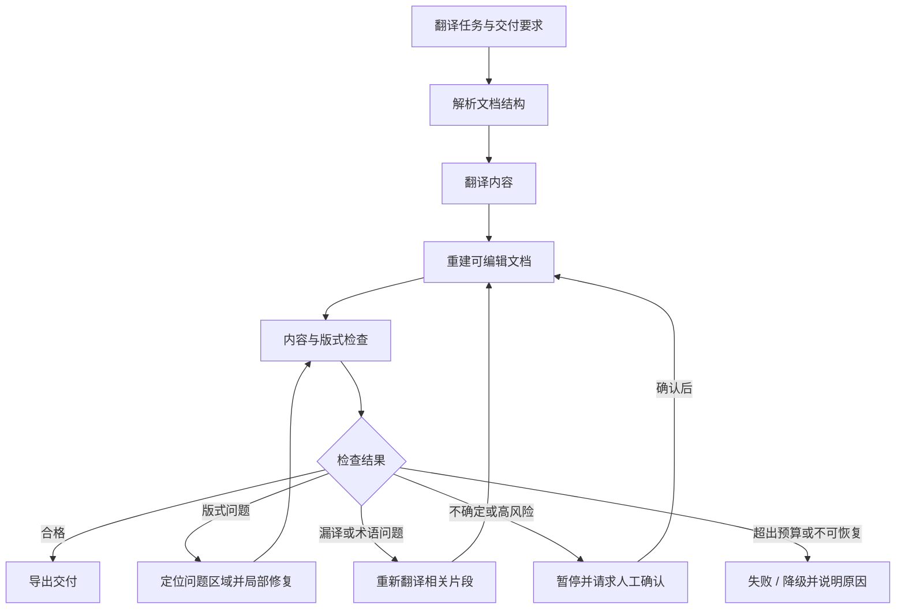

### 10.4 固定流程与 Agent 循环的分工

解析、翻译、重建、基础校验通常适合由确定性 **Workflow（工作流）**组织；当检查失败且修复路径不固定时，可以让 Agent 在受限工具集合内判断应重新翻译、局部调整版式还是请求人工确认。

**工程取舍**：不是每个步骤都需要交给 Agent。对稳定、重复、可预测的环节，固定工作流通常更易测试、更便宜、更可靠；将 Agent 用在确实需要动态判断的环节，往往更合理。

---

## 11. 知识图谱与学习路线

以下图谱全部使用 **Mermaid（基于文本的图表描述语法）**，无需外部 PNG，GitHub 可直接渲染；文本也可在 VS Code 中编辑，避免生成图片时中文笔画模糊的问题。

### 11.1 Agent Loop 全景思维导图

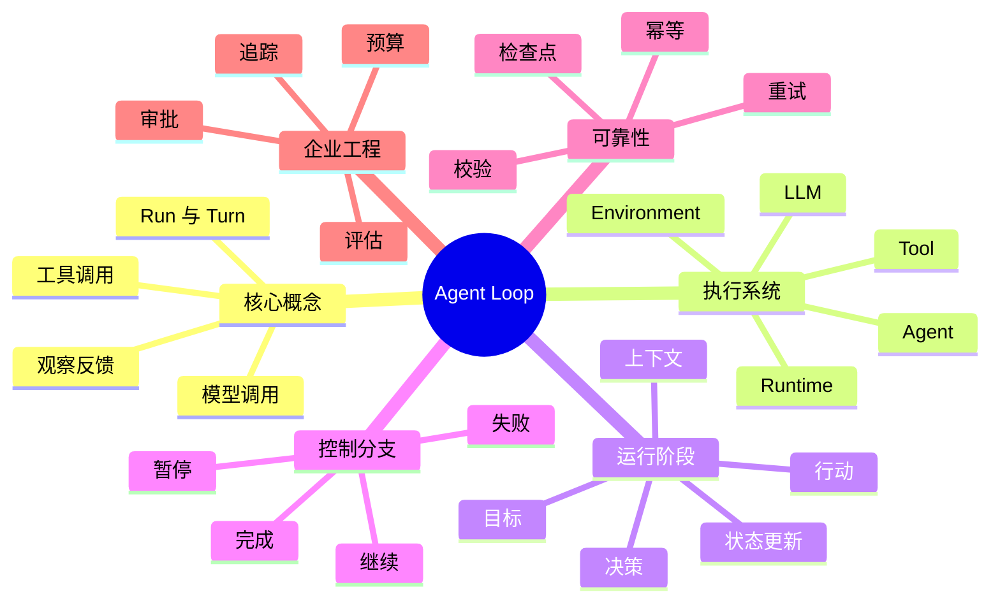

### 11.2 控制权与数据流知识图谱

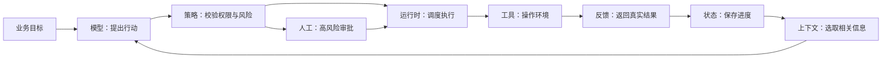

### 11.3 终止与异常处理知识图谱

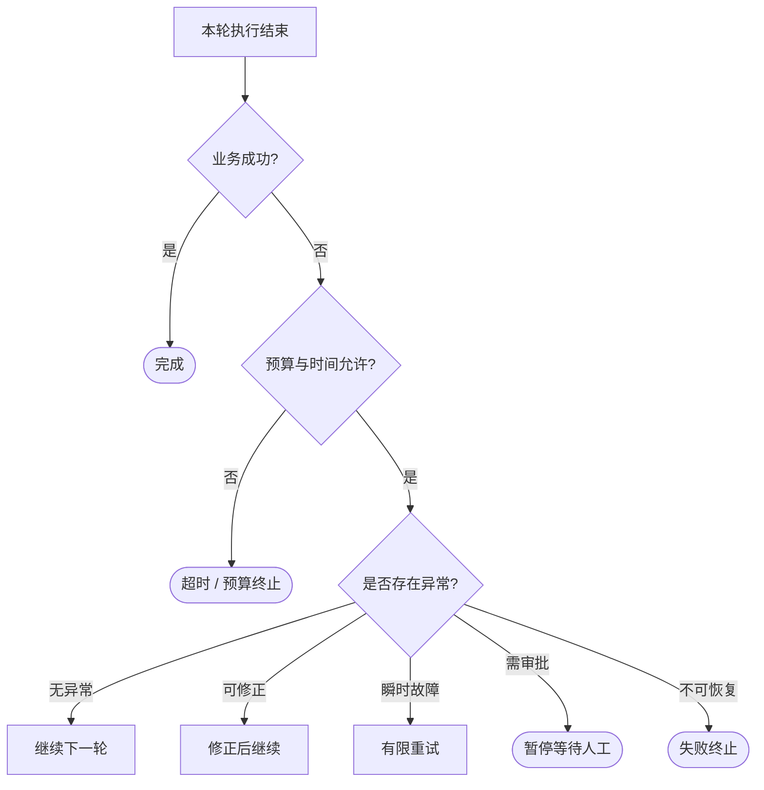

### 11.4 State、Context、Memory 关系图

请重点回看第 5 节的结构图：State 是运行事实，Context 是本轮可见信息，Memory 是跨轮次或跨任务保存的有用信息；Checkpoint 是恢复用的状态快照。

### 11.5 学习路线图

---

## 12. 常见误区与面试问答

### 12.1 常见误区

**误区一：Agent Loop 就是 ReAct。**  
Agent Loop 是运行层的执行控制机制；**ReAct（Reasoning and Acting，推理与行动）**是将推理与行动交替组织的一种工作范式。可以使用 ReAct 风格实现循环，但循环不局限于 ReAct。

**误区二：模型发出工具调用就意味着工具已执行。**  
模型通常只生成工具请求；运行时负责权限校验、参数检查、真正执行及反馈。

**误区三：工具返回成功就代表任务成功。**  
工具成功不等于最终交付通过。需要独立的业务验收标准。

**误区四：模型说“完成”就可以结束。**  
模型输出可以触发结束候选分支，但高价值业务任务应验证交付结果。

**误区五：重试次数越多越稳定。**  
无上限重试可能放大故障、增加成本或重复产生副作用。

**误区六：State、Context、Memory 是同一回事。**  
它们分别描述运行事实、本轮可见信息和可持久保留的信息，虽然可能存在重叠。

**误区七：Agent 必须拥有完全自主权。**  
企业 Agent 可以只在明确权限和预算内自主决策，并在高风险操作前暂停等待审批。

### 12.2 高频面试题（含参考思路）

**Q1：什么是 Agent Loop？与普通 LLM 调用有什么区别？**  
Agent Loop 是应用层的多轮决策—执行—反馈控制过程；普通 LLM 调用通常只完成一次模型推理。Agent Loop 能使用外部反馈调整下一步行动。

**Q2：Agent Runtime 的核心职责是什么？**  
负责模型调用、工具调度、状态管理、权限校验、终止控制、异常处理及可观测性；不能把这些全部寄托于提示词。

**Q3：模型输出 Tool Call 后发生了什么？**  
运行时解析调用请求，验证工具与参数、权限和预算，必要时等待审批，然后执行工具并将结果反馈到后续上下文。

**Q4：为什么工具调用成功仍不代表任务完成？**  
工具只证明某个局部操作完成；最终目标可能要求多步骤交付、质量验证和业务约束满足。

**Q5：如何防止 Agent 无限循环？**  
设置最大轮次、超时、Token / 成本预算、重复动作检测、失败上限和人工取消机制，并定义可验证的终止条件。

**Q6：State 与 Context 有什么区别？**  
State 是系统保存的当前任务事实；Context 是某次模型调用时实际提供给模型的信息，通常只是 State 和历史记录的相关子集。

**Q7：Agent 调用外部写接口失败时为什么不能直接重试？**  
可能发生“远端已成功但本地未收到响应”。重试前应检查执行状态，并通过幂等键或业务去重避免重复副作用。

**Q8：如何实现人工审批后恢复？**  
在执行敏感操作前持久化待审批动作和运行状态，收到授权后重新核验身份、权限和外部状态，再从检查点继续。

**Q9：怎样评估一个 Agent Loop 的质量？**  
结合任务成功率、工具成功率、延迟、成本、重试次数、安全违规、人工介入比例，并通过 Trace 定位失败原因。

**Q10：文档翻译场景为什么适合混合 Workflow 与 Agent？**  
解析、翻译、导出等稳定步骤适合确定性流程；面对漏译、复杂版式和不确定错误时，Agent 可选择合适的修复行动。两者结合更易控制质量与成本。

---

## 13. 术语速查表

| 缩写 / 术语 | 英文全称 | 中文解释与用途 |
|---|---|---|
| Agent | Agent | 智能体，围绕目标组织决策与行动的系统 |
| LLM | Large Language Model | 大语言模型，提供语言理解、推理和生成能力 |
| Agent Loop | Agent Execution Loop | 智能体执行循环，驱动多轮行动与反馈 |
| Runtime | Runtime | 运行时，执行模型调用、工具调度和状态控制 |
| Runner | Runner | 运行器，框架中用于启动和推进 Agent 运行的组件 |
| Harness | Agent Harness | 围绕模型的执行支架、工具、状态和控制基础设施 |
| Goal | Goal | 目标，最终希望达成的业务结果 |
| Run | Run | 一次完整任务运行 |
| Turn | Turn | 一轮逻辑执行；具体计数规则依框架而定 |
| Tool Call | Tool Call | 请求使用某项外部工具或能力 |
| Tool Call ID | Tool Call Identifier | 关联工具调用请求与结果的标识 |
| Observation | Observation | 行动后获得的真实反馈或环境结果 |
| State | State | 当前任务状态与中间执行事实 |
| Context | Context | 本轮提供给模型的可见信息 |
| Memory | Memory | 跨轮次或跨任务保留的信息 |
| Checkpoint | Checkpoint | 可用于恢复执行的状态快照 |
| Resume | Resume | 中断后从保存状态继续执行 |
| Handoff | Handoff | 将任务控制权交接给另一 Agent |
| Schema | Schema | 数据结构与字段约束 |
| Function Calling | Function Calling | 模型以结构化形式选择工具和参数的机制 |
| HITL | Human-in-the-loop | 人在回路中，人工审批、复核或接管 |
| FSM | Finite-State Machine | 有限状态机，显式描述运行状态与转换 |
| Retry | Retry | 重试，失败后重新尝试操作 |
| Backoff | Backoff | 退避，在重试间增加等待时间 |
| Jitter | Jitter | 随机抖动，分散并发重试时机 |
| Idempotency | Idempotency | 幂等性，重复执行不应造成重复副作用 |
| Idempotency Key | Idempotency Key | 幂等键，用于业务侧识别重复逻辑请求 |
| Compensation | Compensation | 补偿操作，尽可能修正已发生的副作用 |
| Trace | Trace | 一次执行的完整追踪链路 |
| Span | Span | 追踪链路中的单个操作片段 |
| Latency | Latency | 延迟，完成操作所需的时间 |
| P95 | 95th Percentile | 第 95 百分位，用于观察尾部延迟 |
| ReAct | Reasoning and Acting | 推理与行动交替的 Agent 工作范式 |
| Workflow | Workflow | 预定义或显式编排的任务流程 |

---

## 14. 权威参考资料

以下优先列出**官方文档、官方工程文章及原始研究论文**。本篇中关于“推荐的状态机、工程验收、企业策略分层”等内容属于对资料的工程化归纳，并非声称各框架都提供完全相同的默认实现。

1. **OpenAI Agents SDK — Running Agents**：运行循环、最终输出、工具调用、交接与最大轮次。  
   https://openai.github.io/openai-agents-python/running_agents/
2. **OpenAI Agents SDK — 中文：运行智能体**：可用于对照阅读，具体细节以当前版本官方文档为准。  
   https://openai.github.io/openai-agents-python/zh/running_agents/
3. **OpenAI Agents SDK — Documentation**：Runner、Tools、Sessions、Guardrails、Tracing。  
   https://openai.github.io/openai-agents-python/
4. **OpenAI Agents SDK — Run Results**：运行结果、交接、最终输出及中断相关数据结构。  
   https://openai.github.io/openai-agents-python/ref/result/
5. **Anthropic — Building Effective Agents**：Workflow 与 Agent 的区别、Agent 循环及适用边界。  
   https://www.anthropic.com/engineering/building-effective-agents
6. **Anthropic — Effective Harnesses for Long-Running Agents**：长任务进度、状态交接与恢复思路。  
   https://www.anthropic.com/engineering/effective-harnesses-for-long-running-agents
7. **LangGraph — Thinking in LangGraph**：状态、节点、异常处理和人在回路中的流程设计。  
   https://docs.langchain.com/oss/python/langgraph/thinking-in-langgraph
8. **LangGraph — Persistence**：线程、检查点与持久化执行。  
   https://docs.langchain.com/oss/python/langgraph/persistence
9. **LangGraph — Interrupts**：暂停、人工介入与恢复执行。  
   https://docs.langchain.com/oss/python/langgraph/interrupts
10. **ReAct: Synergizing Reasoning and Acting in Language Models（原始论文）**：推理与行动交替的研究基础。  
    https://arxiv.org/abs/2210.03629
11. **OpenTelemetry — Traces**：Trace、Span 等可观测性概念。  
    https://opentelemetry.io/docs/concepts/signals/traces/
12. **OpenAI — A Practical Guide to Building Agents（官方 PDF）**：Agent 组成、运行与工程边界。  
    https://cdn.openai.com/business-guides-and-resources/a-practical-guide-to-building-agents.pdf

---

## 本篇总结

Agent 的核心不只是“让模型多想几步”，而是建立一个**可控制、可观察、可恢复的执行系统**：模型提出下一步行动，运行时校验并执行，环境返回反馈，系统更新状态，最后依据明确的成功、失败、暂停和预算规则决定下一步。

理解这条主线后，再学习 **ReAct、Planning、Workflow、Tool Calling、Memory、Multi-Agent** 等主题，就能清楚它们分别位于执行系统的哪一层，以及各自解决什么问题。
