# 03｜Agent 与传统 Workflow 的区别：从规则编排到动态决策

> 学习状态：已整理。  
> 所属章节：`02-Agent-Fundamentals`  
> 核心问题：传统 Workflow 是什么？AI Workflow 与传统 Workflow 有何不同？LLM 判断条件分支，是否意味着系统已经是 Agent？

## 学习目标与阅读路线

本文沿着一条因果链展开：<strong>企业为什么需要工作流 → 传统工作流如何控制执行 → 大模型改变了什么 → Agent 又进一步改变了什么 → 如何判定边界 → 如何在企业系统中组合使用。</strong>

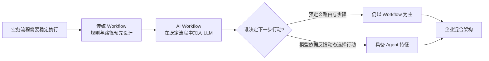

> <strong>术语注释</strong>：Workflow（工作流）是按照特定依赖关系组织的一组活动及其控制逻辑；LLM（Large Language Model，大语言模型）是处理自然语言等信息的模型；Agent（智能体）是能围绕目标进行受约束决策、行动并利用反馈推进任务的系统。不同机构对 Agent 的定义存在差异，本文采用工程分析口径，而非唯一行业标准。

---

## 一、为什么先有 Workflow：业务需要可重复、可审计的执行过程

企业任务通常不只需要一个答案，还需要一连串有依赖的动作。例如采购审批需要收集申请、校验金额、确定审批人、留痕和归档。若把这些动作全部交给人工临时判断，容易遗漏步骤，也难以追踪责任。因此，工作流系统首先解决的是<strong>“让业务按可管理的流程运行”</strong>。

传统 Workflow 的核心不是某种特定编程语言，而是将业务过程明确表达为：<strong>活动（Activity）+ 连接关系（Transition）+ 条件（Condition）+ 状态（State）+ 执行者（Actor）+ 异常处理（Exception Handling）</strong>。流程可能是顺序、分支、并行、循环或人工审批，并非只能是一条直线。

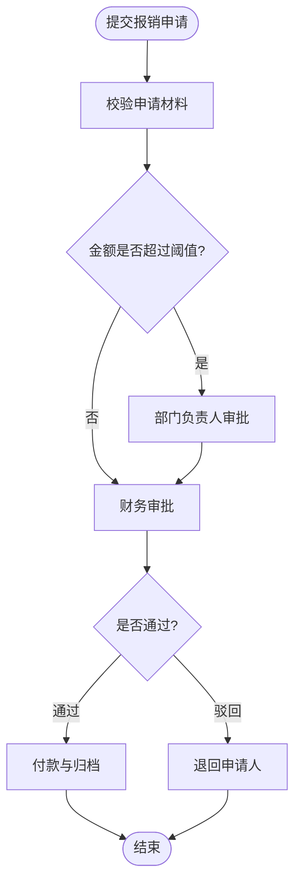

在此例中，金额阈值、审批顺序和处理规则由业务制度及开发者预先定义。即使工作流中有复杂分支、循环、数据库操作和人工交互，它仍然是传统工作流。

### 1.1 传统工作流常见组成

| 组成 | 作用 | 例子 |
|---|---|---|
| Trigger（触发器） | 决定何时启动 | 收到审批申请 |
| Task / Activity（任务／活动） | 执行一个业务步骤 | 校验发票 |
| Gateway（网关） | 控制分支、汇合与并行 | 金额超限走主管审批 |
| Transition（流转） | 指定步骤之间的关系 | 审批后进入付款 |
| State（状态） | 表示执行进度与业务数据 | `pending_approval` |
| Human Task（人工任务） | 等待人处理 | 经理签字 |
| Error Handler（异常处理） | 处理失败与补救 | 支付失败后告警 |

> <strong>术语注释</strong>：BPM（Business Process Management，业务流程管理）关注业务流程的设计、执行、监控与优化；BPMN（Business Process Model and Notation，业务流程模型与标记法）是用于描述业务流程的标准图形符号体系；DAG（Directed Acyclic Graph，有向无环图）常用于表达无循环的任务依赖，但<strong>不是所有 Workflow 都是 DAG</strong>，许多工作流引擎允许循环、等待和事件驱动执行。

### 1.2 传统 Workflow 的优势与局限

传统 Workflow 的优势在于步骤明确、行为可预测、权限容易控制、过程容易审计，特别适合财务审批、订单流转和标准化生产流程。局限在于面对开放式自然语言、非结构化文档和无法事先枚举的异常时，开发者需要编写越来越多的判断规则。

这并不意味着传统 Workflow 过时：<strong>越是高风险、强合规、流程稳定的环节，越需要确定性控制。</strong>

---

## 二、从传统 Workflow 到 AI Workflow：智能化的是节点，不一定是流程控制权

大模型引入后，工作流中的部分节点不再只能使用 `if/else` 或固定算法，也可以通过 LLM 处理语义分类、信息抽取、内容生成、文本比较与质量判断。于是出现了 AI Workflow 或 LLM Workflow。

<strong>关键变化</strong>：原来开发者必须把所有判断规则写清楚，现在可以让模型理解自然语言并输出一个结构化判断结果；但系统仍可能只允许它在几个预设分支中选择。

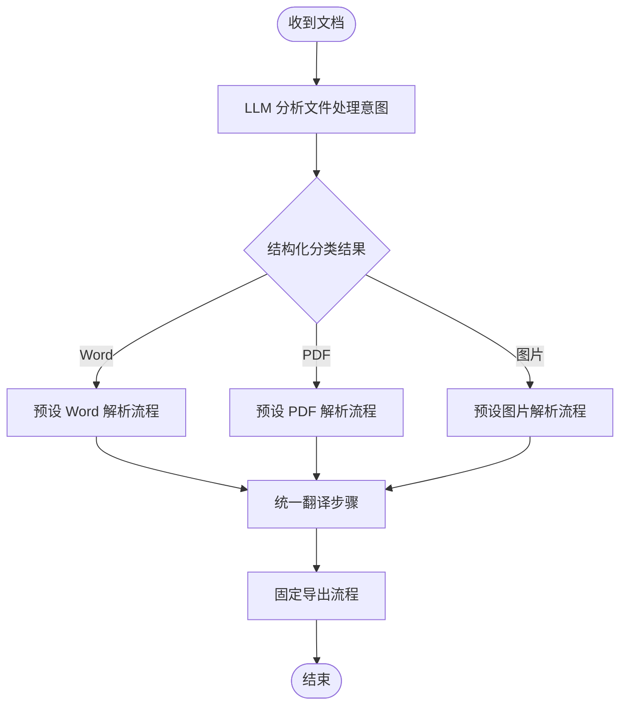

这个系统已经具备语义理解能力，但<strong>模型的控制权被限制为“在开发者提供的分支中选择”</strong>，并不自动等于 Agent。

### 2.1 AI Workflow 的常见模式

| 模式 | 英文术语 | 机制 | 典型用途 |
|---|---|---|---|
| 链式调用 | Prompt Chaining | 前一步结果作为后一步输入 | 抽取→翻译→校验 |
| 智能路由 | Routing | LLM 对输入分类并选择预设路径 | Word/PDF/图片处理 |
| 并行处理 | Parallelization | 多个任务同时执行后汇总 | 多维质量评分 |
| 编排者—工作者 | Orchestrator–Workers | 编排组件拆分并分发子任务 | 按章节并行翻译 |
| 评估—优化 | Evaluator–Optimizer | 生成结果后评估，不合格则改进 | 翻译结果反复修订 |

> <strong>术语注释</strong>：Prompt（提示词）是向模型表达任务和约束的输入；Routing（路由）是依据规则或模型输出选择处理路径；Evaluator–Optimizer（评估者—优化者）是“生成—评估—修改”的闭环模式。<strong>存在循环不等于一定是 Agent</strong>：若循环次数、步骤和回退条件完全由工作流定义，它仍可被归类为 Workflow。

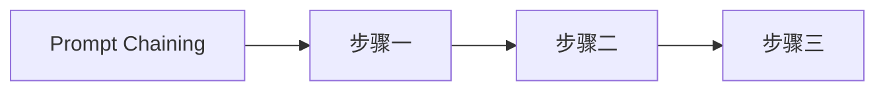

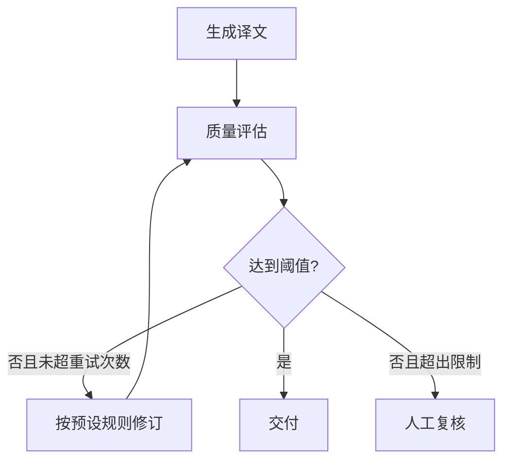

以上两张图强调：AI Workflow 可以包含多次模型调用、质量检查和反馈回路；判断边界时不能只看是否“用了大模型”“用了工具”或“循环了几轮”。

---

## 三、Agent 又改变了什么：从执行既定路径，到动态决定行动

Agent 的工程特征在于：开发者给定目标、工具、权限和约束后，模型能够依据当前观察结果，在运行时决定下一步采用什么行动，并在必要时调整原有计划。Agent 的运行时（Runtime）负责真正执行工具、传递结果、记录状态和实施限制。

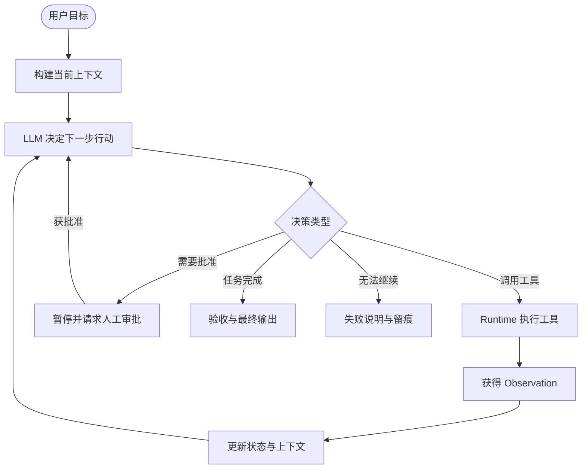

> <strong>术语注释</strong>：Runtime（运行时）是协调模型调用、工具执行和状态管理的软件执行层；Observation（观察结果）指工具或环境返回的信息；Tool Calling（工具调用）通常先由模型产生工具调用请求，再由运行时实际执行；HITL（Human-in-the-Loop，人在回路中）表示在关键节点引入人工判断、授权或纠正。

<strong>注意</strong>：Agent 并不意味着完全自主、没有约束，也不意味着每个任务都要调用工具。模型可以在明确权限内动态决策；系统依然需要设置工具白名单、超时、预算、审批和终止条件。

### 3.1 三者真正的差别：决策权的位置

| 维度 | 传统 Workflow | AI Workflow | Agent |
|---|---|---|---|
| 任务步骤 | 预先设计 | 主要预先设计 | 可运行时动态选择 |
| 条件判断 | 规则／程序 | 可由 LLM 进行语义判断 | 模型可综合反馈决定行动 |
| 工具使用 | 预先编排 | 预先编排或预设路由 | 可在授权范围内动态选择 |
| 异常处理 | 固定规则 | 固定规则与模型辅助判断 | 可动态调整策略，但仍受控制 |
| 是否需要 LLM | 不需要 | 通常需要 | LLM Agent 通常需要 |
| 适合任务 | 稳定、强合规 | 稳定流程中的非结构化判断 | 不确定、多步骤、开放式任务 |
| 可预测性 | 通常较高 | 中等至较高 | 相对较低，需额外治理 |

这里的分类是帮助工程设计的<strong>分析框架</strong>，不是各家厂商统一采用的严格等级。一个复杂系统也可以同时包含这三种机制。

---

## 四、核心争议：LLM 判断条件分支，算不算 Agent？

<strong>结论：仅凭 LLM 判断条件分支，通常不足以称为 Agent。</strong> 因为“选择预设分支”与“根据环境反馈持续决定下一步行动”不是同一种控制能力。

### 4.1 四个由浅入深的案例

<strong>案例 A：规则路由</strong>。代码判断文件扩展名：`.docx` 进入 Word 分支、`.pdf` 进入 PDF 分支。这是传统 Workflow。

<strong>案例 B：LLM 智能路由</strong>。模型阅读用户需求，返回 `{"route":"pdf_translation"}`；工作流执行预先定义的 PDF 翻译流程。这通常是 AI Workflow，<strong>模型参与决策，但只在有限选项内选择</strong>。

<strong>案例 C：LLM 决定工具及后续步骤</strong>。模型检查解析结果后决定调用 OCR、重新分割版面或直接翻译；工具执行后又根据质量结果选择继续修复、换工具或请求人工确认。此时具备典型 Agent 特征。

<strong>案例 D：Workflow 中嵌入 Agent</strong>。文件接收、权限校验、最终审批都固定；中间的复杂排版修复由 Agent 自主选择处理步骤。整体应描述为<strong>混合架构（Hybrid Architecture）</strong>，而不是强行将整个系统归为某一种。

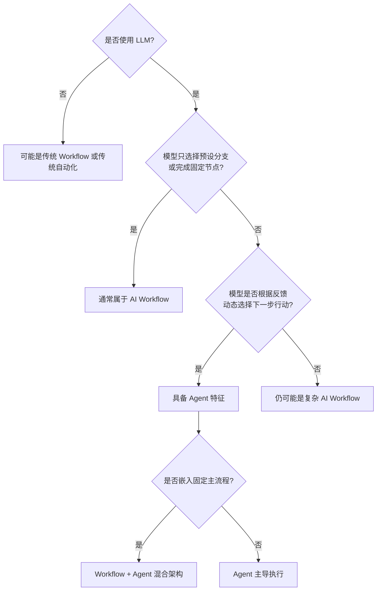

### 4.2 为什么“循环”和“工具调用”也不能单独证明是 Agent？

一条固定的“生成→检查→失败则重试”流程，即使调用 LLM 五次，也可能只是带反馈的 Workflow；反过来，一个 Agent 也可能一次模型决策就完成任务。<strong>判断重点是运行时行动策略由谁决定、决策空间有多大，以及是否根据观察结果重新选择行动。</strong>

同理，调用搜索 API、数据库、OCR 并不是 Agent 独有的能力。工作流也能调用工具。差别是<strong>调用时机、工具选择和后续路径是否由模型动态决定</strong>。

---

## 五、进一步澄清：Agent 与 Workflow 不是互斥概念

可以从两个维度观察系统：一是<strong>执行过程的可预设程度</strong>，二是<strong>模型拥有的行动决策权</strong>。二者并非非黑即白。

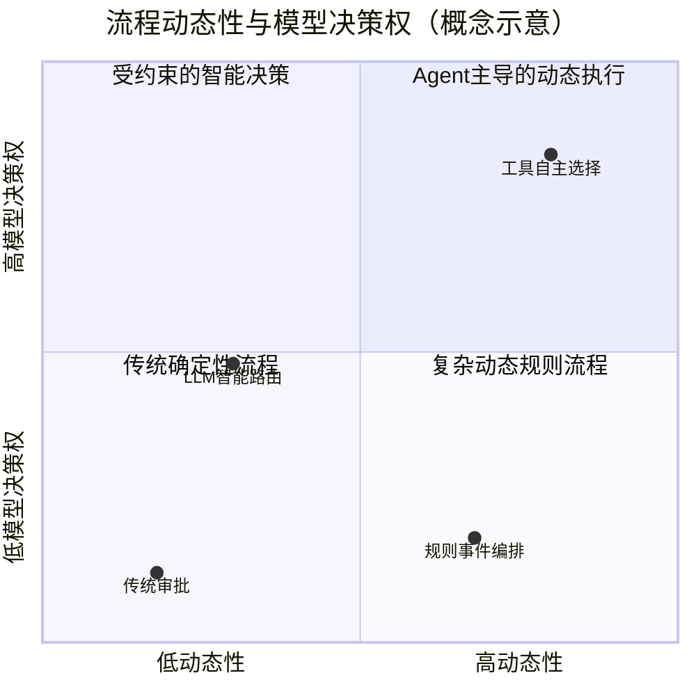

> 上图为帮助理解的概念坐标，不是测量数据或权威分级。Mermaid `quadrantChart` 的中文标签显示可能受 GitHub 渲染器版本影响；核心结论以正文为准。

### 5.1 两种常见混合方式

<strong>方式一：Workflow 调用 Agent。</strong> 工作流控制关键业务阶段，在某个不确定性高的节点委托 Agent 完成子任务，之后回到主流程。

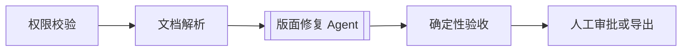

<strong>方式二：Agent 调用 Workflow。</strong> Agent 负责理解用户目标并决定使用哪条稳定、可复用的工作流，工作流负责可靠执行标准化子过程。

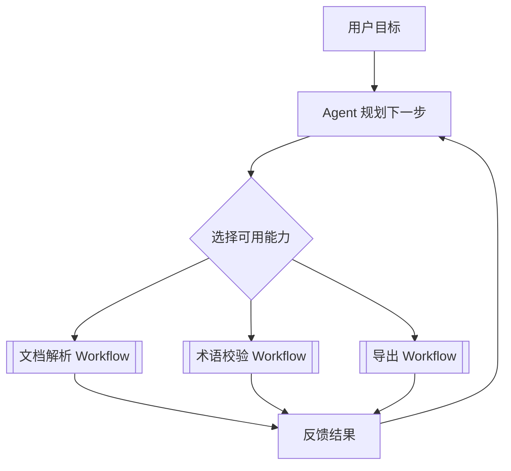

> <strong>术语注释</strong>：Hybrid Architecture（混合架构）表示确定性编排与动态模型决策结合；Orchestration（编排）指协调多个任务或服务的顺序、依赖和资源；Subworkflow（子工作流）指可复用的局部流程。两种混合方式的差别在于<strong>主控制权</strong>属于工作流还是 Agent。

---

## 六、企业系统如何选型：从不确定性和风险出发

架构选型不应该从“Agent 更先进”出发，而应该从业务问题出发。首先判断任务是否能够用明确规则描述，再判断是否需要模型理解非结构化输入，最后才考虑是否真的需要模型动态决定行动。

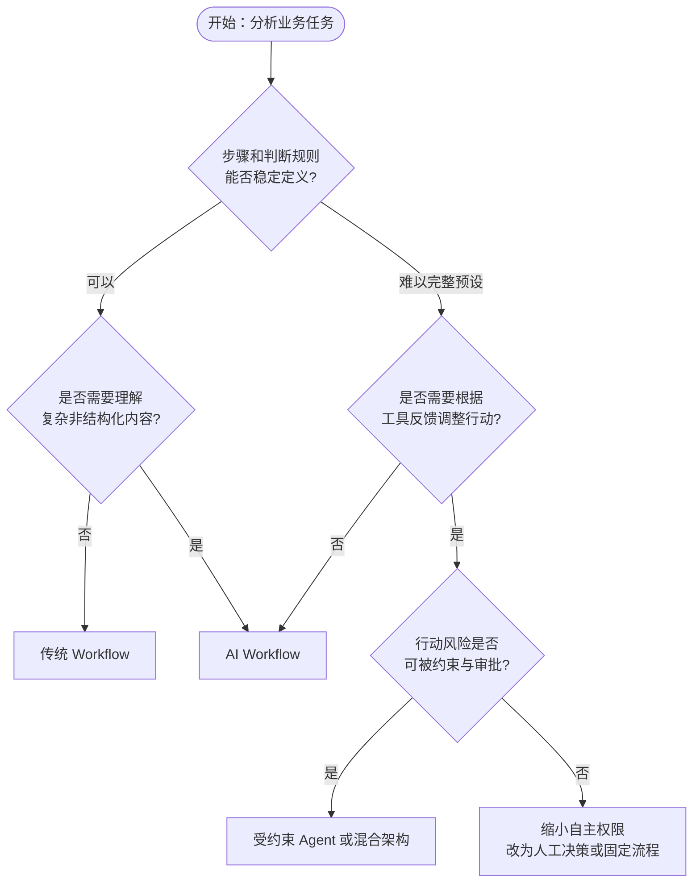

### 6.1 主要工程权衡

| 评估项 | 为什么重要 | 设计建议 |
|---|---|---|
| 任务确定性 | 是否能预先枚举步骤 | 能固定就先固定 |
| 输入复杂度 | 是否存在非结构化文本、图像 | 在节点引入 LLM |
| 路径不确定性 | 是否需要临时选择工具和策略 | 必要时引入 Agent |
| 风险等级 | 是否涉及付款、删除、外发 | 强权限与人工审批 |
| 延迟与成本 | 多轮推理可能增加耗时与费用 | 设置模型调用和工具预算 |
| 可解释与审计 | 是否需要还原每一步决策 | 记录状态、工具输入输出与日志 |
| 失败恢复 | 是否可能部分完成或重复执行 | 检查点、幂等与补偿机制 |

> <strong>术语注释</strong>：Guardrails（护栏／安全约束）是对输入、输出及工具行为设置的控制措施；Tracing（执行链路追踪）用于记录一次任务中各模型和工具调用；Idempotency（幂等性）指同一操作重复执行不会造成额外不期望的效果；Compensation（补偿操作）指在分布式业务失败后执行的逆向或修正动作，未必等同于数据库事务回滚。

<strong>重要取舍</strong>：模型决策空间越大，系统通常越灵活，但测试覆盖、成本控制、权限治理和结果可预测性也越困难。应当只在动态决策能够带来明确收益的地方增加自主性。

---

## 七、贯穿案例：企业文档翻译系统的三次架构演进

为了把前面的概念落到同一个业务中，考虑如下目标：<strong>将中文 Word、PDF 或图片翻译为英文，尽量保留原版式，并检查漏译、裁切和术语一致性。</strong>

### 7.1 第一阶段：传统 Workflow

文件类型由扩展名或解析库判断，按固定步骤执行：解析→翻译服务→导出。优点是流程简单、容易调试；但面对扫描 PDF、复杂图片排版等问题时，可能需要大量特例规则。

### 7.2 第二阶段：AI Workflow

在固定主流程中加入 LLM：识别文档内容、提取术语、翻译、质量打分、路由到预设修复分支。模型提高了语义理解能力，但修复路径仍由开发者事先设计。

### 7.3 第三阶段：Workflow + Agent

主流程负责上传、鉴权、解析、存储、交付；当质量检测发现复杂问题时，局部 Agent 可以依据诊断结果决定调用哪些修复工具、是否重新排版，以及何时请求人工介入。

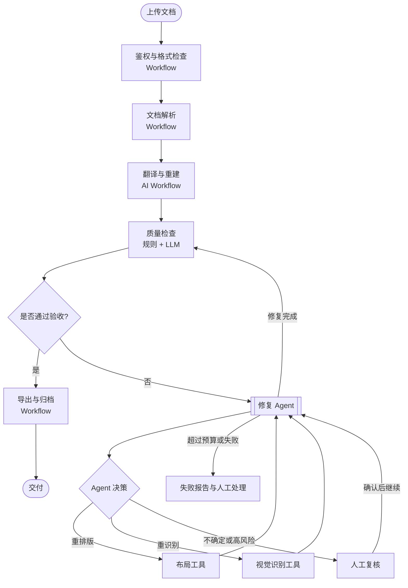

这里的<strong>质量检查可以是 AI Workflow 节点，而修复策略的动态选择才是 Agent 的主要价值</strong>。是否最终称为 Agent，还取决于实现中是否真正让模型控制行动，而不是仅把“Agent”作为组件名称。

### 7.4 三种架构的比较

| 方案 | 主要优点 | 主要问题 | 建议场景 |
|---|---|---|---|
| 传统 Workflow | 稳定、可审计、低复杂度 | 对复杂异常适应较弱 | 标准格式批量处理 |
| AI Workflow | 能理解非结构化内容，路径可控 | 难覆盖未知异常 | 多数常规文档翻译 |
| 混合架构 | 保留确定性，又能处理复杂例外 | 需要严格约束 Agent | 复杂论文、图表与版面修复 |

---

## 八、常见误区：避免概念混淆

| 说法 | 判断 | 原因 |
|---|---|---|
| “只要用了大模型就是 Agent” | 错误 | LLM 可以只是工作流中的一个处理节点 |
| “LLM 能判断 `if/else` 就是 Agent” | 通常错误 | 选择预设分支不等于自主决定执行策略 |
| “有 Tool Calling 就一定是 Agent” | 错误 | Workflow 也能调用工具 |
| “能循环重试就是 Agent” | 错误 | 固定的评估—修订循环仍可能是 Workflow |
| “Agent 必须完全自主、无需人工” | 错误 | 生产系统常要求审批、预算和权限控制 |
| “Workflow 只能顺序执行” | 错误 | 可以有并行、分支、事件、循环和人工任务 |
| “Agent 比 Workflow 高级，所以应该全面替代” | 错误 | 两者针对不同不确定性与风险，常组合使用 |
| “工作流框架里写了 Agent 节点，系统就一定是 Agent” | 不充分 | 需要检查实际的控制权与执行机制 |

---

## 九、面试高频问题与回答思路

### Q1：传统 Workflow 和 AI Workflow 的区别是什么？

传统 Workflow 主要依赖预定义规则和处理步骤；AI Workflow 将 LLM 引入部分节点，增强对非结构化输入的理解、分类和生成能力。但在典型 AI Workflow 中，主要执行路径仍由开发者控制。

### Q2：LLM 选择条件分支，为什么不一定算 Agent？

因为它可能只负责返回一个分类标签，后续执行完全遵循预先定义的分支。Agent 的关键特征是模型能在授权范围内根据反馈动态选择下一步行动，而不只是完成单次语义判断。

### Q3：如何判断系统是 Agent 还是 Workflow？

检查三个问题：<strong>谁决定下一步？谁选择工具？执行失败后谁决定调整策略？</strong> 如果这些关键决策主要由固定流程控制，则偏向 Workflow；如果模型依据环境反馈动态控制行动，则具备 Agent 特征。

### Q4：Workflow 可以有循环和并行吗？

可以。传统工作流引擎就支持条件分支、并行网关、循环和等待事件。因此，不能用是否循环或并行来判断 Agent。

### Q5：企业项目为什么经常采用混合架构？

因为权限、审计、数据流转等环节需要确定性，而复杂异常和开放式任务需要灵活决策。混合架构能将自主性限定在真正需要的环节，降低成本与风险。

### Q6：如果让 Agent 调用一个固定 Workflow，谁控制流程？

Agent 控制是否、何时调用该子工作流；子工作流内部步骤仍由预定义编排控制。这是 Agent 调用 Workflow 的典型混合模式。

### Q7：你会如何改造文档翻译系统？

先保留上传、权限、解析、翻译、导出等稳定主流程；再引入 LLM 做语义路由与质量评估；最后仅在复杂版面修复等不确定性较高的环节加入受约束 Agent，并配套最大重试次数、预算、日志和人工确认。

---

## 十、知识图谱与思维导图总览

### 10.1 概念全景思维导图

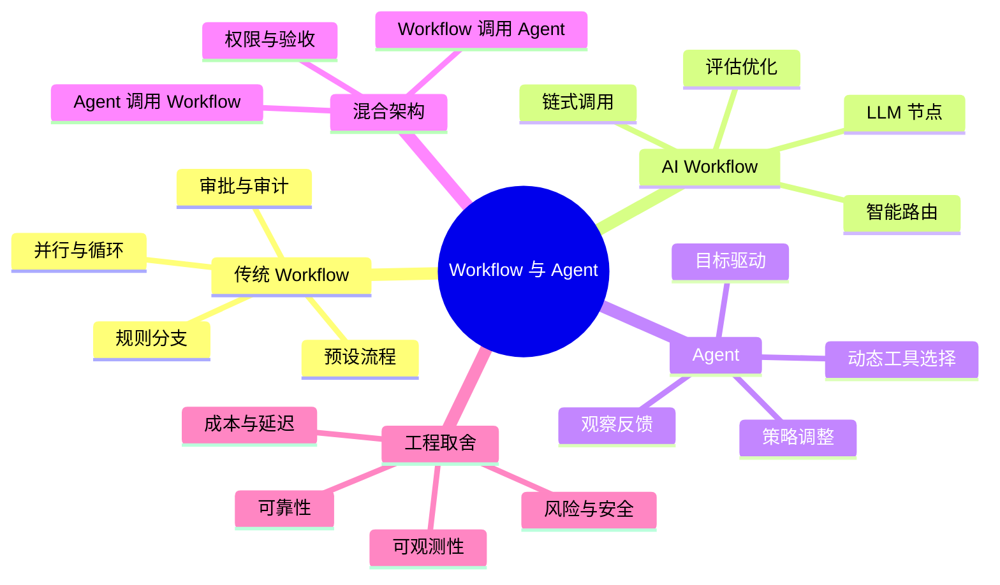

### 10.2 判断边界的三个问题

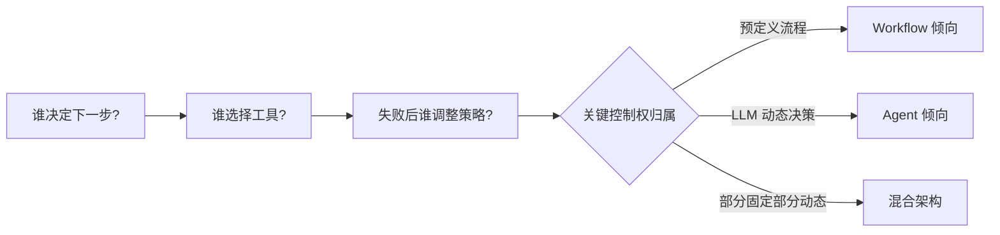

### 10.3 企业设计分层图

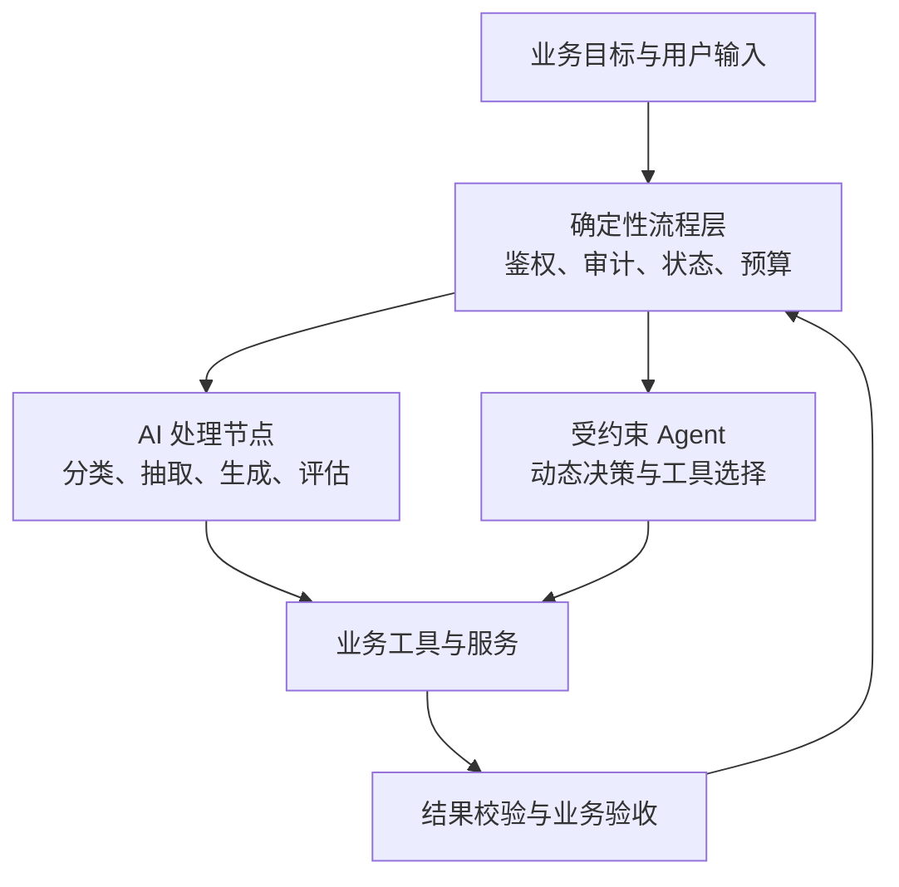

### 10.4 本篇与后续章节的知识连接

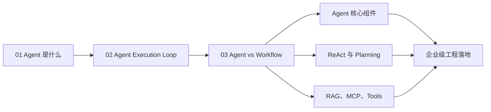

---

## 十一、术语速查表

| 缩写／术语 | 全称 | 中文含义 |
|---|---|---|
| Workflow | Workflow | 工作流；按依赖关系组织任务与控制逻辑 |
| BPM | Business Process Management | 业务流程管理 |
| BPMN | Business Process Model and Notation | 业务流程模型与标记法 |
| DAG | Directed Acyclic Graph | 有向无环图 |
| AI Workflow | Artificial Intelligence Workflow | 使用 AI 能力的工作流 |
| LLM | Large Language Model | 大语言模型 |
| Agent | AI Agent | 能围绕目标决策与行动的智能体系统 |
| Runtime | Runtime | 执行模型与工具调用的运行时 |
| Routing | Routing | 路由；选择处理路径 |
| Prompt Chaining | Prompt Chaining | 提示词链式调用 |
| Orchestrator–Workers | Orchestrator–Workers | 编排者—工作者模式 |
| Evaluator–Optimizer | Evaluator–Optimizer | 评估—优化模式 |
| Tool Calling | Tool Calling | 工具调用机制 |
| Observation | Observation | 工具或环境返回的观察结果 |
| HITL | Human-in-the-Loop | 人在回路中／人工介入 |
| Guardrails | Guardrails | 安全与行为约束 |
| Tracing | Tracing | 执行链路追踪 |
| Idempotency | Idempotency | 幂等性 |
| Hybrid Architecture | Hybrid Architecture | 混合架构 |
| Subworkflow | Subworkflow | 子工作流 |

---

## 十二、官方参考资料与延伸阅读

> 下列链接用于核对概念、工作模式和工程建议。正文中的比较表和决策树属于对多份资料的<strong>综合整理</strong>，不是逐字引用某一家机构的正式分级。

1. <strong>Anthropic — Building Effective Agents</strong>：直接区分 Workflow 与 Agent，介绍 Prompt Chaining、Routing、Parallelization、Orchestrator–Workers、Evaluator–Optimizer 等模式。  
   https://www.anthropic.com/engineering/building-effective-agents
2. <strong>LangChain / LangGraph — Workflows and Agents</strong>：说明工作流的预定义路径与 Agent 的动态工具使用，并提供典型模式。  
   https://docs.langchain.com/oss/python/langgraph/workflows-agents
3. <strong>OpenAI — A Practical Guide to Building Agents</strong>：讨论 Agent 定义、适用场景、工具、指令与执行控制。  
   https://cdn.openai.com/business-guides-and-resources/a-practical-guide-to-building-agents.pdf
4. <strong>OpenAI Agents SDK — Running Agents</strong>：说明 Agent 运行循环、工具调用、交接与最终输出。  
   https://openai.github.io/openai-agents-python/running_agents/
5. <strong>Object Management Group — BPMN</strong>：传统业务工作流的建模标准及背景。  
   https://www.omg.org/spec/BPMN/
6. <strong>LangGraph — Thinking in LangGraph</strong>：状态、节点、执行恢复和人工介入等工程问题。  
   https://docs.langchain.com/oss/python/langgraph/thinking-in-langgraph

---

## 十三、最终结论：用“控制权”理解技术演进

<strong>第一层：传统 Workflow</strong> 解决“如何按明确规则稳定执行”；<strong>第二层：AI Workflow</strong> 解决“如何让固定流程理解复杂内容并作出智能判断”；<strong>第三层：Agent</strong> 进一步解决“如何让系统根据实时反馈动态选择行动”。

三者不是简单的新旧替代关系。对于企业系统，正确的问题不是“能不能把所有 Workflow 改成 Agent”，而是：<strong>哪些步骤必须确定、哪些节点需要智能理解、哪些局部任务值得赋予模型动态决策权。</strong> 这才是选择架构的起点。
