# Agent 整体架构与关键模块：从模型调用到企业级执行系统

> 学习阶段：Agent 基础篇 · 第 04 讲  
> 前置知识：[01 Agent 是什么](./01-What-is-an-Agent.md) · [02 Agent 执行循环](./02-Agent-Execution-Loop.md) · [03 Agent 与 Workflow](./03-Agent-vs-Workflow.md)  
> 核心问题：Agent 由哪些模块组成？谁负责决策、执行和约束？如何从最小原型发展为企业级系统？

## 阅读路线

本篇按照“<strong>问题出现 → 架构分层 → 模块职责 → 运行机制 → 数据与控制 → 扩展技术 → 企业工程 → 实战设计</strong>”展开。先建立整体视图，再逐层深入，最后通过企业文档翻译案例把抽象概念连接起来。

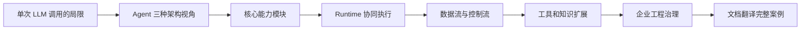

---

## 1. 为什么 Agent 需要架构？

### 1.1 单次 LLM 调用能做什么，不能做什么？

<strong>LLM（Large Language Model，大语言模型）</strong>擅长理解指令、处理语言、生成结构化内容与提出行动建议。但单次模型调用本身不保证能够访问实时数据、执行外部操作、长期保留任务进度、管理权限或验证业务结果。模型输出“应该调用文档解析工具”，并不等于工具已经执行。

以“翻译一份含复杂表格和插图的 PDF，保留版式并导出 Word”为例，至少存在四个独立问题：①理解用户目标；②调用解析、翻译、排版等外部能力；③保存中间结果并根据校验反馈调整；④确保权限、可靠性、交付质量。只有第一个问题主要依赖语言模型本身，其他问题必须依靠外围系统协同。

因此，Agent 不是简单的“模型加一段提示词”，而是<strong>围绕目标组织模型决策、工具执行、状态管理和约束机制的系统</strong>。是否需要完整的自主决策循环，取决于任务的不确定性；固定任务也可能更适合 AI Workflow。

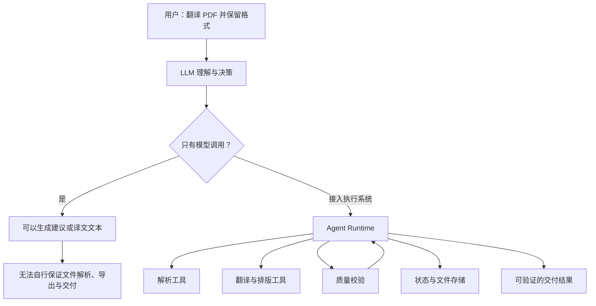

### 1.2 本章的架构不是唯一标准

不同厂商对 Agent、Runner、Harness、Memory 等术语的定义存在差异。本文采用<strong>教学用三视角模型</strong>：概念架构说明“有什么能力”；运行时架构说明“能力如何协同”；企业工程架构说明“如何可靠运行”。这是一种分析方法，不是所有框架强制遵循的标准分层。[1][2][3]

## 2. 三种架构视角：概念、运行时与企业工程

### 2.1 概念架构：Agent 依靠什么完成任务？

概念层聚焦 Model、Instructions、Context、State、Memory、Tools、Planning 等能力。注意它们<strong>并不必然对应独立微服务或独立类</strong>：Planning 可能由模型完成，Context Builder 可能只是调用模型前的一段逻辑，Memory 可能借助数据库和检索工具实现。

### 2.2 运行时架构：谁推动执行循环？

运行时层负责接收请求、准备模型输入、调用模型、解释工具调用、执行工具、处理观察结果、更新状态，以及决定继续、暂停、交接或终止。它让“模型建议下一步”变成“系统真正执行下一步”。

### 2.3 企业工程架构：如何可控地交付？

企业层引入身份与权限、任务队列、存储、日志与追踪、评估、限流、成本管理、审批、部署等能力。模型的安全提示不能替代服务端权限检查；模型声称“任务完成”也不能替代业务验收。

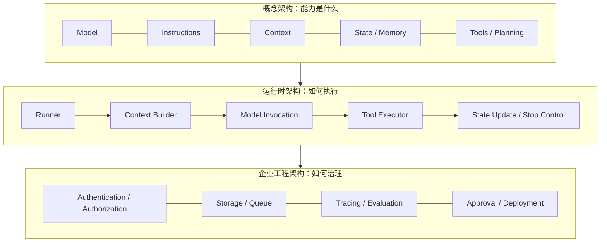

<strong>记忆要点：</strong>概念架构是能力清单；运行时架构是执行机制；企业工程架构是质量与治理保障。三者是不同观察角度，而非只能单向依赖的严格技术栈。

## 3. 核心模块：职责、输入输出与边界

| 模块 | 核心职责 | 典型输入与输出 | 容易混淆的边界 |
|---|---|---|---|
| Model（模型） | 理解、推理、生成决策或内容 | 输入上下文 → 文本、结构化结果、工具调用请求 | 模型不直接等于工具执行器 |
| Instructions / Prompt（指令） | 规定目标、角色、约束和输出格式 | 规则、任务说明 → 模型行为约束 | 提示词不是权限控制 |
| Context（上下文） | 为当前模型调用准备可见信息 | 指令、历史、状态、检索结果 → 当前输入 | Context 不等于全部 Memory |
| State（状态） | 记录当前任务进度和中间结果 | 步骤结果 → 更新后的任务状态 | State 不等于聊天记录 |
| Memory（记忆） | 保存和取回后续有价值的信息 | 经验、偏好、事实 → 可复用信息 | Memory 不一定长期持久化 |
| Tools（工具） | 获取外部信息或执行操作 | 工具名称、参数 → 执行结果或错误 | Tool Calling 不等于工具已执行 |
| Planning（规划） | 分解目标、安排或调整行动 | 目标与反馈 → 计划、子任务 | 不一定需要独立 Planner |
| Orchestration（编排） | 协调执行步骤、路由与交接 | 当前状态 → 下一执行单元 | 不一定由模型独占控制 |
| Guardrails（护栏） | 对输入、输出及行动实施约束 | 内容、参数、策略 → 放行、拦截、升级 | 不能替代服务端授权 |

### 3.1 Model：决策核心，不是完整系统

模型可以回答问题、提取字段、生成计划、选择工具或评估结果。但是否真的执行操作，由运行时和工具层决定。不同 Agent 也可以使用不同模型，例如用轻量模型完成意图分类，用高能力模型处理复杂排版修复。

### 3.2 Instructions：行为规则与任务要求

<strong>Prompt（提示词）</strong>是提供给模型的输入指令及相关信息的统称；<strong>System Instructions（系统级指令）</strong>通常用于定义长期约束；任务指令用于描述本次目标。企业场景应把“不得未经批准发送外部邮件”落实到工具授权或审批节点，而不能只写在 Prompt 中。

### 3.3 Context：模型此刻能看到什么

<strong>Context Window（上下文窗口）</strong>指模型单次处理输入与输出所受的长度限制。Context Builder（上下文构建器）需要选择有用信息、去除冗余、压缩历史，避免上下文过长或被无关内容污染。上下文管理是 Agent 能否持续正确决策的关键因素。[4]

### 3.4 State：任务现在进行到哪里

State 记录任务 ID、当前步骤、已完成文件、质量检查结果、重试次数、待审批操作等。即使模型调用失败，系统也可以根据状态决定是否重试或恢复。

### 3.5 Memory：哪些信息值得跨轮次复用

Memory 可以包括当前会话内的工作记忆、跨会话保留的偏好、专业术语、经验或事实。是否保存、保存多久、何时检索、如何删除，都属于设计决策。不要把“有数据库”直接等同于“有有效记忆”。

### 3.6 Tools：连接真实世界的执行能力

工具可以是本地函数、HTTP API、数据库查询、文档解析器、文件系统操作或外部服务。<strong>Function Calling（函数调用机制）</strong>通常是模型以结构化形式提出工具调用请求的方式；真正执行由应用代码完成。工具必须校验参数、权限、超时与错误。[1]

### 3.7 Planning 与 Orchestration：计划和控制不完全相同

Planning 解决“怎样分解和安排任务”；Orchestration 解决“哪个步骤现在运行、如何传递数据、失败怎么办”。规划可能是一次性的，也可能根据反馈重新生成；编排可以是固定 Workflow，也可以包含模型驱动的动态决策。[5]

### 3.8 Guardrails：把风险拦在关键边界

Guardrails（护栏）可用于输入筛查、输出格式校验、工具参数检查、敏感信息处理和人工升级。但<strong>安全策略必须在真实执行边界生效</strong>，例如工具服务端的授权、文件路径限制和审计记录。

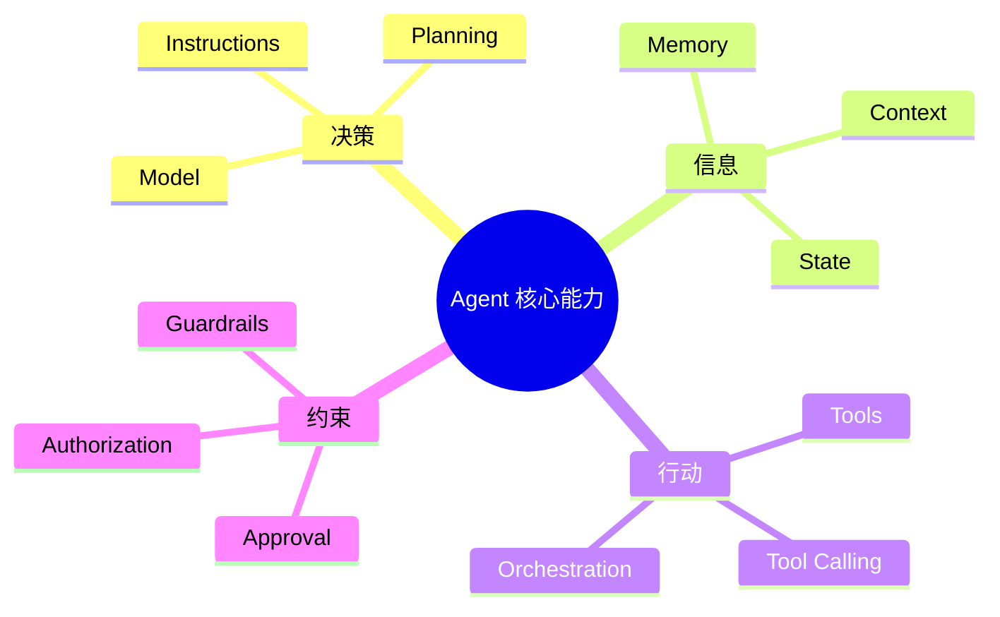

## 4. Runtime：谁让 Agent 真正运行起来？

<strong>Runtime（运行时）</strong>指提供执行、状态和控制能力的环境或机制；<strong>Runner（运行器）</strong>通常指启动并推进一次 Agent 执行的入口；<strong>Harness（运行支架/执行框架）</strong>常指围绕模型提供工具、状态、约束和反馈的外围系统。不同产品中这些名称可能重叠，不应机械映射为固定的三个组件。

### 4.1 一次执行的内部协作

1. 接收用户目标，创建 Run（一次任务运行）及初始 State。
2. Context Builder 组合 Instructions、历史、状态和检索材料。
3. Model Runner 调用 LLM，取得最终回答、工具请求或其他结构化决策。
4. Tool Executor 校验参数与权限，执行工具并返回 Observation（观察结果）。
5. State Manager 保存中间结果，决定哪些内容进入下一轮 Context。
6. Stop Controller 根据业务验收、轮次、时间、费用、错误和审批状态判断继续或停止。

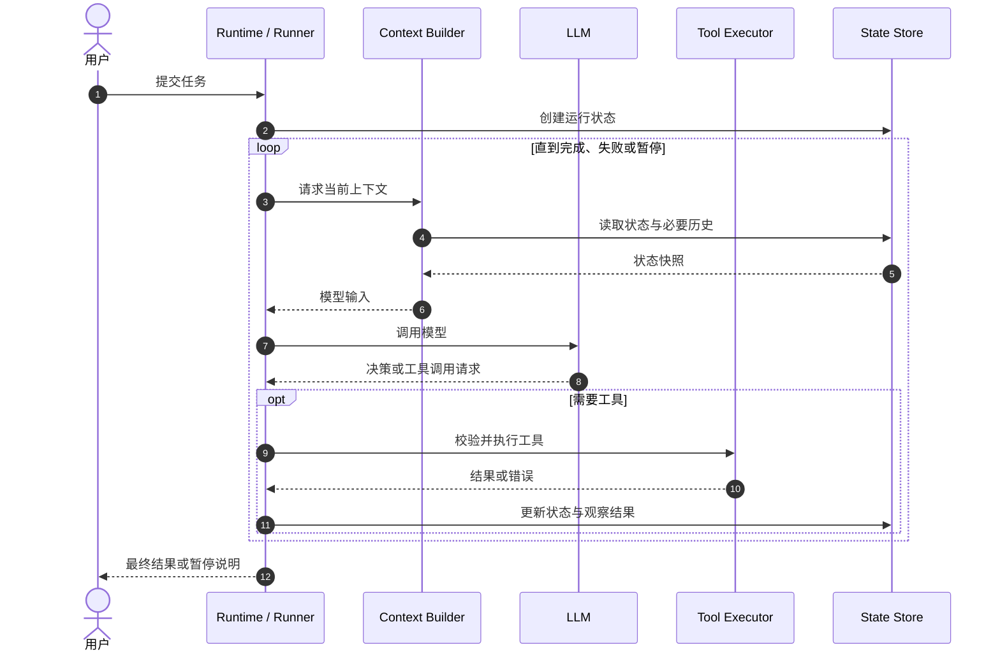

### 4.2 控制流与数据流是两件事

<strong>Control Flow（控制流）</strong>决定谁先执行、下一步去哪、何时停止；<strong>Data Flow（数据流）</strong>决定什么数据被读取、修改和传递。例如“质量评分不合格时返回排版”是控制流，“质量评分和待修复区域坐标传给排版器”是数据流。区分二者，有助于定位“分支正确但数据传错”的故障。

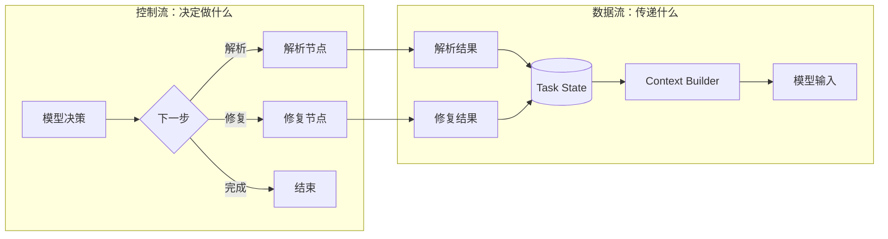

### 4.3 Runtime 不等于 Agent 自主性

即使运行时支持工具、状态和循环，也不代表所有流程都由模型决定。一个 Runtime 可以运行固定 Workflow、AI Workflow 或自主程度较高的 Agent。<strong>自主性取决于决策权如何分配，而不是框架名称。</strong>

## 5. Context、State、Memory、RAG 的关系

这是架构学习中最容易混淆的一组概念：State 回答“当前任务是什么状态”；Memory 回答“什么信息值得保留”；RAG 回答“如何按需取得外部知识”；Context 回答“这次模型调用实际看到了什么”。

<strong>RAG（Retrieval-Augmented Generation，检索增强生成）</strong>是先检索外部信息，再将相关内容提供给模型生成答案的模式。它不是所有 Agent 的必备组件，也不是 Memory 的同义词。[6]

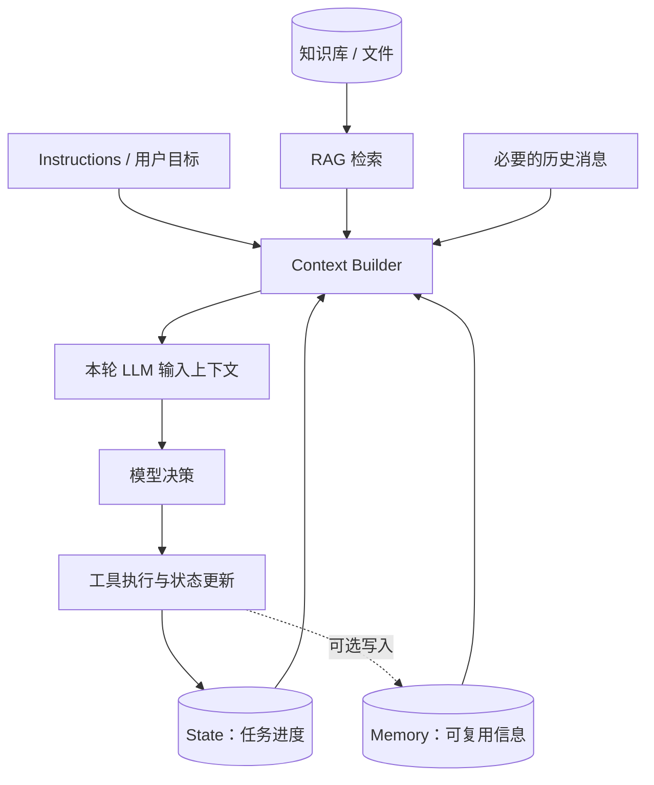

### 5.1 文档翻译实例

假设系统正在翻译第 8 页：State 保存“当前第 8 页、前 7 页已完成、第 6 页曾重试一次”；Memory 保存“本项目已确认的术语译法”；RAG 检索产品手册中的专业词汇；Context Builder 只挑选第 8 页文本、必要术语和质量要求放进模型上下文。这样既能利用历史，又不需要把整个文档和全部历史重复发送给模型。

### 5.2 数据生命周期与存储策略

短期运行状态可存于内存或缓存，重要任务状态可写入数据库；大型文档、图片和导出文件通常存对象存储或文件存储；可检索知识可以存全文索引或向量库。具体选型由数据量、检索方式、成本、合规要求和恢复目标决定，<strong>不是所有 Agent 都必须配备 Redis、向量数据库和消息队列</strong>。

## 6. 工具、知识与工作模式：哪些是模块，哪些是技术？

| 概念 | 类型 | 在架构中的位置 | 是否必备 |
|---|---|---|---|
| Function Calling | 模型与工具交互机制 | 模型输出 → 工具执行接口 | 否 |
| MCP | 连接协议 | 工具/资源集成边界 | 否 |
| RAG | 知识获取模式 | 检索 → Context | 否 |
| Skills | 可复用能力或任务指导包 | 指令、资源或工具层 | 否 |
| ReAct | 推理与行动交替的工作模式 | Agent 决策循环 | 否 |
| Planning | 规划能力/策略 | 决策与编排 | 按需 |
| Workflow | 预定义编排方式 | Orchestration | 按需 |
| Multi-Agent | 多智能体协作架构 | 更高层任务分工 | 否 |
| Guardrails | 约束与校验机制 | 输入、模型、工具和输出边界 | 生产场景强烈建议 |
| Tracing | 可观测性机制 | 跨组件调用链 | 生产场景强烈建议 |

<strong>MCP（Model Context Protocol，模型上下文协议）</strong>是连接 AI 应用与外部工具、资源和提示模板的标准化协议；它不是模型本身，也不是 Agent 必须采用的架构。[7]

<strong>ReAct（Reasoning and Acting，推理与行动）</strong>是一类让推理与外部行动交替进行的方法；并非所有 Agent 都必须以同一种显式推理文本形式实现。[8]

<strong>Skills（技能）</strong>通常指可复用的任务指导、资源或操作能力封装，具体格式取决于产品生态；它与底层工具调用协议并不等价。

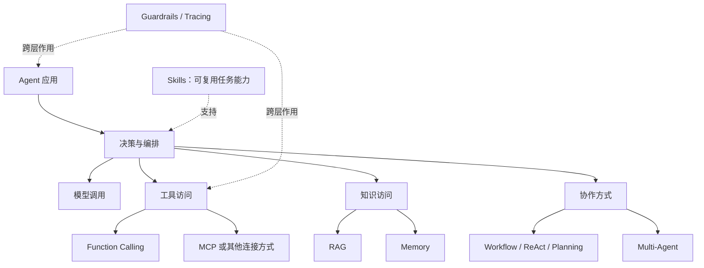

### 6.1 为什么不能把所有名词平铺在同一层？

把 MCP、Memory、ReAct、LLM、RAG、Redis 全部画成“Agent 六大核心模块”会混淆抽象层次：LLM 是模型；Memory 是能力；RAG 是方法；MCP 是协议；ReAct 是工作模式；Redis 是基础设施产品。架构图应先明确“组件职责”，再标注“可选实现技术”。

## 7. 从最小 Agent 到企业级 Agent：架构如何演进？

<strong>阶段一：最小可运行系统。</strong>用户输入、指令、模型、少量工具与简单执行循环，足以验证任务是否适合 Agent。

<strong>阶段二：可控执行。</strong>加入结构化输出校验、状态管理、最大轮次、超时、工具错误处理与必要的人工审批。

<strong>阶段三：可恢复执行。</strong>加入持久化 State、Checkpoint（检查点）、幂等处理、任务队列及中断恢复。

<strong>阶段四：生产治理。</strong>加入认证授权、日志追踪、评估数据集、成本预算、灰度发布、监控告警和审计。

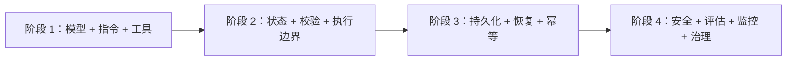

注意：这是常见的<strong>工程能力演进路线</strong>，不是要求每个项目必须按固定顺序采购全部基础设施。对于高风险任务，授权与安全控制必须从第一天就纳入设计。

## 8. 企业级支撑架构：可靠性、安全、可观测性与评估

### 8.1 可靠性：失败不应变成不可控重复执行

需要明确 <strong>Timeout（超时）</strong>、<strong>Retry（重试）</strong>、<strong>Backoff（退避）</strong>、<strong>Idempotency（幂等性）</strong>、<strong>Checkpoint（检查点）</strong> 与 <strong>Resume（恢复执行）</strong> 的适用条件。例如上传文件超时可以安全重试的前提，是使用任务 ID 或幂等键避免重复创建；付款、删除和外发等操作不应仅凭模型判断自动无限重试。

### 8.2 安全：模型提示与真实授权必须分开

<strong>Authentication（认证）</strong>回答“你是谁”；<strong>Authorization（授权）</strong>回答“你能做什么”。企业系统应在工具服务端校验用户权限，采用最小权限原则，限制敏感数据出境与外发，并为高风险动作设置 <strong>HITL（Human-in-the-Loop，人工参与/审批）</strong>。Prompt Injection（提示词注入）意味着外部文档或工具返回内容可能夹带恶意指令，因此不能把检索到的文本视为可信系统指令。[9]

### 8.3 可观测性：不仅要看最终答案

<strong>Trace（执行链路）</strong>用于关联一次任务中的多个步骤；<strong>Span（执行片段）</strong>用于描述其中一次模型调用、工具调用或检索操作；<strong>Latency（延迟）</strong>是耗时。建议记录任务 ID、模型与版本、工具名称、错误类型、轮次、耗时、Token 使用量和最终验收结果，同时注意敏感信息脱敏。

### 8.4 评估：系统“运行结束”不等于“任务成功”

<strong>Evaluation（评估）</strong>要覆盖模型行为、工具调用、过程质量和最终业务结果。对于翻译系统，应分别测量术语一致性、漏译率、版面溢出率、人工返工率、平均耗时和成本；不能仅以“LLM 输出了完成消息”作为成功标准。

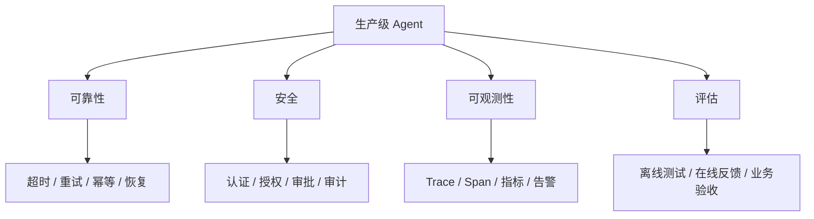

## 9. 企业文档翻译 Agent：完整分层架构案例

### 9.1 需求与架构原则

目标：上传 Word/PDF/图片，自动识别文件结构，完成中英互译，尽量保留版式，并检查漏译、文字裁切、图文重叠和术语一致性。<strong>原则是稳定步骤用 Workflow，开放式异常处理才使用受约束的 Agent 决策</strong>，避免把每一步都交给模型自由选择。

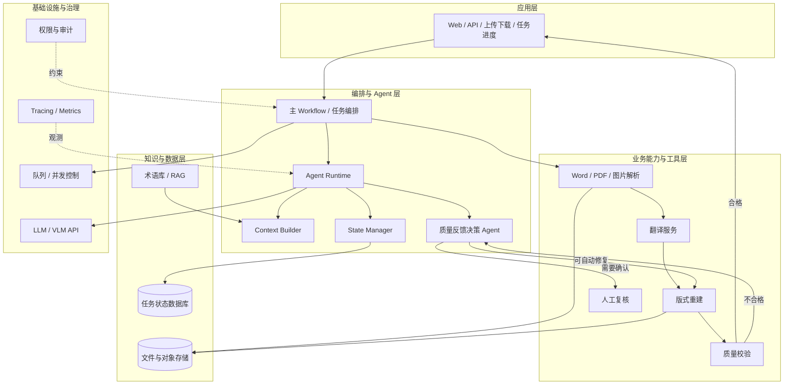

### 9.2 哪些模块应该是工具，哪些应该是 Agent？

| 能力 | 首选设计 | 原因 |
|---|---|---|
| 文件类型识别 | 规则 / 解析工具 | 可用 MIME、文件结构等确定性方法处理 |
| 文档结构提取 | 专用解析工具 | 需要稳定输出、可重复验证 |
| 文本翻译 | 模型服务 + 受控流程 | 重点是质量、术语、批处理与可重试 |
| 表格和图文重建 | 专用排版工具 | 需要精确操作文档对象 |
| 质量检测 | 规则 + 模型辅助评估 | 数值、缺失、溢出可用多种检测手段 |
| 复杂失败后的策略选择 | 受约束的 Agent | 需要综合失败原因和历史反馈决定下一步 |
| 下载、审批、权限校验 | 应用服务 / Workflow | 需要确定性和审计，不宜由模型自行决定权限 |

### 9.3 用一条真实执行链串联所有模块

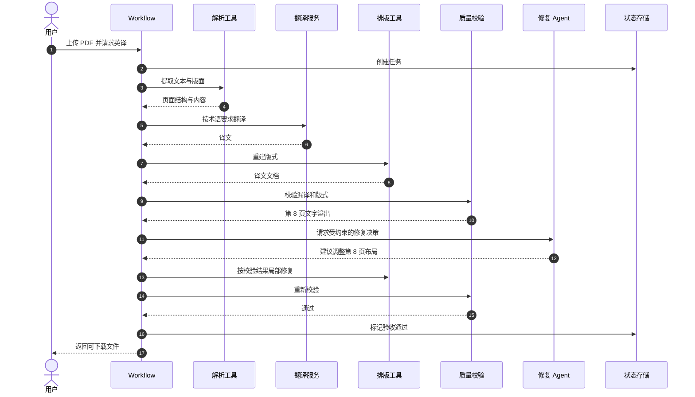

### 9.4 工程边界：防止“看起来智能，实际不可交付”

如果模型自行宣称“修复成功”，但没有重新运行版面检测，系统仍可能交付裁切文档。因此<strong>Agent 的策略建议必须经过可执行工具和业务验收闭环</strong>。同样，任何自动修复都应设置最大重试次数、时间和成本上限；超过阈值时进入人工复核，而不是无限循环。

## 10. 常见架构误区与设计判断

| 常见说法 | 更准确的理解 |
|---|---|
| “LLM + Prompt 就是完整 Agent” | 这可以是最小模型应用；是否构成 Agent 取决于是否具备相应任务控制与行动机制 |
| “Agent 必须有向量数据库” | 仅当知识检索需要时才选择向量检索；很多 Agent 不需要 |
| “RAG 就是 Memory” | RAG 是检索增强模式，Memory 是信息保留与复用能力，两者可以组合 |
| “MCP 是 Agent 的核心大脑” | MCP 是连接协议，不负责替代模型决策 |
| “有 ReAct 才是 Agent” | ReAct 是一种工作模式，不是唯一 Agent 形式 |
| “模型输出工具调用说明工具已经执行” | 必须由执行器校验并实际调用 |
| “Guardrails 可以替代权限系统” | 权限必须在服务端和工具边界落实 |
| “Agent 比 Workflow 高级，应该全部替换” | 两者适合不同任务，混合架构往往更可控 |
| “多 Agent 一定比单 Agent 强” | 多 Agent 增加通信、协调、成本与故障面，应按任务需要选型 |

### 架构选择决策树

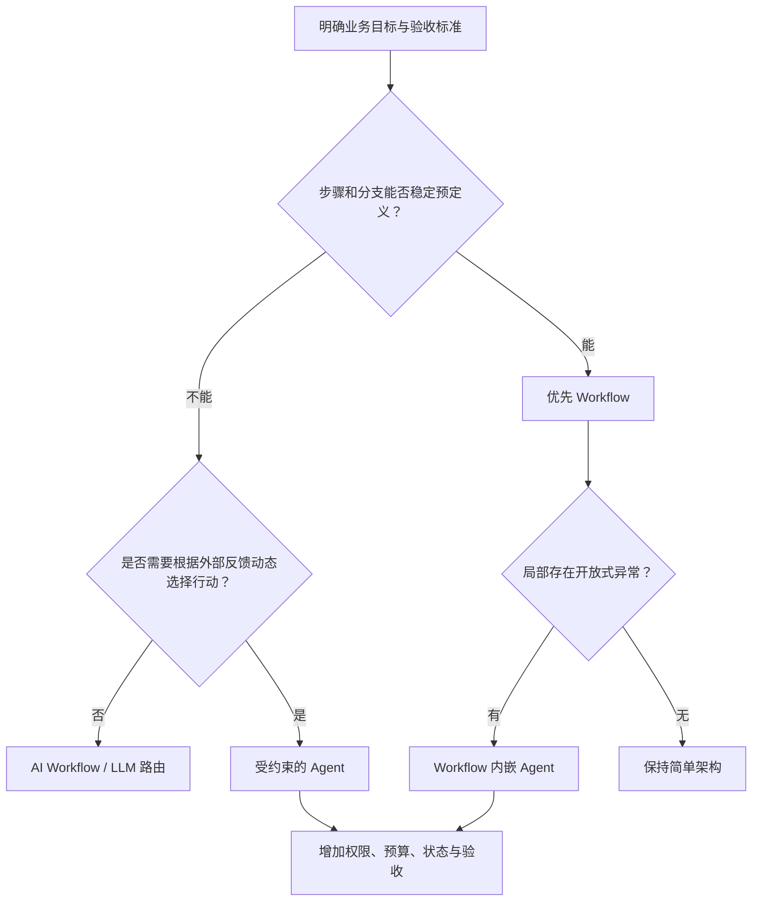

## 11. 面试高频问题：从概念到工程取舍

Q1：一个 Agent 的最小核心组成是什么？

通常可从模型、指令、工具/行动接口和执行循环解释。若只是问答应用，可能无需工具；若需要完成外部任务，就需要运行时协调工具和反馈。生产环境还需要权限、状态、可靠性与评估能力。

Q2：Agent Runtime 和 LLM 有什么区别？

LLM 负责生成内容和提出决策；Runtime 负责真正调用模型与工具、传递结果、管理状态和终止条件。模型可以提出工具调用请求，但不会凭空完成工具操作。

Q3：State、Context、Memory 有什么区别？

State 是当前任务的运行事实；Memory 是后续可能复用的信息；Context 是某次模型调用实际获得的输入。Context 可以从 State、Memory、RAG 和历史中动态构建。

Q4：RAG、MCP、ReAct 为什么不应该放在同一抽象层？

RAG 是知识检索增强模式，MCP 是连接工具和资源的协议，ReAct 是推理与行动交替的工作方法。三者分别回答“信息从哪来”“能力如何接入”“执行策略是什么”。

Q5：企业 Agent 如何保证工具调用安全？

在服务端验证身份、权限、参数和操作范围，对敏感操作实施审批，记录审计日志，并限制重试、预算和外部数据访问。不能只依赖 Prompt 声明。

Q6：为什么不建议所有业务步骤都由 Agent 自主决定？

确定性步骤用 Workflow 通常更容易测试、回放和审计；自主决策增加灵活性，也增加成本和不确定性。应把自主性用于确实需要根据反馈动态调整的部分。

Q7：如何评价 Agent 是否真的成功？

需要区分模型输出、工具调用成功、任务运行结束和业务验收通过。评估应覆盖过程指标与最终交付指标，例如文档翻译的漏译、术语、版式和人工返工率。

## 12. 全章知识图谱与学习路线

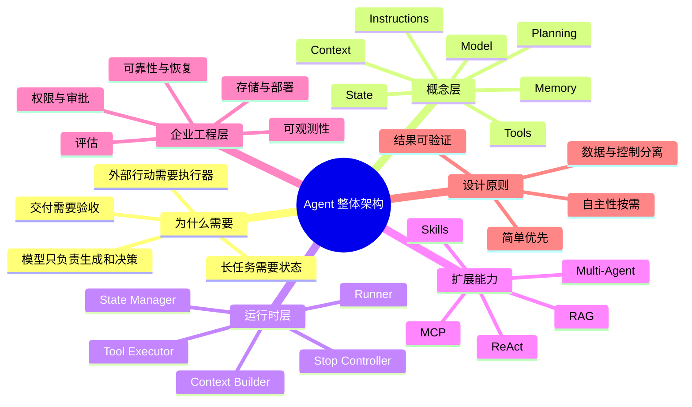

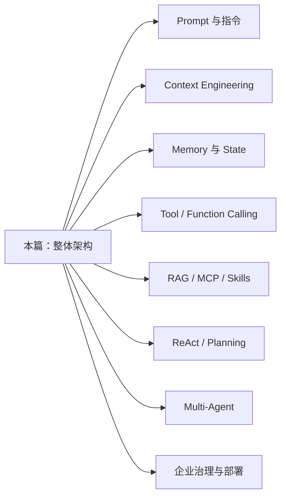

<strong>本篇核心结论：</strong>Agent 是围绕目标运行的执行系统；模型负责提出决策，Runtime 负责推进执行，工具负责与外部环境交互，State/Context/Memory 支撑信息连续性，企业工程层保证安全、可恢复、可观察和可验收。理解每一层的职责与边界，比堆砌框架和技术名词更重要。

## 13. 缩写、术语与注释速查

| 术语 | 英文全称 | 中文解释 / 使用边界 |
|---|---|---|
| Agent | AI Agent | 能围绕目标进行决策与行动的智能体系统，定义随框架有所差异 |
| LLM | Large Language Model | 大语言模型；负责理解、生成和部分决策 |
| VLM | Vision-Language Model | 视觉语言模型；处理图像与文本等多模态输入 |
| API | Application Programming Interface | 应用程序编程接口；系统间调用入口 |
| Prompt | Prompt | 提示词或模型输入指令 |
| Context | Context | 当前模型调用可见的信息集合 |
| Context Window | Context Window | 单次模型处理内容的长度约束 |
| State | State | 任务当前状态与中间结果 |
| Memory | Memory | 为后续决策保留和复用的信息 |
| Runtime | Runtime | Agent 执行环境与控制机制 |
| Runner | Runner | 启动和推进一次 Agent 运行的执行入口 |
| Harness | Harness | 围绕模型提供执行支撑的外围框架；定义因产品而异 |
| Orchestration | Orchestration | 对步骤、工具和执行单元进行编排 |
| Function Calling | Function Calling | 模型结构化提出工具调用请求的机制 |
| MCP | Model Context Protocol | 模型上下文协议；连接外部工具与资源 |
| RAG | Retrieval-Augmented Generation | 检索增强生成；先检索再为生成提供信息 |
| ReAct | Reasoning and Acting | 推理与行动交替的工作模式 |
| Skills | Skills | 可复用任务能力、指导和资源封装 |
| Guardrails | Guardrails | 护栏；内容与行为约束措施 |
| HITL | Human-in-the-Loop | 人工参与或审批机制 |
| Trace | Trace | 一次任务的端到端执行链路 |
| Span | Span | Trace 中的一次具体操作片段 |
| Checkpoint | Checkpoint | 用于恢复的状态检查点 |
| Retry | Retry | 操作失败后的重试 |
| Backoff | Backoff | 重试间隔递增等退避策略 |
| Idempotency | Idempotency | 重复执行不会产生额外业务副作用的性质 |
| Evaluation | Evaluation | 对模型、过程与业务结果的系统评估 |
| Prompt Injection | Prompt Injection | 通过低信任内容影响模型行为的提示词注入攻击 |
| Authentication | Authentication | 身份认证：确认是谁 |
| Authorization | Authorization | 权限授权：确认能做什么 |

> 注：术语表给出的是本章采用的工程语境；不同 SDK 和云平台的组件名称与职责可能存在差异。阅读官方文档时应以其具体版本的定义为准。

## 14. 权威参考资料与延伸阅读

以下资料用于支持本章的概念边界、组件分工和工程取舍；其中三层架构及部分企业案例为本文基于官方资料整理的教学模型，并非官方统一架构规范。

1. [OpenAI — Agents SDK 官方文档](https://openai.github.io/openai-agents-python/)：Agent、Tools、Runner、Handoffs、Guardrails、Sessions、Tracing。
2. [Google Cloud — Core Concepts of AI Agents](https://cloud.google.com/resources/core-concepts-ai-agents)：Agent 核心概念、工具、知识与编排。
3. [Google Cloud — Choose Your Agentic AI Architecture Components](https://docs.cloud.google.com/architecture/choose-agentic-ai-architecture-components)：模型、工具、Memory、Runtime 等架构组件。
4. [LangChain — Agent Middleware](https://www.langchain.com/blog/agent-middleware)：Agent Loop 的上下文与行为控制。
5. [Anthropic — Building Effective Agents](https://www.anthropic.com/engineering/building-effective-agents)：Workflow、Agent 和常见执行模式。
6. [Lewis et al. — Retrieval-Augmented Generation for Knowledge-Intensive NLP Tasks](https://arxiv.org/abs/2005.11401)：RAG 原始研究论文。
7. [Model Context Protocol — Introduction](https://modelcontextprotocol.io/introduction)：MCP 的定位与标准化连接方式。
8. [Yao et al. — ReAct: Synergizing Reasoning and Acting in Language Models](https://arxiv.org/abs/2210.03629)：ReAct 原始论文。
9. [OWASP — Top 10 for LLM Applications](https://owasp.org/www-project-top-10-for-large-language-model-applications/)：提示词注入及大模型应用风险。
10. [LangGraph — Workflows and Agents](https://docs.langchain.com/oss/python/langgraph/workflows-agents)：固定工作流与动态 Agent 的实现模式。
11. [LangGraph — Persistence](https://docs.langchain.com/oss/python/langgraph/persistence)：状态持久化与检查点。
12. [OpenAI — A Practical Guide to Building Agents](https://cdn.openai.com/business-guides-and-resources/a-practical-guide-to-building-agents.pdf)：从最小 Agent 到实际部署的设计建议。

---

<strong>下一步学习：</strong>进入 `03-Agent-Core-Components`，逐一拆解 Prompt、Context、Memory、Tool、State 等模块的设计原理。当前这一篇提供总体地图，后续各篇再深入具体实现与工程细节。
