# Agent 基础与运行原理｜全章知识总结

> 学习范围：`02-Agent-Fundamentals`，对应四篇正文。  
> 本章目标：建立从<strong>概念识别</strong>、<strong>执行机制</strong>、<strong>架构选型</strong>到<strong>工程落地</strong>的完整认知。  
> 图表说明：全部使用 GitHub 原生支持的 Mermaid；不依赖 PNG、外部图片或额外插件。

## 一、一张图看懂本章：四篇知识如何串起来

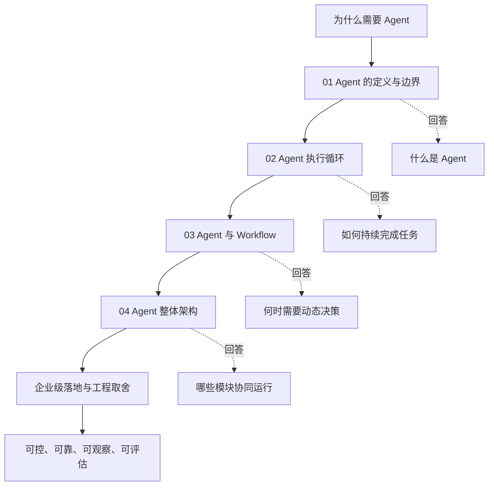

<strong>贯穿本章的核心判断：</strong>Agent 不是“接入 LLM 的流程”的同义词。它是一类在既定目标、权限和资源约束下，能够依据执行反馈动态选择下一步行动的系统；是否值得采用这种动态性，必须结合业务的不确定性、风险和成本判断。

## 二、知识图谱 1：Agent 的概念边界

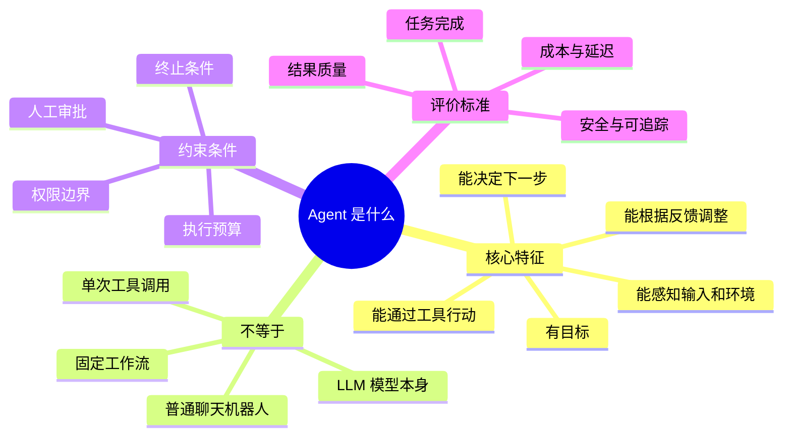

<strong>Agent（智能体）</strong>强调的是围绕目标展开的行动决策和反馈调整，而不只是生成一段文本。不同机构对 Agent 的定义宽严不同，工程判断应观察实际控制权，而非仅凭产品名称。

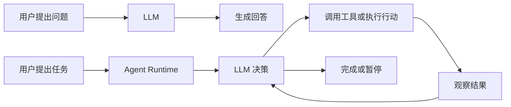

> <strong>术语注释：</strong>LLM（Large Language Model，大语言模型）；Agent Runtime（智能体运行时，负责模型调用、工具执行、状态与控制循环等运行职责）。

## 三、知识图谱 2：一次 Agent 任务如何执行

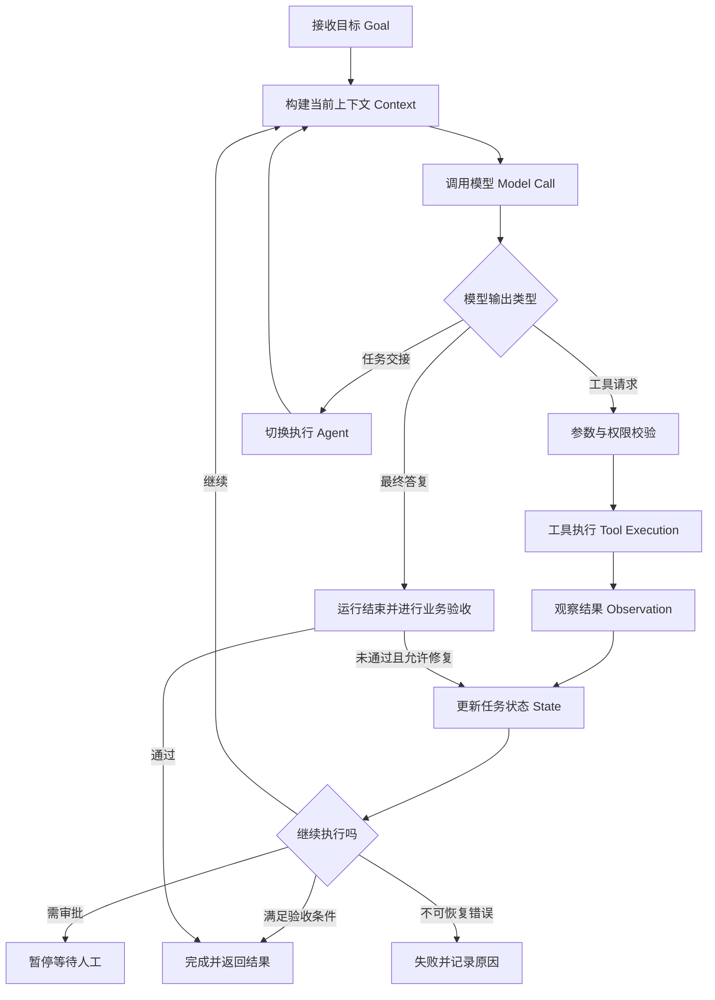

<strong>重要区分：</strong>模型发出 Tool Call（工具调用请求），并不意味着工具已执行；工具返回成功，也不代表业务任务已完成；一次 Run（完整运行）结束，也不一定意味着 Task Success（业务成功）。

### 知识图谱 3：运行、轮次、工具调用的层级

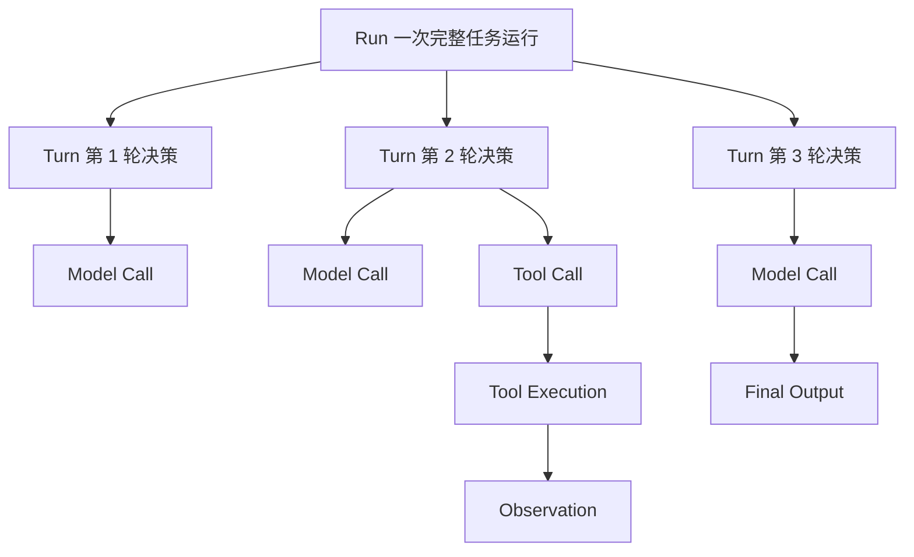

> <strong>术语注释：</strong>Run（一次完整运行）；Turn（框架定义的一轮执行或模型决策，具体边界因框架而异）；Model Call（模型调用）；Tool Call（模型提出的工具调用请求）；Observation（执行后的观察反馈）。

## 四、知识图谱 4：Agent 与 Workflow 的技术演进

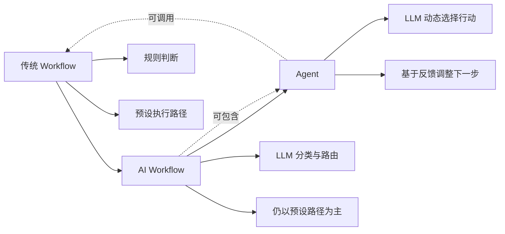

| 维度 | 传统 Workflow | AI Workflow | Agent |
| --- | --- | --- | --- |
| 决策方式 | 预设规则 | 模型可判断预设分支 | 模型可在约束内动态选择行动 |
| 执行路径 | 主要由开发者定义 | 主要由开发者定义 | 可根据运行结果变化 |
| LLM 是否必需 | 否 | 通常是 | 对 LLM Agent 而言是 |
| 典型用途 | 审批、固定处理 | 智能分类、文档路由 | 开放式多步骤任务、复杂异常处理 |
| 工程取舍 | 易预测、易审计 | 智能性与可控性折中 | 灵活，但成本与不确定性可能更高 |

### 知识图谱 5：LLM 判断条件分支，算不算 Agent？

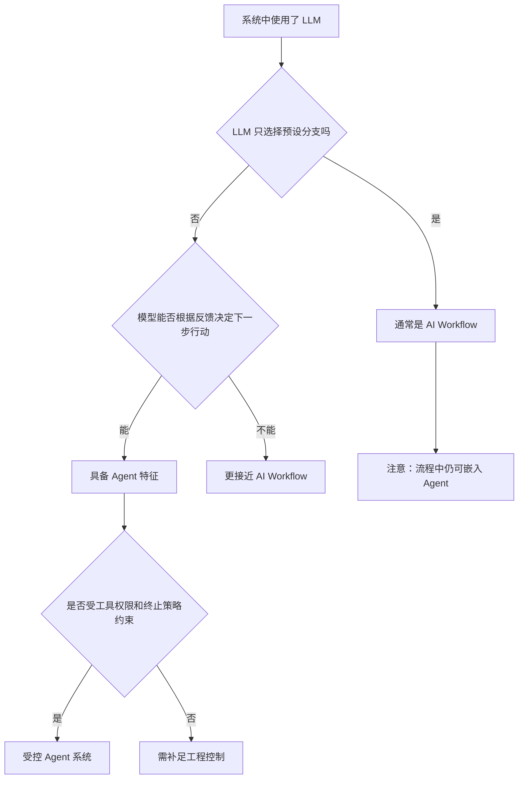

<strong>判断重点是控制权：</strong>“用了 LLM”“有分支”“能调用工具”“有循环”都不能单独证明一个系统是 Agent。需要进一步问：<strong>谁决定下一步做什么？谁执行？谁验证结果？谁有权终止？</strong>

## 五、知识图谱 6：Agent 的三层架构

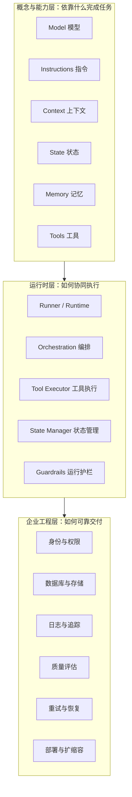

这三层是<strong>帮助理解的架构视角</strong>，不是任何厂商规定的统一组件分层。实际框架可能合并职责，例如 Planning（规划）可能由模型直接完成，Orchestration（编排）可能由 Runtime 实现。

### 知识图谱 7：核心模块各自解决什么问题

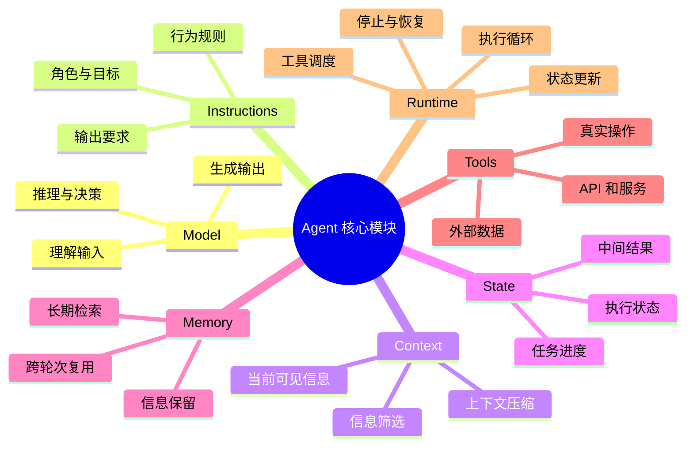

## 六、知识图谱 8：Context、State、Memory 与 RAG 的关系

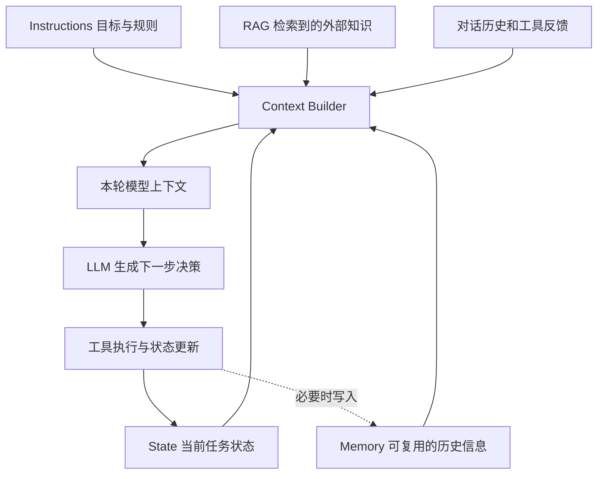

| 名词 | 回答的问题 | 典型内容 |
| --- | --- | --- |
| Context（上下文） | 本轮模型看到了什么？ | 当前指令、相关历史、检索片段、工具反馈 |
| State（状态） | 任务现在进行到哪里？ | 当前步骤、已完成项、错误、进度、结果 |
| Memory（记忆） | 哪些信息需要以后复用？ | 用户偏好、经验、长期知识、历史摘要 |
| RAG（检索增强生成） | 如何按需引入外部知识？ | 检索到的文档、术语库、企业制度 |

> <strong>术语注释：</strong>RAG（Retrieval-Augmented Generation，检索增强生成）；Context Builder（上下文构建器，负责挑选、整理并组装本轮输入）。RAG 是知识获取方法，不等同于 Memory；State 也不等于完整对话历史。

## 七、知识图谱 9：技术名词应该放在架构的哪里

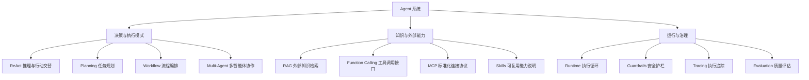

<strong>注意：</strong>ReAct、MCP、RAG、Skills、Multi-Agent 不是所有 Agent 都必须安装的“核心模块”。它们分别属于工作模式、连接协议、知识增强方法、能力组织方式或系统架构形式。

> <strong>术语注释：</strong>ReAct（Reasoning and Acting，推理与行动交替）；MCP（Model Context Protocol，模型上下文协议）；Function Calling（函数/工具调用机制）；Skills（可复用的任务说明和能力包，具体实现因平台而异）；Tracing（执行链路追踪）。

## 八、知识图谱 10：企业级 Agent 如何处理异常与终止

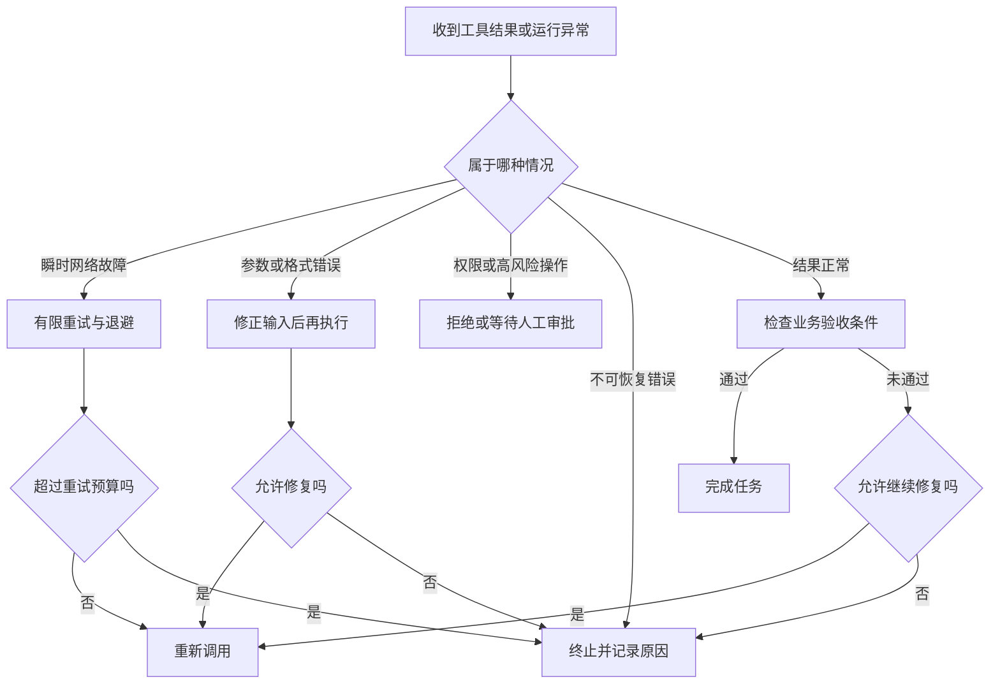

<strong>三个工程底线：</strong>重试必须有上限；可能产生副作用的操作必须考虑幂等性；最终完成状态必须依据可验证的业务条件，而不能只依据模型声称“已完成”。

> <strong>术语注释：</strong>Retry（重试）；Backoff（退避，逐步拉开重试间隔）；Idempotency（幂等性，同一操作重复执行不会造成不期望的额外影响）；Checkpoint（检查点，保存可恢复的任务状态）；HITL（Human-in-the-Loop，人在回路中的人工审核或介入）。

### 知识图谱 11：运行结束与业务成功不是一回事

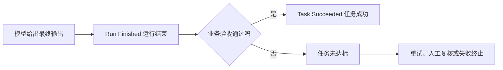

## 九、知识图谱 12：贯穿案例——企业文档翻译 Agent

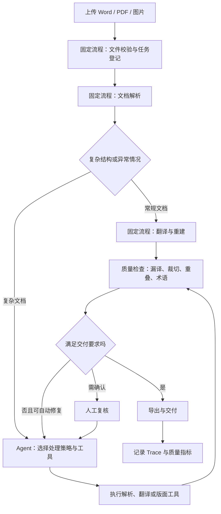

这一案例体现了四篇内容的共同结论：<strong>稳定且可预测的步骤交给 Workflow，不确定性高且需要根据反馈调整的局部交给 Agent，关键操作仍由权限、预算、审批和验收机制约束。</strong>

### 知识图谱 13：企业分层架构与责任归属

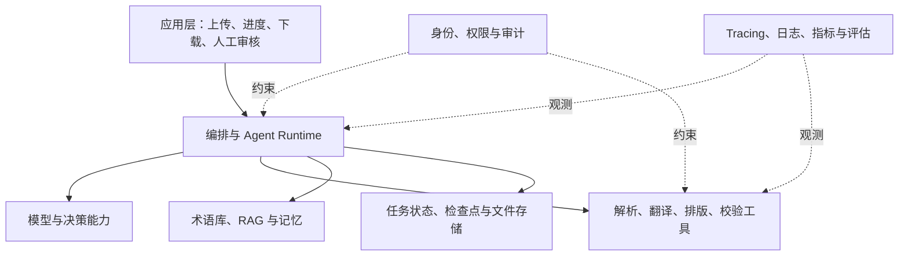

## 十、知识图谱 14：从需求出发的架构选型

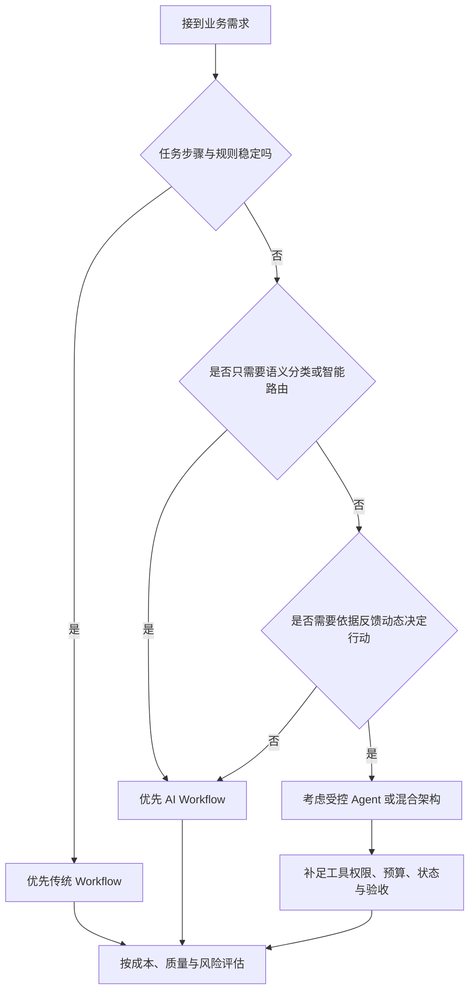

<strong>选型原则：</strong>不是自主性越高越先进，而是在达到目标的前提下，优先选择<strong>足够简单、可验证、可维护</strong>的架构。

## 十一、四篇文章各自掌握什么

| 学习篇目 | 必须能够回答的问题 | 继续阅读 |
| --- | --- | --- |
| 01 Agent 的定义、边界与能力 | 什么是 Agent？什么不算？为什么需要它？ | [进入 01](01-What-is-an-Agent.md) |
| 02 感知—决策—行动—反馈循环 | 模型、运行时和工具怎样连续协作？何时停止？ | [进入 02](02-Agent-Execution-Loop.md) |
| 03 Agent 与传统 Workflow 的区别 | LLM 路由为何不一定是 Agent？何时采用混合架构？ | [进入 03](03-Agent-vs-Workflow.md) |
| 04 整体架构与关键模块 | Model、Tools、Context、State、Memory、Runtime 如何协作？ | [进入 04](04-Agent-Architecture-Overview.md) |

## 十二、全章速记：十个关键判断

1. <strong>Agent ≠ LLM：</strong>模型提供推理能力，完整 Agent 还需要运行与执行机制。
2. <strong>Tool Call ≠ Tool Execution：</strong>模型请求与真实执行是两个步骤。
3. <strong>Tool Success ≠ Task Success：</strong>工具成功不代表业务目标达成。
4. <strong>Agent Loop ≠ 模型逐 Token 推理：</strong>Agent Loop 是应用层的执行控制循环。
5. <strong>LLM Routing ≠ 必然是 Agent：</strong>模型选择预设分支通常仍属于 AI Workflow。
6. <strong>有循环 ≠ 必然是 Agent：</strong>固定 Workflow 同样可以循环、并行和重试。
7. <strong>Context ≠ State ≠ Memory：</strong>分别关注当前可见信息、任务进度和信息复用。
8. <strong>RAG / MCP / ReAct 不是同一层概念：</strong>分别偏向知识检索、连接协议和工作模式。
9. <strong>自主决策 ≠ 无限制执行：</strong>权限、预算、审批和终止条件应由工程系统落实。
10. <strong>企业价值 ≠ 演示能跑通：</strong>还需要稳定性、安全性、成本、可观测性和可验证的交付质量。

## 十三、延伸阅读与权威来源

- [OpenAI — A Practical Guide to Building Agents](https://cdn.openai.com/business-guides-and-resources/a-practical-guide-to-building-agents.pdf?file=a-practical-guide-to-building-agents.pdf)：Agent 的组成、执行边界与设计原则。
- [OpenAI Agents SDK — Running Agents](https://openai.github.io/openai-agents-python/running_agents/)：Agent Loop、工具执行、交接与终止。
- [Anthropic — Building Effective Agents](https://www.anthropic.com/engineering/building-effective-agents)：Workflow 与 Agent 的边界、常见设计模式。
- [LangGraph — Workflows and Agents](https://docs.langchain.com/oss/python/langgraph/workflows-agents)：固定执行路径、动态执行与多种工作流模式。
- [Google Cloud — Core Concepts of AI Agents](https://cloud.google.com/resources/core-concepts-ai-agents)：模型、工具、知识、记忆与编排。
- [Google Cloud — Choose Agentic AI Architecture Components](https://docs.cloud.google.com/architecture/choose-agentic-ai-architecture-components)：运行时与企业级组件选型。
- [ReAct 原始论文](https://arxiv.org/abs/2210.03629)：推理与行动交替的经典方法。

---

> <strong>本章一句话总结：</strong>Agent 的本质不是“模型加了多少功能”，而是一个受约束的系统如何围绕目标，通过<strong>模型决策—工具行动—环境反馈—状态更新</strong>持续推进任务；企业开发则需要根据任务的不确定性决定采用 Workflow、Agent 或两者结合，并用可靠性、安全与验收机制保证真正交付。
