# 02｜上下文工程与上下文窗口管理

> 所属路径：`03-Agent-Core-Components/02-Context-Engineering.md`  
> 学习定位：承接 [01｜Prompt 与 Instructions](./01-Prompt-and-Instructions.md)，为后续 [03｜Memory](./03-Memory.md)、[05｜State](./05-State-Management.md) 建立基础。  
> 本文以概念—问题—机制—策略—系统协作—企业案例—评估为主线，不包含代码练习。

## 导读：为什么 Agent 需要上下文工程？

Prompt Engineering（提示词工程）主要研究<strong>如何表达任务和行为规则</strong>；Context Engineering（上下文工程）则进一步回答：<strong>在每次模型调用前，哪些信息应该进入输入、以什么形式进入、哪些留在外部，以及如何随着任务推进持续更新</strong>。Agent 往往要经历多轮工具调用和状态变化，因此不能把全部历史、文档和工具结果无差别堆进模型。

<strong>全文主线：</strong>定义上下文 → 理解容量与质量约束 → 构建上下文 → 动态管理 → 跨组件协作 → 长任务恢复 → 企业级评估。

### 图 1｜全章知识思维导图

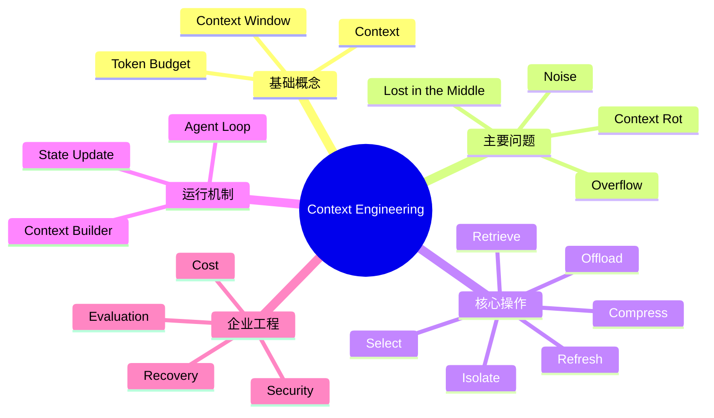

> <strong>读图说明：</strong>从基础概念到工程治理逐层深入；这些分类是教学归纳，不是统一行业标准。

## 一、概念边界：Context 究竟是什么？

### 1.1 五个基础概念

| 名称 | 中文 | 准确定义 | 不应混同于 |
|---|---|---|---|
| Context | 上下文 | 本轮模型推理时实际提供给模型的信息集合 | 企业的全部数据 |
| Context Window | 上下文窗口 | 模型和接口允许处理的输入、输出等 Token 的容量限制，具体计数依模型与接口而异 | 长期记忆容量 |
| Context Engineering | 上下文工程 | 为任务选择、组织、更新、压缩和治理上下文的工程活动 | 单纯写提示词 |
| Context Management | 上下文管理 | 截断、摘要、检索、持久化、刷新等具体管理操作 | 某个单一算法 |
| Token Budget | Token 预算 | 给指令、历史、知识、工具输出及生成结果预留的容量与成本 | 固定字数限制 |

<strong>Token 注释：</strong>Token 是模型处理文本的基本计量单位，并不等同于一个汉字或一个英文单词；同一文本在不同分词器下可能有不同 Token 数。

### 1.2 上下文与提示词的边界

指令是上下文的一部分，但上下文还包含用户任务、历史、检索内容、工具结果和状态摘要。Prompt Engineering 关注指令表达与示例；Context Engineering 关注<strong>信息供给系统</strong>。两者相互依赖，不是互斥技术。

### 图 2｜Prompt 与 Context 的包含关系

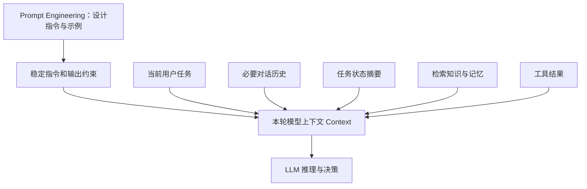

> <strong>读图说明：</strong>稳定指令只是模型输入的一部分；每次调用还要按需选择任务数据。

### 1.3 组成上下文的信息应按来源分类

| 来源 | 典型信息 | 生命周期 | 风险与处理 |
|---|---|---|---|
| System / Developer Instructions | 角色、规则、输出契约 | 相对稳定 | 与应用版本同步 |
| User Input | 当前请求、上传内容 | 当前任务 | 区分用户指令和用户提供的数据 |
| Conversation History | 先前问答与决定 | 按需保留 | 去重、摘要、标注过时信息 |
| State | 已完成步骤、游标、重试次数 | 执行过程 | 应由可信状态存储维护 |
| Memory | 可复用偏好、历史知识 | 跨轮次或跨任务 | 设定更新与过期机制 |
| Retrieval / RAG | 文档片段、术语、证据 | 按需加载 | 来源标注、权限过滤 |
| Tool Results | API、搜索、解析结果 | 每次调用后变化 | 限长、验证、拒绝工具输出越权 |

> <strong>信任边界：</strong>文档、网页、数据库字段及工具输出可能包含恶意文本，应视为待处理数据，而不是自动提升为系统或开发者指令。

## 二、为什么长上下文不等于高质量上下文？

### 2.1 容量、质量、成本三重约束

<strong>容量约束：</strong>输入和输出占用受模型/API限制；还可能有单次输入、单条消息或工具定义等独立限制。<strong>质量约束：</strong>长输入可能出现无关噪声、重复、矛盾和注意力分散。<strong>成本约束：</strong>冗余上下文会增加处理 Token 和延迟，缓存虽可改善部分场景，但不能消除质量问题。

### 2.2 典型失败模式

| 问题 | 英文名 | 表现 | 应对方向 |
|---|---|---|---|
| 超窗 | Context Overflow | 输入超出可用容量 | 预算预留、分页、压缩 |
| 噪声累积 | Noise Accumulation | 大量无关信息干扰决策 | 过滤、去重、排序 |
| 中部信息利用下降 | Lost in the Middle | 重要证据放在长文本中部时可能被忽略 | 信息定位、显式引用、针对模型测试 |
| 上下文退化 | Context Rot | 随上下文增长，信息利用效果下降的工程现象 | 质量评估、重构上下文 |
| 信息污染 | Context Pollution | 过时、错误或冲突信息持续影响后续步骤 | 来源管理、冲突检查、刷新 |
| 摘要失真 | Summary Drift | 压缩时丢失约束、数字或待办事项 | 结构化摘要、原文可回溯 |

<strong>研究证据：</strong>《Lost in the Middle》发现部分受测模型对信息位置敏感；不能据此推断所有模型、所有任务都必然具有同样表现。

### 图 3｜容量、质量与成本的约束关系

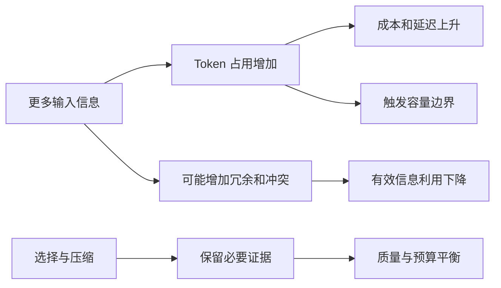

> <strong>读图说明：</strong>上下文工程优化的是有用信息密度，而不是简单追求输入长度最小或最大。

### 2.3 Token 预算如何分配？

一个概念性的预算关系是：

\[
B_{\mathrm{total}} \ge B_{\mathrm{instructions}} + B_{\mathrm{history}} + B_{\mathrm{state}} + B_{\mathrm{retrieval}} + B_{\mathrm{tools}} + B_{\mathrm{output}} + B_{\mathrm{margin}}
\]

其中 `margin` 表示安全余量。该式用于工程规划，<strong>不是各厂商通用的精确计费公式</strong>。工具定义、隐藏协议开销和缓存计费等应以具体模型接口为准。

优先预留<strong>输出预算、不可丢失的任务约束、必要证据</strong>，然后再为历史和工具细节分配剩余容量。不要未经测量就使用固定百分比。

### 图 4｜Token 预算分配示意

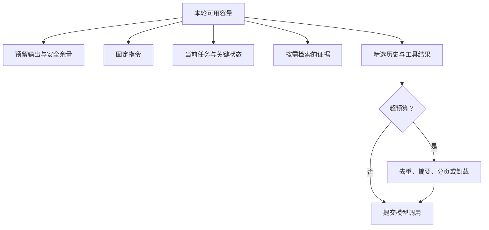

> <strong>读图说明：</strong>这是优先级示意，而不是固定数值比例；实际预算需根据模型接口和业务任务测量。

## 三、Context Builder：从信息集合到本轮输入

Context Builder（上下文构建器）是<strong>一种职责或逻辑模块</strong>，不一定是独立微服务。它负责从候选来源中收集信息，判断相关性与可信度，按 Token 预算组装输入。Agent Runtime（运行时）则控制模型调用、工具执行和循环推进。

### 3.1 六阶段工程生命周期

1. <strong>Collect（收集）</strong>：读取当前任务、必要历史、状态、知识和工具结果。
2. <strong>Filter（筛选）</strong>：剔除无关、重复、过时和权限不符的信息。
3. <strong>Rank（排序）</strong>：根据任务相关性、可信度、时效性和重要性选择证据。
4. <strong>Assemble（组装）</strong>：组织指令、输入、状态、证据及引用。
5. <strong>Execute（执行）</strong>：调用模型并按决策执行工具。
6. <strong>Update（更新）</strong>：保存新结果、更新状态、为下一轮重建上下文。

这六阶段是便于学习的工程归纳，不是某框架的强制标准。

### 图 5｜Context Builder 架构图

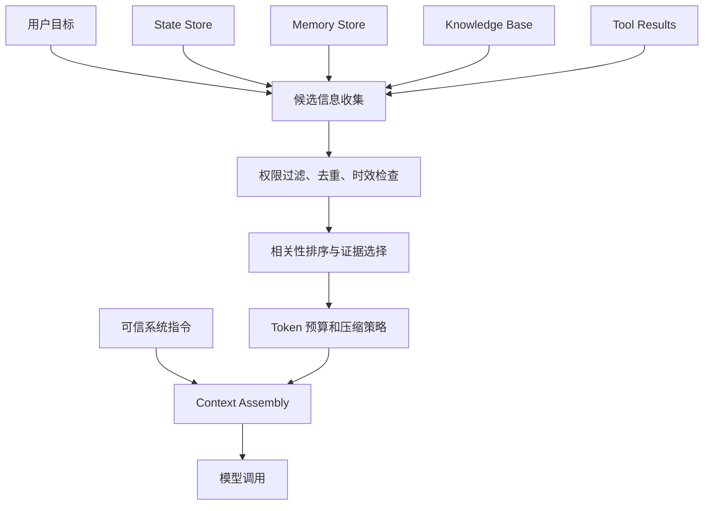

> <strong>读图说明：</strong>Context Builder 负责信息供给，不能替代运行时、权限系统或状态持久化。

### 图 6｜每一轮 Agent 的动态上下文循环

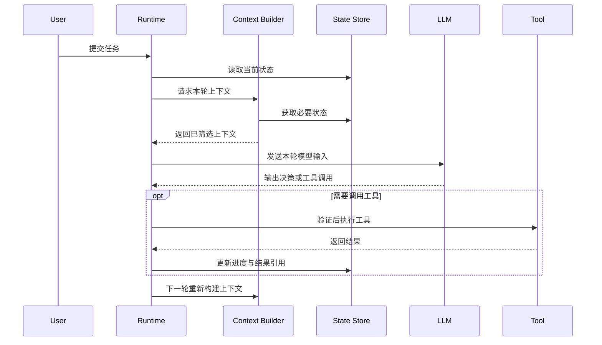

> <strong>读图说明：</strong>每一轮都可重新选择信息，不必无限追加原始历史；工具执行由 Runtime 控制。

## 四、六种上下文管理操作：何时使用？

| 操作 | 英文 | 解决的问题 | 代价与注意点 |
|---|---|---|---|
| 选择 | Select | 候选信息过多 | 错选会遗漏证据 |
| 检索 | Retrieve | 信息不在当前上下文 | 召回不足、排序错误、来源不可信 |
| 压缩 | Compress / Compaction | 历史或工具结果过长 | 摘要丢失关键约束 |
| 卸载 | Offload | 大对象占用窗口 | 需可靠存储与引用恢复 |
| 隔离 | Isolate | 多子任务互相干扰 | 子任务结果需汇总与验证 |
| 刷新 | Refresh | 信息过时或冲突 | 需版本、时间和来源管理 |

### 4.1 Truncation、Summarization 与 Compaction 的区别

- <strong>Truncation（截断）</strong>：直接删除超出限制的内容；速度快，但可能丢失关键条件。
- <strong>Summarization（摘要）</strong>：将原文概括为短文本；适合一般历史压缩，但可能遗漏细节。
- <strong>Compaction（上下文压缩整理）</strong>：面向后续任务继续执行，保留目标、约束、已完成步骤、未完成事项、关键引用等；可能包含摘要和结构化记录。
- <strong>Retrieval（检索）</strong>：按当前问题从外部数据源加载信息，并非压缩原有上下文。

<strong>实践原则：</strong>数值、单位、型号、待办项、失败原因、人工审批状态等应优先保存在结构化 State 中，而不是仅依赖自由文本摘要。

### 图 7｜上下文管理策略选择树

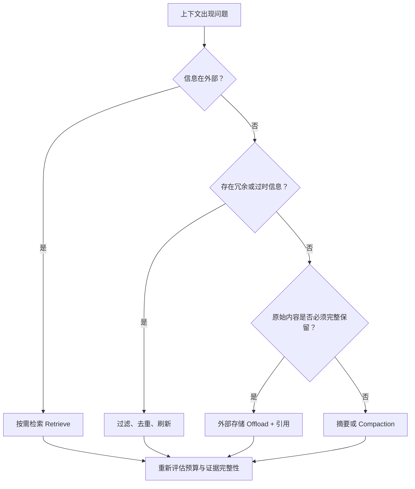

> <strong>读图说明：</strong>策略可以组合使用；不能把摘要当成所有超窗问题的唯一答案。

## 五、按需加载与渐进式披露

<strong>Just-in-Time Context（即时按需上下文）</strong>：在需要信息时才读取，而不是任务开始就加载所有文件。<strong>Progressive Disclosure（渐进式披露）</strong>：先展示索引或概要，再根据任务逐层展开细节。

例如翻译 200 页文档：先获取章节目录和页面索引；翻译某一页时读取该页文本、相邻段落和相关术语；只有发生歧义时才进一步查看上下文或原始图表。

### 图 8｜渐进式加载知识与文档

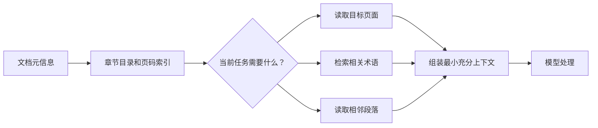

> <strong>读图说明：</strong>按需加载减少无关输入，但不能牺牲跨段落、跨页面的语义连贯性。

## 六、长任务：压缩、持久化与恢复

长任务不能把“会话消息列表”当作唯一真相来源。更稳健的设计是将<strong>任务状态与成果持久化</strong>，上下文只携带当前决策所需的摘要和引用。

### 6.1 建议保留的恢复检查点

| 字段 | 说明 | 文档翻译例子 |
|---|---|---|
| Goal | 最终任务目标 | 将整份说明书译成英文 |
| Constraints | 不可丢失的约束 | 保留型号、单位、图表结构 |
| Progress | 完成进度 | 已完成第 1–37 页 |
| Pending | 未完成任务 | 第 38 页待翻译 |
| Decisions | 已确定的重要决策 | 术语“探头”统一译法 |
| Artifacts | 中间产物引用 | 译文页文件 ID |
| Failures | 失败与重试记录 | 第 26 页表格校验失败 |
| Approval | 人工审核状态 | 某术语等待确认 |

恢复时先从可信存储读取状态，再构建上下文，而不是让模型根据残缺聊天记录猜测进度。

### 图 9｜长任务压缩与断点恢复

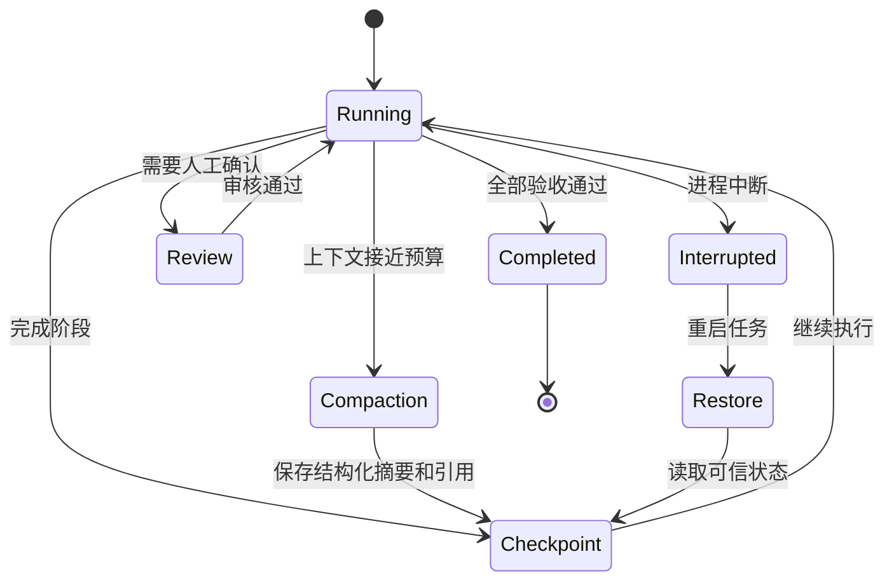

> <strong>读图说明：</strong>压缩解决模型输入问题；Checkpoint（检查点）解决运行中断后的进度恢复问题。

### 6.2 Sub-agent Isolation（子 Agent 上下文隔离）

复杂任务可交给专门子 Agent 处理局部检索、术语核查或表格分析，并仅向主 Agent 返回<strong>结论、证据引用和必要异常</strong>。隔离能减少上下文污染，但增加协调开销和结果汇总风险；简单任务不必强行使用多 Agent。

### 图 10｜子 Agent 上下文隔离

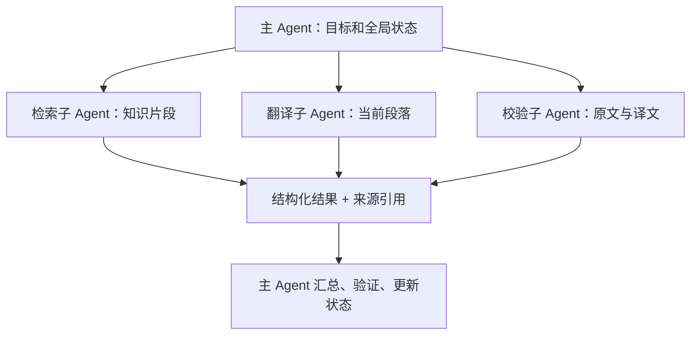

> <strong>读图说明：</strong>每个子 Agent 只获取所需数据；主 Agent 负责结果一致性和最终验收。

## 七、Context 与其他 Agent 模块如何协作？

| 模块 | 主要职责 | 与 Context 的交互 |
|---|---|---|
| Prompt / Instructions | 规定目标、规则与行为边界 | 作为可信指令输入 |
| State | 记录当前执行进度和中间状态 | 提供本轮关键进度，接收更新 |
| Memory | 保存可复用的历史信息 | 根据任务检索有价值的记忆 |
| RAG | 检索增强生成的知识获取方法 | 提供相关证据，不负责全部上下文治理 |
| Tools | 读取环境或执行操作 | 返回可筛选、可验证的数据 |
| Runtime | 调用模型、执行工具、控制循环 | 每轮请求新的上下文 |
| Guardrails / Policy | 安全规则和权限检查 | 限制数据访问和危险操作 |

<strong>四个必须区分的概念：</strong>Context 是<strong>本轮可见信息</strong>；State 是<strong>任务当前状态</strong>；Memory 是<strong>可复用的历史信息</strong>；RAG 是<strong>按需检索并提供知识的方法</strong>。它们可能共享存储技术，但职责不同。

### 图 11｜Context、State、Memory、RAG 关系图

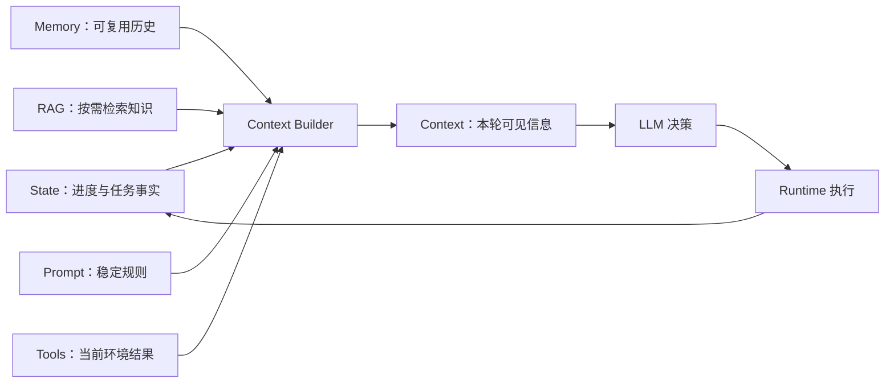

> <strong>读图说明：</strong>Context 是消费视图，State 和 Memory 是不同生命周期的数据来源；RAG 是知识获取方式。

## 八、企业级上下文治理：质量、安全与成本

### 8.1 安全：检索结果不是高优先级指令

来自 PDF、网页或工具的文字可能包含 Prompt Injection（提示词注入）。Context Builder 应标明来源与信任级别；工具执行前还需要真实权限校验。<strong>仅在提示词中写“不要越权”不足以构成安全保证。</strong>

### 8.2 质量评估指标

| 指标 | 关注点 | 评估方式示例 |
|---|---|---|
| Retrieval Recall | 必要证据是否被检索到 | 标注正确片段并统计召回 |
| Context Precision | 输入证据中有用信息占比 | 人工或规则标注相关性 |
| Answer Grounding | 结论是否有上下文证据支持 | 检查引用与事实一致性 |
| Constraint Retention | 压缩后是否保留关键约束 | 对比原始约束清单 |
| Task Success | 最终业务任务是否完成 | 端到端验收 |
| Token Cost | 每次任务的输入输出成本 | 按模型版本统计 |
| Latency | 构建与推理耗时 | 分阶段 Trace 统计 |
| Recovery Success | 中断后是否能正确恢复 | 故障注入与回归测试 |

<strong>Trace（追踪）</strong>记录一次任务内模型调用、检索、工具执行及状态更新的链路；<strong>Span（跨度）</strong>是其中一个步骤的记录单元。记录时注意敏感数据脱敏与访问控制。

### 图 12｜安全信任边界与验证流程

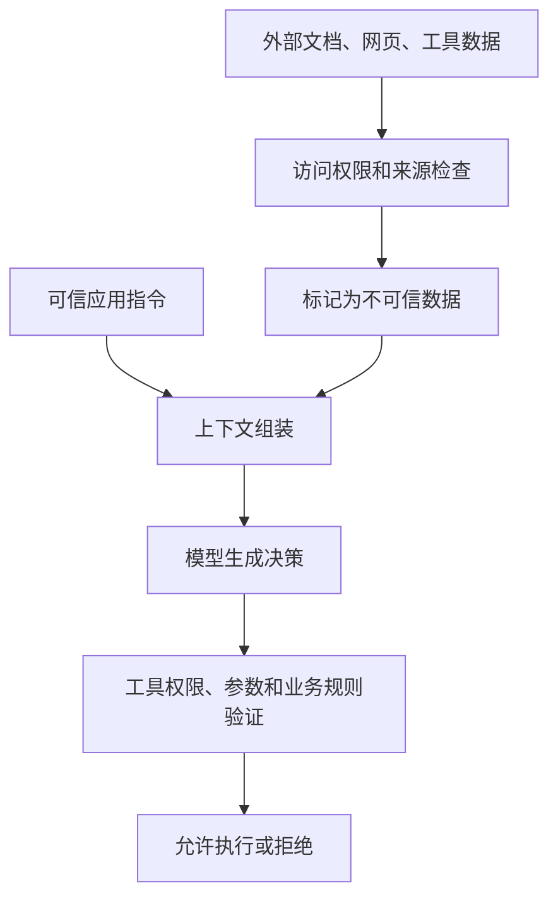

> <strong>读图说明：</strong>数据进入模型不等于获得指令权限；真正的授权必须由运行时和后端强制执行。

### 图 13｜上下文评估与优化闭环

> <strong>读图说明：</strong>优化要基于端到端任务成功率，而不能只看 Token 减少了多少。

## 九、企业案例：医疗设备文档翻译 Agent

### 9.1 任务背景

假设需要将 100 页医疗设备技术说明书从中文翻译为英文，同时保留术语一致性、数字单位、型号、表格和图示位置。全文一次性输入会导致预算和质量问题，因此采用<strong>文档索引 + 页面/章节处理 + 术语检索 + 结构化状态 + 结果校验</strong>的组合架构。

### 9.2 本轮上下文如何构成？

| 信息 | 是否进入当前翻译调用 | 原因 |
|---|---|---|
| 翻译规则与输出结构 | 是 | 保证一致行为 |
| 当前页或段落原文 | 是 | 当前任务核心数据 |
| 相邻段落、章节标题 | 按需 | 保留语义衔接 |
| 相关术语表条目 | 按需 | 术语一致性 |
| 全部 100 页原文 | 通常否 | 过量且多数无关 |
| 其他页面完整翻译结果 | 通常否 | 存外部文件，保留必要引用 |
| 已完成页码和异常清单 | 摘要进入 | 保证进度与异常处理 |
| 图片、表格布局元数据 | 处理相关内容时进入 | 保证结构与排版还原 |

### 9.3 具体流程

先解析并建立文档索引；为当前页面读取必要文本和布局信息；从术语库检索相关术语；组装上下文后翻译；保存结果；再用原文、译文及布局数据执行质量检查。出现遗漏、错译、裁切或术语冲突时，只对受影响片段重新构建上下文并处理。全程通过 State 保存页码、状态和产物引用。

### 图 14｜文档翻译 Agent 的上下文数据流

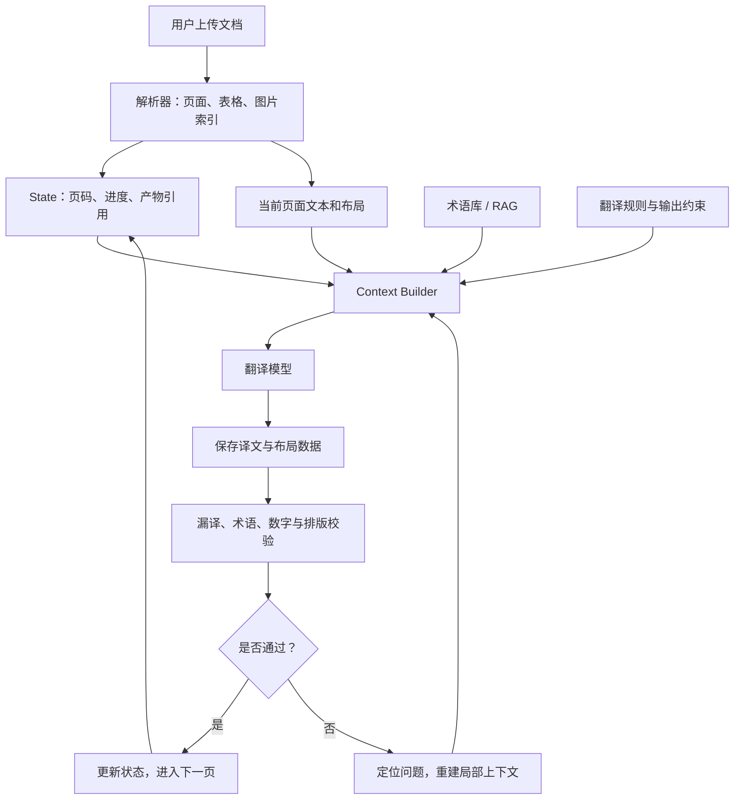

> <strong>读图说明：</strong>完整文件和布局数据存外部；每轮只装配相关上下文，异常只重做必要片段。

### 图 15｜翻译项目的上下文分层架构

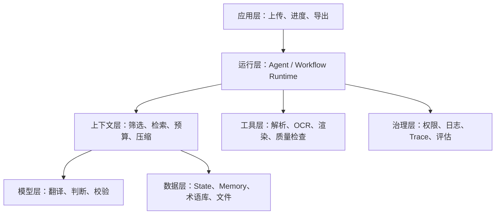

> <strong>读图说明：</strong>分层是企业项目的参考设计，并不意味着每层必须单独部署。

## 十、常见误区与面试问答

### 10.1 常见误区

| 误区 | 正确认识 |
|---|---|
| 窗口越大越不需要上下文工程 | 长窗口仍存在成本、噪声和证据利用问题 |
| 上下文就是聊天历史 | 还包含指令、状态、工具、检索与当前输入 |
| RAG 等于 Context Engineering | RAG 只是信息获取方式之一 |
| Memory 等于 Context | Memory 可在外部长期保存，Context 仅是本轮输入 |
| 只要摘要就能解决超窗 | 摘要可能损失关键事实，需结构化状态和原文引用 |
| 只用 Prompt 就能防注入 | 权限控制和工具执行校验必须由系统强制实现 |
| 每轮追加所有工具输出最保险 | 可能增加噪声、冲突、延迟与成本 |

### 10.2 高频面试问题

<strong>Q1：Context Engineering 和 Prompt Engineering 的区别？</strong>  
A：Prompt Engineering 更偏向指令和示例设计；Context Engineering 管理本轮模型能看到的完整信息，包括来源选择、检索、压缩、预算和更新。

<strong>Q2：为什么大上下文模型仍需要 RAG？</strong>  
A：外部知识规模可能远超窗口；RAG 能按需筛选证据、控制访问范围并减少无关输入，但仍需评估召回质量。

<strong>Q3：State、Memory 和 Context 如何区分？</strong>  
A：State 记录任务执行事实，Memory 保存可复用历史，Context 是当前调用时从这些来源构建的输入。

<strong>Q4：长时间运行的 Agent 如何避免丢失进度？</strong>  
A：持久化任务状态与中间产物，保留检查点和引用；必要时压缩上下文，恢复时读取可信状态。

<strong>Q5：如何判断压缩策略有效？</strong>  
A：同时衡量任务成功率、关键约束保留率、证据可追溯性、Token 成本和延迟，而非只看压缩比例。

<strong>Q6：工具返回了恶意指令怎么办？</strong>  
A：将工具输出视为低信任数据，不允许覆盖应用指令；危险操作必须经过独立权限和参数验证。

## 十一、术语与缩写速查

| 缩写或术语 | 英文全称 | 中文解释 |
|---|---|---|
| LLM | Large Language Model | 大语言模型 |
| Token | Token | 模型文本处理的计量单位 |
| Context Window | Context Window | 上下文窗口 |
| Token Budget | Token Budget | Token 预算 |
| RAG | Retrieval-Augmented Generation | 检索增强生成 |
| OCR | Optical Character Recognition | 光学字符识别 |
| Runtime | Runtime | 执行运行时 |
| Context Builder | Context Builder | 上下文构建器，逻辑职责名 |
| Just-in-Time | Just-in-Time | 即时按需获取 |
| Progressive Disclosure | Progressive Disclosure | 渐进式披露或逐层展开 |
| Truncation | Truncation | 截断 |
| Summarization | Summarization | 摘要 |
| Compaction | Compaction | 面向继续执行的上下文压缩整理 |
| Offload | Offload | 卸载到外部存储 |
| Sub-agent | Sub-agent | 子 Agent |
| Checkpoint | Checkpoint | 检查点 |
| Prompt Injection | Prompt Injection | 提示词注入 |
| Trace | Trace | 任务调用链追踪 |
| Span | Span | 调用链中的单个步骤记录 |
| Context Rot | Context Rot | 上下文增长引发的信息利用质量退化现象 |
| Lost in the Middle | Lost in the Middle | 长上下文中部信息利用下降现象 |

## 十二、权威资料与延伸阅读

以下资料用于进一步核对概念与工程实践；本文中的六阶段生命周期、图表分类和企业分层均为<strong>基于资料整理的教学架构</strong>，不应误认为某一官方规范原文。

1. Anthropic, [Effective Context Engineering for AI Agents](https://www.anthropic.com/engineering/effective-context-engineering-for-ai-agents) — 上下文选择、压缩、长期任务和子 Agent 隔离。
2. Liu et al., [Lost in the Middle: How Language Models Use Long Contexts](https://aclanthology.org/2024.tacl-1.9/) — 长上下文信息位置效应的研究。
3. Anthropic, [Writing Effective Tools for Agents](https://www.anthropic.com/engineering/writing-tools-for-agents) — 工具设计、输出规模和 Token 效率。
4. Anthropic, [Effective Harnesses for Long-Running Agents](https://www.anthropic.com/engineering/effective-harnesses-for-long-running-agents) — 长任务进度记录与恢复。
5. LangChain, [LangChain / LangGraph 官方文档](https://docs.langchain.com/oss/python/langchain/overview) — Agent Runtime、上下文与状态的工程实现入口。
6. Lewis et al., [Retrieval-Augmented Generation for Knowledge-Intensive NLP Tasks](https://arxiv.org/abs/2005.11401) — RAG 原始论文。
7. OWASP, [LLM Prompt Injection](https://genai.owasp.org/llmrisk/llm01-prompt-injection/) — 不可信内容与提示词注入安全风险。

---

## 本章总结：记住一条主线

<strong>上下文工程的本质，是在 Agent 的每一次决策前，动态提供最相关、足够完整、可信且符合预算的信息；并通过外部状态、检索、压缩和恢复机制，让长期任务保持连续性。</strong>

学习路径：<strong>Prompt 决定行为规则 → Context 决定本轮可见信息 → State 记录执行事实 → Memory 复用历史 → Runtime 驱动下一轮行动。</strong>

