# 03｜Agent Memory：短期记忆、长期记忆与工程化管理

> 所属章节：`03-Agent-Core-Components` · 前置阅读：[Prompt 与 Instructions](./01-Prompt-and-Instructions.md) → [Context Engineering](./02-Context-Engineering.md)  
> 学习目标：理解 Agent 为什么需要记忆、记忆如何形成与使用、与 Context / State / RAG 的边界，以及企业级安全和质量治理。  
> 阅读路线：<strong>问题与定义 → 分类 → 生命周期 → 检索与存储 → 组件协作 → 企业落地 → 评估与面试</strong>。

## 目录

1. [从上下文限制到记忆需求](#1-从上下文限制到记忆需求)
2. [记忆的定义与两套分类](#2-记忆的定义与两套分类)
3. [记忆生命周期](#3-记忆生命周期)
4. [写入策略与冲突治理](#4-写入策略与冲突治理)
5. [检索、排序与上下文注入](#5-检索排序与上下文注入)
6. [存储架构与数据模型](#6-存储架构与数据模型)
7. [与 Context、State、RAG、Prompt 的边界](#7-与-contextstateragprompt-的边界)
8. [长任务恢复与多 Agent 共享](#8-长任务恢复与多-agent-共享)
9. [安全、隐私、遗忘与质量评估](#9-安全隐私遗忘与质量评估)
10. [企业文档翻译 Agent 案例](#10-企业文档翻译-agent-案例)
11. [设计决策、常见误区与面试题](#11-设计决策常见误区与面试题)
12. [术语注释与参考资料](#12-术语注释与参考资料)

---

## 1. 从上下文限制到记忆需求

<strong>先看问题：</strong>大语言模型的一次调用只能处理当前输入的上下文；当会话很长、任务跨天继续、不同会话需要复用偏好时，仅依赖本轮输入会出现历史信息丢失、重复询问和经验无法复用等问题。上下文窗口变大只能缓解容量限制，不能自动完成跨会话持久化、事实更新、权限隔离与遗忘。

<strong>Agent Memory（智能体记忆）</strong>是一组信息保留与复用机制：选择有价值的信息，附带来源与作用域保存，并在未来任务需要时检索、验证、组装进上下文。它通常位于模型外部；不能等同于模型权重中训练得到的知识，也不能等同于无限增长的聊天记录。

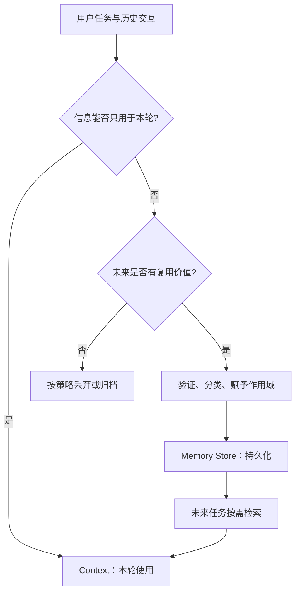

<strong>图解：</strong>不是所有信息都应该成为记忆。是否持久化应综合考虑未来价值、准确性、敏感性、保存期限和权限。

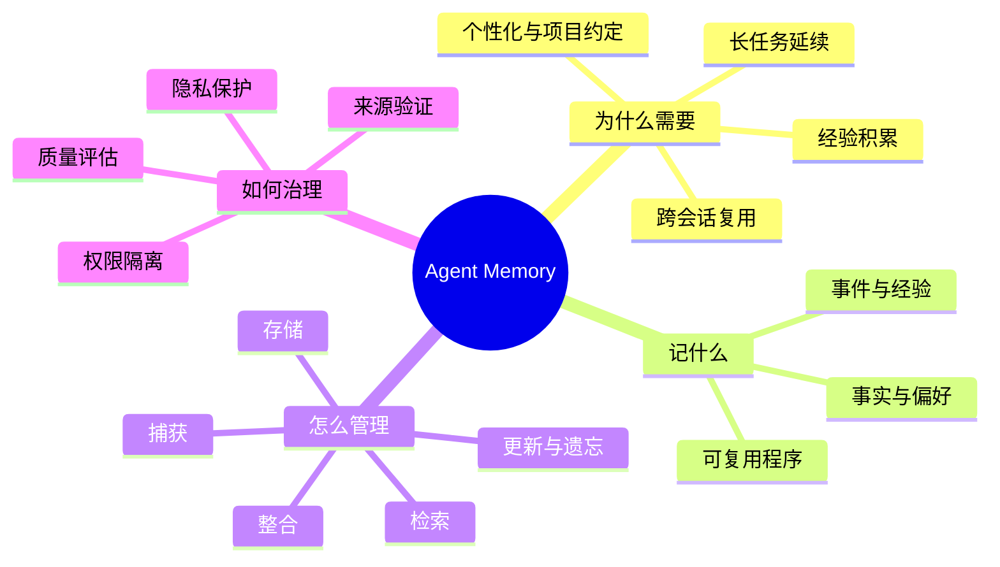

<strong>核心链路：</strong>Memory 不直接替代模型推理；它通过改善未来调用的输入，间接提高任务连续性和决策质量。

## 2. 记忆的定义与两套分类

### 2.1 按生命周期和访问范围：短期与长期

| 类型 | 常见作用域 | 典型信息 | 是否必须持久化 |
|---|---|---|---|
| <strong>Short-term Memory（短期记忆）</strong> | 当前线程、会话或任务 | 近期消息、局部事实、临时上下文 | 不必须，但可以通过检查点持久化 |
| <strong>Long-term Memory（长期记忆）</strong> | 跨会话、跨线程、用户或项目 | 稳定偏好、项目术语、历史经验 | 通常需要持久化 |

<strong>容易误解：</strong>“短期”不是 RAM（随机存取存储器）的同义词；短期记忆也可以存数据库。“长期”也不意味着永远保留，应有生命周期与删除机制。

### 2.2 按内容性质：语义、情景与程序性

| 类型 | 英文 | 回答的问题 | 例子 |
|---|---|---|---|
| <strong>语义记忆</strong> | Semantic Memory | 知道什么 | 某项目统一使用“控制单元”这一译名 |
| <strong>情景记忆</strong> | Episodic Memory | 发生过什么 | 上次某类复杂表格翻译失败，经人工确认后修复 |
| <strong>程序性记忆</strong> | Procedural Memory | 应当如何做 | 对相同文档类型采用已验证的排版修复步骤 |

这套分类借鉴认知科学，在 Agent 中是<strong>工程上的功能类比</strong>，并不意味着模型拥有与人类相同的记忆机制。强制性业务规则应由受控的 Prompt、代码或工作流保证，而不应完全依赖可变的程序性记忆。

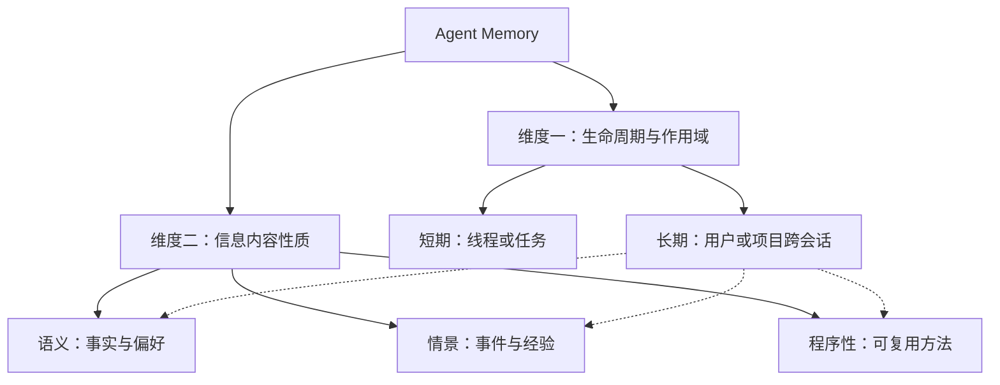

<strong>理解方式：</strong>两套分类是正交的。一条长期记忆可以是语义事实，也可以是情景经验；短期会话中同样可能暂存语义事实。

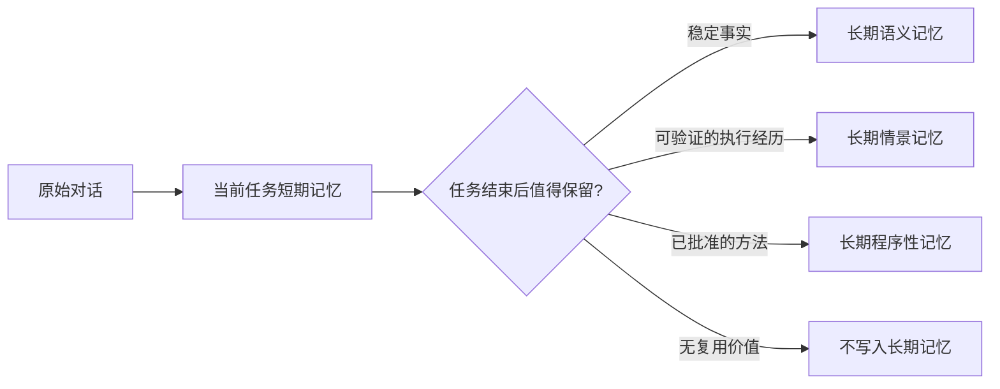

<strong>例子：</strong>“当前翻译到第 25 页”主要是 State（执行状态），而“此项目产品名必须采用官方英文名”可能是项目级语义记忆，但其权威来源仍应是正式术语库。

## 3. 记忆生命周期

记忆系统的完整工作不是“保存一段文字”，而是<strong>捕获 → 整合 → 存储 → 检索 → 使用 → 维护</strong>的闭环。

### 3.1 捕获 Capture

候选来源包括用户明确声明的偏好、经过确认的项目事实、工具执行结果、人工反馈和历史问题的解决经验。<strong>模型自行猜测的内容不能自动升级为事实记忆。</strong>

### 3.2 整合 Consolidate

对候选内容去重、抽取稳定事实、保留来源、判断是否与已有记忆冲突。可以同步写入，也可以任务完成后异步整理。异步方案降低主链路延迟，但必须处理队列失败、重复写入和延迟一致性。

### 3.3 存储 Store

建议保存内容及元数据：`memory_id`、`tenant_id`、`user_id` 或 `project_id`、`type`、`source`、`created_at`、`updated_at`、`expires_at`、`verification_status` 和 `version`。具体字段依合规要求调整。

### 3.4 检索 Retrieve

先按权限和作用域过滤，再按相关性、时效性、可信度排序；检索到的记忆不一定都应进入本轮上下文。

### 3.5 维护 Maintain

支持更新、版本追踪、合并、失效、纠错与删除。对于被后续事实推翻的旧记忆，优先保留变更历史用于审计，同时避免让旧内容继续影响推理。

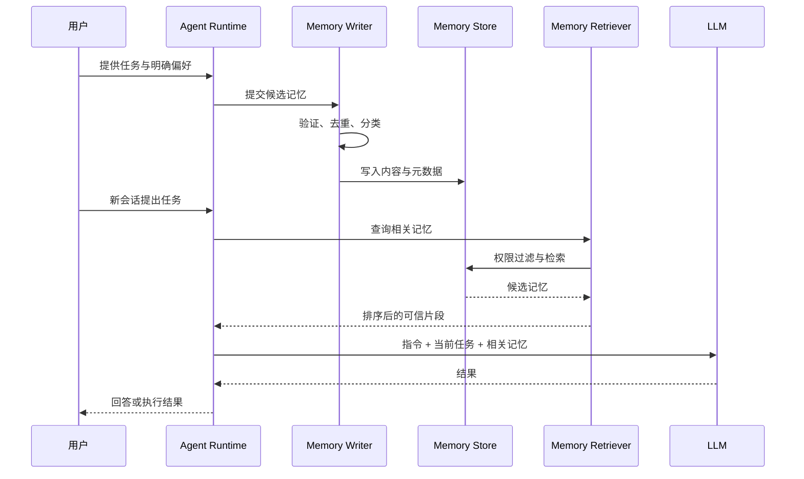

<strong>时序图说明：</strong>记忆写入与检索可以由 Runtime 管理，也可以通过独立服务完成；不要求每个模块都是独立微服务。

## 4. 写入策略与冲突治理

### 4.1 什么值得写入？

优先考虑<strong>稳定、可验证、可复用、在授权范围内保存</strong>的信息。反之，临时闲聊、未经核实的推断、敏感凭据和大体积原始工具日志通常不应直接写入长期记忆。

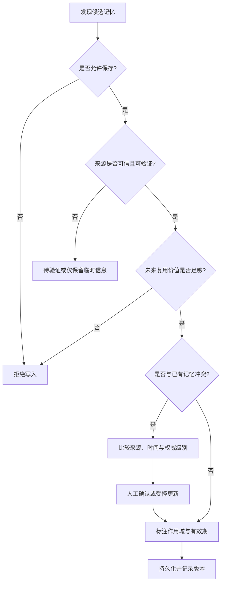

### 4.2 冲突处理的优先原则

1. <strong>权威数据优先：</strong>正式术语库、审批过的业务配置不应被模型生成的记忆覆盖。
2. <strong>明确来源：</strong>用户明确更改偏好与模型推测偏好不可同等对待。
3. <strong>考虑时间：</strong>同一来源的最新有效信息可能替代旧信息，但要检查作用域。
4. <strong>保留纠错路径：</strong>允许用户或管理员查看、修正与删除记忆。

### 4.3 记忆粒度

<strong>Profile（画像式）</strong>：把一组稳定偏好整合为一份文档，适合小规模、整体读取；但更新容易影响整份画像。

<strong>Collection（条目式）</strong>：每个事实或经验单独存储，适合增量更新、元数据过滤和精确删除；但需要去重与冲突合并。

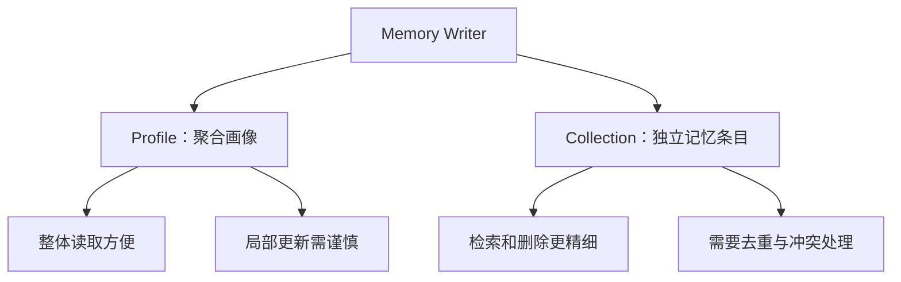

## 5. 检索、排序与上下文注入

<strong>关键原则：</strong>记忆在存储中存在，不代表它应该在每次调用中出现。检索应服务于当前任务，且必须先经过权限和作用域过滤。

| 检索方式 | 英文 | 适合信息 | 注意点 |
|---|---|---|---|
| 关键词检索 | Keyword Search | 产品型号、精确术语、项目编号 | 同义表达可能漏检 |
| 语义检索 | Semantic Search | 不同措辞表达的同一偏好 | 相似不等于事实正确 |
| 元数据过滤 | Metadata Filtering | 用户、项目、租户、有效期 | 应在检索前或检索中强制执行 |
| 混合检索 | Hybrid Search | 同时有精确词与自然语言 | 需要权重或融合策略 |
| 重排序 | Reranking | 多条候选的精排 | 增加延迟与成本 |

### 5.1 多因素排序

研究型系统常综合相关性、近期性与重要性。一个<strong>仅用于理解的概念性评分</strong>可写为：

$$
S(m, q) = w_r R(m, q) + w_t T(m) + w_i I(m) + w_c C(m)
$$

其中：

- $m$：一条候选记忆；$q$：当前查询。
- $R$（Relevance）：与当前任务的相关性。
- $T$（Recency）：时间近期性。
- $I$（Importance）：重要性。
- $C$（Confidence）：来源可信度或验证置信度。
- $w_r,w_t,w_i,w_c$：人为配置或经评估学习得到的权重。

<strong>这不是通用的标准公式，也不是所有框架采用的实现。</strong> 更重要的是：<strong>权限检查不能作为可被高分抵消的软权重</strong>，必须是硬约束。

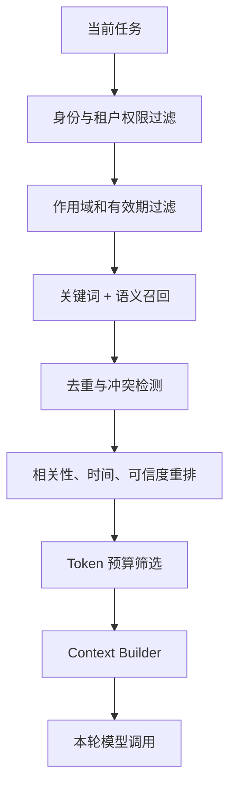

### 5.2 防止记忆过载

限制召回条数与 Token 预算，优先保留明确适用于当前项目的高价值信息；对于大量经验记录，先检索摘要，再按需展开原始证据。被检索的记忆应携带来源与时间，不应伪装为系统指令。

## 6. 存储架构与数据模型

| 存储介质 | 优点 | 适用场景 | 局限 |
|---|---|---|---|
| 内存或 Redis | 低延迟 | 临时会话与热点缓存 | 持久化能力取决于配置 |
| PostgreSQL / MySQL | 事务、结构化查询、审计 | 用户偏好、版本和权限元数据 | 语义检索可能需要扩展 |
| 向量数据库 | 语义近邻检索 | 大量经验和自然语言事实 | 需要补充精确过滤、更新治理 |
| Markdown / JSON 文件 | 可读、可版本化 | 小规模项目、长任务笔记 | 并发更新与大规模检索复杂 |
| 混合架构 | 各取所长 | 企业多租户系统 | 运维和一致性复杂度增加 |

<strong>注意：</strong>向量数据库只是检索基础设施，不等于记忆系统本身；数据库中的事实也不会自动变成模型当前可见的上下文。

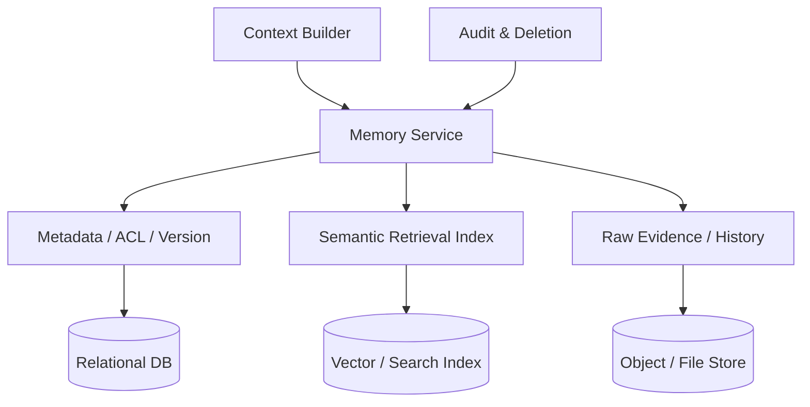

### 6.1 最小记忆记录示意

| 字段 | 目的 |
|---|---|
| `memory_id` | 唯一标识与可追踪删除 |
| `tenant_id` / `project_id` / `user_id` | 数据隔离与作用域 |
| `memory_type` | 语义、情景、程序性分类 |
| `content` | 记忆内容 |
| `source_ref` | 原始证据或授权来源 |
| `verification_status` | 待确认、已验证、已失效 |
| `created_at` / `updated_at` | 时间追踪 |
| `expires_at` | 有效期与自动过期 |
| `version` | 乐观并发与变更记录 |

<strong>工程提醒：</strong>真实生产系统还应设计数据最小化、加密、访问审计和删除传播。存储结构需要根据具体合规要求调整。

## 7. 与 Context、State、RAG、Prompt 的边界

| 组件 | 核心问题 | 企业翻译案例 |
|---|---|---|
| <strong>Prompt / Instructions</strong> | 模型应遵守什么规则 | 数字、单位、型号不得随意改写 |
| <strong>Context</strong> | 本轮模型能看到什么 | 当前段落、相邻上下文和术语 |
| <strong>State</strong> | 任务现在进行到哪一步 | 第 25 页已完成，下一页待处理 |
| <strong>Memory</strong> | 哪些信息未来仍值得复用 | 项目译名偏好、已验证修复经验 |
| <strong>RAG</strong> | 如何从外部知识源取回相关信息 | 检索企业术语库与产品说明 |
| <strong>Tools</strong> | 如何获取信息或执行动作 | PDF 解析、OCR、排版、校验 |

<strong>RAG（Retrieval-Augmented Generation，检索增强生成）</strong>是检索并提供外部证据的方法；<strong>Memory</strong>关注信息保留与复用的生命周期。记忆系统可以使用 RAG 类似的检索技术，但不能简单画等号。

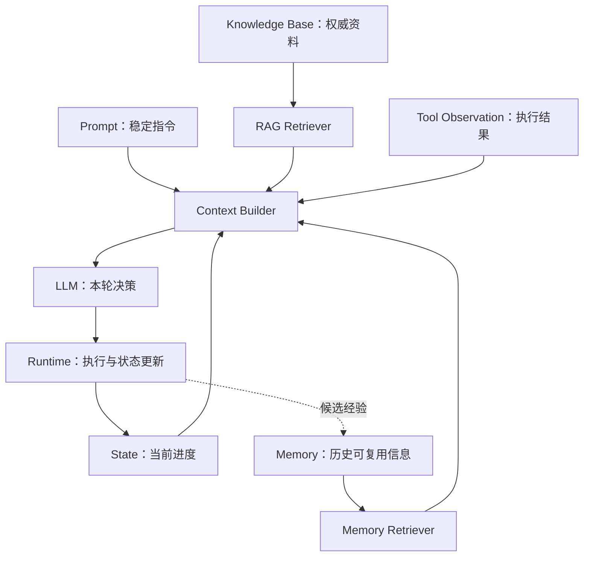

### 7.1 重点边界：记忆不是权限规则

记忆可以提供“这个用户偏好某种输出格式”，但不能授权 Agent 读取原本无权访问的文件；也不能覆盖企业强制的安全规则。系统指令与权限控制应由受控配置和后端实现保证。

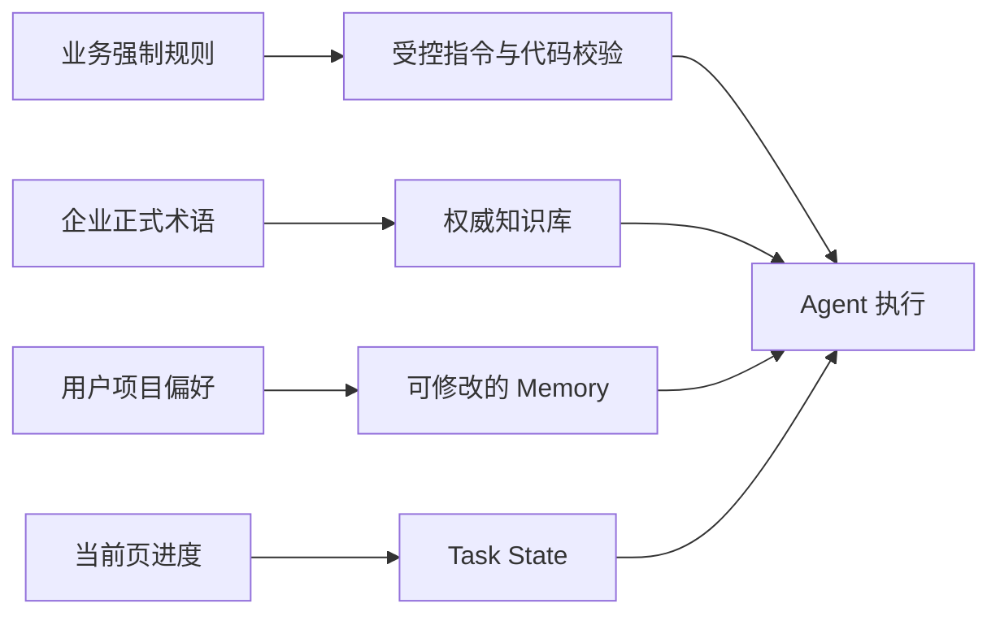

## 8. 长任务恢复与多 Agent 共享

长任务恢复主要依靠<strong>Checkpoint（检查点）与持久化 State</strong>；Memory 可以补充跨任务经验，但不应替代精确的进度记录。

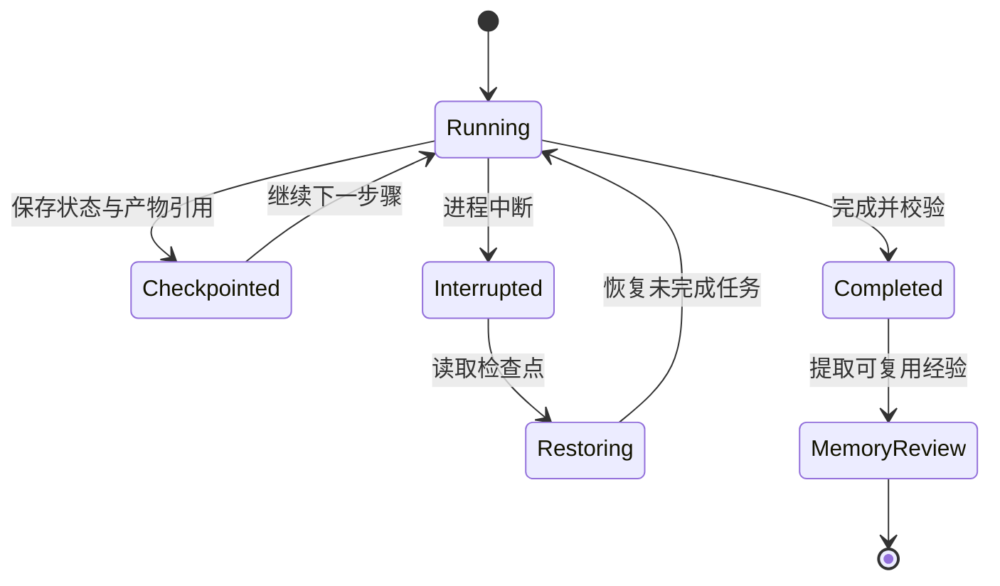

<strong>恢复重点：</strong>应保存已完成步骤、待处理任务、外部产物路径、幂等标识和失败原因；不应只依赖一句“上次做到哪里”的自然语言摘要。

### 8.1 多 Agent 记忆共享

- <strong>私有记忆：</strong>子 Agent 自己的临时工作信息，避免无关数据相互污染。
- <strong>项目共享记忆：</strong>经授权的项目偏好、公共经验与术语引用。
- <strong>组织级权威知识：</strong>应通过受控知识库或配置发布，而不是任意 Agent 直接写入。

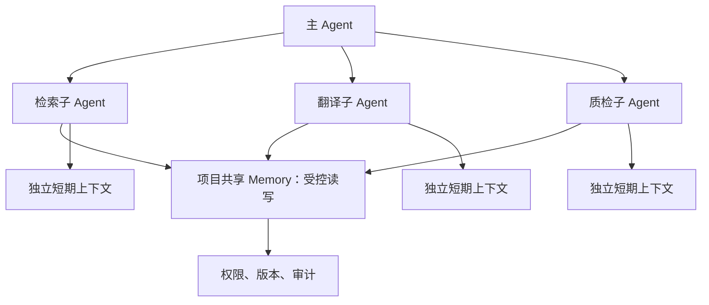

多 Agent 共享时应防止并发覆盖、跨租户泄露和错误经验传播。对于需要精确一致性的内容，采用版本号、事务或审批机制。

## 9. 安全、隐私、遗忘与质量评估

### 9.1 记忆投毒 Memory Poisoning

攻击者可能通过恶意文档、网页、工具输出或对话输入，诱导 Agent 将错误指令写成持久化记忆，随后在未来任务中反复触发。<strong>记忆的持久化会放大不可信信息的影响范围。</strong>

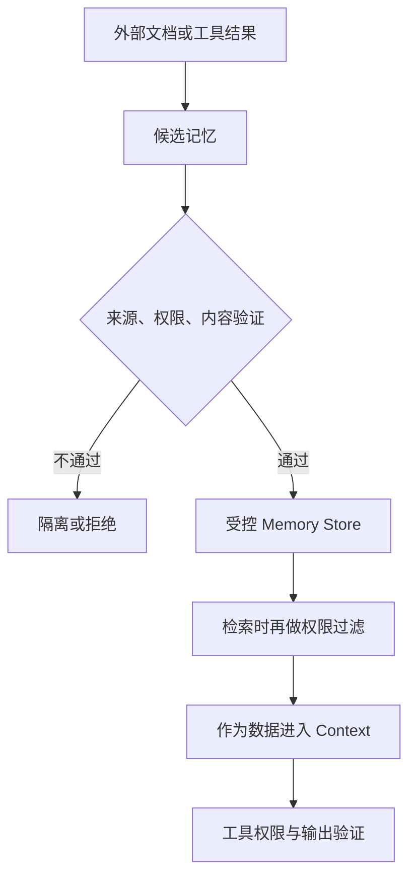

### 9.2 企业治理要点

| 维度 | 设计要求 |
|---|---|
| 作用域 | 用户、项目、租户隔离；默认最小权限 |
| 隐私 | 数据最小化；避免保存密钥、凭据和不必要的敏感信息 |
| 来源 | 保留出处、验证状态和最后更新时间 |
| 纠错 | 支持更正、失效、撤销与审计 |
| 遗忘 | TTL（生存时间）、主动删除、索引同步清理 |
| 安全 | 写入前校验、检索后标注来源、工具执行层硬性授权 |

### 9.3 记忆系统如何评估？

| 指标 | 含义 | 可能的测试方式 |
|---|---|---|
| 写入精度 | 保存的记忆是否真实且值得复用 | 人工标注候选记忆与写入结果 |
| 检索召回率 | 需要的记忆是否被找回 | 构造含正确记忆的查询集 |
| 检索精确率 | 召回结果中有多少真正相关 | 人工标注检索结果 |
| 事实一致性 | 是否使用过时或冲突的记忆 | 时间变更与纠错测试 |
| 任务成功率 | 记忆是否改善最终任务结果 | 有记忆与无记忆对照实验 |
| 删除有效性 | 删除后是否不再被检索或使用 | 删除传播和缓存检查 |
| 成本与延迟 | 检索、写入与上下文注入的开销 | P50/P95 延迟与 Token 统计 |

<strong>指标之间有权衡：</strong>召回更多记忆可能提高覆盖率，却也可能增加噪声、成本与隐私风险；应以任务成功率和安全要求为最终约束。

## 10. 企业文档翻译 Agent 案例

### 10.1 场景与设计目标

某医疗设备企业需要跨多份 Word/PDF 文档保持术语一致，并复用经确认的排版修复经验。系统必须保证文档访问权限、数字与型号完整性、翻译质量以及跨会话继续执行。

<strong>设计原则：</strong>把<strong>任务进度</strong>放入 State，把<strong>正式术语</strong>放入受控知识库，把<strong>经验证的偏好和经验</strong>放入 Memory；每轮只检索当前页面所需内容。

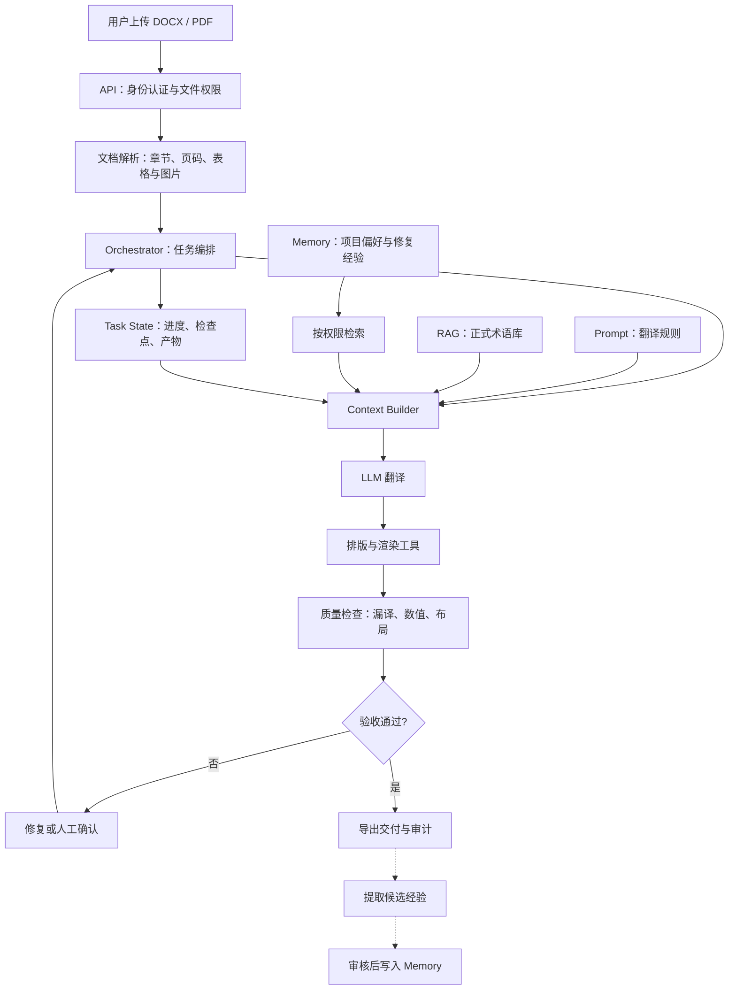

### 10.2 信息归属决策表

| 信息示例 | 放在哪里 | 原因 |
|---|---|---|
| 第 25 页已翻译 | State | 任务执行进度 |
| 当前页原文与相邻段落 | Context | 当前调用需要 |
| 公司批准的设备名称译法 | 企业术语库 / RAG | 权威事实需要集中治理 |
| 某项目约定的译文风格 | 项目级 Semantic Memory | 可跨文档复用 |
| 一次复杂表格的修复过程 | Episodic Memory | 可供未来相似任务参考 |
| 经评审通过的修复步骤 | Procedural Memory 或受控工作流 | 可复用方法，强制流程需固化 |
| 翻译结果必须校验数字 | Prompt + 验证代码 | 强制约束不能只依赖记忆 |

### 10.3 具体执行链路

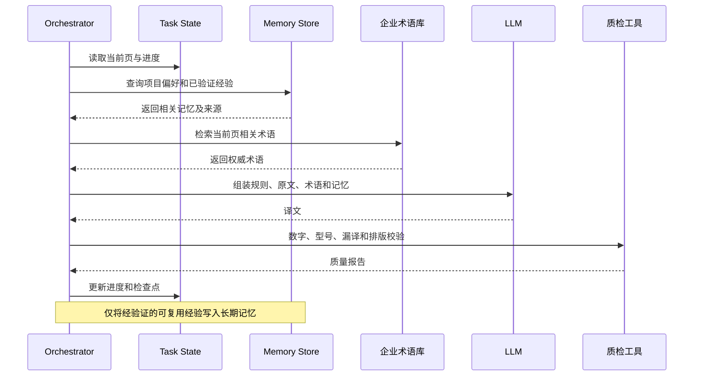

### 10.4 失败场景与处理

<strong>案例 A：记忆与正式术语冲突。</strong> 企业术语库规定“control unit”译为“控制单元”，历史记忆却出现“控制模块”。系统应优先采用权威术语，并将冲突记忆标记为待修正。

<strong>案例 B：跨项目泄露。</strong> A 项目的内部术语被 B 项目检索到。应在检索层按 `tenant_id`、`project_id` 和授权关系强制过滤，不能仅依靠 Prompt 要求模型“不要泄露”。

<strong>案例 C：中断后恢复。</strong> 翻译在第 68 页中断。通过 Checkpoint 恢复页码、已完成产物与待处理步骤；Memory 仅用于补充术语偏好与历史经验。

## 11. 设计决策、常见误区与面试题

### 11.1 是否需要 Memory？

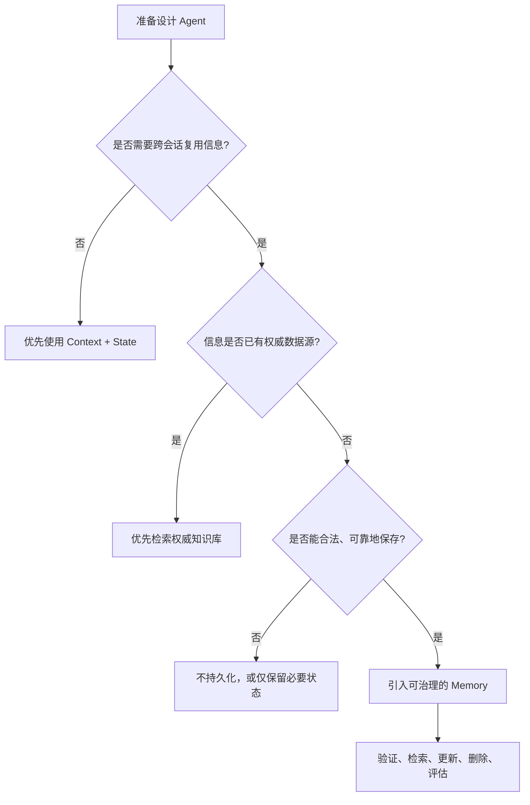

<strong>建议：</strong>不是每个 Agent 都需要长期记忆。先证明跨会话复用确有收益，再引入写入、检索与治理成本。

### 11.2 常见误区

1. <strong>“聊天历史就是 Memory。”</strong> 聊天历史可以是候选信息来源，但缺少选择、治理、检索和遗忘机制时，不等于完整记忆系统。
2. <strong>“Memory 等于向量数据库。”</strong> 向量库是可选的检索存储技术，不负责全部记忆生命周期。
3. <strong>“短期记忆不能持久化。”</strong> 线程级短期记忆也可通过数据库检查点保存。
4. <strong>“RAG 就是 Memory。”</strong> RAG 是检索增强方法，Memory 是信息跨时间保留和复用的能力。
5. <strong>“记忆越多越好。”</strong> 噪声、冲突和过时事实会降低质量。
6. <strong>“模型说过的话都可以记住。”</strong> 模型输出需要来源与事实验证。
7. <strong>“删除数据库记录就完成遗忘。”</strong> 还要考虑缓存、索引、派生摘要、备份和合规删除策略。
8. <strong>“记忆能替代权限系统。”</strong> 授权必须由后端硬性执行。

### 11.3 高频面试问题与回答思路

<strong>Q1：Agent 的短期记忆与长期记忆有什么区别？</strong> 重点从作用域、生命周期和复用范围回答，补充“短期记忆也可持久化”。

<strong>Q2：Memory 与 State 的区别？</strong> State 记录当前任务的准确执行进度，Memory 记录未来任务可能复用的事实、偏好和经验；二者可以共用存储设施，但逻辑职责不同。

<strong>Q3：如何决定一条信息是否值得记忆？</strong> 看授权、来源可信度、稳定性、未来复用价值、敏感性、冲突和有效期。

<strong>Q4：为什么不能只用向量数据库做 Memory？</strong> 因为还需要精确过滤、事务更新、来源、版本、权限、纠错与删除机制。

<strong>Q5：如何防止 Memory Poisoning？</strong> 写入前验证来源，检索时做作用域过滤，记忆作为低信任数据进入上下文，工具层执行硬权限和结果校验。

<strong>Q6：长期任务中 Memory 和 Checkpoint 谁负责恢复？</strong> Checkpoint / State 负责精确恢复；Memory 提供跨任务可复用经验。

<strong>Q7：如何证明 Memory 有价值？</strong> 采用有/无记忆的端到端任务对照，观察成功率、错误率、延迟、Token 成本和安全指标。

---

## 12. 术语注释与参考资料

### 12.1 术语速查表

| 术语 / 缩写 | 英文全称 | 中文解释 |
|---|---|---|
| Agent | AI Agent | 可感知信息、决策并执行任务的智能体系统 |
| LLM | Large Language Model | 大语言模型 |
| Memory | Agent Memory | Agent 信息保留、检索和复用机制 |
| Short-term Memory | Short-term Memory | 通常作用于当前线程或任务的短期记忆 |
| Long-term Memory | Long-term Memory | 可跨会话使用的长期记忆 |
| Semantic Memory | Semantic Memory | 保存事实、概念、偏好等信息 |
| Episodic Memory | Episodic Memory | 保存经历、事件和历史执行案例 |
| Procedural Memory | Procedural Memory | 保存可复用方法和工作程序 |
| Context | Context | 当前模型调用可见的信息 |
| State | Execution State | 当前任务的执行状态与中间结果 |
| RAG | Retrieval-Augmented Generation | 检索增强生成 |
| Retrieval | Retrieval | 从存储中查找与任务相关的信息 |
| Embedding | Embedding | 将文本等信息映射到向量表示 |
| Vector DB | Vector Database | 向量数据库 |
| Hybrid Search | Hybrid Search | 组合关键词与语义等检索信号 |
| Reranking | Reranking | 对召回候选进行重新排序 |
| Checkpoint | Checkpoint | 用于任务恢复的状态快照 |
| TTL | Time to Live | 数据生存时间 / 过期时限 |
| ACL | Access Control List | 访问控制列表 |
| Tenant | Tenant | 租户，企业级数据隔离单位 |
| Namespace | Namespace | 记忆或数据的逻辑命名空间 |
| Memory Poisoning | Memory Poisoning | 通过不可信内容污染持久化记忆的攻击 |
| Consolidation | Memory Consolidation | 将候选记忆去重、整合和验证的过程 |
| Compaction | Context Compaction | 对长上下文进行压缩整理，不等于长期记忆 |
| RAM | Random Access Memory | 计算机随机存取存储器，与短期记忆概念不同 |
| P95 | 95th Percentile | 95% 请求的延迟不超过该分位值 |
| OCR | Optical Character Recognition | 光学字符识别 |

### 12.2 参考资料（官方文档与论文）

1. [LangGraph / LangChain：Memory Overview](https://docs.langchain.com/oss/python/concepts/memory) — 短期与长期记忆、记忆类型、读写策略。
2. [LangGraph：Persistence](https://docs.langchain.com/oss/python/langgraph/persistence) — 线程状态、检查点与恢复。
3. [Anthropic：Memory Tool](https://platform.claude.com/docs/en/agents-and-tools/tool-use/memory-tool) — 文件式持久化记忆和按需读取。
4. [Anthropic：Effective Harnesses for Long-Running Agents](https://www.anthropic.com/engineering/effective-harnesses-for-long-running-agents) — 长任务记录与恢复。
5. [Park et al., Generative Agents: Interactive Simulacra of Human Behavior (2023)](https://arxiv.org/abs/2304.03442) — 记忆流、反思、规划和检索。
6. [Packer et al., MemGPT: Towards LLMs as Operating Systems (2023)](https://arxiv.org/abs/2310.08560) — 分层内存与上下文管理。
7. [Anthropic：Effective Context Engineering for AI Agents](https://www.anthropic.com/engineering/effective-context-engineering-for-ai-agents) — 记忆与上下文工程的联系。
8. [OWASP：Prompt Injection](https://genai.owasp.org/llmrisk/llm01-prompt-injection/) — 不可信输入与持久化风险的安全背景。

> <strong>阅读提醒：</strong>本文中的架构图、评分公式和流程分类主要用于教学与工程设计，不代表某一框架的强制标准。具体实现应结合官方文档、业务数据权限和测试结果决定。

---

## 本篇总结

<strong>Context Engineering 决定“本轮模型应该看到什么”；Memory Engineering 决定“哪些信息值得跨时间保存，以及未来如何可靠地找回来”。</strong>

真正的企业级 Agent Memory 不只是存储和检索，还必须具备<strong>写入判断、来源追踪、权限隔离、冲突纠错、版本管理、过期删除和效果评估</strong>。从最小可用的项目偏好记忆开始，按实际需求演进到可治理的长期记忆服务，通常比一开始保存所有历史信息更稳健。

