# 04｜Agent Tools：从工具契约到企业级执行系统

> 所属路径：`03-Agent-Core-Components/04-Tools.md`  
> 前置知识：[Prompt 与 Instructions](01-Prompt-and-Instructions.md) → [Context Engineering](02-Context-Engineering.md) → [Memory](03-Memory.md)  
> 学习目标：理解 Agent 如何<strong>发现工具、选择工具、生成调用、执行操作、处理错误并反馈结果</strong>，建立可验证、可治理的企业工具体系。

## 阅读导航

1. 为什么需要 Tools：从回答到行动
2. 工具概念、类型与风险
3. 工具契约与 Schema
4. 工具注册、发现与选择
5. Function Calling 完整链路
6. API、Tool Calling 与 MCP 的边界
7. 调度与串并行执行
8. 错误分类、重试、幂等与熔断
9. 权限、安全与人工审批
10. 可观测性、评估与成本
11. Tools 与其他核心组件协作
12. 企业文档翻译 Agent 端到端案例
13. 常见误区与面试问答
14. 术语注释与权威参考资料

---

## 1. 为什么 Agent 需要工具

语言模型能够根据输入生成文本或结构化调用意图，但并不会仅凭生成文本就真实读取数据库、修改文件或执行企业审批。<strong>Tool 是模型决策通往外部世界的能力接口，Runtime 是验证并执行调用的控制者。</strong> 工具既可以只读，也可以产生不可逆的副作用；因此设计工具系统的重点不是增加工具数量，而是建立从能力声明到执行结果的可信闭环。

核心因果链：<strong>任务需要外部信息或动作 → 模型选择能力 → 运行时执行与验证 → 结果成为新观察 → 模型继续决策。</strong>

### 图 1｜工具系统知识全景思维导图

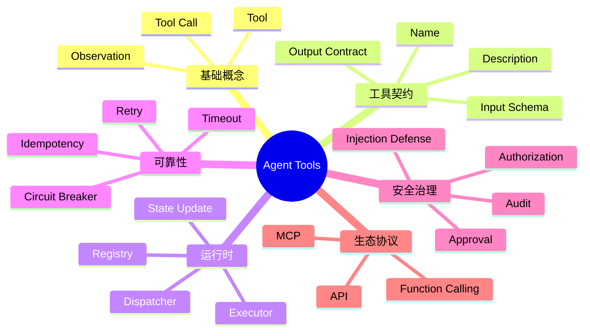

这张图展示工具系统的六个知识域。阅读时先理解调用链，再研究契约、调度与治理。

### 图 2｜从用户意图到真实动作

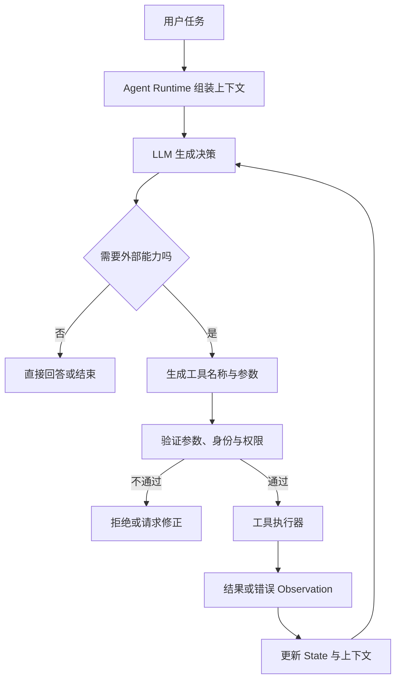

<strong>重要边界：</strong>模型提出调用请求，并不代表调用已经执行；应用必须在执行前进行独立校验。

## 2. 工具概念、类型与风险

### 2.1 六个基本概念

| 概念 | 定义 | 工程责任 |
|---|---|---|
| Tool Definition（工具定义） | 告诉模型某个能力的用途、名称与输入结构 | 使模型理解何时使用 |
| Tool Registry（工具注册表） | 管理工具元数据、版本与可用性 | 维护工具目录；是常见设计而非协议强制组件 |
| Tool Selection（工具选择） | 在可用工具中选择合适能力 | 由模型、规则或二者共同决定 |
| Tool Call（工具调用请求） | 指定工具及参数的结构化意图 | 尚未发生真实执行 |
| Tool Execution（工具执行） | Runtime 或服务端实际执行操作 | 校验、调度、限时、记录 |
| Observation（观察结果） | 返回给 Agent 的执行结果或错误 | 支持下一轮决策 |

### 2.2 功能分类与风险分类

| 类型 | 典型能力 | 常见风险 |
|---|---|---|
| Retrieval | 搜索、知识库查询 | 数据越权、错误检索 |
| File | 文档解析、文件读取 | 路径穿越、文件泄露 |
| Computation | 确定性计算、价格核算 | 单位错误、精度问题 |
| Business | 订单查询、审批状态 | 业务权限和一致性 |
| Action | 写文件、发送消息、修改记录 | 重复执行、不可逆副作用 |
| Validation | 内容校验、格式检查 | 误报漏报、规则漂移 |
| Rendering | DOCX/PDF 排版与导出 | 格式损坏、路径覆盖 |

工具还可按<strong>只读 / 可写 / 高影响操作</strong>进行风险分级。分级由具体业务影响决定，不能只看函数名称。

### 图 3｜工具功能与风险二维图

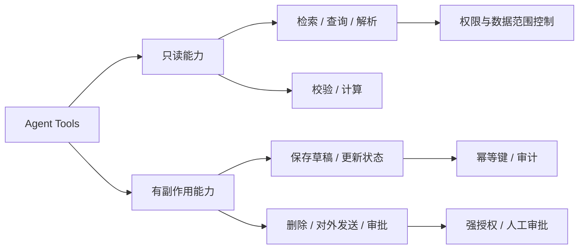

风险随操作影响、数据敏感度和可逆性变化；只读工具同样需要访问控制。

## 3. 工具契约：Schema 解决什么，解决不了什么

一个生产工具至少需要清晰描述：<strong>名称、用途、何时调用、输入类型、输出语义、错误类别、权限边界和副作用</strong>。工具描述是给模型看的“能力说明书”，但权限和业务规则必须在服务端执行。

### 3.1 工具契约的六个维度

| 维度 | 应回答的问题 | 例子 |
|---|---|---|
| Name | 能力叫什么？ | `parse_document` |
| Description | 什么情况下调用、不调用？ | 用于解析 DOCX/PDF，不能直接完成翻译 |
| Input Schema | 参数有哪些、类型是什么？ | `file_id: string`、`mode: enum` |
| Output Contract | 返回哪些字段、各字段含义？ | `pages`、`warnings`、`artifact_id` |
| Permissions | 谁能调用、能访问哪个资源？ | 仅允许当前租户授权文件 |
| Error Contract | 如何识别可恢复与不可恢复错误？ | `INVALID_INPUT`、`TIMEOUT`、`FORBIDDEN` |

### 3.2 JSON Schema、严格模式与业务校验

JSON Schema（JSON 结构模式）可声明字段、类型、必填条件和枚举范围。某些模型 API 的严格结构化调用模式可提高参数符合 Schema 的可靠性，但<strong>结构合法不等于业务正确</strong>。例如 `file_id` 是字符串，不代表用户有权读取该文件；`amount` 是数字，也不代表符合企业额度规则。

推荐将校验分成三层：①结构校验（字段、类型）；②语义校验（业务范围、文件类型、数值限制）；③授权校验（身份、租户、资源权限）。

### 图 4｜工具契约与服务端校验边界

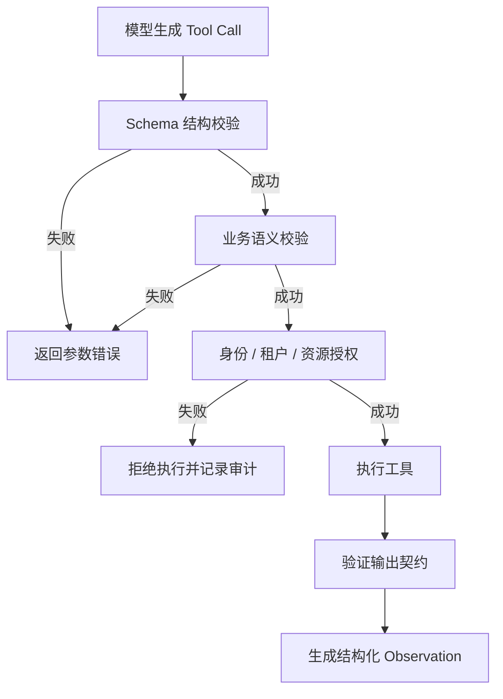

Schema 只是执行门槛之一；敏感操作必须独立授权，不能依赖 Prompt 中的“禁止越权”。

## 4. 工具注册、发现与选择

工具注册表常记录工具标识、描述、输入 Schema、版本、所属服务、执行风险、权限范围和健康状态。工具发现（Discovery）决定当前会话向模型暴露哪些工具。<strong>可调用工具集合应该先由权限与业务策略过滤，再交给模型选择</strong>，而不是让模型先看到所有企业工具。

动态选择常用三种方式：规则路由（确定性）、模型选择（灵活）、混合路由（规则限制候选集合，模型在候选中选择）。工具过多可能增加上下文成本和选择错误率，适宜按任务阶段暴露最相关工具。

### 图 5｜工具发现与选择架构

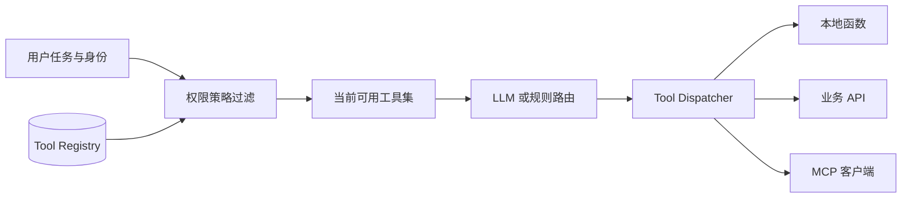

Registry 可以是进程内映射、配置中心或独立服务，是否拆分取决于系统规模。

## 5. Function Calling：完整的模型—应用—工具闭环

Function Calling（函数调用）是让模型输出结构化调用意图的一类接口机制。典型过程：应用提供工具定义 → 模型返回工具名称与参数 → 应用执行 → 应用返回工具结果 → 模型继续生成。不同模型厂商的消息字段、调用 ID 和多工具处理方式可能不同，必须遵循实际接口规范。

### 5.1 工具调用不是最终答案

模型返回的 Tool Call 需要执行、关联调用 ID、处理失败并把结果反馈到后续上下文。对于连续多步任务，Runtime 还需控制最大轮数、超时和预算，避免无限循环。

### 图 6｜Function Calling 时序图

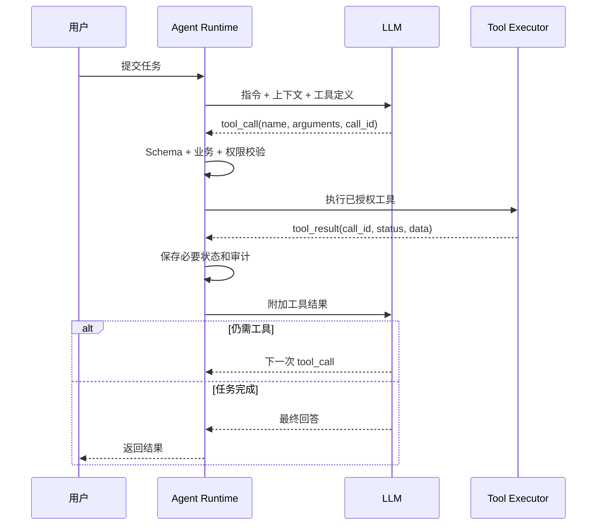

时序图强调工具调用结果应关联原调用标识，防止并行调用时结果错配。

### 图 7｜工具调用状态机

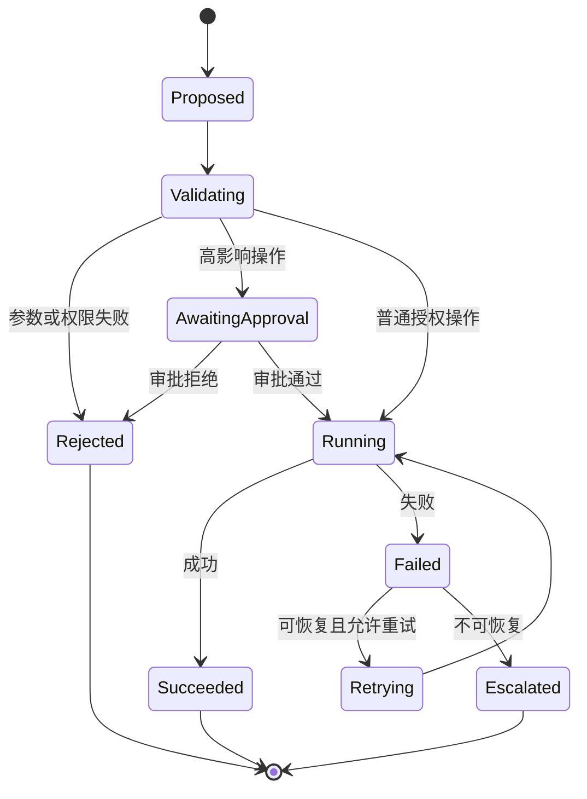

不同工具可采用更简单的状态机；高风险操作才需要审批节点。

## 6. API、Tool Calling、Function Calling 与 MCP 的边界

| 概念 | 全称 / 定义 | 所处位置 | 与其他技术的关系 |
|---|---|---|---|
| API | Application Programming Interface，应用程序编程接口 | 软件间能力调用接口 | 工具的实现常依赖 API |
| Tool Calling | 工具调用的广义能力 | 模型与 Runtime 交互层 | 可以包含函数工具、托管工具等 |
| Function Calling | 结构化函数调用请求机制 | 模型接口层 | 不保证函数自动执行 |
| MCP | Model Context Protocol，模型上下文协议 | 客户端与服务提供方的标准连接层 | 可将 MCP 工具适配为模型可调用工具 |
| Tool Registry | 工具元数据与发现管理 | 应用架构层 | 可注册本地、API 或 MCP 工具 |

MCP 采用 Host、Client、Server 等角色，并定义工具发现与调用等能力。MCP Server 提供工具并不意味着模型直接与它通信；通常由 Host/Runtime 管理 MCP Client，执行权限策略与调用控制。MCP 不等于 RAG，也不是 Agent 必需组件。

### 图 8｜Function Calling 与 MCP 协作关系

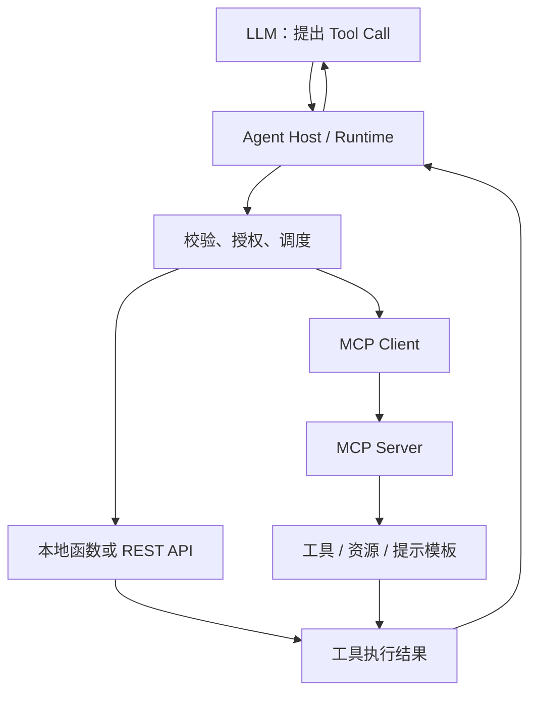

<strong>核心区别：</strong>Function Calling 解决模型如何表达调用意图；MCP 解决应用如何标准化连接外部能力。

### 图 9｜选择本地工具、API 或 MCP 的决策树

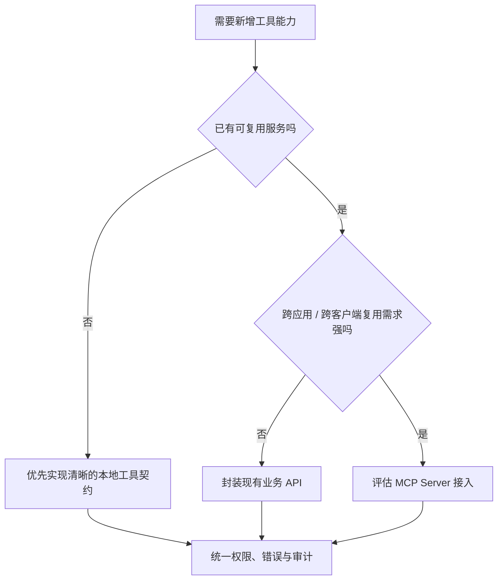

这是工程选型启发式，不是必须遵循的技术标准；是否采用 MCP 还取决于生态、维护和安全要求。

## 7. 调度：串行、并行与依赖执行

工具执行计划取决于依赖关系和副作用。独立的只读检索可并行；解析后才能翻译、翻译后才能排版属于串行依赖；并行写入共享文件则可能产生竞态条件（Race Condition）。模型能够提出多个调用，不代表运行时必须无条件并行执行。

| 模式 | 适用条件 | 关键风险 |
|---|---|---|
| 串行（Sequential） | 有数据依赖或写入顺序 | 延迟较高 |
| 并行（Parallel） | 任务独立、权限允许 | 竞态、资源峰值、结果关联 |
| 批量（Batch） | 同构请求较多 | 部分失败、单批过大 |
| 异步任务（Async Job） | 长耗时、可持久化 | 轮询、取消、重复投递 |

### 图 10｜串行依赖与并行分支

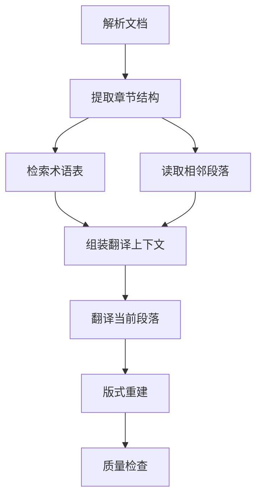

C 与 D 在满足权限和资源条件时可并行；F 必须等待两者的必要结果。

## 8. 错误分类与可靠性机制

生产系统要区分<strong>可重试失败、不可重试失败、未知执行结果</strong>。例如请求超时不代表服务端一定没有执行；对于创建订单、发送邮件、写入文件等操作，盲目重试可能造成重复副作用。

| 机制 | 解释 | 适用要点 |
|---|---|---|
| Timeout（超时） | 限制等待时长 | 设置单次与任务级超时 |
| Retry（重试） | 再次尝试可恢复操作 | 限定次数并识别错误类别 |
| Exponential Backoff（指数退避） | 重试间隔逐步增加 | 可配合抖动 Jitter |
| Idempotency（幂等） | 同一逻辑请求重复执行不产生额外副作用 | 使用幂等键或唯一约束 |
| Circuit Breaker（熔断） | 下游故障时临时阻断调用 | 防止级联故障 |
| Rate Limiting（限流） | 限制请求频率 | 按用户、租户、服务分层 |
| Fallback（降级） | 主路径不可用时切换备用路径 | 不能悄悄降低安全约束 |
| Checkpoint（检查点） | 保存可恢复进度 | 长任务和异步执行 |

### 8.1 错误如何反馈给 Agent

建议使用可解析的错误类型，如 `INVALID_ARGUMENT`、`FORBIDDEN`、`RATE_LIMITED`、`TIMEOUT`、`CONFLICT`、`UPSTREAM_UNAVAILABLE`，附上安全的错误描述与是否允许重试。不要把访问令牌、内部路径、完整堆栈和敏感数据库字段直接放入模型上下文。

### 图 11｜工具错误恢复决策树

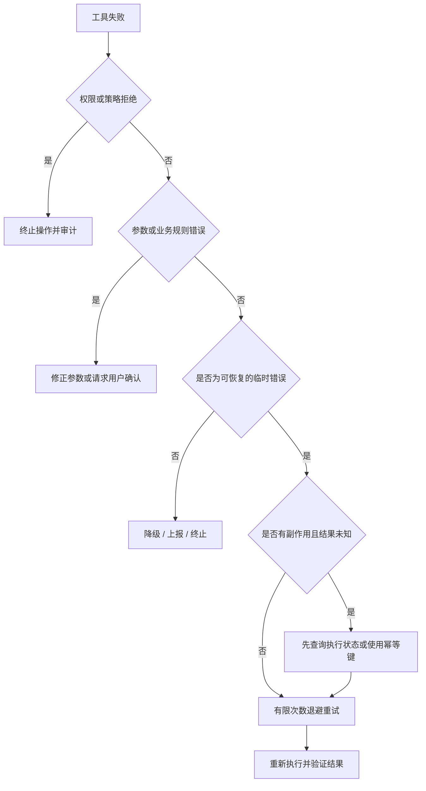

对有副作用的超时操作，首先确认是否已经执行，而不是立即再次提交。

### 图 12｜熔断器状态与恢复

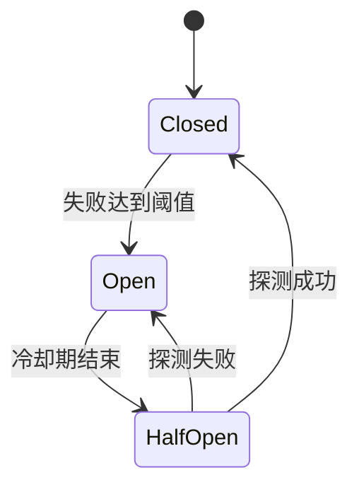

Closed（闭合）允许正常请求，Open（断开）拒绝请求，HalfOpen（半开）进行有限探测。

## 9. 工具安全：权限、信任边界与人工审批

工具描述与 Prompt 不是安全边界。<strong>外部文档、网页、数据库查询结果和工具返回内容都应按数据处理，不能因为被模型读到就获得指令权限。</strong> Prompt Injection（提示词注入）可能诱导模型越权使用工具，防护需要多层机制：工具白名单、身份授权、参数校验、资源隔离、出站访问限制、人工审批和审计。

### 9.1 推荐的分层防护

1. <strong>能力最小化：</strong>只向当前任务暴露必要工具。
2. <strong>身份与租户隔离：</strong>每次执行核验真实用户及资源归属。
3. <strong>输入与目标校验：</strong>校验文件 ID、URL、目标地址和业务约束。
4. <strong>高影响操作审批：</strong>外发、删除、财务类操作按风险配置人工确认。
5. <strong>结果过滤：</strong>敏感信息脱敏，避免错误堆栈泄露。
6. <strong>审计与撤销：</strong>记录谁在何时对什么资源执行了什么操作，必要时提供补偿机制。

### 图 13｜工具安全分层防线

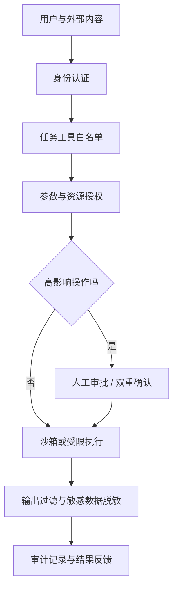

防护重点是可执行的服务端控制，而非依赖模型自行判断权限。

## 10. 可观测性、评估与成本

工具系统不仅要知道调用成功没有，还要知道<strong>为什么选它、用了什么参数、耗时多久、产生什么副作用、是否符合业务目标</strong>。Trace（追踪）描述端到端任务链路，Span（跨度）记录单次模型或工具操作；Metrics（指标）用于聚合统计；Audit Log（审计日志）用于责任追溯。日志需脱敏并设置合理保留策略。

| 指标 | 含义 | 工程价值 |
|---|---|---|
| Tool Selection Accuracy | 工具选择正确率 | 判断描述与路由是否合理 |
| Argument Validity Rate | 参数合法率 | 发现 Schema 与提示词问题 |
| Tool Success Rate | 工具成功率 | 衡量可用性 |
| End-to-end Task Success | 任务端到端成功率 | 避免只看单个工具成功 |
| Retry Rate | 重试率 | 发现不稳定依赖 |
| P95 Latency | 第 95 百分位延迟 | 发现尾部慢请求 |
| Unauthorized Call Rate | 未授权调用比例 | 检查安全策略 |
| Cost per Completed Task | 每完成任务成本 | 综合模型、工具与人工成本 |

这些指标应区分测试环境与真实生产流量；工具成功率高不代表最终交付物质量高。

### 图 14｜工具质量评估与迭代闭环

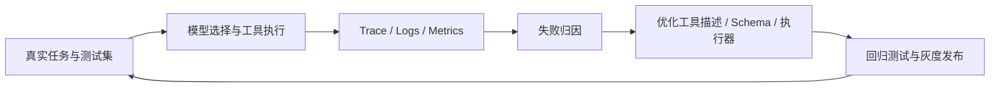

测试需要覆盖正确调用、错误调用、权限拒绝、服务超时、重复提交和恶意工具结果。

## 11. Tools 与其他 Agent 组件如何协作

前面三个核心组件为工具系统提供了决策条件：Prompt 定义行为原则，Context 提供当前信息，Memory 保存可复用经验；Tools 则提供实际行动能力。State 保存调用进度、结果和错误，Runtime 负责循环、授权和调度。RAG 可通过检索工具成为外部知识来源；MCP 是可选的连接协议，而不是记忆或检索本身。

| 组件 | 作用 | 不应混淆的边界 |
|---|---|---|
| Prompt | 工具使用策略与任务规则 | 不替代服务端授权 |
| Context | 提供工具定义、任务信息和观察结果 | 不等于长期存储 |
| Memory | 保存历史偏好和经验 | 不应直接覆盖受控业务规则 |
| State | 保存当前工具调用和任务进度 | 不等于全部对话历史 |
| Runtime | 负责调度、预算、执行与反馈 | 不等于模型本身 |
| RAG | 按需检索外部知识 | 不等于所有工具 |
| MCP | 连接工具、资源等能力的协议 | 不是所有 Agent 的必选项 |

### 图 15｜Agent 核心组件与 Tools 的关系

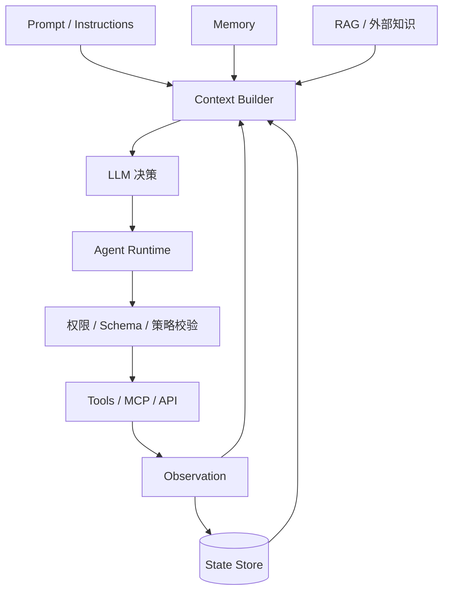

这是概念架构而非强制部署拓扑。不同框架可能将 Context Builder、Runtime 和 Tool Executor 合并实现。

## 12. 企业文档翻译 Agent：端到端工具设计

以医疗设备企业文档翻译为例，核心任务是把 DOCX/PDF 转换为目标语言，并尽量保留表格、图片、段落和版式。<strong>优先使用确定性 Workflow 承担固定步骤，在识别歧义、异常修复、术语冲突等节点引入 Agent 决策。</strong>

### 12.1 工具清单与契约要点

| 工具 | 职责 | 关键输入 | 关键输出 | 主要风险 |
|---|---|---|---|---|
| `parse_document` | 解析文档结构 | 文件 ID、格式 | 页面与元素结构 | 原文件读取权限 |
| `extract_text` | OCR / 文本提取 | 页面、区域 | 文本、坐标、置信度 | 识别遗漏 |
| `retrieve_glossary` | 检索术语库 | 术语、项目 | 候选译名与来源 | 错误或越权术语 |
| `translate_segment` | 翻译片段 | 文本、目标语言、约束 | 译文与对齐关系 | 漏译、数值变化 |
| `rebuild_layout` | 恢复版式 | 原结构、译文 | 新布局结构 | 溢出、错位 |
| `check_translation` | 质量检查 | 原文、译文、版式 | 问题清单 | 漏报 |
| `render_document` | 生成 DOCX/PDF | 布局结构 | 交付文件 ID | 格式损坏 |
| `export_result` | 交付文件 | 文件 ID、授权主体 | 下载地址或交付记录 | 误发、泄露 |

### 12.2 哪些步骤固定，哪些步骤动态？

解析 → 提取 → 翻译 → 排版 → 校验 → 导出，是可控的主工作流；OCR 置信度过低时是否重新识别、排版失败后选择何种修复策略、术语冲突是否请求人工确认，可以由规则或 Agent 在受控范围内决策。模型不应直接绕过权限控制去访问其他租户文件。

### 图 16｜企业文档翻译工具工作流

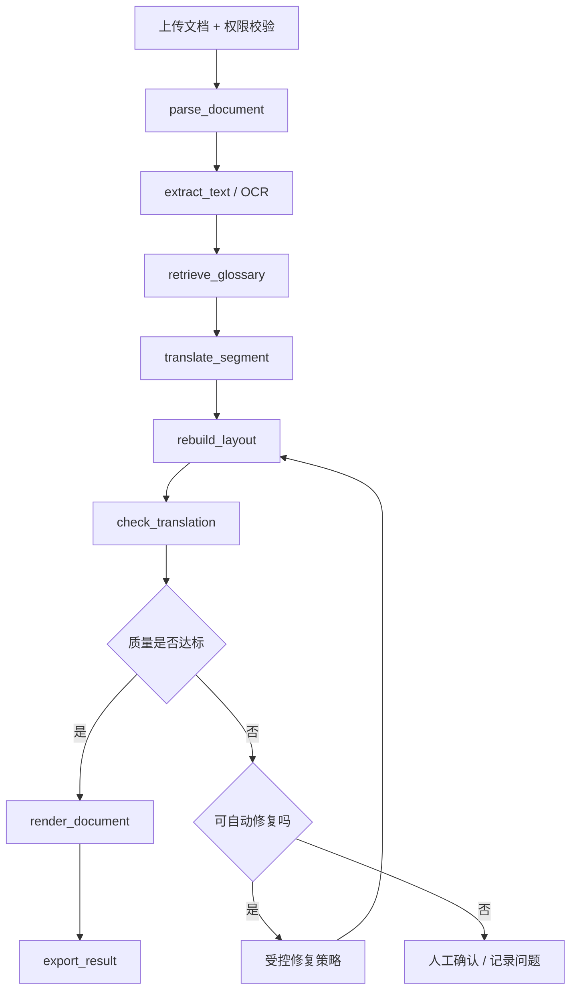

固定主链路保证可预测性；Agent 只在真正需要动态判断的节点介入。

### 图 17｜文档翻译工具调用时序图

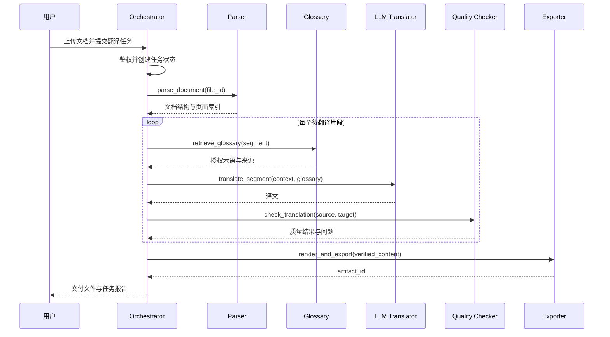

工具返回应关联任务 ID、页面 ID 和片段 ID，避免批量处理时发生结果错配。

### 图 18｜文档翻译工具治理分层架构

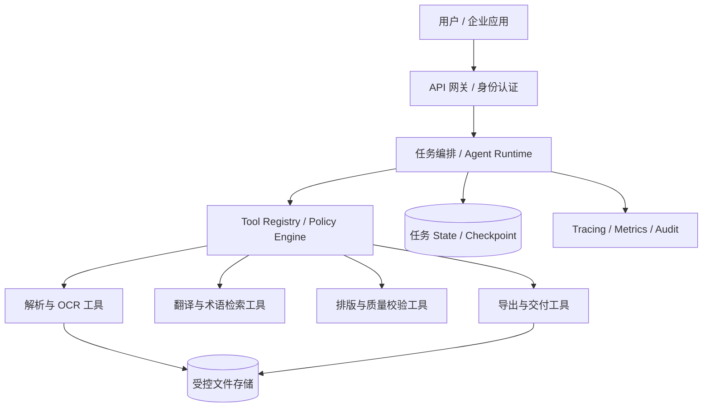

企业落地必须把文件隔离、任务恢复、审计与指标纳入架构，而不是只画模型和工具的调用箭头。

### 12.3 一次异常修复如何体现 Agent 价值

假设某页翻译后出现表格文字溢出。`check_translation` 返回 `OVERFLOW`，附带页面、单元格和溢出位置。Runtime 根据策略将异常交给修复决策模块：优先选择单元格内重排，失败后尝试有限的字体和间距调整；超过修复次数则请求人工处理。每次尝试保存原始结果、变更记录和评分，避免无限循环。<strong>这是一条有上限、可回滚、可审计的 Agent 工具闭环。</strong>

---

## 13. 常见误区与面试问答

### 13.1 常见误区

| 误区 | 正确认识 |
|---|---|
| “Function Calling 就是模型执行 Python” | 模型通常只生成调用意图，Runtime 才执行 |
| “Schema 合法就安全” | 还需业务校验、身份授权和资源隔离 |
| “MCP 可以替代所有 API” | MCP 是连接协议，底层工具仍可调用业务 API |
| “工具越多，Agent 越强” | 工具过多可能提高选择难度与上下文成本 |
| “失败就自动重试” | 权限错误不应重试；有副作用调用需幂等处理 |
| “Prompt 写了禁止删除就不会删除” | 安全边界必须由权限和执行层实现 |
| “工具成功就是任务成功” | 还要评估最终交付物质量 |
| “所有步骤都应该让 Agent 决定” | 固定且确定的流程优先采用 Workflow |

### 13.2 高频面试问题

<strong>Q1：Agent 的工具调用完整链路是什么？</strong> 先暴露经过权限过滤的工具定义，模型生成调用意图，Runtime 校验参数与权限并执行，返回结构化 Observation，更新 State，再由模型继续决策或结束。

<strong>Q2：Function Calling 和 MCP 的区别是什么？</strong> 前者主要解决模型如何提出结构化调用；后者主要解决客户端如何发现、连接和调用外部工具与资源。二者可协作。

<strong>Q3：为什么工具描述很重要？</strong> 模型依据名称、描述和参数约束选择工具；模糊或重叠的描述会增加误选概率。描述应明确适用条件、限制和返回语义。

<strong>Q4：工具超时为什么不能直接重试？</strong> 超时可能发生在服务端已经完成操作之后；写入类工具应先确认执行状态，或使用幂等键避免重复副作用。

<strong>Q5：如何防止 Agent 越权调用工具？</strong> 对每次调用做身份、租户、资源和操作级授权，使用最小权限、工具白名单、参数校验与高影响操作审批；Prompt 只能辅助，不能代替执行层控制。

<strong>Q6：如何评价工具系统？</strong> 同时评估工具选择正确率、参数合法率、执行成功率、任务端到端成功率、延迟、成本和安全事件，配合 Trace 做失败归因。

<strong>Q7：如何设计文档翻译 Agent 的工具链？</strong> 用确定性工作流执行解析、提取、翻译、排版、校验、导出；在异常识别、策略选择和人工升级等节点引入受控 Agent 决策。

---

## 14. 术语注释与权威参考资料

### 14.1 术语速查

| 缩写 / 名词 | 英文全称 | 中文含义 |
|---|---|---|
| LLM | Large Language Model | 大语言模型 |
| Tool | Tool | Agent 可调用的外部能力 |
| Runtime | Runtime | 执行与调度环境 |
| Schema | Schema | 数据结构与约束描述 |
| JSON | JavaScript Object Notation | 常用结构化数据格式 |
| API | Application Programming Interface | 应用程序编程接口 |
| MCP | Model Context Protocol | 模型上下文协议 |
| Tool Call | Tool Call | 模型提出的工具调用请求 |
| Observation | Observation | 工具执行后返回的观察结果 |
| Registry | Registry | 工具注册与元数据管理机制 |
| Dispatcher | Dispatcher | 调度器 |
| Executor | Executor | 执行器 |
| Retry | Retry | 失败重试 |
| Backoff | Backoff | 退避策略 |
| Jitter | Jitter | 在退避间隔加入随机扰动 |
| Idempotency | Idempotency | 幂等性 |
| Circuit Breaker | Circuit Breaker | 熔断机制 |
| Rate Limiting | Rate Limiting | 限流 |
| Fallback | Fallback | 降级或备用路径 |
| Checkpoint | Checkpoint | 可恢复的执行检查点 |
| RBAC | Role-Based Access Control | 基于角色的访问控制 |
| ABAC | Attribute-Based Access Control | 基于属性的访问控制 |
| Prompt Injection | Prompt Injection | 提示词注入攻击 |
| Trace | Trace | 一次任务的端到端追踪 |
| Span | Span | 追踪中的单个操作单元 |
| P95 | 95th Percentile | 第 95 百分位延迟 |
| OCR | Optical Character Recognition | 光学字符识别 |
| RAG | Retrieval-Augmented Generation | 检索增强生成 |
| Workflow | Workflow | 工作流 |
| DOCX | Office Open XML Document | Word 文档格式 |
| PDF | Portable Document Format | 便携式文档格式 |

### 14.2 权威参考资料

1. [OpenAI — Function Calling](https://platform.openai.com/docs/guides/function-calling)：工具定义、调用请求、工具结果回传及结构化调用。
2. [OpenAI Agents SDK — Tools](https://openai.github.io/openai-agents-python/tools/)：函数工具、托管工具与 Agent 工具集成。
3. [Anthropic — Writing Effective Tools for Agents](https://www.anthropic.com/engineering/writing-tools-for-agents)：工具命名、描述、接口设计与上下文效率。
4. [Anthropic — Tool Use](https://docs.anthropic.com/en/docs/agents-and-tools/tool-use/overview)：工具定义、模型调用与结果反馈。
5. [Model Context Protocol — Specification](https://modelcontextprotocol.io/specification/)：MCP 角色、能力及协议规范。
6. [Model Context Protocol — Tools](https://modelcontextprotocol.io/specification/2025-06-18/server/tools)：工具发现与调用接口（该链接为指定版本规范）。
7. [LangChain — Agents](https://docs.langchain.com/oss/python/langchain/agents)：Agent 循环、工具与运行时集成。
8. [LangChain — Middleware](https://docs.langchain.com/oss/python/langchain/middleware/overview)：工具调用的中间件、错误处理和策略控制。
9. [OWASP — Prompt Injection](https://genai.owasp.org/llmrisk/llm01-prompt-injection/)：提示词注入与工具滥用风险。
10. [ReAct: Synergizing Reasoning and Acting in Language Models](https://arxiv.org/abs/2210.03629)：推理与行动交替的经典研究。

> <strong>资料使用说明：</strong>本篇把官方协议/API 描述与工程实践建议分开表述。工具注册表、错误码集合、风险分级、状态机和案例流程属于推荐的架构归纳，不应理解为所有平台强制规定的统一标准。

---

## 全篇总结：从会调用工具到可信执行

<strong>工具系统的本质是一条受控执行链：</strong>定义能力 → 限定可见工具 → 模型选择与生成参数 → 结构/业务/权限校验 → 实际执行 → 结果验证 → 状态更新 → 下一轮决策。

Prompt 指导模型行为，Context 提供当前信息，Memory 保存可复用经验，而 Tools 把模型决策变成外部行动。企业级 Agent 的成熟度不取决于接入了多少工具，而取决于<strong>工具能否被正确选择、安全执行、稳定恢复、准确反馈和持续评估</strong>。

<strong>下一篇：</strong>[05｜State Management：状态管理与任务恢复](05-State-Management.md)。

