# 05｜Agent State Management：状态、会话、持久化与故障恢复

> 路径：`03-Agent-Core-Components/05-State-Management.md`  
> 学习路径：<strong>为什么需要 State → 状态边界 → 状态建模 → 状态转移 → 持久化 → 恢复 → 一致性 → 企业应用</strong>。  
> 本文定位：Agent 工程知识手册，不以代码练习为目标。

## 0. 全景导读：为什么 Agent 需要状态管理

LLM 能推理下一步，Tools 能执行操作，Memory 能复用历史经验，但它们不能单独证明“一个复杂任务实际完成到哪里”。<strong>State Management（状态管理）</strong>把任务进度、执行阶段、工具结果、错误、审批和恢复依据变成系统可以验证的事实。

假设文档翻译 Agent 处理 100 页 PDF，第 35 页生成成功后服务崩溃。如果只保存聊天记录，系统可能重新翻译第 35 页，甚至覆盖正确产物。要可靠恢复，必须核对持久化状态与真实产物。

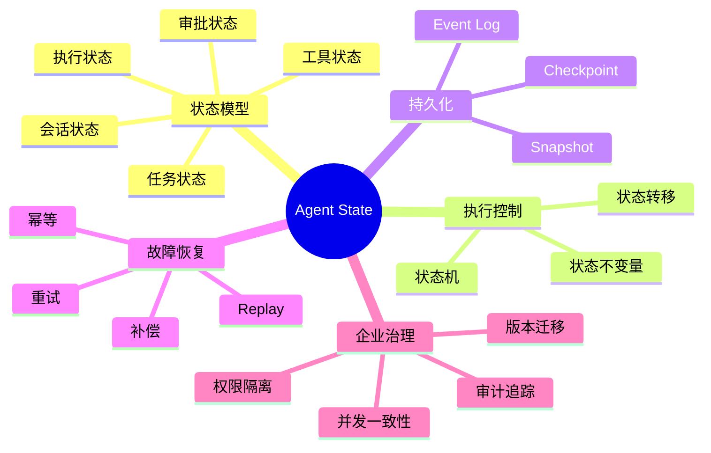

## 1. State 的定义及其与其他组件的边界

<strong>State（状态）</strong>是与特定会话、任务或运行实例相关、随执行变化且影响后续决策的结构化信息。它可以保存在内存，也可以保存在数据库；是否持久化与是否属于 State 是不同维度。

| 概念 | 首要问题 | 示例 |
|---|---|---|
| State | 任务现在进行到哪里 | 第 35 页已通过检查 |
| Context | 本轮模型能看到什么 | 当前页文本和任务状态摘要 |
| Memory | 未来应该复用什么 | 某客户的术语偏好 |
| Prompt | 模型应该遵守什么规则 | 不得修改设备型号 |
| Tools | 实际执行什么操作 | 解析 PDF、生成 Word |
| RAG | 从知识源检索什么资料 | 检索企业术语库 |

<strong>关键边界：</strong>State 不等于聊天记录；Memory 不等于数据库；Checkpoint 不等于事务；RAG 不是状态管理系统。

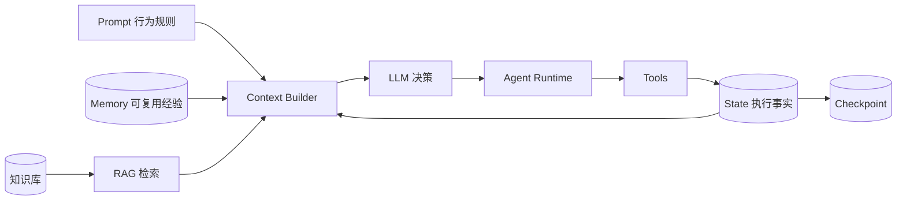

### 1.1 State 的常见分类

| 类型 | 英文 | 典型内容 | 作用 |
|---|---|---|---|
| 会话状态 | Session State | 会话消息、交互上下文 | 保持对话连续性 |
| 任务状态 | Task State | 目标、完成项、待办项 | 业务进度管理 |
| 执行状态 | Execution State | 当前节点、重试次数 | 执行调度 |
| 工具状态 | Tool State | 调用 ID、参数摘要、结果 | 工具追踪与去重 |
| 工作流状态 | Workflow State | 分支、依赖、阶段 | 流程推进 |
| 审批状态 | Approval State | 审批请求、决定、版本 | 人工介入 |

以上是便于工程理解的分类，并不要求拆成六个数据库。

## 2. 标识与生命周期：Session、Thread、Task、Run

| 标识 | 常见含义 | 注意事项 |
|---|---|---|
| Session ID | 一段用户交互 | 不等于业务任务 ID |
| Thread ID | 框架中的对话或状态线程 | 不必然是操作系统线程 |
| Task ID | 稳定的业务任务标识 | 应跨重试保持稳定 |
| Run ID | 某次执行尝试 | 同一任务可以有多次 Run |
| Tool Call ID | 某次工具调用请求 | 不一定等于业务幂等键 |
| Checkpoint ID | 某个恢复点 | 不代表外部副作用一定成功 |

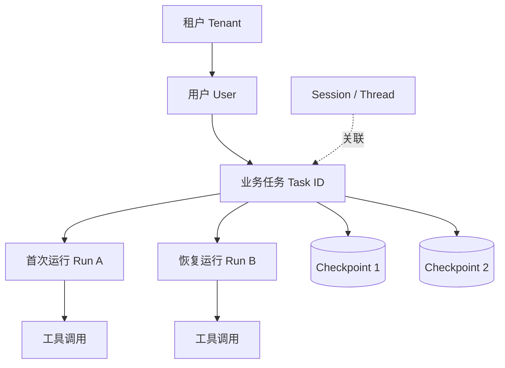

企业级设计应显式关联租户、用户、任务、运行实例和执行步骤。权限校验应依据可信身份，而不是仅依赖模型生成的参数。

## 3. State Schema：如何设计可验证的状态

Schema（数据模式）规定状态字段、类型、取值和约束。应保存足够的恢复依据，但避免把整个 PDF、图片和大模型完整输出都塞进一个状态对象；大对象可以保存在文件或对象存储，State 保存引用与校验信息。

| 字段类别 | 示例 | 用途 |
|---|---|---|
| 身份 | tenant_id、task_id、run_id | 归属与追踪 |
| 控制 | status、current_step | 驱动流程 |
| 进度 | completed_pages、pending_pages | 断点续传 |
| 产物 | output_uri、checksum | 验证真实结果 |
| 质量 | validation_status、issues | 交付门禁 |
| 错误 | error_code、retry_count | 故障恢复 |
| 并发 | version、lease_owner | 冲突检测 |
| 审计 | created_at、updated_at、actor | 可追溯 |

### 3.1 状态不变量（Invariant）

Invariant 是任何合法状态都必须满足的规则。例如：`COMPLETED` 必须具有可访问且通过校验的输出文件；未通过质量检查的页面不能标记为最终通过；同一任务版本的审批不能应用于另一版本。<strong>不变量应由运行时代码和数据约束验证，不能只依赖 Prompt。</strong>

### 3.2 状态更新策略

- <strong>整体替换：</strong>简单，但并发下可能覆盖更新。
- <strong>局部合并：</strong>适合分步更新，但必须明确列表和计数器的合并语义。
- <strong>事件驱动：</strong>记录事实事件，再计算当前状态；可审计性好，但复杂度更高。

## 4. 状态机：如何控制合法的下一步

FSM（Finite State Machine，有限状态机）用状态、事件和转移规则描述任务执行。常见状态包括 Pending（待执行）、Running（执行中）、Waiting Approval（等待审批）、Retrying（重试）、Failed（失败）、Cancelled（取消）、Completed（完成）。

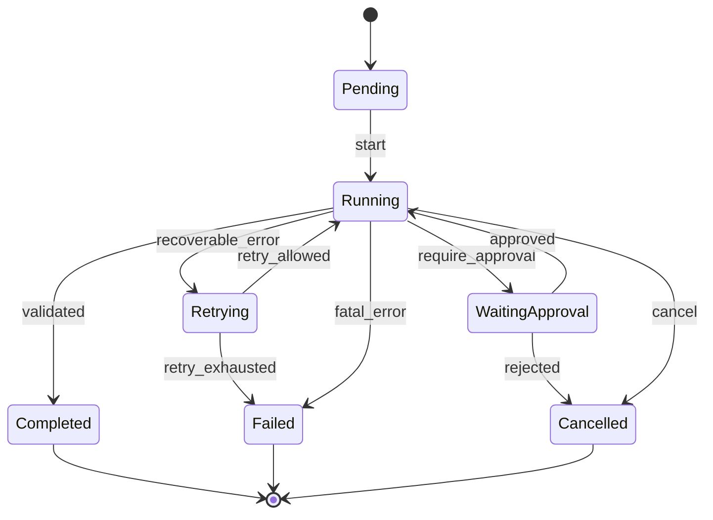

<strong>Guard（转移守卫）</strong>是状态改变前的检查条件。例如只有全部页面完成、质量检查通过且导出文件有效，才能进入 Completed。Command（命令）表达“希望执行”，Event（事件）表达“已经发生”；“请求导出”绝不等于“导出成功”。

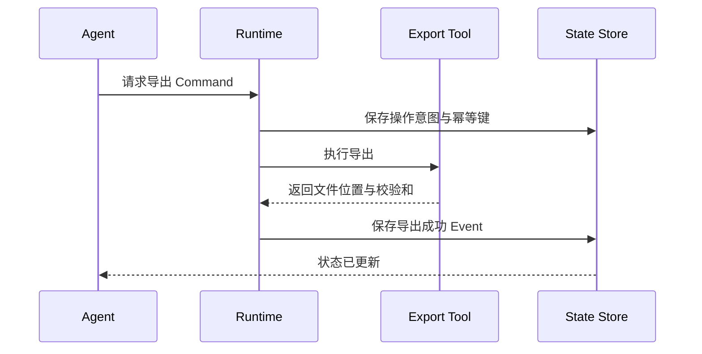

## 5. 持久化：Checkpoint、Snapshot 与 Event Log

| 机制 | 含义 | 与其他概念的区别 |
|---|---|---|
| Checkpoint | 检查点 | 保存恢复所需状态及执行位置等信息 |
| Snapshot | 状态快照 | 保存某时刻状态，不必包含恢复调度信息 |
| Event Log | 事件日志 | 记录发生过的变化 |
| Event Sourcing | 事件溯源 | 以事件为事实来源重建业务状态 |
| Replay | 重放 | 根据已记录历史重建执行状态 |

<strong>Checkpoint 不会自动回滚外部 API 或文件写入。</strong> 不同框架保存的信息不同：可能包括节点位置、状态快照、挂起任务、消息和执行元数据。

### 5.1 检查点保存时机

常见方案包括：关键节点完成后、工具副作用前后、人工审批前、长任务周期性保存，以及任务结束时保存。保存越频繁，通常可减少故障后的重做工作，但会增加存储与写入开销。

在“每隔 $k$ 个等耗时步骤保存一次，故障位置近似均匀”的简化假设下，平均重做步骤数可粗略估算为：

$$
E[\mathrm{rework}] \approx \frac{k-1}{2}
$$

这只是帮助理解权衡的示意公式，忽略外部副作用、恢复耗时和步骤时长差异，并非通用生产公式。

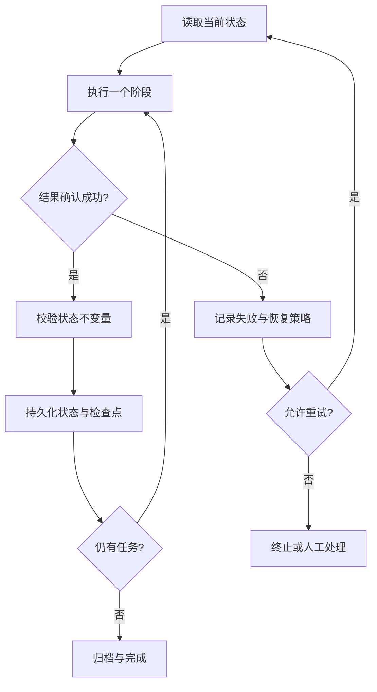

### 5.2 存储方案

| 介质 | 适用场景 | 注意事项 |
|---|---|---|
| 进程内存 | 临时状态 | 进程退出即可能丢失 |
| Redis | 缓存、租约、短期状态 | 持久性与一致性取决于配置 |
| PostgreSQL / MySQL | 任务、审批、版本与事务 | 适合结构化持久状态 |
| 对象存储 | 原文件、解析结果、页面产物 | State 应保存引用和校验和 |
| 事件日志系统 | 事件消费、审计 | 需处理重复投递和顺序问题 |

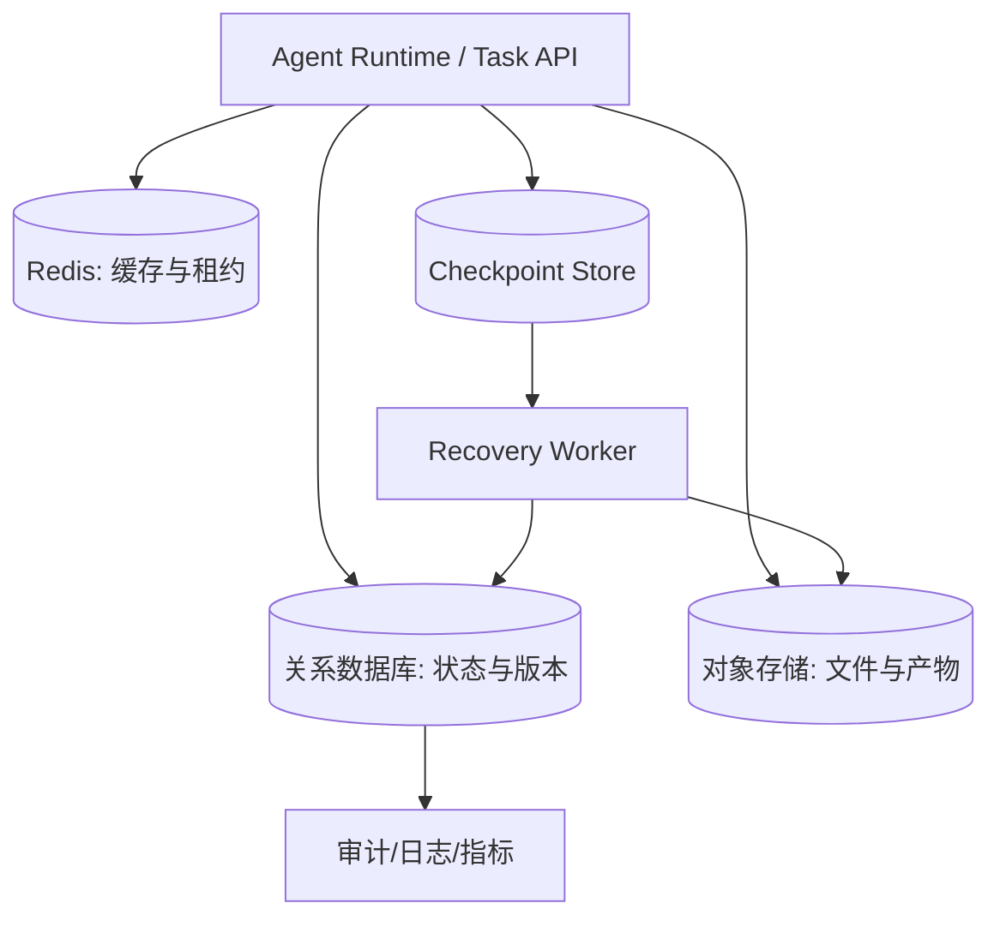

## 6. Durable Execution：如何跨故障恢复执行

Durable Execution（持久化执行）强调进程中断后仍可依据持久化事实继续任务。<strong>数据库中保存一个 state 对象，不自动等于完整的持久化执行系统。</strong>

| 系统 | 代表概念 | 重点区别 |
|---|---|---|
| LangGraph | Thread、Checkpointer、State Snapshot | 图状态持久化、节点边界恢复 |
| OpenAI Agents SDK | Sessions | 会话历史持久化，不自动保证业务副作用 |
| Temporal | Workflow、Activity、Event History | 工作流历史、确定性重放与活动重试 |
| Microsoft Agent Framework | Workflow Checkpoints | 工作流执行器及待处理状态恢复 |

Temporal 的 Replay 通常用于重建 Workflow 的确定性执行，不意味着重新执行全部外部操作；外部副作用应放在受控 Activity 边界。

### 6.1 正确恢复的五步

1. 找到正确 Task、Run 与最新有效 Checkpoint。
2. 校验状态版本、权限和工作流定义兼容性。
3. 核对外部操作是否已成功，例如文件是否存在、校验和是否匹配。
4. 根据幂等键决定跳过、重试、补偿或人工确认。
5. 保存新的执行记录，从正确节点继续。

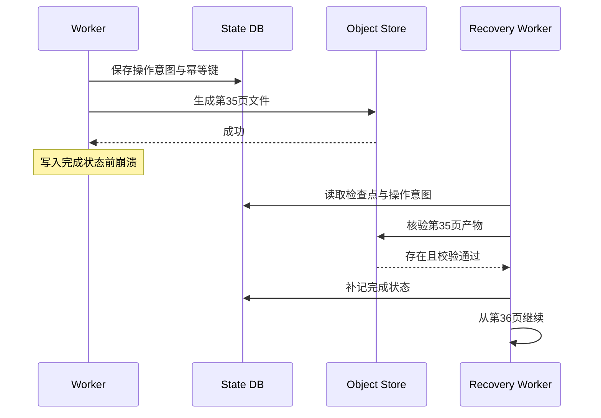

## 7. 故障恢复正确性：幂等、事务、并发与补偿

### 7.1 幂等性（Idempotency）

同一业务操作重复执行，最终业务效果与执行一次相同。常用机制包括稳定的 Idempotency Key（幂等键）、唯一约束、操作记录和结果查询。工具调用 ID 可能随重试变化，不能无条件当作稳定的业务幂等键。

### 7.2 原子性与外部副作用

Atomicity（原子性）要求一组操作整体成功或失败。数据库事务通常不能直接覆盖外部文件系统、邮件、第三方 API 等副作用。因此会出现“工具成功但状态尚未提交”的失败窗口，需要结果查询、幂等 API、Outbox Pattern（事务发件箱模式）或 Saga（补偿型长事务）等机制。

### 7.3 并发一致性

Optimistic Locking（乐观锁）用版本号发现更新冲突；Lease（租约）限制一段时间内的执行所有权；Fencing Token（隔离令牌）可降低过期 Worker 继续写入的风险。分布式锁不能替代业务幂等性。

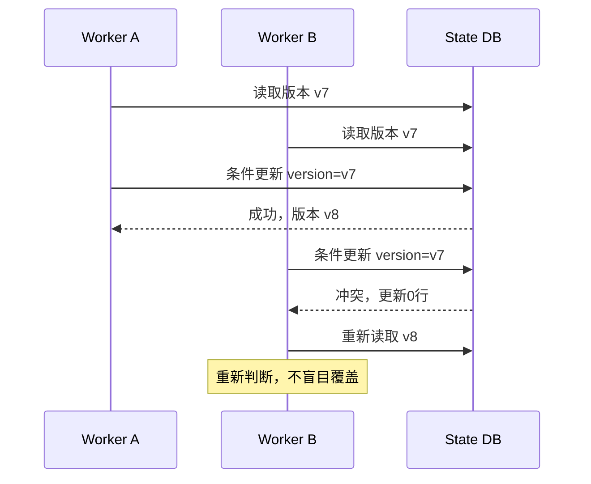

### 7.4 重试的交付语义

At-most-once（至多一次）可能丢失；At-least-once（至少一次）可能重复；Exactly-once effect（业务上恰好一次的效果）通常需要幂等、去重和事务共同实现。不能仅凭消息队列或 Checkpoint 宣称端到端恰好一次。

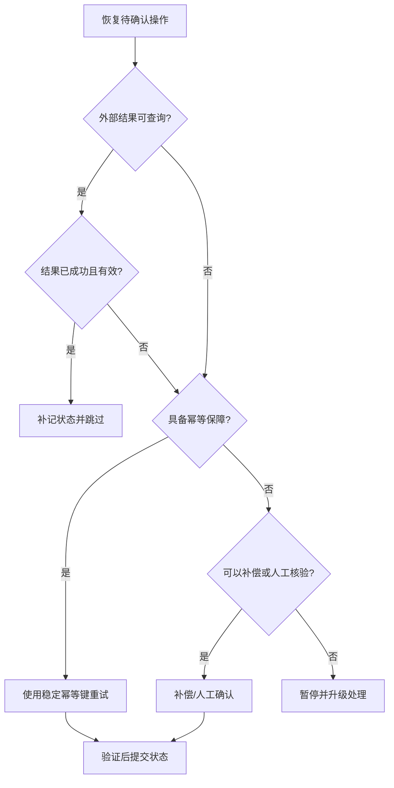

## 8. 人工审批：暂停、恢复与取消

HITL（Human-in-the-Loop，人在回路）用于处理低置信度结果、敏感操作和业务风险。审批必须保存请求 ID、审批人、审批内容、任务版本、时间与结果。恢复时要重新检查审批是否仍然有效，避免过期授权被复用。

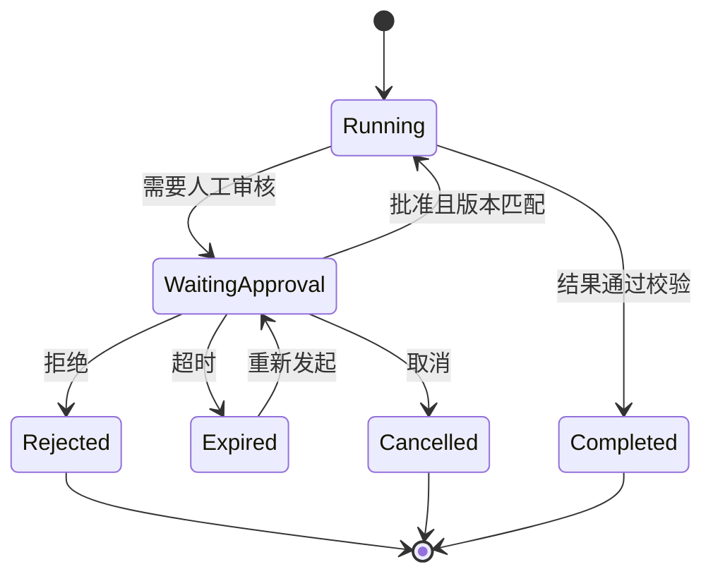

## 9. 与其他 Agent 模块的协作

Prompt 提供行为约束，Context Builder 选择当前相关状态给模型，Tools 产生实际结果，Runtime 负责校验与状态转移，Workflow 规定执行阶段，Memory 保留未来可复用的经验。<strong>模型生成的“任务已完成”不是可信状态变更依据，必须由真实执行结果和业务校验支撑。</strong>

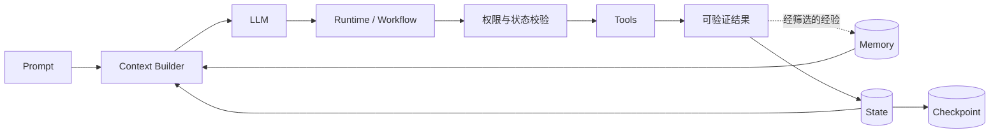

## 10. 企业级治理：安全、可观测性与版本演进

<strong>安全：</strong>状态可能包含客户数据、文件路径、审批记录和工具输出，应进行租户隔离、最小权限、加密、脱敏、审计及数据保留与删除。不能随意反序列化不可信的 Checkpoint。

<strong>可观测性：</strong>Metrics（指标）用于统计，Logs（日志）用于记录事件，Traces（追踪）用于串联执行链。建议关注恢复成功率、重复副作用次数、状态冲突率、Checkpoint 延迟、审批等待时间和任务完成率。

<strong>版本迁移：</strong>状态模式和 Workflow 可能升级。应记录 schema_version、workflow_version，对旧检查点提供迁移或兼容策略，而不是默认直接恢复。

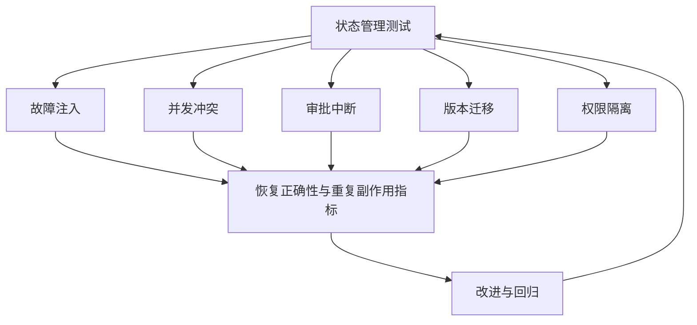

## 11. 贯穿案例：医疗设备文档翻译 Agent

### 11.1 任务与状态设计

处理一份 100 页医疗器械技术文档，流程包括解析、逐页翻译、术语核查、版式恢复、质量复核与导出。每页应独立记录状态、重试次数、产物引用和校验结果。

| 层级 | 核心字段 | 约束 |
|---|---|---|
| 文档任务 | task_id、source_hash、target_lang | 输入版本不可静默变化 |
| 页面任务 | page_id、stage、attempt、artifact_uri | 产物必须可核验 |
| 质量检查 | missing_text、term_conflicts、review_status | 未通过不得交付 |
| 导出任务 | export_id、output_uri、checksum | 避免重复覆盖有效产物 |
| 审批记录 | approval_id、reviewer、decision | 绑定任务版本 |

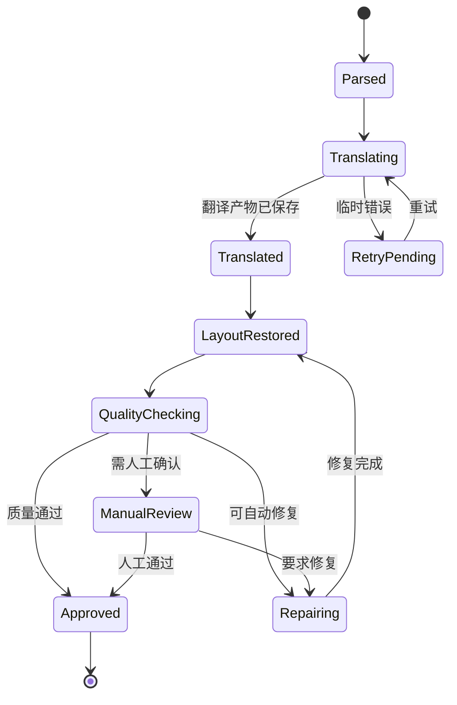

### 11.2 企业架构

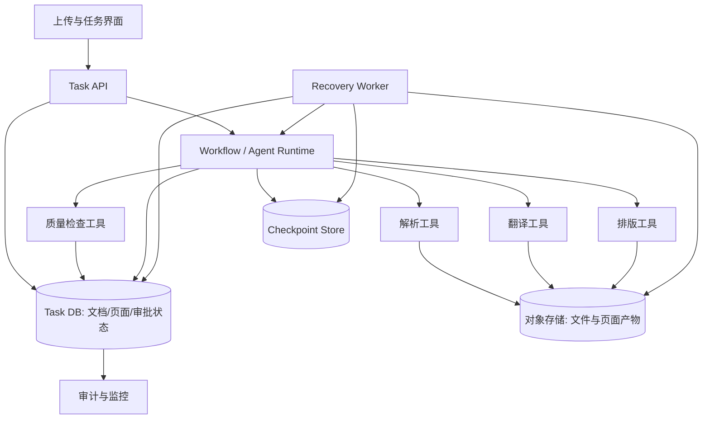

### 11.3 典型故障：第 35 页生成成功，但状态未提交

恢复时先读取最新有效 Checkpoint，再查询页面产物及校验和。如果文件存在且完整，应补记成功状态并继续第 36 页；如果产物缺失或损坏，在幂等保护下重试；如果无法确认外部操作结果，则暂停并人工核验。

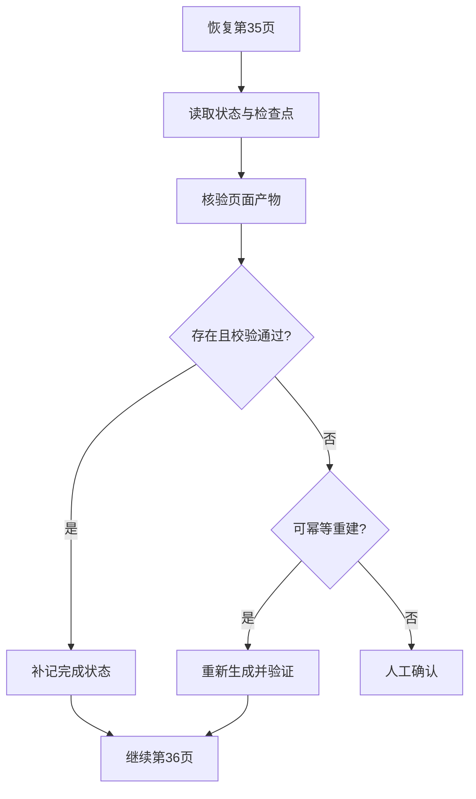

<strong>工程取舍：</strong>单机 Demo 可先用关系数据库记录任务/页面状态，文件系统保存产物；进入多 Worker 环境后，再增加乐观锁、租约、队列、审计和故障注入。优先保证恢复正确性，而非先堆叠复杂组件。

## 12. 常见误区

| 误区 | 正确认识 |
|---|---|
| 保存聊天历史就等于保存 State | 聊天记录不能证明工具副作用是否完成 |
| 有 Checkpoint 就能自动回滚 | Checkpoint 不等于分布式事务 |
| 失败后直接重试即可 | 非幂等操作可能重复产生副作用 |
| 有分布式锁就绝对安全 | 锁过期与旧 Worker 仍可能造成问题 |
| 所有状态都应放进 Context | 会造成噪声和 Token 成本，也无法代替持久化 |
| Completed 状态等于结果可用 | 必须核验真实产物和质量门禁 |
| State 与 Memory 存同一数据库就等价 | 物理存储相同不代表职责相同 |

## 13. 面试问答

### Q1：State 与 Memory 的区别？

<strong>答：</strong>State 管理当前任务的执行事实、进度和控制条件；Memory 管理未来可复用的知识与经验。State 强调合法转移、持久化和恢复，Memory 强调筛选、检索、更新和遗忘。

### Q2：Checkpoint 和 Snapshot 有什么区别？

<strong>答：</strong>Snapshot 是某时刻的状态视图；Checkpoint 是用于恢复执行的信息，可能包含状态、执行位置、挂起任务与调度元数据。

### Q3：为什么保存 Checkpoint 后仍会重复调用工具？

<strong>答：</strong>外部操作成功和状态提交之间可能崩溃；恢复时无法直接确认操作是否完成，需要幂等键、结果查询或补偿。

### Q4：如何设计可恢复的文档翻译 Agent？

<strong>答：</strong>为任务和页面建立稳定 ID，记录每页阶段、产物和校验状态，在关键节点持久化，导出使用幂等规则，恢复时先核验产物再继续。

### Q5：Session、Thread、Task、Run 一样吗？

<strong>答：</strong>不一样。Session/Thread 多用于交互或框架状态范围，Task 是业务任务，Run 是某次执行尝试，具体以框架定义为准。

### Q6：如何处理多 Worker 并发更新？

<strong>答：</strong>可以使用版本号乐观锁、租约、稳定幂等键和操作结果核验；锁不能替代业务一致性设计。

### Q7：如何实现人工审批后继续执行？

<strong>答：</strong>保存审批请求及任务版本，等待期间暂停相关节点，收到授权决定后重新验证审批身份、版本和有效期，再恢复执行。

### Q8：如何评估状态管理？

<strong>答：</strong>通过故障注入、重复消息、并发写入、审批超时、版本迁移和租户隔离测试，关注恢复正确率、重复副作用与审计可追溯性。

## 14. 术语与缩写注释

| 术语 | 英文全称 | 中文解释 |
|---|---|---|
| LLM | Large Language Model | 大语言模型 |
| State | State | 执行状态 |
| FSM | Finite State Machine | 有限状态机 |
| Schema | Data Schema | 数据模式与约束 |
| Invariant | State Invariant | 状态不变量 |
| Transition | State Transition | 状态转移 |
| Guard | Transition Guard | 转移前置条件 |
| Session | Session | 会话范围 |
| Thread | Thread | 框架状态线程或会话范围 |
| Run | Run | 一次执行尝试 |
| Checkpoint | Checkpoint | 恢复点及相关状态 |
| Snapshot | Snapshot | 状态快照 |
| Event Log | Event Log | 事件日志 |
| Event Sourcing | Event Sourcing | 事件溯源架构 |
| Replay | Replay | 重放已记录历史 |
| Durable Execution | Durable Execution | 持久化执行 |
| Worker | Worker | 任务执行单元 |
| Activity | Activity | Temporal 等系统中的外部工作单元 |
| Idempotency | Idempotency | 幂等性 |
| Idempotency Key | Idempotency Key | 业务操作去重键 |
| Atomicity | Atomicity | 原子性 |
| Transaction | Transaction | 事务 |
| Optimistic Locking | Optimistic Locking | 乐观锁 |
| Lease | Lease | 限时执行所有权 |
| Fencing Token | Fencing Token | 过期写入者隔离令牌 |
| Outbox Pattern | Transactional Outbox | 事务发件箱模式 |
| Saga | Saga Pattern | 补偿型长事务模式 |
| HITL | Human-in-the-Loop | 人在回路、人工介入 |
| RAG | Retrieval-Augmented Generation | 检索增强生成 |
| API | Application Programming Interface | 应用程序编程接口 |
| OCR | Optical Character Recognition | 光学字符识别 |
| URI | Uniform Resource Identifier | 统一资源标识符 |
| TTL | Time to Live | 生存时间 |
| Metrics | Metrics | 指标 |
| Logs | Logs | 日志 |
| Traces | Traces | 执行追踪 |

## 15. 官方资料与延伸阅读

> 下面是可进一步核对实现细节的官方文档入口。通用工程建议不应被误认为任何框架的强制标准；实际实现以所使用版本的官方文档为准。

1. [LangGraph — Persistence](https://docs.langchain.com/oss/python/langgraph/persistence)：Thread、Checkpointer、State Snapshot、恢复。
2. [LangGraph — Interrupts](https://docs.langchain.com/oss/python/langgraph/interrupts)：暂停、人工审批、恢复。
3. [OpenAI Agents SDK — Sessions](https://openai.github.io/openai-agents-python/sessions/)：会话历史持久化及边界。
4. [Microsoft Agent Framework — Workflow Checkpoints](https://learn.microsoft.com/en-us/agent-framework/workflows/checkpoints)：工作流检查点。
5. [Temporal — Workflows](https://docs.temporal.io/workflows)：持久化执行与 Workflow 历史。
6. [Temporal — Activities](https://docs.temporal.io/activities)：外部活动、重试与幂等。
7. [Temporal — Retry Policies](https://docs.temporal.io/encyclopedia/retry-policies)：重试策略与故障处理。

---

## 16. 全文总结

<strong>完整逻辑链：</strong>任务产生状态 → Schema 约束数据 → 状态机限制合法转移 → Runtime 调用工具 → 核验结果并持久化 → Checkpoint 提供恢复依据 → 故障时核对外部副作用 → 幂等恢复 → 审计与评估。

<strong>一句话：</strong>Agent State Management 的目标不是让模型“记住更多”，而是让复杂任务在多轮交互、跨进程执行、人工审批与故障恢复中，始终保持可验证、可控制、可继续的执行事实。
