# 06｜Agent 核心组件集成：从独立能力到可靠执行系统

> 所属章节：`03-Agent-Core-Components/06-Component-Integration.md`  
> 学习目标：理解 Prompt、Context、Memory、Tools、State 的职责边界，以及 Runtime 如何把它们组织成可观测、可恢复、可验证的执行闭环。  
> 阅读路径：核心概念 → 组成模块 → 工作原理 → 关键机制 → 实际应用 → 总结拓展。  
> 本文侧重<strong>原理、架构和工程决策</strong>，不以代码实践为目标。

## 阅读导航与前置知识

| 前置章节 | 解决的问题 | 本篇如何复用 |
|---|---|---|
| Prompt and Instructions | Agent 应遵守什么规则 | 形成行为约束和工具使用策略 |
| Context Engineering | 本轮模型看到什么 | 形成按需装配的模型输入 |
| Memory | 哪些经验跨会话复用 | 提供经授权、经筛选的长期信息 |
| Tools | Agent 如何操作外部系统 | 通过运行时完成真实动作 |
| State Management | 任务执行到了哪里 | 提供控制条件、持久化和恢复能力 |

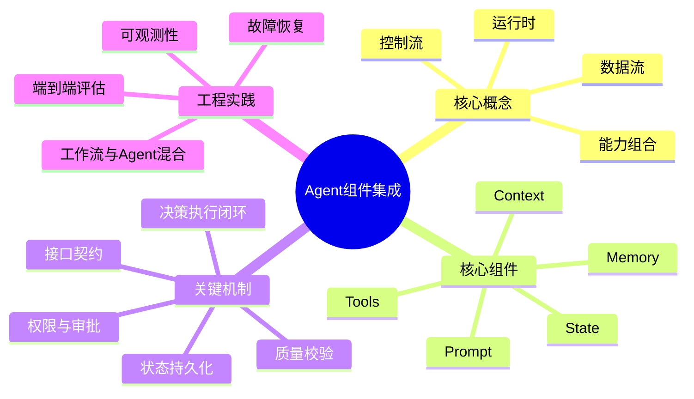

---

# 第一部分：核心概念——为什么要集成

## 1. 从组件能力到系统能力

单独的 Prompt 可以约束回答，Context 可以提供当前信息，Memory 可以保存历史经验，Tools 可以执行外部操作，State 可以记录任务进度；但任何一个组件都不能独立保证复杂任务正确完成。一个真实任务往往需要连续多轮决策，并面对外部工具失败、信息过期、权限不足、进程中断与结果不达标等问题。

<strong>组件集成（Component Integration）</strong>指通过明确的接口契约、控制流、数据流和生命周期管理，把分散能力组织为具有可预测边界的系统。它的目标不是组件数量最多，而是使系统在正常路径和异常路径下都能给出可解释的行为。

<strong>Agent Runtime（智能体运行时）</strong>是负责驱动执行循环、调用模型、调度工具、维护状态、处理错误和终止任务的应用执行环境。Runtime 不必是单独进程或框架，也可以由应用中的多个服务共同实现。

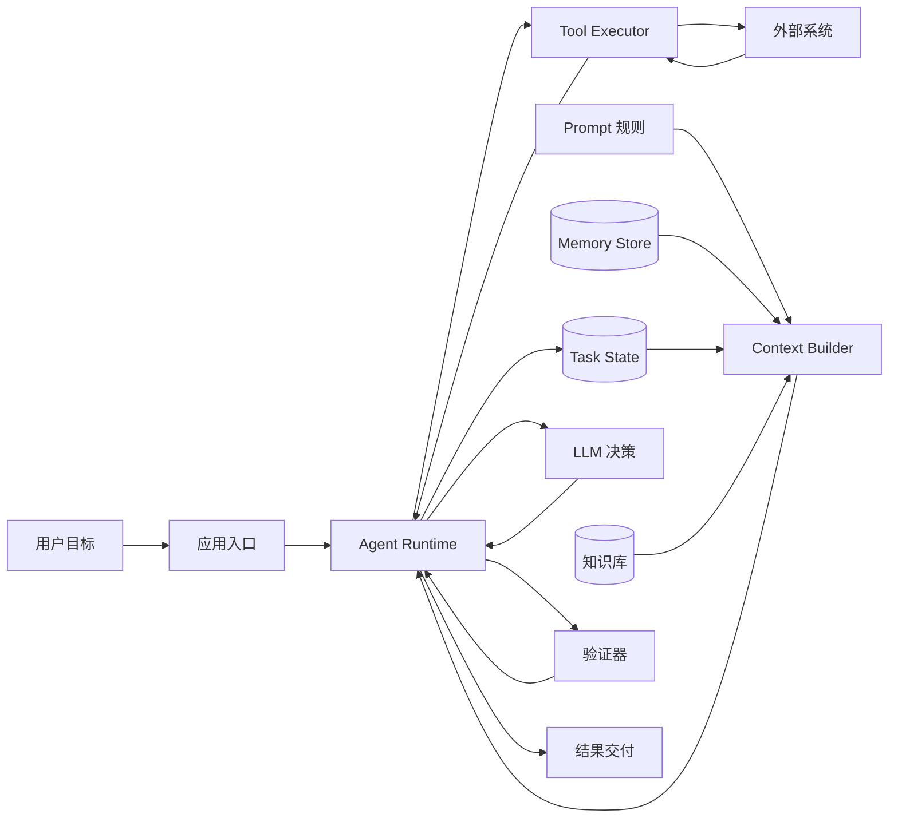

上图有意把模型决策与工具执行分开：LLM 可以建议调用什么工具，但<strong>实际权限判断、执行副作用和结果确认由受控运行时负责</strong>。

## 2. 五个组件与 Runtime 的职责边界

| 模块 | 核心职责 | 典型输入 | 典型输出 | 不应承担的职责 |
|---|---|---|---|---|
| Prompt | 规定目标、行为与边界 | 系统规则、业务政策 | 指令内容 | 可靠保存任务进度 |
| Context | 选择并组织本轮信息 | 任务、状态、记忆、检索结果 | 模型调用上下文 | 长期保存所有数据 |
| Memory | 维护跨步骤或跨会话的可复用信息 | 经验、偏好、验证事实 | 相关记忆 | 代替权威业务数据库 |
| Tools | 暴露外部能力 | 结构化参数、身份 | 结果、错误、产物 | 自行决定越权操作 |
| State | 记录执行事实与控制条件 | 事件、状态更新 | 任务进度、检查点 | 自动保证所有外部副作用已完成 |
| Runtime | 组织决策和执行 | 模型输出、状态、策略 | 下一动作、结果 | 无条件信任模型或工具文本 |

<strong>关键关系：</strong>State 是可持久化的任务事实；Context 是模型本轮看到的信息；Memory 是未来可能复用的内容。三者可以共享底层数据库，但读取目的、写入条件和生命周期不同。

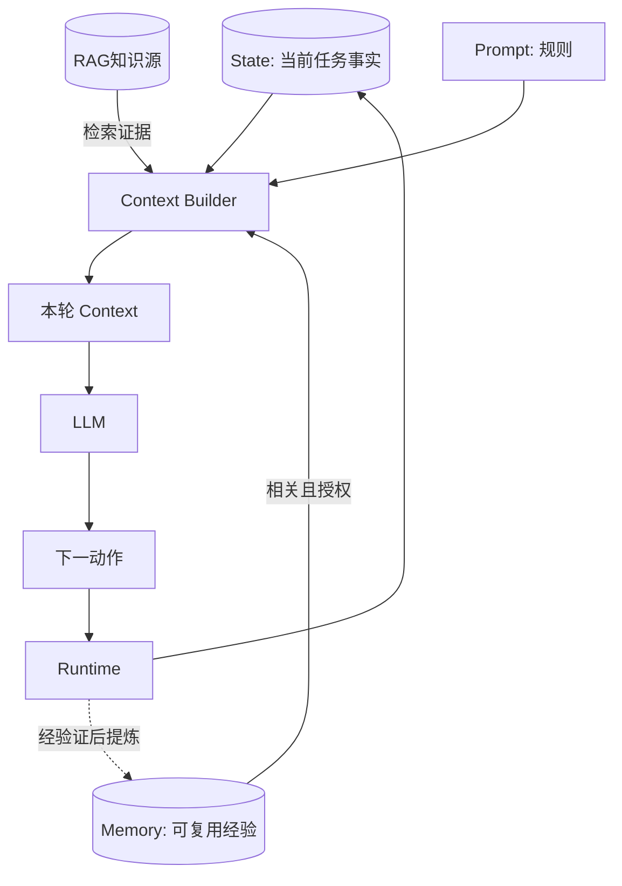

## 3. 控制流与数据流是两张不同的地图

<strong>Control Flow（控制流）</strong>决定下一步执行什么，包括条件分支、循环、暂停和终止。<strong>Data Flow（数据流）</strong>决定信息如何在组件间传递，包括参数、工具结果、状态更新和模型上下文。一个工具结果可以改变数据流，却不一定改变控制流；只有通过明确的转移规则，才能进入下一节点。

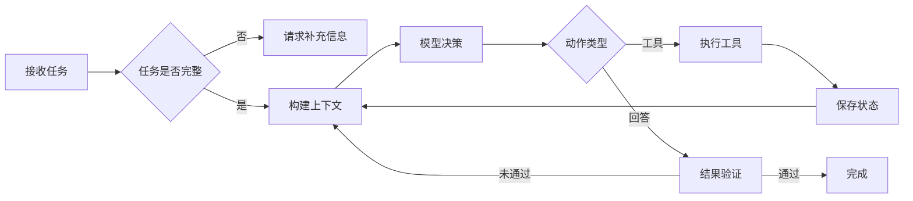

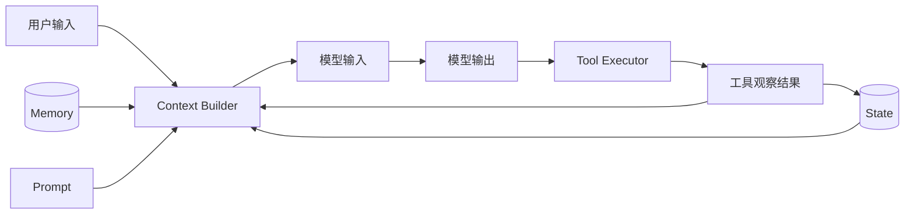

---

# 第二部分：组成模块——运行时如何组织协作

## 4. 参考分层架构

常见的工程划分包括应用入口、Agent Runtime、核心能力、模型服务和基础设施。分层是为了解耦职责，并非要求每层独立部署。安全、日志、权限和质量验证通常是跨层的横切能力。

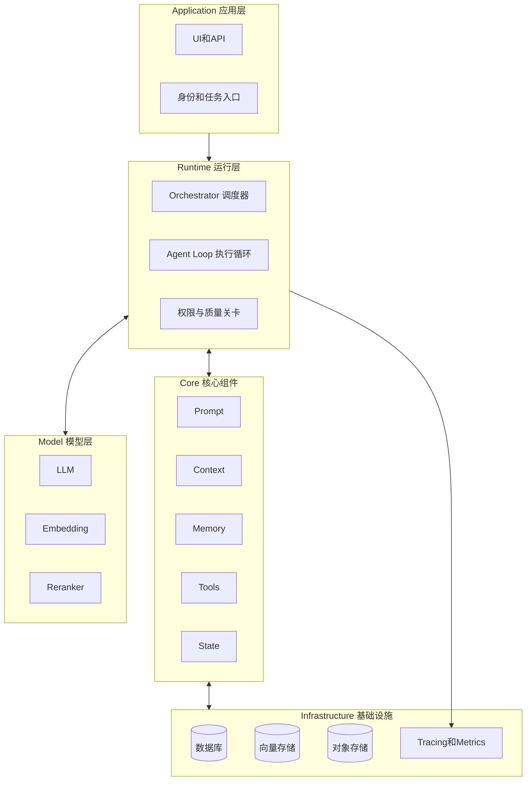

<strong>Orchestrator（编排器）</strong>负责把任务分配给步骤或执行单元；<strong>Agent Loop（智能体执行循环）</strong>负责在模型决策、工具执行、结果观察之间迭代；<strong>Guardrail（防护约束）</strong>负责输入、输出或动作的安全与业务检查。这些能力可以由一个 Runtime 统一实现。

## 5. Context Builder：组件集成的输入枢纽

Context Builder（上下文构建器）并不是简单拼接字符串。它要根据当前任务、Token Budget（令牌预算）、信息权威性、相关性和时间有效性选择内容。建议优先装配稳定规则与当前任务事实，再按需检索长期记忆和知识库；对大体量工具输出只保留必要字段或引用。

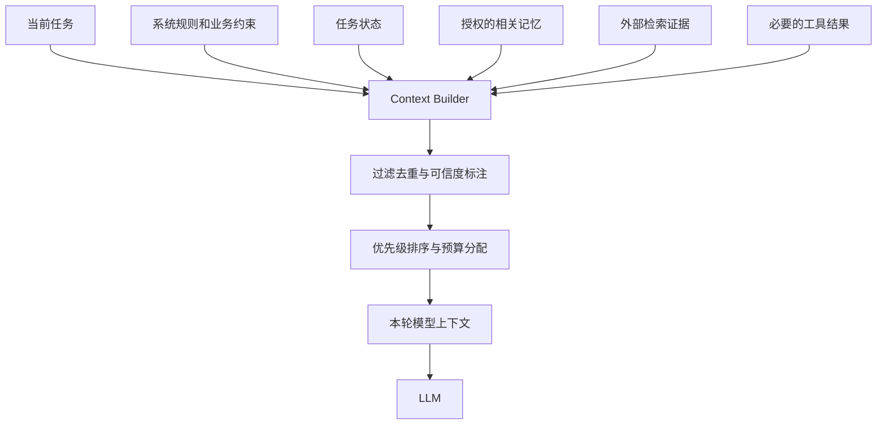

<strong>Prompt Injection（提示词注入）</strong>是外部内容企图改变模型指令层级或执行目标的攻击。检索结果、网页和工具输出应作为数据使用，不能自动成为系统指令。Context Builder 应保留来源标识和可信边界。

## 6. Tool Executor：从模型意图到真实操作

Tool Executor（工具执行器）接收模型生成的工具名称和参数，执行 Schema（结构模式）校验、身份与权限检查、业务规则检查、超时和幂等控制，再调用真实服务。<strong>Function Calling（函数调用）</strong>通常描述模型输出结构化调用请求的能力，而不是模型自己运行函数。

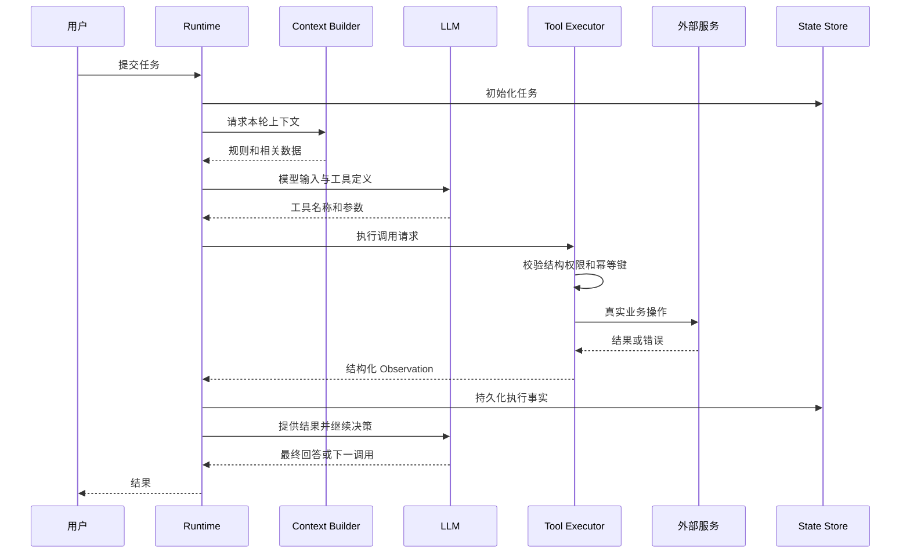

<strong>Observation（观察结果）</strong>是工具返回给 Agent 的数据；应尽量结构化，例如 `status`、`error_code`、`artifact_id`、`retryable`。对模型有用的错误反馈不应包含访问密钥或敏感堆栈。

## 7. State Manager 与 Memory Manager 的协作

State Manager（状态管理器）记录执行节点、任务进度、重试次数、审批状态和产物标识。Memory Manager（记忆管理器）负责可复用信息的筛选、验证、存储与检索。两者可在任务结束时协作：从已验证的执行经验中提炼长期知识，而不是把每条工具日志都写入 Memory。

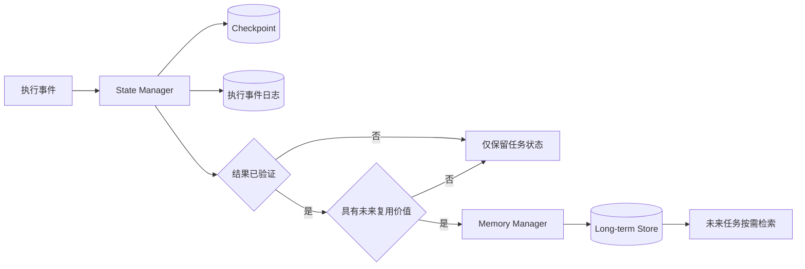

LangGraph 的官方持久化设计把线程内状态 Checkpointer 与跨线程数据 Store 分开，这是上述逻辑分工的典型实例；但具体系统也可以使用不同存储方案。

---

# 第三部分：工作原理——形成完整执行闭环

## 8. 端到端十阶段

| 阶段 | 主要动作 | 关键输出 | 失败时如何处理 |
|---|---|---|---|
| 1 初始化 | 建立任务、身份与状态 | Task ID、初始状态 | 拒绝无效请求 |
| 2 识别约束 | 解析目标与业务规则 | 任务目标、约束 | 请求澄清 |
| 3 构建上下文 | 装配 Prompt、State、Memory、证据 | 当前模型输入 | 缩减或补充信息 |
| 4 模型决策 | 选择回答、工具或计划 | 下一动作 | 校验格式与合法性 |
| 5 执行工具 | 授权、参数检查、调用 | 结果或错误 | 重试、降级、审批 |
| 6 结果观察 | 标准化工具输出 | Observation | 保留错误原因 |
| 7 更新状态 | 保存进度和产物 | 状态版本、检查点 | 处理并发与存储失败 |
| 8 质量验证 | 校验业务结果 | 通过或问题清单 | 进入修复分支 |
| 9 继续或终止 | 判断预算、终止条件 | 下一步或完成 | 超限时安全结束 |
| 10 交付与沉淀 | 输出产物并提炼经验 | 最终结果、可选记忆 | 保留审计记录 |

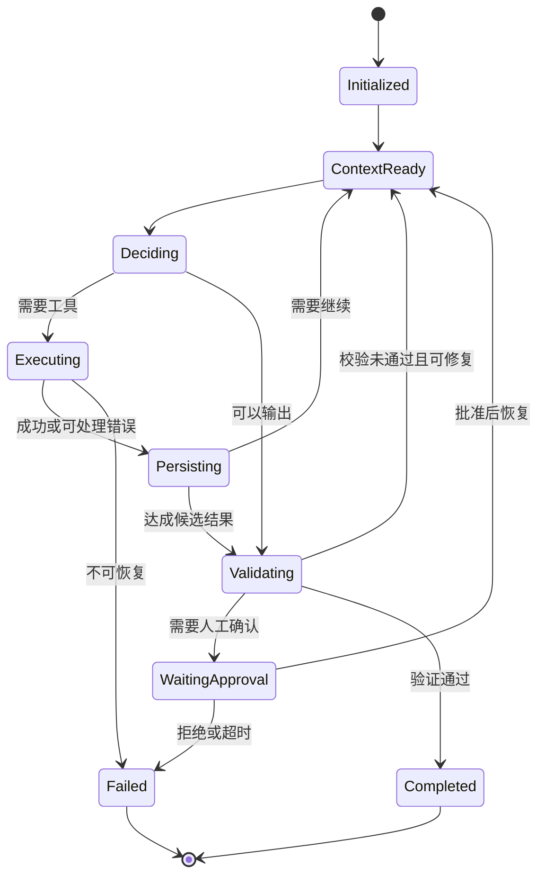

这是一套<strong>参考状态机</strong>，不是所有框架的固定状态集合。实际工程应定义每个状态的合法转移、进入条件、退出条件和超时策略。

## 9. 单轮与跨轮的差别

单轮调用往往只有一次模型推理和输出；Agent 执行可能跨多个工具调用和模型轮次，甚至跨进程重启。前者主要依赖 Context，后者必须结合 State 持久化、工具结果确认和恢复机制。

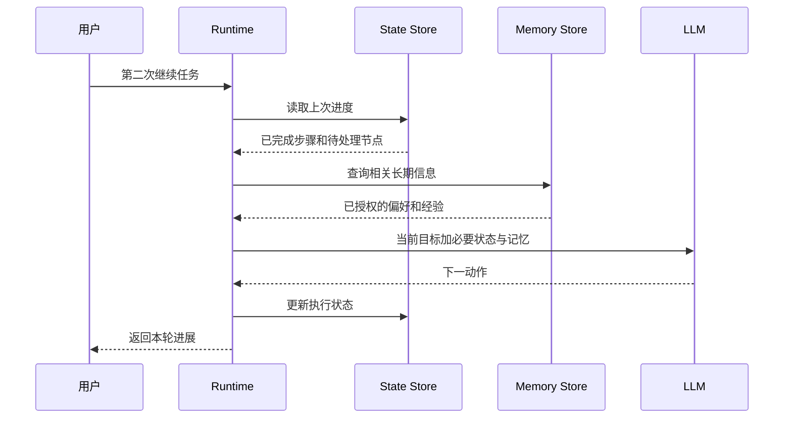

## 10. 终止条件与资源预算

Agent Loop 必须有明确的停止机制，包括目标完成、用户取消、不可恢复错误、超出调用次数、超时或预算耗尽。否则即使每个组件本身正常，也可能出现无穷循环和成本失控。

$$
C_{\mathrm{total}} = C_{\mathrm{model}} + C_{\mathrm{tools}} + C_{\mathrm{storage}} + C_{\mathrm{observability}}
$$

该式是<strong>概念性成本分解</strong>，不是某一平台的统一计费公式。模型调用、外部服务、存储和监控都可能贡献成本。工程上应同时约束调用次数、执行时间和业务风险，而不是只限制 Token。

---

# 第四部分：关键机制——让集成可靠、可控、可维护

## 11. 接口契约与模块解耦

<strong>Contract（接口契约）</strong>不仅包含字段类型，还包含身份、权限、错误语义、版本和副作用。好的契约能让模型服务、工具服务和状态存储独立替换，而不改变整个系统。

| 接口 | 输入 | 输出 | 不变量与失败语义 |
|---|---|---|---|
| Context Builder | Task、State、Memory、证据 | 模型上下文 | 遵守预算和信任边界 |
| Tool Executor | Tool Call、身份、幂等键 | 结果、错误 | 未授权不能执行 |
| State Manager | Task ID、期望版本、状态变更 | 新版本 | 不允许非法状态转移 |
| Memory Retriever | 查询、用户与租户范围 | 记忆及来源 | 不得跨租户泄露 |
| Validator | 产物、规则、来源 | 问题清单、判定 | 检查结果可追溯 |
| Runtime | 当前状态、动作、策略 | 下一动作 | 必须可终止、可恢复 |

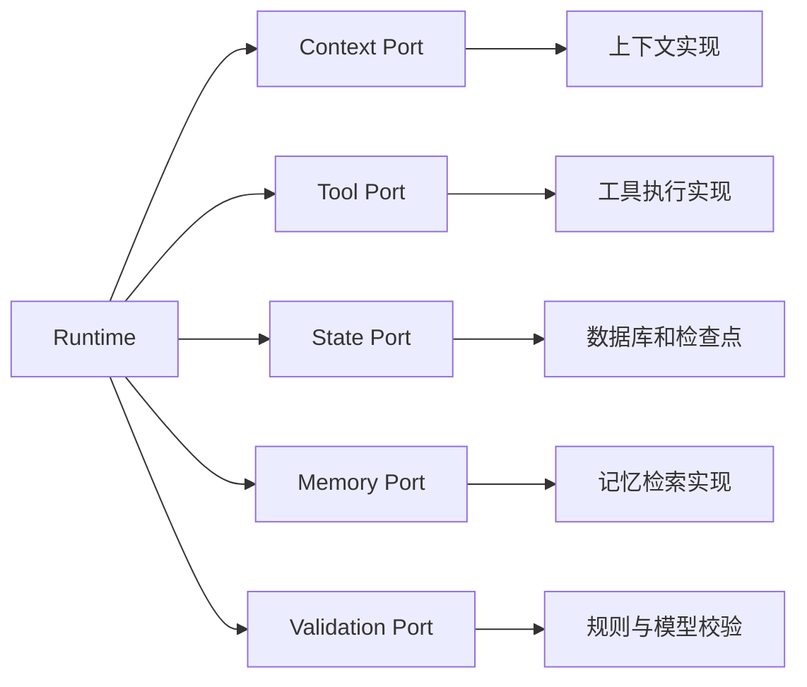

Port（端口）在这里指稳定的抽象接口；Adapter（适配器）指具体技术实现。它们体现的是依赖倒置思想：核心运行逻辑依赖契约，而不是依赖某一家模型或数据库。

## 12. 工具副作用、幂等与一致性

<strong>Idempotency（幂等性）</strong>表示重复提交同一业务请求不会产生重复的目标副作用。例如导出文件、发送通知或提交审批可能需要稳定的业务操作 ID。<strong>Atomicity（原子性）</strong>表示一组操作以整体方式成功或失败，但跨数据库与外部 API 的操作通常不能靠单个本地事务保证。

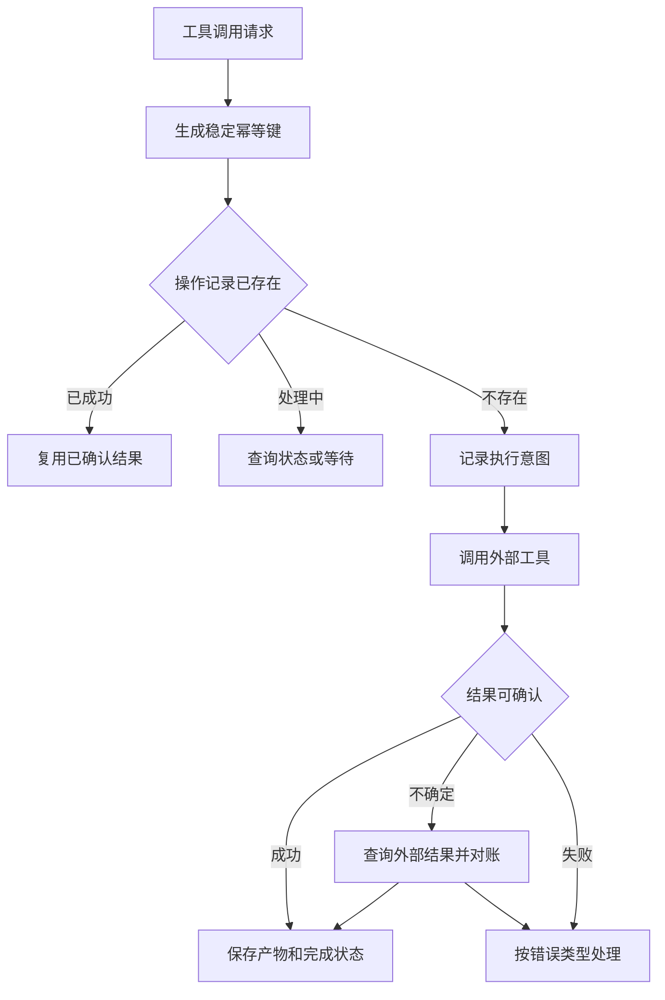

<strong>特别注意：</strong>Checkpoint 保存成功，不等于外部操作与检查点更新处于同一个事务中。恢复时应先核验已产生的副作用，再决定是否重试。

## 13. 错误传播、重试与降级

工具异常应先被 Runtime 分类，再决定是否反馈模型。参数错误通常可修正；权限错误通常应阻断；临时网络错误可以有限重试；不可逆操作必须先确认幂等条件。

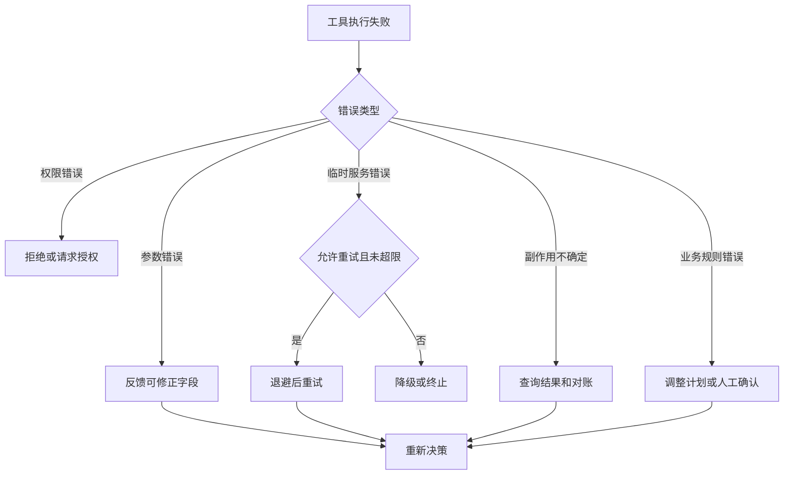

<strong>Retry（重试）</strong>用于处理可恢复错误；<strong>Exponential Backoff（指数退避）</strong>逐次增加重试间隔；<strong>Circuit Breaker（熔断器）</strong>在下游持续故障时暂停请求；<strong>Fallback（降级）</strong>在主路径不可用时切换可接受的备用方案。它们是可组合的可靠性机制，不是所有工具都需要同时使用。

## 14. 人工审批与安全边界

<strong>Human-in-the-Loop，HITL（人在回路）</strong>指在高风险或不确定步骤中引入人工审核。审批必须成为真正的控制关卡，而不只是向模型提示“请谨慎”。系统应持久化审批请求和审批结果，并在恢复时重新检查操作权限与参数是否变化。

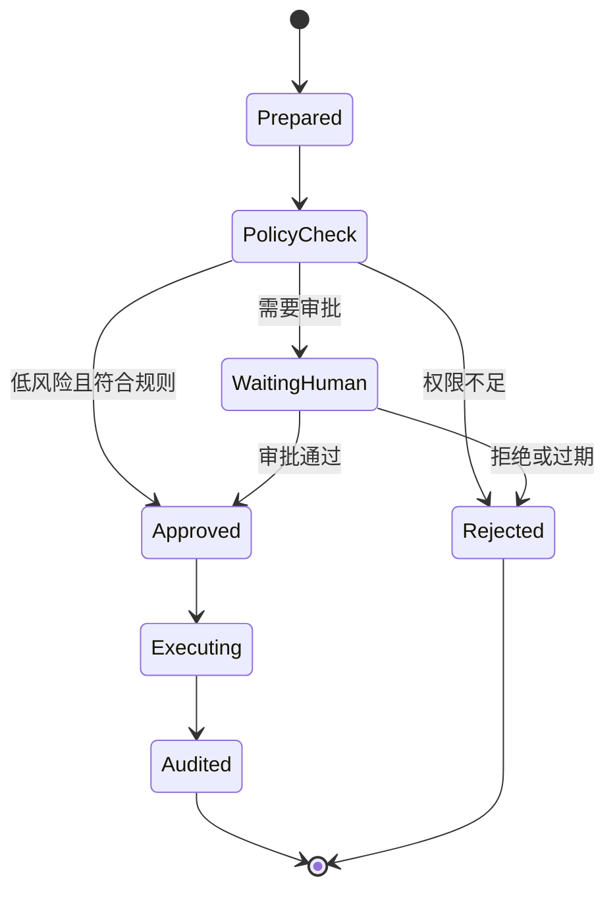

工具输出、检索文档和长期记忆均可能包含不可信文本。应用必须实施身份校验、租户隔离、最小权限、敏感数据脱敏和日志访问控制。不要让模型的自然语言判断替代权限系统。

## 15. 可观测性与端到端评估

<strong>Tracing（链路追踪）</strong>记录一次任务中的模型调用、工具执行和关键决策；<strong>Metrics（指标）</strong>汇总成功率、延迟、成本等数值；<strong>Logs（日志）</strong>记录事件详情；<strong>Audit Trail（审计轨迹）</strong>记录可追责的业务操作。四者可以关联，但不能互相代替。

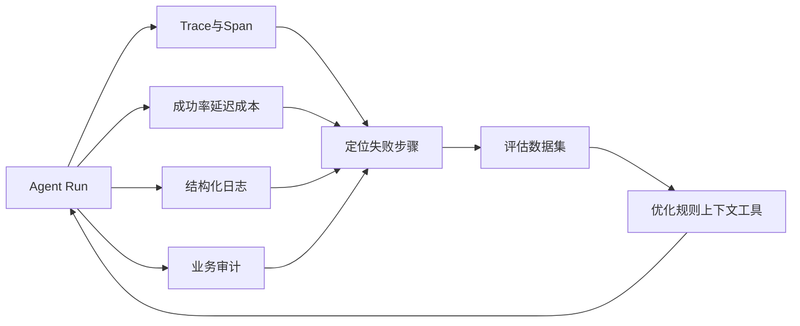

| 评估维度 | 示例指标 | 对应风险 |
|---|---|---|
| 任务正确性 | 端到端完成率、人工验收率 | 任务看似结束但目标未达成 |
| 工具质量 | 参数正确率、工具失败率 | 选择错误工具或参数 |
| 状态可靠性 | 恢复成功率、重复副作用次数 | 重复执行或进度丢失 |
| 上下文质量 | 证据相关性、遗漏率 | 重要信息未进入模型 |
| 安全 | 越权阻断率、审批覆盖率 | 不受控外部操作 |
| 性能 | P50/P95 延迟、平均成本 | 成本过高或响应缓慢 |

P50/P95 是第 50/95 百分位延迟，分别反映典型和尾部体验。评估应覆盖正常路径、异常路径和恢复路径，而不只测试最终答案是否流畅。

---

# 第五部分：架构选型与实际应用

## 16. Workflow、单 Agent 与混合架构

<strong>Workflow（工作流）</strong>的主要执行路径由代码预先定义；Agent 则可根据模型判断动态选择步骤。二者不是互斥关系。对于可重复、可审计、顺序明确的企业流程，通常应先使用确定性 Workflow，在不确定节点嵌入 Agent。

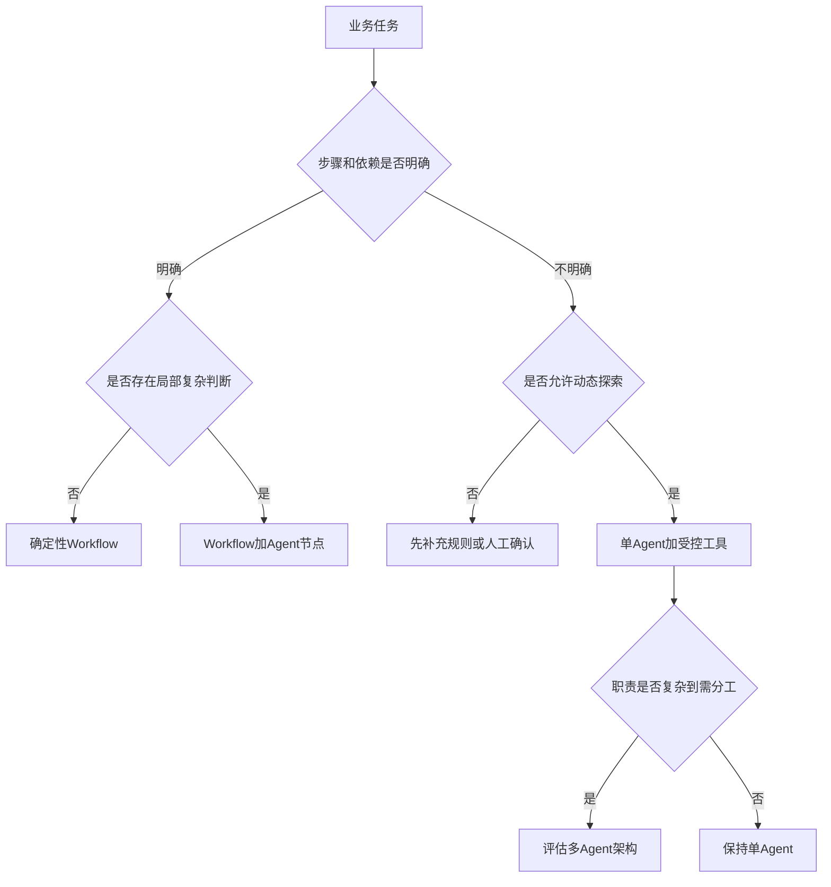

| 模式 | 优点 | 代价 | 适用场景 |
|---|---|---|---|
| Workflow | 路径清晰、易审计 | 灵活性有限 | 文档解析、导出、审批 |
| 单 Agent + Tools | 结构简单、可动态选择 | 决策稳定性需验证 | 多工具助手 |
| Workflow + Agent | 兼顾稳定与适应性 | 需设计边界与恢复 | 企业文档翻译 |
| Planner + Executor | 适合动态多步骤任务 | 计划与执行可能偏离 | 开放式复杂任务 |
| 多 Agent | 专业分工、上下文隔离 | 协调成本更高 | 多专业领域任务 |

Anthropic 的架构建议强调从最简单可行方案开始，只有在收益能够抵消延迟、成本和复杂度时再引入更复杂的 Agent 模式。

## 17. 企业文档翻译 Agent：完整系统架构

目标不是只翻译文本，而是处理 Word/PDF/图片的结构解析、专业术语一致性、图文排版、质量校验和最终交付。一个稳健方案是：<strong>Workflow 控制确定性主流程，Agent 处理低置信度识别、术语冲突和复杂布局修复等不确定环节</strong>。

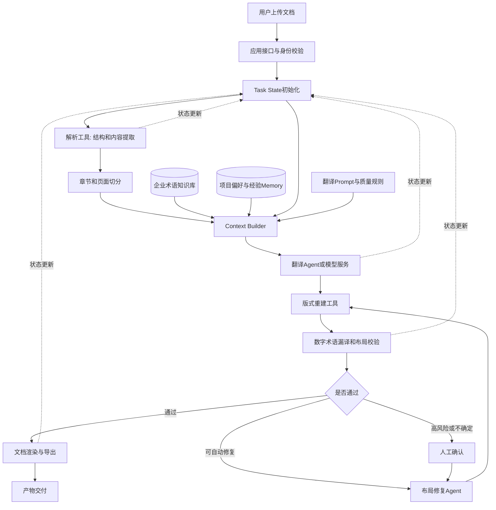

### 17.1 五个组件如何落地

| 组件 | 文档翻译中的具体作用 | 不应做的事 |
|---|---|---|
| Prompt | 规定译文语言、术语、型号和格式约束 | 代替格式校验程序 |
| Context | 提供当前段落、相邻内容和必要术语 | 塞入整本无关文档 |
| Memory | 保存经验证的项目偏好和修复经验 | 私自覆盖正式术语库 |
| Tools | 解析、OCR、翻译、重排、检查、导出 | 绕过权限直接覆盖源文件 |
| State | 记录页面完成情况、产物版本、重试和审批 | 将任务状态当作用户偏好 |

OCR（Optical Character Recognition，光学字符识别）用于从图片或扫描页面中识别文字；RAG（Retrieval-Augmented Generation，检索增强生成）可用于按需查询企业术语和文档知识，但它不等同于长期记忆。

### 17.2 页面级执行状态与恢复

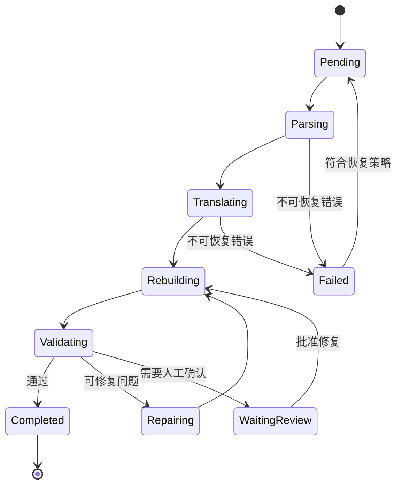

假设第 35 页已经生成结果，但进程在状态写入前崩溃。恢复时不能简单依据旧状态重新生成：应先核对该页的稳定操作标识、产物是否存在、校验是否通过和输出版本，再决定标记完成、继续验证或重新执行。否则容易重复生成文件或覆盖正确结果。

### 17.3 典型故障恢复时序

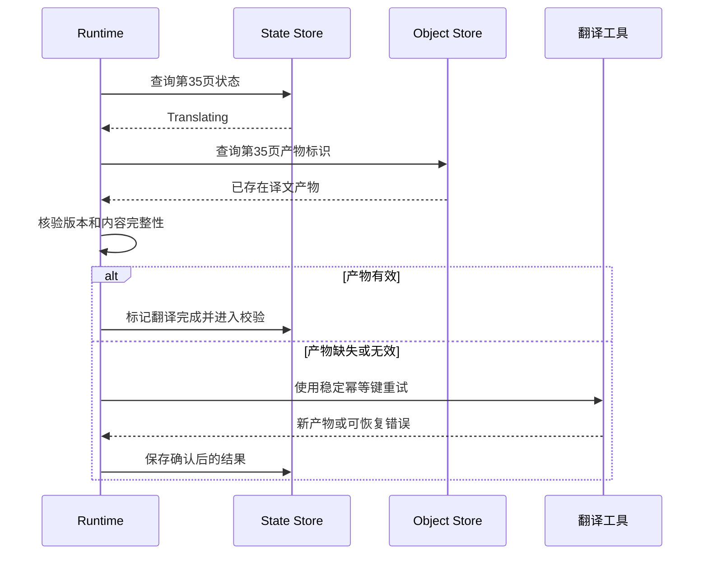

### 17.4 为什么术语库与 Memory 要分开

企业正式术语库是受管理的权威知识源，通常有审核流程、版本和适用范围；Memory 是从交互和执行中提炼的经验。若某次模型输出与术语库冲突，应标记并提交审核，而不是把模型的临时结论直接写回标准术语库。这体现了<strong>知识权威性高于经验便利性</strong>的工程原则。

## 18. 从 Demo 到生产的演进路线

```mermaid
flowchart LR
    A[阶段一: 单模型加少量工具] --> B[阶段二: 独立Context和State]
    B --> C[阶段三: 检查点与错误处理]
    C --> D[阶段四: 验证器与人工审批]
    D --> E[阶段五: 可观测性与回归评估]
    E --> F[阶段六: 按需引入Memory和多Agent]
```

该路线不是强制的线性项目计划；如果场景涉及敏感信息或高风险写操作，权限和审计应从第一阶段就建立。成熟度的核心指标是任务成功率、可恢复性和可审计性，而不是 Agent 数量。

---

# 第六部分：总结拓展

## 19. 常见误区与正确理解

| 常见误区 | 正确认识 |
|---|---|
| 五个组件都存在就完成了集成 | 还需要运行时、接口、控制流、数据流和失败语义 |
| Context 就是 State | Context 是本轮输入；State 是任务执行事实 |
| Memory 可以代替知识库 | 经验记忆不能覆盖权威知识管理 |
| 模型生成 Tool Call 就算执行成功 | 必须经过校验、真实执行和结果确认 |
| 有 Checkpoint 就不会重复执行 | 外部副作用仍需幂等和对账 |
| 所有流程都应该由 Agent 决策 | 确定性步骤通常更适合 Workflow |
| Tracing 就是审计和状态持久化 | 三者目标不同，应分别设计 |
| 工具错误都可以重试 | 必须区分权限、业务、临时和不确定副作用错误 |
| 多 Agent 一定更强 | 分工收益必须覆盖协调成本与复杂性 |

## 20. 面试问答：用完整逻辑解释组件集成

### Q1：如何解释五个核心组件的协作？

<strong>答：</strong>Prompt 规定行为边界，Context Builder 按当前任务组合 State、Memory 和外部证据，LLM 根据这些信息产生下一动作，Runtime 校验并执行 Tool Call，结果写入 State 后反馈给模型继续决策。任务完成时通过验证器检查结果，并根据策略把可复用经验写入 Memory。整个过程由 Runtime 管理终止条件、权限和异常恢复。

### Q2：为什么 Runtime 是集成核心，而不是 LLM？

<strong>答：</strong>LLM 擅长不确定条件下的判断，但无法单独保证数据库一致性、权限校验、幂等和可靠持久化。Runtime 负责把模型输出转化为受控操作，并维护可恢复的执行事实。

### Q3：Context、State、Memory 有什么区别？

<strong>答：</strong>Context 是本轮模型可见的信息，State 是任务执行进度和控制事实，Memory 是跨任务复用的历史知识。通常从 State 和 Memory 中筛选相关内容装配进 Context，而不是把三者合并为一份无限增长的聊天记录。

### Q4：工具执行成功后程序崩溃，如何恢复？

<strong>答：</strong>先通过操作标识和外部产物查询确认副作用是否已发生，再与 State 对账；若已完成则补写状态，若未完成且满足幂等要求则重试。不能直接根据旧 Checkpoint 盲目重复执行。

### Q5：为什么企业文档翻译更适合 Workflow + Agent？

<strong>答：</strong>解析、分段、校验和导出通常有明确顺序，适合确定性 Workflow；OCR 低置信度、术语冲突和复杂版式修复具有不确定性，适合局部 Agent 判断。混合架构兼顾质量、审计和可恢复性。

### Q6：如何评价一个集成系统是否成熟？

<strong>答：</strong>除端到端任务成功率外，还要评估工具参数正确率、恢复成功率、重复副作用次数、权限阻断效果、人工审批覆盖率、P95 延迟、成本和可追溯性，并使用异常场景做回归测试。

## 21. 术语与缩写速查表

| 术语 | 英文全称 | 中文及说明 |
|---|---|---|
| Agent | AI Agent | 智能体，具备目标驱动的决策与行动能力 |
| LLM | Large Language Model | 大语言模型，负责语言理解和推理生成 |
| Runtime | Agent Runtime | 智能体运行时，组织执行循环与外部交互 |
| Prompt | Prompt / Instructions | 提示与指令，约束模型行为 |
| Context | Context | 当前模型调用可见的信息集合 |
| Context Builder | Context Builder | 上下文构建器，筛选、装配和压缩输入 |
| Memory | Agent Memory | 记忆机制，保存可复用信息 |
| State | Execution / Task State | 执行或任务状态，记录当前进度 |
| Tool Call | Tool Call | 工具调用请求，通常由模型生成 |
| Tool Executor | Tool Executor | 工具执行器，执行参数校验与真实调用 |
| Schema | Schema | 结构模式，约束数据字段与类型 |
| Observation | Observation | 工具执行后的观察结果 |
| Workflow | Workflow | 工作流，预定义的执行路径 |
| Orchestrator | Orchestrator | 编排器，负责步骤或执行单元调度 |
| RAG | Retrieval-Augmented Generation | 检索增强生成，按需提供外部知识 |
| MCP | Model Context Protocol | 模型上下文协议，标准化工具与资源连接 |
| Checkpoint | Checkpoint | 检查点，用于执行状态恢复 |
| HITL | Human-in-the-Loop | 人在回路，关键步骤由人工审核 |
| Idempotency | Idempotency | 幂等性，重复请求不产生重复目标副作用 |
| Guardrail | Guardrail | 防护约束，控制输入、输出或动作风险 |
| Tracing | Distributed / Execution Tracing | 链路追踪，关联执行过程中的调用事件 |
| Span | Span | 链路片段，表示某个操作的执行区间 |
| P95 | 95th Percentile | 第95百分位，用于衡量尾部延迟 |
| OCR | Optical Character Recognition | 光学字符识别，从图像提取文字 |
| Token Budget | Token Budget | 令牌预算，控制模型上下文和输出资源 |
| Adapter | Adapter | 适配器，将抽象接口连接到具体实现 |
| Port | Port | 端口，业务逻辑依赖的稳定抽象接口 |

## 22. 总结：从五个组件走向完整 Agent

```mermaid
mindmap
  root((完整Agent系统))
    行为规则
      Prompt
      业务约束
    信息管理
      Context
      Memory
      知识检索
    执行能力
      LLM决策
      Tools
      Runtime调度
    状态与恢复
      State
      Checkpoint
      幂等对账
    质量与治理
      结果验证
      权限审批
      Tracing
      端到端评估
    架构选择
      Workflow
      单Agent
      混合架构
```

<strong>一条贯穿全文的主线：</strong>Prompt 规定行为 → Context 组织当前信息 → Memory 提供经筛选的经验 → LLM 决定下一动作 → Runtime 校验并执行 Tools → State 保存执行事实 → Validator 判断是否达标 → Runtime 继续、恢复或终止。五个组件的价值只有在这条闭环中才能转化为稳定的业务能力。

下一章可以在此基础上研究 ReAct、Planning、Workflow、Reflection 等工作范式：它们主要改变<strong>Runtime 如何组织决策与行动</strong>，而不是推翻这里的组件职责边界。

## 23. 官方资料与延伸阅读

以下资料用于核对框架特性、理解架构模式与进一步学习。文中对六层架构、十阶段执行闭环、错误分类和成熟度路线的划分属于<strong>工程归纳</strong>，并非这些官方文档共同规定的唯一标准。

1. [OpenAI Agents SDK 官方指南](https://developers.openai.com/api/docs/guides/agents/sdk)：Agent 运行时、工具、审批与可观测性。
2. [OpenAI Agents SDK — Sessions](https://openai.github.io/openai-agents-python/sessions/)：会话历史保存与连续对话。
3. [OpenAI Agents SDK — Tracing](https://openai.github.io/openai-agents-python/tracing/)：执行链路与工具调用追踪。
4. [LangGraph — Persistence](https://docs.langchain.com/oss/python/langgraph/persistence)：Checkpointer 与 Store 的职责区分。
5. [LangGraph — StateGraph API](https://reference.langchain.com/python/langgraph/graph/state)：图节点、状态更新与合并机制。
6. [Anthropic — Building Effective Agents](https://www.anthropic.com/engineering/building-effective-agents)：Workflow、Agent 和常见编排模式。
7. [Anthropic — Writing Effective Tools for Agents](https://www.anthropic.com/engineering/writing-tools-for-agents)：工具描述、契约与可用性设计。
8. [Model Context Protocol — Specification](https://modelcontextprotocol.io/specification/)：标准化工具与资源连接。

---

> <strong>最终结论：</strong>Agent 的工程能力不取决于组件堆叠数量，而取决于这些组件能否在明确的权限边界、数据契约、状态机制和验证闭环下持续协作。一个优秀的 Agent 系统应当不仅能完成任务，也能解释过程、控制风险、恢复故障，并通过评估持续改进。
