# 第三章｜Agent 核心组件：从能力边界到可靠执行闭环

> <strong>章节定位：</strong>本章是 Agent 工程体系的组件层与运行时衔接层。六篇正文分别解释 Prompt、Context、Memory、Tools、State 以及它们的集成方式；本 README 负责建立全局知识地图、串联因果关系并提供深入阅读入口，不替代各专题正文。
>
> <strong>阅读主线：</strong>行为约束 → 信息组织 → 跨会话复用 → 外部执行 → 过程控制 → 系统集成。

## 1. 为什么必须把五个组件放在同一个体系中理解

大语言模型（Large Language Model，<strong>LLM</strong>）擅长理解、生成与辅助决策，但企业任务要求的不是一次回答，而是可执行、可验证、可恢复的结果。Prompt 让模型知道应当遵循什么规则，Context 决定本轮能依据哪些信息，Memory 提供未来可复用的经验，Tools 把决策连接到真实系统，State 记录可核验的执行事实。<strong>Agent Runtime（智能体运行时）</strong>负责把这些能力协调为闭环，并在模型输出与实际执行之间设置安全边界。

### 图 1｜章节知识全景思维导图

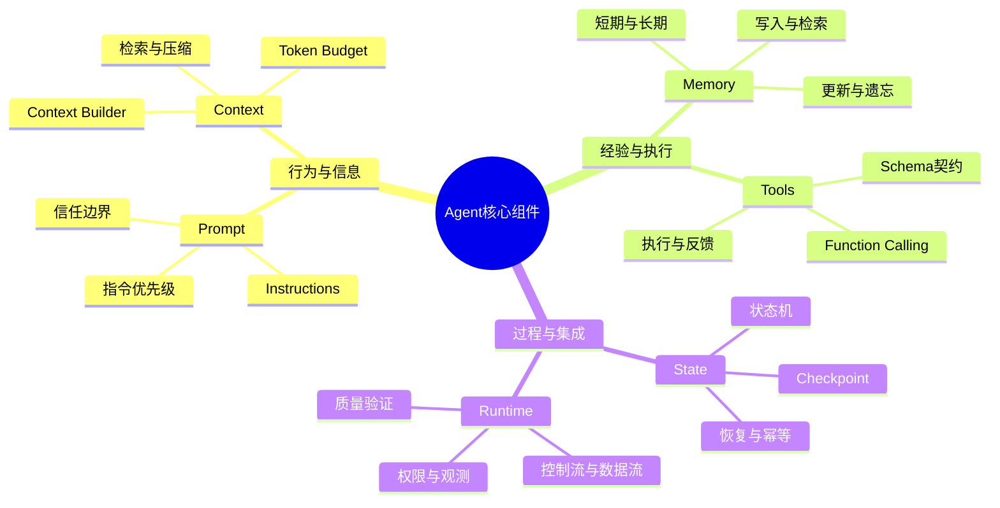

<strong>读图：</strong>前三组分别解决行为与输入、经验与行动、执行连续性与系统协调。它们不是相互独立的“插件”，而是在同一次任务中持续交换数据和控制信号。

### 图 2｜从模型能力到系统能力的因果链

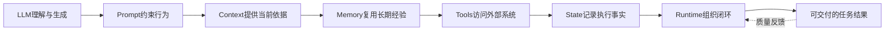

这条链是<strong>学习依赖顺序</strong>，不是运行时必须逐个串行执行的固定流程。实际执行中，State、Memory 和 Context 会在多轮循环中反复协作。

## 2. 六篇知识文档的学习导航

| 顺序 | 专题与相对链接 | 一句话核心问题 | 学完后应理解 |
|---|---|---|---|
| 01 | [Prompt、系统指令与提示词设计](./01-Prompt-and-Instructions.md) | 模型应遵循什么规则？ | 指令来源、优先级、结构化约束及其安全边界 |
| 02 | [上下文工程与上下文窗口管理](./02-Context-Engineering.md) | 本轮应该让模型看到什么？ | Context Builder、Token Budget、选择、检索、压缩与更新 |
| 03 | [短期记忆、长期记忆与工程化管理](./03-Memory.md) | 哪些信息值得未来继续使用？ | 记忆分类、写入、检索、冲突治理与遗忘 |
| 04 | [工具契约、调用与结果反馈](./04-Tools.md) | 决策怎样转化为真实操作？ | Tool Schema、注册、Function Calling、MCP、可靠性与权限 |
| 05 | [状态、会话、持久化与故障恢复](./05-State-Management.md) | 任务执行到了哪里，如何安全继续？ | State Schema、状态机、Checkpoint、幂等与恢复 |
| 06 | [核心组件集成与执行闭环](./06-Component-Integration.md) | 五个组件如何组成完整 Agent？ | Runtime、接口契约、控制流、数据流与端到端治理 |

<strong>推荐路径：</strong>初学者按 01 → 06 顺序阅读；已有 Agent 开发经验的读者可先读 [06 集成](./06-Component-Integration.md) 定位系统，再按问题返回相应专题。六篇文档的知识目标不同，README 仅提供整体地图和关键边界。

### 图 3｜学习依赖与交叉引用

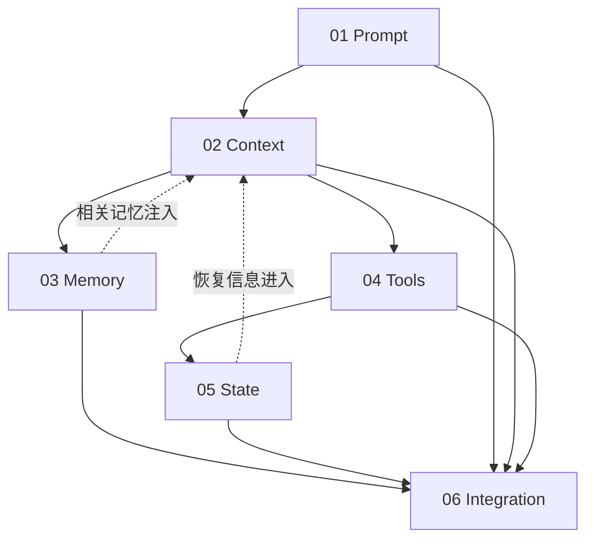

<strong>读图：</strong>Context 是模型输入的汇合点，State 是任务事实的记录点，Integration 则解释两者如何与工具执行和记忆复用衔接。

## 3. 五个组件的职责边界：最容易混淆的概念

| 组件 | 回答的问题 | 典型输入或数据 | 不应承担的职责 |
|---|---|---|---|
| <strong>Prompt / Instructions</strong> | 应怎样做？ | 角色、目标、规则、输出约束 | 不能替代实际鉴权、事务和结果校验 |
| <strong>Context</strong> | 本轮能看到什么？ | 当前用户请求、状态摘要、检索片段、工具反馈 | 不能充当唯一持久化存储 |
| <strong>Memory</strong> | 未来要复用什么？ | 经筛选的偏好、事实、历史经验 | 不等于完整聊天记录或权威业务数据库 |
| <strong>Tools</strong> | 能实际执行什么？ | 工具契约、参数、身份、结果 | 模型生成调用意图不等于执行成功 |
| <strong>State</strong> | 当前执行事实是什么？ | 阶段、进度、错误、审批、产物引用 | 不等于模型“记住”了任务 |

这里还要区分 <strong>RAG（Retrieval-Augmented Generation，检索增强生成）</strong>：它是从外部知识源检索并补充模型输入的方法，可以服务于 Context，也可以用于 Memory 检索，但不等同于 Memory 本身。<strong>Checkpoint（检查点）</strong>则是支持状态恢复的持久化依据，不能保证所有外部副作用天然只执行一次。

### 图 4｜组件职责与数据所有权

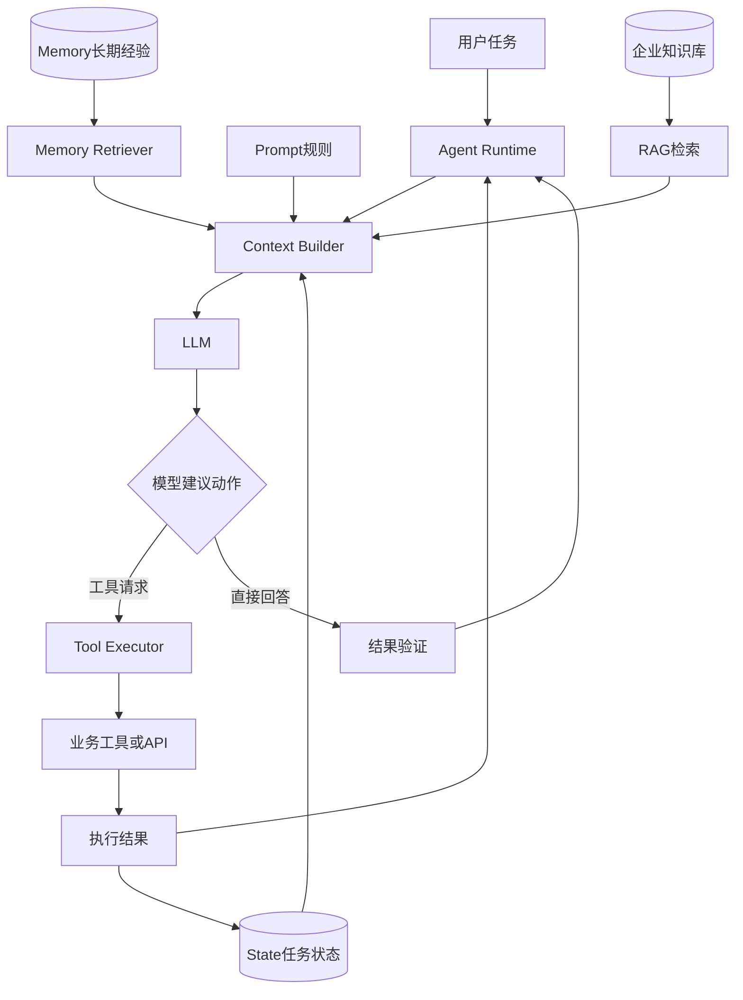

<strong>读图：</strong>长期经验和企业知识可以共同参与本轮上下文，但它们来源、可信度和更新机制不同。工具执行后的真实结果优先成为 State 中的执行事实，再由运行时决定是否注入下一轮 Context；不是所有工具结果都应自动写成长期 Memory。

### 图 5｜Context、Memory、State 的时间维度

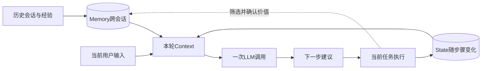

<strong>读图：</strong>Context 是每轮调用的“视图”，State 是当前任务的“事实”，Memory 是跨任务的“可复用资产”。三者可以共享底层存储，却不应混淆生命周期和写入策略。

## 4. 工作原理：Runtime 如何把组件组织成闭环

<strong>Runtime（运行时）</strong>不是第六个知识仓库，而是负责执行循环、工具调度、状态转移、错误处理与终止判断的协调层。它需要同时管理两条链：<strong>Control Flow（控制流）</strong>决定下一步做什么；<strong>Data Flow（数据流）</strong>决定什么信息流向哪个组件。

### 图 6｜一次 Agent 任务的完整控制流

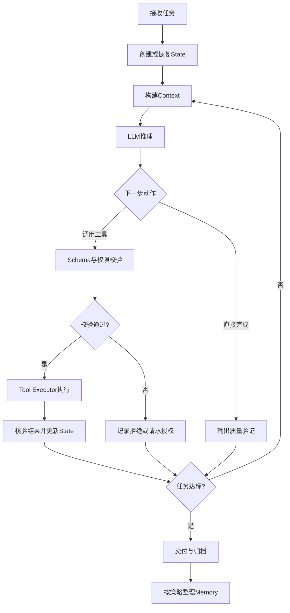

<strong>读图：</strong>LLM 负责语义判断，程序负责权限、状态合法性、幂等与质量门槛。模型输出工具调用请求只是执行的开始，不能视为完成。

### 图 7｜模型、运行时与外部系统的时序协作

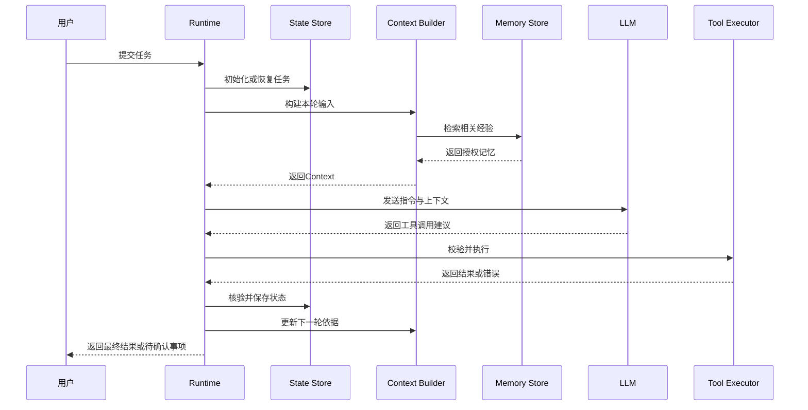

<strong>读图：</strong>时序图强调的是调用责任边界。模型不直接写入状态数据库，也不因为工具反馈中出现命令式文本就获得额外权限。

### 图 8｜信息在一次模型调用前如何汇合

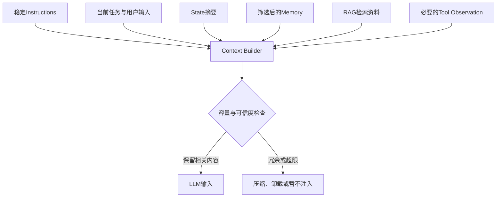

<strong>读图：</strong>Context Engineering 的价值在于<strong>按需装配</strong>而非无限堆叠。工具结果、网页和文档内容属于低信任数据，不应覆盖高优先级指令。

## 5. 关键机制：从可运行到可恢复、可验证

完整 Agent 必须处理执行失败、状态冲突、权限不足和结果不达标。它们不是孤立的工程优化，而是组件集成后必然出现的跨边界问题。

### 图 9｜故障恢复与幂等决策

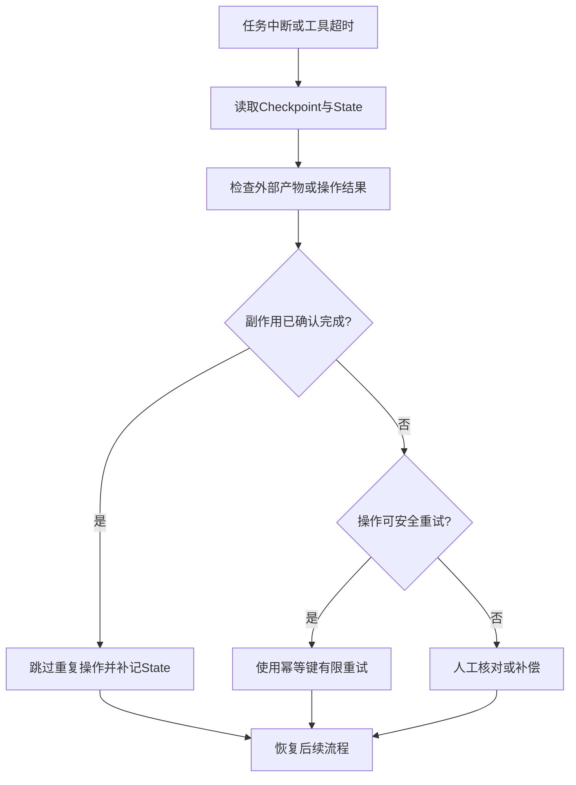

<strong>读图：</strong>重试不是恢复的全部。<strong>Idempotency（幂等性）</strong>要求重复请求不会产生重复业务副作用；在状态更新与外部操作不能共用一个事务时，必须核对真实结果，必要时采用补偿或人工确认。详见 [05 状态管理](./05-State-Management.md) 与 [04 工具系统](./04-Tools.md)。

### 图 10｜可信执行的分层防护

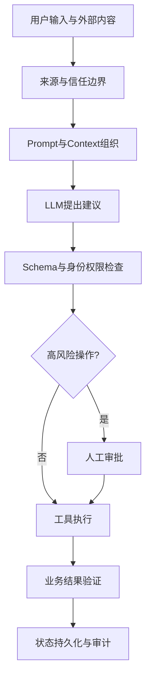

<strong>读图：</strong>Prompt 可以指导模型，但安全必须在 Runtime 与 Tool Executor 中独立实施。<strong>Schema（结构模式）</strong>约束参数形状，不保证业务语义正确或访问权限合法。

### 图 11｜端到端质量反馈闭环

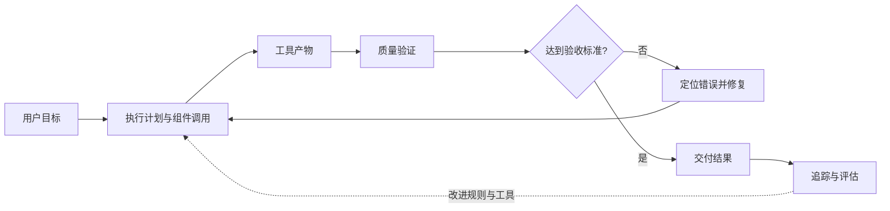

<strong>读图：</strong>系统正确性需要从“模型是否回答得像样”扩展到“任务是否真实完成、产物是否符合业务要求”。<strong>Tracing（执行追踪）</strong>用于观察模型与工具调用，不能代替业务审计或任务持久化。

## 6. 实际应用：企业文档翻译 Agent 的组件协作

以医疗设备企业的 Word、PDF、图片翻译为例，任务要求不仅是翻译文本，还包括术语一致性、数字和型号准确、版式保留、漏译检查与可靠交付。适合采用<strong>确定性 Workflow（工作流）作为主干、Agent 负责局部动态判断</strong>的混合方案。

### 图 12｜文档翻译的业务主链与组件挂载点

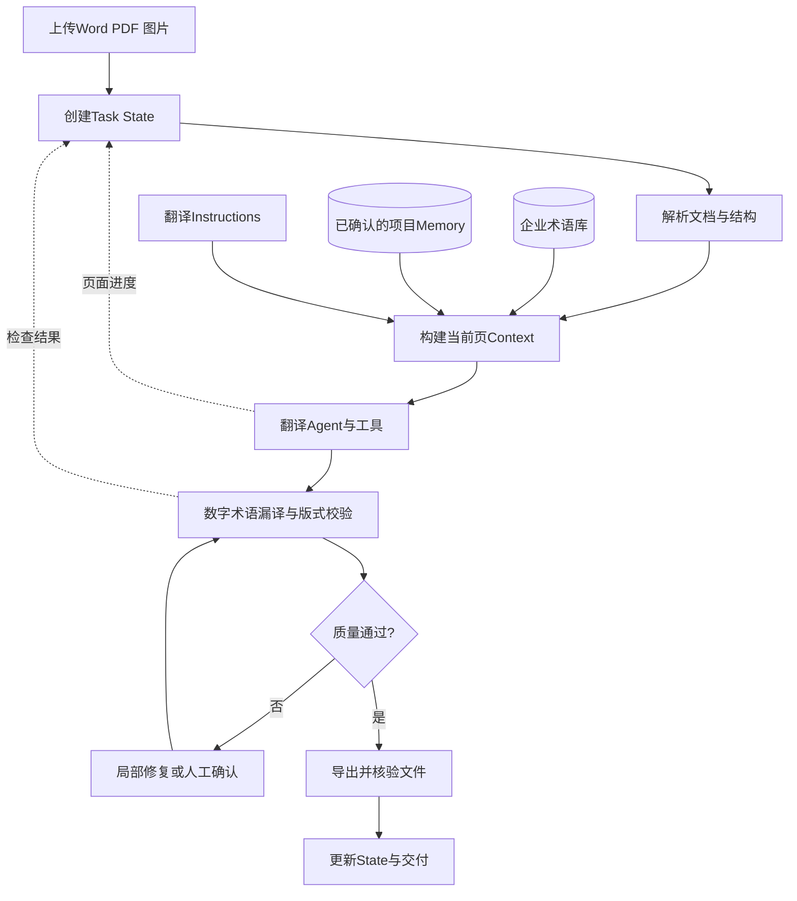

<strong>读图：</strong>术语库属于受控业务知识源，不应被模型自行总结的 Memory 覆盖。每页翻译与质量检查的进度属于 State；仅有稳定复用价值且经过验证的偏好或修复经验，才适合进入 Memory。

### 图 13｜第 35 页故障时的恢复链路

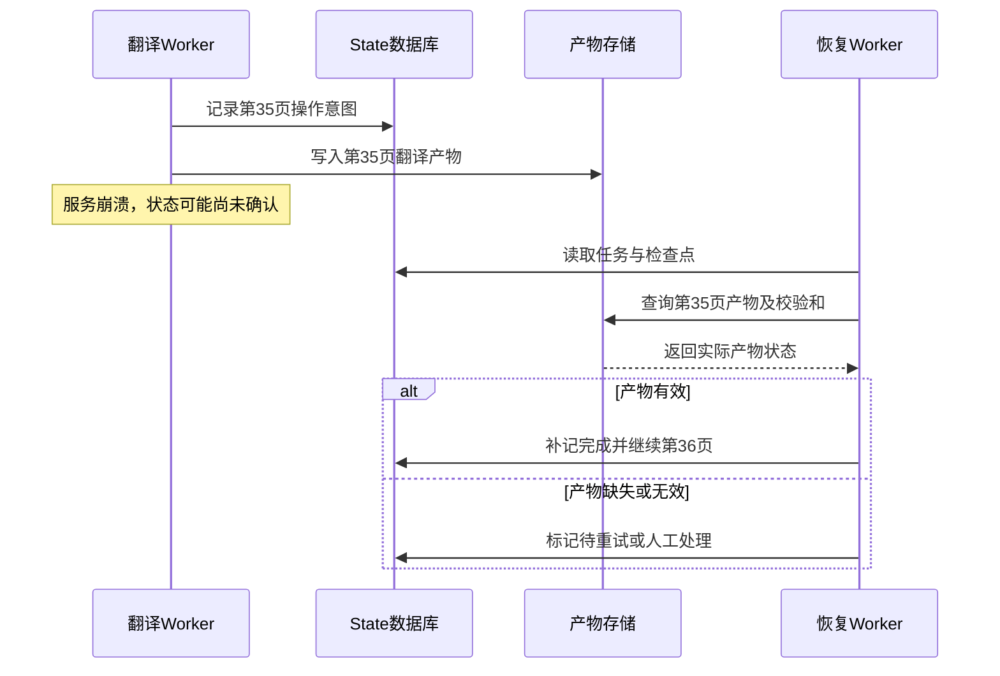

<strong>读图：</strong>这个案例串联了 Tool 的外部副作用、State 的持久化、Runtime 的恢复决策和 Context 的后续更新，是本章知识体系的综合应用。

## 7. 工程决策：什么情况下重点复习哪一篇？

### 图 14｜按问题定位知识模块

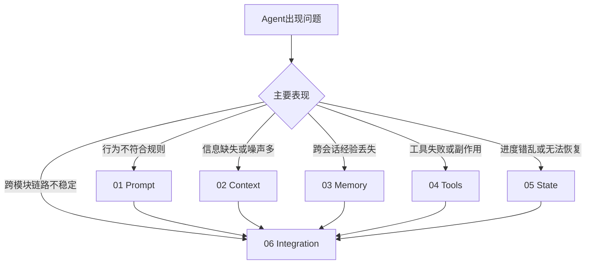

<strong>读图：</strong>这不是互斥分类。例如工具超时可能同时涉及 Tools 的重试策略、State 的执行记录与 Runtime 的错误分支。先定位主故障点，再沿依赖关系追查。

| 典型现象 | 优先检查 | 关联机制 |
|---|---|---|
| 模型忽略格式要求 | [Prompt](./01-Prompt-and-Instructions.md) | 指令结构、角色优先级、输出验证 |
| 对话越长效果越差 | [Context](./02-Context-Engineering.md) | Token Budget、信息筛选、压缩与上下文污染 |
| 新会话无法复用术语偏好 | [Memory](./03-Memory.md) | 写入、检索、命名空间、有效期 |
| 工具参数正确却访问被拒 | [Tools](./04-Tools.md) | Schema 与授权的区别 |
| 任务重启后重复导出文件 | [State](./05-State-Management.md) | Checkpoint、幂等键、外部结果核验 |
| 单组件测试通过但端到端失败 | [Integration](./06-Component-Integration.md) | 接口契约、状态更新、质量闭环与追踪 |

## 8. 本章知识关联与下一阶段的演进

五大组件是<strong>能力基础</strong>，Runtime 是<strong>协调机制</strong>，工作范式则是<strong>如何组织决策与执行步骤</strong>。因此，掌握本章之后，自然进入下一章的 ReAct、Planning、Workflow、Reflection 与模式选择，而不是再重复学习组件定义。

### 图 15｜从核心组件到工作范式

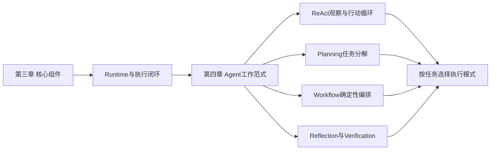

<strong>读图：</strong>ReAct 等范式不替代 Prompt、Context、Memory、Tools 或 State，而是在这些基础能力之上定义决策与执行的组织方式。下一章建议从 [04-Agent-Working-Patterns/01-ReAct.md](../04-Agent-Working-Patterns/01-ReAct.md) 开始。

## 9. 核心术语速查

| 术语 | 英文全称 | 在本章中的含义 |
|---|---|---|
| LLM | Large Language Model | 大语言模型，承担语义理解与生成、辅助决策 |
| Prompt | Prompt | 提供给模型的输入内容，包含指令及必要数据 |
| Instructions | Instructions | 规定模型行为、目标和约束的指令 |
| Context | Context | 本次模型调用可见的相关信息 |
| Context Builder | Context Builder | 选择、过滤、组织本轮输入的组件 |
| Token Budget | Token Budget | 在模型上下文容量约束下分配输入输出额度 |
| Memory | Memory | 选择性保存并在未来复用的信息机制 |
| RAG | Retrieval-Augmented Generation | 检索增强生成，将外部资料用于模型回答或决策 |
| Tool Calling | Tool Calling | 模型提出使用外部能力的调用请求 |
| Function Calling | Function Calling | 模型按函数工具定义生成结构化调用请求的机制 |
| MCP | Model Context Protocol | 模型上下文协议，标准化工具与资源连接 |
| Schema | Schema | 数据结构和字段约束定义 |
| State | State | 任务或执行过程中的结构化事实与控制条件 |
| Checkpoint | Checkpoint | 用于执行恢复的持久化检查点 |
| Idempotency | Idempotency | 重复操作不造成重复业务副作用的性质 |
| Runtime | Agent Runtime | 管理执行循环、工具调度、状态和异常的运行时 |
| Workflow | Workflow | 按预定义步骤和条件组织执行的工作流 |
| Tracing | Tracing | 记录模型、工具和节点执行过程的追踪机制 |
| Guardrails | Guardrails | 对输入、输出和操作施加的安全或质量约束机制 |

## 10. 本章总结

<strong>一条主线：</strong>Prompt 定义规则，Context 提供本轮依据，Memory 保存可复用经验，Tools 执行外部动作，State 记录可核验的任务事实；Runtime 将它们组织为<strong>决策 → 执行 → 观察 → 验证 → 更新 → 再决策</strong>的闭环。

<strong>两个边界：</strong>第一，模型提出建议不等于系统已执行；第二，模型看到的信息不等于可信的持久化事实。只有把权限、状态、结果验证和故障恢复放进运行时，Agent 才能从演示系统走向可靠的企业任务系统。

<strong>继续深入：</strong>依次阅读 [01 Prompt](./01-Prompt-and-Instructions.md)、[02 Context](./02-Context-Engineering.md)、[03 Memory](./03-Memory.md)、[04 Tools](./04-Tools.md)、[05 State](./05-State-Management.md) 和 [06 Integration](./06-Component-Integration.md)，再进入 [第四章 Agent 工作范式](../04-Agent-Working-Patterns/README.md)。
