# ReAct：推理与行动交替的 Agent 工作模式

> 所属章节：`04-Agent-Working-Patterns` · 第 01 篇  
> 学习定位：在理解 Prompt、Context、Memory、Tools、State 之后，掌握 Agent 如何形成“决策—行动—观察—再决策”的动态执行闭环。  
> 核心问题：为什么仅有推理或工具还不够？ReAct 如何运行、何时适用、怎样可靠落地？

## 0. 全局知识地图：从核心组件走向工作模式

ReAct（Reasoning and Acting，推理与行动协同）不是一种新模型，也不是工具协议，而是一种让语言模型根据外部反馈连续选择行动的工作范式。理解它的最佳路径是先看问题，再看闭环，最后看运行时如何约束闭环。

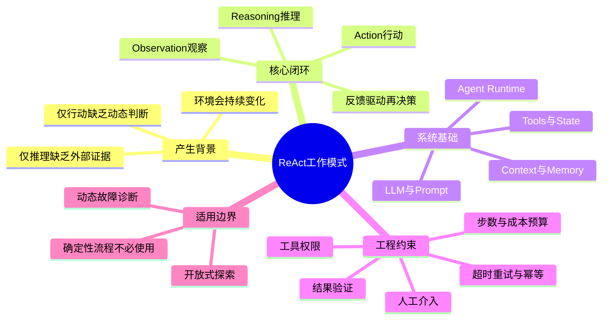

图谱中的“系统基础”对应第三章的五大核心组件；“核心闭环”则是本章新增的执行组织方式。组件回答“有什么能力”，工作范式回答“这些能力以什么顺序和条件协作”。

## 1. 问题起点：为什么需要 ReAct？

### 1.1 单纯推理与单纯行动各有什么缺陷

大型语言模型（LLM，Large Language Model，大语言模型）可以根据输入推断答案，但其已有知识可能过时、缺失或不符合当前环境。Chain-of-Thought（CoT，思维链）强调分步推理，却不会自动使外部信息变得真实或及时。另一方面，只按固定动作序列操作的系统能访问环境，但面对意外反馈时可能缺乏重新选择路径的能力。

ReAct 试图将二者连接：<strong>推理提出可检验的下一步，行动获取外部证据，观察修正后续决策。</strong> 原始研究发表于 ICLR 2023，论文为 *ReAct: Synergizing Reasoning and Acting in Language Models*。其提出的是推理轨迹与任务动作交替的框架，而不是“只要使用工具就是 ReAct”的宽泛定义。

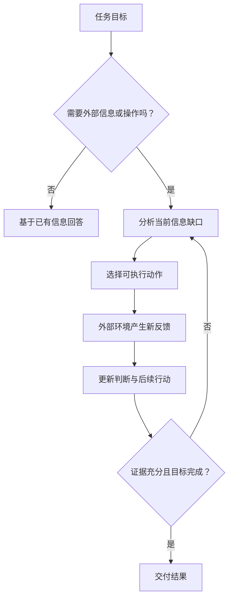

这张图表达了 ReAct 的因果关系：<strong>信息缺口触发行动，行动反馈改变认知，更新后的认知决定下一步。</strong> 并非每一轮都必须调用工具；能够直接回答时，应避免无价值的额外循环。

### 1.2 与其他模式的边界

| 模式 | 控制方式 | 外部反馈 | 适合的问题 | 主要局限 |
|---|---|---|---|---|
| Direct Answer（直接回答） | 一次模型响应 | 通常没有 | 简单解释、改写 | 难以核实动态事实 |
| CoT（思维链） | 模型内部逐步推理 | 不必有 | 多步骤推断 | 推理不等于事实验证 |
| Act-only（仅行动） | 选择或执行动作 | 有 | 规则明确的交互 | 动态策略能力受限 |
| ReAct | 推理与行动交替 | 有，且用于再决策 | 开放式检索、诊断、探索 | 延迟、成本、循环风险 |
| Plan-and-Execute（规划后执行） | 先建立较完整计划 | 执行中可更新 | 长程依赖任务 | 计划可能过时 |
| Workflow（工作流） | 预设步骤与分支 | 可以有 | 稳定、可审计的业务流程 | 非预设异常的适应性有限 |

这些模式并非完全互斥：实际系统可以在 Workflow 的某个节点使用 ReAct，也可以在 ReAct 循环中维护一份可调整的计划。

## 2. 基本单元：Reasoning、Action 与 Observation

### 2.1 Reasoning：基于当前证据决定下一步

Reasoning（推理）是依据目标、已有证据和约束判断下一动作的过程。它可以表现为“还缺少第 3 页的术语来源，因此先检索术语库”这样的行动依据；<strong>不要求模型向用户或日志暴露完整的内部思考链。</strong> 在工程实现中，记录简洁的决策理由、工具选择和可审计的输入输出通常已经足够。

### 2.2 Action：通过工具或环境接口施加影响

Action（行动）可以是只读检索，也可以是有副作用的业务操作。Tool Calling（工具调用）通常由模型生成调用意图和参数，真正的权限检查、执行和错误处理由 Agent Runtime（Agent 运行时）负责。Function Calling（函数调用）是一种常见的结构化工具调用形式，但不等同于 ReAct 本身。

### 2.3 Observation：把环境反馈变成下一轮依据

Observation（观察）是工具执行后返回的结果、错误或环境变化。它可以包含检索文档、页面布局检查结果、数据库查询结果等。观察结果不应自动被当作高优先级指令：<strong>外部数据是证据，不是系统命令。</strong>

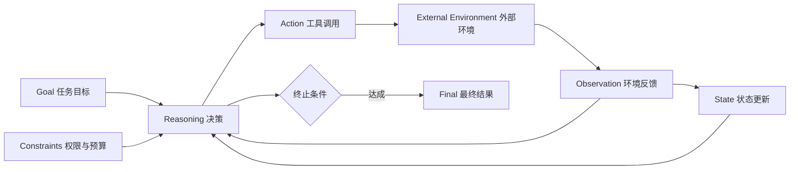

图中有两条互补的反馈：Observation 提供事实证据，State 保存执行事实与恢复所需信息。它们共同影响下一轮决策。

## 3. 原始 ReAct 研究：思想、实验与适用边界

原始论文以交替生成推理轨迹与任务动作的方式，探索知识问答和交互式决策。HotpotQA（多跳问答）与 FEVER（事实核验）用于检验检索与证据整合；ALFWorld（文本交互环境）与 WebShop（网页购物环境）用于检验在环境中连续采取行动的能力。

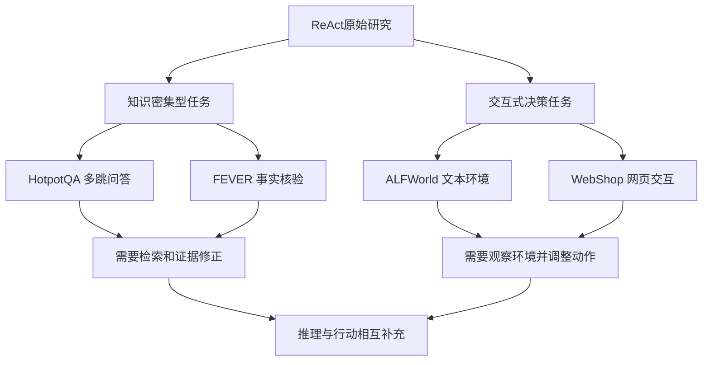

研究显示交替推理与行动在特定基准上具有优势，但<strong>实验结果不等于任何企业任务都能获得同样的提升</strong>。模型能力、工具质量、任务难度、动作空间和评价方法都会影响最终表现。应将论文视为工作机制的理论依据，而非生产效果保证。

## 4. 从论文轨迹到现代 Agent Runtime

### 4.1 现代工具调用循环

现代 Agent 不一定采用论文中显式的 `Thought / Action / Observation` 文本标签。模型可以直接产生结构化工具调用，运行时完成执行，再把结果加入下一轮上下文。概念不变，接口形式发生了演进。

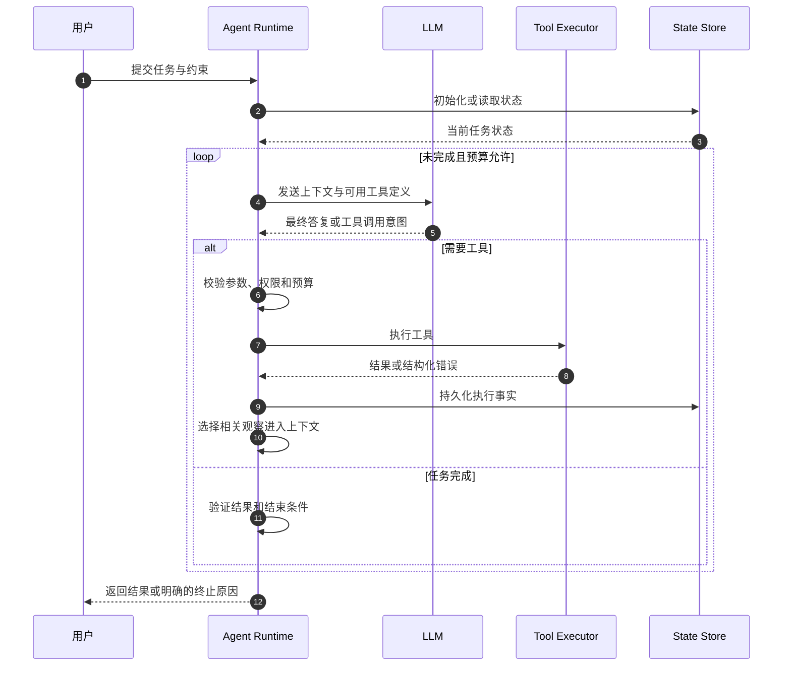

这张时序图强调：模型负责提出动作，运行时负责可信执行。循环的真正边界包括预算、权限、状态和质量验证，而不是模型一句“已经完成”。

### 4.2 第三章五大组件如何进入 ReAct

| 组件 | 在循环中的职责 | 与其他组件的关系 |
|---|---|---|
| Prompt / Instructions（指令） | 明确任务、工具使用规则和终止条件 | 约束模型决策 |
| Context（上下文） | 提供本轮任务、历史、工具结果和证据 | 由 Context Builder 组装 |
| Memory（记忆） | 按需提供跨任务经验和稳定偏好 | 不等于本轮状态 |
| Tools（工具） | 获取外部信息、执行可授权动作 | 由 Runtime 调度 |
| State（状态） | 记录当前阶段、调用结果、错误和重试次数 | 支持恢复和一致性 |
| Runtime（运行时） | 组织模型调用、校验、执行、观察与终止 | 协调上述组件 |

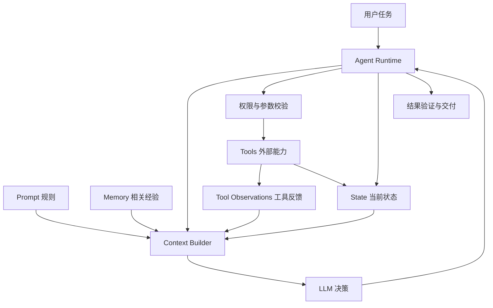

特别注意 Context、Memory、State 的边界：Context 是<strong>本次调用可见的信息集合</strong>；Memory 是<strong>可跨任务复用的信息机制</strong>；State 是<strong>任务执行事实及控制条件</strong>。三者可能存于同一数据库，却不能在概念上合并。

### 4.3 一次工具失败之后发生什么

失败也是 Observation。参数错误可能需要修改参数，服务暂时不可用可能适合有限重试，权限拒绝通常应直接停止相关操作。对有副作用的工具，重试前必须考虑 Idempotency（幂等性：重复执行不产生重复业务副作用）。

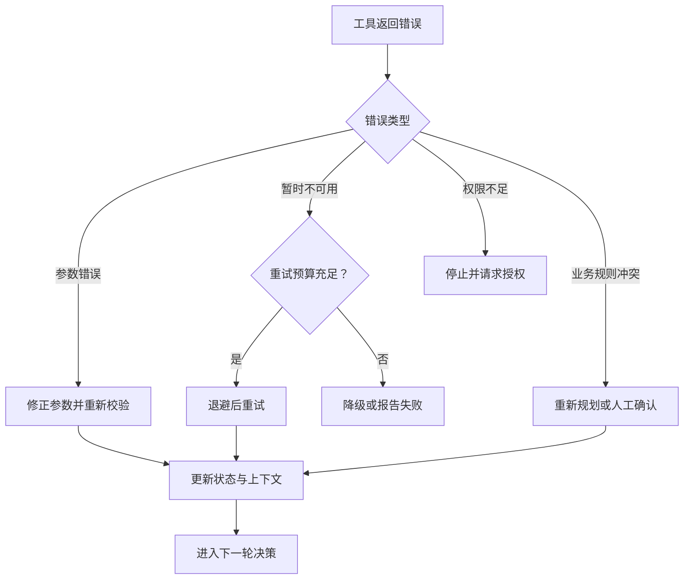

## 5. ReAct 的关键工程机制

### 5.1 终止条件：循环必须能够结束

ReAct 循环应当同时具备成功终止与保护性终止。成功终止要求结果通过必要的业务验证；保护性终止可以由最大步数、超时、Token 预算、工具调用次数、重复动作检测或人工审批要求触发。

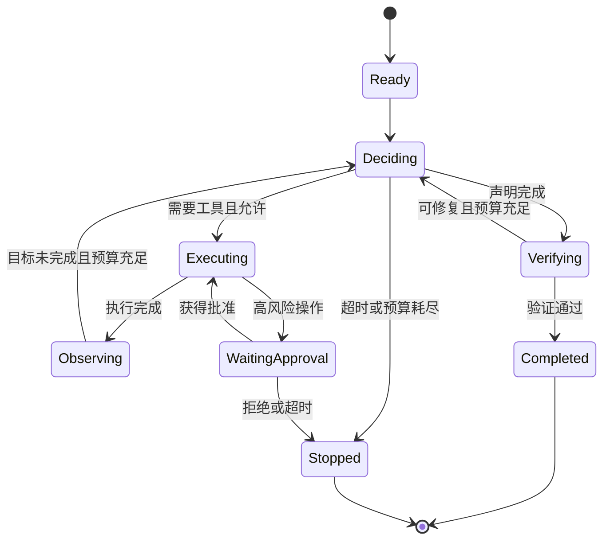

<strong>防止死循环</strong>不仅是设置 `max_steps`，还要识别“同一个工具、相同参数、相同错误反复出现”的无进展循环。出现持续无进展时，应改变策略或停止。

### 5.2 观察结果的可信度与上下文预算

工具返回的数据可能冗长、错误或包含 Prompt Injection（提示注入：试图通过低信任数据影响模型指令遵循的攻击）。因此，工具结果进入 Context 前应经过长度控制、字段筛选、来源标记和必要的内容安全检查。

Context Engineering（上下文工程）的作用不是“尽可能塞入更多内容”，而是保证模型在有限上下文窗口中看到<strong>足够、相关、可信且可追溯</strong>的信息。

### 5.3 状态持久化与副作用一致性

Checkpoint（检查点）用于保存可恢复执行位置；但检查点无法自动证明外部工具没有重复执行。例如 Agent 已成功导出文件，状态保存前却发生崩溃。恢复时应先核验已有产物，再决定是否重试。必要时使用幂等键、事务、版本号和补偿机制。

### 5.4 质量、延迟与成本的平衡

每增加一次模型决策或工具调用，通常会增加耗时与费用，但不一定提升正确率。可将执行预算理解为一个工程约束，而非追求“尽可能多思考”。

$$
C_{\mathrm{total}} = \sum_{i=1}^{N_{\mathrm{llm}}} C_{\mathrm{llm},i} + \sum_{j=1}^{N_{\mathrm{tool}}} C_{\mathrm{tool},j}
$$

其中，$N_{\mathrm{llm}}$ 为模型调用次数，$N_{\mathrm{tool}}$ 为工具调用次数；$C$ 表示相应的计费或资源成本。此式是用于理解成本组成的简化模型，不是所有供应商的统一计费公式。

工程评估还应关注 Task Success Rate（任务成功率）、Tool Call Accuracy（工具调用正确率）、Recovery Rate（恢复成功率）、Latency（延迟）、Cost（成本）以及 Unsafe Action Rate（不安全操作率）。单独提高工具调用次数不代表 Agent 更智能。

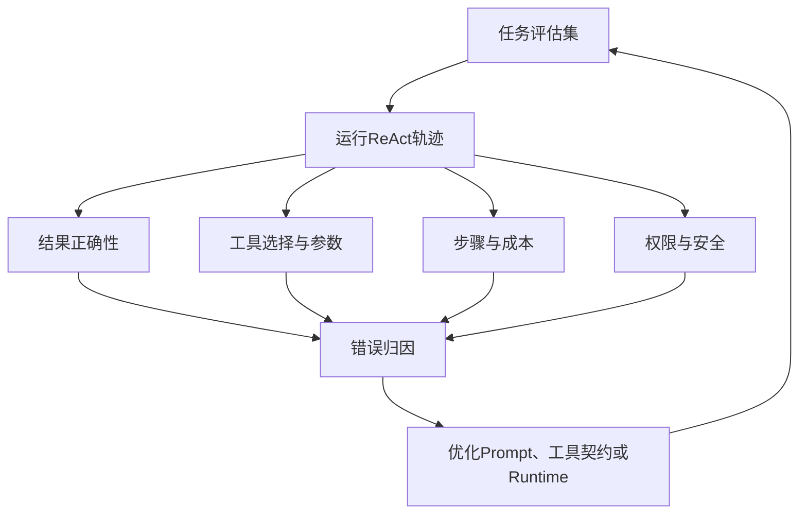

## 6. 模式选择：什么时候用 ReAct，什么时候不用？

ReAct 的优势来自动态适应，但这种自由度也会带来不可预测的步骤数和执行路径。对于完全确定、需要严格审计的业务操作，优先采用 Workflow；对于信息缺口不确定、反馈会改变后续策略的任务，ReAct 更有价值。

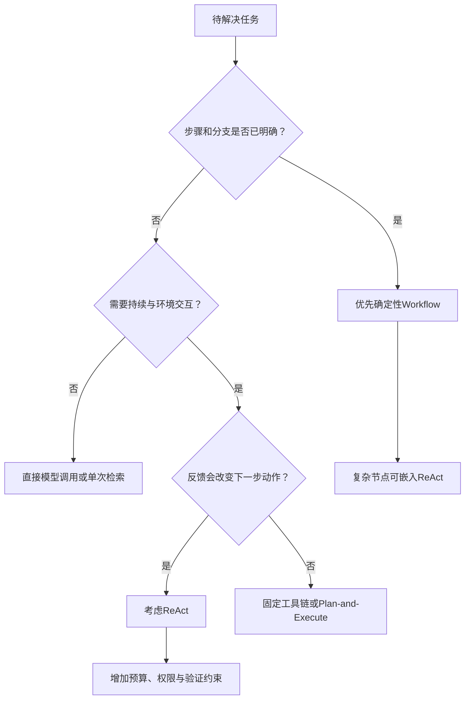

| 场景 | 推荐组织方式 | 原因 |
|---|---|---|
| 固定顺序解析、翻译、导出 | Workflow | 路径清晰，容易验证和恢复 |
| 术语不确定，需要多轮查询 | ReAct 或受限检索循环 | 新证据决定后续查询 |
| 大型研究任务，需要拆解子目标 | Planning + ReAct | 先有全局结构，再局部动态探索 |
| 翻译结果反复质量不达标 | Workflow + 局部 ReAct | 固定质量门控，动态选择修复手段 |
| 简单格式转换 | 确定性工具 | 不需要多轮模型决策 |

这也为第四章后续内容建立了联系：Planning 关注任务分解与长期计划；Workflow 关注预设控制流；Reflection and Verification（反思与验证）关注对执行结果的审查与改进；Pattern Selection（模式选择）则综合比较它们的适用边界。

## 7. 企业案例：医疗设备文档翻译中的 ReAct 异常修复

### 7.1 为什么不建议整个翻译流程都采用自由循环

医疗设备技术文档通常有固定处理阶段：解析、分段、术语检索、翻译、版式恢复、质量检查、导出。若所有步骤都由模型自由选择，容易出现漏步骤、重复导出、术语不一致或难以复现的问题。因此主干应采用确定性 Workflow，将 ReAct 用于<strong>原因不确定、需要根据新反馈调整方案</strong>的局部环节。

### 7.2 具体任务：译文图片文字溢出

假设翻译后某个图中的文字超出边框。质量检查工具给出“文本溢出”观察，但原因可能是译文过长、文本框太窄或 OCR（Optical Character Recognition，光学字符识别）区域划分错误。此时 ReAct 的价值是动态定位原因，而不是机械地反复缩小字体。

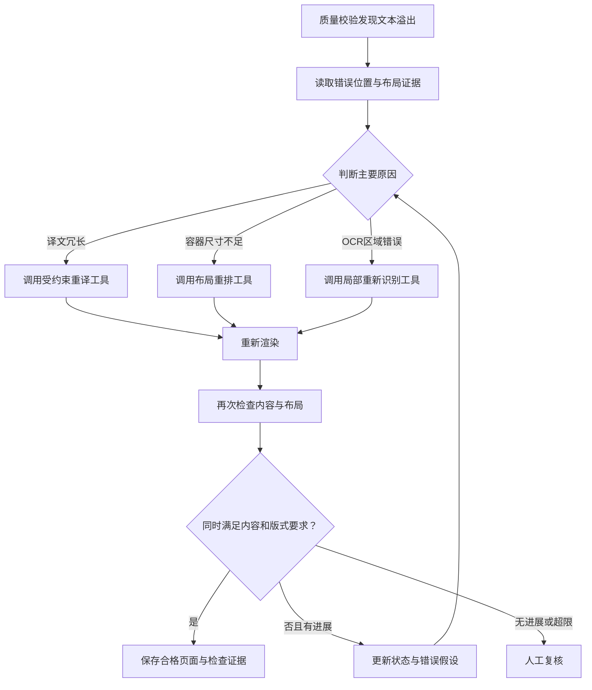

这里的“成功”必须同时满足两个目标：视觉布局合格，以及译文没有因为压缩而丢失关键语义、型号、数值或单位。否则就会出现“图片变美观了，但技术内容被改错了”的伪成功。

### 7.3 各组件在案例中的职责

| 组件 | 具体信息或动作 | 为什么不可替代 |
|---|---|---|
| Prompt | 不得修改型号、数字、单位；限制修复次数 | 定义行为与质量边界 |
| Context | 当前图像、原文、译文、检测框和最近修复结果 | 为本轮判断提供证据 |
| Memory | 经审核的术语偏好与类似故障经验 | 提供可复用经验，但不能覆盖正式术语库 |
| Tools | OCR、重译、布局调整、渲染、质量检查 | 执行真实动作 |
| State | 页面状态、尝试次数、产物路径、错误类别 | 支持审计、恢复与防重复 |
| Runtime | 调度工具、验证权限、终止无进展循环 | 防止自由循环失控 |

### 7.4 一次完整的可解释执行轨迹

| 轮次 | 观察到的事实 | 下一步动作 | 状态变化 |
|---|---|---|---|
| 初始 | 标签超出右侧边框 | 检查文本长度与框尺寸 | 标记 `layout_overflow` |
| 第 1 轮 | 译文长度显著增加，框宽固定 | 在语义约束下尝试重译 | 记录候选译文版本 |
| 第 2 轮 | 内容检查通过，仍有轻微溢出 | 调整换行和文本框布局 | 记录布局版本 |
| 第 3 轮 | 内容与布局检查均通过 | 保存结果并结束 | 标记 `completed` |

这是示意性的工程轨迹，不代表实际运行结果。其价值在于每一步都有可观察的依据、受控动作和明确状态变化。

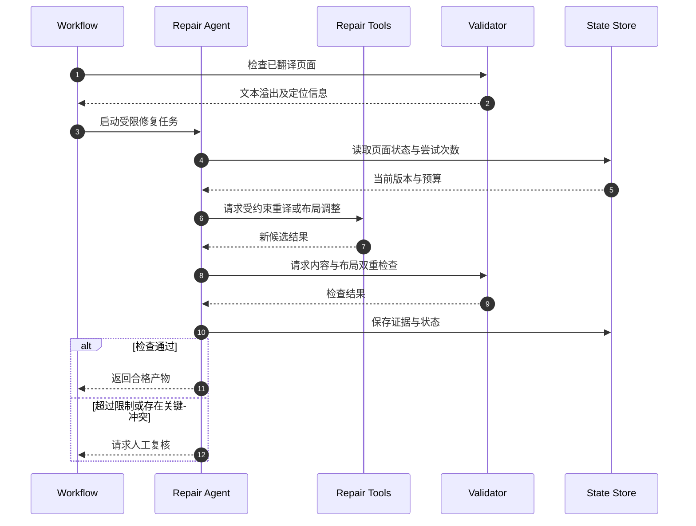

## 8. 常见误区与工程判断

| 常见说法 | 为什么不准确 | 更合理的理解 |
|---|---|---|
| “调用了工具就是 ReAct” | 单次固定工具调用不一定形成反馈闭环 | 关键是观察结果影响下一轮行动 |
| “ReAct 必须公开完整 Thought” | 公开内部推理不是工作模式的必要条件 | 可以使用结构化动作与简洁决策摘要 |
| “循环越多，结果越准确” | 无进展循环会放大成本和错误 | 需要进展检测、预算和终止条件 |
| “工具返回的内容一定可信” | 外部数据可能错误或被恶意操纵 | 要做来源、权限和内容校验 |
| “工具成功就代表任务成功” | 工具结果可能不满足业务目标 | 必须独立验证最终结果 |
| “ReAct 可以替代 Workflow” | 动态探索与确定性流程各有适用场景 | 常见最优解是固定主干与局部动态修复 |
| “保存聊天历史即可断点恢复” | 历史不保证外部副作用一致性 | 还需要 State、Checkpoint 和幂等机制 |

## 9. 面试问答：从原理走向工程设计

**Q1：ReAct 的本质是什么？**  
ReAct 是推理与行动交替的执行模式。模型根据当前信息选择动作，外部环境返回观察结果，模型再据此调整后续决策；它的核心是反馈闭环，而不是某种固定的提示词格式。

**Q2：ReAct 和 Function Calling 有什么区别？**  
Function Calling 主要描述模型如何生成结构化工具调用请求；ReAct 描述为何以及何时反复进行“决策—执行—观察”。前者可以作为后者的实现机制。

**Q3：ReAct 与 Planning 是否冲突？**  
不冲突。Planning 负责目标分解和全局依赖，ReAct 可以负责计划中某个子任务的动态执行；观察到新证据后也可以触发重新规划。

**Q4：如何避免 ReAct 无限循环？**  
同时设置步数、耗时、费用、工具次数限制，识别重复动作和无进展轨迹，并使用独立的完成标准和人工介入机制。

**Q5：工具执行失败后如何处理？**  
先分类错误，再选择参数修复、有限重试、降级、人工审批或终止；对有副作用的工具应验证幂等性，不能盲目重试。

**Q6：如何证明一个 ReAct Agent 真正有效？**  
用覆盖正常、异常和对抗性场景的评估集，联合测量任务成功率、工具调用准确率、成本、延迟、安全性与恢复能力，并分析执行轨迹中的失败原因。

**Q7：企业文档翻译系统为什么适合局部 ReAct？**  
解析、翻译、校验、导出有固定顺序；但面对版式异常、OCR 误识别、术语冲突时，修复路径依赖新反馈。固定 Workflow 保证主流程稳定，ReAct 提供局部适应性。

## 10. 术语速查与知识关联

| 术语 | 英文全称 | 本篇含义 |
|---|---|---|
| ReAct | Reasoning and Acting | 推理与行动交替的工作范式 |
| LLM | Large Language Model | 大语言模型，负责生成决策与响应 |
| CoT | Chain-of-Thought | 思维链，分步推理方法 |
| Runtime | Agent Runtime | Agent 运行时，负责调度、执行和控制 |
| Tool Calling | Tool Calling | 模型请求使用外部工具的机制 |
| Function Calling | Function Calling | 结构化函数调用机制 |
| Observation | Observation | 行动后得到的环境反馈 |
| State | State | 任务进度、执行结果和控制信息 |
| Context | Context | 本次模型调用可见的信息 |
| Memory | Memory | 跨步骤或跨会话保留并复用信息的机制 |
| Checkpoint | Checkpoint | 可用于执行恢复的检查点 |
| Idempotency | Idempotency | 幂等性，避免重复调用造成重复副作用 |
| OCR | Optical Character Recognition | 光学字符识别 |
| Prompt Injection | Prompt Injection | 提示注入，通过低信任内容干扰指令遵循 |
| GFM | GitHub Flavored Markdown | GitHub 风格 Markdown |

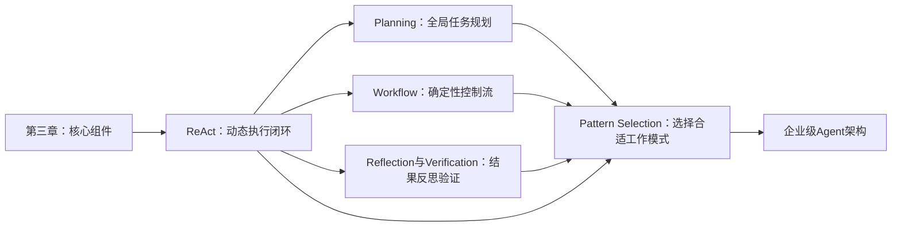

学习顺序建议为：先掌握 ReAct 的动态反馈，再学习 Planning 如何约束长程目标、Workflow 如何保证确定性、Reflection 如何评估与修复，最后在 Pattern Selection 中进行综合选型。

## 11. 权威参考资料与延伸阅读

1. Yao, S. 等，*ReAct: Synergizing Reasoning and Acting in Language Models*，ICLR 2023。论文：https://arxiv.org/abs/2210.03629
2. ReAct 官方研究项目：https://react-lm.github.io/
3. ReAct 作者代码仓库：https://github.com/ysymyth/ReAct
4. Google Research，*ReAct: Synergizing Reasoning and Acting in Language Models*：https://research.google/blog/react-synergizing-reasoning-and-acting-in-language-models/
5. Anthropic，*Building Effective Agents*：https://www.anthropic.com/engineering/building-effective-agents
6. Anthropic，*Demystifying Evals for AI Agents*：https://www.anthropic.com/engineering/demystifying-evals-for-ai-agents
7. LangChain Agents 官方文档：https://docs.langchain.com/oss/python/langchain/agents

> 阅读提示：原始论文提供 ReAct 的理论与实验背景；后续官方工程文档用于理解现代工具调用、运行时治理和评估实践。不要将后续工程设计全部归因于原始论文。

---

## 12. 一页总结：ReAct 的知识主线

<strong>起点：</strong>仅靠模型推理缺乏实时外部证据，固定动作序列又难以应对环境变化。  
<strong>机制：</strong>Reasoning 选择 Action，Action 产生 Observation，Observation 修正下一轮 Reasoning。  
<strong>基础：</strong>Prompt、Context、Memory、Tools、State 由 Runtime 协调。  
<strong>工程化：</strong>权限校验、预算限制、状态持久化、错误恢复、质量验证和人工介入保证循环可控。  
<strong>适用边界：</strong>动态探索和不确定异常适合 ReAct；稳定业务主干通常更适合 Workflow。  
<strong>实践原则：</strong>优先使用最简单、可验证的方案，只在外部反馈确实会改变下一步决策时引入 ReAct。
