# 02｜Agent Planning：任务分解、规划与动态重规划

> 所属章节：`04-Agent-Working-Patterns/02-Planning.md`  
> 前置知识：[01｜ReAct](./01-ReAct.md)、[Agent 核心组件](../03-Agent-Core-Components/README.md)  
> 学习主线：<strong>目标与约束 → 任务表示 → 分解与依赖 → 计划生成 → 校验与调度 → 执行与验证 → 状态更新 → 重规划 → 交付</strong>。

## 0. 全景导读：Planning 为什么重要

ReAct（Reasoning and Acting，推理与行动）擅长根据最新观察选择下一步行动；但对于长任务，局部决策可能忽略整体依赖、预算和完成条件。<strong>Planning（规划）</strong>将目标转化为可执行、可检查、可调整的任务结构，让系统知道“做什么、先做什么、何时能做、何时算完成”。它不只是生成自然语言待办清单，而是把目标、动作、依赖、约束和反馈连接起来。

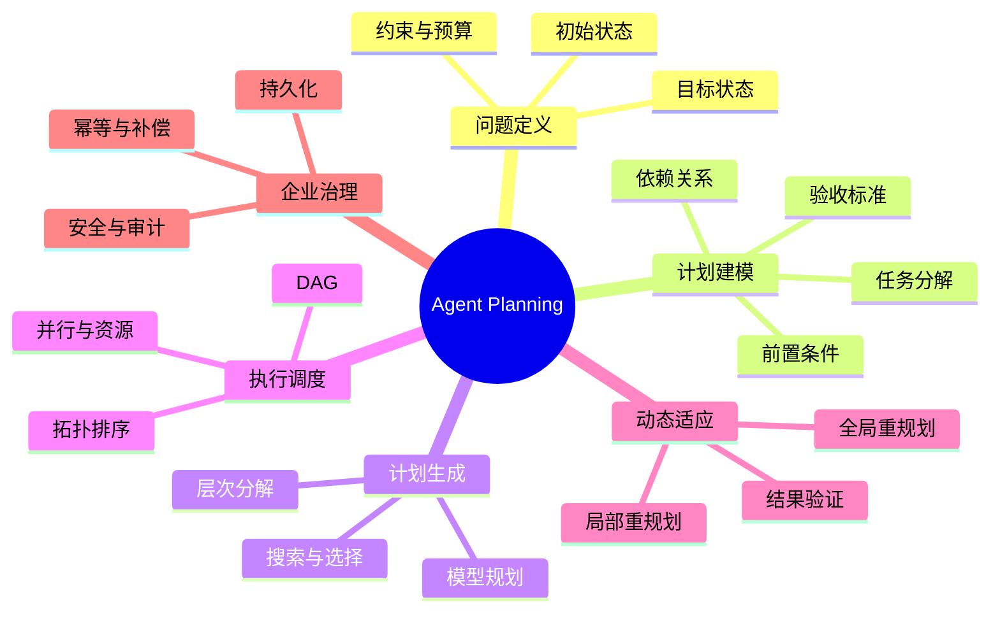

<strong>读图：</strong>Planning 是连接目标和执行的中间层。计划生成解决“如何组织行动”，调度解决“何时运行”，验证与重规划解决“现实不符合预期怎么办”。

## 1. 概念边界：Planning 与 ReAct、Workflow、Reflection

| 概念 | 首要问题 | 典型产物 | 与 Planning 的关系 |
|---|---|---|---|
| ReAct | 观察之后下一步做什么 | 下一行动或工具请求 | 可作为子任务执行器 |
| Task Decomposition（任务分解） | 目标拆成哪些子任务 | 任务树或任务列表 | 规划的基础，但不等于完整规划 |
| Planning | 怎样在约束下达成目标 | 计划、依赖、验收条件 | 统筹全局与局部 |
| Scheduling（调度） | 哪些任务现在可以执行 | 可运行任务集合 | 执行计划中的依赖和资源规则 |
| Workflow（工作流） | 预定义流程如何推进 | 固定或条件分支流程 | 可承载计划，也可约束规划范围 |
| Reflection（反思） | 结果为什么不理想 | 诊断与改进建议 | 为验证和重规划提供证据 |
| Replanning（重规划） | 旧计划不适用时怎么办 | 新版本计划 | 根据环境反馈修改未来动作 |

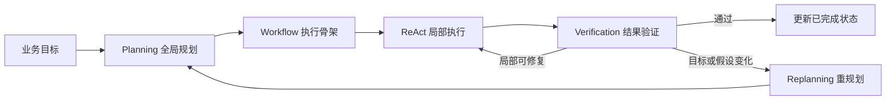

<strong>边界：</strong>重试通常重新执行原动作；重规划可能改变任务依赖、工具选择和执行路径。规划并不要求多 Agent，单 Agent 加工具同样可以实现。

## 2. 规划问题的基础：从经典 AI 到 LLM

### 2.1 状态、动作、目标与约束

经典 AI Planning（人工智能规划）把任务描述为初始状态、目标条件、可用动作及其前置条件与效果。STRIPS（Stanford Research Institute Problem Solver）是经典动作表示思想；PDDL（Planning Domain Definition Language，规划领域定义语言）用于描述规划领域和问题。LLM（Large Language Model，大语言模型）可以从自然语言提出候选计划，却不能天然保证动作的合法性和执行效果，因此仍需程序校验。

| 元素 | 含义 | 文档翻译示例 |
|---|---|---|
| Initial State（初始状态） | 当前已成立的事实 | 已上传 PDF，尚未解析 |
| Goal（目标） | 必须满足的最终条件 | 所有必要页面译文合格并导出 |
| Action（动作） | 可执行的操作 | OCR、翻译、渲染、校验 |
| Precondition（前置条件） | 动作开始前的条件 | 翻译前必须存在可用原文 |
| Effect（效果） | 动作完成后可能改变的状态 | 产生译文草稿与产物引用 |
| Constraint（约束） | 不得违反的规则 | 型号不变、权限有效、预算限制 |

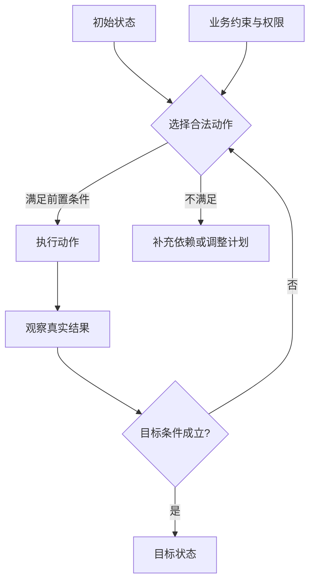

<strong>读图：</strong>模型提出的动作只是候选；动作是否允许执行，应由可验证的前置条件、权限和资源约束决定。

### 2.2 规划质量的多个维度

规划不只有“找到一条路径”。还要考虑可行性、覆盖率、总成本、时延、风险、资源占用和可恢复性。硬约束（例如不得修改医疗器械型号）不能通过“提高其他维度得分”来抵消；软目标（例如速度、成本）才适合权衡优化。

## 3. 任务分解：从目标树到可执行任务

### 3.1 层次任务网络与分解粒度

HTN（Hierarchical Task Network，层次任务网络）把高层任务递归拆成更具体的子任务，直到能够交给工具或执行器。LLM 可以辅助选择分解方法，但领域规则决定哪些步骤必不可少。分解过粗，难以恢复和验证；分解过细，调度与上下文开销过高。

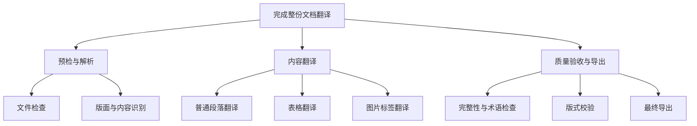

<strong>读图：</strong>这是任务分解树，不等于执行依赖图。树表达“属于哪个父目标”，依赖图才表达“必须先完成什么”。

### 3.2 可执行任务契约

| 字段 | 作用 | 设计要点 |
|---|---|---|
| `task_id` | 唯一标识 | 重规划后仍能追踪历史 |
| `goal` | 明确子目标 | 不能仅写模糊动作名称 |
| `depends_on` | 上游依赖 | 必须无环、引用存在 |
| `inputs` / `outputs` | 输入输出契约 | 标注数据类型与产物位置 |
| `preconditions` | 执行前检查 | 权限、资源、上游验收 |
| `acceptance_criteria` | 完成标准 | 可验证、可复核 |
| `status` | 当前执行状态 | 与 State Manager 一致 |
| `executor` | 执行主体 | 工具或专用 Agent |
| `retry_policy` | 失败策略 | 幂等性、次数、退避 |

一个计划的“完成”不能由自然语言声明决定，而应由任务输出与验收条件共同证明。

## 4. 计划生成：从提示方法到搜索与选择

### 4.1 Plan-and-Solve 与 Plan-and-Execute

Plan-and-Solve Prompting（先规划后求解提示）通过先生成解题步骤再求解，改善多步推理的遗漏问题；Plan-and-Execute（规划—执行架构）则将规划器与工具执行器分离，是更完整的运行时组织方式。两者思想相通，但不等价。

### 4.2 候选计划、搜索与层次规划

| 方法 | 核心思想 | 适用情形 | 注意事项 |
|---|---|---|---|
| HTN | 利用领域分解规则 | 稳定、可复用的业务流程 | 领域知识维护成本 |
| Plan-and-Solve | 先形成步骤再求解 | 多步语言推理 | 不保证工具执行正确 |
| ToT（Tree of Thoughts，思维树） | 探索多条推理分支并评估 | 需要搜索和回溯的推理 | 调用成本较高 |
| GoT（Graph of Thoughts，思维图） | 复用、合并与反馈推理中间结果 | 非线性推理结构 | 不等于任务执行 DAG |
| A*（A-star，启发式搜索） | 按路径代价与启发估计搜索 | 有明确状态和代价模型 | 启发函数设计关键 |
| Candidate Selection（候选计划选择） | 生成多个方案并评分 | 成本、质量、风险权衡 | 硬约束必须先验证 |

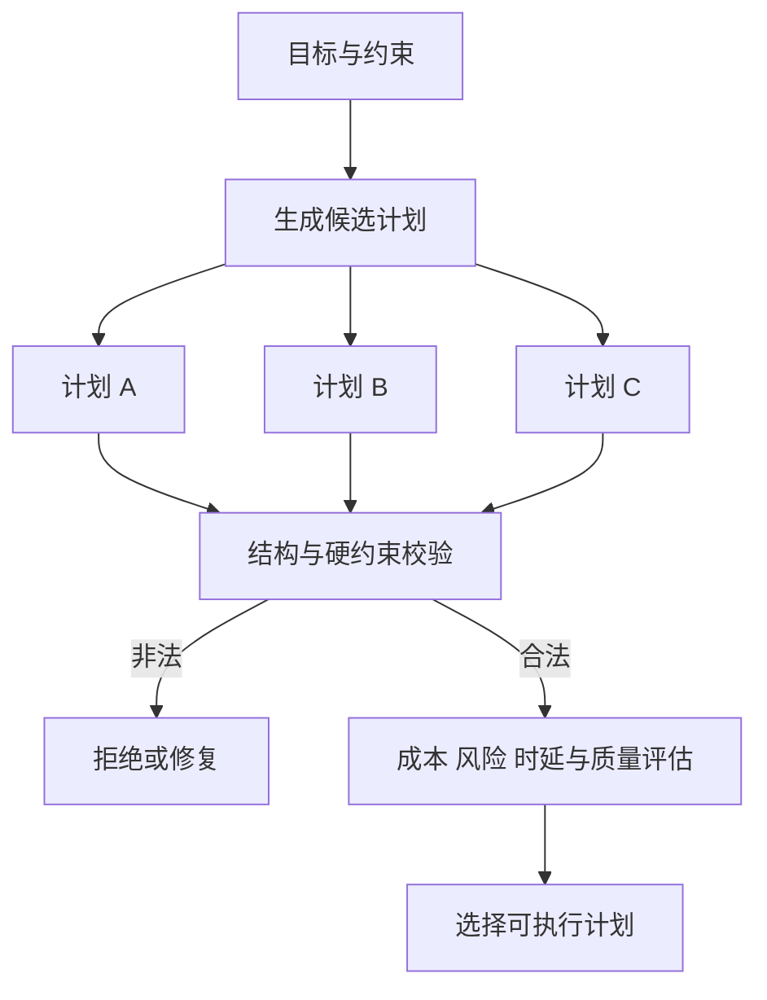

<strong>读图：</strong>先过滤不合法计划，再在合法集合中做成本与效果权衡。不能用高模型评分掩盖工具不存在、依赖错误等硬性问题。

## 5. 依赖分析：任务树、DAG 与并行调度

DAG（Directed Acyclic Graph，有向无环图）用于表示任务之间的先后依赖。Topological Sort（拓扑排序）求得合法执行次序；Critical Path（关键路径）是决定理论最短完成时间的最长依赖路径；Parallel Scheduling（并行调度）在依赖满足且资源不冲突时并行执行任务。

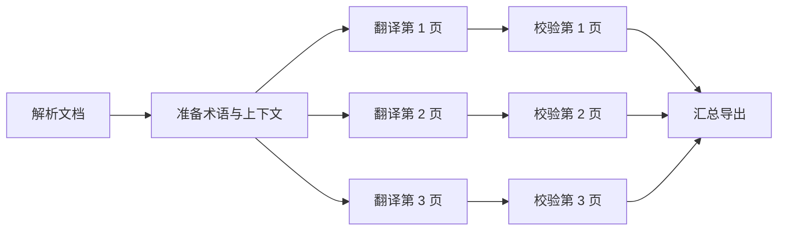

<strong>读图：</strong>页面翻译之间不存在数据依赖时可并行，但并行还受模型并发限制、共享文件写入、术语一致性和资源预算约束。

### 5.1 理论时延与关键路径

设每个任务执行耗时为 $t_i$，在不考虑额外开销和资源竞争时，串行执行时间为：

$$
T_{\mathrm{serial}} = \sum_{i=1}^{n} t_i
$$

理想情况下，满足依赖约束的并行执行时间至少为关键路径长度：

$$
T_{\mathrm{parallel}} \geq \max_{p\in\mathcal{P}}\sum_{i\in p} t_i
$$

其中 $\mathcal{P}$ 是所有依赖路径的集合。实际还要增加排队、通信、限流和合并开销，因此“无依赖”不等于“无条件并行”。

### 5.2 ReWOO 与 LLMCompiler

ReWOO（Reasoning WithOut Observation，不逐步等待观察的推理架构）允许在计划中引用前序工具结果，减少每个工具调用前都重新咨询大型规划模型的需求。LLMCompiler 进一步使用任务依赖图和调度单元，使可并行的工具调用提前运行。二者的共同前提是：<strong>依赖与结果引用必须可靠解析</strong>。

## 6. Plan-and-Execute：完整运行闭环

| 运行角色 | 核心职责 | 失败风险 |
|---|---|---|
| Planner（规划器） | 根据目标和约束生成计划 | 遗漏步骤、虚构工具 |
| Plan Validator（计划校验器） | 检查 Schema、依赖、权限 | 未发现隐含资源冲突 |
| Scheduler（调度器） | 选取 Ready Tasks（可执行任务） | 饥饿、限流、竞争 |
| Executor（执行器） | 调用工具或执行子 Agent | 超时、外部副作用 |
| Verifier（验证器） | 核验产物与完成标准 | 误判成功 |
| State Manager（状态管理器） | 记录版本、结果和检查点 | 并发更新丢失 |
| Replanner（重规划器） | 修改未完成部分 | 重复执行、目标漂移 |

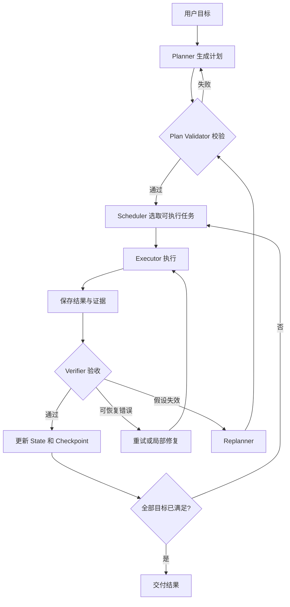

<strong>读图：</strong>执行结果先经过验证，再标记完成。重试、修复与重规划是不同分支；运行时负责保证循环终止、预算约束和安全控制。

### 6.1 规划与执行的时序

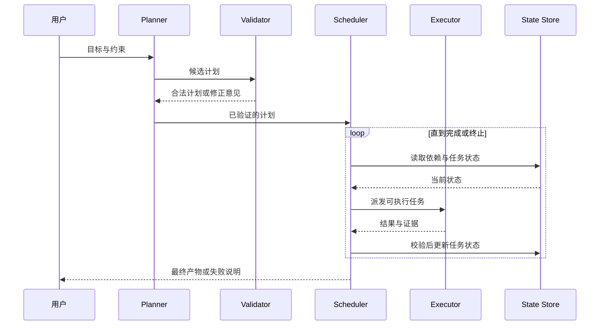

## 7. Replanning：反馈驱动的计划修正

<strong>Replanning（重规划）</strong>是因新信息使现有计划不可行、不再最优或无法满足目标，而调整未来任务结构的过程。典型触发包括输入类型变化、工具不可用、预算不足、质量不合格、用户增加约束、目标提前满足。

| 情况 | 优先策略 | 原因 |
|---|---|---|
| 临时网络超时 | 安全重试 | 目标和依赖未改变 |
| 页面被识别为扫描件 | 局部重规划 | 新增 OCR 前置步骤 |
| 用户改变目标语言 | 全局影响分析 | 多个下游产物可能失效 |
| 文字溢出 | 局部修复 | 不应重做已验收页面 |
| 导出已完成但状态未更新 | 产物核验后恢复 | 避免重复副作用 |

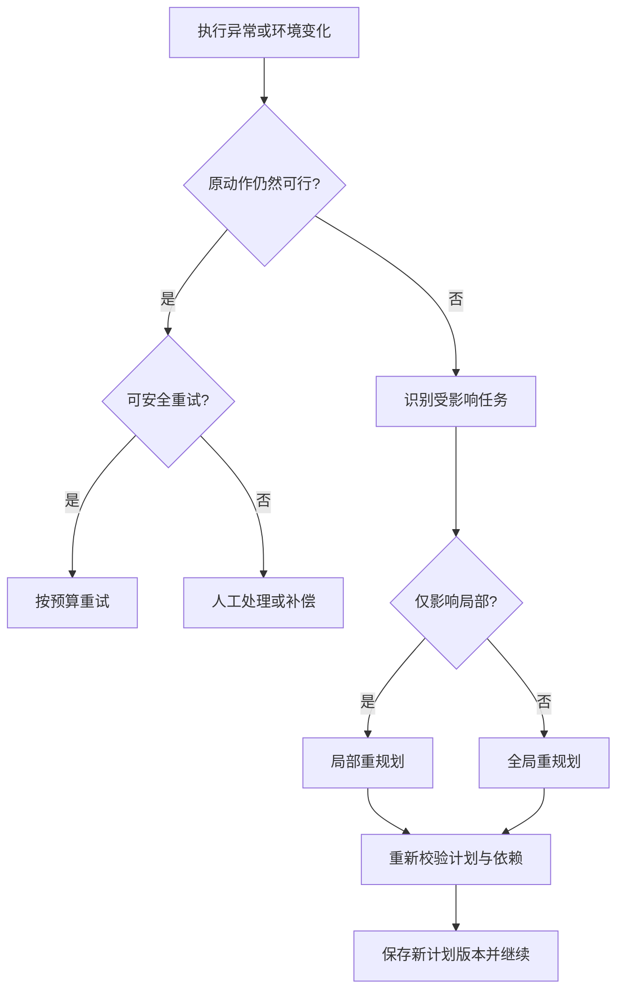

<strong>读图：</strong>重规划前先判断是不是普通可重试故障，再决定修改局部还是整体计划。已验收的结果应尽可能复用。

### 7.1 计划版本与变更传播

计划应保存 `plan_id`、`plan_version`、步骤 ID、步骤状态、产物引用、变更原因和前后依赖。若上游输出发生变化，需要通过依赖关系识别下游哪些结果必须重新验证；但不应无条件清空所有历史。变更传播和结果复用需要结合内容哈希、版本号和业务规则。

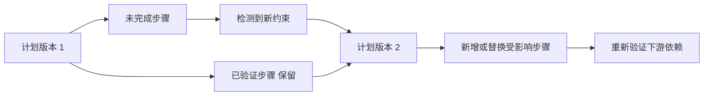

## 8. 与第三章核心组件的协作

Planning 不取代 Prompt、Context、Memory、Tools 或 State，而是定义它们在多步骤任务中的协作方式。

| 组件 | 在规划中的作用 | 关键边界 |
|---|---|---|
| Prompt / Instructions | 规定规划目标、规则、工具使用约束 | 不能替代权限控制 |
| Context | 组织当前目标、约束、进度和观察 | 不应无限堆积全部历史 |
| Memory | 复用成功策略、术语偏好等 | 历史经验需检查时效与适用性 |
| Tools | 实际执行动作 | 需要参数校验、超时和副作用治理 |
| State | 保存任务进度、计划版本和产物 | 不等于聊天历史 |
| Runtime | 调度、验证、恢复、终止 | 不应完全依赖模型自然语言决定 |

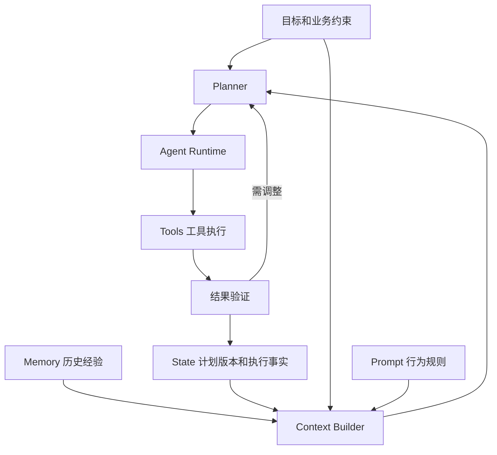

<strong>读图：</strong>Context 是模型当前可见信息，State 是执行事实，Memory 是可复用经验。Planner 需要它们，但不应混为同一数据对象。

## 9. 企业级可靠性与工程取舍

### 9.1 硬约束、权限与计划幻觉

模型可能规划出不存在的工具、错误的参数或未授权的操作。Tool Registry（工具注册表）定义实际能力；Schema（结构约束）校验输入输出；授权层独立检查权限；Plan Validator 检查任务依赖和禁止操作。文档内容和工具返回属于低信任数据，不应提升为系统级指令。

### 9.2 持久化、幂等与恢复

Checkpoint（检查点）记录恢复所需状态；Idempotency（幂等性）确保重复请求不会产生不应重复的效果；Compensation（补偿）处理不能直接回滚的外部副作用。数据库状态已写入，不代表文件实际生成；文件实际生成，也不代表数据库状态已经成功提交。恢复时必须双向核验。

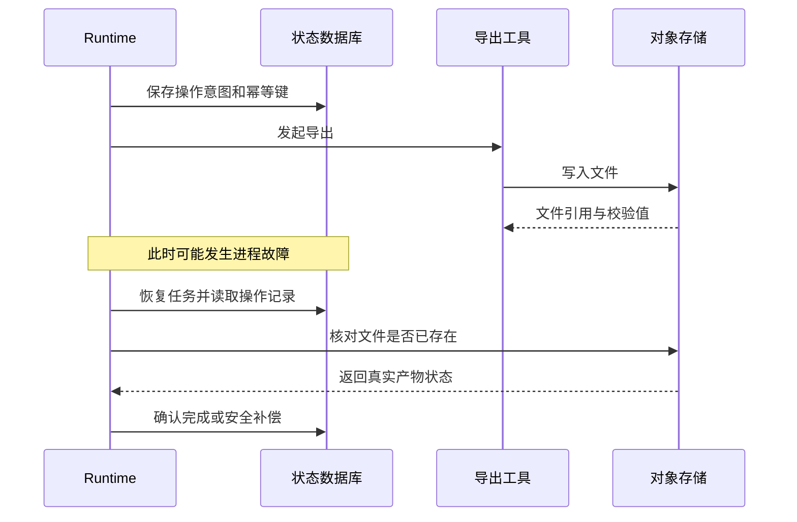

### 9.3 并发与成本

任务无依赖并不代表能无限并行：共享文件、数据库行、模型配额、上下文预算都可能构成资源约束。可以用 Semaphore（信号量）限制并发，使用乐观锁或版本检查保护状态更新，使用指数退避处理短暂限流。规划器和执行器可采用不同能力或成本的模型，但必须实测任务质量。

### 9.4 可观测性与评估

Tracing（链路追踪）关联计划版本、任务 ID、工具调用、延迟、Token 消耗和异常；Audit Log（审计日志）记录关键授权和操作事实，两者不应混为一谈。核心指标包括端到端成功率、计划合法率、依赖错误率、重规划成功率、重复副作用次数、关键路径时延与单位任务成本。

## 10. 企业案例：100 页医疗设备文档翻译 Agent

### 10.1 全局规划与局部规划

全局计划定义预检、解析、翻译、校验和导出阶段；局部计划根据页面结构选择不同路径。普通文字页可直接翻译，扫描页需要 OCR（Optical Character Recognition，光学字符识别），复杂表格需要结构保护和布局校验。<strong>确定性 Workflow 作为主干、Planning 处理动态分支</strong>，通常比所有步骤都交给自由决策更容易保证质量。

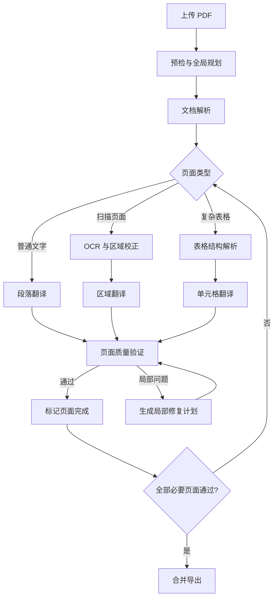

<strong>读图：</strong>图中的循环表达按页面处理的逻辑，而不是让同一页面无条件重复执行；生产实现应使用页面级任务状态与有限重试预算。

### 10.2 第 35 页布局故障的重规划

假设第 35 页翻译成功但两个标签重叠。系统先保存质量证据，再判断是译文过长、区域检测错误还是布局约束不足。若译文过长，可尝试不改变型号和数值的等义精简；若区域错误，重新解析；若布局约束不足，调整文本框或字号范围。每次修复后都要重新检查内容与版式，达到预算上限则人工介入。

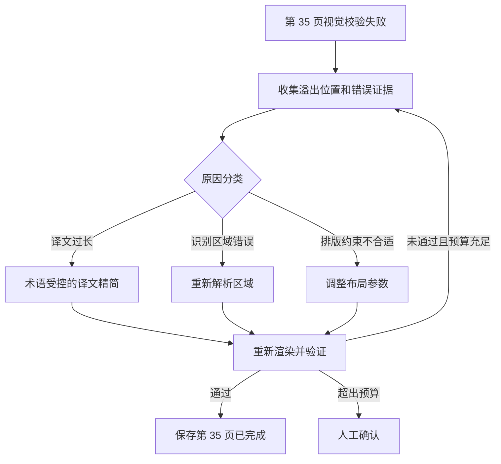

<strong>工程要点：</strong>保留其他已验收页面的产物；记录第 35 页的计划版本、修复次数、错误证据和产物哈希；恢复后先核对产物，再决定是否重试。

## 11. 模式选择与性能权衡

| 任务特征 | 优先考虑 | 原因 |
|---|---|---|
| 单步、工具少 | 直接调用或简单 ReAct | 规划开销可能得不偿失 |
| 多步骤且依赖稳定 | Workflow | 更可预测、易测试 |
| 复杂目标但子任务可分解 | Plan-and-Execute | 减少局部决策偏离目标 |
| 大量独立工具调用 | DAG + 并行调度 | 降低关键路径时延 |
| 环境经常变化 | Planning + Replanning | 适应新约束和失败反馈 |
| 高风险操作 | 固定审批节点 + 受控规划 | 不能把授权交给模型自行决定 |

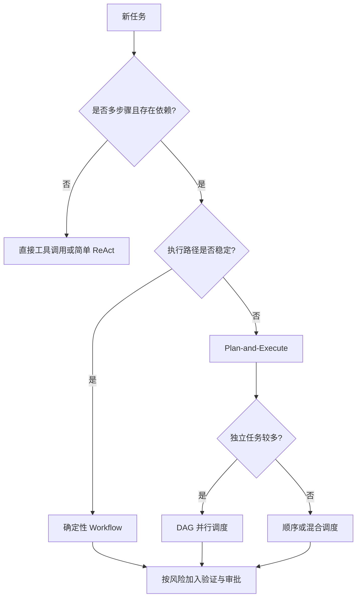

<strong>读图：</strong>这是工程选型启发式，不是唯一正确的决策算法。优先使用满足需求的最简单架构，再以真实指标决定是否增加规划复杂度。

## 12. 常见误区与面试问答

| 问题 | 核心回答 |
|---|---|
| Planning 是否就是让 LLM 列步骤？ | 不是；可执行规划还包括约束、依赖、状态、验收和调整机制。 |
| ReAct 与 Planning 如何协作？ | Planner 负责整体目标与依赖，ReAct 可作为单个步骤的动态执行器。 |
| 任务树与 DAG 有什么不同？ | 任务树描述层次分解，DAG 描述执行依赖；二者可以同时存在。 |
| 为什么 DAG 无依赖任务仍不能随意并行？ | 共享资源、权限、配额和外部副作用可能冲突。 |
| 重试和重规划的区别是什么？ | 重试重复原操作，重规划修改未来任务结构或执行路径。 |
| 如何避免重规划循环？ | 限制次数和预算、记录计划版本、检测重复方案、必要时人工升级。 |
| 如何保证已完成任务不被重复执行？ | 持久化状态、产物核验、幂等键、依赖传播与恢复策略。 |
| 为什么不能只相信 Planner 的计划？ | LLM 可能遗漏前置条件、虚构工具或违反约束，必须确定性校验。 |

## 13. 术语速查

| 缩写或术语 | 英文全称 | 中文与用途 |
|---|---|---|
| AI | Artificial Intelligence | 人工智能 |
| LLM | Large Language Model | 大语言模型，负责生成候选规划与决策 |
| Planning | Planning | 规划，将目标转为可执行任务结构 |
| HTN | Hierarchical Task Network | 层次任务网络，按领域方法分解任务 |
| STRIPS | Stanford Research Institute Problem Solver | 经典动作建模思想 |
| PDDL | Planning Domain Definition Language | 规划领域定义语言 |
| DAG | Directed Acyclic Graph | 有向无环图，表达执行依赖 |
| ToT | Tree of Thoughts | 思维树，探索多条推理路径 |
| GoT | Graph of Thoughts | 思维图，复用与组合推理中间结果 |
| ReWOO | Reasoning WithOut Observation | 使用变量引用结果的规划执行方法 |
| OCR | Optical Character Recognition | 光学字符识别 |
| Checkpoint | Checkpoint | 检查点，保存恢复所需状态 |
| Idempotency | Idempotency | 幂等性，避免重复调用产生重复效果 |
| Runtime | Runtime | 运行时，协调调度、执行、恢复与终止 |
| Critical Path | Critical Path | 关键路径，决定理论最短完成时间的依赖链 |

## 14. 权威资料与延伸阅读

### 学术论文

1. [Understanding the Planning of LLM Agents: A Survey](https://arxiv.org/abs/2402.02716)：LLM Agent 规划方法的总体分类。
2. [Plan-and-Solve Prompting](https://arxiv.org/abs/2305.04091)：先规划再求解的提示方法。
3. [Tree of Thoughts](https://arxiv.org/abs/2305.10601)：推理树搜索。
4. [Graph of Thoughts](https://arxiv.org/abs/2308.09687)：图结构推理。
5. [ReWOO](https://arxiv.org/abs/2305.18323)：变量引用与工具执行解耦。
6. [An LLM Compiler for Parallel Function Calling（ICML 2024）](https://proceedings.mlr.press/v235/kim24y.html)：任务图、并行调度与性能实验。
7. [TravelPlanner（ICML 2024）](https://proceedings.mlr.press/v235/xie24j.html)：现实约束规划基准。

### 框架与工程文档

8. [LangChain：Plan-and-Execute Agents](https://www.langchain.com/blog/planning-agents)：Plan-and-Execute、ReWOO、LLMCompiler 架构比较。
9. [LangGraph：Workflows and Agents](https://docs.langchain.com/oss/python/langgraph/workflows-agents)：状态驱动执行与工作流组织。
10. [LangGraph：Persistence](https://docs.langchain.com/oss/python/langgraph/persistence)：状态持久化与恢复。
11. [Temporal：Workflows](https://docs.temporal.io/workflows)：持久化执行和事件历史。
12. [LLMCompiler 源代码](https://github.com/SqueezeAILab/LLMCompiler)：并行工具编排参考实现。

> 论文性能数字只适用于其特定数据集和实验设置；框架 API 可能迭代，工程实践应以所用版本官方文档为准。

## 15. 本章总结：把规划视为可验证的执行承诺

<strong>知识主线：</strong>目标定义 → 状态与约束建模 → 任务分解 → 依赖分析 → 候选计划生成 → 计划校验 → 调度执行 → 产物验证 → 状态持久化 → 重试或重规划 → 交付。

<strong>核心关系：</strong>任务分解决定“做什么”，依赖分析决定“先做什么”，调度决定“何时做”，执行器负责“如何做”，验证器判断“是否做好”，重规划负责“变化后怎么办”。

<strong>最终判断：</strong>一个 Agent 能写出合理计划，不代表它具备可靠规划能力。真正可交付的 Planning 系统，必须把计划表示、执行事实、约束校验、结果验证和故障恢复统一起来。

下一篇：[03｜Workflow](./03-Workflow.md) 将进一步研究如何将确定性流程与 Agent 动态决策结合。
