# 03｜Agent Workflow：顺序、分支、循环、并行与编排

> 第四章 · Agent 工作模式｜从 ReAct 的局部决策与 Planning 的任务规划，走向可控、可恢复、可验证的流程执行。
>
> 学习目标：理解工作流的控制流、数据流、状态与事件；掌握顺序、路由、循环、并行、汇聚、编排；能够设计具有故障恢复、人工审批和质量门禁的企业级 Agent Workflow。

## 1. 为什么需要 Workflow：从智能决策走向可靠交付

[上一节：任务规划](02-Planning.md)解决“目标如何拆解、步骤如何依赖”，[ReAct](01-ReAct.md)解决“收到观察后下一步怎么行动”。但企业系统还必须回答：哪些任务可以并发？错误后从哪里恢复？人工审批怎样等待？一个页面失败是否会导致整份文档重做？这就是 <strong>Workflow（工作流）</strong> 的核心价值。

<strong>Workflow 是用显式的节点、连接、条件、状态和执行规则，组织多个处理步骤并管理其生命周期的机制。</strong> 它可以组合确定性程序、LLM（Large Language Model，大语言模型）、工具、Agent 与人工操作。Anthropic 的工程文章将 Workflow 主要描述为由预定义代码路径编排模型和工具的系统；Agent 则让模型动态控制过程。两者在生产系统中经常嵌套组合。[1]

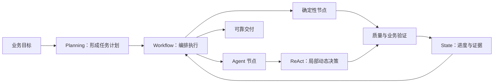

图中体现了分工：Planning 提供计划，Workflow 承载执行，ReAct 在局部处理开放性问题，State 与验证机制形成可恢复闭环。<strong>Workflow 不等于 Agent，也不等于多次 LLM 调用。</strong>

### 1.1 核心概念的边界

| 概念 | 回答的问题 | 典型产物 | 与 Workflow 的关系 |
|---|---|---|---|
| ReAct（Reasoning and Acting，推理与行动） | 当前应做什么 | 动作与观察循环 | 可以封装在 Agent 节点中 |
| Planning（规划） | 需要哪些步骤及依赖 | 任务计划 | 为 Workflow 提供目标与结构 |
| Workflow（工作流） | 怎样组织和管理执行 | 运行实例及结果 | 负责路由、调度、状态、恢复 |
| Orchestration（编排） | 谁来协调各执行单元 | 调度与协作规则 | 是 Workflow 的关键能力 |
| State Machine（状态机） | 允许哪些状态转换 | 状态与转换规则 | 约束执行生命周期 |
| DAG（Directed Acyclic Graph，有向无环图） | 任务有哪些无环依赖 | 任务依赖图 | 适合批处理，不涵盖所有循环场景 |

## 2. 工作流的基本模型：节点、边、状态、事件

工作流应首先被理解为一个运行系统，而不是一张流程图。<strong>Workflow Definition（工作流定义）</strong>描述允许的执行路径；<strong>Workflow Instance（工作流实例）</strong>是一次具体运行。Temporal 官方文档也区分定义、类型与执行实例。[5]

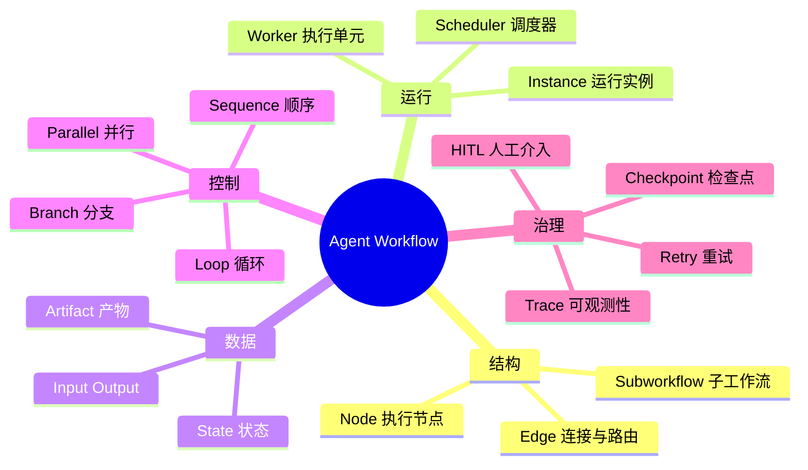

### 2.1 组成要素及契约

| 要素 | 定义 | 必须考虑的约束 |
|---|---|---|
| Node / Executor（节点／执行器） | 独立处理单元 | 输入输出 Schema、超时、幂等 |
| Edge（边） | 指定执行与数据传递关系 | 条件优先级、默认出口 |
| State（状态） | 当前执行事实与进度 | 原子更新、持久化、版本 |
| Event（事件） | 执行发生的变化 | 去重、顺序、关联标识 |
| Scheduler（调度器） | 选择可运行任务 | 依赖、优先级、并发上限 |
| Worker（工作单元） | 实际调用模型或工具 | 资源隔离、失败报告 |
| Artifact（产物） | 文件、译文、结构化结果 | 存储引用、校验和、版本 |
| Gate（门禁） | 决定是否允许后续步骤 | 验收条件、权限、质量 |

### 2.2 控制流与数据流不能混淆

<strong>Control Flow（控制流）</strong>决定下一步由哪个节点执行；<strong>Data Flow（数据流）</strong>决定节点获得哪些输入以及输出流向哪里。文件类型路由属于控制流；解析出的文本、布局、术语表传递属于数据流。

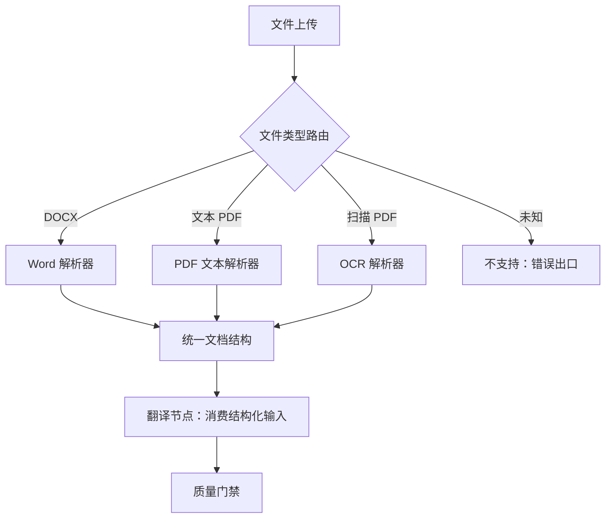

OCR（Optical Character Recognition，光学字符识别）是将图像中的字符转换为可处理文本的技术。上图中不同解析路径最终汇聚到统一的文档结构，避免翻译节点依赖各类原始格式。

### 2.3 控制平面与执行平面

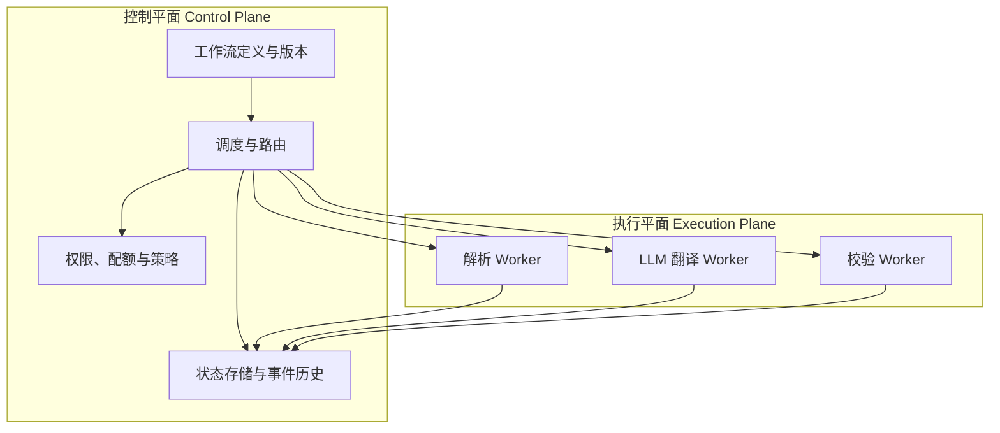

这种分离使执行资源可以独立扩缩容，但也要求任务身份、状态更新、超时与重复执行语义明确。

## 3. 顺序执行：把复杂任务拆成可验证的阶段

<strong>Sequential Workflow（顺序工作流）</strong>按确定的前后依赖执行节点。<strong>Prompt Chaining（提示链）</strong>是其中一种特例：将前一个模型调用的结果作为后一个模型调用的输入，并在中间设置质量门禁。[1]

顺序执行适用于强依赖、可明确验收的阶段。它的优势是结果追踪简单，局限是串行延迟叠加、前序错误可能向后传播。<strong>不要为了显得“Agent 化”而把简单函数强行拆成多次 LLM 调用。</strong>

质量门禁应当检查实际证据，例如解析结构是否完整、关键数值是否保留，而不是让模型仅声明“已检查”。

## 4. 条件分支：让不同输入进入合适路径

<strong>Conditional Routing（条件路由）</strong>根据规则或模型判断选择路径。常见实现包括 Rule-based Routing（规则路由）、Classifier Routing（分类器路由）、LLM Routing（大模型路由）和 Hybrid Routing（混合路由）。

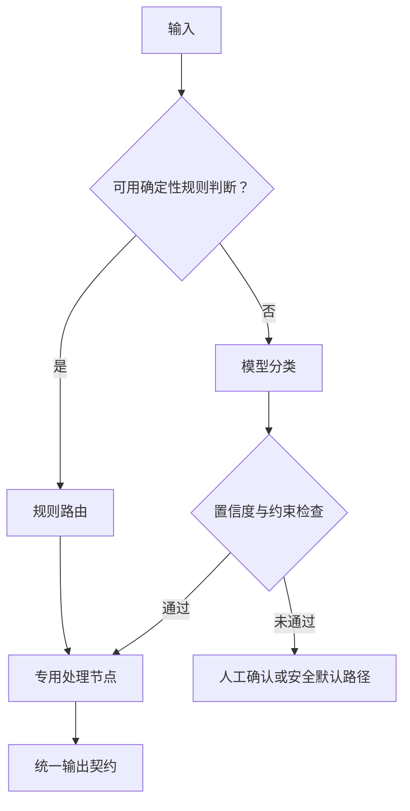

<strong>Exclusive Gateway（排他网关，XOR）</strong>通常选择一个分支；<strong>Inclusive Gateway（包容网关，OR）</strong>可选择多个分支；<strong>Event-based Gateway（事件网关）</strong>由外部事件决定后续路径。它们来自 BPMN（Business Process Model and Notation，业务流程模型与标记法）流程建模体系。[8]

| 路由方式 | 适合任务 | 代价或风险 |
|---|---|---|
| 确定性规则 | 文件扩展名、权限、状态判断 | 覆盖范围有限 |
| 小模型分类 | 大量相似文本意图 | 误分类与置信度校准 |
| LLM 语义路由 | 复杂、开放性语义 | Token 成本、非确定性 |
| 混合路由 | 企业多场景 | 需要规则与模型冲突处理 |

无论使用哪种方式，都必须定义未知输入、模型无效输出、多个分支同时满足时的处理策略。

## 5. 循环：重试、修复与 Agent 决策不是一回事

<strong>Loop Workflow（循环工作流）</strong>让某些步骤按条件重复，但必须设置退出机制。需要区分四种循环：Retry（重试）用于暂时性故障；Refinement（迭代优化）用于质量改进；Agent Loop（Agent 循环）用于观察后重新决策；Polling（轮询）用于等待外部状态变化。

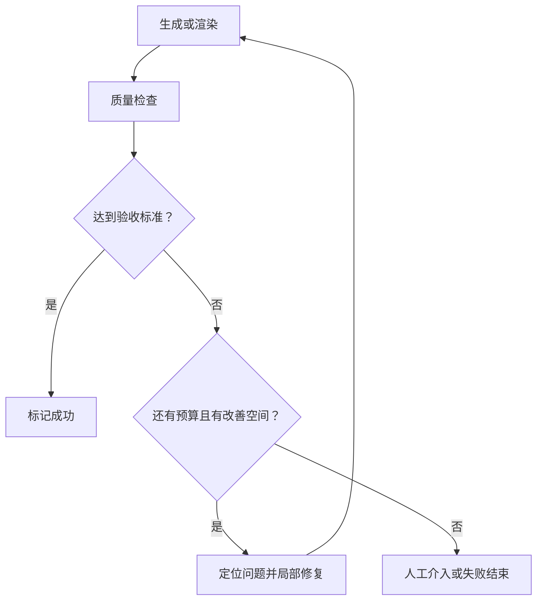

循环需要同时约束最大次数、总耗时、总 Token、质量改善幅度和副作用。一个可以参考的停止条件是：达到质量阈值、达到次数上限、预算耗尽或连续若干轮无改善。<strong>循环的目标是收敛，而不是永远尝试。</strong>

### 5.1 有界质量优化

若以质量评分 $q_k$ 表示第 $k$ 轮的结果，可使用下列示意性停止条件：

$$
q_k \ge q_{\mathrm{target}}
$$

或者在质量提升不足时退出：

$$
q_k-q_{k-1}<arepsilon
$$

这只是工程上的一种启发式判断；评分必须经过校准，不能把模型自评直接当作真实质量保证。

## 6. 并行、汇聚与动态任务映射

<strong>Parallel Workflow（并行工作流）</strong>同时执行无冲突的任务；<strong>Fan-out（扇出）</strong>负责分发，<strong>Fan-in（扇入）</strong>负责汇聚。<strong>Barrier（同步屏障）</strong>在满足条件前阻止后续节点执行。<strong>Map-Reduce（映射—归约）</strong>则将批量数据拆分处理后聚合结果。[1][9]

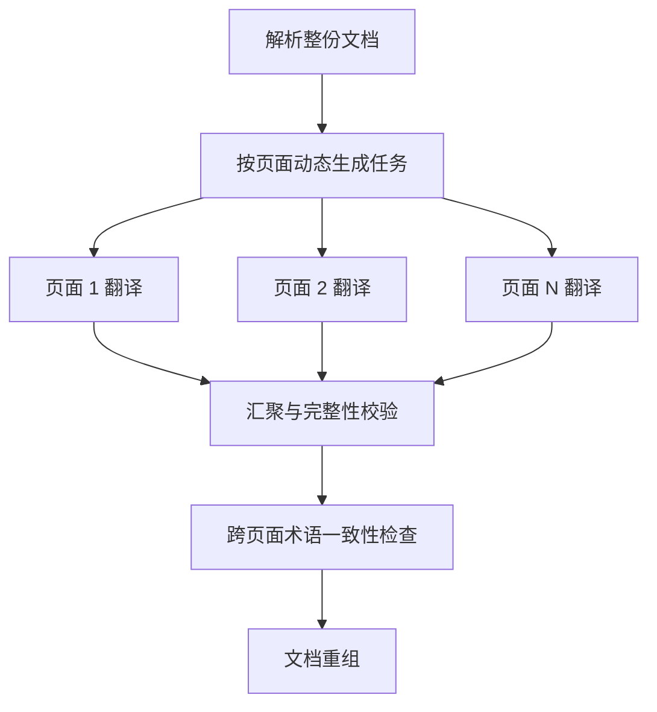

### 6.1 并行调度的关键约束

并行前要检查两类关系：<strong>逻辑依赖</strong>（后续任务是否需要前序产物）和<strong>资源冲突</strong>（任务是否修改同一文件、占用同一有限资源）。不存在依赖不代表一定能安全并行。

对于 $n$ 个任务，理想串行时间与并行时间可写成：

$$
T_{\mathrm{serial}}=\sum_{i=1}^{n}t_i
$$

$$
T_{\mathrm{parallel}}\ge\max_{1\le i\le n}t_i
$$

实际还要增加排队、调度、限流、汇聚和重试开销。<strong>Critical Path（关键路径）</strong>是决定整个依赖网络最短完成时间的最长依赖链。

### 6.2 汇聚语义必须明确

| 汇聚规则 | 含义 | 适用情形 |
|---|---|---|
| All Success | 全部成功才继续 | 严格完整交付 |
| All Done | 全部结束后汇总成功与失败 | 批量报告 |
| Any Success | 任一成功即可继续 | 冗余候选结果 |
| Quorum | 达到指定数量或比例 | 多评审、多模型投票 |
| Partial Result | 容许部分产物交付 | 经业务明确允许的降级 |

Apache Airflow 的 Dynamic Task Mapping 可在运行时按上游结果生成任务；Trigger Rules 则定义不同汇聚触发条件。[9][10]

## 7. 编排模式：中央协调、事件驱动与子工作流

<strong>Orchestration（编排）</strong>管理任务之间的依赖、执行、等待、取消和恢复。中央编排器适合集中治理；<strong>Event-driven Architecture（事件驱动架构）</strong>适合异步解耦；子工作流适合复杂流程模块化。<strong>Orchestrator-Workers（编排器—工作者）</strong>还允许由模型动态决定需要哪些子任务。[1]

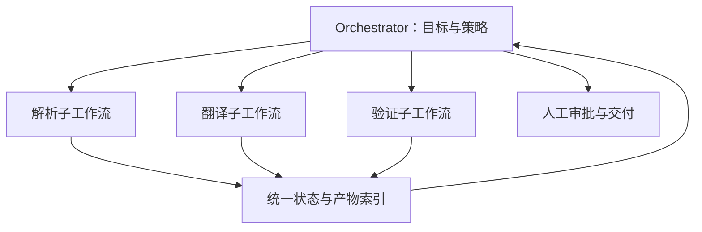

这里的箭头表达协调与反馈，不代表三个子工作流无依赖并行。实际执行顺序应由依赖、条件和任务状态确定。

### 7.1 Anthropic 的五种可组合模式

| 模式 | 主要思想 | 与本章基础机制的联系 |
|---|---|---|
| Prompt Chaining | 顺序模型调用，配合门禁 | 顺序 |
| Routing | 按输入选择专用路径 | 分支 |
| Parallelization | 分片处理或多次独立判断 | 并行、汇聚 |
| Orchestrator-Workers | 动态分配子任务 | 编排、动态任务生成 |
| Evaluator-Optimizer | 生成、评价、修正直到停止 | 循环、验证 |

这五种是可组合的工程模式，而非互斥的产品类别。[1][2]

## 8. 状态机、事件与执行生命周期

状态是“当前事实”，事件是“发生了什么”，工作流定义是“允许怎样变化”。应避免把模型的自然语言回答直接当作任务完成事件。

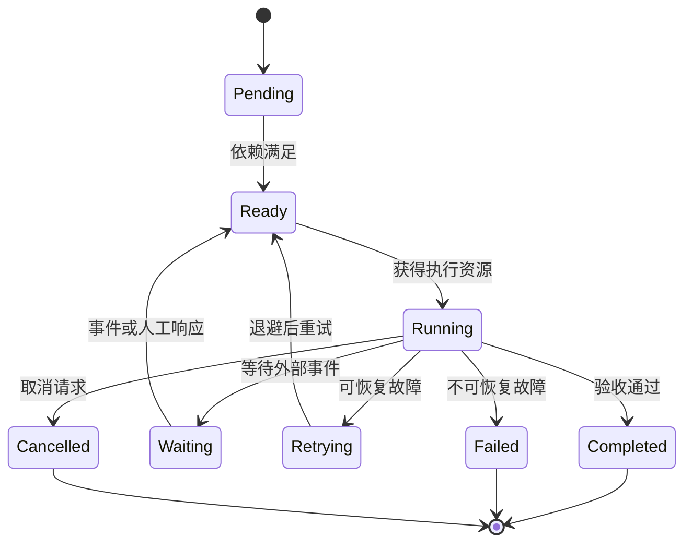

### 8.1 BPMN 与 Petri Net 的理论补充

BPMN 的 Task、Gateway、Event、Subprocess 用于表达业务过程；<strong>Petri Net（Petri 网）</strong>通过 Place（库所）、Transition（变迁）和 Token（令牌）研究并发与同步，适合分析死锁和可达性。<strong>Finite State Machine（有限状态机）</strong>则更适合单个任务的生命周期约束。

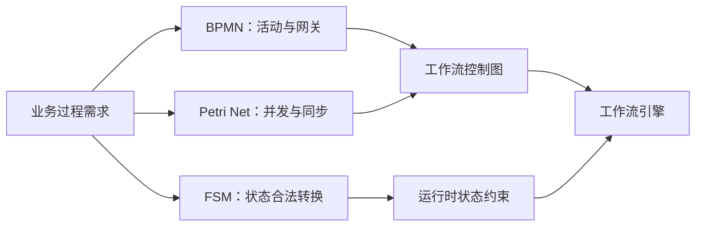

DAG 是无环依赖表示，而包含修复与反思循环的 Agent 控制图可能有环。二者不能混同。

## 9. 可靠性：从“能运行”到“故障后仍能正确交付”

企业 Workflow 必须处理崩溃、网络超时、重复消息、外部副作用和跨版本恢复。<strong>Checkpoint（检查点）</strong>保存可恢复状态；<strong>Durable Execution（持久化执行）</strong>保证进程失败后仍可继续；<strong>Replay（重放）</strong>依据持久化历史重建状态；<strong>Idempotency（幂等性）</strong>防止重复操作产生额外副作用。

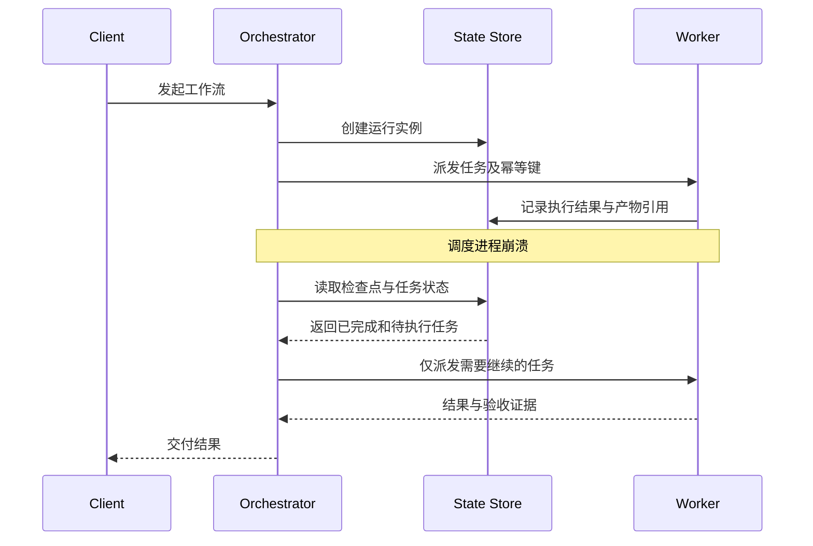

### 9.1 Checkpoint 与 Replay 的不同

LangGraph 的 Checkpointer 持久化线程范围的图状态，Store 可用于跨线程的长期数据；Temporal 使用 Event History（事件历史）重放工作流代码并恢复状态。[3][5][6] 两者都能支持恢复，但持久化粒度和重放语义不同。

<strong>重要边界：</strong>Temporal 已完成 Activity 的结果在工作流重放时复用，不意味着外部 Activity 在所有网络故障情况下都天然恰好执行一次。对有副作用的操作仍要设计幂等键、结果查询和补偿。[5]

### 9.2 故障处理决策

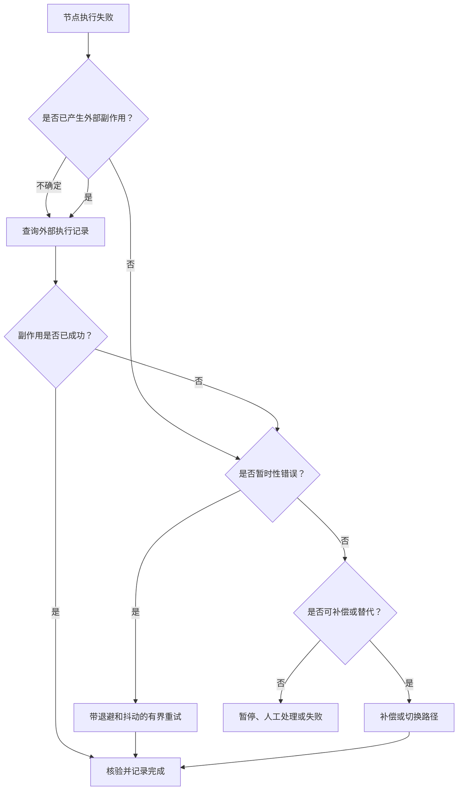

<strong>Exponential Backoff（指数退避）</strong>逐步增加重试间隔；<strong>Jitter（随机抖动）</strong>减少同时重试引发的流量尖峰；<strong>Circuit Breaker（熔断器）</strong>在下游持续失败时暂停请求；<strong>Dead Letter Queue（死信队列）</strong>保存无法正常处理的消息以供排查。

### 9.3 补偿不是数据库回滚

<strong>Saga（长事务补偿模式）</strong>通过一组业务补偿动作处理跨服务的已完成操作。例如“文件已发布但审批撤销”可能需要撤销发布权限，而不是假设能回滚所有外部系统。补偿本身也可能失败，因此必须记录补偿状态并支持人工处理。

## 10. Human-in-the-Loop：人工审批也是工作流节点

<strong>HITL（Human-in-the-Loop，人在回路中）</strong>用于高风险、低置信度或权限敏感的步骤。它不是“暂停程序等待输入”这么简单，还涉及身份、超时、审计、修改后重验和恢复语义。LangGraph 的 `interrupt` 机制允许暂停并恢复，但恢复时节点可能重新执行，因此中断前的副作用必须谨慎处理。[4]

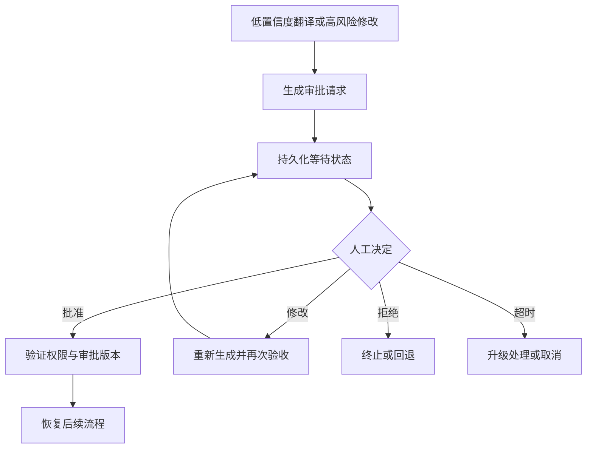

审批应绑定运行实例、具体产物版本和审批人权限，防止旧审批错误应用到新结果。

## 11. 并发治理、成本与性能模型

生产系统的吞吐量受模型接口、数据库、OCR、渲染 CPU/GPU 和对象存储共同约束。<strong>RPM（Requests Per Minute，每分钟请求数）</strong>与 <strong>TPM（Tokens Per Minute，每分钟 Token 数）</strong>是模型接口常见限流维度。<strong>Backpressure（背压）</strong>在下游能力不足时限制上游任务生产，避免队列无限膨胀。

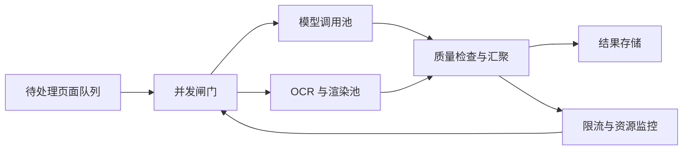

### 11.1 估算吞吐与成本

若系统稳定吞吐为 $\lambda$（任务／秒），平均任务停留时间为 $W$（秒），根据 Little's Law（利特尔法则），平均在途任务数满足：

$$
L=\lambda W
$$

该关系要求系统处于适用的稳定统计条件下；它是容量分析工具，不是直接的并发配置公式。

工作流总成本可近似分解为：

$$
C_{\mathrm{total}}=C_{\mathrm{LLM}}+C_{\mathrm{tools}}+C_{\mathrm{storage}}+C_{\mathrm{retry}}+C_{\mathrm{operations}}
$$

增加并行度可能缩短等待时间，但不一定减少 Token 消耗；过高并发还可能触发限流与重试风暴。

## 12. 框架与执行引擎：不同层次解决不同问题

| 技术 | 主要能力 | 更适合的场景 | 注意事项 |
|---|---|---|---|
| LangGraph | StateGraph、条件边、循环、检查点、人工中断 | 需要动态决策的 Agent 工作流 | 精细设计状态更新和节点边界 |
| Microsoft Agent Framework | Executor、Edge、并行与 Agent 编排 | 组合确定性节点和 Agent 节点 | 注意 SDK 版本及功能差异 |
| Temporal | Durable Workflow、Activity、Event History、Replay | 长时程、高可靠业务流程 | Workflow 代码需遵循确定性重放约束 |
| Apache Airflow | DAG、动态任务映射、触发规则 | 批处理、定时任务和数据管线 | 不宜直接视为交互式 Agent Runtime |
| Prefect | Python 流程、任务调度与监控 | 数据与计算工作流 | Agent 推理控制通常需要额外设计 |
| Camunda | BPMN、事件、人工任务与业务编排 | 审批、合规和跨系统流程 | 需要业务流程建模与平台治理 |

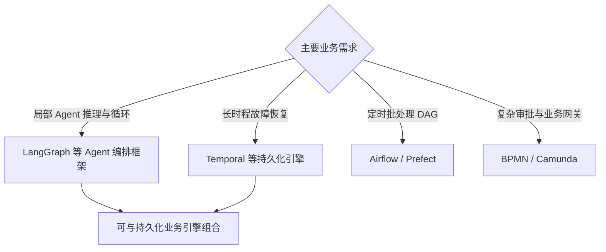

选择应以执行语义为依据，而非框架流行程度。也可以采用“外层持久化工作流 + 内层 Agent 图”的分层设计。

## 13. 企业文档翻译：完整混合 Workflow

以“100 页中英互译、保留版式、支持扫描页、图表和人工复核”为例，建议由外层确定性工作流管理业务生命周期，内部 Agent 节点处理复杂语义判断和局部修复。

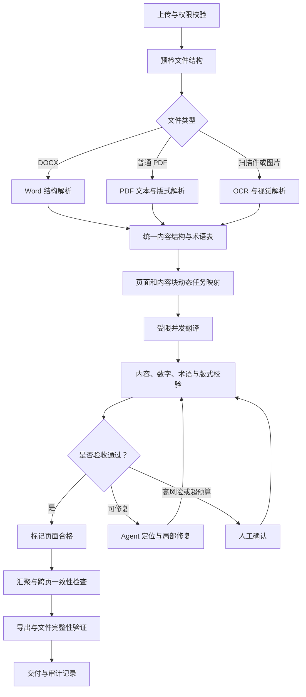

### 13.1 为什么需要“全局流程固定、局部策略动态”

文档上传、权限、完整性校验、最终交付具有稳定业务规则，适合确定性 Workflow；扫描页、复杂图表、布局冲突则具有较高不确定性，适合局部 Agent 决策。将两者分层，既保留灵活性，又避免模型自由决定高风险业务步骤。

### 13.2 页面级任务契约

| 字段 | 示例 | 作用 |
|---|---|---|
| workflow_id | 文档翻译运行 ID | 全局追踪 |
| page_id | 页码与内容版本 | 页面身份 |
| source_artifact | 原始页面引用 | 可复现输入 |
| glossary_version | 术语表版本 | 跨页一致性 |
| status | Ready / Running / Completed | 恢复与调度 |
| retry_count | 已尝试次数 | 防止无界循环 |
| output_artifact | 译文和版式产物引用 | 汇聚依据 |
| verification | 数字、术语、漏译、布局结果 | 完成证据 |
| idempotency_key | 页面任务唯一业务键 | 避免重复副作用 |

### 13.3 第 35 页失败时怎样恢复

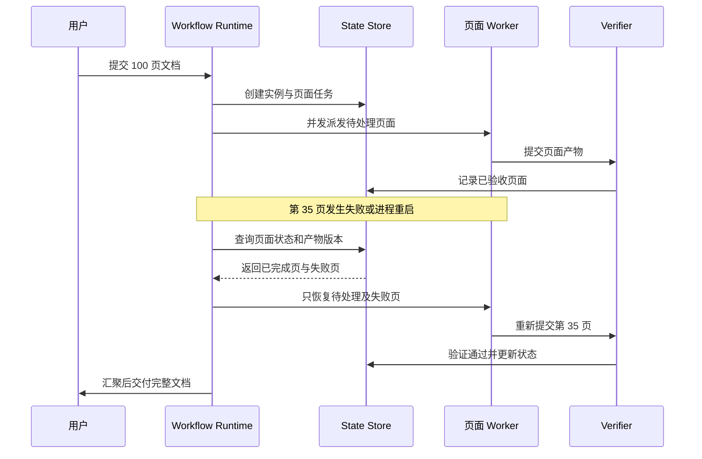

关键点是：<strong>恢复以持久化事实和验收证据为准，而不是按“上次执行到第几页”的模糊描述恢复。</strong> 对并发页面任务尤其如此。

## 14. 测试、评估与可观测性

<strong>Observability（可观测性）</strong>包括 Logs（日志）、Metrics（指标）与 Traces（链路追踪）。在 Agent Workflow 中，Trace 应能关联工作流实例、节点、模型调用、工具调用、页面产物与人工审批。不能仅记录最终输出。

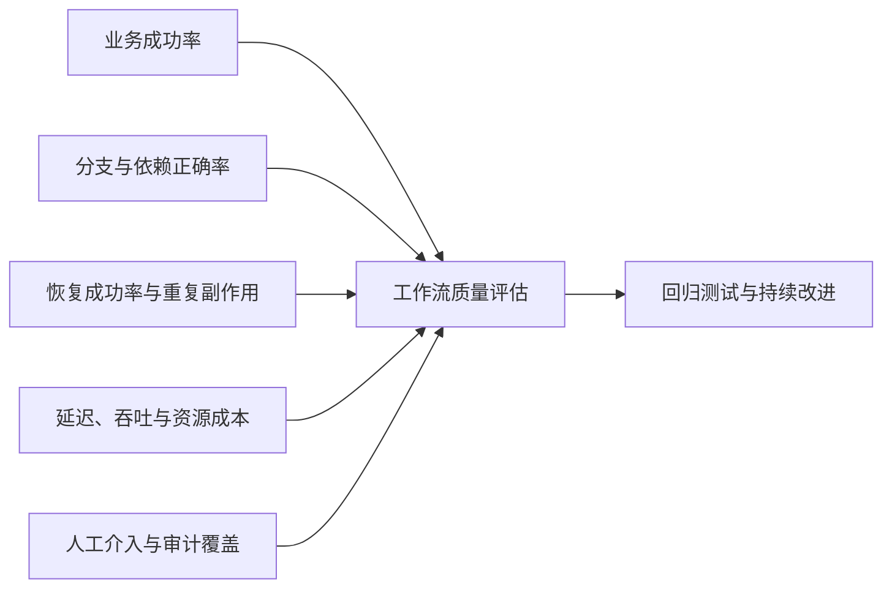

| 测试类别 | 应覆盖的情形 | 核心判断 |
|---|---|---|
| 正常路径 | 各文件类型、各分支 | 输出正确且可追踪 |
| 条件路由 | 未知格式、模型低置信度 | 进入安全出口 |
| 循环收敛 | 持续低分、重复相同错误 | 有界退出 |
| 并发与汇聚 | 页面乱序完成、部分失败 | 汇聚结果完整且顺序正确 |
| 故障注入 | 超时、崩溃、网络断连 | 恢复后不丢失已验收结果 |
| 副作用保护 | 重复投递、确认丢失 | 不重复提交或发布 |
| HITL | 审批超时、拒绝、修改 | 状态与权限正确 |
| 版本兼容 | 流程更新时旧实例未结束 | 可安全继续或迁移 |

## 15. 常见误区与工程取舍

| 误区 | 正确认识 |
|---|---|
| Workflow 就是多次调用 LLM | 还包括状态、依赖、调度、异常和治理 |
| Workflow 必须是 DAG | Agent 循环和等待事件可形成有环控制图 |
| 并行一定更快 | 受关键路径、限流、排队和汇聚约束 |
| 没有依赖就能并行 | 还要检查共享资源与外部副作用 |
| 重试能解决所有失败 | 永久性错误、质量问题和权限问题需要不同策略 |
| 有 Checkpoint 就能保证恰好执行一次 | 外部副作用仍需要幂等和结果核对 |
| 模型说完成就等于流程成功 | 必须有确定性验收或可核实的证据 |
| Agent 与 Workflow 二选一 | 外层固定编排、内层动态 Agent 往往更实用 |
| 任务越细越好 | 过细会增加调度、持久化和模型调用开销 |
| 工作流升级只需替换代码 | 长运行实例还涉及历史和 Schema 兼容 |

## 16. 面试与架构讨论题

**Q1：ReAct、Planning、Workflow 如何配合？**  Planning 负责将目标转换为任务结构；Workflow 负责调度、依赖、状态和恢复；ReAct 可以作为局部执行节点，根据观察动态调用工具。

**Q2：为什么有向无环图不能完整描述 Agent Workflow？** DAG 只能描述无环依赖，而 Agent 常有反馈修复、反思和轮询；可将无环任务依赖与允许循环的控制图分层表示。

**Q3：Fan-out 后一个任务失败怎么办？** 取决于汇聚契约：严格交付可阻止汇聚；允许部分结果的场景可记录失败并继续；同时要处理重试、超时和补偿。

**Q4：Checkpoint 和幂等是否是同一个概念？** 不是。Checkpoint 解决恢复进度，幂等解决重复执行造成的外部副作用；可靠恢复通常需要二者共同存在。

**Q5：什么时候用 Workflow 而不是自由 Agent？** 当路径和验收标准较稳定、风险高、可审计性重要时优先使用确定性 Workflow；在难以预设步骤的局部问题中引入 Agent。

**Q6：怎样设计一个可交付的文档翻译 Workflow？** 使用固定预检和导出流程、按文档类型路由、按页并发、质量门禁、有界修复、人工确认、页面级状态与最终完整性校验。

## 17. 术语速查

| 缩写／术语 | 英文全称 | 中文说明 |
|---|---|---|
| LLM | Large Language Model | 大语言模型 |
| Workflow | Workflow | 工作流，管理步骤与执行生命周期 |
| Orchestration | Orchestration | 编排，协调多个执行单元 |
| DAG | Directed Acyclic Graph | 有向无环图 |
| BPMN | Business Process Model and Notation | 业务流程模型与标记法 |
| FSM | Finite State Machine | 有限状态机 |
| OCR | Optical Character Recognition | 光学字符识别 |
| HITL | Human-in-the-Loop | 人在回路中 |
| Fan-out / Fan-in | Fan-out / Fan-in | 扇出分发／扇入汇聚 |
| Map-Reduce | Map-Reduce | 映射—归约 |
| Checkpoint | Checkpoint | 检查点 |
| Replay | Replay | 事件重放恢复 |
| Idempotency | Idempotency | 幂等性 |
| Saga | Saga Pattern | 长事务补偿模式 |
| Backpressure | Backpressure | 背压 |
| RPM / TPM | Requests / Tokens Per Minute | 每分钟请求数／Token 数 |
| Trace | Distributed Trace | 分布式链路追踪 |

## 18. 参考资料与延伸阅读

以下以官方技术文档和开源项目为主；文中框架能力可能随版本变化，落地时应核对当前 SDK 文档。

1. [Anthropic — Building Effective Agents](https://www.anthropic.com/engineering/building-effective-agents)：Workflow 与 Agent 边界、五种可组合模式。
2. [Anthropic — Building Effective Agents Cookbook](https://github.com/anthropics/claude-cookbooks/tree/main/patterns/agents)：常见工作流模式的官方示例。
3. [LangGraph — Persistence](https://docs.langchain.com/oss/python/langgraph/persistence)：Checkpointer、Store 与状态恢复。
4. [LangGraph — Interrupts](https://docs.langchain.com/oss/python/langgraph/interrupts)：人工介入和中断恢复。
5. [Temporal — Workflows](https://docs.temporal.io/workflows)：工作流定义、实例、Event History 与 Replay。
6. [Temporal — Event History](https://docs.temporal.io/encyclopedia/event-history)：事件持久化与恢复机制。
7. [LangGraph — Workflows and Agents](https://docs.langchain.com/oss/python/langgraph/workflows-agents)：图编排与 Agent 结合。
8. [Camunda — BPMN Gateways](https://docs.camunda.io/docs/components/modeler/bpmn/gateways/)：排他、并行、包容与事件网关。
9. [Apache Airflow — Dynamic Task Mapping](https://airflow.apache.org/docs/apache-airflow/stable/authoring-and-scheduling/dynamic-task-mapping.html)：动态任务映射。
10. [Apache Airflow — DAGs](https://airflow.apache.org/docs/apache-airflow/stable/core-concepts/dags.html)：依赖、任务和触发规则。
11. [Microsoft Agent Framework — Workflows](https://learn.microsoft.com/en-us/agent-framework/concepts/workflows/)：Executor、Edge 和工作流机制。
12. [Temporal — Understanding Temporal](https://docs.temporal.io/evaluate/understanding-temporal)：Worker、Task Queue 和 Durable Execution。

## 19. 本节总结：可靠 Workflow 的完整逻辑链

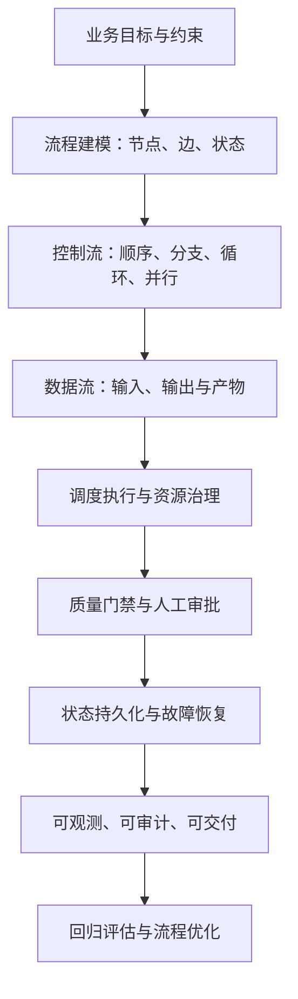

<strong>一句话总结：</strong>Workflow 的本质不是把步骤画成流程图，而是把确定性规则、模型能力、工具调用、状态与事件组织为可控、可恢复、可验证的执行系统。

下一节：[04｜Reflection and Verification：反思与验证](04-Reflection-and-Verification.md)。
