# 反思、自检与结果验证：从反馈到可信交付

> 第四章 Agent 工作范式 · `04-Reflection-and-Verification.md`  
> 前置：`01-ReAct.md`、`02-Planning.md`、`03-Workflow.md`  
> 学习目标：理解 Reflection、Verification、Validation、Evaluation 的边界，掌握证据驱动的诊断、修复、再验证闭环，并能为企业级 Agent 设计可执行的质量门禁。

## 0. 全局知识地图：执行完成不代表目标达成

ReAct 解决“下一步行动”，Planning 解决“如何组织目标与依赖”，Workflow 解决“如何可靠调度”。三者都无法单独证明产物正确。本章为这些机制补上<strong>证据、质量门禁和可控改进</strong>。这里及下文强调的核心结论是：<strong>反思是提出假设，验证是收集证据，修复是采取行动，验收是做出决策。</strong>

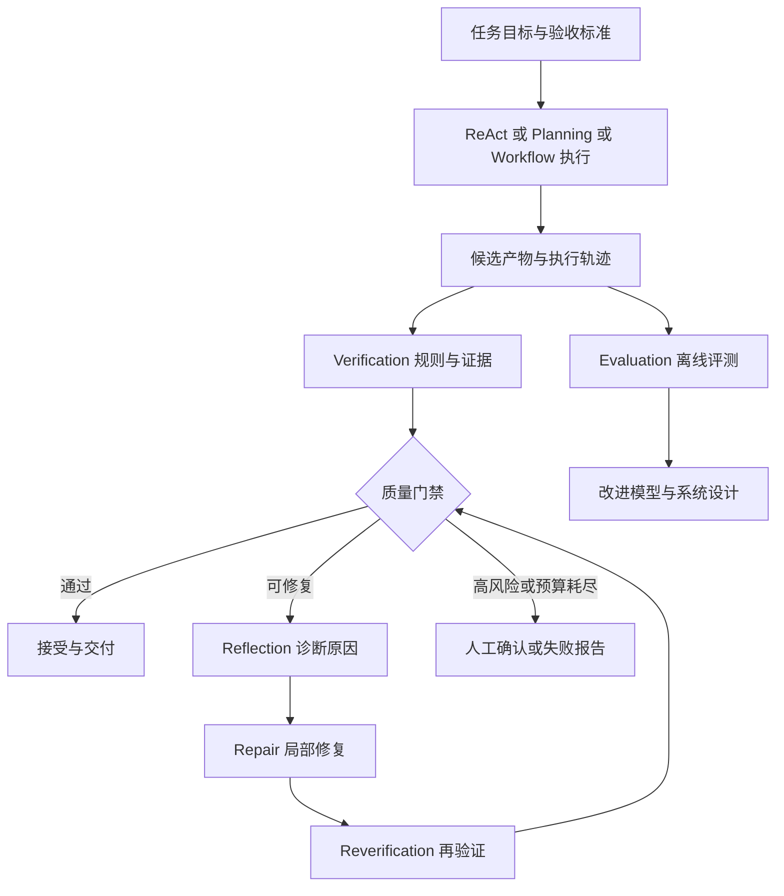

## 1. 概念边界：到底检查什么

| 概念 | 英文全称或常用称谓 | 关注点 | 产出 | 不应被误解为 |
|---|---|---|---|---|
| 反思 | Reflection | 为什么失败，下一步如何改进 | 原因假设、修复建议 | 可靠的事实证据 |
| 自检 | Self-Checking / Self-Critique | 当前产物可能有什么问题 | 可疑问题清单 | 独立客观的验收 |
| 验证 | Verification | 是否满足明确的规格、规则和约束 | 检查证据、通过或失败 | 一句模型主观判断 |
| 确认 | Validation | 是否适合真实预期用途 | 业务认可、人工确认 | 单纯格式正确 |
| 评估 | Evaluation / Evals | 系统在样本集合上表现如何 | 指标、回归报告 | 单次任务的验证 |
| 护栏 | Guardrails | 哪些输入、输出或动作不允许 | 拒绝、拦截、审批 | 结果质量评估的替代品 |
| 监控 | Monitoring | 生产运行是否异常或退化 | 告警、趋势 | 离线质量测试 |

软件工程中 Verification 与 Validation 常被概括为“是否按规格做对”与“是否做了用户需要的事”。但不同行业标准的正式术语有细微差别，实际项目应以适用标准和质量体系为准。

### 1.1 两种错误必须分开

<strong>过程错误</strong>：选错工具、越权调用、跳过审批、执行顺序错误。<strong>结果错误</strong>：语义漏译、数值错误、版式重叠、输出文件损坏。过程完全合规也可能产生错误结果；结果偶然正确也不意味着执行过程可接受。

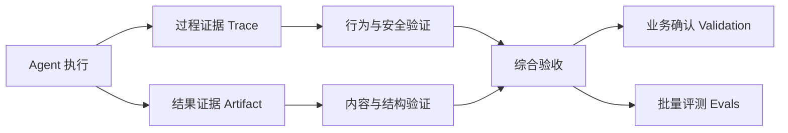

## 2. 研究演进：从自我反馈到外部证据

语言模型能够产生批评意见，但其判断和原答案可能共享同一盲点。相关研究逐步探索了：保存反馈经验、对当前结果反复修订、借助工具检验事实，以及在工程中用独立评估器建立质量门禁。

| 路线 | 代表研究 | 核心机制 | 主要限制 |
|---|---|---|---|
| 跨尝试反思 | Reflexion（2023） | 评估反馈转成语言经验，写入情景记忆 | 经验质量依赖反馈，错误经验可能污染后续尝试 |
| 当前产物迭代 | Self-Refine（2023） | 生成—反馈—修订 | 自我评价不稳定，可能越改越差 |
| 外部工具纠错 | CRITIC（2023） | 通过搜索、执行器等工具提供反馈 | 工具证据可能不完整或过时 |
| 事实核验 | Chain-of-Verification（CoVe，2023） | 生成验证问题、尽可能独立核验、修订 | 自生成核验不保证独立真实性 |
| 工程质量循环 | Evaluator–Optimizer | 生成器与评估器循环迭代 | 增加成本；必须定义明确验收条件 |

### 2.1 Reflexion：反思如何成为经验

Reflexion（反思式语言智能体）由 Actor（行动者）、Evaluator（评估者）、Self-Reflection（自我反思）和 Episodic Memory（情景记忆）组成。它的“Verbal Reinforcement Learning（语言形式强化学习）”通常不涉及梯度更新，而是将失败反馈转为后续任务可检索的文字经验。论文在特定 HumanEval 设置下报告 91% 的 pass@1；不能将其推广为生产任务成功率。

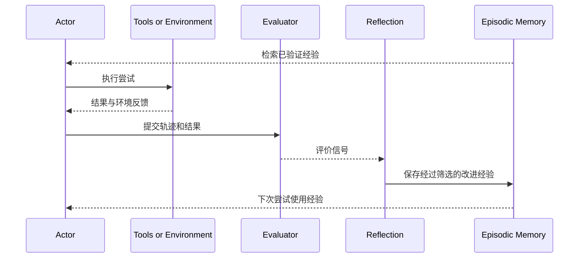

### 2.2 Self-Refine：围绕当前产物修订

Self-Refine（自反馈迭代改进）通常让同一个大语言模型（LLM，Large Language Model）承担 Generator（生成器）、Feedback Provider（反馈者）和 Refiner（修订者）。它可以改善语言表达等可迭代任务，但<strong>同一模型既出题又判题，不等于获得独立证据</strong>。必须保留上一版，并比较修复前后质量。

### 2.3 CRITIC 与 CoVe：为什么需要核验来源

CRITIC（工具交互式批评与修正）将搜索、执行器、数据库等外部工具引入批评环节。CoVe（Chain-of-Verification，验证链）强调为初始答案提出核验问题，并尽量独立回答后再修订。二者共同指出：<strong>应将“产生答案”与“验证答案”在证据路径上分离</strong>。

### 2.4 自我纠错的边界

研究 *Large Language Models Cannot Self-Correct Reasoning Yet* 表明，在其研究的缺少外部反馈的推理设置中，自我纠错可能不改善甚至损害正确率。这不否定 Self-Refine 在特定写作与反馈任务上的价值；关键差异是任务类型、外部证据和反馈质量。

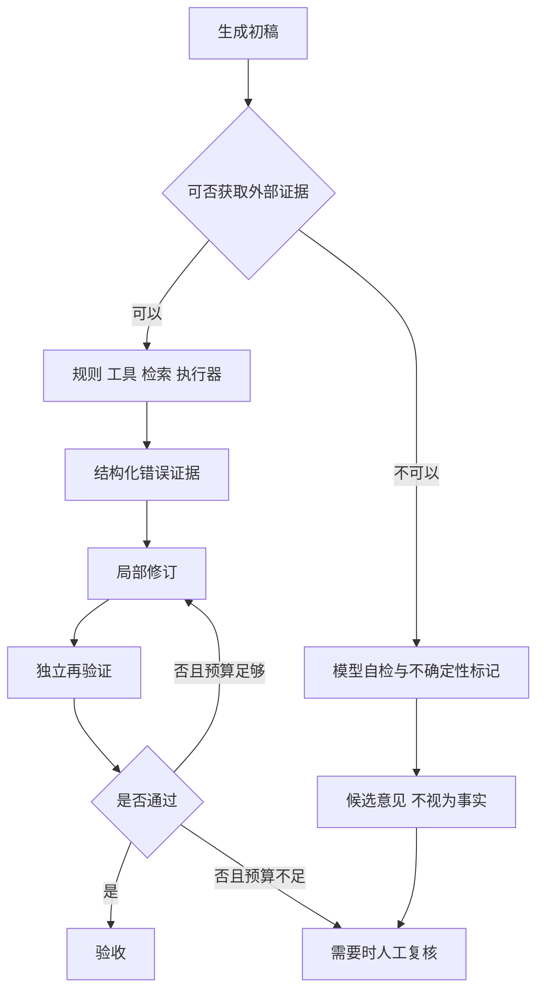

## 3. 验证分层：把“正确”拆成可检查的契约

验收标准（Acceptance Criteria）应在生成之前定义，而不是事后根据产物临时改变。推荐从输入、过程、产物、业务用途四个层次构建证据链。

| 层次 | 验证对象 | 推荐方法 | 示例 |
|---|---|---|---|
| 输入与权限 | 文件类型、访问范围、约束 | Schema、白名单、权限检查 | 禁止读取未授权文档 |
| 结构与规则 | 字段、数值、单位、页数、文件结构 | 确定性解析器、断言、哈希 | 型号 `X-120` 必须原样保留 |
| 执行行为 | 工具选择、状态变迁、审批 | Trace、状态机约束 | 未审批不得对外发布 |
| 语义与事实 | 译文含义、事实依据、引用 | 双语对齐、检索、独立评审 | “不得使用”不能翻成“可以使用” |
| 视觉与布局 | 裁切、重叠、阅读顺序 | 布局几何检查、渲染对比、视觉模型 | 表格单元格不能错位 |
| 业务适用性 | 真实使用目标、风险、法规要求 | 领域专家与质量流程 | 关键安全警示人工确认 |

### 3.1 规则优先，语义补充

如果能直接解析原文与译文中的数字、单位、产品型号、表格单元格数量，就优先使用程序比对。LLM-as-a-Judge（以大语言模型作为评审器）更适合语义完整性、语言自然度和版式可读性等难以穷举规则的项目。

### 3.2 证据必须可追溯

每条错误记录建议包含：`run_id`、`artifact_version`、`check_id`、`severity`、`location`、`expected`、`observed`、`evidence_ref`、`confidence`、`verifier_version`。`confidence` 仅表示评估器自身置信程度，不能自动等同于错误真实概率。

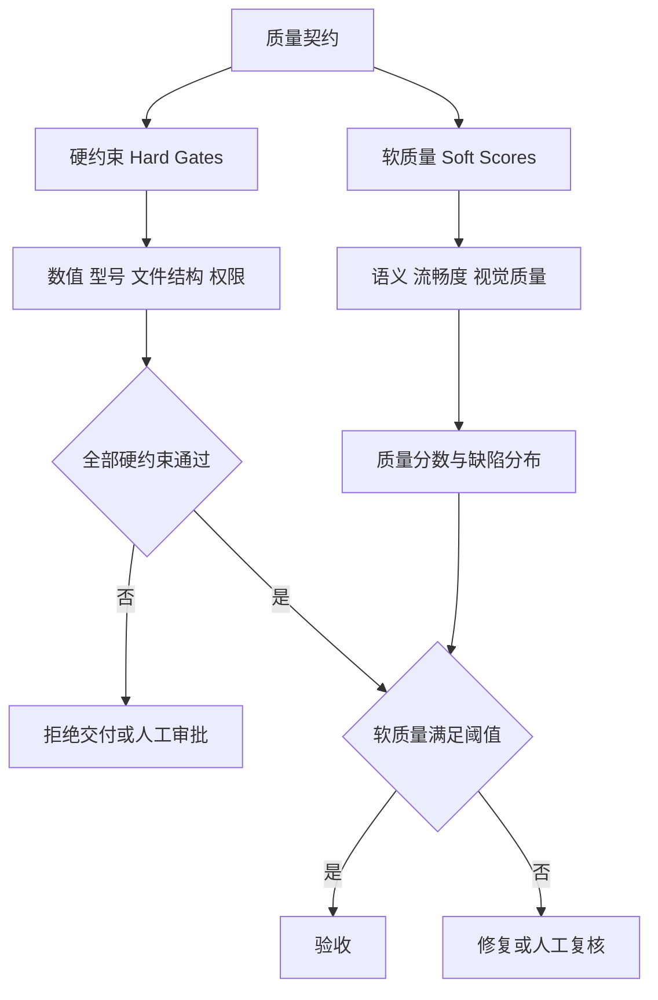

## 4. LLM-as-a-Judge：评价方法、偏差与校准

LLM-as-a-Judge 通过明确的 Rubric（评分准则）对候选结果进行判断。三种常用方式：Pointwise（逐项评分）、Pairwise（成对比较）和 Reference-based（参考答案评估）；Reference-free（无参考答案评估）不依赖标准答案，但更需要外部校准。

| 方式 | 适合的问题 | 关键设计 |
|---|---|---|
| Pointwise | 一份译文是否达到最低标准 | 维度定义、等级锚点、证据 |
| Pairwise | A 与 B 哪个译文更好 | 交换顺序、避免长度偏好 |
| Reference-based | 是否忠实于已核实的标准文本 | 标准答案来源与覆盖度 |
| Reference-free | 风格、可读性等开放质量 | 多评审、人工抽检、稳定性分析 |

### 4.1 评审偏差

Position Bias（位置偏差）会使候选顺序影响结果；Verbosity Bias（冗长偏差）可能偏爱长答案；Self-Preference Bias（自我偏好）可能偏爱相近模型输出；Anchoring Bias（锚定偏差）可能使先前评分影响后续判断。此外还存在评分波动、错误证据编造和提示注入风险。

### 4.2 可信评审的设计

评审器输入必须明确原文、译文、验收规则、允许引用的证据范围；输出必须区分“已证实错误”“疑似错误”“无法判断”。应以人工标注集校准误报率、漏报率与分数稳定性。高风险问题不能通过多数模型投票直接视为已确认。

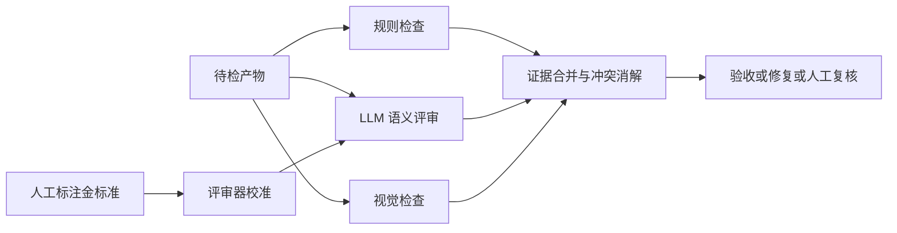

## 5. 反思—诊断—修复：从泛泛建议到精确动作

反思的价值不是“再想一遍”，而是将验证证据转化为可执行的修复策略。诊断阶段应回答四个问题：失败发生在哪里、属于哪种类型、最可能的原因是什么、最小修复范围在哪里。

| 错误类型 | 可能根因 | 优先修复策略 | 再验证范围 |
|---|---|---|---|
| 数值错误 | 模型改写数值 | 恢复原值并检查上下文 | 当前字段及关联表格 |
| 漏译 | 解析漏块、上下文截断 | 补解析并局部重译 | 相关内容块 |
| 术语不一致 | 未共享术语库 | 术语映射修正 | 同文档相关出现位置 |
| 文字溢出 | 译文增长、框宽不足 | 局部布局调整 | 当前区域及邻接区域 |
| 标签错位 | 坐标映射错误 | 修正定位与渲染参数 | 相关图表 |
| 文件无法打开 | 文档结构损坏 | 重建导出产物 | 全文件结构 |

### 5.1 局部修复优于盲目重做

对于 100 页文档中第 35 页的标签重叠，优先修复该页面对应的内容块，不应默认重新翻译全部页面。局部修复必须建立在依赖分析上：若第 35 页的术语修改影响全篇术语一致性，验证范围应扩展到相关页面。

### 5.2 修复可能引入回归

Regression（回归）指修改后破坏原先正确的功能或内容。每次修复都应保留上一个通过验证的版本，并检查受影响区域和相关不变量（Invariant，不应变化的性质），例如数字、型号、页数与图像完整性。

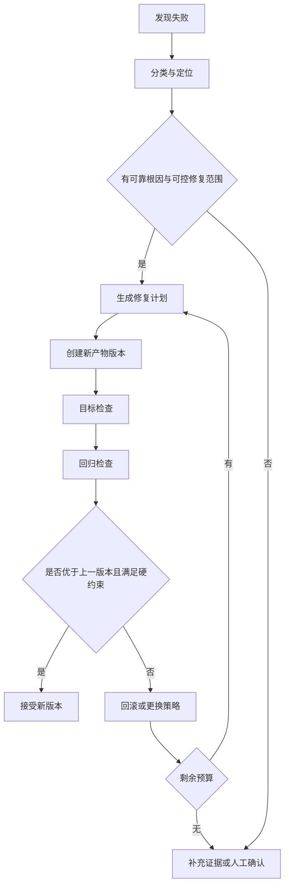

## 6. 有界循环：何时继续，何时停止

修复循环必须同时受质量、时间、成本和风险约束。不能将“继续反思直到满意”作为终止规则。建议设定最大轮数、累计模型与工具成本、单轮质量改善阈值、连续无进展次数和人工升级条件。

对于非负损失函数 $L$，可以定义第 $t$ 轮修复的改善量：

$$
\Delta L_t = L_{t-1}-L_t
$$

若连续多轮 $\Delta L_t$ 很小或为负，应考虑停止、回滚或切换策略。该公式仅用于说明质量改善的量化思路；不同指标的损失定义和阈值需经过业务校准。

### 6.1 硬约束不可被平均分掩盖

可以将软质量得分表示为加权和：

$$
Q = \sum_{i=1}^{n} w_i q_i, \qquad \sum_{i=1}^{n} w_i = 1
$$

但是否交付必须首先满足所有关键硬约束：

$$
\operatorname{Accept}(x)=\left(\bigwedge_{j=1}^{m} h_j(x)\right)\land\left(Q(x)\geq\tau\right)
$$

其中 $h_j(x)$ 是关键检查的布尔结果，$\tau$ 是经验证的软质量阈值。即使整体分数很高，安全警告漏译或剂量错误仍应阻止自动通过。

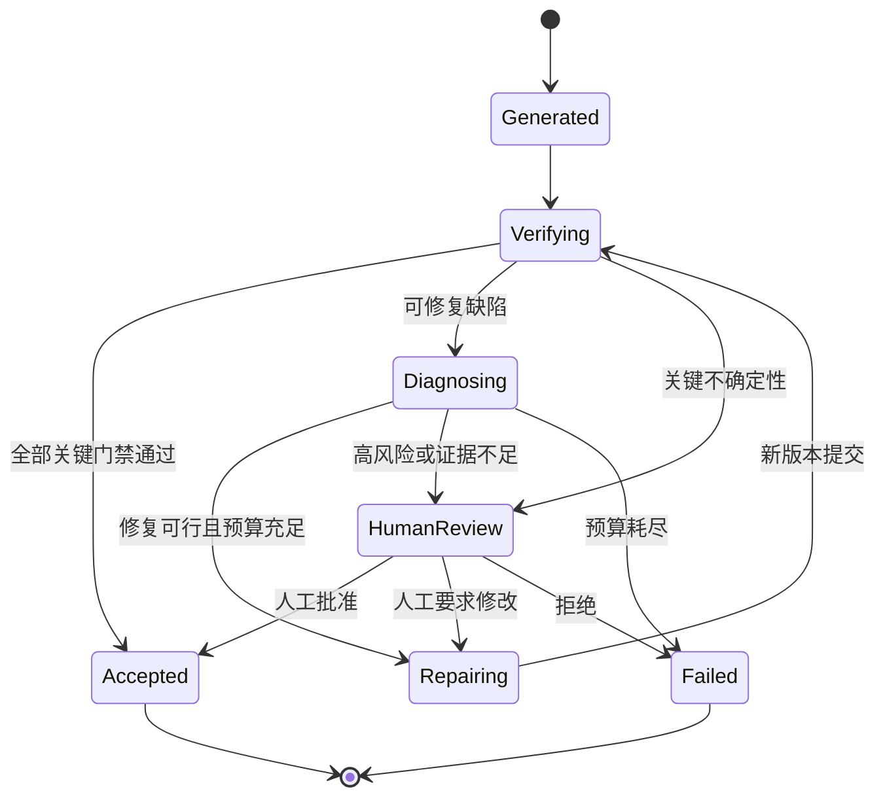

## 7. Guardrails、Tracing 与 Evals：从单次验收到系统治理

Guardrails（护栏）用于输入、输出及工具边界的安全约束；Tracing（追踪）记录一次运行中的模型调用、工具调用、交接和状态变化；Evals（评测）则在一组样本上比较系统版本。三者与 Verification 协作，但职责不同。

OpenAI Agents SDK 的输入护栏通常针对链路首个 Agent，输出护栏针对最终输出；工具级检查需要部署在实际工具调用边界。对于有副作用的操作，必须采用同步阻塞的权限与审批检查，不能仅依赖可能并行运行的检测。

### 7.1 Trace Grading（轨迹评分）

轨迹评分不仅看最终答案，还检查工具选择、路由、审批和异常恢复是否符合要求。对于“结果正确但越权访问”的情况，轨迹验证可以揭示仅靠产物检查无法发现的问题。

### 7.2 从线上缺陷形成离线回归集

每次真实失败都应沉淀为：输入样本、期望行为、可核验结果、错误分类和测试断言。这样可以构成持续改进闭环：线上观察 → 复现 → 标注 → 回归测试 → 版本比较 → 灰度发布。

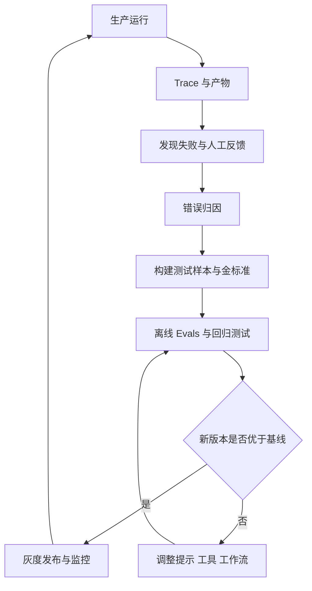

## 8. 与 ReAct、Planning、Workflow、Memory、State 的协作

本篇不是一个孤立的“检查 Agent”。ReAct 根据验证反馈选择下一步行动；Planning 决定是否修改任务计划；Workflow 控制质量门禁与有界循环；State 保存版本与检查结果；Memory 只应积累经过验证的可复用经验。

| 组件 | 提供什么 | 接收什么 | 关键风险 |
|---|---|---|---|
| ReAct | 动态修复行动 | 错误观察 | 无边界重复调用工具 |
| Planning | 任务依赖与修复计划 | 根因和失败任务 | 不必要的全局重规划 |
| Workflow | 分支、循环、并行与审批 | 检查状态 | 循环失控、错误汇聚 |
| Tools | 程序校验和执行能力 | 明确输入契约 | 不可信工具输出 |
| Context | 原文、译文、证据与约束 | 定位后的上下文 | 无关上下文污染判断 |
| State | 版本、检查点和任务状态 | 验收及修复结果 | 状态丢失或并发覆盖 |
| Memory | 经确认的经验与案例 | 经过筛选的反思 | 错误经验长期传播 |

<strong>关键原则：</strong>不能把未经验证的反思文本直接写成高可信长期记忆。建议对经验记录来源、适用条件、验证状态、过期时间和撤销方式。

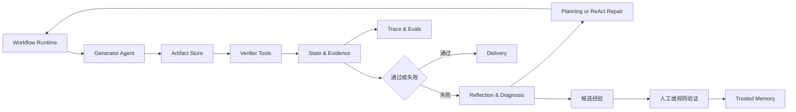

## 9. 企业案例：医疗设备文档翻译的完整质量闭环

目标不是单纯输出英文文本，而是在保证结构、数值、术语与版式可用的前提下交付文档。以下是通用企业工程设计示例，并非声称已满足任何具体医疗器械法规或认证要求。

### 9.1 质量检查分层

| 阶段 | 检查内容 | 优先实现 | 不通过时 |
|---|---|---|---|
| 解析后 | 页数、块数量、表格结构、图片位置 | 文档解析器 | 重新解析或标记人工处理 |
| 翻译后 | 漏译、数字、单位、型号、术语 | 程序对齐 + 语义评审 | 局部重译 |
| 排版后 | 溢出、裁切、重叠、阅读顺序 | 几何检测 + 视觉评审 | 布局修复 |
| 导出后 | 文件可打开、页数、结构完整性 | 格式解析器 | 重新导出 |
| 交付前 | 安全警告、关键参数、业务适用性 | 质量人员或专家 | 人工审批 |

### 9.2 示例：剂量错误与标签重叠

假设原文为 `0.5 mg`，译文变成 `5 mg`，同时图表标签发生重叠。系统应先将数值错误标记为阻断交付的硬约束失败；再通过源文定位、译文块引用与版式坐标将两个错误拆成不同修复任务。数值修复必须重新验证上下文中的否定、单位和剂量；布局修复必须检查相邻标签没有受到影响。只有两项均通过，页面才可进入最终汇聚。

### 9.3 页面级并行与全局一致性

不同页面可并行翻译和检查，但跨页术语、章节编号、引用与目录需要全局检查。若某页修复改变了术语表，依赖该术语的其他页面必须重新检查，不能简单把“页面通过”视为永久有效。

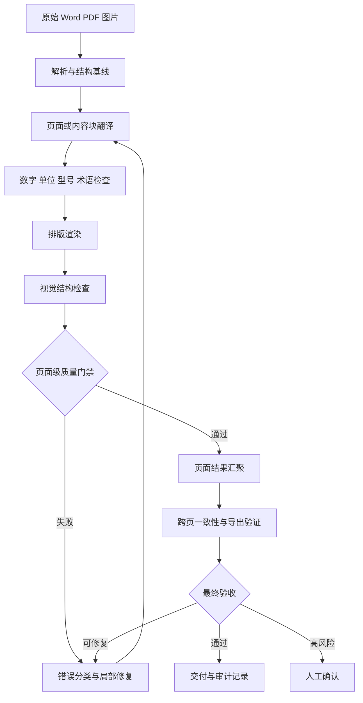

### 9.4 数据与状态设计

一次检查应与产物版本绑定。若文件在检查后又被修改，原检查结果不应自动继承。建议使用 `document_id`、`page_id`、`artifact_version`、`check_run_id` 和 `validator_version` 建立可追溯关系，并记录“修复前—修复后”的差异与证据。

### 9.5 为什么不应完全依赖视觉大模型

视觉语言模型（VLM，Vision-Language Model）适合判断整体可读性、标签遮挡与视觉层级，但对小字号、精确数值和细粒度文本遗漏可能不稳定。应结合原始文档结构、文本抽取、坐标几何和人工抽检，形成互补证据。

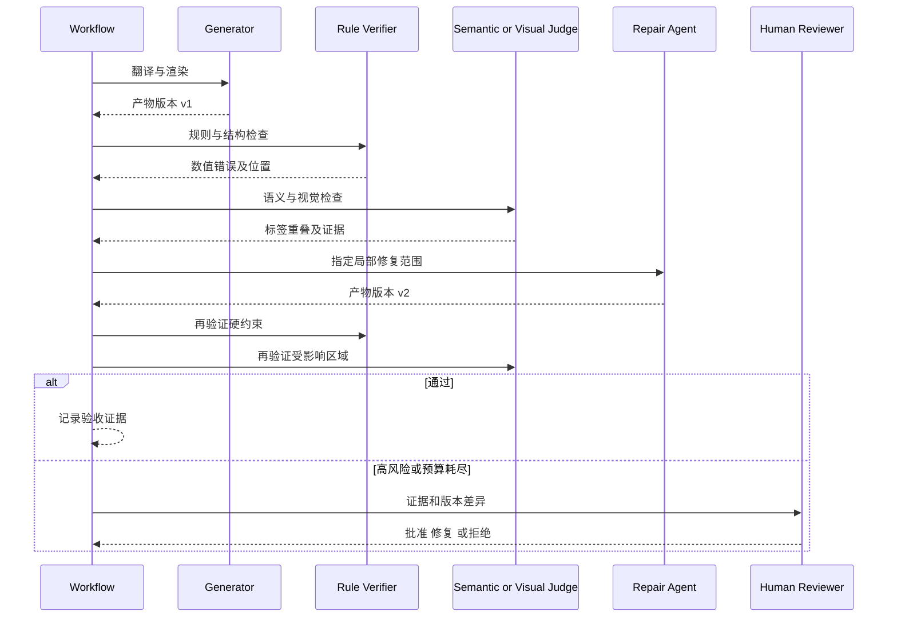

## 10. 评测指标：如何证明闭环有效

只记录“修复成功率”不足以评估系统。必须区分错误检测能力、修复能力、系统可靠性与成本。

| 指标 | 含义 | 关注点 |
|---|---|---|
| Precision（精确率） | 被报告错误中真实错误的比例 | 避免误报造成无谓重译 |
| Recall（召回率） | 实际错误中被检出的比例 | 避免关键漏译被忽略 |
| False Positive Rate（假阳性率） | 正常样本被误判为错误的比例 | 评估过度拦截 |
| False Negative Rate（假阴性率） | 异常样本被漏判为正常的比例 | 评估漏检风险 |
| Repair Success Rate | 修复后通过验证的比例 | 修复策略有效性 |
| Regression Rate | 修复引入新缺陷的比例 | 保护既有正确结果 |
| Judge–Human Agreement | 模型评审与人工标注的一致程度 | 评审器校准 |
| Cost per Accepted Result | 每份合格产物的综合成本 | 质量与成本平衡 |
| Time to Resolution | 从发现错误到解决的时间 | 修复效率 |

对二分类错误检测，可以定义：

$$
\mathrm{Precision}=\frac{TP}{TP+FP},\qquad
\mathrm{Recall}=\frac{TP}{TP+FN}
$$

其中 TP（True Positive，真正例）是正确识别出的错误，FP（False Positive，假正例）是误报，FN（False Negative，假负例）是漏报。分母为零时应明确约定统计口径，而不是直接计算。

### 10.1 测试集如何构建

至少包含正常样本、单一缺陷、多个缺陷、冲突证据、工具失败、模型错误自信、修复回归、长文档跨页依赖、高风险警告和预算耗尽等场景。应保留人工核实的错误位置与严重程度，避免测试集仅以另一模型生成的标签作为唯一真值。

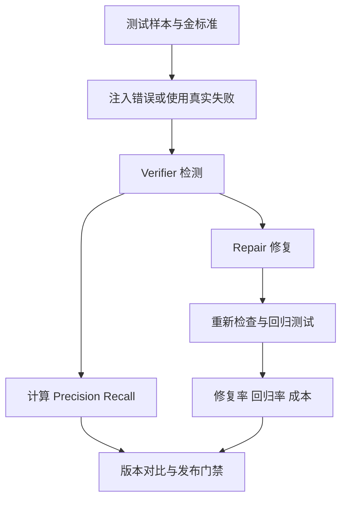

## 11. 可靠性、安全与工程边界

### 11.1 验证器不是无条件可信

工具输出可能过时、检索内容可能被污染、模型评审可能编造证据。必须保留来源和原始引用，并把不可信内容视为数据而非指令。对于具有外部副作用的工具，权限检查与审批应在执行前同步完成。

### 11.2 验证本身也有成本

每增加一次模型评审都会增加延迟与 Token 消耗。可按风险采用分级检查：所有文档执行确定性规则；语义与视觉检查按复杂度触发；高风险文档增加独立评审与人工确认。不要因为“多模型投票”就假设错误一定减少。

### 11.3 可恢复性与幂等

修复工具应有 Idempotency（幂等）设计，即重复提交同一逻辑操作不会产生不期望的重复副作用。任务重试前检查产物版本与操作状态；对于无法直接回滚的操作，应使用补偿动作或人工处理。

### 11.4 医疗器械业务的特殊要求

涉及安全警示、技术参数、使用限制和法规措辞时，必须根据实际质量管理体系决定人工复核、审批与留痕要求。自动化质量评分不能代替法定或组织规定的验证确认活动。

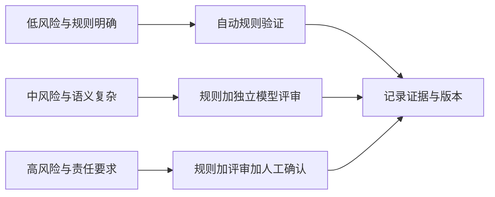

## 12. 常见误区与面试问答

### 12.1 常见误区

| 误区 | 更准确的理解 |
|---|---|
| 让模型检查自己就能保证正确 | 自检可能共享原始生成的盲点 |
| Reflection 等于 Verification | 反思提供原因假设，验证提供可核查证据 |
| 评分高就可以交付 | 关键硬约束不能被平均分抵消 |
| 反思越多越好 | 应限制轮数并检查边际改善 |
| 多模型一致就是真相 | 多模型可能共享错误或偏差 |
| 结果正确就说明执行合规 | 仍需检查轨迹、权限和审批 |
| 通过一次检查即可永久有效 | 产物版本变化后需要重新验证 |
| 修复失败就整份重做 | 应优先定位受影响范围和依赖 |
| 评审器无需评估 | 评审器也需要金标准与持续校准 |

### 12.2 面试高频问题

<strong>Q1：Reflection 与 Self-Refine 的区别？</strong> Reflection 是更宽泛的反馈分析机制；Self-Refine 是围绕当前产物进行生成—反馈—修订的具体方法。Reflexion 则强调把语言反思存入情景记忆，改善后续尝试。

<strong>Q2：为什么不直接让同一个 LLM 既翻译又评分？</strong> 可以作为低成本初筛，但可能存在共享盲点和自我偏好。应优先用程序验证确定性约束，必要时引入独立评审、可信参考与人工校准。

<strong>Q3：如何避免无限反思循环？</strong> 设置最大轮数、总成本、质量改善阈值、无进展检测、版本回滚与人工升级条件。

<strong>Q4：如何处理一页修复导致跨页术语变化？</strong> 建立内容依赖索引，识别受影响页面并进行跨页回归验证；不要简单沿用旧版本验收结论。

<strong>Q5：如何证明验证系统本身有效？</strong> 用人工标注的金标准计算 Precision、Recall 和评审一致性，针对真实失败维护回归测试集，并在版本升级时比较漏报、误报和成本。

<strong>Q6：Guardrails 和 Verification 有什么不同？</strong> Guardrails 控制输入、输出和动作的允许边界；Verification 检查产物是否满足质量与业务契约，两者需要共同部署。

## 13. 术语速查与章节关联

| 术语 | 英文全称 | 中文释义 |
|---|---|---|
| LLM | Large Language Model | 大语言模型 |
| VLM | Vision-Language Model | 视觉语言模型 |
| Reflection | Reflection | 反思与原因分析 |
| Self-Critique | Self-Critique | 自我批评、自检 |
| Verification | Verification | 规格符合性验证 |
| Validation | Validation | 预期用途确认 |
| Evals | Evaluations | 系统评测 |
| CoVe | Chain-of-Verification | 验证链 |
| HITL | Human-in-the-Loop | 人在回路中 |
| Trace | Execution Trace | 执行轨迹 |
| Rubric | Evaluation Rubric | 评分准则 |
| Regression | Regression | 修改导致既有正确结果退化 |
| TP / FP / FN | True Positive / False Positive / False Negative | 真正例、假正例、假负例 |
| Guardrails | Guardrails | 输入、输出及行为约束 |

本篇承接前三篇工作范式，并为下一篇 `05-Pattern-Selection.md` 提供选择依据：不是所有任务都值得增加 Reflection Loop；只有当结果可评估、反馈可执行、改善收益大于成本时，才适合引入自动迭代。

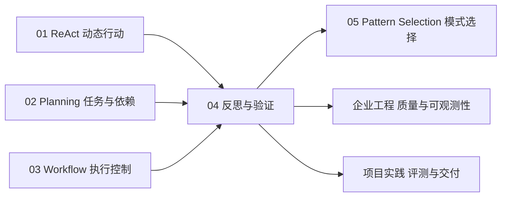

## 14. 权威参考资料与进一步阅读

以下以原始论文、官方技术文档和官方工程文章为主。研究结论均有特定实验条件，实际效果应以项目测试为准。

1. Shinn et al., [Reflexion: Language Agents with Verbal Reinforcement Learning](https://arxiv.org/abs/2303.11366), NeurIPS 2023；[官方实验仓库](https://github.com/noahshinn/reflexion)。
2. Madaan et al., [Self-Refine: Iterative Refinement with Self-Feedback](https://arxiv.org/abs/2303.17651), 2023。
3. Gou et al., [CRITIC: Large Language Models Can Self-Correct with Tool-Interactive Critiquing](https://arxiv.org/abs/2305.11738), 2023。
4. Dhuliawala et al., [Chain-of-Verification Reduces Hallucination in Large Language Models](https://arxiv.org/abs/2309.11495), 2023。
5. Huang et al., [Large Language Models Cannot Self-Correct Reasoning Yet](https://arxiv.org/abs/2310.01798), 2023。
6. Anthropic, [Building Effective Agents](https://www.anthropic.com/engineering/building-effective-agents), Evaluator–Optimizer 模式。
7. Anthropic, [Demystifying Evals for AI Agents](https://www.anthropic.com/engineering/demystifying-evals-for-ai-agents), 2026。
8. OpenAI, [Evaluate Agent Workflows](https://developers.openai.com/api/docs/guides/agent-evals), Traces、Graders、Datasets 与 Evals。
9. OpenAI, [Trace Grading](https://developers.openai.com/api/docs/guides/trace-grading), 执行轨迹评估。
10. OpenAI Agents SDK, [Guardrails](https://openai.github.io/openai-agents-python/guardrails/), 输入、输出及工具检查。
11. OpenAI Agents SDK, [Tracing](https://openai.github.io/openai-agents-python/tracing/), 运行记录与可观测性。
12. OpenAI, [Safety in Building Agents](https://developers.openai.com/api/docs/guides/agent-builder-safety), 工具审批、注入风险与评估。
13. [Justice or Prejudice? Quantifying Biases in LLM-as-a-Judge](https://proceedings.iclr.cc/paper_files/paper/2025/hash/fdca08d371e4b6c031397909e20043bd-Abstract-Conference.html), ICLR 2025。
14. [Position Bias in LLM-as-a-Judge](https://aclanthology.org/2025.ijcnlp-long.18/), IJCNLP-AACL 2025。

---

## 15. 一页总结

<strong>生成不是完成，反思不是证据，评分不是验收，修复不是成功。</strong>

可信的 Agent 应把目标转化为可检查的契约，把执行过程与结果保存为可追溯证据，在规则、工具、模型与人工之间分配不同的验证责任；对失败进行定位和有界修复，并在每次修改后重新验证受影响的约束。最后通过 Evals 把单次失败转化为长期可复现的系统改进。

最终闭环：<strong>生成 → 证据收集 → 规则与语义验证 → 错误诊断 → 局部修复 → 回归验证 → 验收或人工升级 → 持续评测。</strong>

