# 05｜Agent 工作范式对比与选型：从任务画像到企业架构决策

> 第四章 Agent 工作范式的综合篇。先明确任务和验收标准，再选择最小必要执行架构，最后用评测数据决定是否增加自主性。

## 阅读路线与学习目标

本篇连接 [01-ReAct](./01-ReAct.md)、[02-Planning](./02-Planning.md)、[03-Workflow](./03-Workflow.md) 和 [04-Reflection-and-Verification](./04-Reflection-and-Verification.md)。前四篇分别回答“下一步做什么”“整体怎样安排”“怎样稳定执行”“怎样确认并修复”，本篇回答“何时用哪一种、怎样组合、凭什么证明选型合理”。

学习完成后，应能区分工作范式与框架、构造任务画像、明确硬约束、设计混合架构、用消融实验验证组件收益，并解释质量、延迟、成本、风险与维护复杂度之间的取舍。

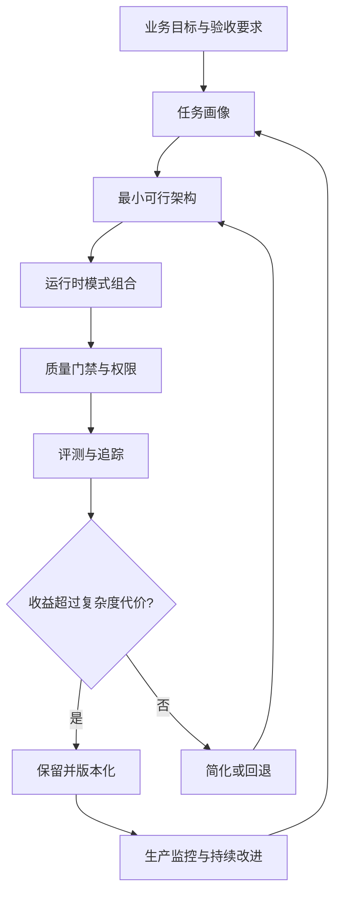

## 1. 为什么必须进行范式选型

<strong>工作范式（Working Pattern）</strong>描述任务的决策与执行组织方式；<strong>框架（Framework）</strong>提供节点、工具、状态、持久化等实现能力。两者不等价：LangGraph 可以实现固定工作流，也可以承载动态 Agent；Temporal 可以为长任务提供可靠执行，而不负责替模型决定下一步行动。

LLM（Large Language Model，大语言模型）具有语义理解能力，但模型调用并不自动等于 Agent。任务的确定性越高，通常越应该先考虑规则、传统算法或单次模型调用。只有执行路径难以预先确定、外部观察会改变行动选择时，才有理由引入自主决策。

Anthropic 的《Building Effective Agents》区分预定义执行路径的 Workflow 和由模型动态指导行动的 Agent，强调从简单方案起步、在收益明确时才增加复杂性。[来源](https://www.anthropic.com/engineering/building-effective-agents)。

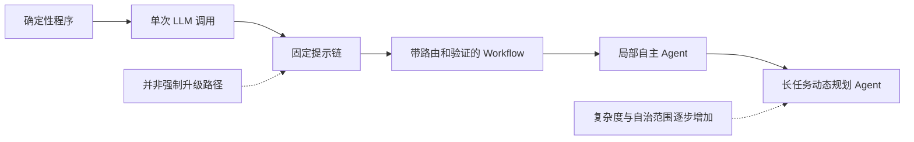

以上 L0–L5 式的渐进层级只是本篇的<strong>工程分析框架</strong>，不是官方行业成熟度标准。每次增加复杂度都应有明确假设，例如“增加局部 ReAct 能提高未知版式问题的处理成功率”，并用相同数据集验证。

## 2. 核心概念边界：五种能力不是五选一

| 能力 | 首次术语解释 | 决策粒度 | 典型产物 | 核心失败模式 |
|---|---|---|---|---|
| ReAct | Reasoning and Acting，推理与行动；模型交替决策和调用工具 | 当前一步 | 行动及观察 | 循环失控、误用工具 |
| Planning | 任务规划；将目标分解为依赖任务 | 多步或全局 | 结构化计划 | 计划不可执行、过时 |
| Workflow | 工作流；按规则编排执行节点 | 流程节点 | 执行状态与产物 | 分支遗漏、恢复失败 |
| Reflection | 反思；根据反馈分析失败和改进策略 | 错误与修复 | 诊断建议 | 自我肯定、错误经验 |
| Verification | 验证；基于可核查条件判定结果 | 验收项 | 证据与通过状态 | 漏报、误报、标准不全 |

<strong>重要区别：</strong>Reflection 不是 Verification，Planning 不是 Scheduler（调度器），并行任务也不自动意味着 Multi-Agent（多智能体）。工作流可以包含 Agent，Agent 内也可以调用子工作流。

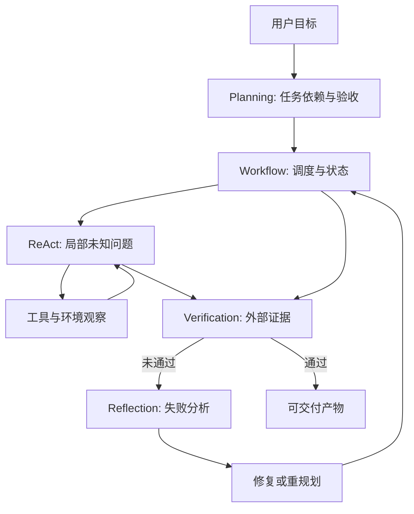

### 2.1 从控制权看区别

<strong>控制权（Control Authority）</strong>指谁决定下一步动作。规则驱动工作流由程序决定路径；ReAct 由模型在授权动作集合中选择；Planning 负责提出任务顺序，但实际能否执行由调度器和验证器决定。控制权必须与工具权限区分：模型建议调用删除工具，不代表它获得了删除权限。

### 2.2 从时间尺度看区别

ReAct 偏向局部短视反馈，Planning 偏向全局长程约束；Workflow 维持执行生命周期；Verification 贯穿前置、中间与最终检查。它们解决不同时间尺度的问题，天然适合组合。

## 3. 任务画像：在选型之前先定义问题

至少采集七个维度：任务复杂度、环境不确定性、路径稳定性、结果可验证性、行动风险、预算和运行时长。不要只问“需要多少 Agent”，而要问“哪些决策必须留给模型，哪些必须留给程序”。

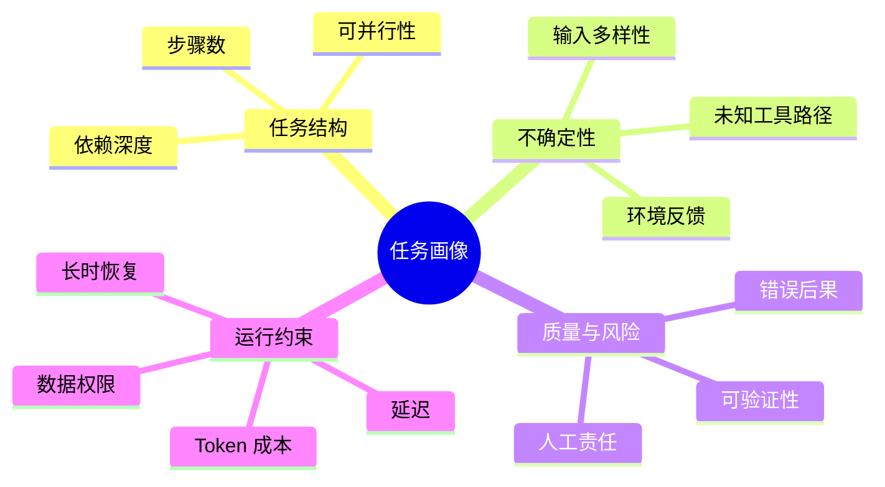

| 维度 | 低值特征 | 高值特征 | 选型影响 |
|---|---|---|---|
| 路径不确定性 | 操作步骤可枚举 | 需要持续探索 | 高时考虑局部 ReAct |
| 依赖复杂度 | 少量线性步骤 | 多层依赖和条件 | 高时考虑 Planning + Workflow |
| 验证可得性 | 无客观检查 | 有规则、测试和证据 | 高时适合反馈修复循环 |
| 失败代价 | 可轻易重试 | 外部不可逆副作用 | 高时强化审批、幂等和限制 |
| 长时需求 | 秒级请求 | 跨小时或跨天 | 高时考虑持久化执行 |
| 并行空间 | 严格串行 | 独立分片多 | 高时采用受限并发 |
| 需求稳定性 | 规则频繁变化 | 业务 SOP 稳定 | 稳定时更适合固定 Workflow |

SOP（Standard Operating Procedure，标准操作程序）描述可重复执行的业务规范。判断是否需要 Agent 时，应优先识别能够直接实现为 SOP 的部分。

## 4. 基于任务画像的选型决策

一个可执行的选型过程应先检查安全和可行性，再评估动态决策需求，最后考虑质量增强。它不是“先选框架再套业务”。

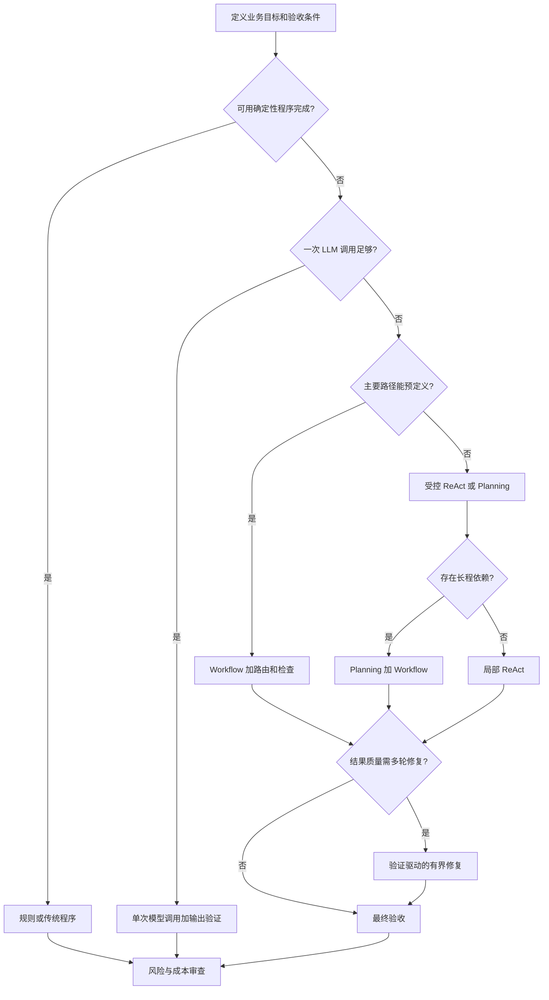

### 4.1 ReAct 何时优于固定工作流

开放检索、复杂排障、未知网页交互等任务，需要根据工具观察决定下一步。ReAct 通过“推理—行动—观察”的迭代减少预先枚举路径的负担，但会引入不可预测的调用次数、上下文增长和潜在循环。应设置允许工具清单、最大步数、超时、预算和升级处理条件。原始研究见 [ReAct 论文](https://arxiv.org/abs/2210.03629)。

### 4.2 Planning 何时真正必要

复杂目标涉及多阶段依赖、资源冲突、条件任务和失败重规划时，规划能够提供全局协调。但计划应输出可执行任务契约，例如 task_id、dependencies、preconditions、outputs、acceptance_criteria、status，而不只是自然语言清单。规划器生成的计划必须经过合法性验证，再交给执行器。参见 [Plan-and-Solve](https://arxiv.org/abs/2305.04091)。

### 4.3 Workflow 为什么常作为外层骨架

流程稳定的企业系统需要权限、状态、审计、重试和可恢复执行。即使局部存在未知任务，外层也可通过条件边进入动态 Agent，完成后回到确定性主流程。不要把“Workflow”误认为“没有模型推理”。

### 4.4 Reflection 何时值得增加

只有在错误可被定位、反馈可信且修订能带来可衡量收益时，增加 Evaluator–Optimizer（评估器—优化器）才有价值。自我反思可能误判，应优先依赖外部工具、规则或人工证据；限制迭代次数，记录修复前后差异。参见 [Reflexion](https://arxiv.org/abs/2303.11366) 与 [Self-Refine](https://arxiv.org/abs/2303.17651)。

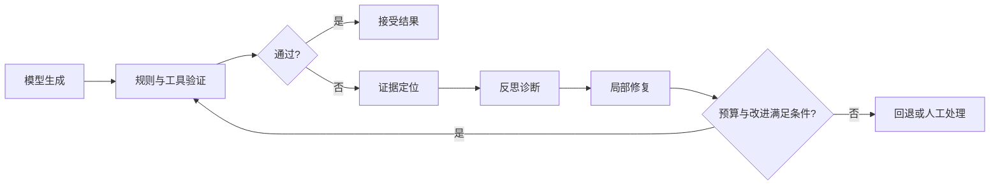

## 5. 五种可组合的经典 Workflow 模式

Anthropic 的 [Building Effective Agents](https://www.anthropic.com/engineering/building-effective-agents) 和官方 [Cookbook](https://github.com/anthropics/claude-cookbooks/tree/main/patterns/agents) 提供了典型实现思路：Prompt Chaining（提示链）、Routing（路由）、Parallelization（并行化）、Orchestrator–Workers（编排器—工作者）和 Evaluator–Optimizer（评估器—优化器）。它们是可组合模式，而非互斥架构。

| 模式 | 控制方式 | 适用条件 | 关键风险 |
|---|---|---|---|
| Prompt Chaining | 固定顺序 | 分阶段处理、可设置质量门禁 | 逐步累积延迟 |
| Routing | 规则或模型分类 | 多种任务对应不同处理策略 | 分类错误传播 |
| Parallelization | 分片或多视角 | 独立任务、可汇聚结果 | 限流、竞争和聚合错误 |
| Orchestrator–Workers | 动态分派子任务 | 子任务数量与类型事先未知 | 协调成本、结果冲突 |
| Evaluator–Optimizer | 反馈驱动修订 | 有明确评价标准和改进空间 | 额外成本、循环失控 |

需要区分 Sectioning（独立分片）与 Voting（多次独立判断）：前者主要增加吞吐，后者用于多视角质量评估。多次判断仍可能具有相关性，不能当作独立真值来源。

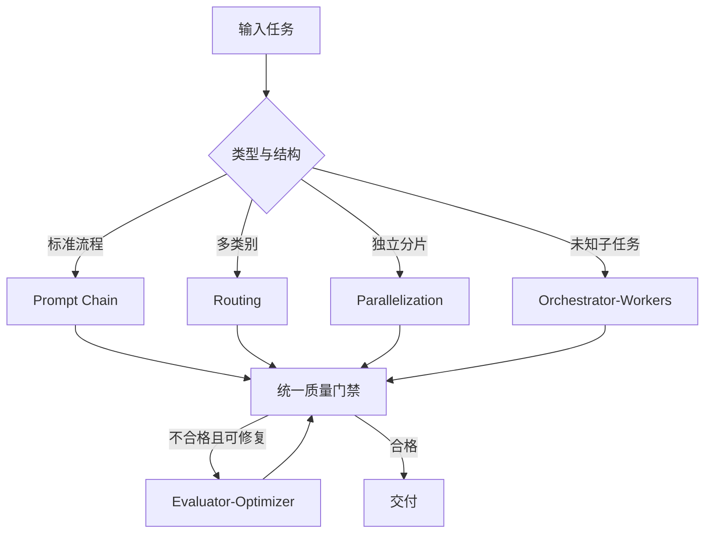

## 6. 混合架构：把自主性限制在需要它的地方

<strong>混合架构（Hybrid Architecture）</strong>不是简单堆叠模块，而是明确每个模块的控制边界、数据契约和失败处理策略。典型架构是外层 Workflow 管理生命周期，Planning 管理复杂依赖，局部 ReAct 处理未知异常，Verification 作为不可绕过的质量门禁。

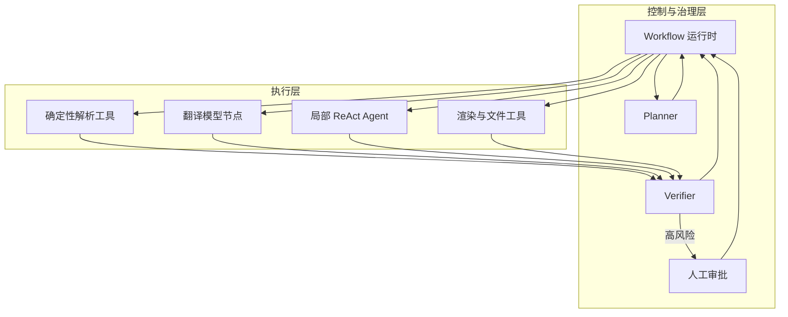

### 6.1 控制流与数据流分离

控制流决定下一个执行节点；数据流承载文档、结构化文本、证据和产物引用。不要将大文件或完整轨迹反复塞入每次模型上下文。可以让 State（状态）保存引用与关键摘要，将大对象保存在对象存储中，并通过明确的输入输出 Schema（结构模式）传递。

### 6.2 工具权限与 Agent 自主性分离

模型可以提出行动建议，但执行器必须检查工具权限、参数合法性、风险等级和审批状态。高风险操作需要在执行前进行阻塞式检查；不能把“请勿执行危险操作”这种 Prompt 当作安全边界。OpenAI Agents SDK 的 [Guardrails 文档](https://openai.github.io/openai-agents-python/guardrails/) 也区分不同检查发生的执行位置。

### 6.3 子任务边界与上下文隔离

当不同子任务需要不同工具、权限或上下文时，可考虑 Specialist Agent（专门化智能体）；如果仅仅是独立的程序任务，并不需要包装为 Agent。多 Agent 增加通信、协调和一致性成本，必须有可测量的收益。

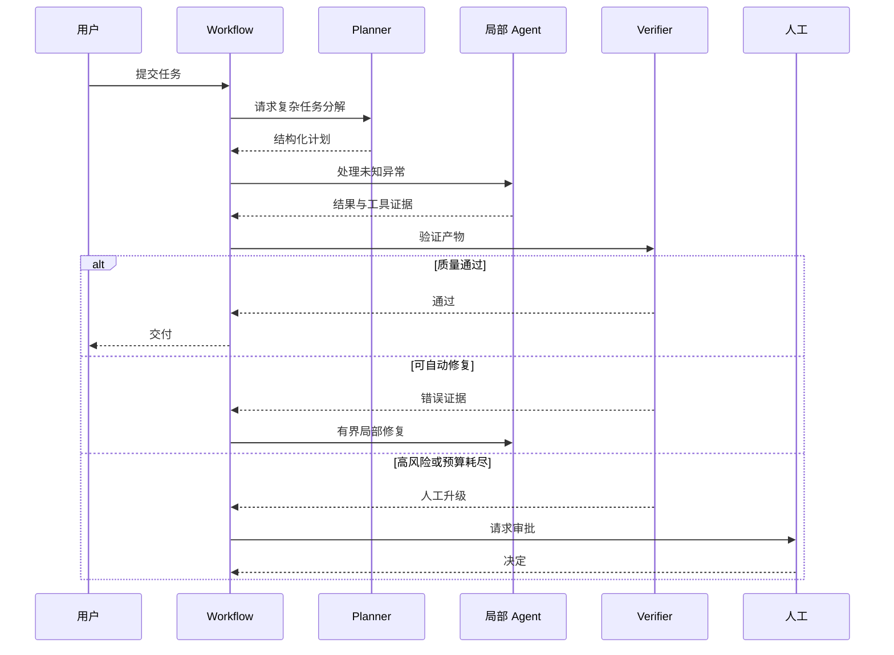

### 6.4 控制权所有权：谁真正决定下一步

<strong>控制权所有权（Control Ownership）</strong>是选型时独立于模型能力的关键维度：模型可以生成建议，但业务调度器、策略引擎、专业 Agent 与人工审批者可能分别掌握不同决策权限。设计时应明确每个节点的<strong>决策者、执行者、授权者和验收者</strong>，防止责任边界模糊。

| 控制权模式 | 决策者 | 适合场景 | 必须保留的约束 |
|---|---|---|---|
| 程序控制 | 应用代码或 Workflow 引擎 | 固定步骤、合规与交付 | 状态转移与权限校验 |
| ReAct 控制 | 当前 Agent | 受限范围内的未知异常 | 工具白名单、预算、步数上限 |
| Planner 控制 | 规划器提出计划，执行器批准 | 复杂任务依赖 | 计划结构校验、依赖合法性 |
| Manager 控制 | 管理者 Agent | 动态分派专业子任务 | 子任务契约与汇总验证 |
| 质量门禁控制 | Verifier 或 Policy Engine（策略引擎） | 结果放行与风险阻断 | 不允许生成器绕过门禁 |
| 人工控制 | 指定审批人员 | 高风险或不可自动判定事项 | 审批记录与恢复机制 |

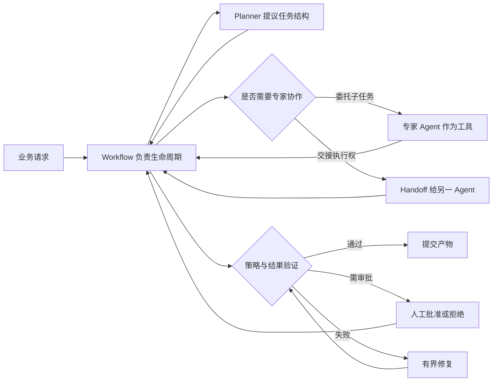

<strong>Handoff（控制权交接）</strong>与 <strong>Agents-as-Tools（Agent 作为工具）</strong>不是同一回事。前者由另一个 Agent 接管后续执行；后者由管理者保持控制权，专家仅返回子任务结果。OpenAI Agents SDK 的 [Handoffs](https://openai.github.io/openai-agents-python/handoffs/) 与 [Quickstart](https://openai.github.io/openai-agents-python/quickstart/) 文档可用于核对实际调用语义。企业任务通常优先采用可审计的受控委托，只有确有必要时才交接控制权。

### 6.5 五种多 Agent 编排拓扑及其代价

Microsoft Agent Framework 文档区分 <strong>Sequential（顺序）</strong>、<strong>Concurrent（并发）</strong>、<strong>Handoff（交接）</strong>、<strong>Group Chat（群组讨论）</strong>和 <strong>Magentic（动态管理者编排）</strong>等模式。这些是协作拓扑，和 ReAct、Planning 等认知与执行范式不在同一分类层级。

| 拓扑 | 信息流和控制流 | 适用情况 | 常见代价 |
|---|---|---|---|
| Sequential | A 的产物传给 B | 流程依赖明确 | 上游错误传播、串行延迟 |
| Concurrent | 多执行者并行、集中汇总 | 独立页面、多维检查 | 限流、冲突合并、屏障等待 |
| Handoff | 控制权转移到专业执行者 | 不同专业领域接管 | 上下文交接、权限与状态边界 |
| Group Chat | 多方共享讨论并协调结论 | 多视角讨论、方案评审 | Token 膨胀、共识不稳定 |
| Magentic | 管理者动态选择、调度专家 | 子任务未知的开放式问题 | 协调成本、路径难预测 |

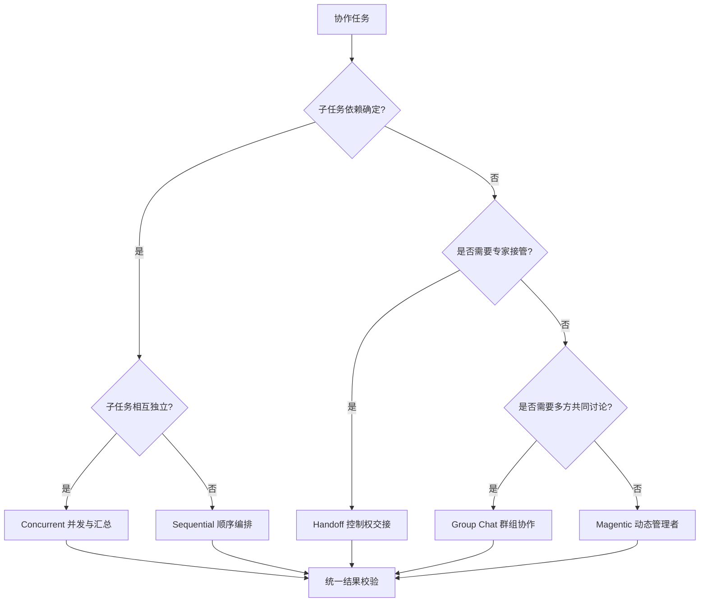

图中判断条件是<strong>教学用的初步筛选启发式</strong>，而非 Microsoft 官方决策算法；实际拓扑可能混合使用。特别是“多 Agent”不等于“并行”，多个程序任务也无需包装成 Agent。参见 [Microsoft Workflow Orchestrations](https://learn.microsoft.com/en-us/agent-framework/workflows/orchestrations/)。

## 7. 动态升级、降级与模式切换

动态模式选择不等于每一步都让 LLM 决定使用哪个框架。建议使用<strong>规则优先、模型辅助、状态受控</strong>的路由：先判断任务是否落在稳定流程内，再决定是否进入局部 Agent。复杂模式切换需要记录原因和状态，避免反复升级、回退造成抖动（Thrashing）。

Fallback（回退）是失败时转向备用实现；Graceful Degradation（优雅降级）是在保证安全约束的前提下降低功能或服务等级；Human Escalation（人工升级处理）是在自动化不足以安全完成时转交人员。三者不能混为一谈。

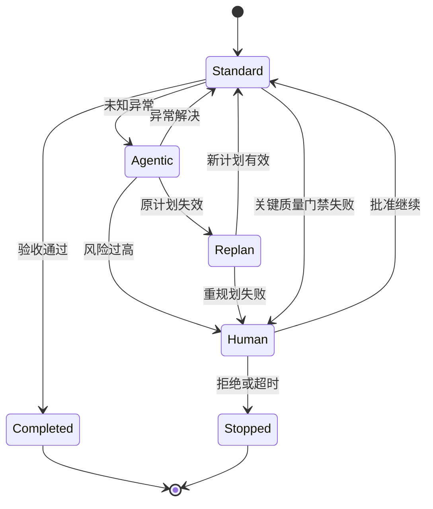

模式切换的工程保护包括：每次升级需有触发事件；单次任务最大升级次数；预算和截止时间；已完成任务不可重复产生副作用；高风险失败必须停止或升级；人工决定要写入审计记录。

## 8. 质量、成本、延迟与风险的多目标权衡

架构选型先满足<strong>硬约束（Hard Constraints）</strong>，再优化<strong>软目标（Soft Objectives）</strong>。硬约束包括权限、法规、安全、必须通过的质量项、最大预算；软目标包括平均延迟、成本、吞吐和维护负担。

以下是用于说明选型逻辑的工程模型，并非业界统一标准：

$$
a^*=\arg\min_{a\in\mathcal{A}_{\mathrm{feasible}}}\left(w_c\widetilde C_a+w_l\widetilde L_a+w_e\widetilde E_a+w_m\widetilde M_a\right)
$$

其中 $\mathcal{A}_{\mathrm{feasible}}$ 为满足硬约束的架构集合，$\widetilde C$、$\widetilde L$、$\widetilde E$、$\widetilde M$ 分别是归一化后的成本、延迟、错误代价和维护复杂度，$w$ 是业务权重。不能把关键安全约束简单放进加权和，以免被其他指标抵消。

Pareto Frontier（帕累托前沿）是多目标优化中的非支配解集合：若没有其他候选在全部指标上不差且至少一项更好，则该候选未被支配。实际架构常在帕累托前沿上根据业务风险偏好选择。

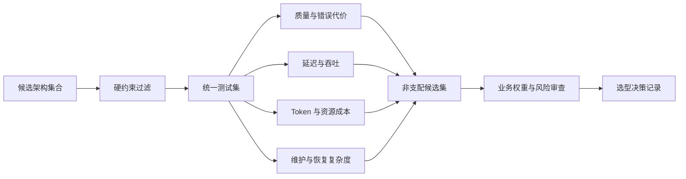

### 8.1 延迟模型与关键路径

对串行链路，端到端延迟近似为各节点耗时、排队和网络开销之和；对可并行的独立任务，理想执行耗时由最长分支主导，但仍需加上调度、汇聚和资源竞争开销：

$$
T_{\mathrm{parallel}}\approx T_{\mathrm{dispatch}}+\max_i(T_i)+T_{\mathrm{merge}}+T_{\mathrm{queue}}
$$

因此“增加 Agent 数量必然更快”是错误的。若共享同一 API 限流、上下文准备成本很高或分支需要串行汇聚，并行收益可能很小。

### 8.2 成本模型

成本不仅包含输入输出 Token，还包含模型重试、评估器、工具调用、OCR、图像渲染、存储和人工审核。可使用“每个通过验收的结果的总成本”衡量，而不是仅比较单次模型调用价格。

## 9. 框架选型：模式与运行时能力分开评估

| 框架或系统 | 核心定位 | 适合承担的职责 | 不能直接推断的能力 |
|---|---|---|---|
| LangGraph | 状态图与 Agent 编排 | 条件路由、循环、子图、持久化状态 | 不自动保证业务正确性 |
| OpenAI Agents SDK | Agent 运行时与工具、交接 | 模型驱动循环、工具调用、Tracing、Guardrails | 不替代业务事务和权限系统 |
| Temporal | Durable Execution（持久化执行） | 长任务、事件历史、恢复、重试 | 不自动提供 Agent 推理策略 |
| Apache Airflow | DAG（Directed Acyclic Graph，有向无环图）任务调度 | 批处理、定时、动态任务映射 | 不天然适合低延迟交互 Agent |
| Camunda | BPMN（Business Process Model and Notation，业务流程模型与标记法）引擎 | 企业审批、事件和业务流程治理 | 不负责模型语义决策 |

参考官方资料：[LangGraph](https://docs.langchain.com/oss/python/langgraph/workflows-agents)、[OpenAI Agents SDK](https://developers.openai.com/api/docs/guides/agents/sdk)、[Temporal](https://docs.temporal.io/workflows)、[Airflow](https://airflow.apache.org/docs/)、[Camunda](https://docs.camunda.io/)。版本迭代快，实施时以对应 SDK 版本文档为准。

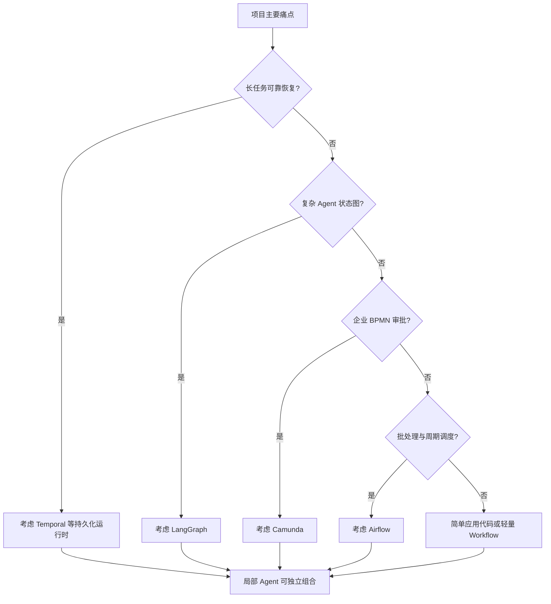

### 9.1 运行时可靠性核对清单

复杂 Agent 架构必须将<strong>编排能力</strong>与<strong>执行可靠性</strong>分别验收。Checkpoint（检查点）保存恢复所需状态；Durable Execution（持久化执行）支持进程重启后继续任务；Idempotency（幂等性）保证重复请求不产生重复副作用；Retry Policy（重试策略）区分可重试和不可重试错误；Versioning（版本管理）用于控制长任务跨版本恢复时的兼容性。

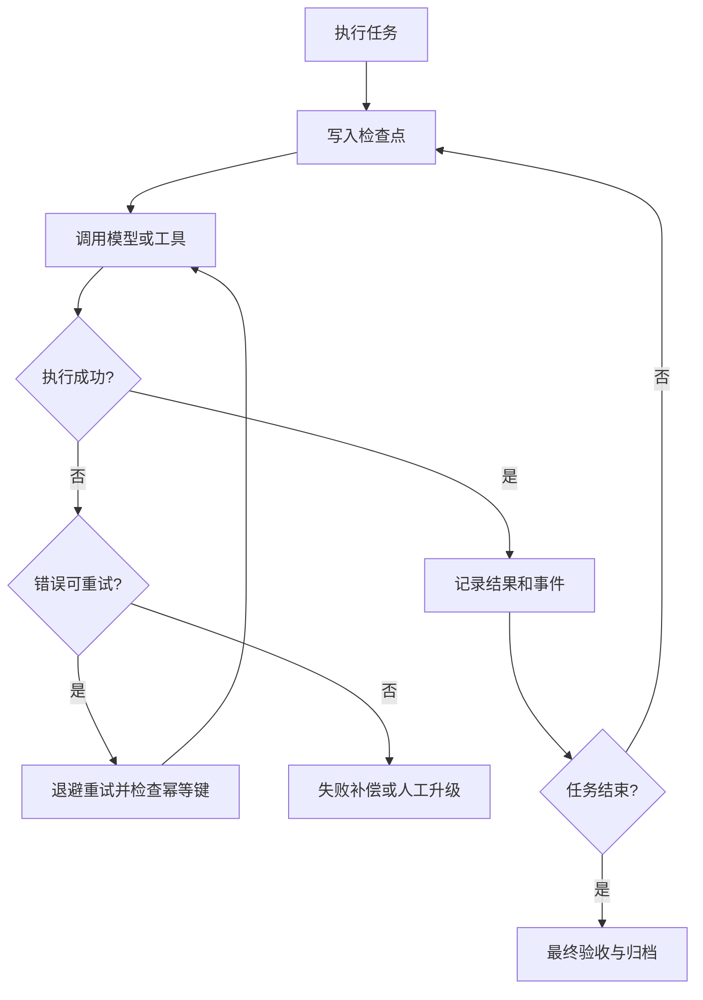

注意：仅保存 Checkpoint 不等于具备端到端 Exactly-once（恰好一次）副作用语义。网络超时后外部操作可能已成功，因此需要业务幂等键、去重记录或补偿策略。对于长时间运行的文档翻译，应测试进程崩溃、模型超时、重复回调、人工审批跨天恢复和工作流升级等情况。

## 10. 企业文档翻译 Agent：完整选型案例

以医疗设备技术文档的中英互译为例，需求包括：Word/PDF/图片输入，保留表格与图示结构，核对术语、数值、型号、警告信息，必要时修复版式，并提供可交付文件。

<strong>关键思路：</strong>文件解析和导出是相对确定性的；复杂页面布局和异常诊断存在不确定性；质量验证必须依赖多类证据；重要参数和安全警告可能需要人工确认。

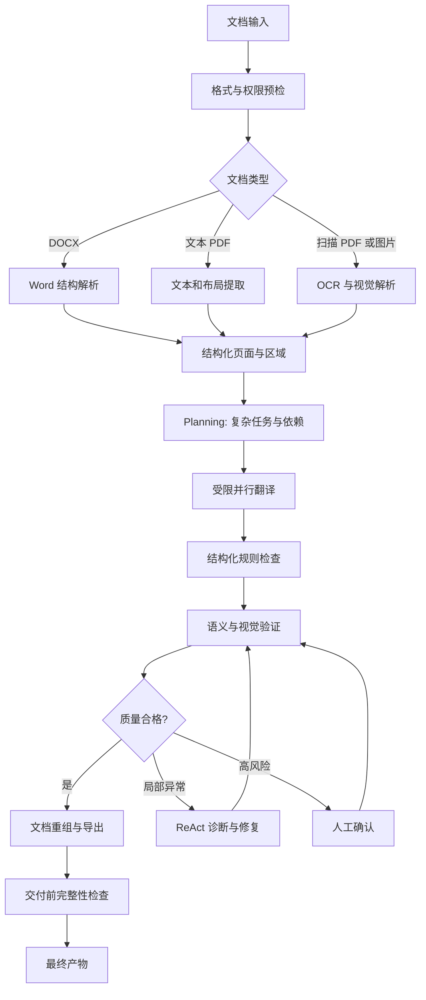

### 10.1 子任务与范式映射

| 子任务 | 首选方案 | 何时升级 | 质量边界 |
|---|---|---|---|
| 文件识别 | 规则程序 | 不确定时补充分类器 | 不支持格式拒绝 |
| 结构解析 | 固定 Workflow | 特殊布局进入专用解析 | 保留结构引用 |
| 页面分解 | Planning + DAG | 发现跨页依赖时重规划 | 依赖合法性检查 |
| 普通翻译 | Prompt Chain | 专业术语冲突时增强上下文 | 术语表、原文映射 |
| 批量翻译 | 受限并行 | API 限流时降低并发 | 页面状态独立保存 |
| 未知布局修复 | 局部 ReAct | 无改善时人工升级 | 不能任意改原图 |
| 数值与型号核验 | 确定性验证 | 复杂语义再由模型检查 | 硬约束不可豁免 |
| 视觉质量 | 规则 + 视觉评审 | 定位错误后局部修复 | 不能仅凭总评分 |
| 最终交付 | 持久化 Workflow | 失败时断点恢复 | 文件可打开、内容齐全 |

### 10.2 典型失败场景：第 35 页标签重叠

系统先定位重叠区域，保留原始页面和译文版本；布局检查器输出具体框坐标和问题类型；局部 Agent 只能选择授权的缩排、换行、字体调整或重排工具；修复后重新运行区域检查与全页回归检查。如果连续两轮没有改进，停止自动修复并升级人工。这里的关键是“受控的局部自主”，而不是让模型自由重画整页。

### 10.3 高风险技术参数

假设原文是 `0.5 mg`，译文误写成 `5 mg`。即使语义评分很高，也必须由数字与单位核验阻止交付。质量总分不应覆盖关键参数硬约束。若系统无法可靠确定数值映射，应请求人工核查，而不是通过额外反思轮次强行给出结论。

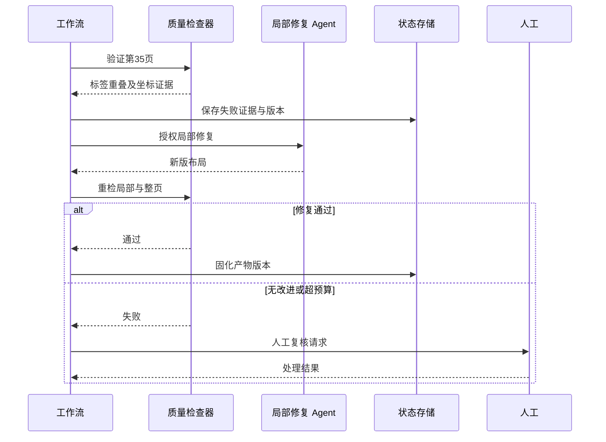

## 11. 评测驱动选型：证明复杂模块确有收益

Evaluation（评估）应覆盖结果质量、过程正确性、成本、延迟、可恢复性和安全性。Trace（执行轨迹）记录模型调用、工具调用、交接与状态变化，帮助定位问题；仅看最终答案无法证明执行过程可靠。OpenAI Agents SDK 提供 [Tracing](https://openai.github.io/openai-agents-python/tracing/) 机制。

### 11.1 统一评测集

建议将任务分为常规、复杂、异常、高风险四类，覆盖正常输入、扫描件、跨页表格、模型超时、错误工具返回、重复事件、重启恢复和审批拒绝。比较候选方案时，固定输入数据、验收规则、模型版本与预算口径，避免混淆因素。

### 11.2 消融实验（Ablation Study）

消融实验通过移除一个模块来估计其贡献。建议对比：固定 Workflow；加 Planning；加局部 ReAct；加 Verification；加 Reflection。逐项测量成功率、关键错误率、P95 延迟、平均成本、修复回归率。不能仅凭单个成功案例宣称模块有效。

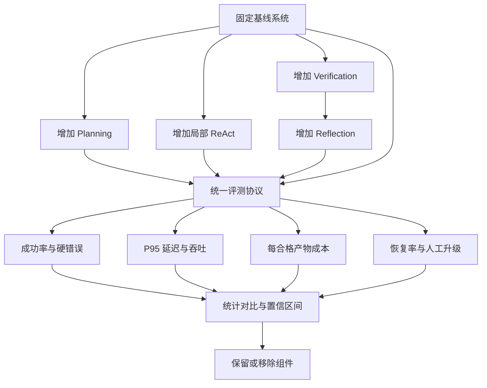

### 11.3 关键指标

| 指标 | 定义与注意事项 |
|---|---|
| Task Success Rate | 通过全部验收项的任务比例；明确样本分母 |
| Critical Error Rate | 关键数字、警告、权限等硬错误比例 |
| P95 Latency | 95 分位端到端耗时，避免只看平均值 |
| Cost per Accepted Result | 总模型、工具、人工成本除以合格产物数 |
| Recovery Success Rate | 注入故障后成功恢复且无重复副作用的比例 |
| Human Escalation Rate | 需要人工接管的任务比例，需结合风险解释 |
| Regression Rate | 修复后引入新错误的比例 |
| Trace Coverage | 关键节点和工具调用被记录的比例 |

对于二元成功率，可在同一测试集上比较两个方案的成功样本，使用配对统计分析和置信区间，而不是把少量样本的波动当成确定性改进。

### 11.4 pass@k 与 pass^k：区分探索能力和稳定性

在独立同分布且单次成功概率为 $p$ 的简化假设下，<strong>pass@k</strong> 表示尝试 $k$ 次至少成功一次的概率；<strong>pass^k</strong> 表示连续 $k$ 次全部成功的概率：

$$
P(\text{至少一次成功})=1-(1-p)^k
$$

$$
P(\text{全部成功})=p^k
$$

实际模型调用可能相关，且评测中的 pass@k 估计有其采样协议，不能直接把上面的独立性公式当成所有基准的精确计算方式。对探索型编程任务，多次尝试至少成功一次可能有价值；对企业生产流程，更应关注重复运行的稳定性、硬错误率、恢复成功率和最终交付可靠性。

### 11.5 Pareto Frontier 与统计有效性

<strong>Pareto Frontier（帕累托前沿）</strong>用于筛选多目标下的非支配架构：如果方案 A 的质量不低于 B、成本和延迟不高于 B，且至少一个维度严格更好，则 B 在这些维度上被 A 支配。比较前必须统一指标方向、样本分布和硬约束。未被支配的方案不一定只有一个，应由业务权重、风险阈值和部署条件最终选择。

消融实验应固定可比条件并尽量使用配对样本；样本较少时，不应将偶然的成功率差异当作显著收益。尤其要关注新增 Reflection、Planning 或多 Agent 后，是否只是通过更多调用提高了成功机会，而不是提升了单次执行质量。

## 12. 工程治理：架构决策、发布与持续优化

ADR（Architecture Decision Record，架构决策记录）用于保存一次重要选型的背景、候选方案、约束、结论、预期收益和复审条件。一个合格的 ADR 应说明为什么没有选择更复杂的方案，也要说明何时重新评估。

生产环境建议记录任务类型、模式选择原因、模型与工作流版本、输入输出产物引用、验证证据、失败类型、成本、延迟、人工审批和恢复结果。生产数据可能包含敏感文档，Tracing 必须遵守最小化采集、脱敏、访问控制和保留策略。

上线采用版本化评测、灰度发布、回滚方案和异常监控。新的模型版本可能改变路由、工具调用或评审偏差，不能因为代码没有变更就省略回归测试。

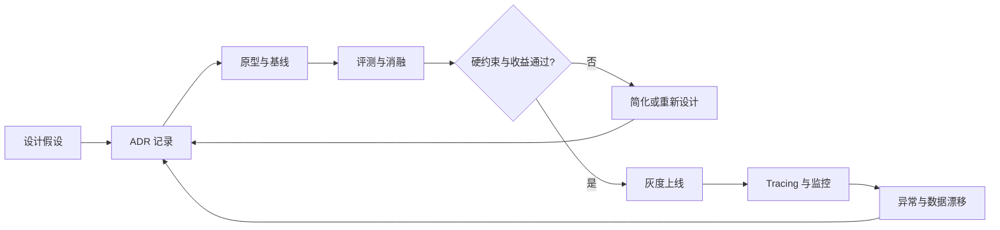

## 13. 常见误区与纠正

| 常见误区 | 为什么不成立 | 正确做法 |
|---|---|---|
| Agent 越自主越先进 | 路径不可预测性增加 | 自主性匹配不确定性 |
| 多 Agent 必然优于单 Agent | 通信与协调有额外成本 | 按工具权限和上下文边界拆分 |
| Planning 可以替代 Workflow | 计划不等于调度与状态管理 | 用结构化契约连接 |
| Reflection 次数越多越好 | 可能反复强化错误 | 外部证据、有界修复 |
| 并行越多越快 | 存在限流和汇聚瓶颈 | 依据关键路径调并发 |
| 高分即可交付 | 综合分可能掩盖硬错误 | 关键验收项一票否决 |
| 选框架等于选架构 | 框架提供机制而非业务答案 | 先任务画像后技术选型 |
| 最终答案正确即可 | 过程可能越权或重复副作用 | 同时评估轨迹与状态 |
| 一次成功证明方案最优 | 样本偏差与随机性很大 | 多类别基准与统计比较 |
| 失败时自动降级总是安全 | 降级可能绕过权限或质量门禁 | 安全停止或人工升级 |

## 14. 面试与设计评审问题

### Q1：ReAct、Planning 和 Workflow 的本质区别？

ReAct 决定局部下一步行动，Planning 组织全局任务依赖，Workflow 负责实际执行与状态生命周期。复杂系统通常由 Workflow 承载 Planning 输出的计划，并在局部未知问题中调用 ReAct。

### Q2：为什么不直接用一个大 Agent 做完所有事情？

因为稳定任务无需动态决策；单个大 Agent 容易出现上下文膨胀、工具权限过宽、路径难审计和局部失败难恢复。只有确实需要开放探索的部分才应授予有限自主性。

### Q3：如何判断是否需要 Planning？

看是否存在多层依赖、条件任务、资源冲突、跨步骤验收和重规划需求。如果只有固定的三个步骤，直接使用 Workflow 往往更简单。

### Q4：什么情况下使用 Reflection？

当错误可检测、反馈能定位、修复有改善空间时。应先建立 Verification，再考虑 Reflection；没有证据的自我批评不能替代验收。

### Q5：多 Agent 和并行 Workflow 有何区别？

多 Agent 强调多个自治决策主体及其协作，并行 Workflow 强调多个任务同时执行。多个非 Agent 工具可以并行；多个 Agent 也可能串行。

### Q6：如何防止 Agent 无限调用工具？

使用最大步数、总超时、Token 和费用预算、重复动作检测、进展指标以及人工升级阈值。限制应由运行时强制执行，而非仅写在 Prompt 中。

### Q7：什么是硬约束和软目标？

硬约束是必须满足的安全、权限、合规与关键质量条件；软目标是可权衡的延迟、成本和维护性。先过滤不可行方案，再比较软目标。

### Q8：为什么选择 Workflow 作为外层骨架？

因为企业任务需要稳定的业务规则、状态管理、审批、重试、追踪与恢复。局部模型决策可作为内部节点，减少全局不确定性。

### Q9：如何证明加入 Planning 真有价值？

在同一数据集和预算口径下做消融实验，比较任务成功率、依赖错误、延迟、成本和失败恢复表现。若收益不足，应保留简单架构。

### Q10：模型评审器可以作为唯一质量门禁吗？

不可以。关键数字、文件结构和权限必须用确定性规则或独立证据核验；模型评审更适合复杂语义与视觉质量，必要时人工复核。

### Q11：如何选择 LangGraph 和 Temporal？

LangGraph 更聚焦 Agent 状态图、条件边与循环；Temporal 更聚焦长任务持久化执行与恢复。二者可能互补，具体选择由部署、状态和恢复需求决定。

### Q12：何时从自动执行升级为人工处理？

遇到高风险内容、缺少可靠证据、反复修复无进展、预算耗尽或权限边界不清时。人工升级应带上上下文、失败证据和已尝试操作。

### Q13：如何设计模式切换避免抖动？

记录触发原因，限制升级次数，采用明确的状态转换和冷却条件，并保留幂等性与检查点。不能在没有新证据时反复切换。

### Q14：什么是每个合格结果的成本？

将模型、工具、计算、重试、人工审核等总成本除以最终通过验收的产物数。它比单次模型调用价格更能体现企业价值。

### Q15：怎样评估复杂 Agent 的可靠性？

不仅检查最终成功率，还要检查关键错误、执行轨迹、工具副作用、超时、重复事件、断点恢复、人工升级和版本回归。

## 15. 术语速查

| 缩写或术语 | 英文全称 | 中文解释 |
|---|---|---|
| LLM | Large Language Model | 大语言模型 |
| ReAct | Reasoning and Acting | 推理与行动交替 |
| Workflow | Workflow | 工作流编排 |
| DAG | Directed Acyclic Graph | 有向无环图 |
| SOP | Standard Operating Procedure | 标准操作程序 |
| ADR | Architecture Decision Record | 架构决策记录 |
| HITL | Human-in-the-Loop | 人在回路中 |
| API | Application Programming Interface | 应用程序编程接口 |
| SDK | Software Development Kit | 软件开发工具包 |
| BPMN | Business Process Model and Notation | 业务流程模型与标记法 |
| P95 | 95th Percentile | 95 分位数 |
| Trace | Execution Trace | 执行轨迹 |
| Guardrails | Guardrails | 输入、输出与工具安全约束 |
| Ablation | Ablation Study | 消融实验 |
| Pareto Frontier | Pareto Frontier | 帕累托前沿 |
| Fallback | Fallback | 失败回退 |
| Schema | Schema | 结构与类型约束 |
| OCR | Optical Character Recognition | 光学字符识别 |
| Token | Token | 模型文本处理单元 |

## 16. 权威资料与延伸阅读

以下资料分别用于<strong>模式定义、学术原理、框架实现与工程验证</strong>。阅读时应注意论文实验结论不能直接泛化为所有生产系统，框架功能以当前版本官方文档为准。

1. Anthropic, [Building Effective Agents](https://www.anthropic.com/engineering/building-effective-agents) — Workflow/Agent 边界与五类组合模式。
2. Anthropic, [Building Effective AI Agents](https://resources.anthropic.com/building-effective-ai-agents) — 单 Agent、多 Agent 与工作流架构取舍。
3. Anthropic, [Claude Cookbooks: Agent Patterns](https://github.com/anthropics/claude-cookbooks/tree/main/patterns/agents) — 常见模式的示例实现。
4. Yao et al., [ReAct](https://arxiv.org/abs/2210.03629) — 推理与行动交替。
5. Wang et al., [Plan-and-Solve Prompting](https://arxiv.org/abs/2305.04091) — 任务规划与求解。
6. Shinn et al., [Reflexion](https://arxiv.org/abs/2303.11366) — 反馈反思与情景记忆。
7. Madaan et al., [Self-Refine](https://arxiv.org/abs/2303.17651) — 自反馈迭代修订。
8. LangChain, [LangGraph Workflows and Agents](https://docs.langchain.com/oss/python/langgraph/workflows-agents) — 状态图、路由、并行与 Agent。
9. OpenAI, [Agents SDK](https://developers.openai.com/api/docs/guides/agents/sdk) — Agent 运行时、工具与交接。
10. OpenAI, [Agents SDK Tracing](https://openai.github.io/openai-agents-python/tracing/) — 轨迹与调试。
11. OpenAI, [Agents SDK Guardrails](https://openai.github.io/openai-agents-python/guardrails/) — 安全检查边界。
12. Temporal, [Workflows](https://docs.temporal.io/workflows) — 持久化执行与事件历史。
13. Apache Airflow, [Official Documentation](https://airflow.apache.org/docs/) — DAG 与批处理调度。
14. Camunda, [Documentation](https://docs.camunda.io/) — BPMN 与企业流程治理。
15. Anthropic, [Demystifying Evals for AI Agents](https://www.anthropic.com/engineering/demystifying-evals-for-ai-agents) — Agent 评测设计。

16. Microsoft, [Agent Framework Workflow Orchestrations](https://learn.microsoft.com/en-us/agent-framework/workflows/orchestrations/) — Sequential、Concurrent、Handoff、Group Chat 与 Magentic 协作拓扑。
17. Microsoft, [Agent Framework Workflow Concepts](https://learn.microsoft.com/en-us/agent-framework/concepts/workflows/) — 执行器、边、事件、状态与运行时概念。
18. OpenAI, [Agents SDK Handoffs](https://openai.github.io/openai-agents-python/handoffs/) — 控制权交接语义。
19. OpenAI, [Agents SDK Quickstart](https://openai.github.io/openai-agents-python/quickstart/) — 管理者模式与 Agent 工具委托。

## 17. 全章总结：选型不是寻找最强模式，而是寻找最小充分架构

<strong>最终决策链：</strong>明确业务目标与验收 → 分析任务画像 → 先尝试最简单方案 → 只在必要处引入 Planning、ReAct 和修复循环 → 由 Workflow 统一执行与治理 → 通过验证、追踪和消融实验确认收益 → 生产监控与持续优化。

第四章至此形成完整闭环：ReAct 负责局部行动，Planning 负责全局组织，Workflow 负责执行控制，Reflection 与 Verification 负责反馈质量，Pattern Selection 负责根据业务条件决定它们如何组合。真正成熟的 Agent 工程能力，不在于使用了多少模式，而在于能够解释每一层复杂度为何必要，并以数据证明其价值。

