# 第四章｜Agent 工作范式：从动态决策到可靠交付

> <strong>章节定位：</strong>本章不是介绍五种互斥的 Agent 类型，而是研究智能体如何组织决策、计划、执行、验证与改进，并在企业约束下选择合适的组合架构。  
> <strong>阅读方式：</strong>先通过知识图谱建立整体认识，再沿五篇正文深入学习；README 负责总结关联和建立导航，不替代正文的原理、案例与工程细节。  
> <strong>前置知识：</strong>[第三章：Agent 核心组件](../03-Agent-Core-Components/README.md)，特别是 Prompt、Context、Memory、Tools、State。

## 1. 全章总览：五种能力共同解决什么问题

Agent（智能体）不仅要“能回答”，还要在不断变化的环境中完成任务。大语言模型（LLM，Large Language Model）提供语义理解与决策能力，但<strong>模型能力本身并不自动构成可靠的执行系统</strong>。要实现可交付的业务结果，需要将局部行动、全局计划、执行控制、质量证据与架构取舍连接起来。

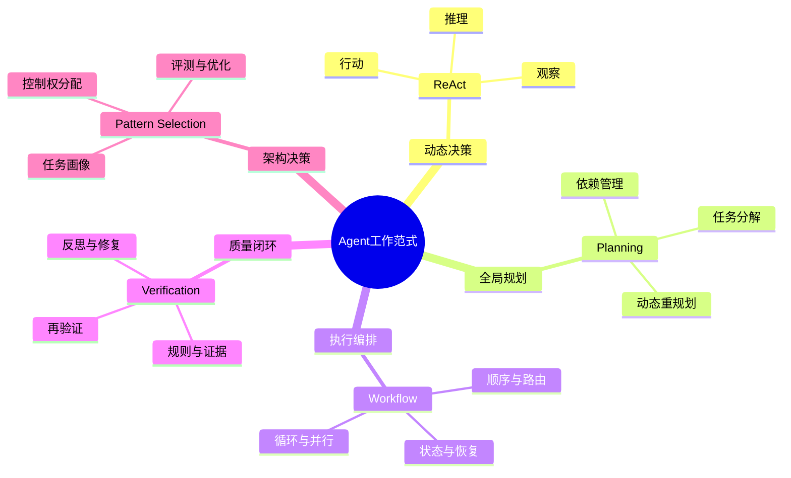

<strong>读图：</strong>ReAct 回答“下一步做什么”，Planning 回答“整体如何安排”，Workflow 回答“如何稳定组织执行”，Reflection 与 Verification 回答“结果是否可信、错误如何修正”，Pattern Selection 则回答“何时需要哪种能力、如何组合才值得”。它们是不同层面的职责，而不是五选一的竞争关系。

### 核心能力速览

| 能力 | 主要输入 | 核心决策或机制 | 典型输出 | 深入阅读 |
|---|---|---|---|---|
| ReAct（Reasoning and Acting，推理与行动） | 当前目标、观察、工具结果 | 推理—行动—观察循环 | 下一行动、环境反馈 | [01｜ReAct](./01-ReAct.md) |
| Planning（规划） | 目标、约束、可用能力 | 任务分解、依赖、重规划 | 任务计划、验收条件 | [02｜Planning](./02-Planning.md) |
| Workflow（工作流） | 任务计划、状态、执行规则 | 节点、分支、循环、并行、恢复 | 过程状态、可交付产物 | [03｜Workflow](./03-Workflow.md) |
| Reflection / Verification（反思／验证） | 结果、执行轨迹、验收标准 | 证据检查、诊断、局部修复 | 检查报告、修复结果 | [04｜Reflection and Verification](./04-Reflection-and-Verification.md) |
| Pattern Selection（范式选型） | 任务画像、风险、预算、评测 | 最小充分架构与组合取舍 | 架构方案、选型证据 | [05｜Pattern Selection](./05-Pattern-Selection.md) |

## 2. 知识依赖：从基础组件到执行闭环

第三章研究 Agent 拥有哪些能力，第四章研究这些能力如何按条件协作。两章之间的连接不是线性的“学完组件再背范式”，而是<strong>组件支撑范式、范式反过来规定组件的使用时机和状态边界</strong>。

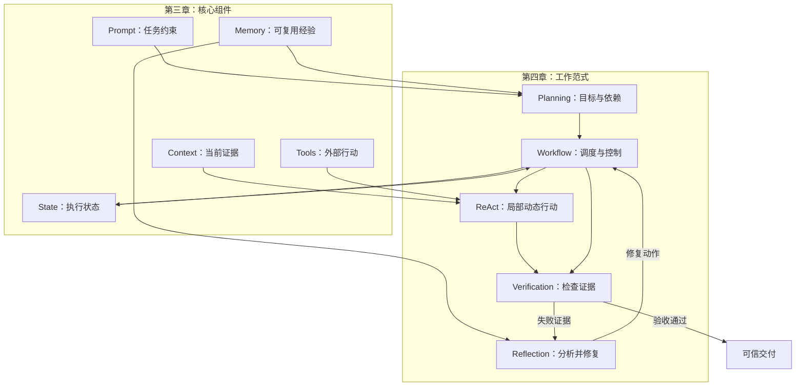

<strong>读图：</strong>Prompt 与 Context 为模型提供任务规则和证据；Tools 让 ReAct 能够作用于环境；State 让 Workflow 能够跟踪进度和恢复；Memory 可以为 Planning 和 Reflection 提供经验，但<strong>未经验证的反思不应自动成为可信记忆</strong>。上述关系是典型协作方式，并非所有任务都必须同时启用所有组件。

## 3. 决策与执行：局部行动、全局规划和工作流如何分工

### 3.1 ReAct 负责局部适应，Planning 负责全局约束

ReAct 的核心是根据 Observation（观察）更新下一步 Action（行动）；Planning 则将任务目标转换为带有依赖、约束和验收标准的任务结构。一个偏重<strong>局部反馈</strong>，一个偏重<strong>全局组织</strong>。长任务中仅有 ReAct 可能忽略整体依赖，仅有静态计划又难以处理意外反馈，因此常需要动态重规划（Replanning）。

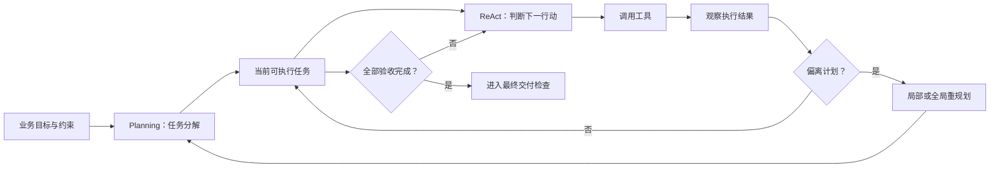

<strong>读图：</strong>计划提供方向，ReAct 提供现场适应能力；观察反馈既可能触发下一步行动，也可能触发计划版本更新。真正的工程实现还需要明确任务完成判定，避免无界循环。

### 3.2 Workflow 把计划转成可执行的生命周期

Planning 生成的计划不等于 Workflow。前者表达“应完成哪些任务及其依赖”，后者负责“何时执行、执行到哪里、失败后如何恢复”。Workflow 可以使用顺序、条件路由、循环、并行与汇聚来组织确定性程序和 Agent 节点。

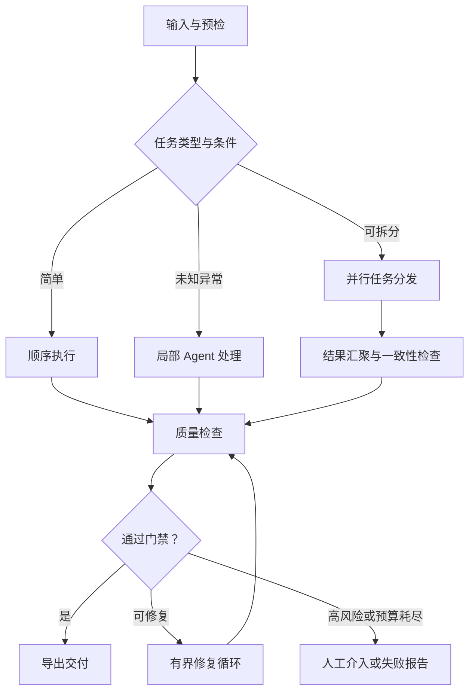

<strong>读图：</strong>路由解决输入差异，并行解决可独立任务的吞吐问题，循环处理可修复缺陷，汇聚检查跨任务一致性。<strong>Workflow 是执行组织方式，不意味着每个节点都必须由 LLM 执行。</strong>

## 4. 状态、反馈与质量：为什么执行结束不等于任务成功

Agent 调用了正确工具、完成了所有步骤，也可能产生错误内容。Reflection（反思）可以分析问题，但不能仅凭模型自评证明结果正确。Verification（验证）应依赖可核查的规则、工具反馈、执行轨迹、业务证据和必要的人工确认。

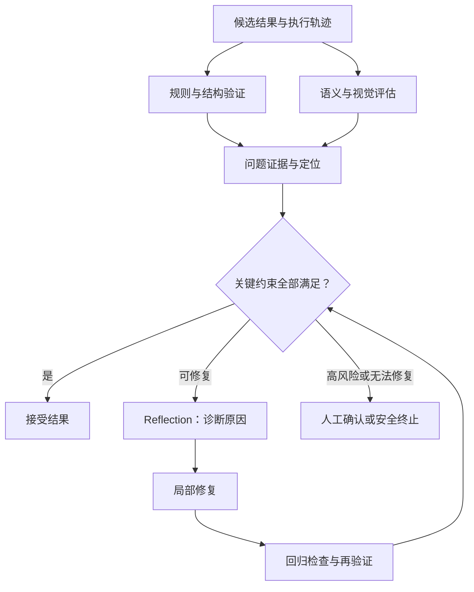

<strong>读图：</strong>验证负责给出证据，反思负责提出修复假设，修复动作必须再次接受检查。数值、型号、权限和文件结构等硬约束不能被综合质量评分掩盖。具体研究参见 [04｜反思、自检与结果验证](./04-Reflection-and-Verification.md)。

### 运行状态与故障恢复

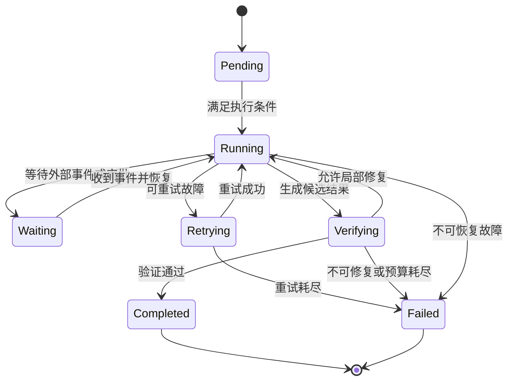

<strong>读图：</strong>状态机强调的是业务生命周期，而不是模型思维过程。Checkpoint（检查点）、Durable Execution（持久化执行）、Idempotency（幂等性）和补偿操作决定了系统能否在中断或重试后正确继续；这些能力必须由运行时与业务设计提供，而非由范式名称自动保证。

## 5. 控制权关系：谁决定下一步行动

在混合 Agent 系统中，最重要的架构边界之一是<strong>控制权所有权</strong>：哪些步骤由代码确定，哪些步骤由模型动态选择，哪些操作必须经验证器或人工批准。

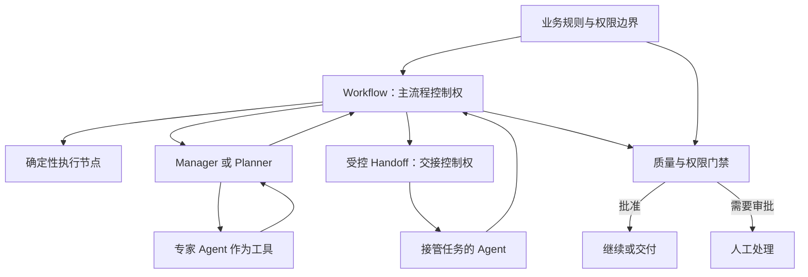

<strong>读图：</strong>Agents-as-Tools（将 Agent 作为工具）意味着管理者保留主控制权；Handoff（交接）意味着另一个 Agent 接管后续执行。无论采取哪种协作方式，权限检查都不应仅依赖模型自我约束。详见 [05｜范式对比与选型](./05-Pattern-Selection.md)。

## 6. 从单一模式到混合架构：选型决策的知识链

选型不是比较哪个模式“更高级”，而是先分析任务画像，再检查硬约束，最后用评测证明增加复杂度确实有收益。

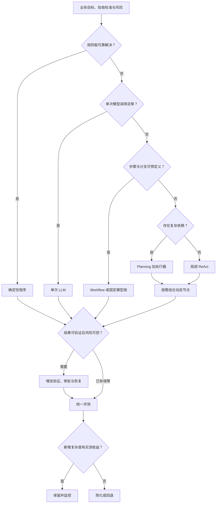

<strong>读图：</strong>这是帮助思考的工程决策路径，不是所有任务都适用的机械规则。尤其要先确定安全、数据权限、审计和质量等硬约束，再权衡延迟、成本与维护复杂度等软目标。

### 选型维度与典型信号

| 任务信号 | 优先考虑 | 不应忽略的代价 |
|---|---|---|
| 路径固定、规则清晰 | 程序或固定 Workflow | 过度 Agent 化增加不确定性 |
| 下一步依赖实时观察 | 局部 ReAct | 工具权限、循环上限与调用成本 |
| 任务分解和依赖复杂 | Planning + Workflow | 计划有效性与重规划成本 |
| 子任务相互独立 | 并行 Workflow | 限流、汇聚与全局一致性 |
| 结果可反复修订 | 验证 + 有界修复 | 评审偏差、回归与额外成本 |
| 高风险、不可逆操作 | 规则门禁 + 人工审批 | 审批延迟、责任与审计链 |
| 长时间运行、容易中断 | 持久化 Workflow | 状态版本、幂等与恢复复杂度 |

## 7. 企业案例：文档翻译如何串联五篇知识

本章五篇正文都使用医疗设备文档翻译作为工程例子。把它们放在同一架构中，可以看到各范式之间的实际依赖，而不是把“翻译 Agent”误解为一个从头到尾自由调用工具的单体智能体。

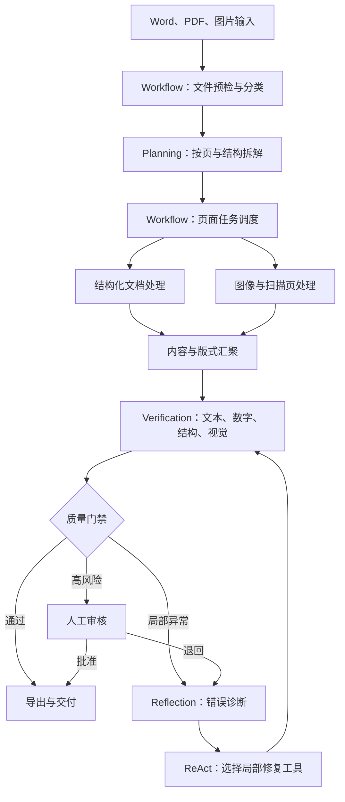

<strong>读图：</strong>Workflow 固定主业务生命周期；Planning 处理复杂任务依赖；ReAct 只进入需要动态决策的异常节点；Verification 负责质量证据；Reflection 指导有界修复。对于跨页术语一致性、数值和型号等关键检查，必须在汇聚后进行全局核对。

### 同一个异常如何在五篇知识中被解释

以“第 35 页翻译后标签重叠”为例：

| 观察角度 | 对应机制 | 关键问题 |
|---|---|---|
| ReAct | 观察渲染结果并选择修复工具 | 下一步调整文本、字号还是布局？ |
| Planning | 分析修复是否影响后续任务 | 是否需要重排相关页面或更新计划？ |
| Workflow | 定位失败节点并恢复执行 | 是否只重跑第 35 页，如何保持幂等？ |
| Reflection / Verification | 找到重叠证据并检查修复 | 是否确实消除重叠且未造成漏译？ |
| Pattern Selection | 比较固定修复与动态 Agent | 是否值得为此类异常增加 ReAct？ |

这一案例表明：<strong>同一个业务问题可以从不同技术层次观察；范式之间是职责协作关系，而不是替代关系。</strong>

## 8. 评测闭环：架构复杂度必须用收益证明

Pattern Selection 的终点不是选出框架，而是形成可重复的工程验证过程。建议对同一批任务比较“固定 Workflow”“Workflow + 局部 Agent”“增加 Planning”“增加反思修复”等候选方案，并记录质量、延迟、成本、失败恢复和人工介入比例。

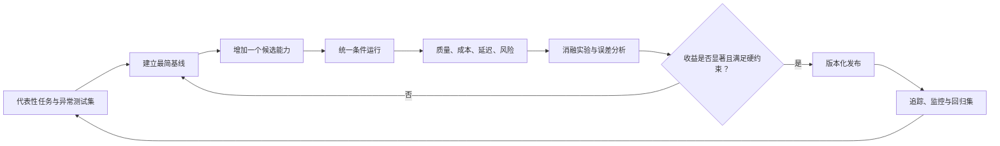

<strong>读图：</strong>Ablation Study（消融实验）通过移除某个组件观察性能变化，帮助判断 Planning、Reflection 或多 Agent 协作是否真正贡献收益。最终目标是找到满足业务约束的<strong>最小充分架构</strong>，而不是堆叠最多的模式。

## 9. 学习导航：按问题深入五篇正文

| 顺序 | 文档 | 阅读后应能回答的问题 | 与下一篇的联系 |
|---|---|---|---|
| 01 | [ReAct：推理与行动交替](./01-ReAct.md) | Agent 如何根据工具反馈连续决策？ | 单步动态决策如何服务长任务？ |
| 02 | [Planning：任务分解、规划与重规划](./02-Planning.md) | 目标如何形成带依赖和验收标准的计划？ | 计划如何交给运行时可靠执行？ |
| 03 | [Workflow：顺序、分支、循环、并行与编排](./03-Workflow.md) | 如何组织节点、状态、并发与故障恢复？ | 流程完成后怎样证明结果正确？ |
| 04 | [Reflection and Verification：反思、自检与结果验证](./04-Reflection-and-Verification.md) | 如何用证据发现问题、修复并再验证？ | 哪些质量机制值得加入具体架构？ |
| 05 | [Pattern Selection：范式对比与选型](./05-Pattern-Selection.md) | 如何按任务风险、控制权和实测收益组合模式？ | 回到整体架构设计与持续优化 |

### 推荐的三种阅读路径

- <strong>建立概念：</strong>01 → 02 → 03 → 04 → 05，适合首次系统学习。
- <strong>设计企业系统：</strong>03 → 04 → 05，再按需回看 01、02，适合已有工具调用基础的开发者。
- <strong>解决具体故障：</strong>根据异常定位至 01（行动选择）、02（计划变更）、03（执行恢复）或 04（质量证据），最后用 05 复盘架构取舍。

## 10. 一页总结：第四章应形成的工程判断

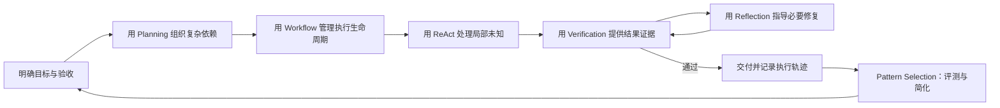

<strong>最终结论：</strong>可靠 Agent 的关键不在于让模型拥有无限自主权，而在于<strong>把自主决策放在确实需要它的位置，用显式流程承载执行，用证据约束结果，用评测决定架构复杂度</strong>。

本章五篇正文分别展开上述机制的理论基础、实现细节、企业案例和工程取舍。README 提供的是全局知识地图；需要深入某一问题时，可通过上方相对路径链接直接进入对应正文。
