# 01｜RAG：检索增强生成与企业知识系统完整链路

> 所属章节：`05-Agent-Knowledge-and-Tools` · 第一篇  
> 核心主线：<strong>知识来源 → 解析与结构化 → 切块与索引 → 查询理解 → 检索与排序 → 证据上下文 → 生成与引用 → 验证评测 → 企业治理</strong>。  
> 学习目标：理解 RAG 的理论边界、核心算法、端到端工程架构及其与 Agent 的协作，能够解释每个阶段的输入、输出、风险与优化方法。

## 0. 全局知识地图：RAG 不只是向量搜索

RAG（Retrieval-Augmented Generation，检索增强生成）通过检索外部知识为语言模型提供回答依据。LLM（Large Language Model，大语言模型）的参数知识适合语言理解和一般知识推断；企业制度、技术手册和实时业务事实则需要来自外部系统的可核查证据。<strong>检索是证据获取，生成是证据使用，验证是对结果负责。</strong>

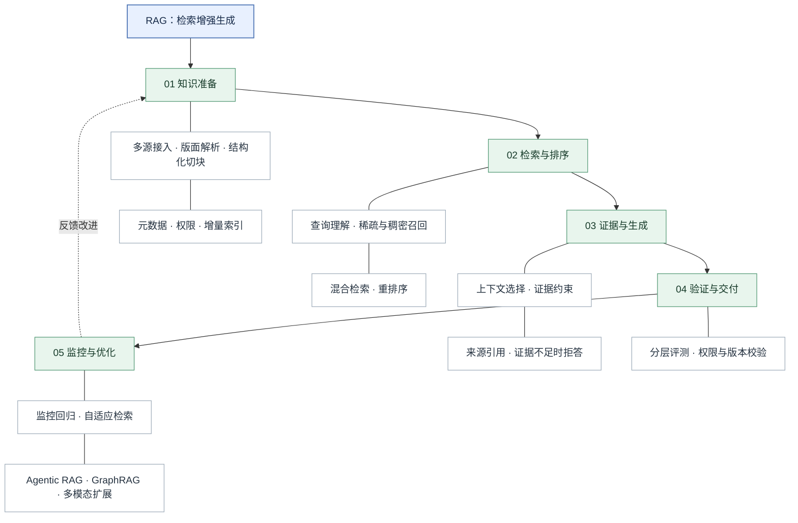

<strong>读图：</strong>知识工程决定信息能否被正确表示，检索工程决定证据能否被找到，生成工程决定证据能否被忠实使用，治理体系决定结果能否安全进入生产环境。后续 [混合检索](./02-Hybrid-Search.md) 和 [重排序](./03-Reranking.md) 将分别深入两项检索技术，本篇关注它们在全链路中的位置。

## 1. 问题起点：参数知识、外部知识与 RAG 边界

### 1.1 为什么单靠模型参数不够

模型参数并不等于可更新、可审计的企业数据库。知识可能不在训练集中，训练后可能更新，或具有严格的访问权限。即使模型能够流畅作答，也不能据此确认事实正确。RAG 将可更新的外部知识引入推理过程，使答案可以附带来源、版本和证据定位。

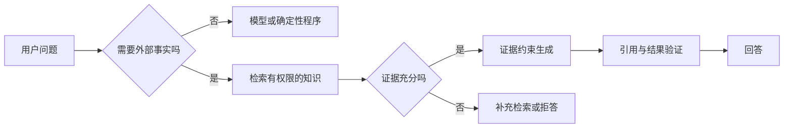

这张图强调 RAG 不是所有请求的必经步骤。计算、格式转换等任务可以不检索；企业事实查询则应根据风险选择检索和验证。RAG 不能代替事务性数据库查询、权限系统或实时操作工具。

### 1.2 与微调、长上下文、工具调用的区别

| 机制 | 主要改变什么 | 典型优势 | 关键局限 |
|---|---|---|---|
| RAG | 推理时可用的外部证据 | 易更新、可引用 | 受检索和文档质量制约 |
| Fine-tuning（微调） | 模型参数或适配器 | 适合行为、风格、任务能力适配 | 不保证事实及时或精确可追溯 |
| Long-context（长上下文） | 单次输入的信息容量 | 减少部分检索环节 | 成本、注意力分配、权限与更新问题仍存在 |
| Function Calling（函数调用） | 模型与工具的交互接口 | 获取实时结构化数据、执行动作 | 需要外部工具和权限约束 |

实际系统可组合这些机制：模型负责理解，RAG 提供文档证据，函数调用读取实时库存或执行获授权的操作。

## 2. 理论源头与现代工程形态

2020 年 Lewis 等人的原始 RAG 研究结合参数化模型与可检索的非参数化记忆，研究了 RAG-Sequence 与 RAG-Token 两种生成建模方式。前者以文档为整个输出序列提供条件，后者允许在不同 Token 位置利用不同文档分布。<strong>现代工程中“先检索再将证据放入提示词”的流程，是广义 RAG，不等同于完整复现原论文训练方法。</strong>

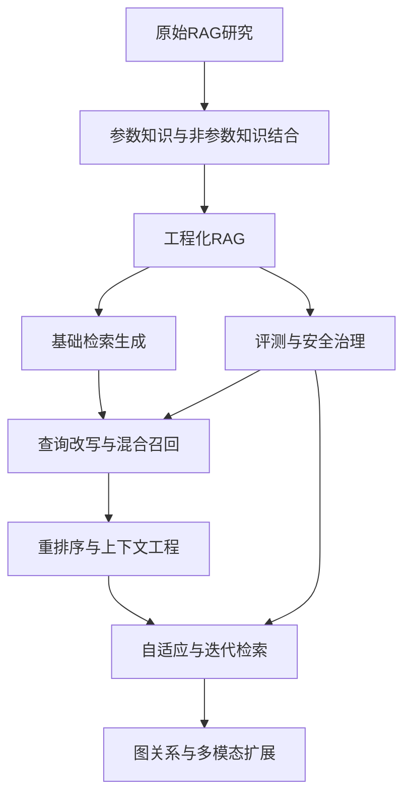

这是一条能力扩展路线，而非必须依次升级的版本序列。复杂方案应通过任务测试证明收益，不应仅因新颖而替代基础 RAG。

## 3. 系统架构：离线索引与在线问答

### 3.1 双链路与接口契约

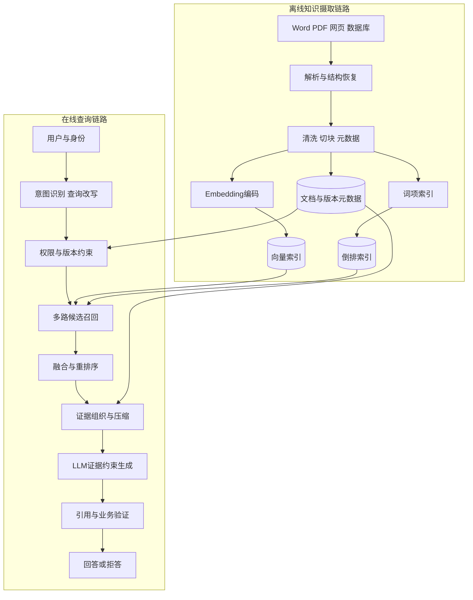

离线链路的产物不仅是向量，还包括可恢复的源文档、结构化片段、版本信息与权限元数据。在线链路必须在证据进入模型前完成访问控制。不同数据库对过滤、混合检索和一致性的支持各异，架构图描述的是职责，而非某个产品的内置保证。

### 3.2 最小数据契约

| 对象 | 建议字段 | 为什么必要 |
|---|---|---|
| Document（源文档） | `document_id`、`version`、`source_uri`、`effective_time` | 版本与原文可追溯 |
| Chunk（检索片段） | `chunk_id`、`parent_id`、`section`、`page`、`content_hash` | 定位、扩展、去重 |
| Access（访问约束） | `tenant_id`、`access_policy`、`classification` | 过滤与隔离 |
| Index（索引版本） | `embedding_model_version`、`chunk_strategy_version`、`index_version` | 可重复构建与回滚 |
| Evidence（证据） | `source_chunk_id`、`retrieval_score`、`rank`、`citation_span` | 回答验证与调试 |

`retrieval_score` 的数值不可在不同检索器之间直接比较；需要校准或采用基于名次的融合。

## 4. 文档摄取：解析质量决定知识上限

OCR（Optical Character Recognition，光学字符识别）负责从图像识别文字；Layout Analysis（版面分析）负责判断阅读顺序、标题、表格和图文区域。它们并不等价。扫描件若把负号识别错误，后续高性能向量搜索也无法自动修复事实。

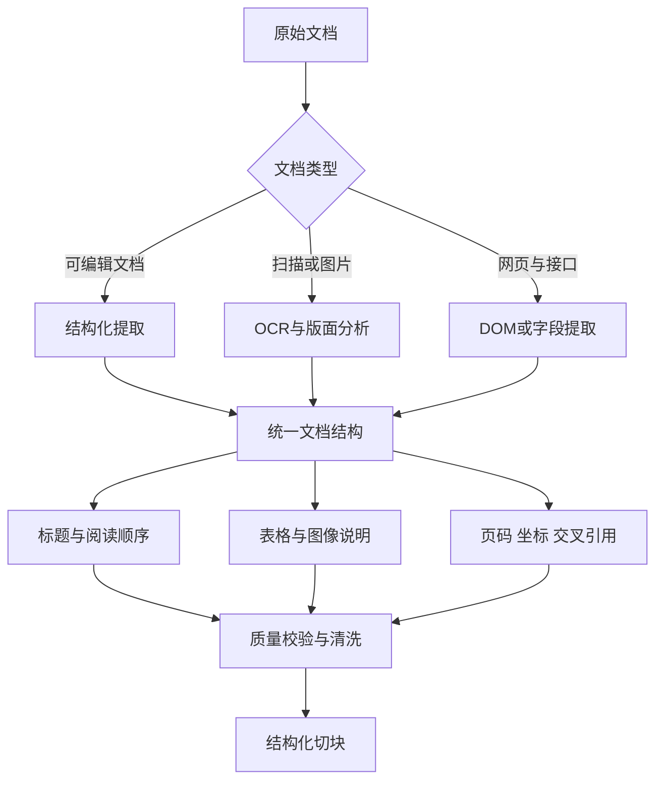

<strong>结构恢复优先于盲目切块。</strong> 对于医疗设备手册，应将表格行与其列标题、单位、设备型号、适用条件关联保存。跨页表格、双栏 PDF、脚注、公式、图片内警告标志都需要专项测试。Docling、MinerU、Unstructured、LlamaParse、PyMuPDF 等可作为候选，但具体解析效果应基于同一文档集实测。

### 4.1 摄取质量门禁

至少检查页数与解析页数是否一致、标题层级是否完整、表格是否缺列、数值和单位是否异常、重复页眉页脚是否污染正文、是否保留原始文件定位。对高风险字段可保留原图裁剪与文本并行证据，供人工复核。

## 5. Chunking：检索粒度与上下文完整性的矛盾

Chunking（文本切块）是把文档划分为可索引单元。块太大时，召回可能不精确；块太小时，限定条件、表格标题与跨句语义容易丢失。Chunk Size（块大小）和 Overlap（重叠长度）必须与 Embedding 模型、查询类型及上下文预算共同调优。

| 策略 | 机制 | 适用情况 | 代价 |
|---|---|---|---|
| Fixed-size | 固定 Token 或字符窗口 | 简单基线 | 容易截断语义 |
| Recursive | 段落、句子、分隔符递归切分 | 常规文本 | 不保证章节完整 |
| Semantic | 基于语义边界切分 | 主题变化明显的文档 | 额外计算成本 |
| Structure-aware | 按标题、表格和章节切分 | 技术手册、报告 | 依赖解析质量 |
| Parent-child | 子块召回，父块返回 | 精确定位与上下文兼顾 | 维护父子映射 |
| Hierarchical | 多层摘要和原文索引 | 长文档、跨章节查询 | 索引和路由更复杂 |

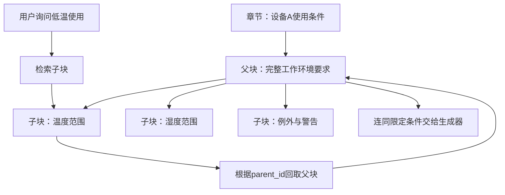

父子块检索把<strong>检索单位</strong>和<strong>返回单位</strong>分开。它不能自动解决错误的父子关系；因此必须先保证文档结构可靠。评测应覆盖事实定位、表格关联、跨章节证据、Token 成本，而不是孤立比较块大小。

## 6. Embedding 与向量近邻搜索

Embedding（嵌入表示）把文本映射为数值向量，使语义相近的文本在向量空间中较容易被共同检索。它度量的是表示相似性，不是事实正确性。查询编码与文档编码可能需要不同提示前缀或模型接口，应遵循具体模型规范。

余弦相似度定义为：

$$
\mathrm{cos}(\mathbf{q},\mathbf{d})=\frac{\mathbf{q}\cdot\mathbf{d}}{\|\mathbf{q}\|_2\|\mathbf{d}\|_2}
$$

ANN（Approximate Nearest Neighbor，近似最近邻）通过索引减少全量距离计算，通常以一定近似误差换取更好的延迟与资源效率。

| 技术 | 核心机制 | 典型取舍 |
|---|---|---|
| Flat Search | 全量向量比较 | 精确但大规模代价高 |
| HNSW（Hierarchical Navigable Small World） | 分层近邻图导航 | 查询延迟、内存、构建成本 |
| IVF（Inverted File Index） | 向量分区与候选探测 | 探测分区数与召回 |
| PQ（Product Quantization） | 向量分段量化压缩 | 存储压缩与距离失真 |
| DiskANN | 面向磁盘访问优化的近邻结构 | 内存预算与 I/O 延迟 |

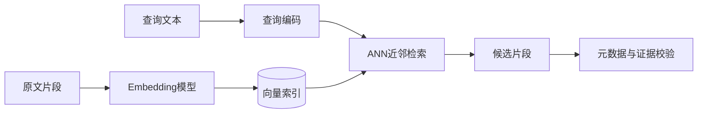

选择向量模型时应比较多语言能力、专业缩写与型号匹配、长文本截断、推理吞吐、部署成本。升级模型可能改变向量空间，通常需要重建相应索引或进行严格的兼容性验证。

## 7. 查询理解、召回融合与重排序

原始问题常包含省略、指代和不规范术语。Query Rewriting（查询改写）改善表达；Query Expansion（查询扩展）加入同义词；Query Decomposition（问题分解）将多跳问题拆成子问题；Query Routing（查询路由）决定搜索哪个知识源。<strong>改写不应悄悄改变用户意图，分解则明确增加多个检索子目标。</strong>

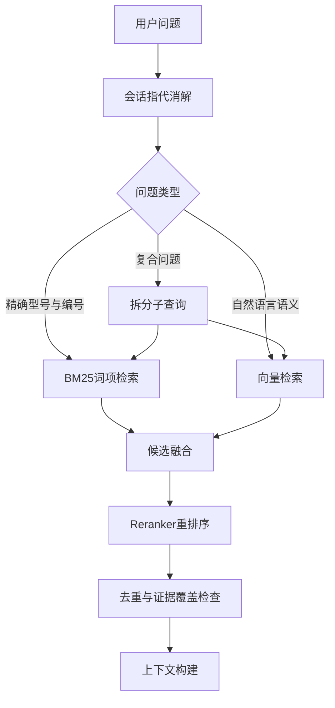

BM25（Best Matching 25）是基于词频、逆文档频率与长度归一化的经典稀疏检索方法，适合型号、标准编号和精确术语；Dense Retrieval（稠密检索）更适合语义近似表达。Hybrid Search（混合检索）融合两路候选，RRF（Reciprocal Rank Fusion，倒数排名融合）可在不同检索器分数不可直接比较时按排名融合：

$$
\mathrm{RRF}(d)=\sum_{r\in\mathcal{R}}\frac{1}{k+\mathrm{rank}_r(d)}
$$

其中 `k` 是平滑常数，`R` 表示参与融合的检索器集合。Reranking（重排序）对有限候选做更精细的相关性评估，常见方法包括 Cross-Encoder（交叉编码器，联合编码查询与候选文本）。它通常提高排序精度，但增加推理延迟；详细算法见 [02｜Hybrid Search](./02-Hybrid-Search.md) 和 [03｜Reranking](./03-Reranking.md)。

## 8. 上下文工程、证据约束生成与引用

Context Engineering（上下文工程）不是把 Top-K 文本直接拼接到 Prompt，而是选择能够回答问题、来源可信、相互不矛盾且不超出 Token 预算的证据集合。长上下文并不意味着所有位置的信息都能被同等利用；*Lost in the Middle* 研究提醒我们关注证据位置与利用效率。

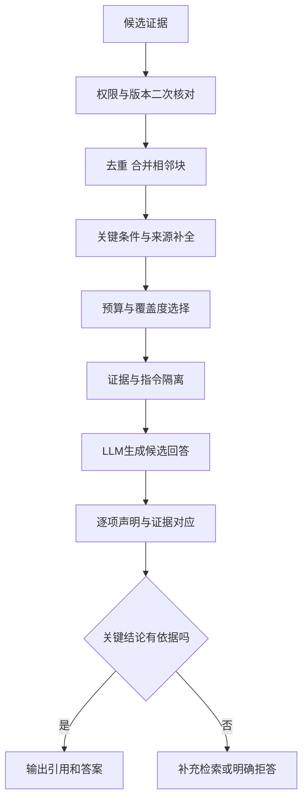

### 8.1 三种不同的正确性

- <strong>相关性：</strong>检索文本与问题相关。
- <strong>忠实度（Faithfulness）：</strong>生成陈述受到所给证据支持。
- <strong>事实正确性（Correctness）：</strong>陈述与真实、有效的业务事实一致。

三者不能混为一谈。模型可以忠实复述一份已经过期的技术手册，却仍然给出错误答案。

### 8.2 引用链与拒答

推荐保存 `answer_claim → evidence_chunk → page/section → document_version → source_document` 的可追溯关系。Citation（来源引用）不是装饰：应检查引用是否支持对应陈述，是否来自有权限、仍然有效的文档。对于缺少必要证据、文档版本冲突或高风险数值无法核验的情况，应拒答、说明不确定性或转人工复核。

## 9. RAG 与 Agent：固定检索还是动态检索

Agentic RAG（Agent 驱动的检索增强生成）允许 Agent 根据任务决定是否检索、选择知识源、分解查询、再次检索与停止。它不是 RAG 的必要条件。固定 RAG 在高频、稳定、低复杂度问答中更容易控制延迟和行为。

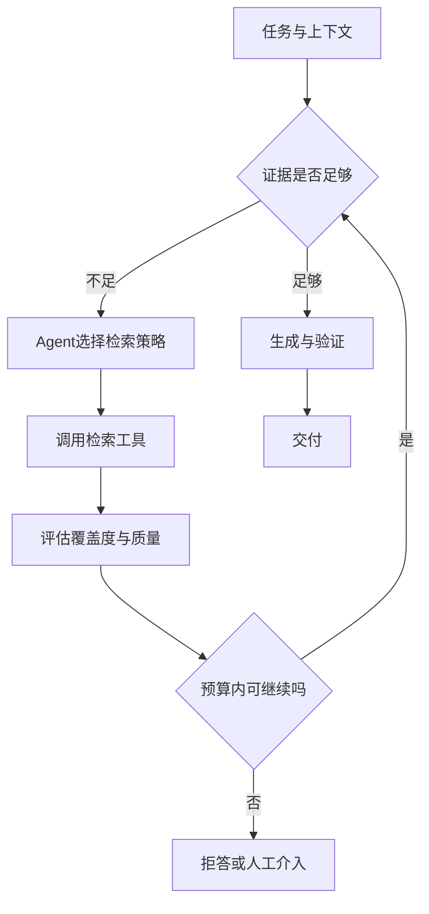

Self-RAG（Self-Reflective Retrieval-Augmented Generation，自反思 RAG）在原始研究中使用专门的反思标记来学习何时检索及如何评价证据；不能等同于在普通 RAG 后简单添加一个 Reflection Agent。CRAG（Corrective Retrieval-Augmented Generation，纠错式 RAG）重点处理低质量检索结果，通过检索评估和纠错操作增强鲁棒性。

与第四章的关系是：ReAct 提供观察—行动循环，Planning 管理复杂查询的子任务依赖，Workflow 管理确定性步骤和重试，Verification 决定证据是否达到交付门槛。Agentic RAG 需要最大检索轮数、超时、成本预算和权限边界。

## 10. GraphRAG 与多模态扩展

GraphRAG（图增强检索生成）利用实体、关系、社区及其摘要补充文本检索，适合跨文档关联与全局主题问题。Microsoft GraphRAG 的标准索引涉及实体与关系提取、汇总和社区报告；索引成本可能显著高于基础文本 RAG。GraphRAG 不是对所有事实查询的默认替代。

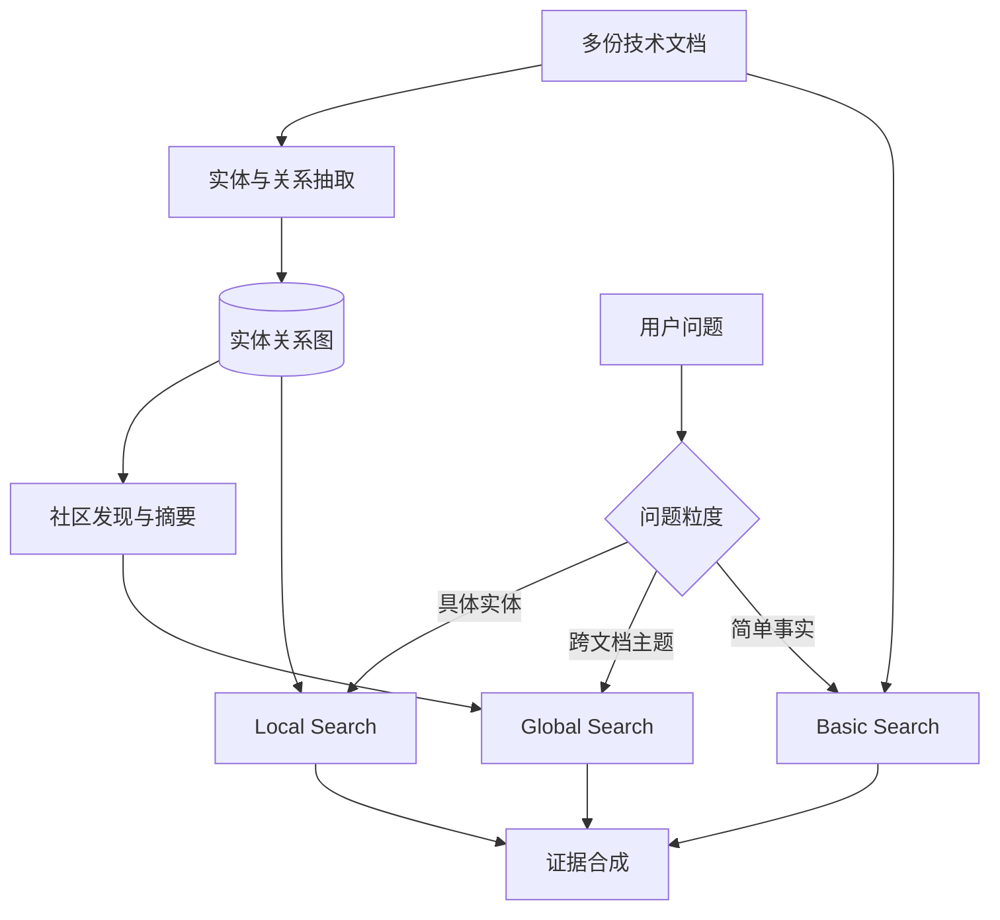

多模态 RAG（Multimodal RAG）进一步处理图像、表格、音视频与文本证据。医疗器械文档中的接线图、警告图标和复杂表格不能仅靠 OCR 字符串完整表达；可以将原始图像、结构化表格和文字说明建立关联，再根据问题路由到相应检索与理解模块。

## 11. 评测：分清索引错误、召回错误与生成错误

端到端答案不正确，并不能直接说明 Embedding 模型不好。应建立阶段级追踪和分层评测。Ragas、LlamaIndex 等提供检索与生成评测相关组件，但自动评分也需要人工样本校准。

### 11.1 检索层指标

| 指标 | 含义 | 重点 |
|---|---|---|
| Recall@K（前 K 项召回率） | 前 K 项覆盖了多少标注相关项 | 是否漏掉证据 |
| Precision@K（前 K 项精确率） | 前 K 项中相关项的比例 | 噪声水平 |
| Hit Rate（命中率） | 前 K 项是否至少命中一项相关证据 | 单证据查询 |
| MRR（Mean Reciprocal Rank，平均倒数排名） | 首个相关结果倒数排名的平均值 | 首次命中位置 |
| nDCG（Normalized Discounted Cumulative Gain，归一化折损累计增益） | 兼顾相关等级与排序位置 | 多级相关性排序 |

若一个问题必须同时找到两个章节才能回答，单个片段的 Hit Rate 不能代表证据完整性。必须明确标注粒度是文档、片段还是证据集合。

### 11.2 生成与生产指标

| 维度 | 指标与检查 |
|---|---|
| 证据使用 | Faithfulness、引用支持率、证据覆盖率 |
| 答案质量 | 正确性、完整性、业务规则符合度 |
| 拒答 | 无答案问题的正确拒答率、误拒率 |
| 性能 | P50/P95/P99 延迟、各阶段耗时、吞吐 |
| 成本 | Embedding、检索、重排序、生成成本 |
| 可靠性 | 失败率、索引新鲜度、恢复成功率 |
| 安全 | 越权检索率、注入攻击测试、审计完整性 |

测试集应包含精确型号、数值单位、跨页表格、多跳问题、版本冲突、无答案、越权、注入攻击、同义词与拼写错误等样本。通过消融实验分别关闭查询改写、混合检索、重排序、父子块，测量每个组件的净收益。

## 12. 企业级安全、版本与可靠性

### 12.1 权限必须先于生成

ACL（Access Control List，访问控制列表）定义对象访问许可；RBAC（Role-Based Access Control，基于角色的访问控制）根据角色授予权限。企业 RAG 还可能结合属性策略与租户隔离。<strong>不能把“模型不要泄密”的提示词当作访问控制。</strong>

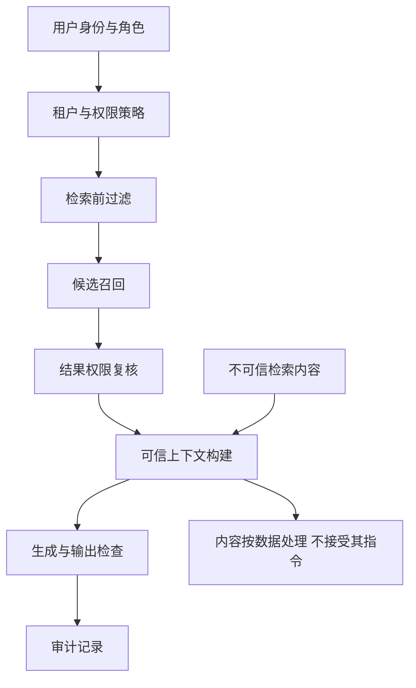

Prompt Injection（提示词注入）是恶意文本试图改变模型指令优先级或工具行为的攻击。检索结果属于低信任数据；需要明确指令与数据的隔离，并结合工具最小权限、输入输出检查、人工审批和审计。

### 12.2 增量索引与版本一致性

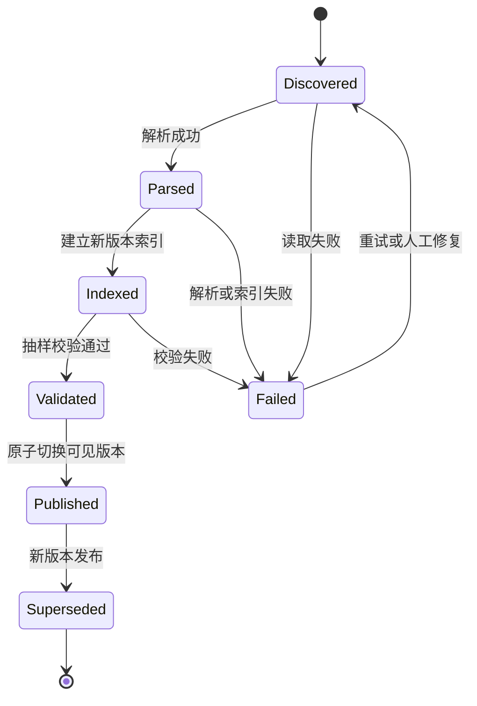

这里的“原子切换”是建议的应用架构策略，不代表所有向量数据库自动提供该语义。可通过索引别名、版本过滤或蓝绿索引实现。文档删除或撤权必须同步传播到可检索集合与缓存。LlamaIndex Ingestion Pipeline 文档介绍了利用文档标识与哈希检测变化并进行处理的机制，可作为增量摄取参考。

### 12.3 故障与降级

当向量检索不可用时，可在满足权限和质量要求的前提下退化为 BM25；重排序超时可以退回融合结果；检索证据不足应拒答而非臆测。缓存键应考虑查询、租户、权限、文档版本和检索策略，避免跨权限复用。

## 13. 企业案例：医疗设备技术知识库

<strong>场景：</strong>员工询问“设备 A 在低温条件下能否使用？依据哪个版本的技术文件？”系统必须识别型号、检索有效版本、定位温度表格与警告说明、检查数值单位，并输出来源。

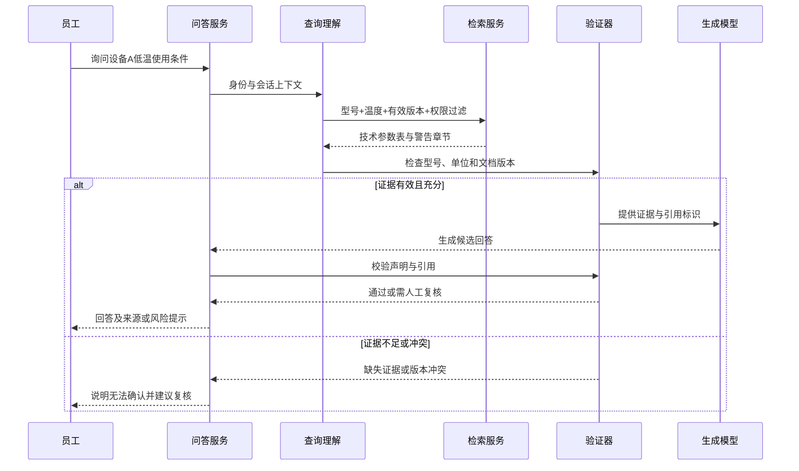

### 13.1 关键工程设计

| 环节 | 方案 | 验收重点 |
|---|---|---|
| 解析 | 结构化 PDF/Word，扫描件使用 OCR | 表格与警告信息不丢失 |
| 切块 | 标题感知与父子块 | 型号、单位、条件保持关联 |
| 检索 | BM25 与向量混合 | 精确型号与语义问题兼顾 |
| 排序 | 轻量融合后按需重排序 | 证据覆盖率与延迟平衡 |
| 生成 | 证据约束、逐项引用 | 不编造技术参数 |
| 验证 | 数值、单位、型号、版本的确定性核对 | 高风险错误拦截 |
| 治理 | 权限、审计、增量更新 | 版本正确、不能越权 |

### 13.2 失败注入测试

测试旧版说明书覆盖新版、型号相近、扫描件负号丢失、跨页表格错位、权限撤销后缓存残留、知识库超时、引用错误和恶意文档指令。每个失败样本应保存检索候选、排序、证据上下文、生成结果和验证结论，便于定位根因。

## 14. 框架选型：分清应用框架与存储引擎

| 组件 | 技术代表 | 主要职责 |
|---|---|---|
| 应用与检索编排 | LangChain、LlamaIndex | 数据接入、Retriever、查询与生成组合 |
| Agent 工作流 | LangGraph | 状态、条件路由、多轮检索与控制 |
| 向量数据库 | Qdrant、Milvus、Weaviate | 向量索引、过滤与查询 |
| 搜索引擎 | Elasticsearch、OpenSearch | 词项检索、过滤及混合搜索 |
| 图增强检索 | Microsoft GraphRAG | 实体关系与全局主题索引 |
| 评测工具 | Ragas、LlamaIndex Evals | 检索与生成质量评测 |

LangChain 与 Qdrant 不在同一技术层级，二者可以共同使用。框架选型必须比较权限过滤、索引更新、可观测性、数据规模、部署约束与维护成本，而不只是示例代码的简短程度。

## 15. 常见误区：从功能演示走向工程判断

| 误区 | 正确理解 |
|---|---|
| RAG 就是向量数据库 | 它是从知识摄取到可信生成的完整系统 |
| 相关检索结果一定真实 | 相关性不保证事实正确或版本有效 |
| 块越小越好 | 精确定位与完整上下文需要平衡 |
| Top-K 越大越好 | 噪声、Token 成本与注意力竞争可能增加 |
| 加入 Reranker 一定更好 | 需要量化排序收益与延迟代价 |
| GraphRAG 总优于普通 RAG | 适用跨文档关系问题，索引成本更高 |
| 引用存在就说明可信 | 必须检查引用与声明的支持关系 |
| RAG 能完全消除幻觉 | 只能缓解部分问题，仍需验证与拒答 |
| 所有 RAG 都需要 Agent | 固定工作流在很多场景更可靠 |
| Prompt 能防止越权 | 权限必须由系统层执行 |

## 16. 面试与架构评审问题

1. <strong>RAG 与微调的核心差异？</strong> RAG 主要改变推理时证据，微调主要改变模型行为或参数能力；二者可组合。
2. <strong>为什么先解析再切块？</strong> 切块依赖章节、表格、阅读顺序等结构，错误结构会导致证据关系丢失。
3. <strong>为什么采用父子块？</strong> 用小块提高定位精度，回取父块保留限定条件。
4. <strong>Embedding 相关性为何不能保证正确？</strong> 向量空间度量表示相近，不验证事实真实性与文档有效性。
5. <strong>混合检索解决什么问题？</strong> 结合语义匹配与精确词项匹配，尤其适合型号和自然语言混合查询。
6. <strong>Reranking 与召回有什么不同？</strong> 召回追求找到候选，重排序优化候选顺序，通常需要更多计算。
7. <strong>为什么检索和生成分开评测？</strong> 否则无法判断错误源于缺证据还是误用证据。
8. <strong>Faithfulness 与 Correctness 的差异？</strong> 忠实于证据不意味着证据本身真实、最新。
9. <strong>什么时候用 Agentic RAG？</strong> 多轮、多知识源、动态查询有明显收益且可控制预算时。
10. <strong>GraphRAG 适合什么？</strong> 跨文档实体关系、全局主题与复杂关联查询。
11. <strong>如何处理知识更新？</strong> 文档版本、哈希检测、增量重建、可见版本切换、删除传播。
12. <strong>如何防止越权检索？</strong> 身份绑定的索引过滤、二次权限核验、缓存隔离和审计。
13. <strong>证据不足时怎么办？</strong> 在预算内补充检索，仍不足则拒答或转人工。
14. <strong>如何证明新增组件值得保留？</strong> 用固定测试集和消融实验比较质量、延迟、成本与可靠性。

## 17. 术语速查与章节关联

| 术语 | 解释 |
|---|---|
| RAG | Retrieval-Augmented Generation，检索增强生成 |
| LLM | Large Language Model，大语言模型 |
| OCR | Optical Character Recognition，光学字符识别 |
| Embedding | 嵌入表示，将文本编码为向量 |
| ANN | Approximate Nearest Neighbor，近似最近邻 |
| BM25 | Best Matching 25，经典词项相关性排序方法 |
| RRF | Reciprocal Rank Fusion，倒数排名融合 |
| Reranking | 重排序，对候选结果重新计算排序 |
| ACL | Access Control List，访问控制列表 |
| RBAC | Role-Based Access Control，基于角色的访问控制 |
| MRR | Mean Reciprocal Rank，平均倒数排名 |
| nDCG | Normalized Discounted Cumulative Gain，归一化折损累计增益 |

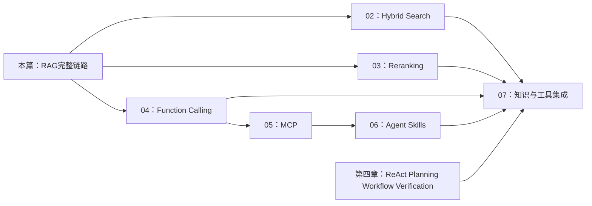

这里的依赖是学习和架构关联，不代表 Function Calling 必须依赖 RAG，也不代表 MCP 是 Function Calling 的下位实现。RAG 提供知识证据，工具调用提供与外部能力交互的机制，Agent 工作范式负责决策与编排。

## 18. 权威参考资料与延伸阅读

### 研究论文

1. Lewis et al. (2020), [Retrieval-Augmented Generation for Knowledge-Intensive NLP Tasks](https://arxiv.org/abs/2005.11401)：原始 RAG 概率建模。
2. Asai et al. (2023), [Self-RAG: Learning to Retrieve, Generate, and Critique through Self-Reflection](https://arxiv.org/abs/2310.11511)：自适应检索与反思标记。
3. Yan et al. (2024), [Corrective Retrieval Augmented Generation](https://arxiv.org/abs/2401.15884)：检索纠错。
4. Liu et al. (2023), [Lost in the Middle: How Language Models Use Long Contexts](https://arxiv.org/abs/2307.03172)：长上下文位置效应。
5. Es et al. (2023), [RAGAS: Automated Evaluation of Retrieval Augmented Generation](https://arxiv.org/abs/2309.15217)：RAG 自动评测。
6. Malkov & Yashunin (2016), [Efficient and Robust Approximate Nearest Neighbor Search Using Hierarchical Navigable Small World Graphs](https://arxiv.org/abs/1603.09320)：HNSW 原理。

### 官方框架与工程资料

7. [LlamaIndex：RAG 概念与流程](https://docs.llamaindex.ai/en/stable/understanding/rag/)。
8. [LlamaIndex：Ingestion Pipeline](https://docs.llamaindex.ai/en/stable/module_guides/loading/ingestion_pipeline/)。
9. [LlamaIndex：Evaluation](https://docs.llamaindex.ai/en/stable/module_guides/evaluating/)。
10. [LangChain 官方文档](https://docs.langchain.com/)。
11. [Qdrant 官方文档](https://qdrant.tech/documentation/)。
12. [Weaviate：Hybrid Search](https://docs.weaviate.io/weaviate/search/hybrid)。
13. [Microsoft GraphRAG：Methods](https://microsoft.github.io/graphrag/index/methods/)。
14. [Microsoft GraphRAG：Getting Started](https://microsoft.github.io/graphrag/get_started/)。
15. [Ragas 官方文档](https://docs.ragas.io/)。
16. [Azure AI Search：文档级访问控制](https://learn.microsoft.com/en-us/azure/search/search-document-level-access-overview)。
17. [NVIDIA NeMo Guardrails](https://docs.nvidia.com/nemo/guardrails/latest/)。
18. [MinerU GitHub](https://github.com/opendatalab/MinerU)。
19. [Docling GitHub](https://github.com/docling-project/docling)。

> 阅读建议：先以原始论文建立理论边界，再结合 LlamaIndex 的摄取与查询体系理解工程链路；针对检索质量深入阅读后续混合检索与重排序章节；最后通过 GraphRAG、Ragas 和安全治理资料建立企业级设计能力。框架接口随版本变化，实际实现时应核对对应版本的官方文档。

## 19. 全篇总结：可信 RAG 是证据工程

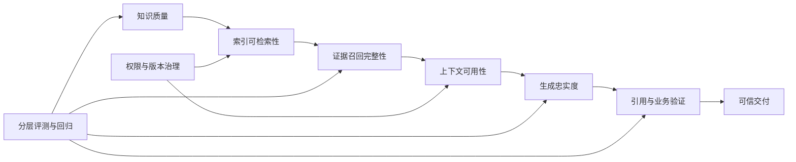

<strong>最重要的工程结论：</strong>RAG 的能力不是某个向量模型或数据库单独决定的，而是知识解析、表示、检索、证据使用、权限治理和评测共同作用的结果。企业项目应优先建设可追溯的数据链路与可重复的质量评测，再逐步增加混合检索、重排序、Agentic RAG 或 GraphRAG 等复杂能力。
