# 02｜向量、关键词与混合检索：从候选召回到证据排序

> 所属章节：`05-Agent-Knowledge-and-Tools` · 前置：[01｜RAG](01-RAG.md) · 后续：[03｜Reranking](03-Reranking.md)
>
> 本文聚焦 RAG 的<strong>检索层</strong>：解释为什么单一检索器不够、两类检索信号如何形成、如何融合与过滤、怎样验证系统是否真的变好。重排序模型的训练和推理细节留给下一篇。

## 1. 问题起点：检索到底需要找到什么

### 全局知识网络：Hybrid Search 的能力结构

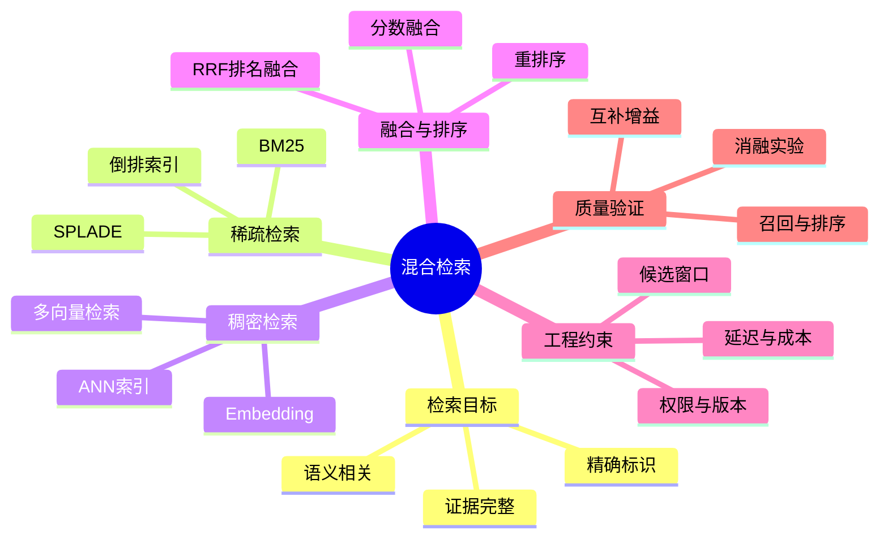

<strong>读图：</strong>以“混合检索”为中心，六条知识分支分别回答为什么检索、用什么表示、如何召回、如何融合、如何保证可靠以及如何评测。它们并非六个互不相关的模块：检索目标决定表示方式，表示方式决定候选质量，候选质量限制融合上限，工程约束与评测贯穿全程。


检索增强生成（Retrieval-Augmented Generation，RAG）要求模型先取得外部证据，再生成回答。对于“ABC-300 的 E07 报警如何排查”，`ABC-300` 与 `E07` 是必须正确识别的精确标识；“如何排查”又可能与“故障诊断”“异常处理步骤”等不同措辞对应。只按关键词匹配会漏掉语义等价的文本；只按语义向量匹配则可能找出描述相似、型号却错误的资料。

<strong>混合检索（Hybrid Search）的本质是融合互补的检索信号，不是机械地把两种分数相加。</strong> 其目标是以可接受的成本，召回足够完整、相关、授权、可追溯的证据，为后续重排序和生成提供候选。

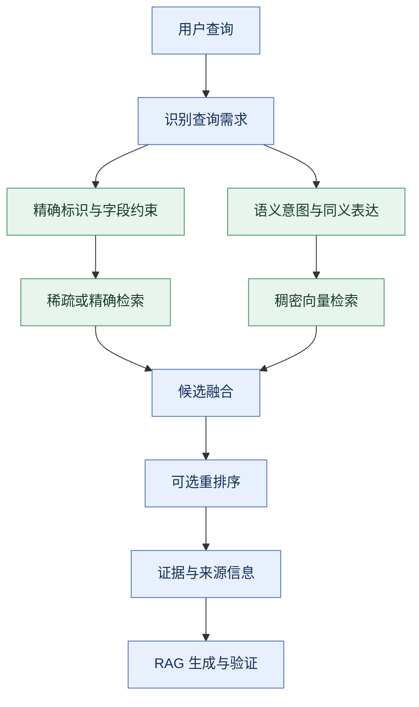

上图的关键不是“两个分支”，而是<strong>两种不同的相关性假设</strong>：词项分支重视出现了什么，向量分支重视表达了什么意思。精确字段过滤可以独立于这两类相关性评分存在。

## 2. 信息检索的基本模型与数据契约

### 检索结果的数据契约网络

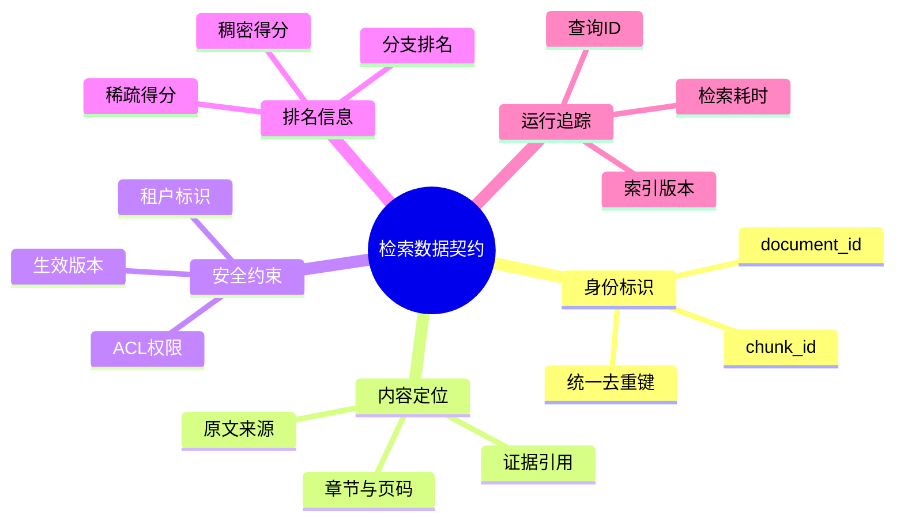

<strong>读图：</strong>统一的文档身份让两路候选能够去重；来源和位置支撑引用；权限与版本限制可见范围；得分和名次服务于融合；追踪字段用于解释与回归。数据契约是后续算法协作的前提。


信息检索（Information Retrieval，IR）可以抽象为查询、文档集合、检索器、相关性评分与排序结果。一个生产级检索结果不仅包含文本，还应携带稳定文档标识、片段标识、来源、版本、权限标签及各分支分数。否则融合时难以去重，生成时难以引用，故障时难以定位。

| 数据元素 | 作用 | 工程约束 |
|---|---|---|
| `document_id` / `chunk_id` | 文档及片段的稳定身份 | 多路检索需使用同一去重键 |
| `title` / `section` / `page` | 恢复文档语境 | 防止证据脱离适用条件 |
| `tenant_id` / `acl` | 租户及访问控制列表 | 必须在证据暴露前生效 |
| `version` / `effective_time` | 版本与生效时间 | 避免旧版覆盖现行规范 |
| `sparse_score` / `dense_score` | 分支得分 | 不应直接视为同一量纲 |
| `retriever_rank` | 各检索器内的名次 | 用于倒数排名融合 |

<strong>索引设计决定能检索什么，查询设计决定怎样寻找，融合决定怎样组合，评测决定怎样判断收益。</strong>

## 3. 稀疏检索：倒排索引如何找到精确证据

### 稀疏检索知识网络

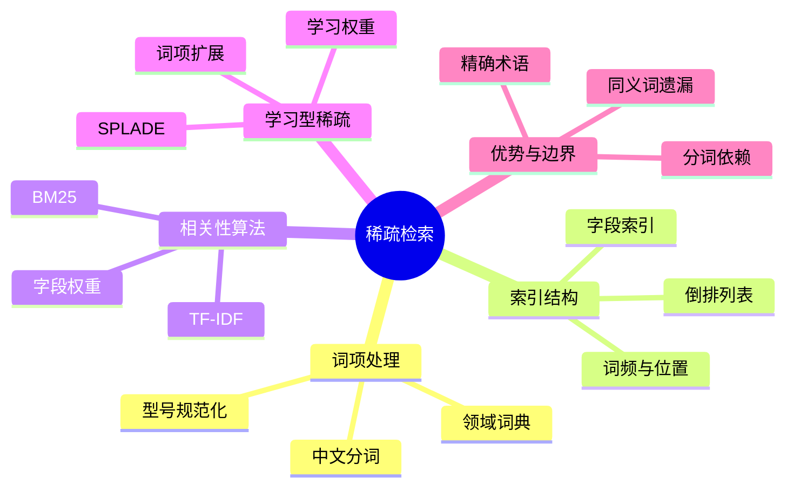

<strong>读图：</strong>词项处理影响索引内容，索引结构决定可匹配的候选，BM25 等评分方法决定候选次序；SPLADE 则将学习到的语义扩展引入稀疏表示，但仍要面对索引规模与查询成本问题。


### 3.1 倒排索引与词项分析

倒排索引（Inverted Index）把“文档包含哪些词”转换为“每个词出现在哪些文档中”。词项对应的 Posting List（倒排列表）可记录文档 ID、词频、位置等信息；查询时通过交并集和评分获取候选。

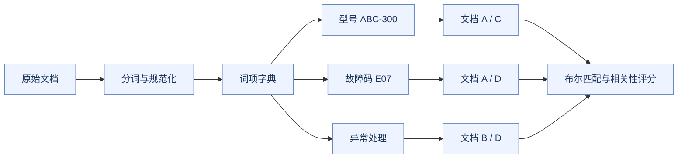

分词器（Analyzer）通常涉及字符过滤、Tokenization（分词）、Token Filter（词项处理）。中文没有自然空格，且设备型号中可能存在连字符、斜杠、大小写与数字，因此要单独测试领域词典、精确字段、短语匹配、同义词和停用词策略。

`text` 类字段用于全文分析；`keyword` 类字段通常用于未经全文分词的精确值匹配、过滤和聚合。<strong>BM25 不是严格字符串相等操作</strong>；型号与序列号应优先考虑结构化精确字段，而非仅靠 BM25 排名。

### 3.2 从 TF-IDF 到 BM25

TF-IDF（Term Frequency–Inverse Document Frequency，词频—逆文档频率）强调词在当前文档中出现的频率，以及该词在整个语料库中的稀有程度。BM25（Best Matching 25）进一步引入词频饱和和文档长度归一化。其常见形式为：

$$
\mathrm{BM25}(q,d)=\sum_{t\in q}\mathrm{IDF}(t)\cdot\frac{f(t,d)(k_1+1)}{f(t,d)+k_1\left(1-b+b\frac{|d|}{\mathrm{avgdl}}\right)}
$$

其中，`q` 是查询、`d` 是文档、`f(t,d)` 是词频、`avgdl` 是平均文档长度；`k_1` 控制词频饱和，`b` 控制长度归一化。逆文档频率（Inverse Document Frequency，IDF）的一种常见形式为：

$$
\mathrm{IDF}(t)=\ln\left(1+\frac{N-n_t+0.5}{n_t+0.5}\right)
$$

`N` 是文档总数，`n_t` 是包含词项 `t` 的文档数。实际引擎可能采用不同的统计口径或实现细节，不能把单一公式当作所有产品的完全一致实现。

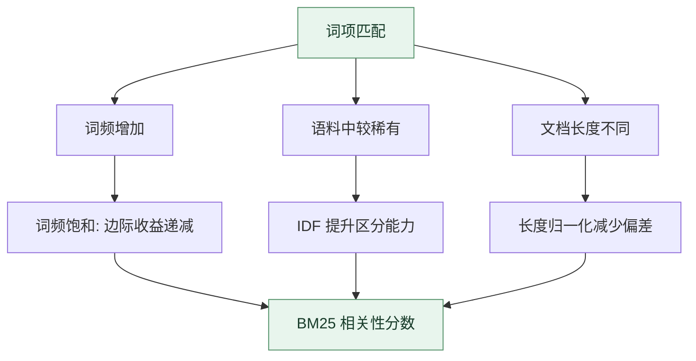

### 3.3 传统稀疏与学习型稀疏

Sparse Retrieval（稀疏检索）不只包括 BM25。SPLADE（Sparse Lexical and Expansion Model，稀疏词汇扩展模型）利用语言模型学习词项权重及扩展词项，生成仍可利用倒排索引的稀疏表示。其价值是弥补部分字面不一致问题，但增加了模型推理、索引容量和维护复杂度。BM25 应作为强基线，SPLADE 应通过领域数据评估是否值得引入。

## 4. 稠密检索：语义表示如何补足词项匹配

### 稠密检索知识网络

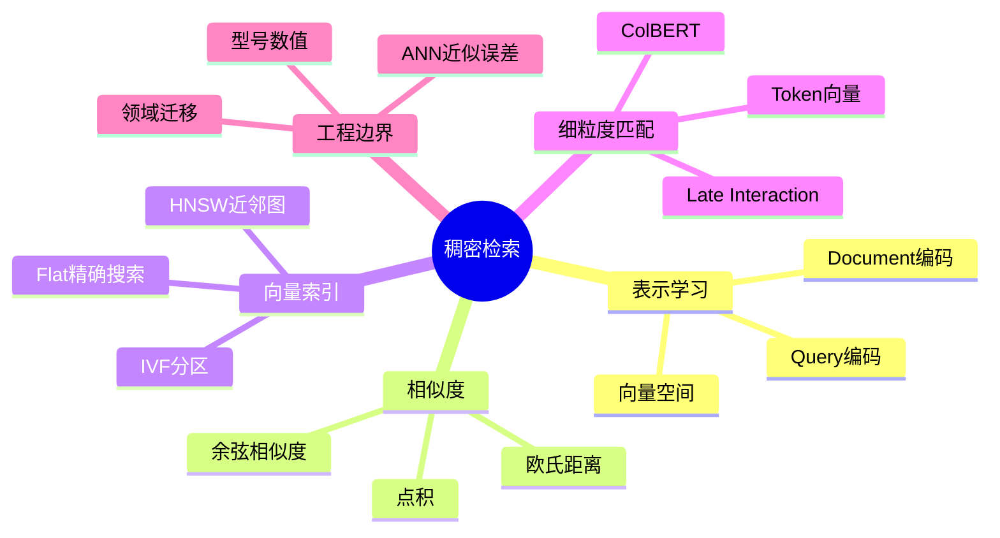

<strong>读图：</strong>编码器决定语义表示，相似度定义向量空间中的排序规则，索引加速近邻搜索；多向量方法以更多存储与计算换取细粒度匹配。领域适配和精确实体约束仍需要额外设计。


Dense Retrieval（稠密检索）利用 Embedding（嵌入表示）模型把查询和文档映射到连续向量空间。Dual Encoder（双编码器）分别编码查询与文档，文档向量可预先建立索引；查询时只需编码一次并查找相似向量。

$$
\mathrm{cosine}(\mathbf{q},\mathbf{d})=\frac{\mathbf{q}\cdot\mathbf{d}}{\|\mathbf{q}\|_2\,\|\mathbf{d}\|_2}
$$

余弦相似度衡量向量方向接近程度，不衡量事实正确性。点积（Dot Product）和欧氏距离（Euclidean Distance）也是常见度量；是否归一化、向量模型是否匹配、距离与相似度的排序方向，必须遵守具体引擎的约定。

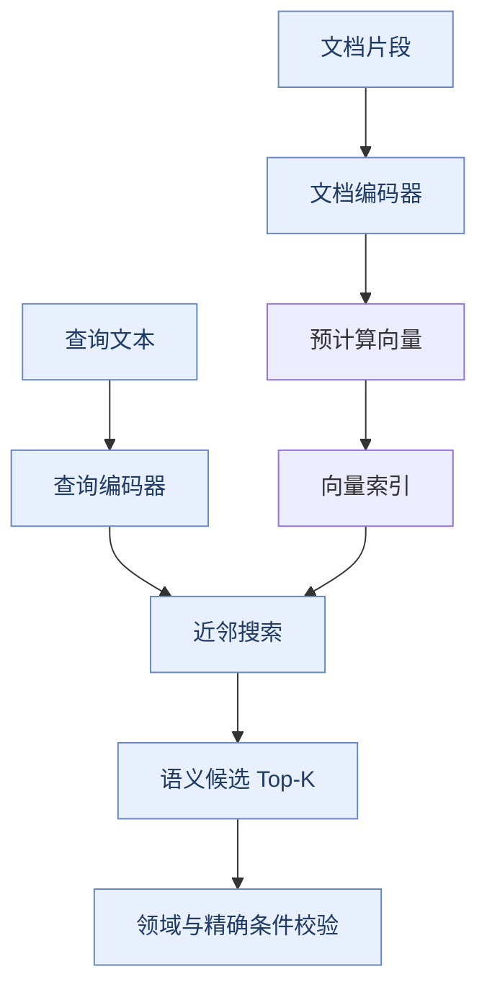

### 4.1 精确搜索与近似搜索

ANN（Approximate Nearest Neighbor，近似最近邻）通过减少向量比较降低查询成本。常见方案：

| 技术 | 英文全称或含义 | 原理与取舍 |
|---|---|---|
| Flat / Exact | 精确全量搜索 | 结果精确，但大规模计算成本较高 |
| HNSW | Hierarchical Navigable Small World，分层可导航小世界图 | 图导航搜索；受内存、建图参数和搜索宽度影响 |
| IVF | Inverted File，倒排文件分区 | 聚类分区后探测部分分区；探测范围影响召回 |
| PQ | Product Quantization，乘积量化 | 压缩向量；降低存储但引入量化误差 |
| DiskANN | 磁盘友好近邻搜索方法 | 面向大规模向量，权衡内存、磁盘访问与延迟 |

必须区分三类质量：Embedding 表示是否相关、ANN 是否找回精确近邻、最终检索是否找回业务证据。<strong>ANN Recall 高不代表业务 Recall@K 高。</strong>

### 4.2 多向量与后期交互

ColBERT（Contextualized Late Interaction over BERT，基于 BERT 的上下文化后期交互模型）为查询与文档保留多个 Token 级表示，并在检索阶段进行 Late Interaction（后期交互）。与单向量检索相比，它保留更细的匹配信息；与 Cross Encoder（交叉编码器）相比，它能够预计算文档侧表示，但索引和检索成本通常更高。

| 方法 | 表示粒度 | 典型位置 |
|---|---|---|
| BM25 | 词项统计 | 初始召回 |
| SPLADE | 学习型稀疏词项 | 初始召回 |
| Dual Encoder | 单个或少量稠密向量 | 初始召回 |
| ColBERT | 多个 Token 向量 | 召回或细粒度排序 |
| Cross Encoder | 查询与候选联合编码 | 小候选集精排 |

## 5. 多路召回：为什么要融合而不能直接相加

### 融合算法的选择网络

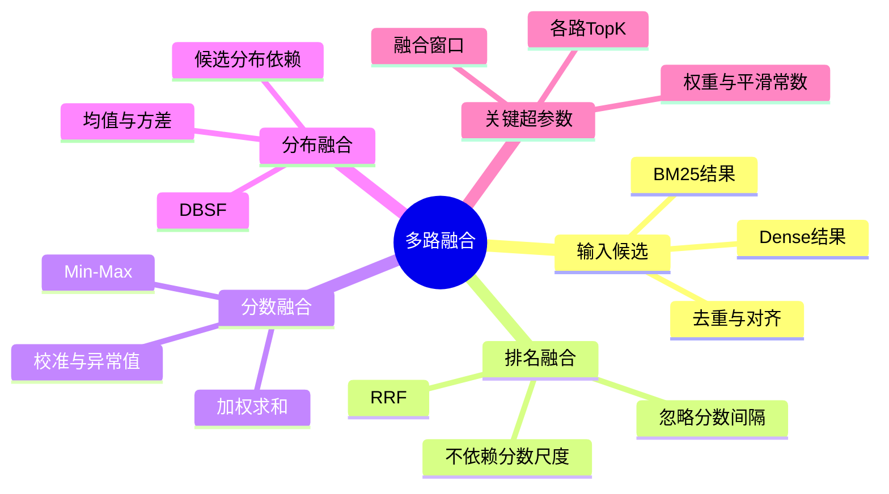

<strong>读图：</strong>候选集合先对齐，再选择排名或分数信号进行融合。RRF 强调跨检索器名次的一致性，分数融合利用得分强弱，DBSF 依赖当前候选分布；它们都无法补救召回阶段没有进入候选池的证据。


BM25 分数与向量相似度的数值范围、分布及含义通常不同。直接相加会让某一路因数值尺度而主导结果，未必反映相关性。因此需要 Rank Fusion（排名融合）或 Score Fusion（分数融合）。

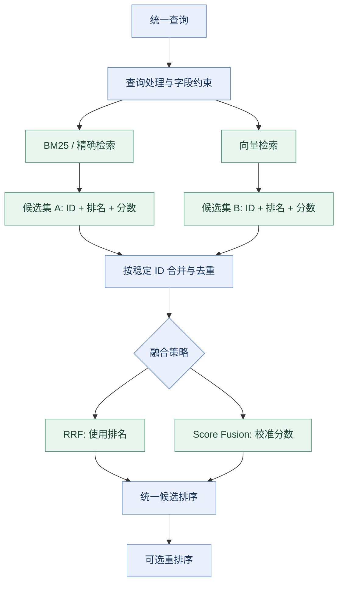

### 5.1 RRF：倒数排名融合

RRF（Reciprocal Rank Fusion，倒数排名融合）依据候选在不同检索器中的名次赋分，不要求各路原始得分可比较。经典公式为：

$$
\mathrm{RRF}(d)=\sum_{r\in R_d}\frac{1}{k+\mathrm{rank}_r(d)}
$$

`R_d` 是返回候选 `d` 的检索器集合；`rank` 从 1 开始；`k` 为平滑常数。没有返回该候选的检索器不贡献得分。`k=60` 是部分实现常见的取值，<strong>不是所有引擎的统一默认值</strong>。例如 Elasticsearch 文档说明其 RRF 默认 `rank_constant=60`，而 Qdrant 文档使用另一套参数化定义与默认值。

RRF 的优点是稳定、简单、对不同分数尺度不敏感；缺点是丢失了原始分数的差距信息，且无法找回被各路候选窗口截断的文档。

### 5.2 Score Fusion：归一化后融合

Min-Max Normalization（最小—最大归一化）的一种形式为：

$$
\hat{s}(d)=\frac{s(d)-s_{\min}}{s_{\max}-s_{\min}}
$$

当 `s_max = s_min` 时需定义特殊处理规则，避免除零。归一化后可加权：

$$
S(d)=\alpha\,\hat{s}_{\mathrm{dense}}(d)+(1-\alpha)\,\hat{s}_{\mathrm{sparse}}(d)
$$

`alpha` 是权重；该公式是<strong>常见融合模型</strong>，不代表所有引擎采用相同的归一化和缺失分数处理方式。Weaviate 的 `relativeScoreFusion` 采用相对分数归一化，`rankedFusion` 使用名次信息；其 `alpha` 用于控制两类检索的相对贡献。

### 5.3 DBSF：基于分数分布的融合

DBSF（Distribution-Based Score Fusion，基于分数分布的融合）是 Qdrant 支持的融合策略之一。它基于各检索器返回候选的均值与标准差对分数进行变换，再进行组合。Qdrant 官方给出的归一化形式为：

$$
\hat{s}=\frac{s-(\mu-3\sigma)}{6\sigma}
$$

其中 `mu` 为均值、`sigma` 为样本标准差。Qdrant 文档说明：此方法基于<strong>当前返回候选</strong>估计分布，结果不强制裁剪到 0 到 1；当分数完全相同或仅有一个候选时采用特殊值避免除零。它适合原始分数幅度有意义的场景，但仍需验证稳定性。

| 比较维度 | RRF | 归一化分数融合 | DBSF |
|---|---|---|---|
| 主要依据 | 排名 | 相对分数 | 当前候选分数分布 |
| 保留原始分数差距 | 否 | 是 | 是 |
| 主要优势 | 简单、弱依赖分数校准 | 权重灵活 | 利用分布统计 |
| 主要风险 | 忽略分数间距 | 异常值与窗口敏感 | 小样本与分布漂移 |
| 选型原则 | 优先作为稳健基线 | 需要校准且分数有区分度 | 引擎支持且经实验验证 |

## 6. 过滤、去重与候选窗口：融合前必须解决的工程问题

### 检索工程约束网络

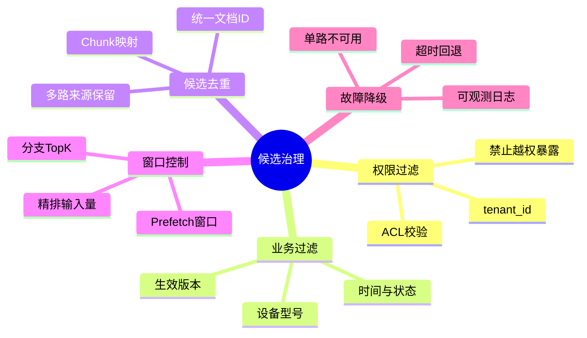

<strong>读图：</strong>权限是必须满足的安全边界，版本和型号是业务约束；去重与窗口控制决定融合的有效输入；故障降级保障可用性，但不得绕过安全过滤。


检索系统必须区分 <strong>Filter（过滤）</strong>、<strong>Deduplication（去重）</strong>、<strong>Fusion（融合）</strong> 和 <strong>Reranking（重排序）</strong>。过滤控制候选是否满足约束；去重识别同一证据；融合整合多路信号；重排序重新判断相关性。

### 6.1 前过滤与后过滤

Pre-filter（前过滤）在搜索空间约束下查找候选；Post-filter（后过滤）先检索再剔除不符合条件的结果。若先取向量 Top-10 再过滤型号，可能把正确但原本排在第 11 名之后的文档永久漏掉。不同引擎对过滤的执行时机与 ANN 的交互方式存在差异，应以其查询计划和官方说明为准。

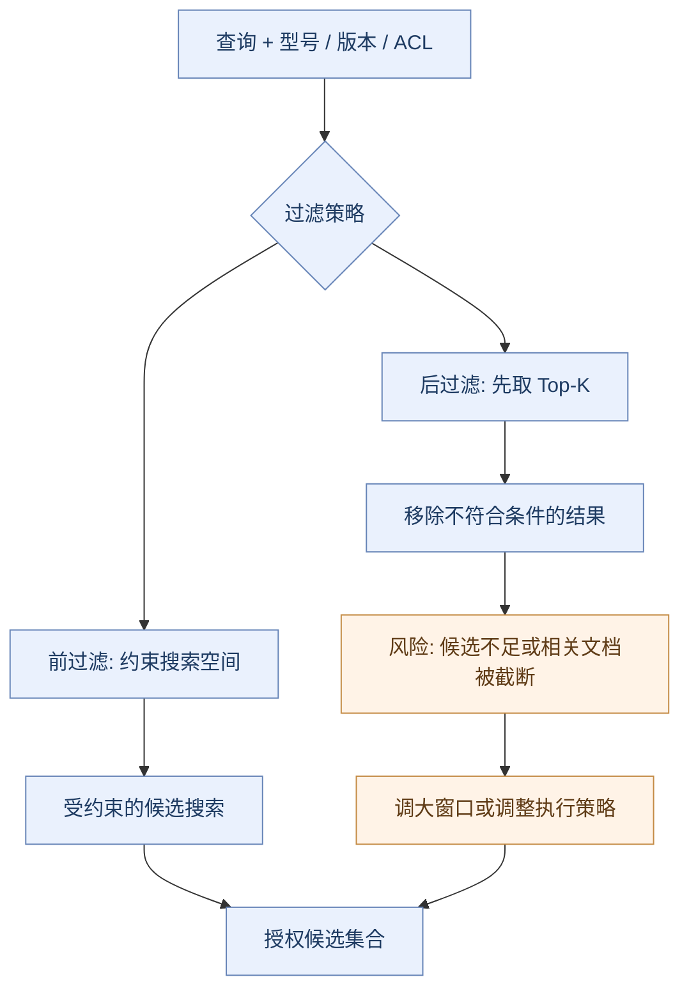

访问控制列表（Access Control List，ACL）和租户隔离必须由可信系统强制执行；不能把“模型不要引用无权限文档”当作权限控制。需要注意：不同业务约束可以影响相关性，但安全权限属于硬性边界。

### 6.2 候选窗口与截断

设 BM25 和 Dense 各返回 Top-20。若正确证据分别位于第 21 和第 25 名，则后续融合无法恢复它。候选窗口、ANN 搜索宽度、融合 Top-N、重排序输入量和最终上下文预算必须联合调参。

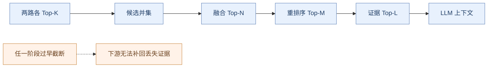

去重键应与业务证据粒度一致。相同文档中的不同段落不应因为 `document_id` 相同而全部合并；同一片段经不同检索器返回则应合并其分支证据。对重复段落、近重复版本和相邻块，还可在候选构建阶段增加去重与多样性约束。

## 7. 查询路由与自适应检索

### 查询意图与检索策略网络

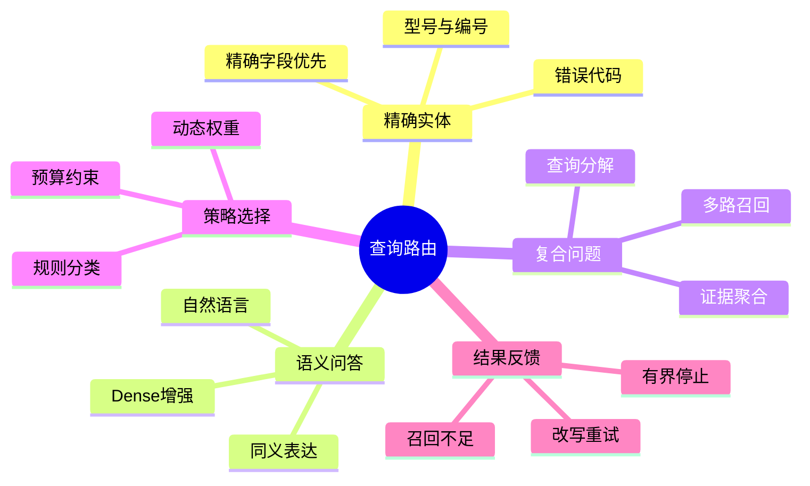

<strong>读图：</strong>查询特征决定优先使用哪类检索信号；策略选择既可以由规则完成，也可以由学习模型完成。检索反馈只在必要时触发追加检索，避免无界循环。


Adaptive Retrieval（自适应检索）根据问题类型决定检索分支、权重和候选窗口，并非每次都固定“BM25 一半、向量一半”。可先使用确定性规则识别型号、错误码、日期、部门、结构化字段，再逐步引入 Query Classification（查询分类）或 Learning to Rank（学习排序）。

| 查询类型 | 首选策略 | 原因 |
|---|---|---|
| 型号 / 故障码 | 精确字段 + BM25 | 避免语义相近但标识错误 |
| 自然语言描述 | Dense + BM25 | 兼顾同义表达与术语 |
| 型号 + 故障描述 | 字段过滤 + Hybrid | 精确范围内进行语义召回 |
| 跨语言手册 | 多语言 Embedding + 术语映射 | 中英文表达不一致 |
| 多跳或多条件 | 查询分解 + 多轮检索 | 单个查询难覆盖全部证据 |

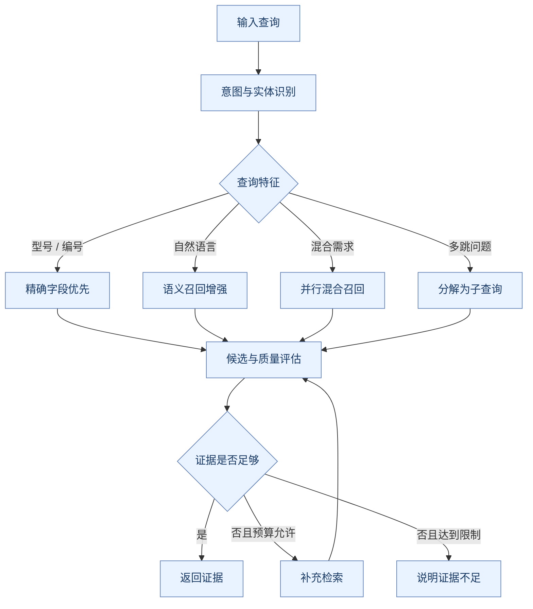

动态路由会引入分类错误、额外推理成本和策略复杂度，因此应先建立静态 Hybrid 基线，再比较不同查询类型上的增益。

## 8. 主流引擎：同名 Hybrid 并不意味着相同实现

### 搜索引擎能力对照网络

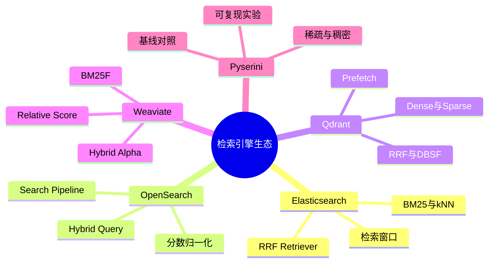

<strong>读图：</strong>各引擎都可以承载混合检索，但查询组织方式、融合算法和默认参数不同。选型时应对照能力与运行语义，而非仅对照是否提供 Hybrid Search 接口。


| 引擎 | 典型能力 | 需要核对的实现细节 |
|---|---|---|
| Elasticsearch | BM25、kNN、RRF Retriever | `rank_constant`、`rank_window_size`、检索器组合 |
| OpenSearch | Hybrid Query、Search Pipeline | 归一化处理器、RRF 排名处理器及版本差异 |
| Qdrant | Dense/Sparse Named Vectors、Prefetch、RRF、DBSF | 子查询窗口、过滤、主查询与预取层级 |
| Weaviate | BM25F、向量、Relative Score Fusion | `alpha`、融合方式、候选集归一化 |
| Pyserini | Lucene / Faiss 等检索实验工具 | 可复现的 BM25、Dense、Hybrid 基线 |

Qdrant 的 Query API 使用 `prefetch` 组织多路或多阶段查询，主查询可对预取结果融合；其文档特别指出分页时预取窗口需要覆盖主查询的 `limit + offset`。Weaviate 的 `relativeScoreFusion` 与 `rankedFusion` 不同，前者保留相对得分差异。Elasticsearch 的 RRF 采用排名融合，并公开候选窗口与平滑常数参数。<strong>跨引擎迁移时，必须重新核对分数方向、默认参数、过滤时机和候选截断。</strong>

## 9. 评测：证明“混合”确实带来增益

### 评测与诊断知识网络

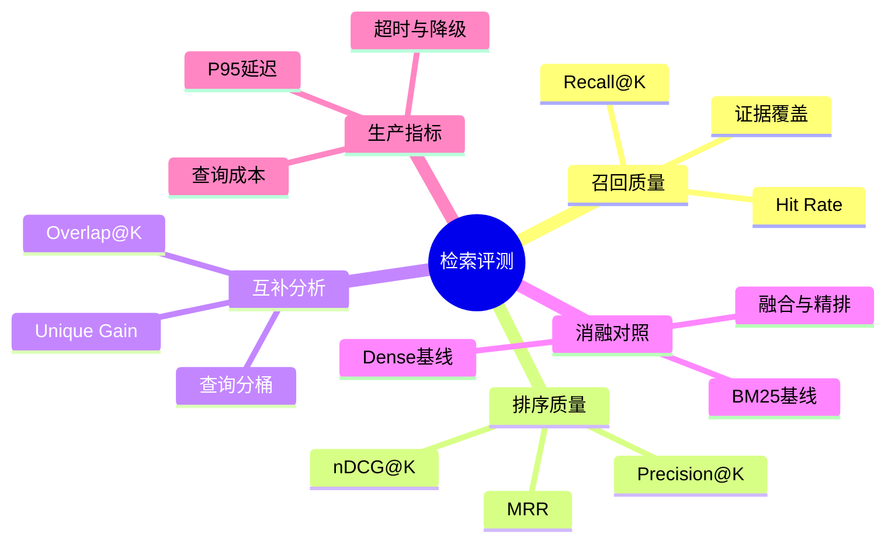

<strong>读图：</strong>召回指标验证“有没有找到”，排序指标验证“排得是否合理”，互补分析验证新增检索器是否提供独立价值；消融实验与生产指标共同决定优化是否值得上线。


### 9.1 检索质量指标

Recall@K（前 K 项召回率）衡量相关证据被找回的比例；Precision@K（前 K 项精确率）衡量返回结果中相关证据的占比。对查询集合可计算 MRR（Mean Reciprocal Rank，平均倒数排名）与 nDCG（Normalized Discounted Cumulative Gain，归一化折损累计增益），分别关注首个相关结果的位置和多级相关性排序。

$$
\mathrm{Recall@K}=\frac{|\mathrm{Relevant}\cap\mathrm{TopK}|}{|\mathrm{Relevant}|}
$$

$$
\mathrm{Precision@K}=\frac{|\mathrm{Relevant}\cap\mathrm{TopK}|}{K}
$$

$$
\mathrm{MRR}=\frac{1}{|Q|}\sum_{q\in Q}\frac{1}{\mathrm{rank}_q}
$$

对没有命中相关结果的查询，MRR 中该查询的倒数排名贡献记为 0。指标还必须注明标注单位是文档、片段还是完整证据集合；多跳问题需要额外评价是否找齐全部必要证据。

### 9.2 互补性与消融实验

<strong>新检索器真正的价值，是找回原有检索器遗漏的相关证据。</strong> 可以记录候选重叠率（Overlap@K）和独有相关增益（Unique Relevant Gain），并进行 Ablation Study（消融实验）：

| 实验组 | 配置 | 核心目的 |
|---|---|---|
| A | BM25 | 关键词基线 |
| B | Dense | 语义基线 |
| C | BM25 + Dense + RRF | 检验排名融合 |
| D | BM25 + Dense + Score Fusion | 比较分数融合 |
| E | Hybrid + Reranker | 检验精排增益 |
| F | 动态路由 + Hybrid | 检验自适应策略 |

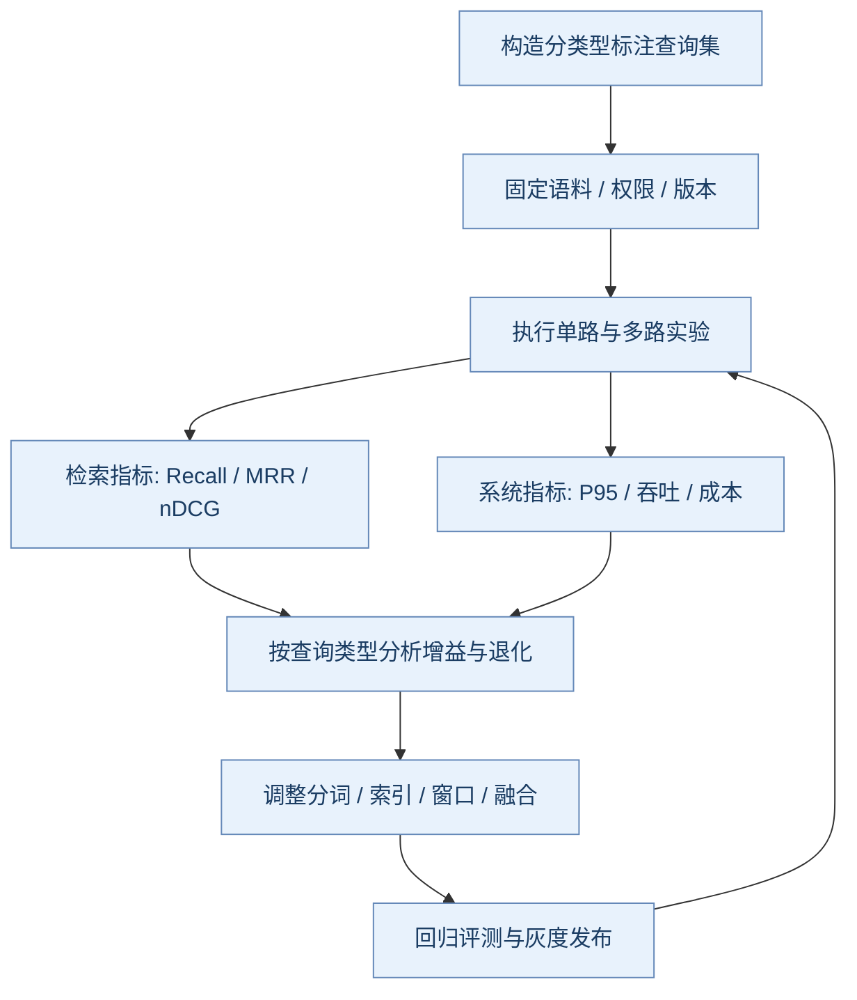

评测时应固定语料、Embedding 版本、权限范围、查询集与相关性标注，并分别记录 P50/P95/P99 延迟、吞吐、失败率和每次查询成本。不要只报告平均检索耗时或单一 Recall 数值。

## 10. 性能、更新与生产可靠性

### 生产运行知识网络

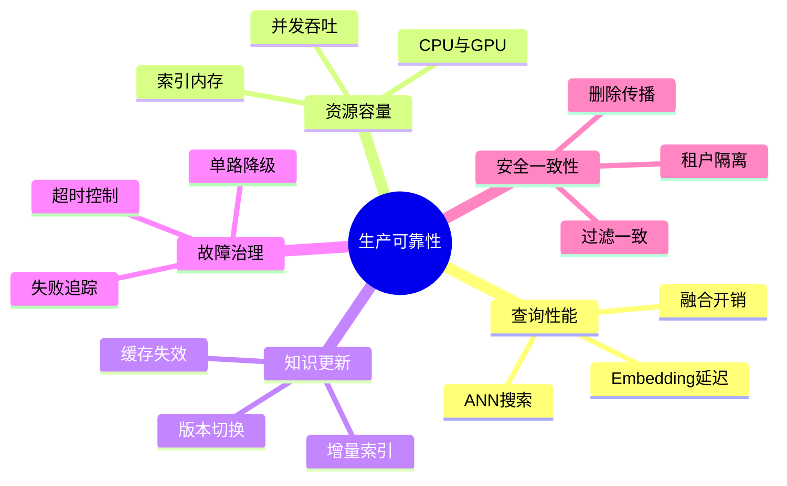

<strong>读图：</strong>性能优化与可靠性不是独立问题：索引更新会影响缓存和版本一致性，降级会改变召回能力，权限过滤必须在所有正常和异常路径中保持一致。


混合检索的瓶颈不只在向量数据库：查询 Embedding 推理、中文分析器、ANN 搜索、并发双路检索、融合窗口、跨服务网络与后续重排序都会增加延迟。两路并行通常可减少顺序等待，但高并发时也可能争夺 CPU、内存和连接资源。

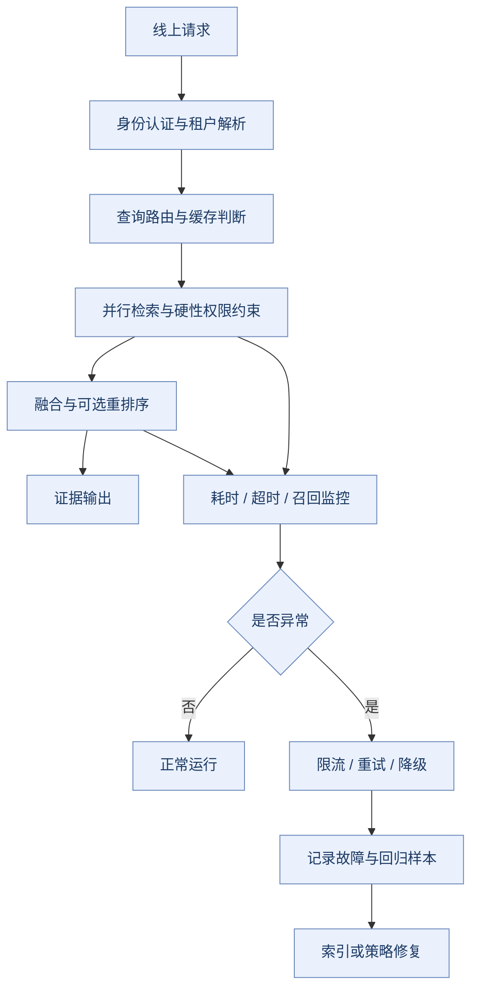

还应建立索引更新的版本策略：源文档更新后，需要同步全文索引、稠密向量与元数据；删除与权限变更应及时传播。缓存必须包含租户、权限与索引版本等隔离维度，避免复用不该返回的结果。故障降级可考虑在向量服务不可用时退回授权的关键词检索，但应明确标识质量下降，并防止越权或使用过期证据。

## 11. 企业案例：医疗设备故障知识库

### 企业案例中的知识协作网络

```mermaid
mindmap
  root((设备故障检索))
    用户问题
      ABC-300型号
      E07故障码
      排查步骤
    检索证据
      设备说明书
      维修手册
      维护规范
    匹配策略
      精确字段
      BM25召回
      Dense召回
    质量约束
      当前版本
      访问权限
      单位与参数
    结果交付
      融合与精排
      证据引用
      不足时拒答
```

<strong>读图：</strong>设备型号和故障码构成精确约束，排查步骤需要语义检索，多份文档共同提供证据；权限、版本与参数校验决定最终结果是否可用于企业场景。


用户问：“ABC-300 型号出现 E07 报警时，如何排查？有没有对应的维护规范？”

<strong>第一步，结构化识别。</strong> 从问题中提取型号 `ABC-300`、故障码 `E07`，并确定用户所属部门、可访问文档及现行版本。

<strong>第二步，多路召回。</strong> BM25 与精确字段检索查找型号、故障码和维护术语；Dense 分支查找“排查步骤”“异常处理”“故障诊断”等语义相近段落。两路都应在授权范围内执行。

<strong>第三步，融合与精排。</strong> 用稳定片段 ID 合并候选，以 RRF 作为首个可复现基线；若需要利用得分差距，再评估分数融合。重排序检查候选是否真正针对指定型号、报警码和维护场景。

<strong>第四步，证据完整性校验。</strong> 分别检查故障原因、排查步骤和维护规范是否均有来源支持；对数字、单位、适用条件和版本进行确定性核对。缺失证据时补充检索或明确说明，而不是由模型推测。

```mermaid
sequenceDiagram
    participant U as 员工
    participant A as 查询与权限层
    participant K as 关键词检索
    participant V as 向量检索
    participant F as 融合与精排
    participant R as RAG 生成
    U->>A: ABC-300 的 E07 如何排查
    A->>A: 提取型号与故障码 / 校验权限
    par 词项召回
        A->>K: 型号 + 故障码 + 维护术语
        K-->>F: 候选与 BM25 排名
    and 语义召回
        A->>V: 故障排查语义查询
        V-->>F: 候选与向量排名
    end
    F->>F: 去重 / 融合 / 相关性精排
    F->>R: 授权证据 + 来源 + 版本
    R-->>U: 有引用的排查建议或证据不足说明
```

| 失败表现 | 根因假设 | 优先修复方向 |
|---|---|---|
| 召回相似但错误的型号 | 语义召回忽视精确标识 | 型号精确字段约束 |
| 搜不到 E07 | 分词或字符规范化错误 | 故障码专用字段与测试 |
| 旧版规范排名靠前 | 版本未纳入约束 | 生效版本过滤 |
| 多路融合反而变差 | 权重或候选互补性不足 | 分类型消融实验 |
| 结果缺少关键步骤 | 窗口截断或切块不完整 | 扩大候选与父子块恢复 |
| 越权资料进入结果 | 过滤层位置错误 | 服务端强制权限隔离 |

## 12. 常见误区与工程决策原则

1. <strong>BM25 不是绝对精确匹配。</strong> 精确标识应结合字段匹配、规范化和过滤。
2. <strong>稀疏检索不等于 BM25。</strong> SPLADE 等学习型稀疏模型也属于稀疏检索。
3. <strong>Dense 不保证型号、数值和版本正确。</strong> 语义相似性与业务真实性是不同概念。
4. <strong>RRF 不是直接加原始分数。</strong> 它根据各检索器的名次融合。
5. <strong>不同引擎的 RRF 默认参数不一定相同。</strong> 不应照搬配置。
6. <strong>融合不等于重排序。</strong> 前者组合检索信号，后者可重新判断候选相关性。
7. <strong>扩大 Top-K 不必然提高最终答案质量。</strong> 可能增加噪声、延迟和成本。
8. <strong>权限过滤是安全边界，不是相关性偏好。</strong> 必须由可信服务执行。
9. <strong>混合检索不必然优于单路。</strong> 只有在目标查询集上验证互补增益才有意义。
10. <strong>检索指标不等于生成指标。</strong> 最终还需检验回答忠实度、引用准确性和证据完整性。

## 13. 全章知识收束与学习导航

本篇建立的完整依赖链是：<strong>查询与业务约束 → 词项 / 语义表示 → 多路候选 → 权限与版本控制 → 去重与融合 → 重排序 → 可追溯证据 → 评测优化。</strong>

继续学习时，建议回到 [01｜RAG](01-RAG.md) 理解证据如何进入生成上下文，再进入 [03｜Reranking](03-Reranking.md) 深入 Cross Encoder、Listwise / Pairwise 排序和重排序评测。混合检索解决的是“尽量不要漏掉正确候选”，精排解决的是“从候选中更准确地挑选最相关证据”，两者应共同评测。

## 14. 参考资料与延伸阅读

以下资料以官方文档、开源项目和研究论文为主。引擎接口、默认参数和版本行为可能更新，落地时以实际部署版本的官方文档为准。

1. [Elasticsearch — Reciprocal Rank Fusion](https://www.elastic.co/docs/reference/elasticsearch/rest-apis/reciprocal-rank-fusion) — RRF 原理、平滑常数与候选窗口。
2. [Qdrant — Hybrid and Multi-Stage Queries](https://qdrant.tech/documentation/search/hybrid-queries/) — Prefetch、RRF、DBSF 和多阶段检索。
3. [Weaviate — Hybrid Search Concepts](https://docs.weaviate.io/weaviate/concepts/search/hybrid-search) — 关键词与向量融合及两种融合策略。
4. [Weaviate — Hybrid Search API](https://docs.weaviate.io/weaviate/search/hybrid) — `alpha`、查询选项与返回解释。
5. [OpenSearch — Hybrid Search](https://docs.opensearch.org/latest/vector-search/ai-search/hybrid-search/index/) — 混合查询与搜索流水线。
6. [OpenSearch — Normalization Processor](https://docs.opensearch.org/latest/search-plugins/search-pipelines/normalization-processor/) — 分数归一化和组合。
7. [SPLADE: Sparse Lexical and Expansion Model](https://arxiv.org/abs/2107.05720) — 学习型稀疏检索。
8. [SPLADE v2](https://arxiv.org/abs/2109.10086) — 稀疏表示优化。
9. [ColBERT: Efficient and Effective Passage Search via Contextualized Late Interaction](https://arxiv.org/abs/2004.12832) — 多向量后期交互。
10. [BEIR: A Heterogeneous Benchmark for Zero-shot Evaluation of Information Retrieval Models](https://arxiv.org/abs/2104.08663) — 多领域检索评测。
11. [Pyserini GitHub](https://github.com/castorini/pyserini) — 可复现的检索基线。
12. [Qdrant Documentation](https://qdrant.tech/documentation/) — 向量与 Payload 过滤的工程实现。

---

<strong>一句话总结：</strong>混合检索的价值不在于“同时使用 BM25 和向量”，而在于通过互补召回、可靠融合、正确过滤和可复现评测，把真正有用且有权限的证据稳定送入 RAG 系统。
