# 03｜Reranking：重排序、检索质量优化与证据选择

> 第五章 · Agent Knowledge and Tools。前置阅读：[01-RAG](01-RAG.md) → [02-Hybrid-Search](02-Hybrid-Search.md)；下一阶段关注 Agent 的知识使用与工具调用。
>
> 本文讨论的是检索后的相关性排序，不把模型得分误认为事实可信度，也不把重排序当成权限控制或答案验证。

## 0. 全局知识网络：重排序处于什么位置？

检索增强生成（Retrieval-Augmented Generation，RAG）的检索阶段首先追求<strong>候选覆盖</strong>，精排阶段追求<strong>有限候选内的相关性顺序</strong>，上下文工程再追求<strong>证据集合的完整性</strong>。三者的目标不同，但共同决定生成模型能看到什么。

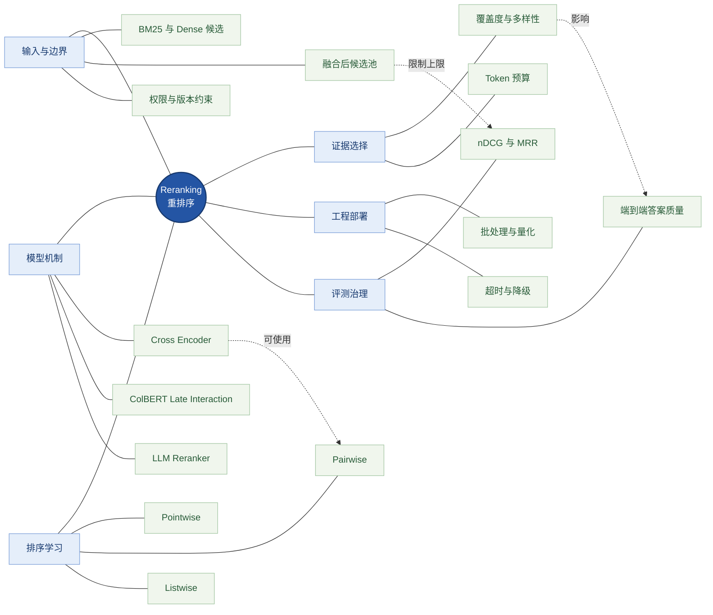

<strong>读图：</strong>输入候选池限定重排序能够改善的范围；模型架构与训练方式共同决定相关性判别能力；证据选择把“单条文档排序”转化为“可回答问题的证据集合”；评测同时覆盖排序指标与最终答案。

## 1. 问题起点：为什么召回和融合之后仍需要精排？

在企业知识库中，查询“ABC-300 设备 E07 故障如何排查”，混合检索可能返回同型号不同故障码、同故障码不同型号、故障说明、操作规程等多个候选。BM25（Best Matching 25，经典概率词项检索）偏向词项匹配，Dense Retrieval（稠密检索）偏向语义近似，RRF（Reciprocal Rank Fusion，倒数排名融合）负责综合不同检索器的排序；它们均不保证对完整查询条件作出足够细致的判断。

<strong>Reranking（重排序）</strong>接受查询与有限候选，计算相关性并重新排列。它一般不扩大候选集合；如果正确证据未被第一阶段召回，精排无法凭空找回。

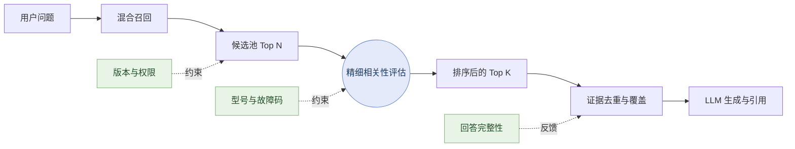

<strong>读图：</strong>精排是召回和上下文构建之间的桥梁；权限应在证据进入模型前由可信系统执行，精排不能替代它。

### 1.1 必须区分的五类能力

| 能力 | 输入 | 目标 | 不能替代的环节 |
|---|---|---|---|
| Retrieval（检索召回） | 查询、索引 | 尽量找到相关候选 | 精细排序 |
| Fusion（多路融合） | 多个候选列表 | 统一排名信号 | 查询—文本深度理解 |
| Reranking（重排序） | 查询、候选池 | 改善候选先后顺序 | 未召回证据的恢复 |
| Context Selection（上下文选择） | 已排序证据 | 在预算内保证覆盖与多样性 | 事实验证 |
| Verification（验证） | 生成结果、证据 | 判断结论是否受证据支持 | 检索与权限控制 |

## 2. 模型架构：从独立编码到细粒度交互

### 2.1 Bi-Encoder 与 Cross-Encoder

Bi-Encoder（双编码器）独立将查询与文档映射为向量，文档表示可以预先计算，适合大规模候选召回。Cross-Encoder（交叉编码器）将查询和候选联合输入 Transformer，让注意力机制直接学习二者之间的匹配关系。对于“型号正确但故障码错误”的困难候选，联合交互往往更有辨别潜力，但每个查询—文档对都要推理，成本通常高于向量相似度计算。

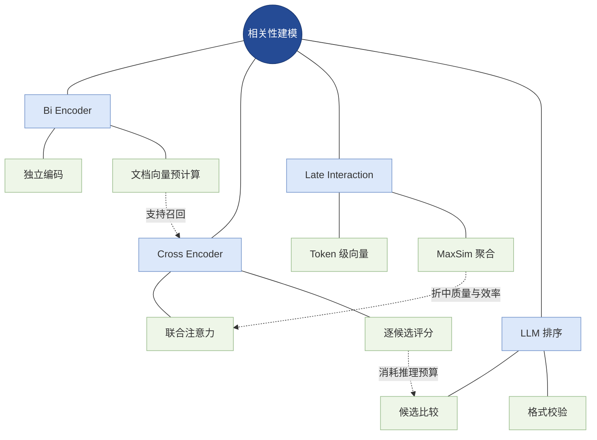

<strong>读图：</strong>四类方法的差异首先是“查询与文档何时、以什么粒度交互”，不是简单按模型大小排列。

Cross-Encoder 的相关性打分可写成：

$$
s_i=f_{\theta}(q,d_i)
$$

这里的分数通常只是<strong>相对排序信号</strong>。部分模型输出未经校准的 Logit（对数几率形式的原始模型输出），不能直接理解为“答案正确概率”。对同一查询的分数使用单调变换通常不改变排序，但跨查询阈值需要单独校准。

### 2.2 ColBERT 与 Late Interaction

ColBERT（Contextualized Late Interaction over BERT，基于 BERT 上下文化表示的后期交互）为查询和文档保留多个 Token 向量，并在检索阶段执行细粒度匹配。典型 MaxSim 聚合形式为：

$$
S(q,d)=\sum_{i=1}^{|q|}\max_{1\le j\le |d|}\mathrm{sim}(q_i,d_j)
$$

其中每个查询 Token 选择与其最相近的文档 Token，再汇总得分。它既不像单向量检索那样把所有信息压缩到一个向量，也不必像 Cross-Encoder 一样对每对文本完整执行联合注意力；代价是更高的多向量存储与匹配开销。

### 2.3 LLM Reranker

LLM（Large Language Model，大语言模型）可以逐项打分、成对比较，或一次排列多个候选。它能够利用较复杂的任务说明，但可能受到提示词、候选顺序、上下文长度及输出格式的影响。对于生成式排序，必须检查候选 ID 是否完整、是否重复，并在格式错误或超时时回退。

| 架构 | 可否预计算文档侧表示 | 细粒度匹配 | 常见使用位置 |
|---|---|---|---|
| Bi-Encoder | 是 | 相对有限 | 第一阶段召回 |
| Cross-Encoder | 一般不能独立缓存最终配对分数 | 强 | 精排 |
| ColBERT | 是，多 Token 向量 | 强 | 检索或精排 |
| LLM Reranker | 依实现而定 | 依模型与提示而定 | 复杂候选的后段排序 |

## 3. 排序学习：训练目标与模型架构是两个维度

Pointwise（逐点评分）、Pairwise（成对排序）和 Listwise（列表排序）描述训练或推理如何组织候选，而 Bi-Encoder、Cross-Encoder 描述文本如何编码。因此，Cross-Encoder 完全可以采用 Pairwise 损失，二者并不互斥。

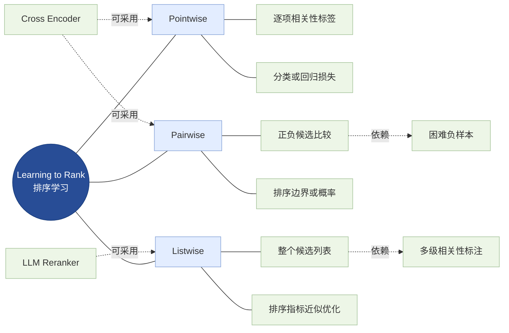

<strong>读图：</strong>排序学习方式决定监督信号如何构造；模型架构决定特征交互能力；数据质量决定模型究竟学到什么相关性。

### 3.1 Pointwise

对每个查询—文档对独立预测二分类或多级相关性，适合标签明确、实现简单的任务。但它不直接要求同一查询下更相关的文档排在前面。

### 3.2 Pairwise

构建正样本 $d^{+}$ 与负样本 $d^{-}$，希望前者得分更高。典型的成对逻辑损失为：

$$
\mathcal{L}_{pair}=\log\left(1+\exp\left(-(s^{+}-s^{-})\right)\right)
$$

如果把同型号但不同故障码的文档当作困难负样本，模型会被迫学习更精细的匹配约束。

### 3.3 Listwise

将整个候选列表作为学习对象，利用列表级概率、排列或与 nDCG 相关的近似目标优化排序。RankNet、ListNet、ListMLE、LambdaRank、LambdaMART 分属不同历史方法和建模范式，不应把它们都视为同一个神经网络结构。

## 4. 训练数据：相关性不是简单的语义相似

模型可以很好地判断“两个文本讨论相似主题”，却仍然错误地将 ABC-300/E08 排在 ABC-300/E07 之前。因此企业数据集需要把<strong>业务条件是否满足</strong>纳入相关性定义。

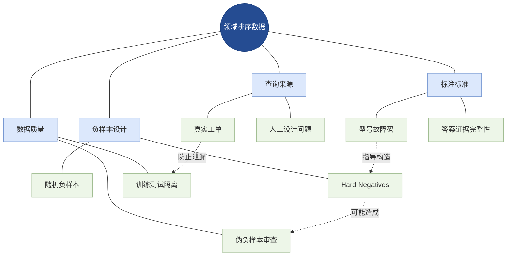

<strong>读图：</strong>训练数据不是“随机找几个负文档”，而是从业务约束出发定义相关性，再设计能够暴露模型弱点的困难负样本。

Hard Negative Mining（困难负样本挖掘）可从 BM25 高排名误召回、向量高相似误召回、同型号不同故障码、旧版规程等来源获得负样本。要谨防 False Negative（伪负样本）：例如一份确实包含正确排查步骤的文档被错误标负，会误导模型。

数据切分不应只随机按样本行分割；同一设备手册的近重复段落、同一问题的多种改写可能跨越训练集与测试集，造成评价虚高。应按文档来源、问题簇、版本或设备族设计隔离实验。

## 5. 多阶段排序：精度、延迟和候选保留的共同约束

当第一阶段返回 200 个候选时，直接使用昂贵模型逐个评分可能导致延迟过高。Cascade Ranking（级联排序）通过多阶段缩小候选范围，把昂贵模型用于最需要的少量文本。

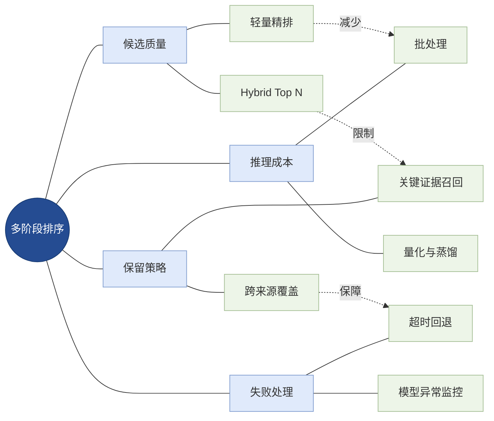

<strong>读图：</strong>精排级联的瓶颈不仅是计算资源，更是前段筛选能否保留关键证据。早期误删无法由后期大模型补救。

可行的工程路径是：混合召回 Top-100～200 → 轻量 Cross-Encoder 选出 Top-20～40 → 在必要时使用更强模型评估少量候选 → 证据集合选择。这里的数量仅为实验起点，不是通用最优配置，应通过真实数据调参。

### 5.1 长文本截断

交叉编码器通常有输入长度上限。如果候选中包含标题、适用范围、警告、表格及正文，简单从尾部截断可能丢失关键限定条件。可以采用标题与元数据前置、按段落切块、父子块扩展或滑动窗口评分；需要比较额外推理成本与排序收益。

### 5.2 推理优化

Batch Inference（批量推理）可提升吞吐；FP16（16 位浮点）和 BF16（Brain Floating Point 16，脑浮点格式）可降低部分硬件上的计算开销；INT8/INT4 量化可以减小模型存储或推理成本，但排序质量必须重新测量。Dynamic Batching（动态批处理）改善并发吞吐的同时可能增加排队延迟。

缓存键需要包含查询规范化结果、候选内容哈希、模型版本及权限相关上下文，防止文档更新后复用过期分数。

## 6. 从相关性排序到证据集合选择

Top-K 最相关的片段不一定能完整回答多条件问题。如果 Top-5 都来自同一故障现象说明，用户要求的维护规程可能仍然缺失。因此需要在排序之后做 Coverage（覆盖度）、Diversity（多样性）、Authority（来源权威性）、Freshness（时效性）和 Token Budget（上下文预算）的联合权衡。

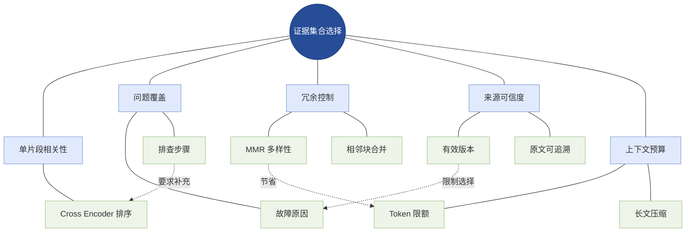

<strong>读图：</strong>相关性是必要条件而非充分条件；还要保证答案覆盖多个子目标，保留正确版本和来源，并避免重复片段占满上下文。

MMR（Maximal Marginal Relevance，最大边际相关性）常用于平衡查询相关性与候选间冗余，其示意形式为：

$$
\mathrm{MMR}(d)=\lambda\,\mathrm{sim}(q,d)-(1-\lambda)\max_{d'\in S}\mathrm{sim}(d,d')
$$

这里 `S` 为已选集合，`λ` 控制相关性与去冗余的权衡。MMR 不是 Cross-Encoder 的替代品；它通常属于证据集合优化策略。

## 7. 模型选型：从实验基线到生产部署

| 模型与方案 | 主要定位 | 优点 | 注意事项 |
|---|---|---|---|
| Sentence Transformers CrossEncoder | 开源训练和推理框架 | 易建立基线、支持自定义训练 | 需选择匹配领域与语言的具体模型 |
| BGE Reranker | 开源重排序模型系列 | 可本地部署、支持微调 | 需验证模型版本、输入长度、硬件需求 |
| Cohere Rerank | 托管重排序 API | 集成方便 | 网络、费用、数据合规与版本限制 |
| NVIDIA NeMo Retriever | 检索与重排序服务组件 | 可用于企业化推理部署 | 资源与部署复杂度 |
| ColBERTv2 | 多向量后期交互 | 细粒度匹配 | 索引规模与匹配开销 |
| LLM-based Reranker | 复杂候选判断 | 可显式描述业务标准 | 输出稳定性、延迟、成本 |

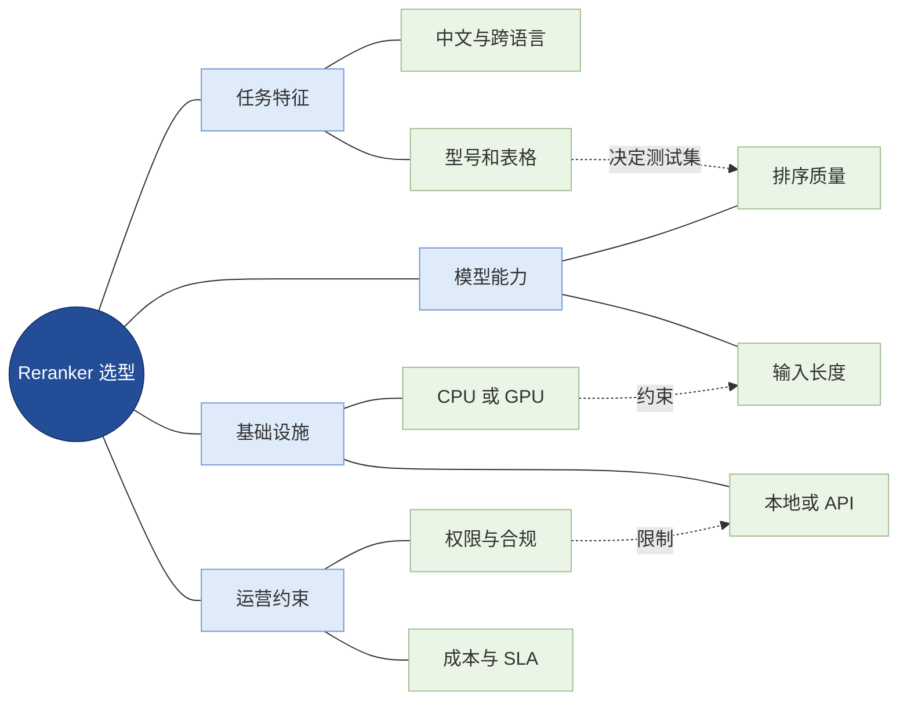

<strong>读图：</strong>模型选型是任务数据、模型质量、部署资源和企业治理的联合决策，不是单看公开榜单。

## 8. 评测：为什么 nDCG 提升不一定代表回答更好？

### 8.1 排序指标

MRR（Mean Reciprocal Rank，平均倒数排名）关注每个查询第一个相关结果的位置：

$$
\mathrm{MRR}=\frac{1}{|Q|}\sum_{q\in Q}\frac{1}{\mathrm{rank}_{q}}
$$

当查询没有相关命中时，其倒数排名记为 0。

DCG（Discounted Cumulative Gain，折损累计增益）考虑相关性等级与排名位置：

$$
\mathrm{DCG}@K=\sum_{i=1}^{K}\frac{2^{rel_i}-1}{\log_2(i+1)}
$$

nDCG（Normalized Discounted Cumulative Gain，归一化折损累计增益）将 DCG 与理想排序的 IDCG 比较：

$$
\mathrm{nDCG}@K=\frac{\mathrm{DCG}@K}{\mathrm{IDCG}@K}
$$

若理想 DCG 为 0，需要在评测协议中明确处理规则。MAP（Mean Average Precision，平均精度均值）关注多个相关文档的排序质量；Precision@K 与 Recall@K 分别反映前 K 项的准确性与覆盖程度。

### 8.2 候选池上限与精排收益

固定候选池中的相关文档数量不会因重排序增加，但其进入最终 Top-K 的数量可能提高。因此必须同时报告<strong>候选池 Recall@N</strong>与<strong>精排后 Recall@K</strong>，不能只比较最终排名。

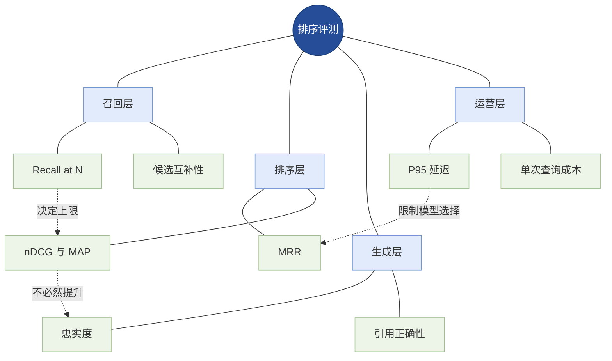

<strong>读图：</strong>评测必须沿召回、精排、生成和服务成本逐层诊断；离线排名改善不自动等于最终答案可信。

### 8.3 推荐消融实验

| 实验组 | 方案 | 验证目标 |
|---|---|---|
| A | BM25 | 词项基线 |
| B | Dense Retrieval | 语义基线 |
| C | Hybrid Search | 多路召回互补性 |
| D | Hybrid + Cross-Encoder | 精排独立增益 |
| E | D + 覆盖与去重 | 证据集合质量 |
| F | D + 领域微调 | 专业条件识别 |
| G | D + 级联强模型 | 质量与成本取舍 |

测试集需要覆盖同型号不同故障码、同故障码不同型号、旧版与新版、无答案、跨语言、表格与数字、权限边界以及多文档问题；同时记录模型版本、索引版本、硬件、批大小和候选窗口，保证结果可复现。

## 9. 企业级可靠性：安全、状态、监控与降级

Reranker 通常处理来自知识库的外部文本，因此输入仍属于不可信数据。检索文档中的“忽略指令”等内容不能升级为系统命令。权限、租户隔离与版本筛选必须由可信系统执行，而不是交给模型自觉遵守。

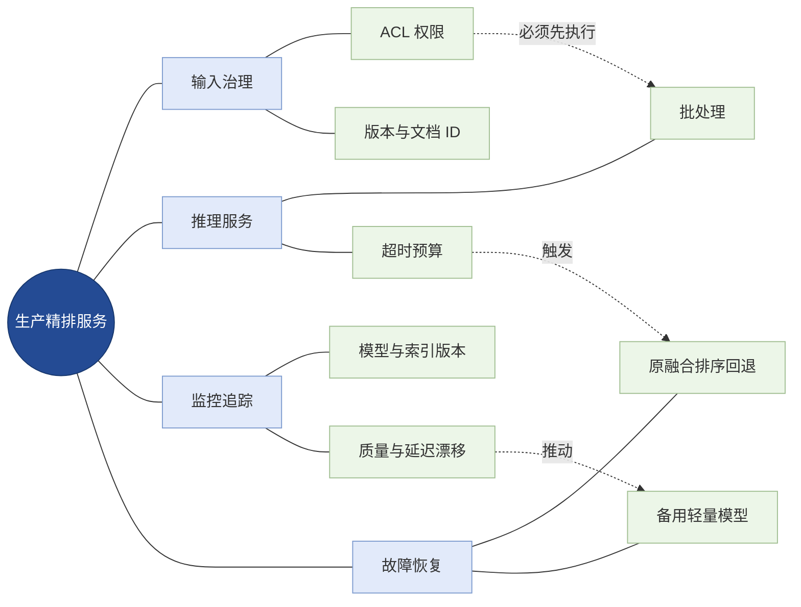

<strong>读图：</strong>精排服务必须有独立于模型的输入治理、可观测性与失败路径，才能成为可靠的企业基础组件。

推荐记录 query_id、候选文档 ID、原始排名、精排分数、模型版本、截断比例、处理耗时、超时原因和最终证据 ID。若模型失败，可以退回已授权的融合检索排序，但应标记本次发生降级。

## 10. 贯穿案例：医疗设备故障知识库

用户问题：“ABC-300 型号出现 E07 报警时，应按什么顺序排查？对应维护规范在哪里？”

| 候选 | 内容 | 判断 |
|---|---|---|
| A | ABC-300 / E07 排查步骤 | 高度相关，优先保留 |
| B | ABC-300 / E08 排查步骤 | 型号匹配但故障码不匹配 |
| C | ABC-200 / E07 排查步骤 | 故障码匹配但型号不匹配 |
| D | ABC-300 / E07 故障现象 | 部分相关，不能独立回答步骤 |
| E | ABC-300 正式维护规范 | 对第二个子问题必要 |

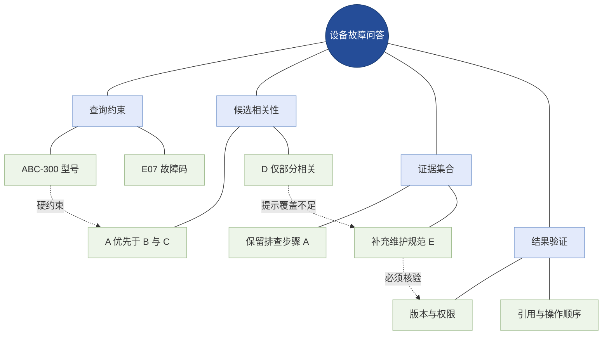

<strong>读图：</strong>单文档排序解决“哪个候选更贴近问题”，证据集合选择解决“是否同时覆盖排查步骤和维护规范”，验证解决“是否为正确型号、有效版本且有来源依据”。

落地时应优先通过结构化字段过滤型号、权限与版本，再让重排序模型判断文本相关性；不能把硬性业务条件完全交给语义分数。对于高风险设备操作，最终答案仍应以正式文件为依据，并设置必要的人工复核。

## 11. 进阶方向与常见误区

### 11.1 值得持续关注的方向

- <strong>RankGPT / Listwise LLM：</strong>使用语言模型生成候选排列，研究复杂相关性与排序稳定性。
- <strong>RankRAG：</strong>探索通过训练将检索相关性判断与生成能力结合，注意它不是所有 RAG 系统的通用默认组件。
- <strong>多模态精排：</strong>对技术图纸、扫描页和复杂表格使用图文联合表示或视觉语言模型，前提是解析和来源定位可靠。
- <strong>蒸馏与自适应级联：</strong>让轻量模型处理容易候选，把高成本模型保留给困难查询。

### 11.2 误区辨析

| 误区 | 正确认识 |
|---|---|
| 重排序能修复所有召回问题 | 不能恢复候选池之外的证据 |
| Cross-Encoder 等于 Pairwise | 一个是模型架构，一个是排序学习方式 |
| 相关性分数等于可信概率 | 分数通常未校准，跨查询不可直接比较 |
| Top-K 分数最高就是最佳上下文 | 还需要覆盖度、多样性、版本与预算 |
| nDCG 提升等于答案一定更准确 | 需要独立评估生成忠实度和引用质量 |
| 大模型精排一定优于小模型 | 需要比较领域数据、延迟、成本和稳定性 |
| 精排可以替代权限过滤 | 权限必须在可信系统中执行 |

## 12. 与其他 Agent 模块的关系及总结

Reranking 位于知识检索与上下文构建之间。与 [01-RAG](01-RAG.md) 的关系是提供更高质量证据排序；与 [02-Hybrid-Search](02-Hybrid-Search.md) 的关系是接收多路召回后的候选；与第四章的 [ReAct](../04-Agent-Working-Patterns/01-ReAct.md) 和 [Planning](../04-Agent-Working-Patterns/02-Planning.md) 的关系是为动态工具调用与多步检索提供可用证据，而不是代替 Agent 决策。

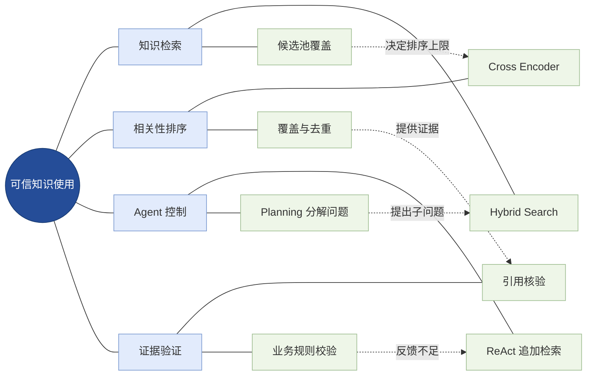

<strong>读图：</strong>从知识检索到可靠答案是协作闭环：召回决定证据边界，精排改善候选次序，Agent 决定是否继续检索，验证决定证据是否足以支持结论。

<strong>核心结论：</strong>重排序的价值不在于让相似度分数更漂亮，而在于在候选覆盖、相关性判断、证据完整性和推理成本之间建立可评测的工程平衡。

## 13. 权威资料与延伸阅读

以下来源覆盖基础架构、排序学习、代表模型、研究论文与评测工具；具体 API 与模型版本应以使用时的官方文档为准。

1. [Sentence Transformers：Retrieve & Re-Rank](https://sbert.net/examples/sentence_transformer/applications/retrieve_rerank/README.html) — 两阶段检索与重排序。
2. [Sentence Transformers：CrossEncoder Usage](https://www.sbert.net/docs/cross_encoder/usage/usage.html) — 推理接口与模型分数。
3. [Sentence Transformers：Cross-Encoder Losses](https://www.sbert.net/docs/package_reference/cross_encoder/losses.html) — 训练损失及排序学习。
4. [Sentence Transformers：Cross-Encoder Training](https://www.sbert.net/docs/cross_encoder/training_overview.html) — 训练流程。
5. [FlagEmbedding GitHub](https://github.com/FlagOpen/FlagEmbedding) — BGE Reranker 模型、推理和微调。
6. [Cohere Rerank](https://docs.cohere.com/docs/rerank) — 托管重排序服务。
7. [NVIDIA NeMo Retriever](https://docs.nvidia.com/nemo/retriever/) — 企业检索与精排服务。
8. [BEIR Benchmark](https://github.com/beir-cellar/beir) — 可复现的检索与精排评测。
9. [ColBERTv2](https://arxiv.org/abs/2112.01488) — 多向量后期交互。
10. [RankGPT](https://arxiv.org/abs/2304.09542) — 基于排列生成的 LLM 排序。
11. [RankRAG](https://arxiv.org/abs/2407.02485) — 排序与生成的联合优化研究。
12. [Learning to Rank for Information Retrieval](https://www.microsoft.com/en-us/research/publication/learning-to-rank-for-information-retrieval/) — 排序学习基础。
