# Function Calling：函数调用协议与 Agent 工具执行机制

> 本文属于 **05-Agent-Knowledge-and-Tools / 04-Function-Calling**。以“模型提出动作、运行时受控执行、结果驱动下一步决策”为主线，解释函数调用的接口契约、协议、编排、可靠性、安全和工程选型。

## 阅读导航

1. [问题起点与系统边界](#1-问题起点与系统边界)
2. [工具契约与结构化参数](#2-工具契约与结构化参数)
3. [模型决策与工具路由](#3-模型决策与工具路由)
4. [协议与完整交互生命周期](#4-协议与完整交互生命周期)
5. [主流模型平台的差异](#5-主流模型平台的差异)
6. [单步并行与组合式调用](#6-单步并行与组合式调用)
7. [Tool Runtime 与执行状态](#7-tool-runtime-与执行状态)
8. [可靠性幂等与异步任务](#8-可靠性幂等与异步任务)
9. [安全权限与人工审批](#9-安全权限与人工审批)
10. [与 MCP 和其他 Agent 模块的关系](#10-与-mcp-和其他-agent-模块的关系)
11. [性能成本与评测](#11-性能成本与评测)
12. [企业级文档翻译案例](#12-企业级文档翻译案例)
13. [工程选型与常见误区](#13-工程选型与常见误区)
14. [知识网络总结与参考资料](#14-知识网络总结与参考资料)

---

## 1. 问题起点与系统边界

大语言模型（Large Language Model，**LLM**）本质上输出 Token 序列，能够描述“去查询数据库”，但不等于已查询数据库。企业 Agent（智能体）要把自然语言意图变成真实操作，必须在模型与外部系统之间建立受控接口。**Function Calling（函数调用）**正是让模型以结构化数据表达“调用哪个工具、传入什么参数”的机制；真正执行通常由宿主应用或工具服务承担。

典型职责划分为：**LLM 决策**（选择工具、构造参数、解读结果）、**Tool Runtime 执行**（验证、授权、调用、记录、重试）与**业务系统生效**（查询、修改或创建资源）。Function Calling 并不天然包含数据库权限、可靠重试、持久化或安全审批，这些必须由应用设计。

### 1.1 为什么不能把文本回答当作工具调用

自然语言输出无法稳定保证参数结构、身份关联和执行状态；工具调用引入机器可解析的函数名、参数、调用 ID 与结果回填。它解决“表达可执行意图”的问题，但**不保证意图正确、参数有权限或操作成功**。

### 1.2 四层边界

| 层次 | 负责什么 | 不应假定什么 |
|---|---|---|
| Model | 决策是否调用、选工具、生成参数 | 能直接访问私有系统 |
| API Protocol | 表示调用意图、关联结果 | 所有厂商字段相同 |
| Runtime | 校验、授权、调度、状态、观测 | 模型输出可信 |
| Business Service | 真正执行并返回业务结果 | 超时必然意味着失败 |

**全局知识网络：从意图到受控行动**

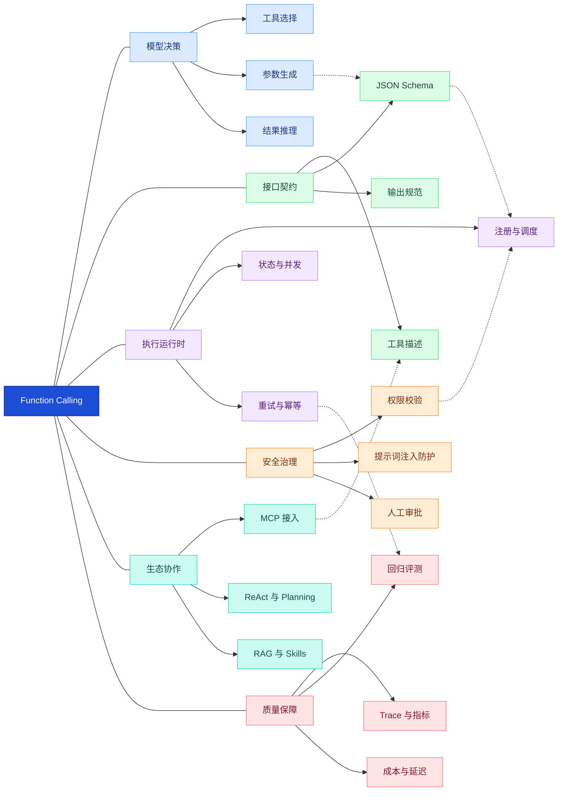

**图谱解读：**中心不是某个 Python 函数，而是“模型意图与可信执行之间的接口”。工具契约影响模型选择，运行时保障执行，安全治理贯穿调用全程，评测结果反过来改进工具设计。

## 2. 工具契约与结构化参数

### 2.1 Tool Contract 的基本构成

**Tool Contract（工具契约）**是模型与执行器共同理解的接口定义。通常包括名称（name）、用途描述（description）、输入参数（parameters）及执行端约定的结果结构。参数可由 **JSON Schema（JSON 数据结构描述规范）**表示，常见约束有 `type`、`properties`、`required`、`enum`、`additionalProperties`。

工具描述不应只写“查询文档”，还应交代**何时使用、何时不使用、参数代表什么、返回哪些信息**。名称宜稳定、可区分，避免 `get_data`、`search2` 等模糊命名。对于同义或重叠工具，明确职责边界比增加描述长度更重要。

### 2.2 示例：查询企业制度文档

以下示例为**说明性接口契约**，不是某一家模型 API 的完整请求格式：

```json
{
  "name": "search_policy_documents",
  "description": "检索当前用户有权访问的企业制度文档；仅用于查询，不执行修改。",
  "parameters": {
    "type": "object",
    "properties": {
      "query": {"type": "string", "description": "需要检索的具体问题"},
      "department": {"type": ["string", "null"], "description": "可选部门过滤条件"}
    },
    "required": ["query", "department"],
    "additionalProperties": false
  }
}
```

其中 `department` 在业务语义上可选，但示例将其列入 `required`，通过允许 `null` 表示未提供；这是与部分严格 Schema 模式相适配的写法。**实际支持哪些 JSON Schema 特性，应以选用的模型 API 文档为准。**

### 2.3 三种不同的“正确”

| 正确性 | 问题 | 保障机制 |
|---|---|---|
| 语法 | 是合法 JSON 吗 | JSON 解析与结构化生成 |
| 结构 | 字段类型、枚举、必填符合约束吗 | Schema / 严格模式 |
| 语义与权限 | 文档存在吗、用户能访问吗、参数与用户意图一致吗 | 业务校验、授权、人工确认 |

**Structured Outputs（结构化输出）**与严格工具参数模式可提高结构一致性，但不能替代执行端授权。OpenAI 严格模式有受支持 Schema 子集及相应约束，不能假设任意 JSON Schema 都能原样使用。[1]

**工具契约知识网络**

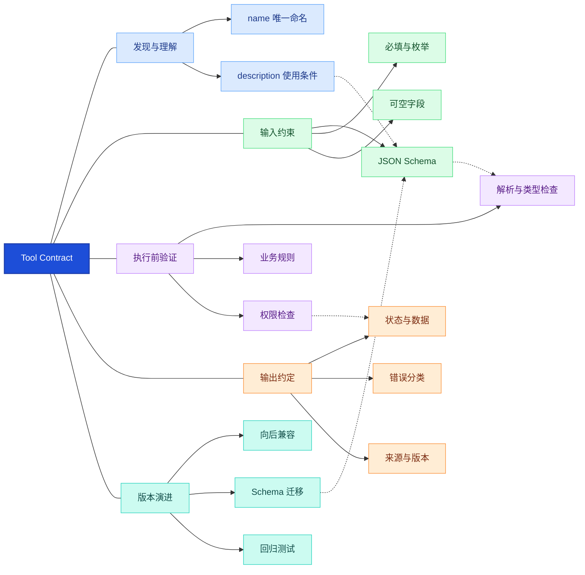

**图谱解读：**描述解决“模型能否选对”，Schema 解决“参数是否符合结构”，运行时验证解决“是否允许真正执行”。输出契约又影响模型下一轮推理和失败恢复。

## 3. 模型决策与工具路由

### 3.1 何时调用工具

模型需要在直接回答、询问补充参数、调用只读工具、发起有副作用操作之间做选择。常见错误包括：无需调用却调用、工具重叠时选错、缺参时编造、执行成功后继续重复调用。根因通常涉及工具描述、上下文质量、权限可见性及终止条件。

**Tool Selection（工具选择）**不是简单的关键词匹配：模型必须结合用户目标、当前执行状态、历史结果、可用权限和工具前置条件。工具越多，名称相似性、上下文占用和选择混淆越值得关注。

### 3.2 工具路由与按需发现

- **静态工具集合**：少量稳定工具直接提供给模型，简单但不适合大规模扩展。
- **分组路由**：先判断“知识检索 / 文档处理 / 外部业务”，再暴露相关工具。
- **按需发现**：检索工具目录、加载少量候选工具；减少上下文开销，但增加发现失败和缓存一致性问题。
- **动态注册**：根据租户、角色、任务阶段更新可见工具；必须防止权限与工具列表不同步。

工具路由并非越复杂越好。工具数少时，清晰描述和直接绑定往往更可维护；规模增长后再考虑检索式发现。OpenAI 文档包含工具搜索与延迟加载相关能力，但属于具体平台特性，不应泛化为所有模型都支持。[1]

**工具决策与路由知识网络**

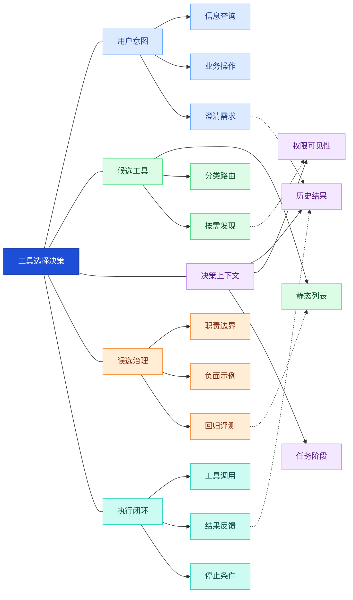

**图谱解读：**路由决定模型“看见什么”，描述影响“选什么”，上下文与状态影响“现在是否应该调用”。工具选择错误通常需要同时检查这三个层面。

## 4. 协议与完整交互生命周期

### 4.1 客户端工具调用的七个阶段

1. **注册**：宿主应用提供工具定义和可用范围。
2. **请求**：模型接收用户目标及工具描述。
3. **提议**：模型返回结构化工具调用，通常包含名称、参数、调用标识。
4. **校验**：应用解析参数、校验业务约束和用户授权。
5. **执行**：执行器调用本地函数、HTTP API、数据库服务或 MCP Server。
6. **回填**：将成功结果或受控错误与原调用 ID 关联。
7. **继续**：模型决定下一次调用、请求澄清或生成最终回答。

这里的调用 ID 尤其重要：**并行调用结果不能依赖到达顺序匹配**。工具结果应保留足够的状态、来源和错误信息，但避免向模型暴露密钥、内部堆栈和敏感数据。

### 4.2 结果反馈与错误传播

一个有用的内部结果模型通常包含 `tool_call_id`、`tool_name`、`status`、`data`、`error_code`、`retryable`、`duration_ms`。这是**应用层推荐抽象**，并非跨厂商统一的协议标准。

要区分“模型提出调用”“执行器收到请求”“业务系统成功处理”“结果成功回填”“最终任务完成”五个事件。它们在分布式系统中可能分别失败，不能用单一的 `success` 覆盖全部状态。

**调用生命周期与反馈网络**

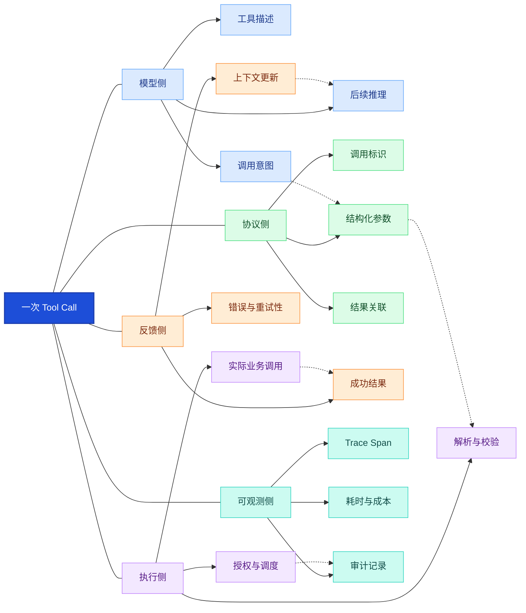

**图谱解读：**这是一条闭环而不是单向 API 请求：结果回填影响模型下一步决策，调用标识维系并发正确性，可观测与安全贯穿全过程。

## 5. 主流模型平台的差异

### 5.1 OpenAI、Anthropic、Gemini

| 平台 | 典型机制 | 重点关注 |
|---|---|---|
| OpenAI Responses API | `tools`、`function_call`、`function_call_output`、调用 ID | 严格参数模式、工具选择、并行控制；以当前 API 文档为准 [1] |
| Anthropic Messages API | `tool_use` 内容块与 `tool_result` 内容块 | 工具结果与调用 ID 对应；区分客户端工具和服务端工具 [2] |
| Google Gemini API | Function Declaration、Function Call、Function Response | 支持并行调用和依赖前序结果的组合式调用；具体 SDK 自动执行能力有差异 [3] |

**不能将三家字段名称当作通用标准。**统一内部 `ToolCall` 与 `ToolResult`，通过 Provider Adapter（供应商适配器）转换，才能降低切换模型的成本。

### 5.2 客户端工具与服务端工具

客户端工具通常由应用接收模型意图并自行执行；部分平台还提供托管或服务端工具，调用与结果可能由平台内部完成。两者在执行权限、审计能力、数据流向、延迟及错误处理上存在差异，选型前必须确认“谁真正执行工具”。

### 5.3 Structured Output 不等于 Function Calling

结构化输出用于约束模型回答的数据形态；Function Calling 则表达调用外部能力的意图。二者共享 Schema 技术，但业务语义不同：前者可能直接交付 JSON，后者通常还需要执行器、结果反馈与后续推理。

**跨厂商适配知识网络**

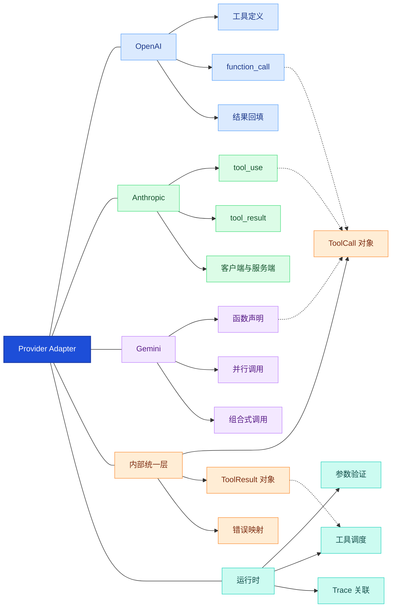

**图谱解读：**适配器屏蔽厂商格式差异，执行器则保持统一的权限、错误和观测策略。平台特有能力应通过显式特性检测，而非假设所有模型行为一致。

## 6. 单步并行与组合式调用

### 6.1 三类执行关系

- **单步调用**：例如读取设备状态，一次请求即可完成。
- **并行调用**：例如同时查询库存与汇率，前提是彼此独立且不会产生资源冲突。
- **组合式调用**：例如先查询设备编号，再按编号读取维修记录，后续输入依赖前序结果。

**依赖关系而非工具数量**决定是否可以并行。并行能减少独立任务的关键路径时间，但也可能带来限流、资源争用、结果乱序和部分失败。

### 6.2 并发、聚合与取消

对并行工具调用应设置最大并发数、每工具超时、总体截止时间与结果聚合策略。若两个写操作可能修改同一资源，应通过串行化、乐观锁或业务冲突检测控制，而不是让模型直接并行执行。

当用户取消任务时，Runtime 应尽可能传播取消信号；但已经提交的外部写操作不一定能撤销，因此需要检查实际业务状态。

### 6.3 Agent Loop 与终止条件

**Agent Loop（智能体循环）**重复“模型决策—工具执行—结果反馈”，直至任务完成或触发终止条件。应限制最大步骤、最大工具调用次数、总时长与费用预算；对于相同参数重复调用、没有进展的循环，应主动停止或转人工。

Programmatic Tool Calling（程序化工具调用）是部分平台提供的特殊编排能力，可以在受控环境中组织条件、循环或批量调用；它不代表所有 Function Calling 都能安全执行任意模型代码。[4]

**执行拓扑知识网络**

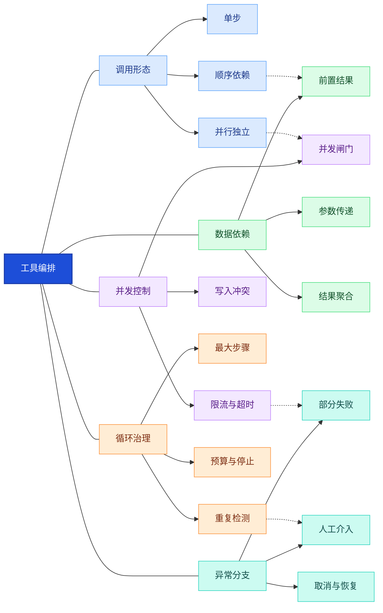

**图谱解读：**并行提升独立任务效率，顺序保证依赖正确性；二者都需要在 Runtime 层管理预算、异常和终止条件。

## 7. Tool Runtime 与执行状态

### 7.1 核心组件

| 组件 | 职责 | 典型风险 |
|---|---|---|
| Tool Registry | 注册工具、版本、Schema、可见性 | 工具描述与实现不一致 |
| Validator | 类型、必填、业务参数验证 | 仅检查 JSON 而忽略业务规则 |
| Authorizer | 用户、租户、资源级授权 | 服务账号权限过大 |
| Dispatcher | 本地、HTTP、队列、MCP 调度 | 错误路由或超时 |
| State Store | 保存调用与任务状态 | 重启后丢失执行上下文 |
| Result Adapter | 标准化结果、错误、来源 | 将错误当作成功 |
| Observability | 日志、指标、Trace、审计 | 无法定位失败阶段 |

### 7.2 调用状态机

可将一次调用定义为 `CREATED`、`VALIDATING`、`AUTHORIZING`、`WAITING_APPROVAL`、`RUNNING`、`SUCCEEDED`、`FAILED`、`CANCELLED`、`TIMED_OUT` 等状态。并非所有调用都经过全部状态，但每次状态转换都应有明确的触发条件和持久化规则。

对于异步操作，应进一步区分**任务已接收、任务正在运行、外部业务已提交、结果已回填**，避免把“收到任务 ID”误认为“任务完成”。

### 7.3 Trace 与审计

Trace（分布式调用链）记录一次用户请求在模型、执行器和业务服务之间的传播。推荐关联 `request_id`、`session_id`、`tool_call_id`、`trace_id` 与业务任务 ID；日志记录必要元数据而非明文密钥、个人敏感信息或完整受保护文档。

**Tool Runtime 核心知识网络**

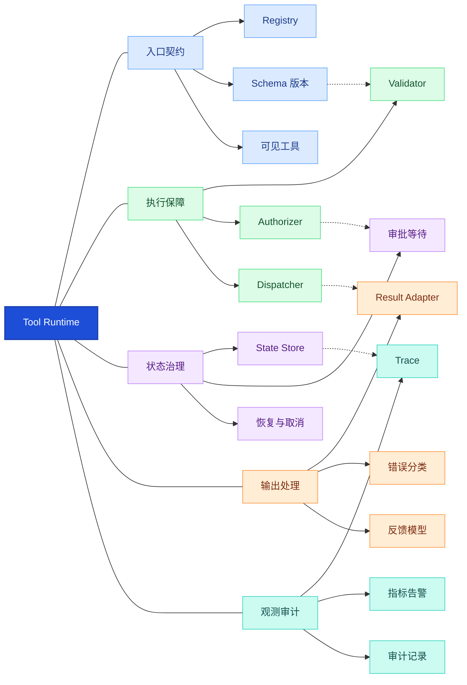

**图谱解读：**Runtime 是 Function Calling 工程化的核心。工具注册提供入口，校验授权保护执行，状态存储支持恢复，结果适配保证模型可理解，Trace 使故障可定位。

## 8. 可靠性幂等与异步任务

### 8.1 失败的不同来源

调用可能在模型生成、参数解析、授权、网络传输、业务处理、结果回填或模型续写阶段失败。**网络超时不等于业务失败**：写入可能已经提交，只是响应丢失。重试前应先确定操作是否幂等或是否可查询其最终状态。

### 8.2 Idempotency 与执行语义

**Idempotency（幂等性）**表示同一业务操作重复请求不会产生额外效果。只读查询通常较容易安全重试；创建订单、发送通知、删除文件等写操作需要幂等键、唯一约束、状态查询或业务补偿。

- **At-most-once（至多一次）**：避免重复执行，但失败时可能不完成。
- **At-least-once（至少一次）**：允许重试，但需要处理重复副作用。
- **Exactly-once（恰好一次）业务效果**：通常依赖去重、事务和业务约束组合，不应仅凭消息投递机制承诺。

### 8.3 Retry、Backoff 与 Circuit Breaker

Retry（重试）应只针对可重试错误，并使用指数退避（Exponential Backoff）与随机抖动（Jitter）降低重试风暴。Circuit Breaker（熔断器）在连续失败时暂时阻断调用，保护下游服务；恢复阶段可采用半开探测。重试、超时、熔断和限流必须协调设计，否则可能相互放大故障。

### 8.4 长任务与补偿

文档翻译、批量导出、视频处理适合异步任务队列：工具先返回 `job_id`，再通过查询状态、回调或事件获得结果。跨多个业务系统的长事务可采用 Saga（分布式事务补偿模式）处理部分成功；补偿并不保证能完全撤销现实世界的副作用。

**可靠性与恢复知识网络**

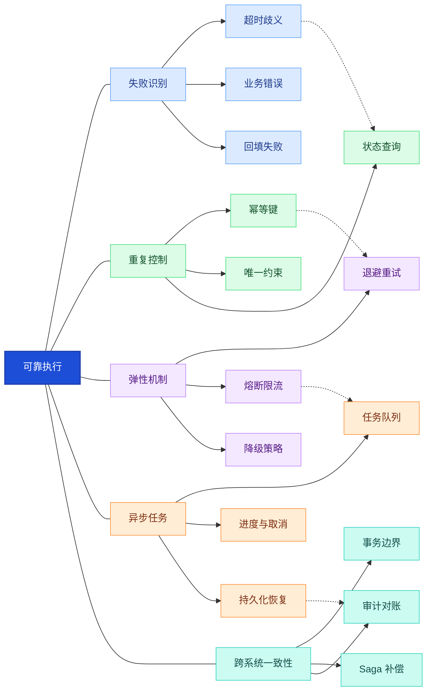

**图谱解读：**可靠性不等于“多重试几次”。必须先判定副作用和最终状态，再决定重试、补偿、等待或人工介入。

## 9. 安全权限与人工审批

### 9.1 不可信边界

模型参数、用户上传文档、网页内容、检索结果和工具返回文本都可能携带不可信内容。**Prompt Injection（提示词注入）**会尝试把外部数据伪装成高优先级指令，诱导模型泄露信息或越权调用工具。仅靠“忽略恶意指令”的提示词无法构成可靠的安全边界。

### 9.2 多层授权

建议区分用户权限、Agent 可用能力、工具服务凭据及资源级访问控制。执行前基于真实用户身份、租户、资源和操作类型进行授权，遵循 **Least Privilege（最小权限原则）**。禁止把模型生成的 `user_id` 或 `role` 当作授权依据；身份应来自可信会话与服务端上下文。

### 9.3 高风险操作审批

**Human-in-the-loop（人在回路中）**可在删除、付款、发布、对外发送等高风险操作前暂停执行，展示实际参数并等待批准。审批绑定具体操作、资源和参数摘要；如果参数发生变化，应重新校验。LangGraph 的 `interrupt()` 提供暂停与恢复能力，但具体权限逻辑仍由应用实现。[5]

### 9.4 其他安全风险

- **SSRF（服务器端请求伪造）**：模型构造 URL 让工具访问内网或云元数据地址；应限制目标域名和网络出口。
- **Exfiltration（数据外传）**：把机密内容传给外部搜索、邮件或日志工具；应实施数据分类和出口控制。
- **Tool Output Injection（工具输出注入）**：工具返回文本包含恶意指令；应将其视为数据，并约束后续可执行操作。
- **Secrets Exposure（密钥泄露）**：不得将 API Key、数据库密码和内部令牌注入模型上下文。
- **Destructive Actions（破坏性操作）**：删除、覆盖、付款等必须加强授权、幂等和审计。

**安全治理知识网络**

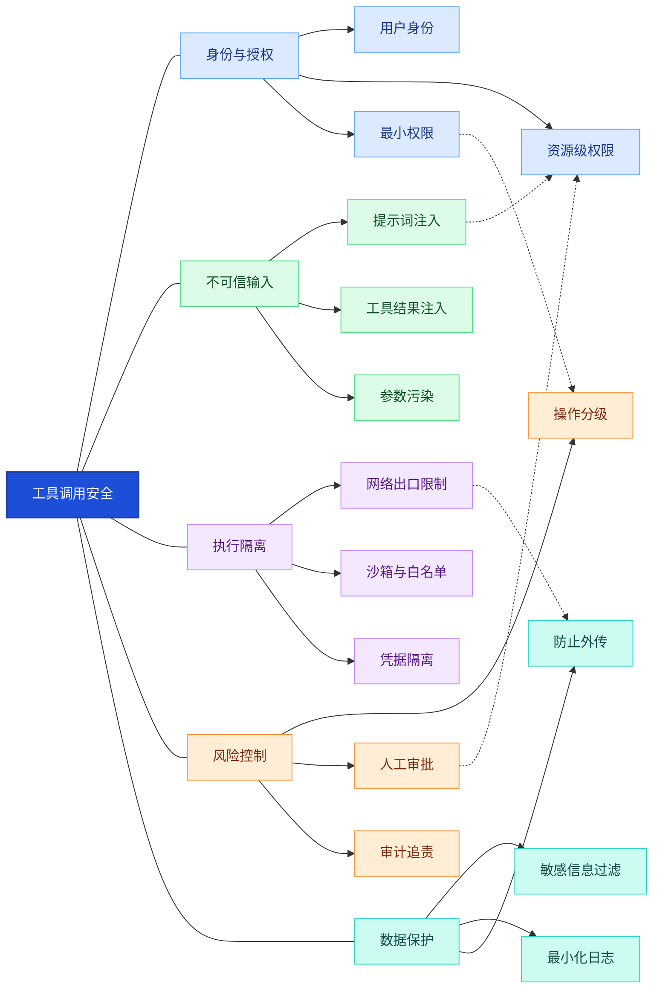

**图谱解读：**安全策略不应依赖模型是否“听话”。不可信输入经模型转换为调用参数后，仍必须穿过权限、网络、数据出口与审批控制。

## 10. 与 MCP 和其他 Agent 模块的关系

### 10.1 Function Calling 与 MCP

**MCP（Model Context Protocol，模型上下文协议）**标准化工具与外部资源的发现和调用，例如 `tools/list`、`tools/call`；Function Calling 侧重模型如何表达调用意图。常见组合方式是 MCP Client 获取工具清单、将其转换为模型工具定义、模型发起 Function Call、Runtime 授权后调用 MCP Server，再把结果反馈给模型。[6]

**重要边界：**MCP 不是某个模型厂商的函数调用格式；MCP 工具也不必一定由 LLM 触发。MCP Server 的工具声明不等于最终执行授权，宿主应用仍需校验权限。

### 10.2 与 ReAct、Planning、Workflow、Skills、RAG 的区别

| 模块 | 解决的问题 | 与 Function Calling 的协作 |
|---|---|---|
| ReAct（Reason + Act） | 推理与行动交替 | Action 可由函数调用承载 |
| Planning（任务规划） | 任务拆解与依赖安排 | 子任务通过工具执行 |
| Workflow（工作流） | 确定性步骤与分支 | 某些节点可使用模型工具选择 |
| RAG（检索增强生成） | 检索证据并增强回答 | 检索器可封装为工具 |
| Memory（记忆） | 保存跨步骤或跨会话信息 | 工具结果可写入受控状态或记忆 |
| Context（上下文） | 为模型组织当前证据与状态 | 工具结果需经过筛选再进入上下文 |
| Agent Skills（智能体技能） | 可复用任务知识和操作流程 | Skill 可指导工具组合，但不替代执行器 |
| MCP | 标准化外部工具接入 | 可作为执行器的工具来源 |

### 10.3 什么时候不需要 Agent 自主选工具

当任务流程固定、合规约束严格、步骤可确定时，优先使用程序化 Workflow；只有存在真实语义判断、分支选择或动态工具决策需求时，再引入模型的 Function Calling。**确定性操作交给程序，模糊决策交给模型**，通常更可靠、可测试且便于审计。

**Agent 生态关联知识网络**

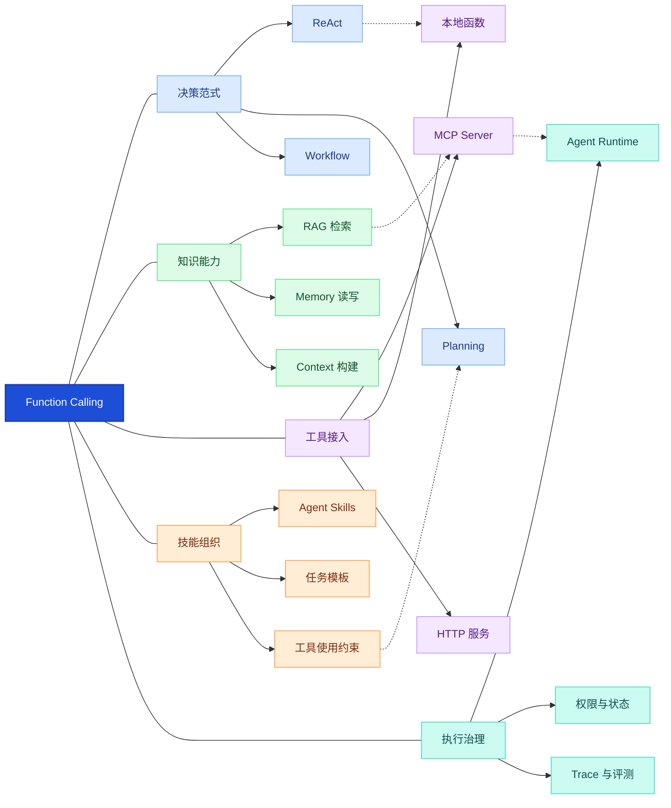

**图谱解读：**Function Calling 处于“决策—执行”的连接处：ReAct 和 Planning 负责何时行动，MCP 提供工具接入，RAG 与 Memory 提供信息能力，Runtime 确保行动可控。

## 11. 性能成本与评测

### 11.1 延迟构成

一次 Agent 任务的总耗时不仅是模型生成时间，还包括工具发现、参数校验、排队、网络调用、业务执行、结果回填和模型续写。可用下式描述一个**简化的顺序执行模型**：

$$
T_{\mathrm{task}}=\sum_{i=1}^{n}\left(T_{\mathrm{model},i}+T_{\mathrm{tool},i}+T_{\mathrm{overhead},i}\right)
$$

其中，`n` 为顺序交互轮数；`T_model,i` 为第 $i$ 轮模型耗时；`T_tool,i` 为工具耗时；`T_overhead,i` 为校验、网络与状态管理等开销。**并行工具调用不能直接套用该求和式**，应根据依赖图的关键路径计算。

### 11.2 核心指标

| 指标 | 解释 | 主要诊断目标 |
|---|---|---|
| Tool Selection Accuracy | 工具选择正确率 | 模型决策与工具描述 |
| Argument Validity Rate | 参数结构合法率 | Schema 与参数生成 |
| Authorization Violation Rate | 越权请求发生率 | 权限与安全策略 |
| Execution Success Rate | 工具执行成功率 | 下游稳定性 |
| Task Completion Rate | 用户任务完成率 | 端到端质量 |
| Unnecessary Call Rate | 不必要调用比例 | 工具选择与循环治理 |
| P95 Tool Latency | 工具延迟第 95 百分位 | 性能尾部问题 |
| Recovery Success Rate | 异常恢复成功率 | 重试与状态持久化 |
| Cost per Task | 单任务模型与工具成本 | 预算和路由优化 |

### 11.3 测试策略

测试集应覆盖单工具、顺序依赖、并行乱序、缺参澄清、工具超时、部分失败、重复写入、权限拒绝、恶意工具结果、审批恢复、长任务取消和跨模型切换。评测时保存工具调用轨迹与最终业务状态，不能仅根据模型最终回答打分。

**质量评测知识网络**

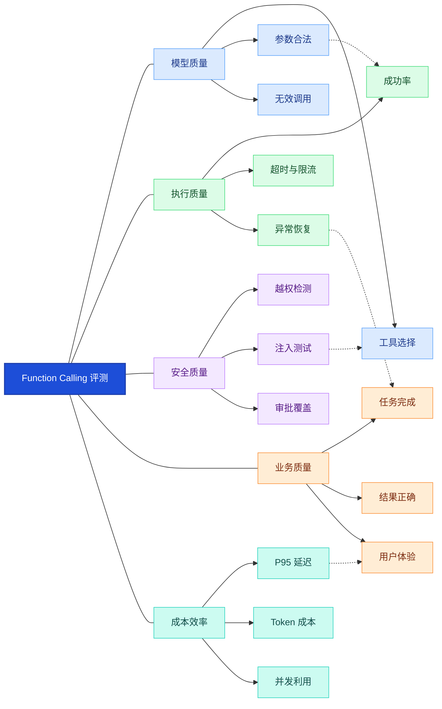

**图谱解读：**“工具调用成功”不代表“用户任务完成”。必须同时测模型决策、执行可靠性、安全合规、最终业务结果和成本效率。

## 12. 企业级文档翻译案例

### 12.1 任务与能力拆分

用户提出：“将英文设备说明书翻译成中文，保留表格和图片，核对型号及单位，导出 Word。”这并不是一次单纯的文本翻译：需要结构解析、术语检索、翻译、质量校验、布局修复和导出等能力协作。

| 工具 | 输入 | 输出 | 关键约束 |
|---|---|---|---|
| `inspect_document` | 文件标识 | 页数、格式、结构摘要 | 只读与文件权限 |
| `extract_content` | 文件标识 | 文本、表格、图片位置 | 保留结构锚点 |
| `lookup_terminology` | 术语或领域 | 标准术语 | 来源与版本 |
| `translate_segments` | 片段与术语约束 | 译文片段 | 不改型号、单位 |
| `validate_translation` | 原文与译文 | 错误与风险清单 | 数字、型号、漏译 |
| `render_document` | 译文与布局约束 | 中间文档 | 不覆盖源文件 |
| `compare_layout` | 源文档与译文 | 版式问题报告 | 裁切、溢出、错位 |
| `export_document` | 验收通过的文档 | 最终文件路径 | 路径与权限校验 |

### 12.2 哪些步骤交给模型，哪些交给程序

模型适合决定何时查术语、哪些片段需要重译、是否调用布局修复；程序适合控制文件权限、提取顺序、数字单位一致性、最大修复次数、导出路径及结果验收。尤其不能让模型凭语言判断替代对型号、单位、文件完整性的确定性检查。

### 12.3 执行中的异常场景

- **术语服务超时**：允许有限重试；若仍失败，标记术语质量风险，而不是伪称已查证。
- **第 5 页溢出**：只修复受影响页面，保留其他页结构，设置最大修复轮次。
- **导出响应超时**：通过任务 ID 查询最终状态，避免重复生成覆盖。
- **用户无权访问源文件**：在解析前拒绝执行，不把文件内容传给模型。
- **模型要求删除原文件**：若不属于用户授权目标，直接拒绝并记录审计事件。

**企业翻译 Agent 工具知识网络**

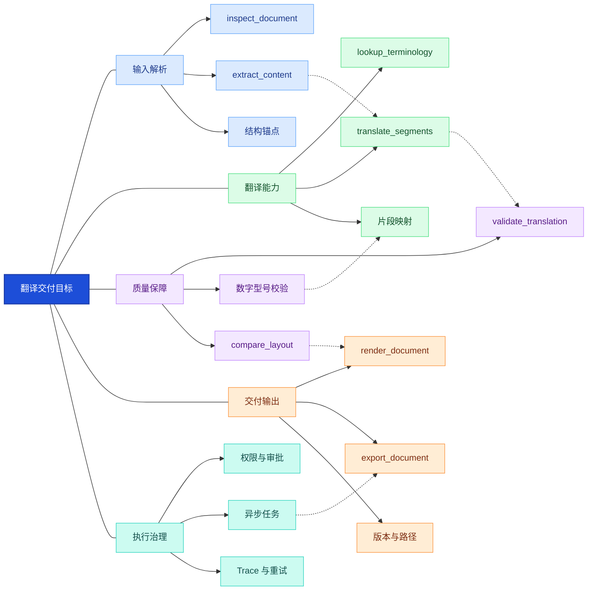

**图谱解读：**解析结构为翻译提供锚点，术语与翻译形成内容链路，校验与布局形成质量反馈，执行治理覆盖所有工具。模型只在需要判断的环节发挥灵活性，确定性验收仍由程序负责。

## 13. 工程选型与常见误区

### 13.1 分阶段演进建议

| 阶段 | 推荐设计 | 引入条件 |
|---|---|---|
| 原型 | 少量函数、明确 Schema、同步执行 | 工具少、风险低 |
| 团队服务 | Registry、统一 Executor、参数校验、Trace | 多工具与多人协作 |
| 企业系统 | 资源级授权、幂等、队列、审批、告警 | 有写操作、长任务与合规要求 |
| 平台化 | MCP 接入、动态工具发现、多模型适配、系统化评测 | 多业务系统、多租户或大量工具 |

### 13.2 常见误区

1. **“模型会调用工具”不等于“模型已执行工具”**：先确认执行主体。
2. **Schema 合法不等于业务合法**：必须做权限和语义校验。
3. **超时不等于失败**：尤其注意写操作重复副作用。
4. **工具越多不等于越智能**：清晰职责与按需暴露更重要。
5. **并行不等于更快**：需要依赖分析与并发治理。
6. **MCP 不等于 Function Calling**：分别处于接入层和模型交互层。
7. **Agent 框架不自动提供企业级安全**：运行时与业务权限需单独实现。
8. **最终回答正确不等于执行过程可靠**：必须检查调用轨迹与业务结果。

### 13.3 面试与设计评审关注点

- 为什么模型不能直接执行工具？如何区分调用意图和执行结果？
- 严格 Schema 能保证什么、不能保证什么？
- 并行工具结果如何通过调用 ID 正确关联？
- 写入工具超时后能否直接重试？为什么？
- 如何设计权限、审批和工具结果的信任边界？
- Function Calling、MCP、ReAct 和 Workflow 各自解决什么问题？
- 如何定位工具选择错误、参数错误和执行错误？

**工程选型决策网络**

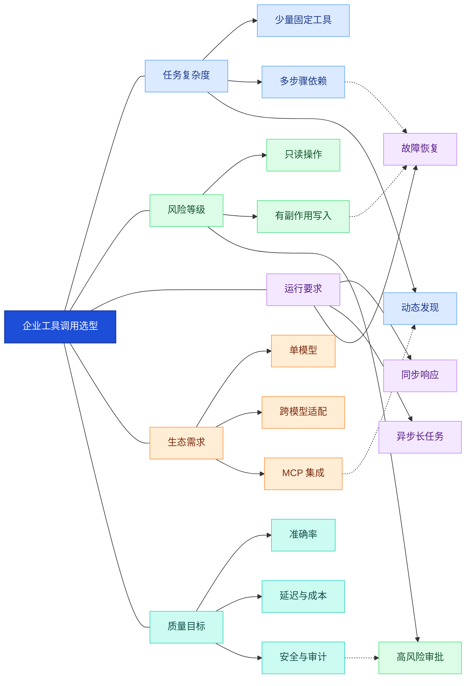

**图谱解读：**选型应由复杂度、风险、时延、生态和质量目标共同决定。高风险业务优先加强授权与审计，而不是优先增加 Agent 自主性。

## 14. 知识网络总结与参考资料

### 14.1 一条主线贯穿整个系统

**用户意图 → 可用工具发现 → 模型选择与参数生成 → Schema / 业务 / 权限校验 → 受控执行 → 结果关联 → 状态更新 → 下一轮决策或结束。**

这一主线连接五个知识层面：**模型决策**决定行动意图，**接口契约**定义机器可解析的数据边界，**运行时**管理真实执行，**安全治理**约束副作用，**质量评测**持续检验端到端业务效果。Function Calling 是这些层次的交汇点，而不是某个孤立的 SDK 功能。

### 14.2 权威资料

以下为优先阅读的官方文档及开源项目。厂商接口会持续演进，实际开发应以当前版本文档为准。

1. [OpenAI — Function Calling](https://developers.openai.com/api/docs/guides/function-calling)：工具定义、严格模式、工具选择与结果反馈。
2. [Anthropic — Tool Use](https://platform.claude.com/docs/en/agents-and-tools/tool-use/overview)：`tool_use` / `tool_result`、客户端与服务端工具。
3. [Google Gemini — Function Calling](https://ai.google.dev/gemini-api/docs/function-calling)：函数声明、并行和组合式调用。
4. [OpenAI — Programmatic Tool Calling](https://developers.openai.com/api/docs/guides/tools-programmatic-tool-calling)：程序化工具编排。
5. [LangGraph — Interrupts](https://docs.langchain.com/oss/python/langgraph/interrupts)：中断、审批和恢复。
6. [MCP Specification](https://modelcontextprotocol.io/specification/)：模型上下文协议规范与工具机制。
7. [MCP 官方 GitHub](https://github.com/modelcontextprotocol/modelcontextprotocol)：协议项目与版本演进。
8. [MCP Python SDK](https://github.com/modelcontextprotocol/python-sdk)：Python 接入示例。
9. [LangGraph GitHub](https://github.com/langchain-ai/langgraph)：有状态 Agent 运行时实现。
10. [OpenAI Python SDK](https://github.com/openai/openai-python)：模型工具调用 SDK。
11. [JSON Schema 官方网站](https://json-schema.org/)：Schema 概念与验证规则。
12. [OWASP LLM Top 10](https://genai.owasp.org/llm-top-10/)：提示词注入、敏感信息泄露及相关安全风险。

---

> **核心结论：**Function Calling 让模型能“提出结构化行动”，但只有当接口契约、权限校验、执行状态、幂等恢复、审计评测共同闭环时，才构成可靠的企业级 Agent 工具调用系统。

