# 05｜MCP：Model Context Protocol 的组成、边界与企业级工程实践

> 章节定位：Agent 知识与工具体系 / 第五篇。本文将 MCP 作为<strong>能力接入协议</strong>研究，而非将其误认为推理框架或模型调用算法。协议版本可能演进，涉及新旧版本差异的内容应结合部署时使用的规范与 SDK 核对。

## 阅读路径

问题起点 → Host / Client / Server → JSON-RPC 与传输 → Tools / Resources / Prompts → 发现和调用 → 协议演进 → 授权与安全 → 状态与异步任务 → SDK 与部署 → Agent 集成 → 企业案例 → 测试与选型。每一部分先说明原理，再给出多分支知识网络，最后解释跨模块联系。

## 1. 为什么需要 MCP：从专用适配到标准化能力接入

大语言模型（Large Language Model，LLM）本质上输出推理结果与文本或结构化调用意图，并不会因为识别到一个 API 名称就自动获得操作外部系统的权限。企业 Agent 通常需要连接文档库、数据库、代码仓库、工单系统及业务服务。若每个 AI 应用分别为每个服务实现工具发现、输入校验、结果包装和通信机制，就会形成重复集成成本。

Model Context Protocol（模型上下文协议，MCP）旨在建立 AI 应用与外部能力提供者之间的统一交互界面。它把外部能力抽象为可发现的工具（Tools）、资源（Resources）和提示模板（Prompts），并约定消息、通信及能力协商机制。<strong>标准化接口不等于标准化业务语义</strong>：两个同名查询工具的权限、结果格式和数据质量仍可能不同。

MCP 的直接收益是减少重复适配、便于跨宿主复用和集中治理；其新增成本是协议版本管理、远程认证、网络故障、工具目录治理和攻击面扩张。内部纯计算函数若无跨应用复用需求，直接函数调用往往更合适。

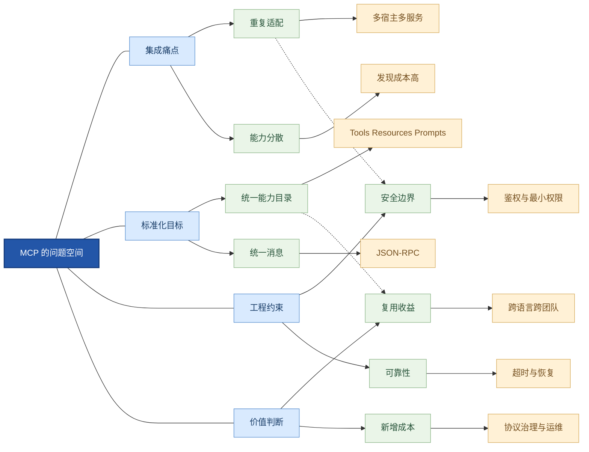

<strong>图谱解读：</strong>协议标准化同时改变“如何发现能力”和“如何执行能力”，但安全与可靠性不会因为使用 MCP 自动实现。选型必须比较复用收益和协议治理成本。

## 2. 角色架构：Host、Client、Server 与外部系统

MCP Host（宿主）是承载 AI 应用的环境，负责管理用户交互、模型上下文、权限决策和多个服务连接。MCP Client（客户端）是 Host 中面向单个服务端的协议组件；MCP Server（服务端）暴露能力并接收调用。Server 可以是本地进程，也可以是独立远程服务。Server 背后还可能连接数据库、REST API、文件系统或任务队列。

需要区分逻辑角色与物理部署：Host 与 Client 往往同进程；Server 不一定独立部署，也不等于模型推理服务器。客户端与服务端之间的协议消息由传输层承载，业务系统的认证与授权仍由相应组件负责。

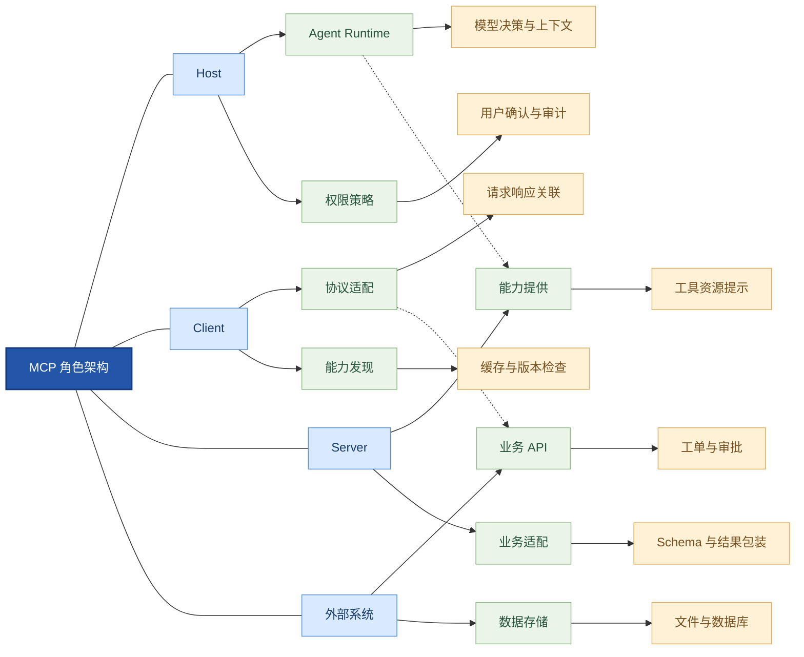

<strong>图谱解读：</strong>Host 决定“是否允许使用”，Client 决定“如何按协议交互”，Server 决定“提供什么能力”，外部系统负责真实业务执行。一个 Host 可同时管理多个 Client 和 Server。

## 3. 协议基础：JSON-RPC、方法、消息与版本

JSON-RPC 2.0（JSON Remote Procedure Call，基于 JSON 的远程过程调用协议）区分 Request、Response、Error 与 Notification。Request 带有方法、参数和请求 ID；Response 以相同 ID 关联结果；Notification 不要求直接响应。MCP 在这一消息基础上定义工具、资源、提示等方法及其数据结构。

典型方法包括 `tools/list`、`tools/call`、`resources/list`、`resources/read`、`prompts/list`、`prompts/get`。这些是协议接口名称，不应与模型平台自身的 function call 消息混淆。JSON-RPC 负责消息关联，不提供身份认证、访问授权或幂等保证。

<strong>版本注意：</strong>不同 MCP 规范版本在初始化、会话、服务端交互和扩展能力上可能存在不兼容变化。本文将基础概念与版本敏感细节分开说明；实际开发必须锁定协议版本与 SDK 版本，并运行互操作测试。

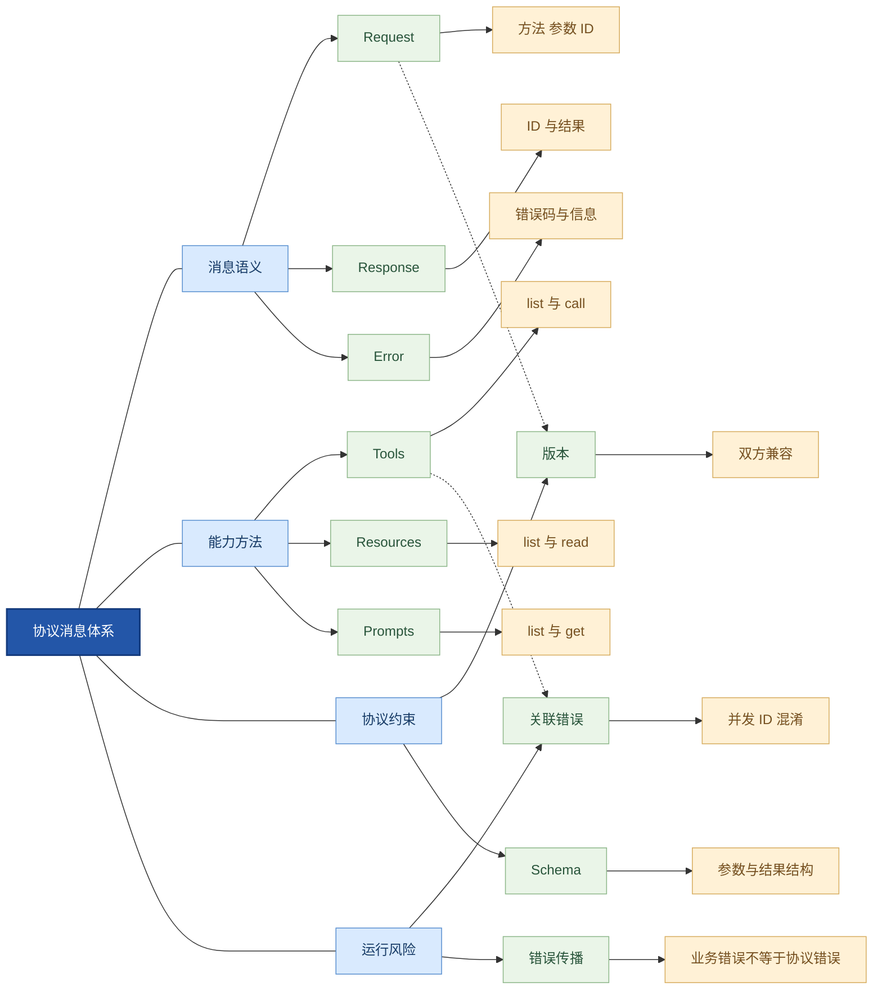

<strong>图谱解读：</strong>JSON-RPC 是底层消息框架；能力方法是 MCP 的语义层；版本和 Schema 是互操作前提。业务执行失败与协议解析失败应分层处理。

## 4. 三大核心原语：Tools、Resources、Prompts

### 4.1 Tools：面向操作的能力

Tool（工具）是可调用的动作或动态查询。定义通常包括名称、描述、输入 Schema，并可提供输出 Schema 与附加元数据。客户端通过 `tools/list` 发现工具，再通过 `tools/call` 传递参数。工具执行可产生外部副作用，因此必须做参数校验、权限检查、超时与审计。

工具名称和描述帮助模型理解用途，但不是安全策略。`delete_document` 即使描述中写明“仅用于已审批文档”，服务端也必须自行验证审批状态。工具结果可能包含文本、结构化内容或资源引用，调用方不应默认所有返回内容可信。

### 4.2 Resources：面向上下文的数据

Resource（资源）用于提供可读取的数据或上下文，常以 URI（Uniform Resource Identifier，统一资源标识符）标识。例如设备术语表、文档元数据、规范文件、项目配置。资源与工具的区别在于前者主要表达可访问内容，后者表达动作或动态计算；但具体边界由服务设计决定。

Resource 不是 RAG（Retrieval-Augmented Generation，检索增强生成）的同义词。MCP 可以提供资源或检索工具，RAG 仍需独立处理分块、索引、检索、重排、证据组织和回答生成。

### 4.3 Prompts：面向任务的模板

Prompt（提示模板）提供可复用的交互内容，可带参数并返回消息。它可以用于设备诊断、代码审查或翻译校验。远程提供的 Prompt 不会自动获得系统指令的最高优先级，仍应由 Host 决定如何使用和信任。

| 原语 | 主要问题 | 典型对象 | 风险重点 |
|---|---|---|---|
| Tools | 做什么操作 | 查询设备、提交审批 | 副作用与越权 |
| Resources | 读取什么内容 | 术语库、文档元数据 | 数据泄露与时效 |
| Prompts | 如何组织任务输入 | 审查模板、翻译模板 | 指令污染与版本漂移 |

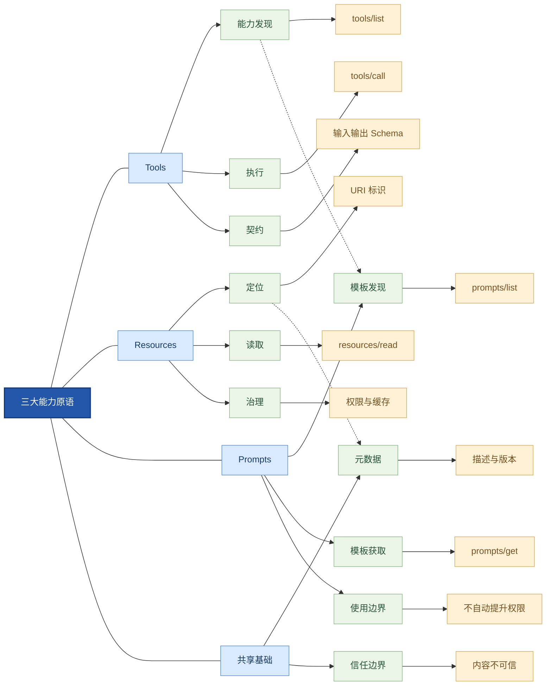

<strong>图谱解读：</strong>Tools 连接执行面，Resources 连接数据面，Prompts 连接任务模板面；三者共享发现、元数据和信任治理需求，但不应被混为一个“万能工具”。

## 5. 能力发现、Schema 与执行结果

能力发现先回答“服务提供什么”，模型或应用的工具路由再回答“本次使用哪个”。客户端不宜每轮都无条件把全部工具描述塞入模型上下文，尤其在工具规模扩大时，应按权限、任务领域与上下文预算筛选。

JSON Schema（JSON 数据模式）约束输入字段的类型、必填、枚举和对象结构，但不保证业务合法性。例如 `document_id` 是合法字符串不等于文档存在，更不等于当前用户有权限读取。建议区分四层验证：语法解析、Schema 结构校验、业务规则校验、身份授权校验。

输出契约应明确成功数据、可恢复错误、不可恢复错误和部分结果。对于可写工具，还应返回业务操作标识以支持审计与幂等检查。工具目录变化应触发缓存失效与重新审核，避免新工具或描述变化绕过既有策略。

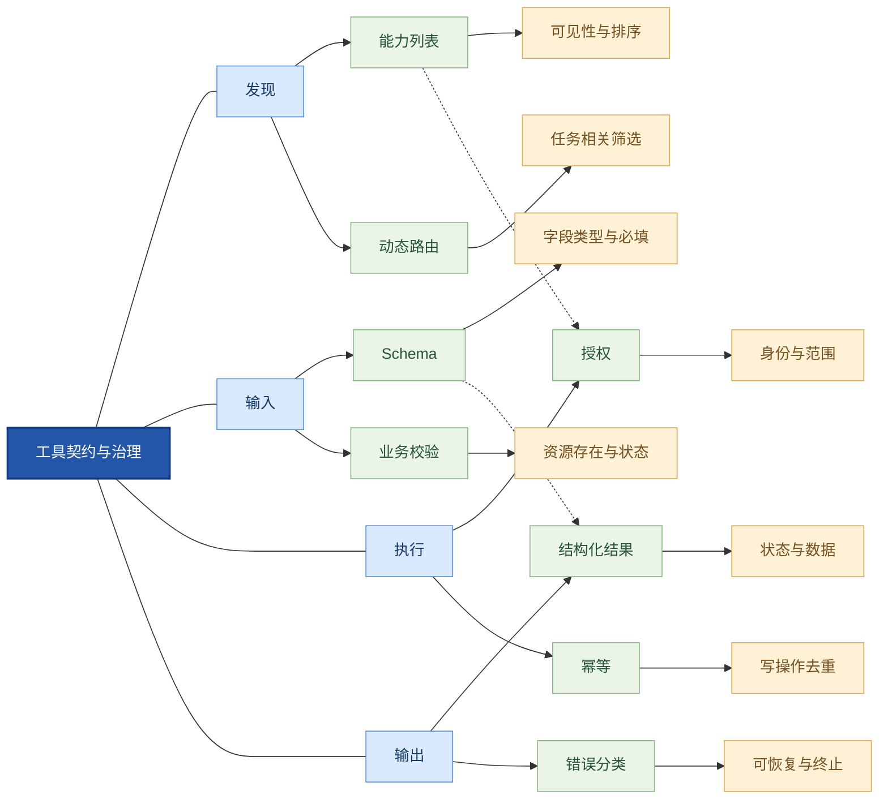

<strong>图谱解读：</strong>工具契约贯穿发现、输入、执行和输出；模型只负责提出调用意图，安全边界由运行时与服务端共同落实。

## 6. 传输层：stdio 与 Streamable HTTP

stdio（标准输入输出）适合本地进程通信。Host 可启动 Server 子进程，通过 stdin/stdout 交换协议消息。普通日志应写入 stderr，避免污染 stdout 的协议流。本地部署便于 IDE 和文件操作，但依然需要目录限制、进程权限和凭据管理。

Streamable HTTP 适合远程共享服务，可与 TLS（Transport Layer Security，传输层安全）、网关、身份认证、负载均衡及服务监控结合。HTTP 与 SSE（Server-Sent Events，服务器发送事件）的具体用法取决于所采用的协议版本；不应将历史 HTTP+SSE 传输方式与新版 Streamable HTTP 混同。

对于 HTTP 部署，应检查 Origin、绑定地址、认证令牌、请求体大小、连接超时与代理行为，防止 DNS Rebinding（DNS 重绑定）、未授权访问和资源耗尽。远程服务还需要设计重试与幂等边界：客户端网络超时不意味着服务端操作未发生。

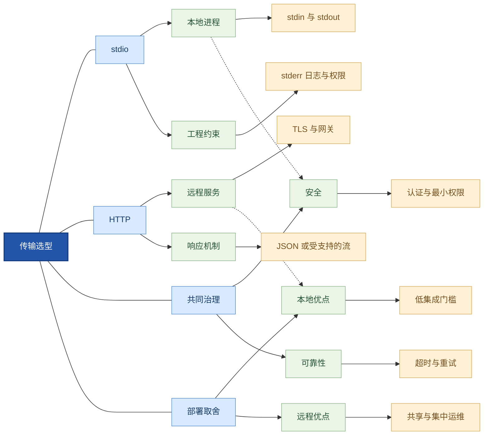

<strong>图谱解读：</strong>传输决定进程边界和网络治理成本，但不改变 Tools、Resources、Prompts 的基本语义。

## 7. 协议演进与版本兼容：避免把历史实现当成永久规则

MCP 是持续演进的协议。旧版本中的初始化握手、会话管理、服务端向客户端请求以及通知机制，在较新规范中可能调整。前述调研特别指出 2026-07-28 规范涉及无状态通信、Multi Round-Trip Requests（MRTR，多轮往返请求）及扩展机制的变化；这些属于<strong>版本敏感事实</strong>，实际工程应以目标版本的官方规范和 SDK 支持矩阵为准。

### 7.1 无状态协议与业务状态

协议层不依赖长生命周期会话，并不意味着业务任务不能保持状态。文档翻译可以通过 `job_id`、资源 URI 或显式 Handle（句柄）引用服务器保存的任务状态。句柄必须具备租户隔离、授权、过期与防猜测能力。

### 7.2 MRTR 与补充输入

MRTR 用于在执行过程中请求客户端补充信息，例如导出目标、用户确认或缺失参数。其目标是将跨多轮交互的依赖显式化，而不是把所有执行都绑在持续打开的连接上。实现时必须考虑重复提交、超时恢复与审批内容变更。

### 7.3 兼容策略

不要在未验证 SDK 能力时混用不同版本示例。建议锁定依赖、记录协议版本、编写握手或元数据兼容测试、验证工具清单与调用结果，并在迁移时逐项确认通知、流式传输、任务扩展与授权行为。

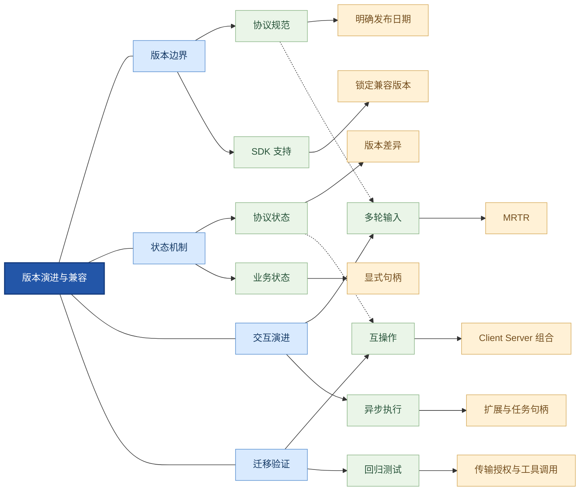

<strong>图谱解读：</strong>版本兼容不仅影响消息字段，还影响状态模型与交互控制；应把“协议状态”和“业务状态”分开设计。

## 8. 安全模型：身份、授权、信任与攻击面

Authentication（身份认证）验证调用方身份，Authorization（授权）决定该身份可执行的操作。远程 MCP 常与 OAuth 2.0 等授权机制集成；具体授权流程、资源元数据和客户端注册要求取决于协议版本与部署环境。OAuth 令牌不应随意透传到无关下游服务。

RBAC（Role-Based Access Control，基于角色的访问控制）适合角色明确的系统；ABAC（Attribute-Based Access Control，基于属性的访问控制）可结合租户、部门、资源标签和操作上下文细化权限。对于高风险写操作，建议加入 Human-in-the-loop（人在回路中）审批，并绑定具体参数与资源。

Prompt Injection（提示词注入）可能来自工具结果、资源内容或提示模板；Tool Poisoning（工具投毒）可能来自恶意工具描述或被替换的工具定义。模型对不可信内容的服从不是授权。服务端必须实施最小权限、输出长度限制、来源标识、审计和危险操作隔离。

还应覆盖 SSRF（Server-Side Request Forgery，服务端请求伪造）、本地文件越界访问、DNS 重绑定、令牌泄露、跨租户缓存污染与工具目录篡改。

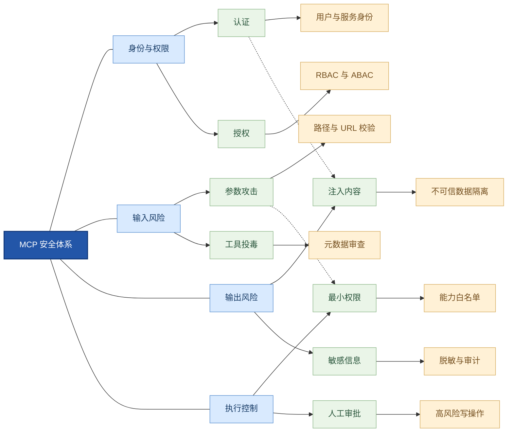

<strong>图谱解读：</strong>安全控制必须覆盖模型看见工具之前、工具执行之时和结果回到模型之后三个阶段。只在 Prompt 中写“不要越权”不足以防护。

## 9. 状态、长任务、缓存与扩展

企业业务往往需要长时间执行、人工补充输入和断点恢复。同步 `tools/call` 适合短任务；文档翻译、批量数据处理、报告生成等可通过任务句柄或受支持的 Tasks 扩展暴露异步生命周期。任务通常需要创建、运行、等待输入、成功、失败、取消和过期等状态，并由持久化存储支持恢复。

Idempotency（幂等性）用于保证重复请求不产生额外副作用。对于创建工单、发送邮件、导出文件等写操作，建议设计业务唯一键或幂等键，并在网络超时后先查询执行状态再决定重试。

缓存可以降低工具清单、资源内容和提示模板的重复传输成本，但必须以用户、租户、授权范围及版本作为缓存隔离维度。缓存过期和工具变更通知应共同处理，避免旧工具描述误导模型。

扩展机制使任务、交互式界面和 Skills 等能力可以独立演进，但不能把扩展当作所有 MCP 客户端天然支持的核心能力。部署前需要进行能力检测与降级设计。

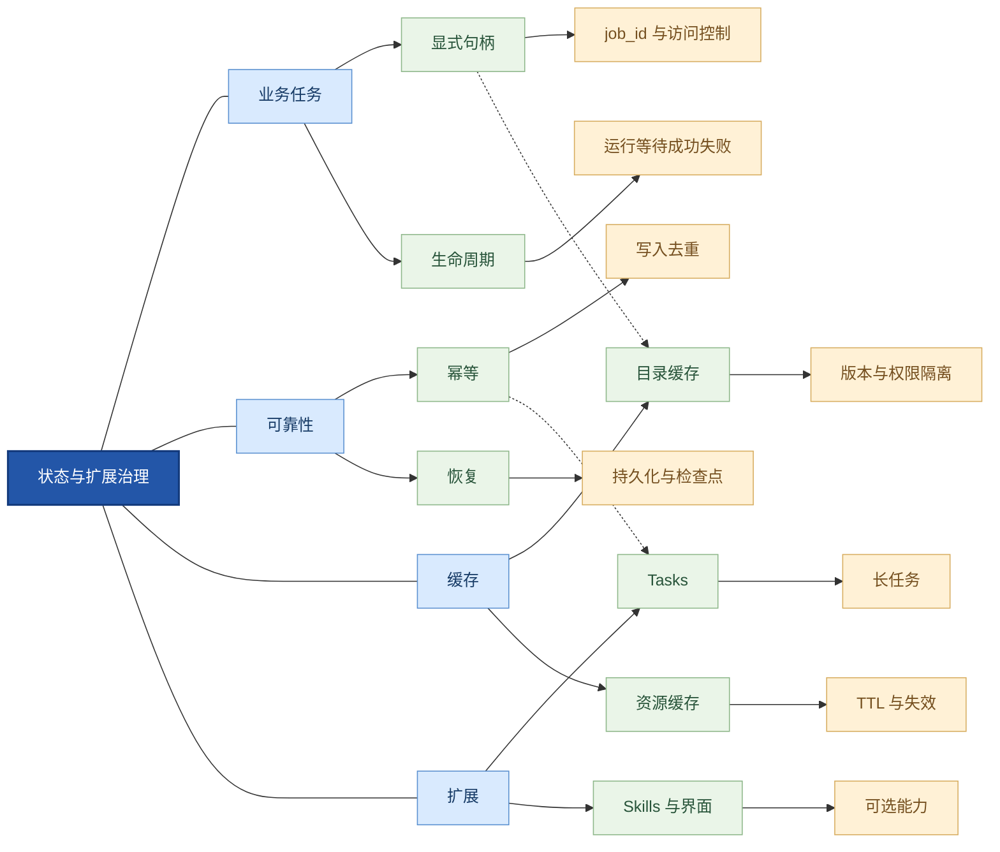

<strong>图谱解读：</strong>任务、缓存和扩展并非孤立优化：长任务需要状态，状态需要授权，缓存必须感知版本与权限。

## 10. MCP 与 Function Calling、RAG、Skills、ReAct 的关系

Function Calling（函数调用）通常指模型输出工具调用意图和参数；MCP 规定外部能力的发现与调用接口。Agent Runtime 将模型平台的工具调用消息映射为 MCP 调用，再将结果适配回模型上下文。

ReAct（Reasoning and Acting，推理与行动交替）描述 Agent 的决策工作方式；Planning（任务规划）负责步骤拆解；Workflow（工作流）约束执行顺序；MCP 只是这些执行策略可利用的一类能力接入方式。

RAG 可以把检索服务暴露为 MCP Tool，也可以通过 MCP Resource 访问语料，但索引构建、Hybrid Search（混合检索）、Reranking（重排序）并非 MCP 自动提供。

Agent Skills（智能体技能）主要封装任务知识、指令与可复用流程；Skills 可以指导模型选择 MCP 工具，但二者不是同义概念。即便存在 MCP Skills 扩展，也要区分“技能分发”与“工具执行”。

| 机制 | 决定什么 | 不负责什么 |
|---|---|---|
| Function Calling | 模型调用意图与参数 | 外部服务统一接入 |
| MCP | 能力发现与协议调用 | 模型规划正确性 |
| ReAct | 推理和行动交替 | 工具通信协议 |
| Workflow | 执行顺序与条件 | 自动理解任意工具语义 |
| RAG | 检索证据与生成 | 通用工具协议 |
| Skills | 复用任务知识和流程 | 自动获得业务权限 |

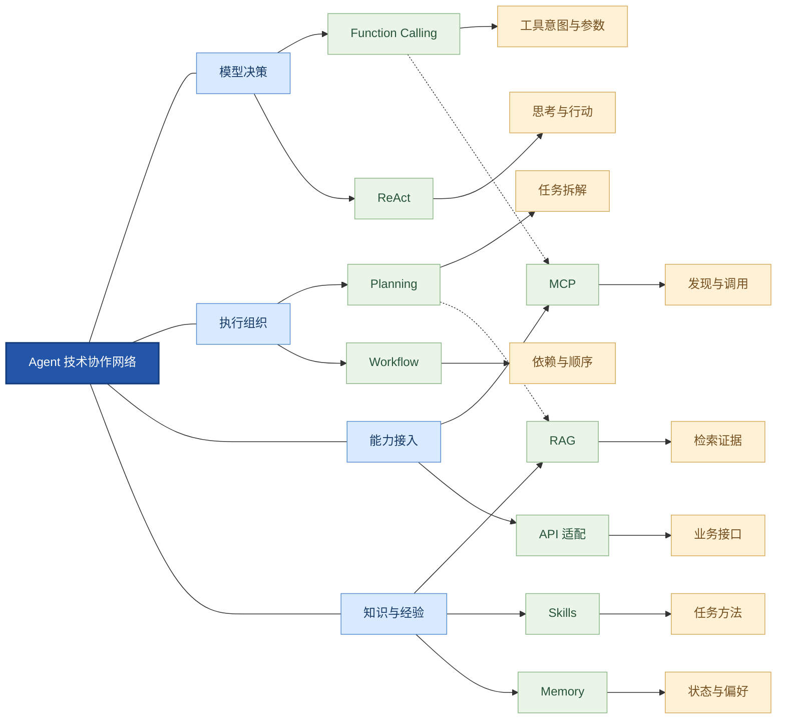

<strong>图谱解读：</strong>模型决策层、执行组织层、能力接入层和知识层可以组合，但职责必须保持清晰。MCP 不应被设计成所有 Agent 能力的替代品。

## 11. 企业级 MCP Server 的内部架构与部署

生产级 Server 通常包含 Protocol Adapter（协议适配器）、Capability Registry（能力注册表）、Schema Validator（模式校验器）、Authorization Middleware（授权中间件）、Business Adapter（业务适配器）、State Store（状态存储）和 Observability（可观测性）组件。

Python 项目可从官方 MCP Python SDK 入手，优先使用 SDK 提供的服务端与客户端抽象；但应检查实际安装版本的 API、传输支持与扩展兼容性。远程部署通常需要 API Gateway（接口网关）、TLS、日志、指标、追踪、限流和灰度发布；本地部署则更关注进程启动、环境变量、文件权限和退出清理。

建议按业务边界拆分 Server，而非简单按每个 Python 函数拆分。拆分过细会增加网络跳数、认证配置和工具发现成本；拆分过粗则容易形成权限过大的“万能 Server”。

### 11.1 典型错误分类

| 错误层次 | 例子 | 处理策略 |
|---|---|---|
| 协议错误 | 非法 JSON-RPC 消息 | 返回协议错误并记录请求 ID |
| Schema 错误 | 参数类型不符合要求 | 拒绝执行并提示字段 |
| 授权错误 | 无权访问目标文件 | 拒绝并审计，不让模型绕过 |
| 业务错误 | 文档不存在、审批未通过 | 返回可解释的业务状态 |
| 依赖错误 | 数据库超时、下游限流 | 限次重试、熔断或降级 |
| 结果错误 | 输出过大、格式不符合契约 | 截断、分页或重新适配 |

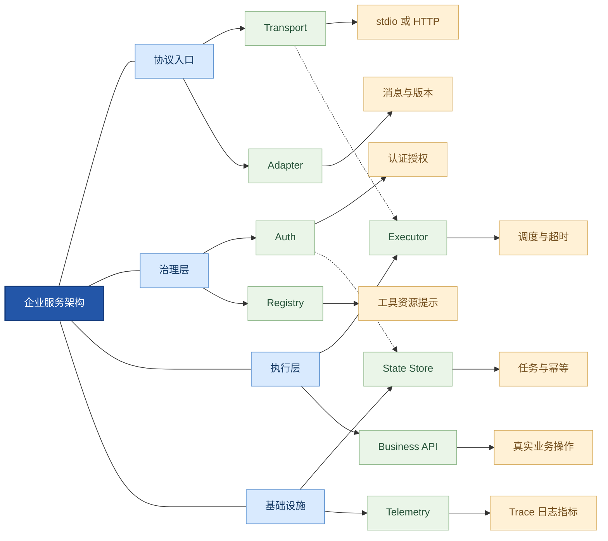

<strong>图谱解读：</strong>协议入口与业务执行之间必须插入治理层；持久化与可观测性横向服务于调用全生命周期。

## 12. 案例：企业文档翻译 Agent 的 MCP 化设计

假设用户请求：“把英文医疗设备说明书翻译成中文，保留图表，核对型号和单位，并导出 Word。”这类任务涉及文件读取、文本抽取、术语检索、翻译、质量校验和格式重建。

可以设计 Document Server 提供 `inspect_document`、`extract_document`；Terminology Server 提供术语 Resource 和 `search_terms`；Translation Server 提供 `translate_segments` 和异步任务查询；Quality Server 提供 `check_numbers`、`check_layout`；Export Server 提供 `render_docx`、`export_file`。

并非所有内部步骤都必须经过 MCP：字体宽度测量、单位字符串比较、文本分段等低延迟纯函数可保留在本地代码中。MCP 适合跨进程、跨团队、跨语言或跨应用共享的能力。

### 12.1 关键执行依赖

先识别文档结构，再决定抽取方案；术语查询可以与独立的元数据分析并行；翻译依赖抽取结果；格式重建依赖译文与原始布局；导出必须在校验之后。若出现型号误译，应优先局部重译，不应无约束地重新执行整份文档。

### 12.2 安全与恢复

源文件访问需要路径白名单与用户权限；翻译任务句柄必须隔离租户；导出路径应受限；覆盖原文件应要求明确确认。长任务应支持进度、取消和重试，重复提交必须避免重复写入。

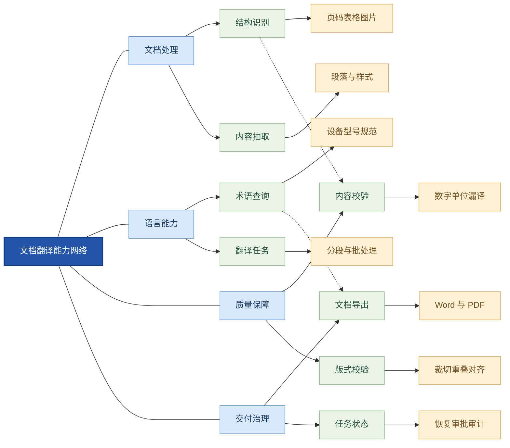

<strong>图谱解读：</strong>图中的四组能力通过原文结构、术语、译文和质量报告关联；跨服务调用适合 MCP，内部确定性校验可直接调用本地函数。

## 13. 可靠性、性能与评测

MCP 服务本身的可用性不等于 Agent 任务成功率。模型可能选错工具；工具也可能成功返回但结果无法满足业务要求。因此应分层测量协议、执行与业务三个层次。

| 维度 | 建议指标 | 典型测试 |
|---|---|---|
| 协议 | 兼容率、解析失败率 | 不同 SDK 与版本互操作 |
| 工具发现 | 清单正确率、缓存命中率 | 权限变化与工具变更 |
| 执行 | 成功率、超时率、P95 延迟 | 并发和下游故障 |
| 安全 | 越权阻断率、审计完整率 | 跨租户与恶意输入 |
| 任务 | 取消有效性、恢复成功率 | 长任务中断与重试 |
| Agent 质量 | 工具选择准确率、任务完成率 | 端到端场景测试 |

建议覆盖协议版本不匹配、非法 Schema、超时后重复写入、资源权限变更、工具目录投毒、恶意工具结果、远程服务不可用、任务句柄泄露和缓存跨租户污染等场景。

性能优化的主要方向是缩减无关工具描述、缓存可安全复用的目录与资源、减少无意义的往返请求、批处理独立操作、为高延迟工具引入异步任务，并通过 Trace（分布式调用链）定位瓶颈。

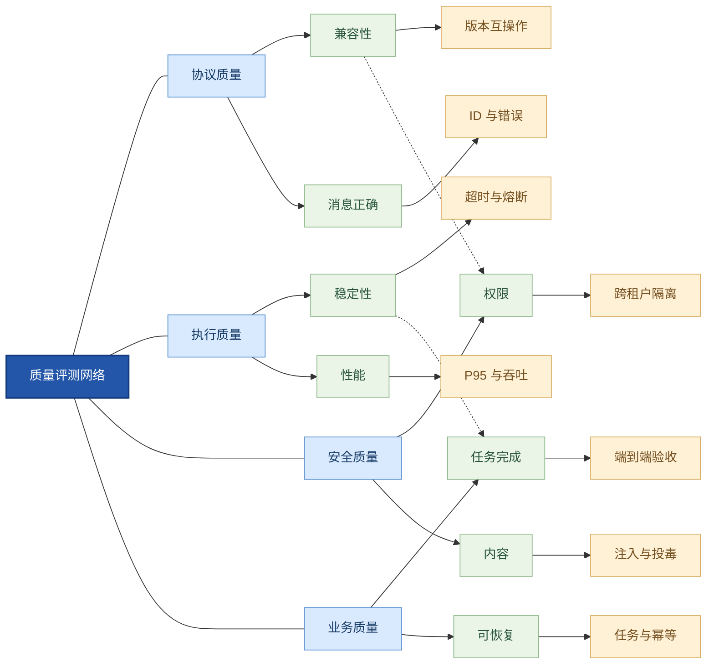

<strong>图谱解读：</strong>协议正确只是基础，企业可用性还取决于执行稳定性、安全隔离与端到端任务质量。

## 14. 工程选型、常见误区与知识总结

### 14.1 什么时候采用 MCP？

优先考虑：多个 AI 宿主共享同一业务能力、跨语言/跨团队集成、希望统一能力发现与协议治理、需要在本地 IDE 与远程业务系统间建立可复用连接。

谨慎考虑：只有单一进程内的纯函数、极端低延迟热路径、尚未具备认证与权限治理的高风险系统、协议版本和 SDK 无法统一的复杂遗留环境。

### 14.2 常见误区

| 误区 | 正确认识 |
|---|---|
| MCP 就是 Function Calling | 一个是能力接入协议，一个是模型调用意图机制 |
| MCP Server 是模型推理服务 | MCP Server 主要暴露外部能力 |
| MCP 只有 Tools | 还包括 Resources 和 Prompts |
| 使用 MCP 就天然安全 | 仍需认证、授权、校验与审计 |
| 无状态协议无法支持长任务 | 业务状态可通过显式句柄维护 |
| 所有内部函数都要封装成 MCP | 只有复用和边界收益足够时才值得 |
| SDK 示例可跨版本直接复制 | 必须核对协议与 SDK 版本 |
| 工具越多 Agent 越强 | 工具过多可能增加选择成本和安全风险 |

### 14.3 最终知识网络

MCP 的核心逻辑是：<strong>统一发现能力 → 按协议传递调用 → 在可信执行边界内验证和操作 → 返回结构化结果 → 由 Agent Runtime 继续组织任务。</strong>理解 MCP 时，应始终把“协议层”“业务执行层”“模型决策层”和“安全治理层”分开，再分析它们如何协作。

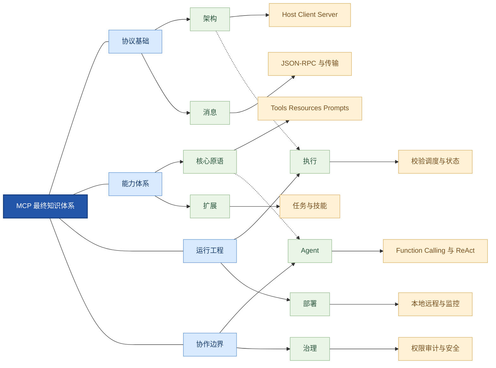

<strong>图谱解读：</strong>完整 MCP 体系不是一个工具列表，而是协议、能力、运行工程和 Agent 协作边界组成的多层知识网络。

## 15. 参考资料与持续验证入口

以下优先使用官方规范、官方 SDK 与标准文档。由于协议快速演进，涉及版本敏感行为时应优先查阅所用版本的规范正文、更新日志及 SDK 兼容说明。

1. [MCP 官方网站与规范入口](https://modelcontextprotocol.io/specification)
2. [MCP 协议官方 GitHub](https://github.com/modelcontextprotocol/modelcontextprotocol)
3. [MCP Python SDK](https://github.com/modelcontextprotocol/python-sdk)
4. [MCP TypeScript SDK](https://github.com/modelcontextprotocol/typescript-sdk)
5. [MCP 2025-11-25 规范](https://modelcontextprotocol.io/specification/2025-11-25)
6. [MCP 2026-07-28 规范入口](https://modelcontextprotocol.io/specification/2026-07-28)
7. [MCP Tasks 扩展](https://tasks.extensions.modelcontextprotocol.io/)
8. [MCP Skills 扩展](https://skills.extensions.modelcontextprotocol.io/specification/stable/skills)
9. [JSON-RPC 2.0 规范](https://www.jsonrpc.org/specification)
10. [OAuth 2.0 核心规范 RFC 6749](https://www.rfc-editor.org/rfc/rfc6749)
11. [OpenAI Function Calling](https://developers.openai.com/api/docs/guides/function-calling)
12. [LangGraph 官方文档](https://docs.langchain.com/oss/python/langgraph/overview)

> 维护建议：每次升级 MCP 规范或 SDK，重新核对初始化/版本元数据、传输、工具结果、授权、任务扩展与通知机制，并重新执行协议互操作和端到端业务测试。

