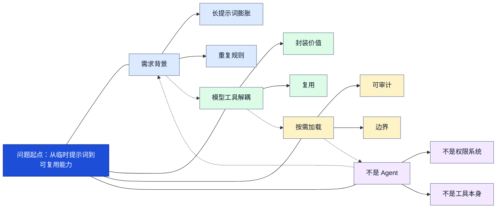
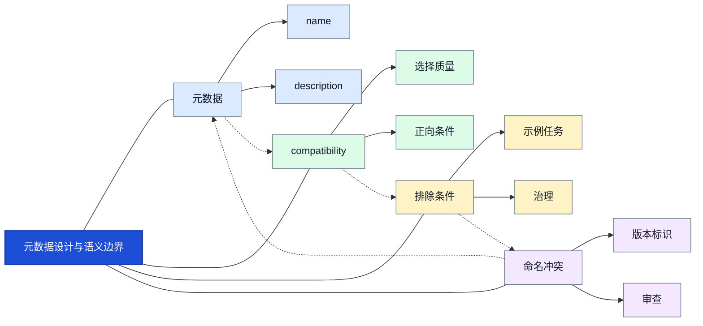
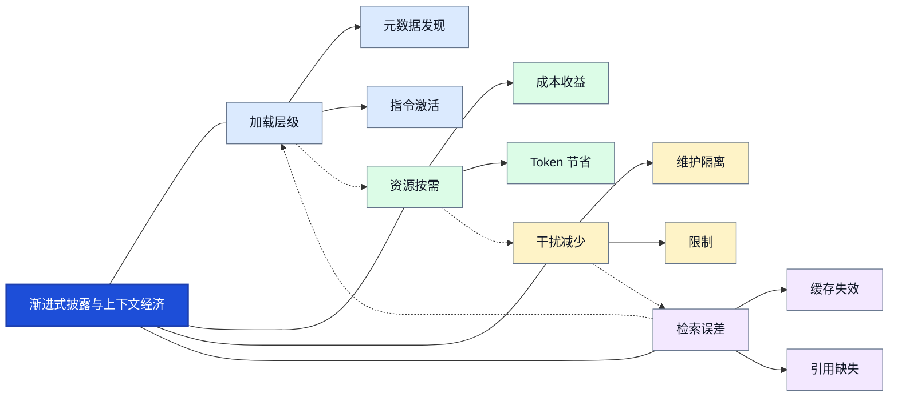
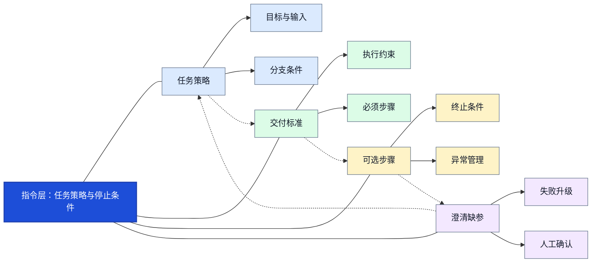
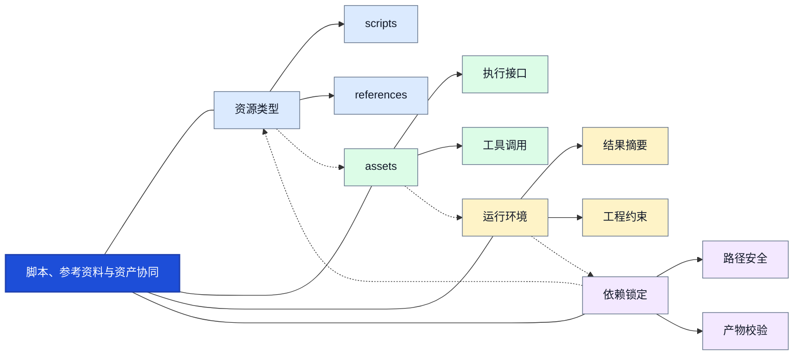
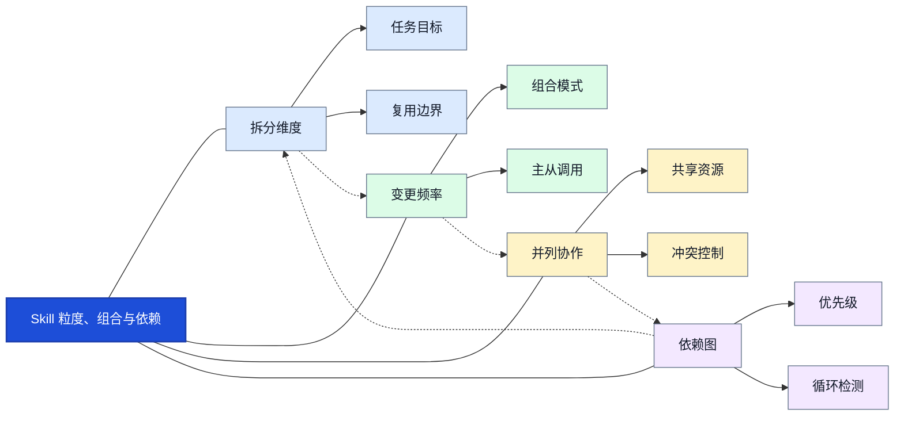
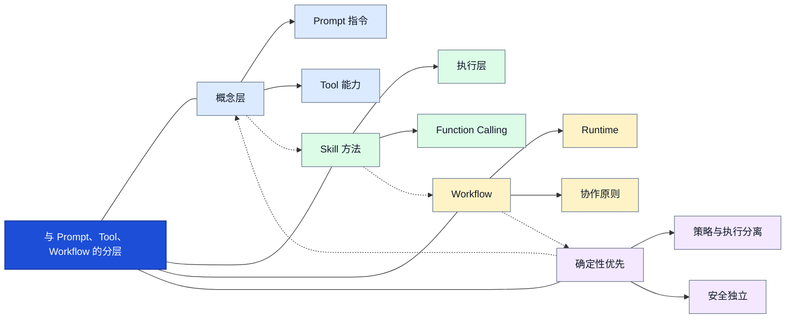
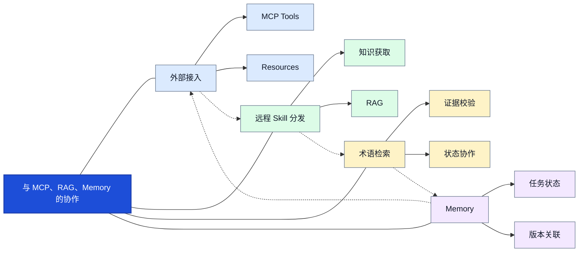
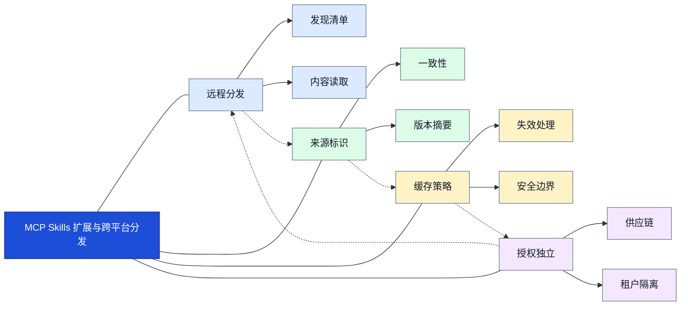
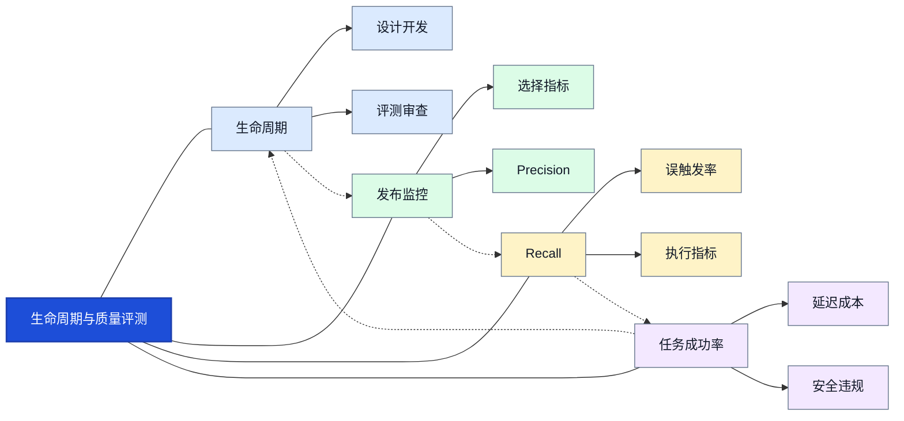

# 06｜Agent Skills：可复用 Agent 能力封装、渐进式加载与企业级治理

> 章节定位：第五章 Agent 知识与工具体系。本文以 Agent Skills 开放规范为核心，区分规范约定、平台特性与工程建议；不同宿主和 MCP 扩展的具体字段与支持范围应以对应版本官方文档为准。

## 阅读路线

问题与定位 → 规范与元数据 → 渐进式加载 → 发现和触发 → 指令与资源 → 粒度与组合 → 工具及 MCP 协作 → 安全与治理 → 评测 → 企业案例。每节以原理为主，以多分支知识网络呈现关系。


## 1. 问题起点：从临时提示词到可复用能力

Agent Skills 不是新模型，而是将任务方法、约束、脚本和资源封装为可发现、可复用的能力包。传统长 System Prompt 在任务增加时出现上下文膨胀、职责混杂、难以版本控制的问题；将所有步骤硬编码又降低对开放任务的适应性。Skill 在两者之间提供可维护的任务知识层。


### 1.1 核心机制与设计取舍


### 1.2 多层级知识网络




<strong>图谱解读：</strong>以“问题起点：从临时提示词到可复用能力”为中心，分别连接“需求背景”“模型工具解耦”“按需加载”“不是 Agent”四类关联模块；虚线表示模块之间需要共同考虑的约束或依赖，并非强制的运行顺序。


### 1.3 工程落地与失败边界

实施时应先明确本节能力的输入、责任主体和成功判据，再为“长提示词膨胀”与“封装价值”建立可复现的验证用例。对于“不是权限系统”等边界情形，应记录失败原因、触发上下文与实际执行轨迹；若行为涉及外部工具或写入操作，还必须在 Runtime 层实施权限和副作用控制。不要将 Skill 文本中的建议误当作已执行的检查。


## 2. 开放规范与目录契约

Agent Skills 开放规范以目录为交付单元，至少需要带 YAML frontmatter 的 SKILL.md。name 和 description 是基础元数据；scripts、references、assets 是按需组织的惯例目录，并非所有 Skill 必须包含。平台可能添加自身字段或限制，跨平台移植时应区分开放规范与宿主扩展。


### 2.1 核心机制与设计取舍


典型目录如下，`SKILL.md` 是入口，其他文件夹按需提供：

```text
document-translation/
├── SKILL.md
├── scripts/
│   └── check_numbers.py
├── references/
│   └── terminology.md
└── assets/
    └── report-template.docx
```

`SKILL.md` 顶部使用 YAML frontmatter。下面是示例，不是所有宿主都支持相同扩展字段：

```yaml
---
name: document-translation
description: Translate technical documents while preserving layout and checking terminology, numbers and model identifiers. Use for document translation tasks; not for general conversation.
---
```


### 2.2 多层级知识网络


<strong>图谱解读：</strong>以“开放规范与目录契约”为中心，分别连接“规范契约”“目录结构”“references”“宿主差异”四类关联模块；虚线表示模块之间需要共同考虑的约束或依赖，并非强制的运行顺序。


### 2.3 工程落地与失败边界

实施时应先明确本节能力的输入、责任主体和成功判据，再为“SKILL.md”与“内容组件”建立可复现的验证用例。对于“路径约束”等边界情形，应记录失败原因、触发上下文与实际执行轨迹；若行为涉及外部工具或写入操作，还必须在 Runtime 层实施权限和副作用控制。不要将 Skill 文本中的建议误当作已执行的检查。


## 3. 元数据设计与语义边界

name 是稳定标识，description 应说明做什么、何时使用及何时不使用。好的描述要兼顾召回与精度：太宽泛容易误触发，太狭窄则漏触发。对相近 Skill 需要划定任务目标和优先级，不应依赖模型猜测隐含边界。


### 3.1 核心机制与设计取舍


description 应写清触发正例与反例；如果两个 Skill 都能处理 PDF，应进一步区分是“翻译整份文档”还是“修复版式”。否则两个能力可能竞争相同请求。


### 3.2 多层级知识网络




<strong>图谱解读：</strong>以“元数据设计与语义边界”为中心，分别连接“元数据”“compatibility”“排除条件”“命名冲突”四类关联模块；虚线表示模块之间需要共同考虑的约束或依赖，并非强制的运行顺序。


### 3.3 工程落地与失败边界

实施时应先明确本节能力的输入、责任主体和成功判据，再为“name”与“选择质量”建立可复现的验证用例。对于“版本标识”等边界情形，应记录失败原因、触发上下文与实际执行轨迹；若行为涉及外部工具或写入操作，还必须在 Runtime 层实施权限和副作用控制。不要将 Skill 文本中的建议误当作已执行的检查。


## 4. 渐进式披露与上下文经济

Progressive Disclosure（渐进式披露）把加载拆为能力目录摘要、SKILL.md 具体指导、参考文件与脚本等按需资源。节省上下文不是唯一目标：它也降低不相关规则干扰，并使知识维护更模块化。实际读取文件的时机取决于宿主实现。


### 4.1 核心机制与设计取舍


| 加载阶段 | 读取内容 | 为什么这样设计 |
|---|---|---|
| 发现 | 名称和描述 | 以较小上下文开销确定候选 |
| 激活 | `SKILL.md` 主体 | 获得任务决策规则 |
| 执行 | 相关参考文件、脚本、资产 | 仅引入本次任务需要的内容 |

<strong>渐进式披露不是懒加载的绝对保证</strong>：不同宿主可能预加载、缓存或主动读取不同资源。应以具体运行时行为评测 Token 成本和选择效果。


### 4.2 多层级知识网络




<strong>图谱解读：</strong>以“渐进式披露与上下文经济”为中心，分别连接“加载层级”“资源按需”“干扰减少”“检索误差”四类关联模块；虚线表示模块之间需要共同考虑的约束或依赖，并非强制的运行顺序。


### 4.3 工程落地与失败边界

实施时应先明确本节能力的输入、责任主体和成功判据，再为“元数据发现”与“成本收益”建立可复现的验证用例。对于“缓存失效”等边界情形，应记录失败原因、触发上下文与实际执行轨迹；若行为涉及外部工具或写入操作，还必须在 Runtime 层实施权限和副作用控制。不要将 Skill 文本中的建议误当作已执行的检查。


## 5. 发现、匹配与激活

Skill 的触发既可能由用户显式指定，也可能由模型根据任务语义隐式选择。核心质量维度是 Trigger Precision 与 Trigger Recall；存在多候选时可结合分类路由、任务条件、负面条件和显式优先级。选择机制是启发式或模型决策，不等于安全授权。


### 5.1 核心机制与设计取舍


隐式激活是模型选择问题，显式激活是用户或流程指定问题。两者都需要执行端权限检查；描述字段中的“允许访问”并不构成授权。


### 5.2 多层级知识网络


<strong>图谱解读：</strong>以“发现、匹配与激活”为中心，分别连接“发现路径”“远程目录”“隐式匹配”“误触发”四类关联模块；虚线表示模块之间需要共同考虑的约束或依赖，并非强制的运行顺序。


### 5.3 工程落地与失败边界

实施时应先明确本节能力的输入、责任主体和成功判据，再为“项目目录”与“匹配方式”建立可复现的验证用例。对于“漏触发”等边界情形，应记录失败原因、触发上下文与实际执行轨迹；若行为涉及外部工具或写入操作，还必须在 Runtime 层实施权限和副作用控制。不要将 Skill 文本中的建议误当作已执行的检查。


## 6. 指令层：任务策略与停止条件

SKILL.md 应描述输入要求、决策分支、工具使用条件、失败处理和完成定义。与其列出所有可能命令，不如明确不可省略的检查、可选步骤和人类确认边界。对低风险开放任务保留灵活度，对高风险操作增加确定性约束。


### 6.1 核心机制与设计取舍


### 6.2 多层级知识网络




<strong>图谱解读：</strong>以“指令层：任务策略与停止条件”为中心，分别连接“任务策略”“交付标准”“可选步骤”“澄清缺参”四类关联模块；虚线表示模块之间需要共同考虑的约束或依赖，并非强制的运行顺序。


### 6.3 工程落地与失败边界

实施时应先明确本节能力的输入、责任主体和成功判据，再为“目标与输入”与“执行约束”建立可复现的验证用例。对于“失败升级”等边界情形，应记录失败原因、触发上下文与实际执行轨迹；若行为涉及外部工具或写入操作，还必须在 Runtime 层实施权限和副作用控制。不要将 Skill 文本中的建议误当作已执行的检查。


## 7. 脚本、参考资料与资产协同

脚本适合数字比对、文件结构检查等确定性操作；参考资料适合术语、政策、长规则；assets 适合模板和静态交付资源。脚本是否执行由运行环境决定，Skill 文本不能自行获得系统权限。对于脚本输出，模型只需要读取结果和必要解释，而非全部源代码。


### 7.1 核心机制与设计取舍


### 7.2 多层级知识网络




<strong>图谱解读：</strong>以“脚本、参考资料与资产协同”为中心，分别连接“资源类型”“assets”“运行环境”“依赖锁定”四类关联模块；虚线表示模块之间需要共同考虑的约束或依赖，并非强制的运行顺序。


### 7.3 工程落地与失败边界

实施时应先明确本节能力的输入、责任主体和成功判据，再为“scripts”与“执行接口”建立可复现的验证用例。对于“路径安全”等边界情形，应记录失败原因、触发上下文与实际执行轨迹；若行为涉及外部工具或写入操作，还必须在 Runtime 层实施权限和副作用控制。不要将 Skill 文本中的建议误当作已执行的检查。


## 8. Skill 粒度、组合与依赖

以可独立交付的用户目标为主要拆分标准。过粗会形成万能 Skill，过细会带来路由与协调开销。复合任务可由主 Skill 指导多个工具，必要时组合专用 Skill；但循环依赖、隐式优先级和相互矛盾的指令必须显式处理。


### 8.1 核心机制与设计取舍


组合设计需要检查共享资源的版本一致性。两个 Skill 若分别要求不同的术语表版本，Runtime 应根据任务配置选择一个权威版本，或要求用户澄清。


### 8.2 多层级知识网络




<strong>图谱解读：</strong>以“Skill 粒度、组合与依赖”为中心，分别连接“拆分维度”“变更频率”“并列协作”“依赖图”四类关联模块；虚线表示模块之间需要共同考虑的约束或依赖，并非强制的运行顺序。


### 8.3 工程落地与失败边界

实施时应先明确本节能力的输入、责任主体和成功判据，再为“任务目标”与“组合模式”建立可复现的验证用例。对于“优先级”等边界情形，应记录失败原因、触发上下文与实际执行轨迹；若行为涉及外部工具或写入操作，还必须在 Runtime 层实施权限和副作用控制。不要将 Skill 文本中的建议误当作已执行的检查。


## 9. 与 Prompt、Tool、Workflow 的分层

Prompt 是单次或持久指令；Tool 提供可执行操作；Function Calling 表达模型调用意图；Workflow 强制组织步骤；Skill 封装可复用任务知识。复杂企业系统通常由 Workflow 固化必须遵守的审批与校验，由 Skill 提供专业策略，再由工具完成实际操作。


### 9.1 核心机制与设计取舍


固定工作流适合不可跳过的合规步骤，Skill 适合可复用但需要灵活判断的任务方法。将审批、支付、删除等操作只写成 Skill 文字说明，不足以强制执行。


### 9.2 多层级知识网络




<strong>图谱解读：</strong>以“与 Prompt、Tool、Workflow 的分层”为中心，分别连接“概念层”“Skill 方法”“Workflow”“确定性优先”四类关联模块；虚线表示模块之间需要共同考虑的约束或依赖，并非强制的运行顺序。


### 9.3 工程落地与失败边界

实施时应先明确本节能力的输入、责任主体和成功判据，再为“Prompt 指令”与“执行层”建立可复现的验证用例。对于“策略与执行分离”等边界情形，应记录失败原因、触发上下文与实际执行轨迹；若行为涉及外部工具或写入操作，还必须在 Runtime 层实施权限和副作用控制。不要将 Skill 文本中的建议误当作已执行的检查。


## 10. 与 MCP、RAG、Memory 的协作

MCP（Model Context Protocol）用于标准化外部能力接入；RAG（Retrieval-Augmented Generation，检索增强生成）负责检索证据；Memory 负责保存动态状态或经验。Skill 可以规定检索策略、调用 MCP 工具以及读写记忆的条件，但不能替代三者各自的实现与安全边界。


### 10.1 核心机制与设计取舍


RAG 检索结果可能包含不可信内容，Skill 只能规定“需要证据”而不能保证证据真实。MCP Tool 负责连接服务，Runtime 负责鉴权和调用，Memory 则保存随时间变化的任务状态。


### 10.2 多层级知识网络




<strong>图谱解读：</strong>以“与 MCP、RAG、Memory 的协作”为中心，分别连接“外部接入”“远程 Skill 分发”“术语检索”“Memory”四类关联模块；虚线表示模块之间需要共同考虑的约束或依赖，并非强制的运行顺序。


### 10.3 工程落地与失败边界

实施时应先明确本节能力的输入、责任主体和成功判据，再为“MCP Tools”与“知识获取”建立可复现的验证用例。对于“任务状态”等边界情形，应记录失败原因、触发上下文与实际执行轨迹；若行为涉及外部工具或写入操作，还必须在 Runtime 层实施权限和副作用控制。不要将 Skill 文本中的建议误当作已执行的检查。


## 11. MCP Skills 扩展与跨平台分发

MCP Skills 扩展为远程 Skill 的发现和内容获取提供协议化方式。其实现与支持程度依赖协议版本、扩展版本和宿主。远程 Skill 的发布者、资源标识、摘要、缓存与授权应一起管理；不能把远程 Skill 的工具声明视为自动获得本机执行权限。


### 11.1 核心机制与设计取舍


### 11.2 多层级知识网络




<strong>图谱解读：</strong>以“MCP Skills 扩展与跨平台分发”为中心，分别连接“远程分发”“来源标识”“缓存策略”“授权独立”四类关联模块；虚线表示模块之间需要共同考虑的约束或依赖，并非强制的运行顺序。


### 11.3 工程落地与失败边界

实施时应先明确本节能力的输入、责任主体和成功判据，再为“发现清单”与“一致性”建立可复现的验证用例。对于“供应链”等边界情形，应记录失败原因、触发上下文与实际执行轨迹；若行为涉及外部工具或写入操作，还必须在 Runtime 层实施权限和副作用控制。不要将 Skill 文本中的建议误当作已执行的检查。


## 12. 安全：提示注入、脚本与供应链

Skill 可能包含恶意指令、外部依赖、危险脚本或敏感信息外传路径。必须把 Skill 视为待审查的内容和代码供应链：来源校验、最小权限、沙箱、网络出口控制、凭据隔离、审批和审计都不能仅靠自然语言指令保证。


### 12.1 核心机制与设计取舍


风险控制应分为内容审查、执行沙箱、网络与文件权限、凭据隔离、审计追踪五层。对第三方 Skill 的更新应视作供应链变更，不能默认延续旧版本的信任。


### 12.2 多层级知识网络


<strong>图谱解读：</strong>以“安全：提示注入、脚本与供应链”为中心，分别连接“攻击面”“依赖投毒”“最小权限”“签名摘要”四类关联模块；虚线表示模块之间需要共同考虑的约束或依赖，并非强制的运行顺序。


### 12.3 工程落地与失败边界

实施时应先明确本节能力的输入、责任主体和成功判据，再为“提示注入”与“防护机制”建立可复现的验证用例。对于“来源审查”等边界情形，应记录失败原因、触发上下文与实际执行轨迹；若行为涉及外部工具或写入操作，还必须在 Runtime 层实施权限和副作用控制。不要将 Skill 文本中的建议误当作已执行的检查。


## 13. 生命周期与质量评测

一个 Skill 的成熟过程是需求定义、开发、测试、审查、发布、监控、迭代和退役。测试必须同时覆盖是否触发与触发后是否成功，使用正样本、负样本、干扰上下文和失败注入；版本更新需进行回归测试。


### 13.1 核心机制与设计取舍


触发精度与召回率分别衡量误触发和漏触发，建议使用同一批标注任务进行评估：

$$
\mathrm{Precision}=\frac{TP}{TP+FP}
$$

$$
\mathrm{Recall}=\frac{TP}{TP+FN}
$$

其中 TP 为正确触发，FP 为错误触发，FN 为应该触发却未触发。若分母为零，应在评测协议中明确定义处理规则，不能直接将其解释为满分。


### 13.2 多层级知识网络




<strong>图谱解读：</strong>以“生命周期与质量评测”为中心，分别连接“生命周期”“发布监控”“Recall”“任务成功率”四类关联模块；虚线表示模块之间需要共同考虑的约束或依赖，并非强制的运行顺序。


### 13.3 工程落地与失败边界

实施时应先明确本节能力的输入、责任主体和成功判据，再为“设计开发”与“选择指标”建立可复现的验证用例。对于“延迟成本”等边界情形，应记录失败原因、触发上下文与实际执行轨迹；若行为涉及外部工具或写入操作，还必须在 Runtime 层实施权限和副作用控制。不要将 Skill 文本中的建议误当作已执行的检查。


## 14. 企业文档翻译 Agent 的能力设计

面向 Word、PDF 和图片翻译，主 Skill 可定义整体交付流程，子能力围绕 PDF 版式、图片文字翻译、术语规范、质量检查展开。文件解析、数字核对和渲染属于工具或脚本；术语规范是参考知识；长任务状态与权限由 Runtime 维护。


### 14.1 核心机制与设计取舍


| 能力 | 适合封装位置 | 原因 |
|---|---|---|
| 完整文档翻译交付 | 主 Skill | 面向可复用用户目标 |
| PDF 版式恢复规则 | 专用 Skill 或参考文件 | 视独立复用频率决定 |
| 数字、单位、型号比对 | 脚本或 Tool | 结果应确定且可测试 |
| 术语库查询 | RAG / MCP Tool | 数据动态更新，需来源和权限 |
| 长任务状态 | Runtime / 任务系统 | 需要持久化、取消和恢复 |

一次任务从文档识别开始，先判定可提取文本与扫描内容，按类型加载对应参考规则；随后查询术语、翻译内容并保留结构信息。校验阶段优先运行确定性数字与型号比对，再做语言和版式质量评估。出现失败时只对受影响区域修复，限制循环次数，并在高风险交付前要求人工复核。


### 14.2 多层级知识网络


<strong>图谱解读：</strong>以“企业文档翻译 Agent 的能力设计”为中心，分别连接“任务入口”“质量约束”“术语校验”“重试上限”四类关联模块；虚线表示模块之间需要共同考虑的约束或依赖，并非强制的运行顺序。


### 14.3 工程落地与失败边界

实施时应先明确本节能力的输入、责任主体和成功判据，再为“文档识别”与“能力拆分”建立可复现的验证用例。对于“人工复核”等边界情形，应记录失败原因、触发上下文与实际执行轨迹；若行为涉及外部工具或写入操作，还必须在 Runtime 层实施权限和副作用控制。不要将 Skill 文本中的建议误当作已执行的检查。


## 15. 前沿方向、误区与工程选型

自动从成功轨迹提炼 Skill、跨宿主移植、远程分发与自动评测是值得关注的方向，但自动生成不代表已验证。不要把 Skill 数量、目录复杂度或脚本数量当作质量指标；应按任务复用率、触发准确率、成功率、风险和维护成本判断。


### 15.1 核心机制与设计取舍


前沿能力需要实验验证：从历史轨迹自动生成 Skill 可能过拟合偶然成功路径；动态组合可能放大指令冲突；远程分发可能扩大供应链攻击面。


### 15.2 多层级知识网络


<strong>图谱解读：</strong>以“前沿方向、误区与工程选型”为中心，分别连接“发展方向”“持续评测”“等于 Agent”“复用频率”四类关联模块；虚线表示模块之间需要共同考虑的约束或依赖，并非强制的运行顺序。


### 15.3 工程落地与失败边界

实施时应先明确本节能力的输入、责任主体和成功判据，再为“自动提炼”与“常见误区”建立可复现的验证用例。对于“风险等级”等边界情形，应记录失败原因、触发上下文与实际执行轨迹；若行为涉及外部工具或写入操作，还必须在 Runtime 层实施权限和副作用控制。不要将 Skill 文本中的建议误当作已执行的检查。


## 16. 全局知识关联与工程选型

| 问题 | 优先选择 | 理由 |
|---|---|---|
| 一次性简单指令 | Prompt | 无需额外生命周期 |
| 确定性计算 | 函数或脚本 | 易测试、低开销 |
| 可重复的专业任务 | Skill | 复用决策知识与资源 |
| 强制审批和状态流转 | Workflow / Runtime | 必须由程序保证约束 |
| 远程共享工具 | MCP | 标准化能力发现与调用 |
| 动态知识证据 | RAG | 提供检索、排序和来源 |
| 跨会话业务状态 | Memory / 数据库 | 持久化和生命周期管理 |

<strong>核心原则：</strong>Skill 组织“如何完成任务”的可复用知识，Tool 提供“实际做什么”的操作能力，Runtime 保证“怎样安全、可靠地执行”，而 MCP 负责“怎样标准化连接外部能力”。四者不是替代关系，而是不同层级的协作关系。

## 17. 常见误区与面试要点

1. <strong>Skill 等于 Prompt 吗？</strong>不等于。Skill 是以 `SKILL.md` 为入口的能力包，可以包含脚本、参考文件和资产。
2. <strong>Skill 可以自己执行脚本吗？</strong>不能脱离宿主运行环境。执行权来自 Runtime 与工具权限。
3. <strong>为什么采用渐进式披露？</strong>为了减少无关上下文、改善能力组织，并允许按需使用细节。
4. <strong>Skill 越多越好吗？</strong>不是。粒度失衡会增加路由冲突、维护成本和误触发。
5. <strong>如何证明 Skill 有效？</strong>对比有无 Skill 的任务成功率、触发精度与召回、延迟、成本和安全事件。
6. <strong>Skill 与 MCP 如何配合？</strong>Skill 说明操作策略，MCP 暴露远程工具与资源，Runtime 执行权限控制。
7. <strong>怎样防止 Skill 投毒？</strong>验证来源、审查内容和脚本、隔离执行、限制网络权限、固定版本并记录审计。
8. <strong>什么时候不用 Skill？</strong>单次短指令、纯确定性函数、没有复用价值的任务，通常无需额外封装。

## 18. 参考资料与进一步验证

以下链接优先指向规范或官方仓库。规范与平台功能可能持续更新，涉及字段、路径、远程扩展时应以实际版本为准。

- [Agent Skills 开放规范](https://agentskills.io/specification)

- [Agent Skills 规范仓库](https://github.com/agentskills/agentskills)

- [Anthropic Skills 仓库](https://github.com/anthropics/skills)

- [OpenAI Skills 仓库](https://github.com/openai/skills)

- [OpenAI Skills 开发文档](https://developers.openai.com/api/docs/guides/tools-skills)

- [MCP 官方规范](https://modelcontextprotocol.io/specification/)

- [MCP Skills 扩展](https://skills.extensions.modelcontextprotocol.io/specification/stable/skills)

- [LangGraph 官方文档](https://docs.langchain.com/oss/python/langgraph/overview)


## 19. 总结

Agent Skills 的完整逻辑是：重复任务产生可复用需求，开放规范定义能力包，元数据支持发现，渐进式披露控制上下文，指令与资源指导执行，Runtime 与 Tool 负责真实动作，安全与评测保障长期复用。企业项目应将 Skill 视为需要版本、测试、权限与审计的工程资产，而不是一份写得很长的提示词。
