# 知识检索与工具调用协同：从证据获取到可靠执行的 Agent 工程体系

> 第五章 · 07｜Knowledge and Tool Integration  
> 研究对象：RAG、混合检索、重排序、Function Calling、MCP、Agent Skills 与 Agent Runtime 的协同机制。  
> 核心命题：<strong>让 Agent 在正确的时机获取可信知识、执行受控操作，并通过状态、证据与验证闭环完成真实任务。</strong>

## 阅读导航

本文按照「为什么需要协同 → 能力边界 → 决策路由 → 任务编排 → 证据与状态 → 安全可靠性 → 性能评测 → 企业案例」组织。网络图中的实线表示组成或主要依赖，虚线表示跨模块协作关系。图谱用于展示逻辑关系，不代表具体 SDK 的唯一实现。

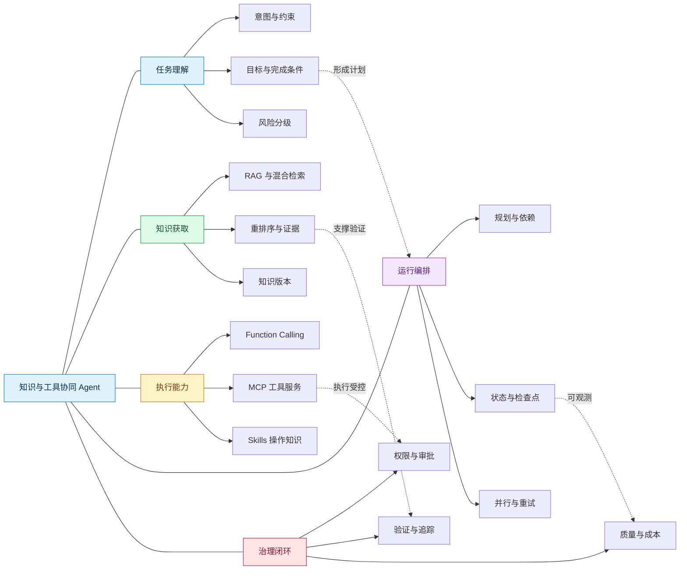

<strong>图谱解读：</strong>核心是 Runtime 协调“知识—行动—验证”三种活动。知识为行动提供依据，行动产生可观察结果，验证决定任务结束、补充检索还是修复；权限约束贯穿整个闭环。

## 一、问题定义：为什么单独的 RAG 或 Tool Calling 不够

### 1.1 四种任务需求

<strong>知识需求</strong>：需要解释规则、术语或文档事实；<strong>实时事实需求</strong>：需要查询数据库或业务 API；<strong>计算需求</strong>：需要确定性算法或规则引擎；<strong>副作用需求</strong>：需要创建、修改、发送或删除真实业务对象。一个用户任务可能同时具备四种需求。

RAG（Retrieval-Augmented Generation，检索增强生成）主要提供外部证据；Function Calling（函数调用）让模型表达结构化工具调用意图；MCP（Model Context Protocol，模型上下文协议）规范化外部能力接入；Agent Skills 将可复用的程序性知识和资源组织成能力包；Agent Runtime 负责调度、执行和状态控制。这些概念不在同一抽象层，不能互相替代。

### 1.2 从固定流水线到动态协同

固定 RAG 流水线通常是“检索—拼接—生成”。它对单次问答有效，但无法自然覆盖跨系统写操作、动态补证、等待审批和失败恢复。引入工具后仍存在“选错工具、使用过期依据、重复执行副作用”的问题。协同系统因此必须增加<strong>决策策略、任务依赖、证据溯源、权限边界和结果验证</strong>。

### 1.3 什么时候不应该使用复杂 Agent

固定、低歧义、强合规的任务优先使用确定性 Workflow（工作流）；简单数据库读取直接调用 API；已有可信上下文足以回答时不应强制检索。动态 Agent 更适合信息不全、分支未知、需要多轮观察的任务。复杂度应由任务不确定性决定，而不是由技术热度决定。

### 本节知识网络

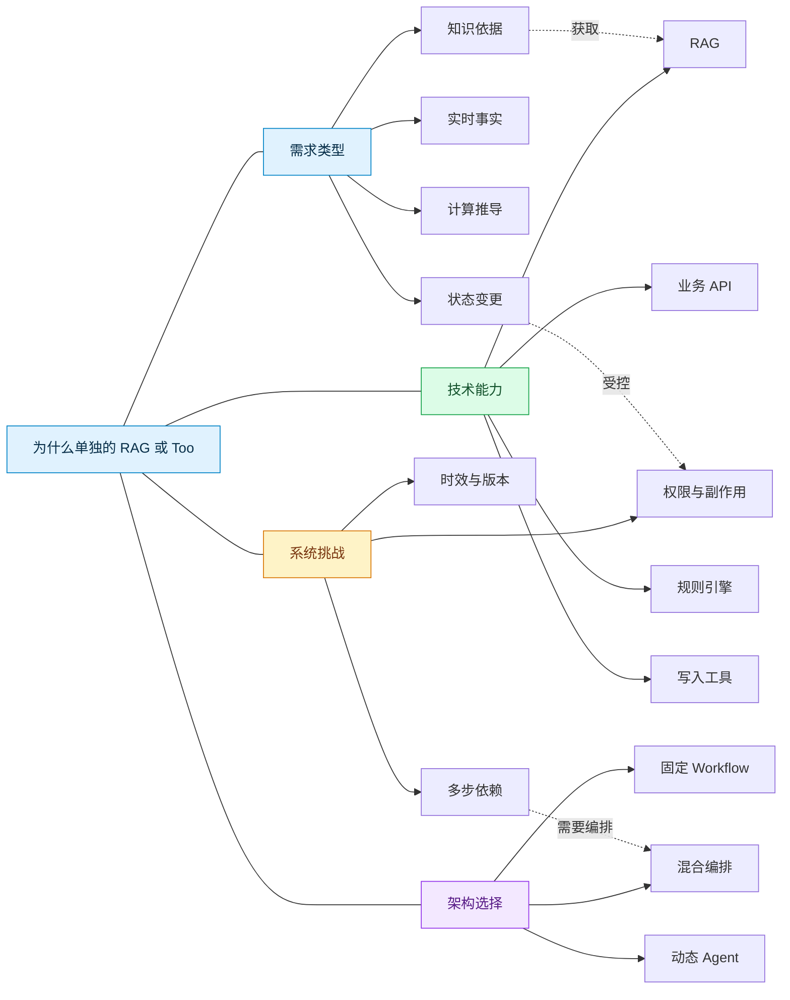

<strong>图谱解读：</strong>此网络以本节核心问题为中心，一级分支分别对应职责层、机制层和治理层；虚线强调跨层依赖。实际工程中应先确认边界和约束，再组合能力，避免将检索、工具与权限混为一谈。

## 二、统一能力模型：知识源、事实源与操作源

### 2.1 能力分类而非接口分类

同一个 `tools/call` 接口既可承载只读检索，也可承载写入动作。治理时应按<strong>语义与风险</strong>分类，而不是按 HTTP、MCP 或 Python 函数分类。建议注册元数据包含：能力标识、用途、输入输出 Schema、数据来源、权限范围、是否只读、幂等策略、超时预算、成本估计、版本及负责人。

| 能力 | 输出 | 主要验证方式 | 典型风险 |
|---|---|---|---|
| 文档检索 | 片段、引用、版本 | 相关性、充分性、权限 | 过期与提示注入 |
| 结构化查询 | 当前业务事实 | Schema、时效、实体一致性 | 数据越权 |
| 确定性计算 | 数值、规则结论 | 单元测试、边界条件 | 输入错误 |
| 状态变更 | 任务 ID、操作回执 | 授权、幂等、状态核对 | 重复副作用 |
| 生成与渲染 | 文件、报告 | 内容与视觉回归 | 质量漂移 |

### 2.2 数据契约与结果信封

检索结果建议包含 `source_id`、`document_version`、`chunk_id`、`retrieved_at`、`acl_context`、`score` 与内容；工具结果建议包含 `tool_call_id`、`status`、`output`、`error_type`、`duration_ms` 和业务 `operation_id`。这些是<strong>推荐的内部字段</strong>，不是 MCP 或 OpenAI 的统一强制协议字段。

### 2.3 MCP、Skills 和工具注册表的分工

MCP 负责外部工具、资源等能力的协议化接入；Skills 负责描述某类任务如何组织知识与工具；Tool Registry（工具注册表）负责本应用内的发现、风险分级和可调用契约；Runtime 负责执行权限与状态。MCP Server 的工具描述只能作为候选能力说明，不能作为安全授权依据。

### 本节知识网络

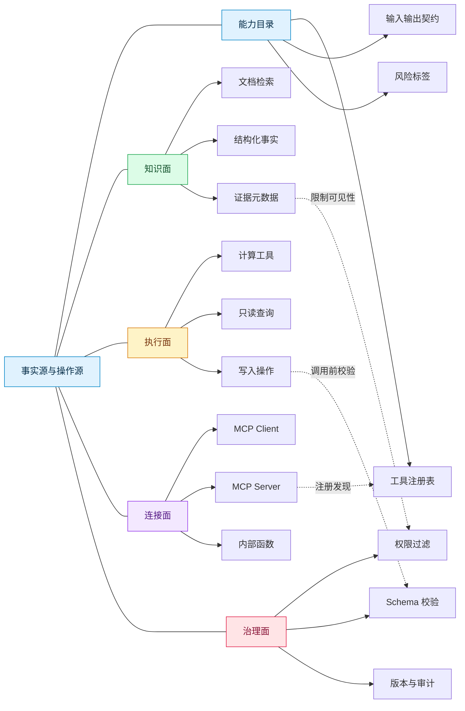

<strong>图谱解读：</strong>此网络以本节核心问题为中心，一级分支分别对应职责层、机制层和治理层；虚线强调跨层依赖。实际工程中应先确认边界和约束，再组合能力，避免将检索、工具与权限混为一谈。

## 三、知识检索链：从查询到可用证据

### 3.1 查询理解与知识源路由

Query Rewrite（查询改写）将口语任务转为可检索查询；Query Decomposition（查询分解）将复合问题拆成子问题；Knowledge Source Routing（知识源路由）依据部门、时效、数据类型和访问控制选择索引。实体型号、数字和法规编号应尽量原样保留，避免语义改写破坏精确匹配。

### 3.2 混合检索与重排序

BM25（Best Matching 25，基于词频和文档长度的稀疏相关性评分）擅长型号、术语和精确关键词；Dense Retrieval（稠密向量检索）擅长语义改写；Hybrid Search（混合检索）融合二者。RRF（Reciprocal Rank Fusion，倒数排名融合）是一种不要求原始评分同尺度的融合方法：

$$
\mathrm{RRF}(d)=\sum_{j=1}^{m}\frac{w_j}{k+r_j(d)}
$$

其中 $r_j(d)$ 是文档 $d$ 在第 $j$ 路检索中的名次，$w_j$ 是权重，$k$ 是平滑常数。RRF 属于排名融合，不等同于交叉编码器 Reranker（重排序模型）。后者通常联合编码 Query 与候选片段，以更高成本评估语义相关性。

### 3.3 证据质量与上下文构建

检索命中不等于证据充分。需要检查来源权威性、版本有效期、覆盖范围、冲突关系、访问权限和可引用位置。Context Packing（上下文装配）应去重、保留关键事实和出处，并控制 Token Budget（上下文预算）。当证据不足时，系统应补检或明确不确定性，而不是编造结论。

### 3.4 Agentic Retrieval（智能体式检索）

固定检索执行一次；Agentic Retrieval 可以规划多个子查询、选择多个知识源、依据结果继续检索。它适合跨文档复杂任务，但增加延迟、费用和执行不确定性。必须设置最大轮次和停止标准。

### 本节知识网络

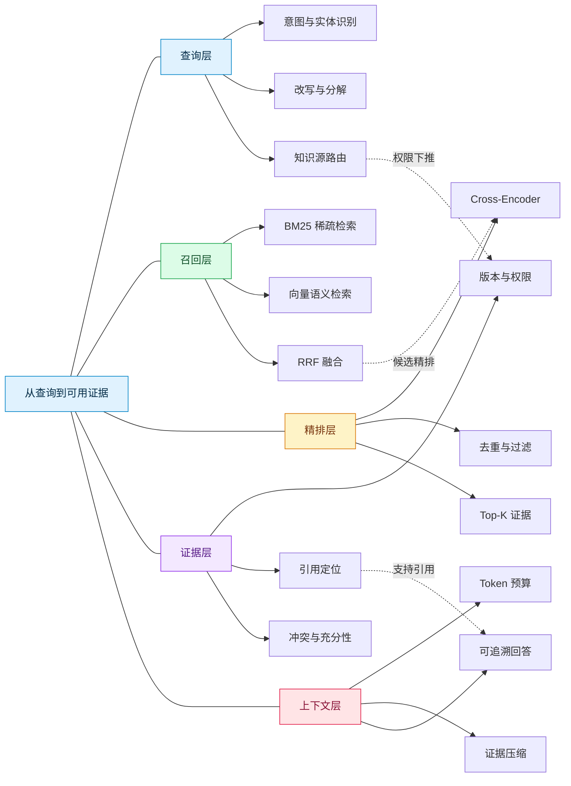

<strong>图谱解读：</strong>此网络以本节核心问题为中心，一级分支分别对应职责层、机制层和治理层；虚线强调跨层依赖。实际工程中应先确认边界和约束，再组合能力，避免将检索、工具与权限混为一谈。

## 四、工具路由：什么时候查知识，什么时候执行动作

### 4.1 四种路由策略

规则路由按明确业务条件选择能力；模型路由根据任务语义选择工具；混合路由先以规则收缩候选，再由模型选择；规划路由先建立子任务与依赖，再逐步执行。企业实践通常适合混合路由：规则决定权限和边界，模型处理语义歧义。

### 4.2 决策变量与成本约束

可将路由看成受约束的效用优化问题，而非单纯最大化模型置信度：

$$
a^*=\arg\max_{a\in A_{\mathrm{allowed}}}\left[\mathrm{Quality}(a)-\lambda\,\mathrm{Cost}(a)-\mu\,\mathrm{Latency}(a)-\nu\,\mathrm{Risk}(a)\right]
$$

这里是工程决策的概念模型，不代表存在通用可直接计算的统一评分。`allowed` 候选集必须先经过权限和策略过滤；风险不应仅通过软分数抵消强制性安全要求。

### 4.3 四种执行组合

<strong>Retrieval-First</strong>：先查规范，再执行；<strong>Tool-First</strong>：先查实时状态，再检索解释；<strong>Parallel</strong>：无依赖分支并行；<strong>Iterative Retrieval-Action</strong>：检索、观察、行动交替。并行必须满足输入独立，不能为了加速而越过依赖边。

### 4.4 防止工具膨胀

工具数增长会增加描述 Token、候选混淆与治理成本。可按领域、能力类型、风险等级分层暴露工具，并使用 Skill 封装任务级使用方法。对于确定性简单步骤，直接函数调用通常优于让模型反复决策。

### 本节知识网络

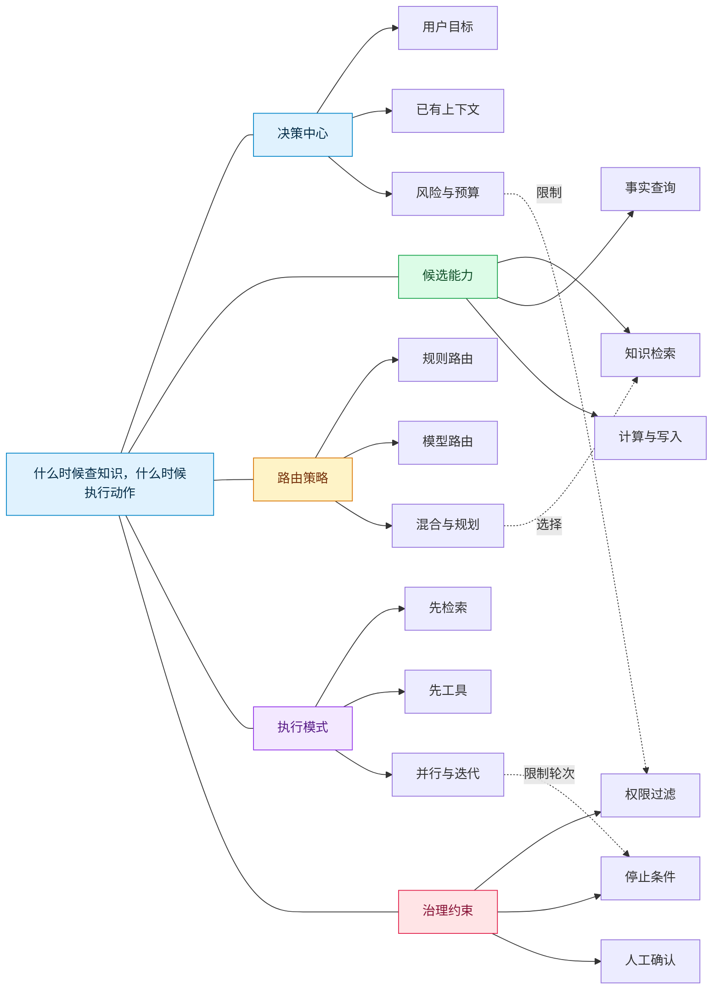

<strong>图谱解读：</strong>此网络以本节核心问题为中心，一级分支分别对应职责层、机制层和治理层；虚线强调跨层依赖。实际工程中应先确认边界和约束，再组合能力，避免将检索、工具与权限混为一谈。

## 五、任务编排：DAG、状态机与动态重规划

### 5.1 依赖图与关键路径

DAG（Directed Acyclic Graph，有向无环图）适合表达有限任务依赖：解析完成后才能翻译，翻译完成后才能检查漏译，导出必须等待关键质量门通过。相互独立的术语查询和文件元数据分析可以并行。

对于一组依赖任务，理论最短执行时间受关键路径约束：

$$
T_{\mathrm{critical}}=\max_{p\in\mathcal{P}}\sum_{i\in p}t_i
$$

其中 $\mathcal{P}$ 是所有从起点到终点的依赖路径集合，$t_i$ 是节点耗时；实际总耗时还受并发上限、网络和共享资源竞争影响。

### 5.2 动态循环与状态机

DAG 无法直接表达无限循环，因此 ReAct（Reasoning and Acting，推理与行动）式反复观察、补证与修复应由有界状态机或图执行器控制。状态可设计为 `CREATED`、`PLANNING`、`RUNNING`、`VALIDATING`、`WAITING_APPROVAL`、`RETRYING`、`COMPLETED`、`FAILED`、`CANCELLED`。

### 5.3 Workflow 与 Agent 的边界

Workflow 固定合规边界和不可跳过的质量门；Agent 在指定节点内进行查询改写、工具选择或局部修复。动态重规划必须保持已完成副作用的记录，不能重新执行已提交的操作。

### 本节知识网络

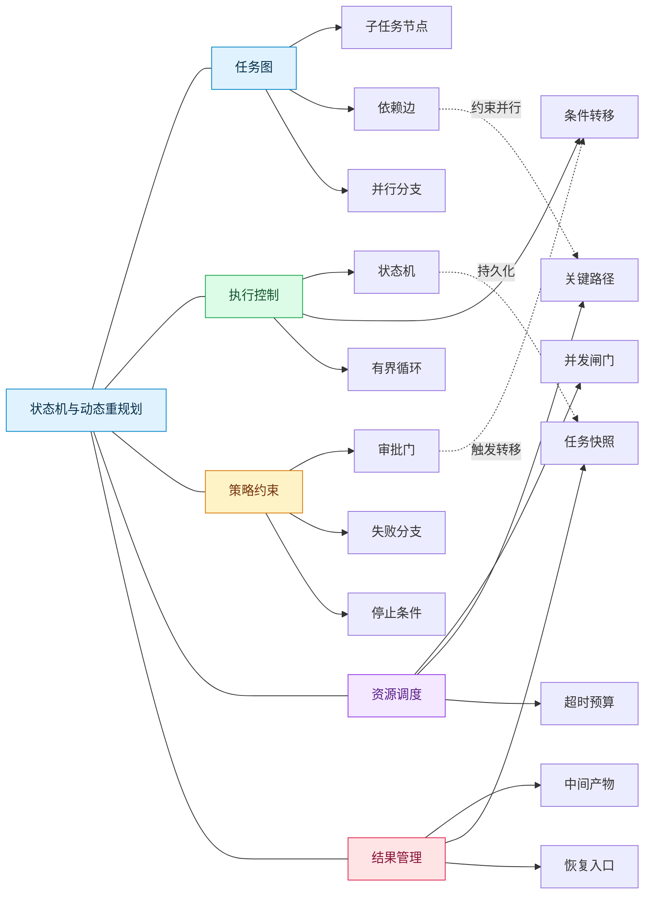

<strong>图谱解读：</strong>此网络以本节核心问题为中心，一级分支分别对应职责层、机制层和治理层；虚线强调跨层依赖。实际工程中应先确认边界和约束，再组合能力，避免将检索、工具与权限混为一谈。

## 六、状态、记忆与证据：不能全部塞进聊天历史

### 6.1 五种数据对象

Task State（任务状态）记录执行位置与依赖；Conversation Memory（会话记忆）记录对话语义；Evidence Store（证据存储）保存检索依据和引用；Artifact Store（产物存储）保存文档与报告；Audit Log（审计日志）记录行为和责任链。它们的生命周期、权限和读写模式不同，不应混放。

### 6.2 Checkpoint（检查点）与恢复

检查点保存当前节点、已完成步骤、待执行操作和关键结果引用。恢复前必须核对外部操作是否已经提交。对于写操作，使用 Idempotency Key（幂等键）或业务唯一约束防止重复创建。检查点不是数据库事务，也不能自动保证跨系统 Exactly-Once（恰好一次）执行。

### 6.3 证据链与结果链

每个关键结论应能追踪到文档版本或 API 查询结果；每个实际副作用应能追踪到工具调用、操作者、授权和回执。建议通过统一 Trace ID 关联证据、步骤和产物，同时对敏感数据脱敏。

### 本节知识网络

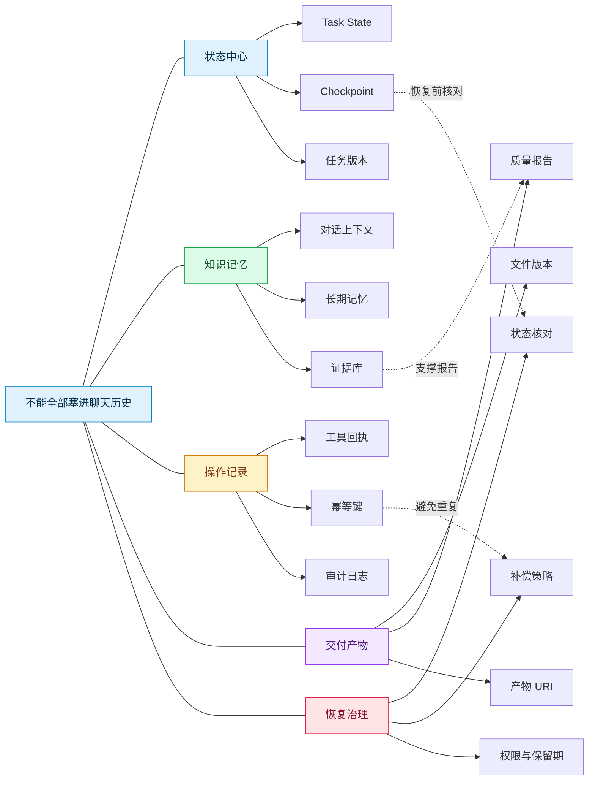

<strong>图谱解读：</strong>此网络以本节核心问题为中心，一级分支分别对应职责层、机制层和治理层；虚线强调跨层依赖。实际工程中应先确认边界和约束，再组合能力，避免将检索、工具与权限混为一谈。

## 七、可靠性：错误分类、重试、幂等与补偿

### 7.1 区分错误所在层

检索无命中可能需要改写 Query；证据矛盾需要核实版本；Schema 错误需要修复参数；429 或暂时性网络故障适合有界退避；权限拒绝必须停止；外部系统部分提交需要核对和补偿。不能统一交给模型“再试一次”。

### 7.2 重试与指数退避

对于可重试的瞬时错误，可使用带随机抖动的指数退避：

$$
t_n=\min(t_{\max},\,t_0\cdot 2^n)+\epsilon_n
$$

其中 $\epsilon_n$ 是随机抖动，实际应限制最大次数、总耗时与并发。对有副作用的请求，重试前必须确认幂等性或查询提交状态。

### 7.3 熔断、隔离与补偿

Circuit Breaker（熔断器）在连续故障时暂时阻断调用；Bulkhead（舱壁隔离）限制故障服务消耗共享资源；Saga（长事务补偿模式）可为跨服务多步操作定义可执行的补偿动作，但不是所有业务动作都可逆。对于不可补偿操作，应引入人工确认和业务对账。

### 本节知识网络

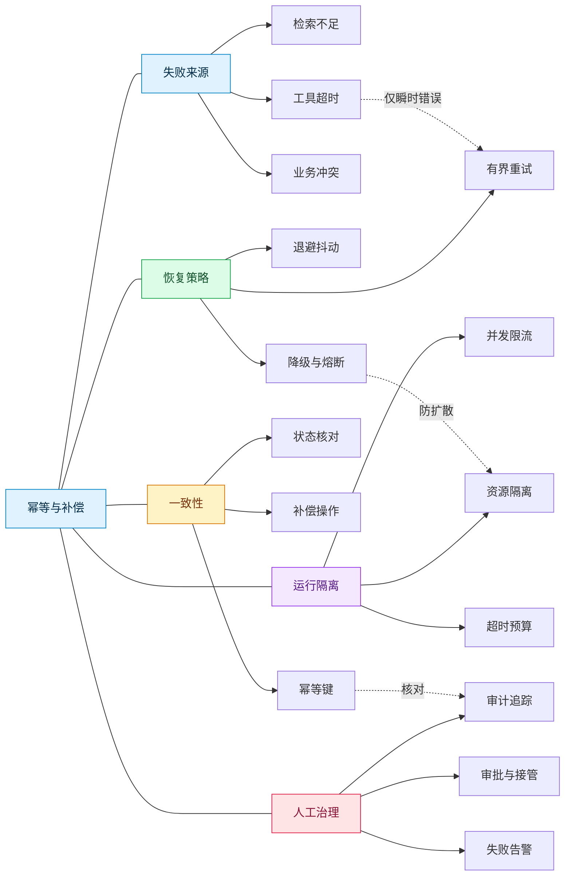

<strong>图谱解读：</strong>此网络以本节核心问题为中心，一级分支分别对应职责层、机制层和治理层；虚线强调跨层依赖。实际工程中应先确认边界和约束，再组合能力，避免将检索、工具与权限混为一谈。

## 八、安全与信任：证据不能变成指令

### 8.1 不同来源的信任级别

System/Developer 策略、用户请求、检索文档、网页、工具结果和 Skill 文件处于不同信任边界。检索文本中的“请调用上传工具”是待分析数据，不应直接成为高权限操作指令。Prompt Injection（提示注入）风险在“读文档又能执行工具”的 Agent 中尤其严重。

### 8.2 认证、授权与数据隔离

Authentication（身份认证）确认调用者；Authorization（授权）决定可执行范围。知识检索应在索引查询时应用 ACL（Access Control List，访问控制列表）或租户过滤；工具执行必须由服务端再次校验，不能仅凭模型选中工具就视为授权。RBAC（Role-Based Access Control，基于角色的访问控制）和 ABAC（Attribute-Based Access Control，基于属性的访问控制）可以结合使用。

### 8.3 高风险操作的审批门

文件删除、外部发送、系统写入、审批提交等操作应根据风险级别设置确认。对 MCP Server、第三方 Skills 和外部网页应审查来源、工具权限和网络出口。日志保留最少必要内容，避免把敏感文档或令牌写入 Trace。

### 本节知识网络

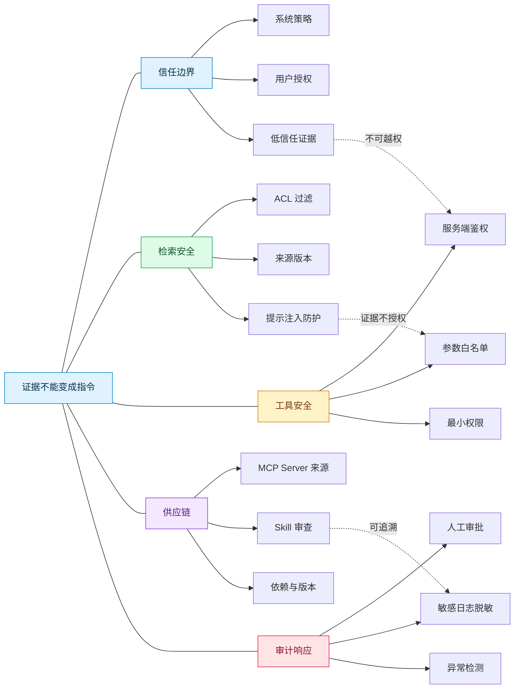

<strong>图谱解读：</strong>此网络以本节核心问题为中心，一级分支分别对应职责层、机制层和治理层；虚线强调跨层依赖。实际工程中应先确认边界和约束，再组合能力，避免将检索、工具与权限混为一谈。

## 九、性能优化：延迟、成本、质量的联合权衡

### 9.1 延迟分解

一个任务的延迟可能由模型规划、检索、重排序、API 执行、验证和输出组成。串行执行时近似为各步骤之和；并行时由最长依赖路径和资源约束决定。不能只优化模型首 Token 时间而忽略慢检索或慢工具。

### 9.2 分级执行

简单任务使用规则路由与直接工具；中等任务使用一次混合检索和重排；复杂任务才使用多轮 Agentic Retrieval。常用优化包括：工具候选集裁剪、只读缓存、查询批处理、并行独立分支、上下文压缩、分级模型、提前终止。

### 9.3 缓存正确性

缓存键至少考虑租户、权限范围、知识库版本、查询和模型/检索配置。实时状态查询和高风险写操作不应随意缓存。缓存命中率上升不代表正确性提高，必须同时监控过期命中与越权泄露。

### 9.4 成本预算

可将任务成本拆分为模型 Token、检索/重排、外部 API 和计算资源。预算控制应具备任务级与节点级上限，并记录成本与任务成功率的关系。

### 本节知识网络

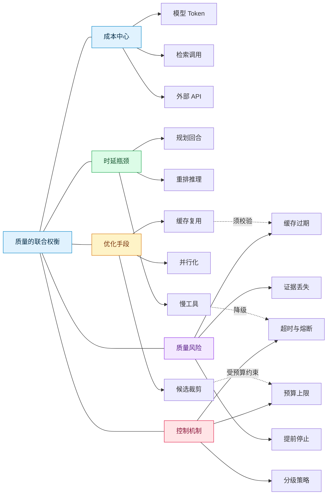

<strong>图谱解读：</strong>此网络以本节核心问题为中心，一级分支分别对应职责层、机制层和治理层；虚线强调跨层依赖。实际工程中应先确认边界和约束，再组合能力，避免将检索、工具与权限混为一谈。

## 十、评测体系：检索准确不等于任务成功

### 10.1 分层指标

| 层次 | 核心指标 | 失败示例 |
|---|---|---|
| 路由 | 工具选择准确率、误调用率 | 本该查询 API 却只检索文档 |
| 检索 | Recall@K、MRR、nDCG | 相关制度未召回 |
| 证据 | 引用准确率、充分性、版本正确率 | 引用了过期标准 |
| 工具 | 参数正确率、调用成功率 | 型号字段传错 |
| 编排 | 依赖满足率、无效步骤率 | 导出先于质量检查 |
| 可靠性 | 恢复成功率、重复副作用数 | 重试重复提交 |
| 业务 | 端到端成功率、人工接管率 | 文本正确但文件损坏 |
| 安全 | 越权率、注入成功率 | 检索结果诱导泄露 |

### 10.2 关键检索指标

Recall@K 衡量相关结果是否进入前 K 名；MRR（Mean Reciprocal Rank，平均倒数排名）关注第一个相关结果的位置；nDCG（Normalized Discounted Cumulative Gain，归一化折损累计增益）适合具有相关性等级的排序评价。它们衡量的是检索，而非完整任务。

$$
\mathrm{MRR}=\frac{1}{N}\sum_{q=1}^{N}\frac{1}{r_q}
$$

其中 $r_q$ 是第 $q$ 个问题的首个相关结果名次；若无相关结果，可将该项记为零。

### 10.3 端到端回归

建立覆盖正确路径、歧义输入、无权限、服务超时、检索冲突、人工审批、重复提交、恢复执行的测试集。比较不同路由策略的成功率、P95 延迟与单位任务成本，不能只看单次演示效果。

### 10.4 Trace 与可观测性

Tracing（分布式追踪）通过统一 Trace ID 关联模型决策、检索查询、工具调用、审批和产物。记录调用耗时、状态、错误类别与引用 ID，敏感参数采用摘要或脱敏形式。

### 本节知识网络

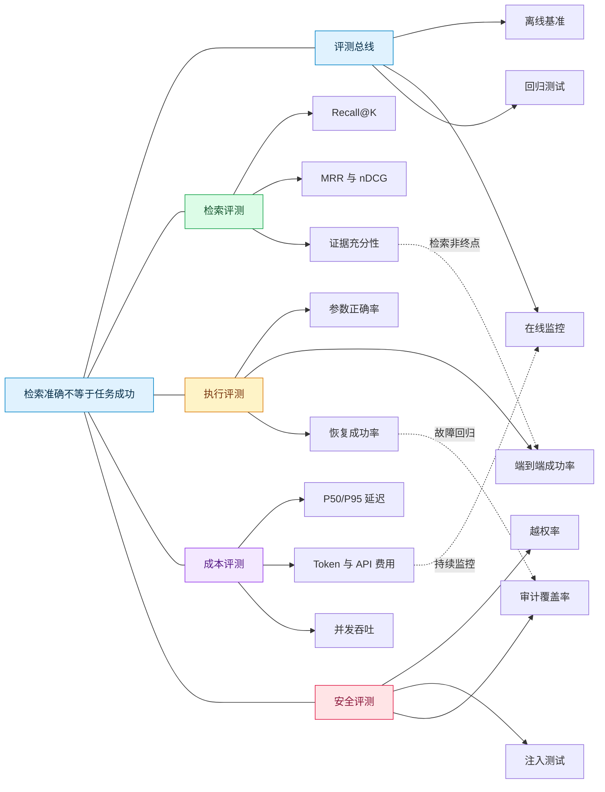

<strong>图谱解读：</strong>此网络以本节核心问题为中心，一级分支分别对应职责层、机制层和治理层；虚线强调跨层依赖。实际工程中应先确认边界和约束，再组合能力，避免将检索、工具与权限混为一谈。

## 十一、主流技术框架与工程选型

### 11.1 LangGraph

LangGraph 以状态图组织节点、条件边和持久化，适合复杂执行、检查点、人工中断和恢复。开发者需显式设计 State Schema、节点幂等性和异常路径；框架不会自动解决业务权限。

### 11.2 LlamaIndex

LlamaIndex 的 RouterRetriever 与 QueryEngine 适合多个检索器、索引和查询策略的组合。若系统主要挑战是知识源路由，可优先使用其检索抽象；若挑战是复杂事务状态，则仍需独立编排层。

### 11.3 OpenAI Agents SDK

OpenAI Agents SDK 提供 Agent、Tools、Handoffs、Guardrails、Sessions 与 Tracing 等能力，适合以模型和工具调用为中心的应用。Guardrail 不等于服务端权限验证，写操作仍需独立授权。

### 11.4 MCP 与服务网关

MCP 提供标准化的外部能力接口；API Gateway（应用程序接口网关）负责认证、限流、路由和监控。MCP 不取代 RAG Pipeline、业务数据库或工作流引擎。

### 11.5 选型原则

| 主要难点 | 优先技术 | 应避免的误用 |
|---|---|---|
| 多源检索 | LlamaIndex / 检索服务 | 用 Agent 循环替代索引治理 |
| 状态与恢复 | LangGraph / 工作流引擎 | 只依赖聊天历史 |
| 工具调用与追踪 | Agents SDK / Runtime | 让模型绕过服务端鉴权 |
| 跨应用能力共享 | MCP | 将全部内部函数都远程化 |
| 重复任务方法 | Agent Skills | 将 Skill 当权限边界 |
| 强合规固定流程 | 确定性 Workflow | 完全交给自由规划 |

上述技术可以组合，不存在一个框架天然覆盖全部治理职责。

### 本节知识网络

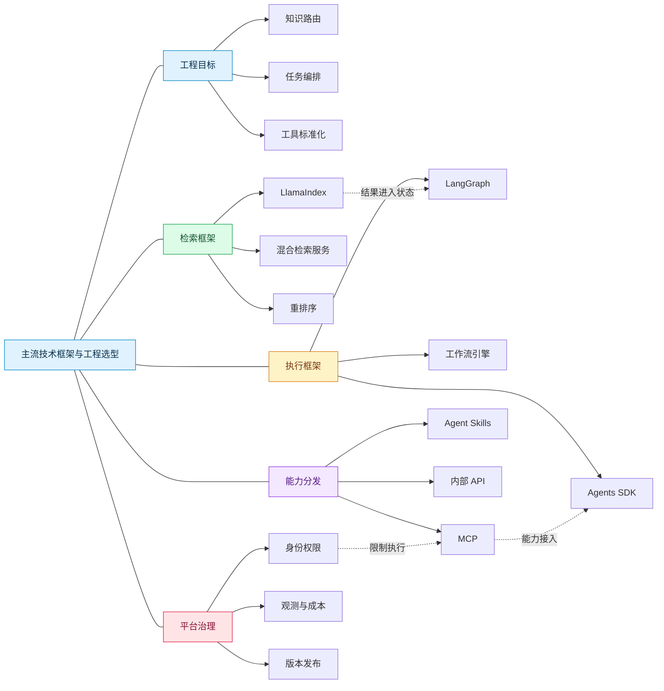

<strong>图谱解读：</strong>此网络以本节核心问题为中心，一级分支分别对应职责层、机制层和治理层；虚线强调跨层依赖。实际工程中应先确认边界和约束，再组合能力，避免将检索、工具与权限混为一谈。

## 十二、贯穿案例：企业医疗设备文档翻译 Agent

### 12.1 任务与验收标准

输入：英文 PDF 或 Word 设备说明书；输出：中文译文、尽可能保留的版式、术语一致性和质量报告。关键验收项包括段落/表格结构、数字、单位、型号、漏译、文字溢出与图文重叠。系统应区分可自动修复项与必须人工确认项。

### 12.2 具体协同策略

1. <strong>接收与识别</strong>：校验文件权限、格式、页数与任务预算，加载文档翻译 Skill。
2. <strong>并行取证</strong>：检索适用术语表和翻译规范，同时获取文档元数据；对受控型号使用主数据精确查询。
3. <strong>结构解析</strong>：文本型 PDF 解析文字与坐标，扫描型 PDF 使用 OCR（Optical Character Recognition，光学字符识别）或视觉解析；保存原文结构映射。
4. <strong>分块翻译</strong>：按段落、表格单元及版式关系组织翻译，保留术语与源位置映射。
5. <strong>双层验证</strong>：确定性脚本检查数字、单位、型号、段落数量；视觉或布局模型检查裁切、重叠、留白和层级。
6. <strong>局部修复</strong>：仅修复失败区块，设置重试上限，避免整篇重新翻译。
7. <strong>交付与审计</strong>：输出译文、质量报告和证据/工具执行记录；无法确定的部分标记人工复核。

### 12.3 状态与幂等设计

为每次翻译生成 `job_id`，为每个片段生成稳定 `segment_id`；翻译、渲染与导出分别持久化阶段结果。导出工具使用幂等键避免重复文件写入，校验结果关联源片段与译文片段。任何人工审批前后的状态变化都要持久化。

### 12.4 质量门与风险控制

型号、计量单位和重要安全警示属于高风险字段，不应仅依赖模型自评。规则无法判定的内容进入人工复核；未经授权的外部上传不得执行。对于涉及设备安全的翻译，交付前需要适用的专业审查流程。

### 本节知识网络

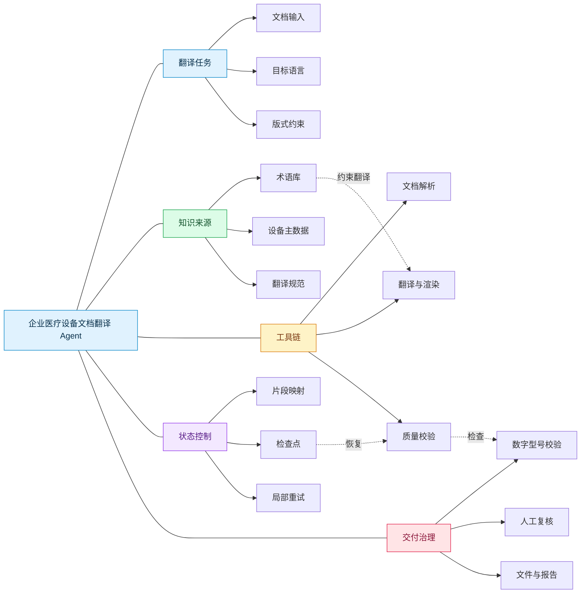

<strong>图谱解读：</strong>此网络以本节核心问题为中心，一级分支分别对应职责层、机制层和治理层；虚线强调跨层依赖。实际工程中应先确认边界和约束，再组合能力，避免将检索、工具与权限混为一谈。

## 十三、误区、边界与知识整合

### 13.1 十个常见误区

| 误区 | 正确认识 |
|---|---|
| 所有任务必须先检索 | 实时查询与确定性计算可以直接使用工具 |
| RAG 与 Tool Calling 互斥 | 检索可以通过工具调用实现 |
| MCP 就是 Agent | MCP 是能力连接协议，不负责完整推理编排 |
| Skills 就是工具 | Skills 是可复用的任务知识与资源组织 |
| 工具调用成功等于任务完成 | 还需校验用户目标和交付产物 |
| 检索分数高等于证据可靠 | 还需验证来源、权限、版本和充分性 |
| 并行总比串行快 | 依赖、资源竞争与失败回滚可能抵消收益 |
| 有 Checkpoint 就不会重复提交 | 需要幂等键和外部状态核对 |
| 提示词可承担授权 | 授权必须由受控执行层验证 |
| Agent 越自主越好 | 关键业务流程应有确定性约束 |

### 13.2 知识依赖总结

本章的基础依赖是：RAG 提供知识证据，Hybrid Search 与 Reranking 提升候选质量；Function Calling 表达工具意图，MCP 提供跨系统连接，Skills 组织任务级知识；Runtime 将它们纳入有状态执行；验证与安全层决定是否可交付。

### 13.3 适合面试的核心判断

面对“为什么不只用 RAG”“MCP 和 Function Calling 有何区别”“如何防止重复提交”“何时选择 LangGraph”等问题，应先讲清职责边界，再说明真实失败模式，最后给出选型条件和验证指标。工程价值来自可控性与可复现性，而不是技术名词堆叠。

### 本节知识网络

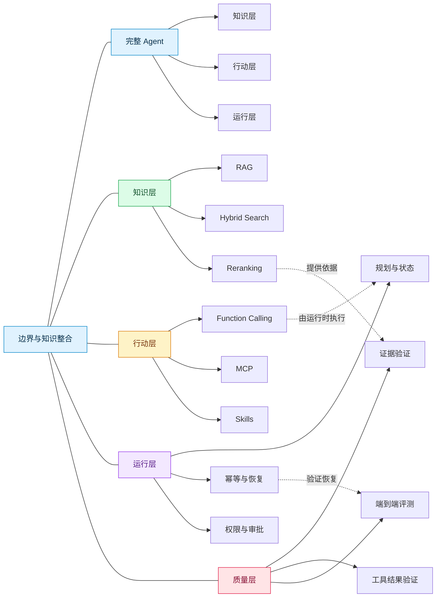

<strong>图谱解读：</strong>此网络以本节核心问题为中心，一级分支分别对应职责层、机制层和治理层；虚线强调跨层依赖。实际工程中应先确认边界和约束，再组合能力，避免将检索、工具与权限混为一谈。

## 十四、参考资料与进一步阅读

以下链接优先采用协议官方规范、框架官方文档和原始论文。部分云产品功能与 SDK 版本持续变化，落地前应核对所使用版本的最新文档。

| 资料 | 对应知识 |
|---|---|
| [Lewis 等：Retrieval-Augmented Generation](https://arxiv.org/abs/2005.11401) | RAG 的基础架构 |
| [ReAct 原始论文](https://arxiv.org/abs/2210.03629) | 推理与行动交替 |
| [Self-RAG 原始论文](https://arxiv.org/abs/2310.11511) | 自适应检索与自我评价 |
| [Microsoft：Agentic Retrieval](https://learn.microsoft.com/en-us/azure/search/agentic-retrieval-overview) | 查询规划、并行检索和来源追踪 |
| [LlamaIndex：RouterRetriever](https://docs.llamaindex.ai/en/stable/api_reference/retrievers/router/) | 多检索器路由 |
| [LangGraph：Persistence](https://docs.langchain.com/oss/python/langgraph/persistence) | 状态、检查点和恢复 |
| [OpenAI Agents SDK 文档](https://openai.github.io/openai-agents-python/) | Agent、工具、Handoff 和 Guardrails |
| [OpenAI Agents SDK Tracing](https://openai.github.io/openai-agents-python/tracing/) | 端到端执行观测 |
| [MCP 官方规范](https://modelcontextprotocol.io/specification/) | 外部工具与资源的协议接入 |
| [Agent Skills 规范](https://agentskills.io/specification) | Skill 文件组织与渐进式加载 |
| [OWASP LLM Top 10](https://genai.owasp.org/llm-top-10/) | 提示注入与过度代理风险 |
| [OpenTelemetry 文档](https://opentelemetry.io/docs/) | 跨组件追踪与指标 |

## 最终总结

<strong>知识检索与工具调用协同的本质，是在任务目标、证据质量、执行权限和状态约束下，动态组织“知道什么—做什么—如何确认做对了”的闭环。</strong>其可交付性取决于五个同时成立的条件：知识有出处、工具有契约、执行有状态、操作有权限、结果可验证。

学习建议：先掌握 RAG 与 Tool Calling 的各自边界，再理解工具路由和 DAG/状态机，最后将证据、幂等、安全、追踪和端到端评测连接为完整的企业级 Agent 工程体系。

