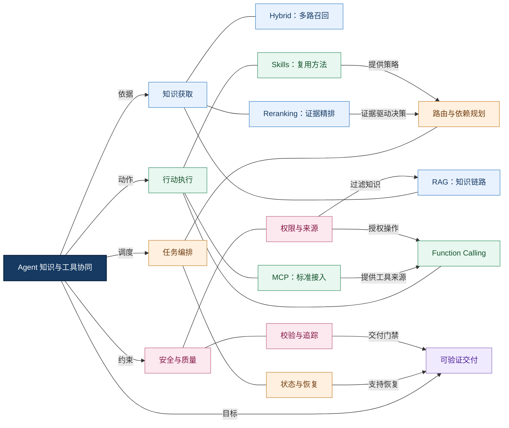
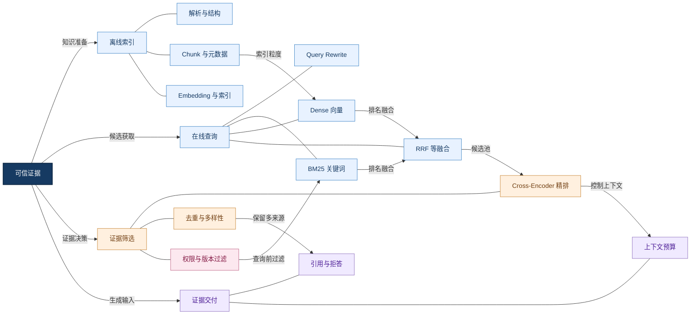
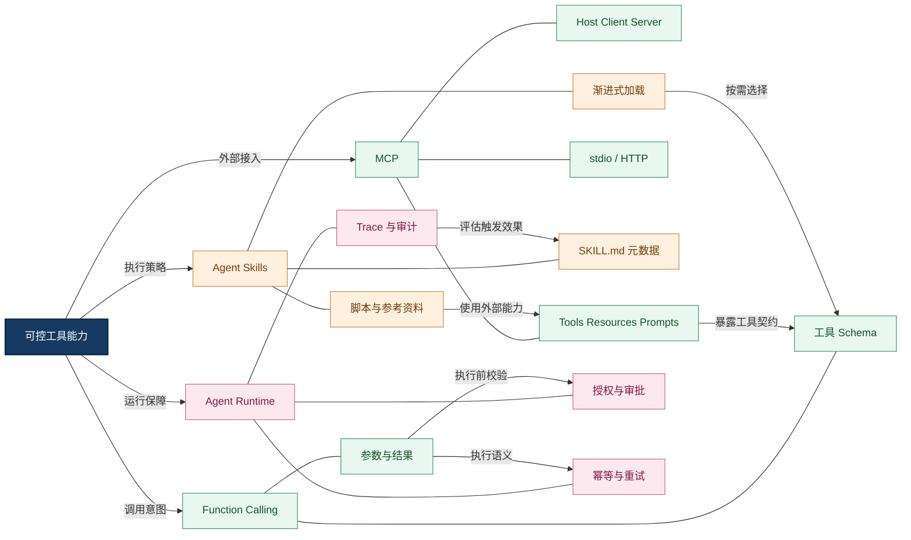
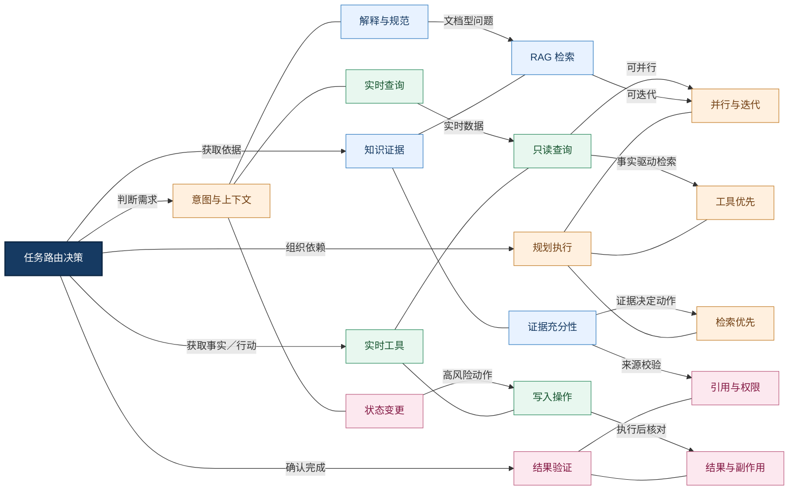
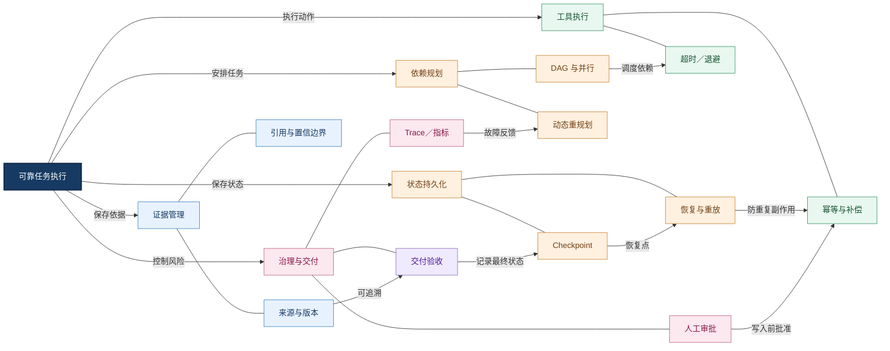
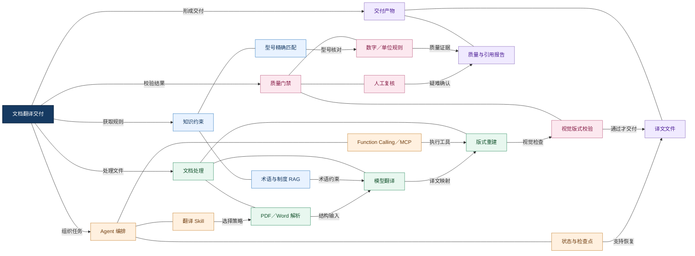
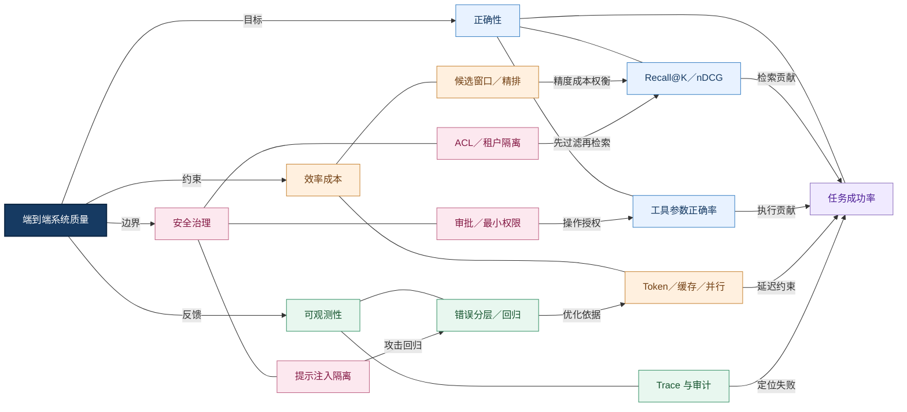

# Agent 知识与工具能力｜全章知识网络与学习导航

> 本章定位：理解 Agent 如何<strong>获取可信知识、选择外部能力、执行真实操作，并在权限与状态约束下交付可验证结果</strong>。本页是七篇专题的知识总览和导航，不替代专题正文。
>
> 推荐阅读：先掌握知识链（01—03），再掌握工具链（04—06），最后通过协同篇（07）建立端到端系统观。

## 一、从问题出发：Agent 的知识与行动是两种不同能力

模型的参数知识无法保证覆盖最新企业制度、产品版本和私有文档；即使知道操作流程，也不代表已经查询数据库、修改文件或完成审批。因此，Agent 必须把<strong>认识世界</strong>与<strong>改变世界</strong>分开设计：知识链负责寻找依据，工具链负责读取实时事实或产生实际副作用，执行层决定何时组合两者，治理层判断是否可信且被授权。

<strong>总原则：</strong>检索命中不等于证据充分；工具返回成功不等于业务目标完成；模型提出调用意图不等于获得执行权限。

<strong>图谱解读：</strong>中心的协同系统向知识、行动、编排、治理和交付五个方向辐射。跨分支连线表示真实依赖：权限既约束检索也约束工具；Skills 为路由提供操作知识；重排后的证据影响下一步决策；状态与校验共同保证交付。

## 二、知识链：从原始文档到可引用证据

[RAG](./01-RAG.md) 建立离线摄取、切分、索引和在线检索的全局链路；[Hybrid Search](./02-Hybrid-Search.md) 解决精确词项与语义召回互补；[Reranking](./03-Reranking.md) 解决候选集合内部的相关性和证据排序。三者是<strong>层级递进关系</strong>，不是三个互相替代的产品。

知识质量受整个链路约束：文档解析遗漏、版本不一致、权限过滤错误，均无法仅靠更强的重排模型修复。对于型号、错误码、单位和标准编号，精确检索尤其重要；对于自然语言问题，语义召回通常提供补充。

<strong>图谱解读：</strong>RAG 定义完整系统；混合检索扩大可用候选覆盖；重排序把有限上下文留给最有价值的证据。<strong>检索分数不是事实真值</strong>，证据仍需版本、来源、权限与引用校验。

### 知识链的关键取舍

| 决策问题 | 优先考虑 | 不能忽略的代价 |
|---|---|---|
| 精确型号、错误码、制度编号 | BM25／字段过滤 | 分词、同义词和字段维护 |
| 自然语言语义问题 | Dense Retrieval（稠密检索） | 向量成本、近似误召回 |
| 同时包含精确和语义约束 | Hybrid + 融合 | 候选窗口和分数可比性 |
| 候选多、上下文紧张 | Reranking + 证据选择 | 额外推理延迟 |
| 资料可能过期或越权 | 版本、ACL（访问控制列表）过滤 | 权限同步与索引更新 |

在学习指标时，要区分 Recall@K（前 K 项召回）、MRR（平均倒数排名）、nDCG（归一化折损累计增益）与最终回答正确率：<strong>排序改善不自动等于答案可靠</strong>。

## 三、工具链：从模型意图到受控业务动作

[Function Calling](./04-Function-Calling.md) 规定模型如何提出结构化工具调用及参数；[MCP](./05-MCP.md) 规定应用如何发现和连接外部工具、资源与提示模板；[Agent Skills](./06-Agent-Skills.md) 组织任务级的操作知识、脚本和参考资料。三者处于不同抽象层：<strong>调用契约、连接协议、任务方法</strong>。

模型负责提出候选调用，执行器负责 Schema 验证、身份授权、超时和结果归档。尤其是文件写入、审批提交等有副作用的动作，必须与普通只读查询分开治理。

<strong>图谱解读：</strong>MCP Server 提供可发现的能力，并不自动决定 Agent 应如何完成任务；Skill 可指导何时使用能力，但不获得额外权限；Function Calling 输出的参数只有经过 Runtime 校验才可以执行。

### 三类机制不要混淆

| 机制 | 核心问题 | 主要产物 | 不负责什么 |
|---|---|---|---|
| Function Calling | 模型如何表达一次工具调用 | 名称、结构化参数、调用结果 | 实际授权与执行保证 |
| MCP（Model Context Protocol，模型上下文协议） | 应用如何标准化接入外部能力 | 工具／资源／提示的协议交互 | 任务规划与推理质量 |
| Agent Skills（智能体技能） | 如何复用某类任务的方法 | `SKILL.md`、脚本、参考资料 | 独立的执行引擎或权限体系 |

MCP 协议具有版本演进，初始化、传输、扩展和授权细节应以部署双方实际支持的规范版本为准，不能把某一历史版本的行为写成永恒约束。

## 四、协同决策：何时查知识，何时执行动作

[知识检索与工具调用协同](./07-Knowledge-and-Tool-Integration.md) 是前六篇的汇合点。首先判断用户需要的是<strong>知识解释、实时事实、计算结果还是状态变更</strong>，再按来源可信度、时效性、权限和副作用风险选择能力。

固定流程适合稳定高风险业务；动态 Agent 适合信息不全和探索性任务；混合方案以确定性工作流约束关键节点，在允许范围内进行模型决策。

<strong>图谱解读：</strong>不是所有任务都必须先检索。解释制度通常从知识库开始；查询设备实时状态应优先调用 API；依据制度执行审批则需组合两者，并在真正写入前做权限和业务规则校验。

## 五、运行时：把知识与工具变成可靠任务

协同系统需要显式维护任务状态（Task State）、证据引用（Evidence）、产物（Artifact）和审计记录（Audit Log）。DAG（Directed Acyclic Graph，有向无环图）适合描述已知步骤依赖，状态机适合管理运行、等待、重试、失败与恢复；两者可组合，不能互相完全替代。

对于外部写入操作，Checkpoint（检查点）只解决状态保存问题，不能自动防止重复副作用；仍需 Idempotency Key（幂等键）、状态核对和必要的补偿机制。

<strong>图谱解读：</strong>可靠性不是“失败就重试”。必须知道哪些步骤已完成、哪些外部操作可能已经生效，以及重试是否安全。证据、任务状态和审计数据各有用途，不应全部混入对话历史。

## 六、贯穿案例：企业医疗设备文档翻译 Agent

一个完整请求可能是：“将英文设备说明书翻译为中文，保留表格和图片，检查型号与单位，生成质量报告。”它同时包含知识检索、文件操作、业务规则、模型推理和结果校验，能够串联本章全部七篇。

<strong>图谱解读：</strong>RAG 提供术语依据，精确检索保护型号，Skills 提供处理策略，Function Calling 与 MCP 接入解析和导出能力，运行时管理跨步骤状态，质量门禁决定是否交付。<strong>“翻译完成”与“文件可交付”是不同验收条件</strong>。

## 七、工程选型：以约束和风险决定复杂度

| 场景 | 推荐起点 | 进一步升级的触发条件 |
|---|---|---|
| 纯知识问答 | 基础 RAG + 引用 | 召回不足时引入混合检索与精排 |
| 多种资料混合、型号敏感 | Hybrid Search + 元数据过滤 | 候选噪声大时引入 Reranking |
| 单次计算或内部函数 | 普通函数调用 | 模型需要自主选工具时引入 Function Calling |
| 多应用共享外部能力 | MCP Server | 需要跨团队标准化、权限治理和远程接入 |
| 重复的专业任务方法 | Agent Skills | 多步骤规则稳定、需要按需加载和版本管理 |
| 多步骤、存在失败恢复 | 有状态 Workflow／Runtime | 需要动态规划时引入受约束 Agent |
| 高风险写操作 | 确定性工作流 + 审批 | 不应只依赖模型自由决策 |

<strong>选型顺序：</strong>先明确业务目标和错误代价，再选知识源、工具边界、状态机制与评测方式；不要为了使用 Agent 而把简单流程复杂化。

## 八、横向关联：哪些能力共同决定系统质量？

这一张网络聚焦容易被拆散讨论的工程问题：质量、性能、安全与可观测性。它们不是最终补丁，而是贯穿检索和执行两条链路的横向约束。

<strong>图谱解读：</strong>Recall@K 和工具成功率都是局部指标，最终需要用端到端任务成功率验收。检索权限过滤、工具授权、提示注入防护和 Trace 必须在系统设计阶段统一考虑。

## 九、七篇知识文档：按依赖顺序深入学习

| 顺序 | 专题文档 | 应掌握的核心问题 | 与下一篇的衔接 |
|---|---|---|---|
| 01 | [RAG：检索增强生成与企业知识系统完整链路](./01-RAG.md) | 离线索引、在线问答、Chunk、Embedding、引用与评测 | 检索阶段如何提高候选覆盖？ |
| 02 | [向量、关键词与混合检索](./02-Hybrid-Search.md) | BM25、稠密检索、RRF、过滤、候选融合 | 多路召回后如何选择更好证据？ |
| 03 | [Reranking：重排序与证据选择](./03-Reranking.md) | Cross-Encoder、Late Interaction、排序学习与多阶段精排 | 有了知识后如何执行实际操作？ |
| 04 | [Function Calling：工具调用协议与执行机制](./04-Function-Calling.md) | Tool Schema、调用生命周期、并行、错误与幂等 | 外部工具如何跨系统标准化连接？ |
| 05 | [MCP：协议组成、边界与企业实践](./05-MCP.md) | Host／Client／Server、Tools／Resources／Prompts、传输与授权 | 如何复用完整任务的方法？ |
| 06 | [Agent Skills：能力封装与渐进式加载](./06-Agent-Skills.md) | `SKILL.md`、触发、按需加载、脚本与治理 | 如何让知识、方法和工具一起运行？ |
| 07 | [知识检索与工具调用协同](./07-Knowledge-and-Tool-Integration.md) | 路由、DAG、状态、证据、执行、恢复与评测 | 形成完整 Agent 工程架构 |

<strong>推荐学习方式：</strong>第一遍按 01→07 理解全链路；第二遍以“企业文档翻译”案例倒推每个模块为什么存在；第三遍针对项目瓶颈返回具体专题深入研究。

## 十、知识边界与最终总结

本章最终建立的是一套<strong>知识—决策—行动—验证</strong>协同体系：RAG 提供可引用的外部知识；Hybrid Search 提高多类型查询的召回覆盖；Reranking 让有限上下文容纳更优证据；Function Calling 表达模型的结构化调用意图；MCP 统一外部能力接入；Skills 复用任务方法；Runtime 将它们组织成有状态、可审计、可恢复的业务执行。

最重要的三个工程边界是：<strong>知识证据不等于执行指令</strong>，<strong>模型意图不等于操作授权</strong>，<strong>局部组件成功不等于端到端交付成功</strong>。

后续研究应围绕可度量的业务目标持续优化：正确检索、正确调用、正确恢复、正确拒绝越权请求，并且能解释每个结果来自哪里、每个操作为何发生。

