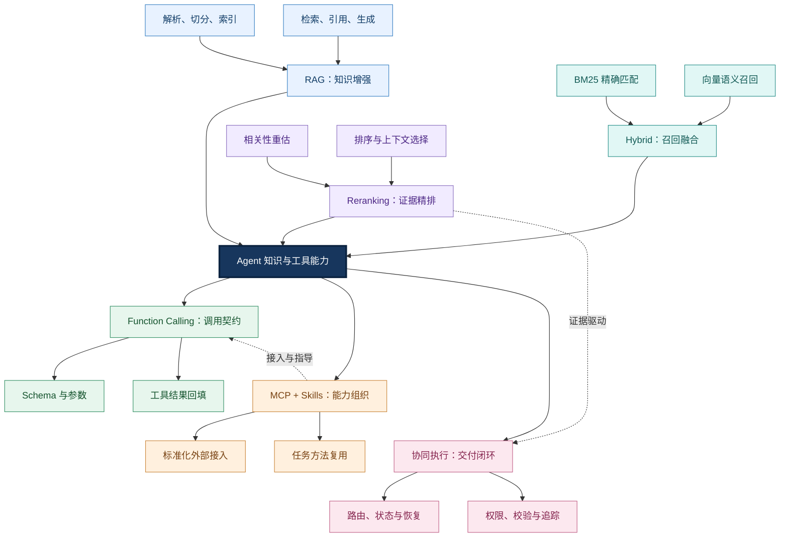
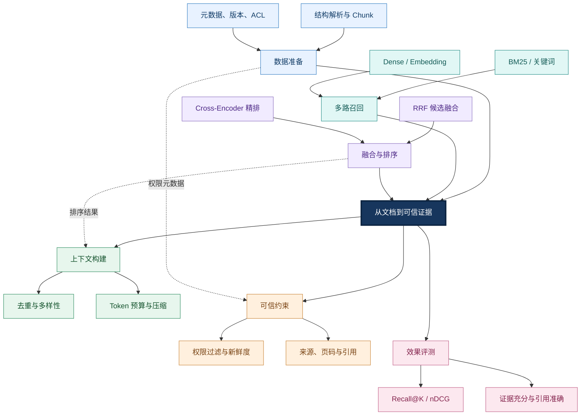
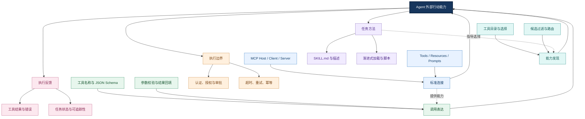
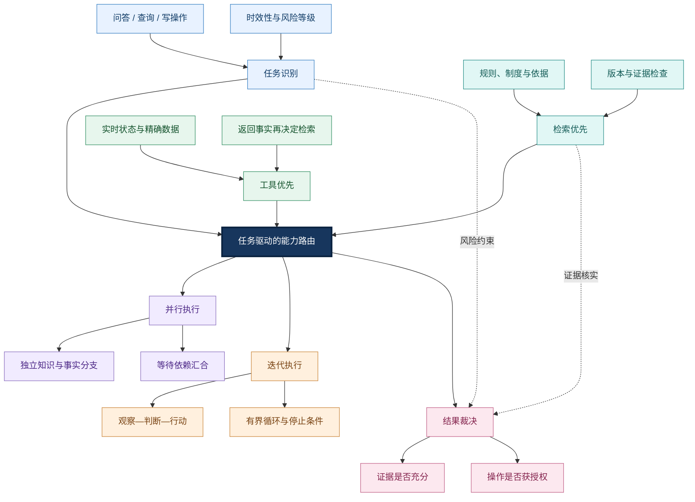
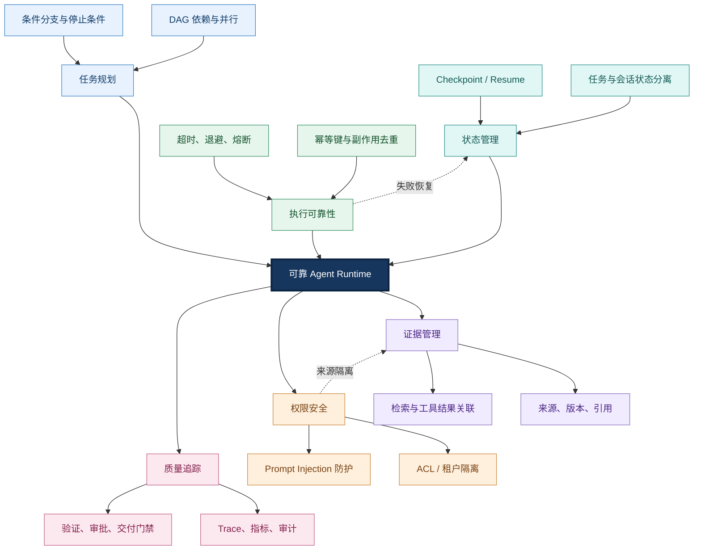
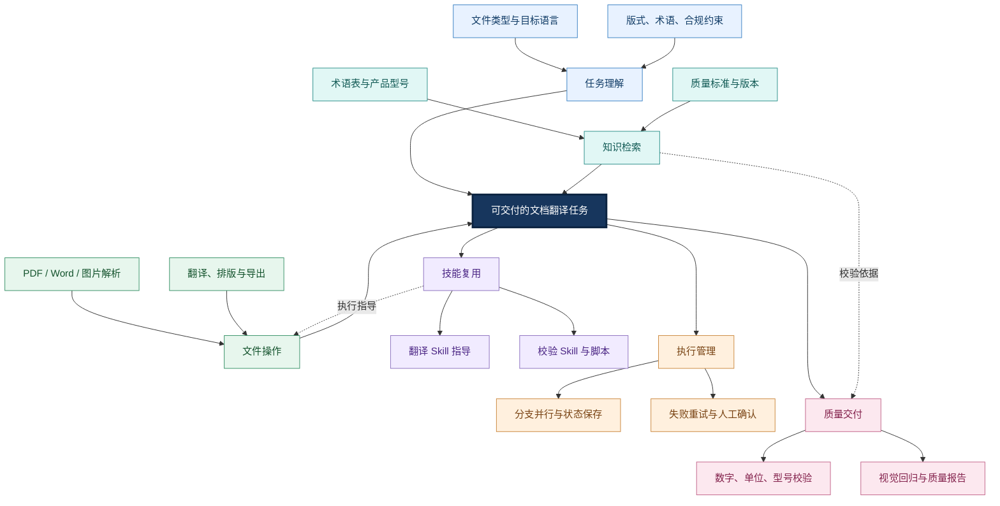
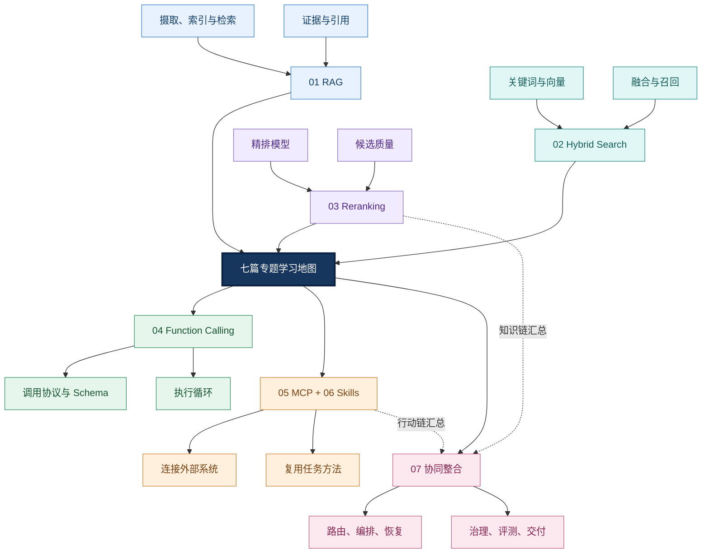

# Agent 知识与工具能力：中心放射式知识总览与学习导航

> <strong>本章定位：</strong>把知识获取、工具接入、任务执行与可靠交付连成一个 Agent 工程系统。本 README 是全章知识地图与学习入口，不重复七篇专题的推导和实现细节。
>
> <strong>阅读方式：</strong>每幅图以中心主题为枢纽，上方与下方各三个主分支向中心汇聚或从中心辐射；外围节点代表二级知识。少量虚线只标记关键的跨模块依赖，避免大量长距离连线穿越图面。

## 一、总览：七篇专题如何组成一个系统

Agent 不仅要“知道”，还要“能做”。知识链将外部资料转化为可核实的证据；行动链将任务意图转化为实际操作；运行时负责把两者协调为有状态、受权限约束、可验证的执行过程。

### 全章核心知识网络

<strong>图谱解读：</strong>六个主分支围绕同一执行目标组织。RAG、Hybrid、Reranking 是知识链的三个层次；Function Calling、MCP、Skills 分别负责调用表达、能力接入和任务方法；第七篇将这些能力纳入任务状态、权限与质量约束。虚线强调两个关键交点：证据影响决策，能力组织影响工具调用。

<strong>先建立三个边界：</strong>检索命中不等于证据充分；模型生成工具调用参数不等于获得执行授权；工具执行成功不等于用户任务完成。

## 二、知识链：如何把原始资料变成可信证据

这一条链解决模型缺少私有、最新或领域知识的问题。其因果关系是：原始资料先被正确解析与索引，召回阶段才能找到候选；候选覆盖足够后，重排才有意义；最后还要检查权限、版本和引用。

### 知识检索与证据质量

<strong>图谱解读：</strong>召回关注“不要漏”，重排关注“排得准”，上下文构建关注“装得下且有依据”，治理关注“有权限且版本正确”。例如设备型号、错误码和标准编号常需要关键词精确召回；自然语言描述则可由向量检索补充。重排不能凭空恢复未被召回的文档。

| 主题 | 解决的关键问题 | 深入阅读 |
|---|---|---|
| RAG | 知识如何摄取、检索并用于生成 | [01-RAG.md](./01-RAG.md) |
| Hybrid Search | 精确匹配与语义召回如何互补 | [02-Hybrid-Search.md](./02-Hybrid-Search.md) |
| Reranking | 如何从候选中选出最可信、最有用的证据 | [03-Reranking.md](./03-Reranking.md) |

## 三、行动链：模型如何从“提出动作”走向“完成操作”

工具体系有三个容易混淆的层次：<strong>Function Calling</strong> 是模型输出调用意图与结构化参数的机制；<strong>MCP（Model Context Protocol，模型上下文协议）</strong> 标准化外部工具、资源和提示模板的发现与访问；<strong>Agent Skills</strong> 则封装完成某类任务所需的指导、脚本和参考资料。三者不是互相替代的产品。

### 工具接入与能力复用

<strong>图谱解读：</strong>Skill 指导“怎么完成任务”，MCP 解决“如何连接能力”，Function Calling 解决“模型怎样提出调用”。真正执行、鉴权、重试和记录状态的是应用运行时与服务端。尤其不能把 Skill 中的文字指令视为自动获得的工具权限。

| 主题 | 关键理解 | 深入阅读 |
|---|---|---|
| Function Calling | Tool Schema、选择、调用循环、并发与错误处理 | [04-Function-Calling.md](./04-Function-Calling.md) |
| MCP | Host/Client/Server、传输、资源、授权与协议版本 | [05-MCP.md](./05-MCP.md) |
| Agent Skills | SKILL.md、发现、激活、渐进式加载与治理 | [06-Agent-Skills.md](./06-Agent-Skills.md) |

## 四、协同决策：什么时候查知识，什么时候调用工具？

固定“先 RAG 后 Tool”不是通用解法。制度解释以检索为主；实时设备状态以 API 查询为主；按制度提交审批则需要知识与实时事实联合判断，并在写操作前验证权限。正确策略取决于<strong>目标、数据时效性、依赖关系与操作风险</strong>。

### 知识与工具的联合决策

<strong>图谱解读：</strong>从中心向外看，是不同任务条件下的策略选择；从外围向中心看，是证据与操作反馈共同影响下一次决策。并行仅适用于没有前后依赖的分支；迭代必须有最大轮次、超时和成本预算。

<strong>工程取舍：</strong>稳定、可审计的业务流程优先使用确定性 Workflow；探索性问题可在受限范围内使用模型动态路由；高风险写操作必须由服务端策略独立授权。

## 五、运行时：把一次调用升级为可恢复的业务任务

复杂 Agent 需要管理任务状态、依赖、证据、文件产物和副作用。聊天历史不能代替任务数据库，Trace 也不能代替授权与事务保证。

### 状态、可靠性与可观测性

<strong>图谱解读：</strong>任务规划决定先后依赖，Checkpoint 保存可恢复状态，幂等性处理“外部操作已成功但本地未记录”的重复执行风险。证据治理和权限控制同时覆盖检索与工具。最终是否交付由业务校验结果决定，而不是由模型自行宣称成功。

| 失败情形 | 不推荐做法 | 更稳妥的处理 |
|---|---|---|
| 检索无结果 | 编造答案 | 查询改写、补检或明确证据不足 |
| 工具超时 | 无限重试 | 限次退避、状态核对 |
| 提交结果未知 | 直接重复提交 | 幂等键、查询外部状态 |
| 权限不足 | 换工具绕过 | 停止并请求授权 |
| 译文校验失败 | 全量重新执行 | 定位失败步骤并局部修复 |

## 六、贯穿案例：企业医疗设备文档翻译 Agent

同一个任务可以检验七篇知识是否真正连成系统。以“将英文设备说明书翻译成中文，保留版式并检查型号、单位”为例：先识别文件与任务约束；从受控术语库取得依据；通过工具解析、翻译、排版；再以规则与视觉校验交付文件。

### 企业文档翻译能力协同

<strong>图谱解读：</strong>术语库提供“翻译依据”，工具提供“文件处理动作”，Skills 提供“可复用的操作方法”，Runtime 提供“执行与恢复能力”，质量检查决定“能否交付”。对于医疗设备型号、数值与单位，优先使用确定性比对；版式质量可结合规则和视觉评估。任何自动修复都应有边界与复核机制。

## 七、如何选型：不同任务需要不同的组合

| 场景 | 核心能力组合 | 关键原因 |
|---|---|---|
| 企业制度问答 | RAG + Hybrid + Reranking | 依据、覆盖、排序与引用 |
| 设备实时状态查询 | Function Calling + 业务 API / MCP | 需要最新的结构化事实 |
| 按制度办理审批 | RAG + API + Workflow + 审批 | 规则依据与副作用同时存在 |
| 技术文档翻译 | Skills + 检索 + 文档工具 + 校验 | 多步骤方法复用与产物质量 |
| 跨系统多步骤任务 | MCP + Runtime + 状态恢复 | 接入、依赖、错误和权限治理 |

<strong>选型原则：</strong>先定义业务正确性和权限边界，再选择检索与工具；优先把确定性操作交给代码或规则；只有确实需要动态判断时才引入自主规划。

## 八、学习导航：七篇专题与推荐顺序

建议按“知识准备 → 召回优化 → 证据排序 → 调用表达 → 标准接入 → 能力复用 → 协同工程”的顺序阅读。

### 学习路线与知识依赖

<strong>图谱解读：</strong>前三篇建立知识获取与质量优化基础；第四至六篇建立工具执行、外部接入与可复用方法；第七篇将前六篇整合为具有状态、安全与评测的完整 Agent 系统。

1. [01｜RAG：检索增强生成与完整链路](./01-RAG.md) — 理解知识如何进入模型上下文。
2. [02｜Hybrid Search：向量、关键词与混合检索](./02-Hybrid-Search.md) — 理解召回互补与融合策略。
3. [03｜Reranking：重排序与检索质量优化](./03-Reranking.md) — 理解候选精排和证据质量。
4. [04｜Function Calling：函数调用协议与执行流程](./04-Function-Calling.md) — 理解工具契约、参数与调用循环。
5. [05｜MCP：Model Context Protocol 的组成与边界](./05-MCP.md) — 理解跨系统能力发现与标准接入。
6. [06｜Agent Skills：可复用能力封装](./06-Agent-Skills.md) — 理解能力发现、渐进式加载与任务方法复用。
7. [07｜Knowledge and Tool Integration：知识检索与工具调用协同](./07-Knowledge-and-Tool-Integration.md) — 理解完整运行时、可靠性与工程取舍。

## 九、读完本章应形成的工程认知

<strong>第一，知识与行动分离但相互依赖。</strong>检索提供依据，工具提供真实操作；实时事实通常来自业务系统，不能把所有信息都当作静态文档检索。

<strong>第二，协议、方法与执行器各有边界。</strong>Function Calling 表达调用，MCP 标准化接入，Skills 组织任务知识，Runtime 负责调度、权限、状态与恢复。

<strong>第三，正确性必须端到端验证。</strong>检索质量、工具调用成功率和最终任务成功率是不同指标。企业级系统必须同时评测证据质量、权限安全、工具副作用、交付产物与失败恢复。

<strong>全章总结：</strong>以可信知识支持判断，以受控工具完成行动，以可复用 Skills 降低重复开发，以可靠 Runtime 保障状态和安全，最终形成<strong>可验证、可恢复、可追溯</strong>的 Agent 工程闭环。

