# 01｜多 Agent 基础：从专业化分工到可靠协作系统

> 所属章节：`06-Multi-Agent-and-Frameworks` · 适用对象：Agent 工程开发者、系统架构师、技术面试准备者。  
> 阅读路径：先理解为什么需要多 Agent，再研究角色与架构，随后学习任务、通信、状态、容错、评测与框架选型。

## 导读：本篇要回答什么

Multi-Agent System（MAS，多智能体系统）不是“调用更多模型”的同义词，而是<strong>将复杂目标分配给多个具有独立职责和局部决策能力的主体，通过明确的通信与状态契约完成全局任务</strong>。本篇将多 Agent 视为一种有代价的系统架构选择，强调可测量收益、可靠执行与工程边界。

### 全局知识导航

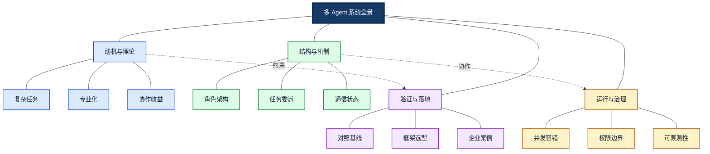

这张全局图把“为什么拆分”“如何组织”“怎样执行”“是否值得”连接起来。四个分支不是四条独立流水线：角色架构决定通信方式，通信方式影响状态一致性，而可靠性与评测共同约束架构选择。

---

## 1．问题起点：为何需要多 Agent

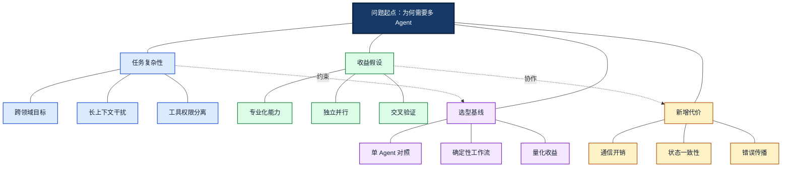

<strong>图谱解读：</strong>本图以“问题起点：为何需要多 Agent”为中心，分别展开任务复杂性、收益假设、新增代价和选型基线。虚线表示跨模块的约束或协作，不表示固定执行先后。

单 Agent（单智能体）并不等于功能简单：一个具备多个工具的 Agent 可以完成复杂任务。Multi-Agent System（MAS，多智能体系统）的真正特征，是存在多个具有可区分决策职责、上下文或执行权限的主体，并通过协作完成共同目标。

从单体系统演进到多 Agent 的驱动力通常是三种瓶颈：一是不同领域知识和工具挤占同一上下文；二是任务存在可并行的独立分支；三是需要独立审核或不同权限域。反过来，如果任务是固定的文档处理流水线，使用确定性 Workflow（工作流）加工具往往更可靠。

<strong>决策标准：</strong>先建立单 Agent 基线，再证明分工在成功率、时延、成本、隔离性或可维护性上有净收益。不要以 Agent 数量作为成熟度指标。

| 比较维度 | 单 Agent | 多工具 Agent | 多 Agent |
|---|---|---|---|
| 决策主体 | 一个 | 一个 | 多个有职责边界的主体 |
| 工具数量 | 可多可少 | 通常多个 | 各 Agent 可拥有不同工具 |
| 上下文 | 主要集中 | 主要集中 | 可隔离并选择性共享 |
| 优势 | 简洁易维护 | 能力扩展直接 | 专业化、隔离、并行 |
| 代价 | 单点上下文压力 | 工具选择复杂 | 通信、状态、协调成本 |

## 2．理论基础：分布式智能与协作收益

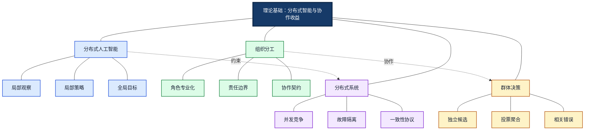

<strong>图谱解读：</strong>本图以“理论基础：分布式智能与协作收益”为中心，分别展开分布式人工智能、组织分工、群体决策和分布式系统。虚线表示跨模块的约束或协作，不表示固定执行先后。

Distributed Artificial Intelligence（DAI，分布式人工智能）研究多个自主主体如何通过交互解决问题。其关键矛盾是<strong>局部最优不自动构成全局最优</strong>。例如，检索 Agent 准确找到一份旧版手册，计算 Agent 精确执行公式，整体结论仍可能不符合当前制度。

Specialization（专业化）必须体现在任务目标、数据可见范围、工具能力或校验职责，而非仅仅使用不同角色名称。Collective Intelligence（群体智能）可通过独立候选和交叉审核提升覆盖，但同模型、同证据导致的相关错误会削弱多数投票。

多 Agent 同时继承分布式系统的经典困难：网络延迟、消息丢失、重复执行、并发修改、部分失败和追踪困难。因此需要把通信协议、状态和容错当作一等工程对象。

## 3．概念边界：Agent、Tool、Workflow 与 Team

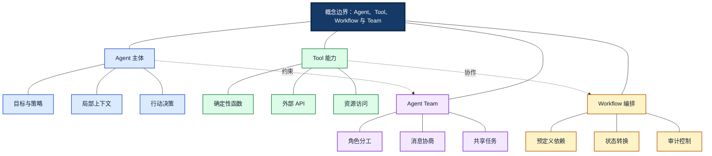

<strong>图谱解读：</strong>本图以“概念边界：Agent、Tool、Workflow 与 Team”为中心，分别展开Agent 主体、Tool 能力、Workflow 编排和Agent Team。虚线表示跨模块的约束或协作，不表示固定执行先后。

Function Calling（函数调用）表达模型的结构化工具调用意图；工具自身通常不具备自主目标。Workflow 按显式控制流调度步骤；Agent 可以在限定范围内动态选择步骤。多个 LLM 调用节点如果只是在固定链条上顺序执行，不一定需要建模为多个自主 Agent。

<strong>实用判断：</strong>若子任务只需执行一次已知转换，优先使用函数或工作流节点；若需要独立规划、动态工具选择、持续交互或异步委派，才考虑专业 Agent。一个 Agent 可以调用另一个 Agent 作为 Tool；这种嵌套并不改变外层执行的授权责任。

## 4．系统构件：从局部智能到整体运行时

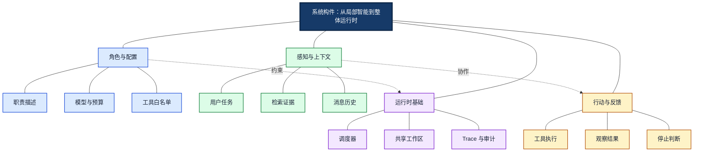

<strong>图谱解读：</strong>本图以“系统构件：从局部智能到整体运行时”为中心，分别展开角色与配置、感知与上下文、行动与反馈和运行时基础。虚线表示跨模块的约束或协作，不表示固定执行先后。

Profile（角色画像）规定职责、权限和输出契约；Perception（感知）读取用户请求、环境状态和其他 Agent 的结果；Action（行动）可能是生成文本、调用工具或委派任务；Interaction（交互）将局部结果变成系统可用的信息。

推荐区分 Agent Local State（局部状态）、Task State（全局任务状态）、Conversation State（对话状态）、Artifact State（产物状态）与 Audit Log（审计记录）。不要把所有数据塞进共享聊天历史：它会导致 Token 膨胀、上下文污染和敏感信息扩散。

## 5．架构谱系：集中、分层、对等与流水线

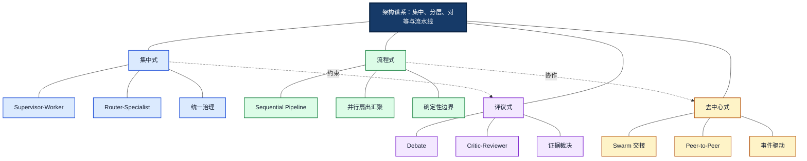

<strong>图谱解读：</strong>本图以“架构谱系：集中、分层、对等与流水线”为中心，分别展开集中式、流程式、去中心式和评议式。虚线表示跨模块的约束或协作，不表示固定执行先后。

Supervisor–Worker（主管—工作者）由主管持续负责全局计划和委派；Router–Specialist（路由—专家）更侧重一次或少量路由判断。Sequential Pipeline（顺序流水线）适合稳定阶段，Parallel Workers（并行工作者）适合无依赖分支，Hierarchical（层级式）适合多团队组织。Swarm（群组式）允许控制权在 Agent 之间动态交接，但必须限制交接轮次。

Debate（辩论）与 Critic（批评者）模式不天然提高准确率：当参与者共享错误证据时，可能共同得出错误结论。能够确定性验证的数字、单位、权限或文件完整性，应优先由程序校验。架构可以组合，例如 Supervisor 管理 Router 和并行子团队，但每层增加的协调成本都需要测量。

| 架构 | 控制方式 | 适用场景 | 核心风险 |
|---|---|---|---|
| Supervisor–Worker | 中央主管持续调度 | 跨领域复杂任务 | 主管瓶颈 |
| Router–Specialist | 分类分发 | 明确领域分流 | 路由误判 |
| Sequential Pipeline | 固定顺序 | 稳定生产流程 | 错误逐级传播 |
| Parallel Workers | 扇出与汇聚 | 独立研究任务 | 聚合冲突 |
| Hierarchical | 多级管理 | 大型复杂团队 | 深层交接开销 |
| Swarm / Peer-to-Peer | 动态交接 | 弹性专业协作 | 循环与状态漂移 |
| Debate / Critic | 讨论与审核 | 开放式推理 | 相关错误和高成本 |

## 6．任务分解与委派：把目标变成可验证契约

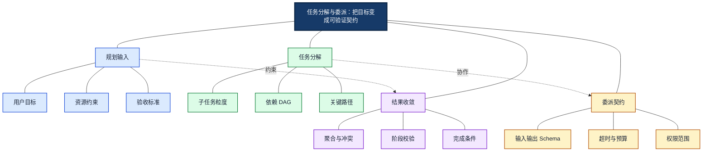

<strong>图谱解读：</strong>本图以“任务分解与委派：把目标变成可验证契约”为中心，分别展开规划输入、任务分解、委派契约和结果收敛。虚线表示跨模块的约束或协作，不表示固定执行先后。

Task Decomposition（任务分解）不是把自然语言切成任意短句，而是建立有输入、输出、依赖、验收条件的工作单元。DAG（Directed Acyclic Graph，有向无环图）表达已知任务依赖；遇到动态重规划、反复检查时，还需要状态机或循环控制。

Delegation（委派）消息建议携带 `task_id`、`parent_task_id`、`input_refs`、`output_schema`、`deadline`、`budget` 和 `acceptance_criteria`。聚合器应对照契约检查输出，不能只把多个回答拼接。遇到冲突时依据证据版本、权威来源和可复现的校验规则裁决；不能简单地以多数票取代事实核验。

## 7．通信协议：消息、交接与互操作

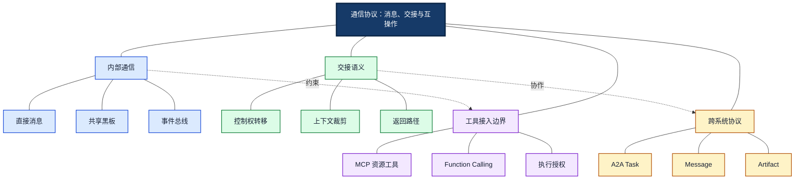

<strong>图谱解读：</strong>本图以“通信协议：消息、交接与互操作”为中心，分别展开内部通信、交接语义、跨系统协议和工具接入边界。虚线表示跨模块的约束或协作，不表示固定执行先后。

Handoff（控制权交接）不仅是发送一条消息，还意味着任务责任和下一步执行权发生变化。消息应具有唯一标识、发送者、接收者、关联任务、消息类型、内容结构、版本和追踪信息。

Agent2Agent（A2A，智能体间通信协议）关注独立 Agent 间的任务与产物交互；Model Context Protocol（MCP，模型上下文协议）关注向模型应用暴露工具、资源等能力；Function Calling 是模型表达调用意图的接口机制。三者处于不同抽象层，不能相互替代。内部同进程的协作未必需要 A2A，框架原生调用通常更轻量。

共享黑板（Blackboard）模式通过共同工作区交换产物，但要限制写入者和版本；事件总线（Event Bus）适合异步处理，但要应对乱序、重复消息和最终一致性。

## 8．状态与一致性：多主体共享事实的难题

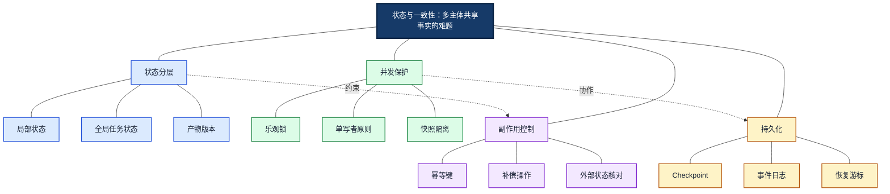

<strong>图谱解读：</strong>本图以“状态与一致性：多主体共享事实的难题”为中心，分别展开状态分层、并发保护、持久化和副作用控制。虚线表示跨模块的约束或协作，不表示固定执行先后。

Checkpoint（检查点）保存任务执行位置及必要状态，但并不保证外部副作用只发生一次。典型故障是：外部审批 API 已创建工单，而本地进程在保存结果前崩溃；恢复后重复调用会产生第二张工单。

Idempotency（幂等性）要求相同业务请求的重复提交不产生重复效果，通常通过幂等键和外部状态核对实现。对于不可回滚操作，采用 Saga（长事务补偿）思路定义补偿或人工接管，而不是假设多 Agent 可以进行全局原子事务。

推荐局部状态隔离、显式结果提交、版本化产物和单写者原则。多个 Agent 同时编辑同一文件时，应通过锁、版本检查或合并策略避免覆盖。

## 9．并发与调度：收益受关键路径约束

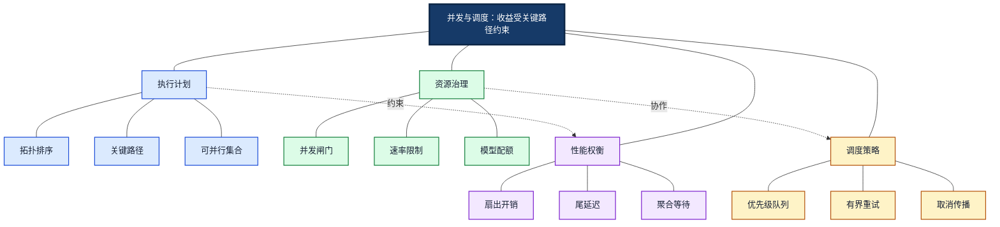

<strong>图谱解读：</strong>本图以“并发与调度：收益受关键路径约束”为中心，分别展开执行计划、资源治理、调度策略和性能权衡。虚线表示跨模块的约束或协作，不表示固定执行先后。

任务图中的独立分支可以并发，但任务总时延由关键路径、调度开销与共享资源竞争共同决定。若三个独立子任务分别需要 3、5、4 秒，理想并行时间约为 5 秒，而不是 12 秒；实际还需加上模型排队、消息传递和结果聚合。

Semaphore（信号量）可限制模型调用并发；Token Bucket（令牌桶）适合控制速率；Circuit Breaker（熔断器）在外部服务持续失败时快速拒绝请求。取消和超时需要沿任务树传播，防止用户已经取消而子 Agent 继续消耗额度。

在理想独立任务并行场景，阶段时延可以近似为：

$$
T_{\mathrm{parallel}} \approx \max(T_1,T_2,\ldots,T_n)+T_{\mathrm{overhead}}
$$

式中，$T_i$ 是子任务时延，$T_{\mathrm{overhead}}$ 是调度、排队与聚合开销。真实系统还受速率限制与关键路径依赖约束。

## 10．可靠性：错误传播、循环与恢复

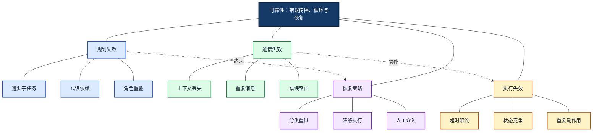

<strong>图谱解读：</strong>本图以“可靠性：错误传播、循环与恢复”为中心，分别展开规划失效、通信失效、执行失效和恢复策略。虚线表示跨模块的约束或协作，不表示固定执行先后。

多 Agent 的错误可以沿依赖链传播：检索 Agent 返回错误版本的文档，翻译 Agent 依此翻译，审核 Agent 又使用同一错误来源，最终形成表面一致但事实错误的结果。

故障应分类处理：网络超时可有界重试，参数错误需修复，权限拒绝必须停止，证据不足需重新检索或人工确认。对于循环交接，设置最大轮次、最大深度、总预算和无进展检测。

MAST（Multi-Agent Systems Failure Taxonomy，多智能体系统失效分类）等研究提示：评估失败时要区分任务规格、Agent 间协调和任务验证问题，而非笼统地归因于模型能力不足。

## 11．安全治理：信任边界与最小权限

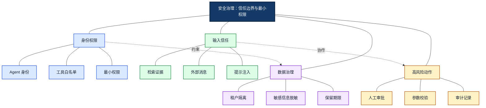

<strong>图谱解读：</strong>本图以“安全治理：信任边界与最小权限”为中心，分别展开身份权限、输入信任、高风险动作和数据治理。虚线表示跨模块的约束或协作，不表示固定执行先后。

Prompt Injection（提示注入）可通过网页、文档或其他 Agent 的输出进入系统。跨 Agent Handoff 不应自动提高输入内容的可信级别。检索到的“请调用某工具上传文件”等文字仍是低信任数据，不能覆盖系统授权策略。

执行层必须独立验证工具权限、业务对象权限、参数和用户授权。多个 Agent 达成一致，不等于获得执行敏感操作的许可。对于跨租户系统，应在数据读取和检索阶段实施访问控制，而不是依赖模型事后过滤。

## 12．性能成本与评测：证明协作价值

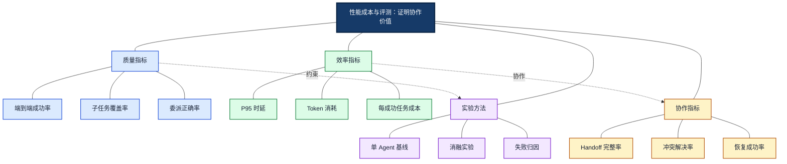

<strong>图谱解读：</strong>本图以“性能成本与评测：证明协作价值”为中心，分别展开质量指标、效率指标、协作指标和实验方法。虚线表示跨模块的约束或协作，不表示固定执行先后。

评价 Multi-Agent 不应只看各 Agent 的回答准确率。一个系统即使每个子模块准确率较高，也可能因为任务交接遗漏而无法交付最终结果。

建议同时记录 Task Success Rate（任务成功率）、Handoff Completeness（交接完整率）、Delegation Accuracy（委派准确率）、Recovery Success Rate（恢复成功率）与 Cost per Successful Task（每成功任务成本）。采用相同数据集对比单 Agent、确定性工作流和多 Agent，进行消融实验（Ablation Study）：依次移除路由器、审核 Agent、并行化等模块，测量真实增益。

Trace（执行追踪）应将每个 Agent 调用、工具调用、消息交接、状态变化和最终产物关联到同一个任务标识。日志中只保留必要摘要并进行脱敏。

总成本可用分解模型估算：

$$
C_{\mathrm{total}}=C_{\mathrm{model}}+C_{\mathrm{tool}}+C_{\mathrm{coordination}}+C_{\mathrm{storage}}+C_{\mathrm{verification}}
$$

若 $N_{\mathrm{success}}$ 为成功任务数，则每成功任务成本为：

$$
C_{\mathrm{per\ success}}=\frac{C_{\mathrm{total}}}{N_{\mathrm{success}}}
$$

该指标应结合任务质量与风险，而非单独最小化。

## 13．框架生态：选型与演进

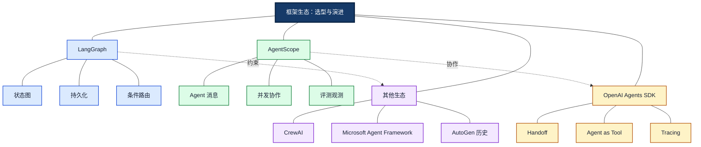

<strong>图谱解读：</strong>本图以“框架生态：选型与演进”为中心，分别展开LangGraph、AgentScope、OpenAI Agents SDK和其他生态。虚线表示跨模块的约束或协作，不表示固定执行先后。

LangGraph 适合需要显式状态图、Checkpoint、人工中断与可控执行路径的系统。AgentScope 强调 Agent 构造、消息传递、工具和多 Agent 协作。OpenAI Agents SDK 提供 Agent、Handoff、Agents as Tools、Guardrails 与 Tracing。CrewAI 偏向角色与任务协作。

Microsoft Agent Framework 体现了微软从 AutoGen、Semantic Kernel 经验向统一 Agent/Workflow 体系发展的方向。由于框架产品状态和 API 可能持续变化，正式选型应重新核对官方发布说明和兼容版本。

框架选型顺序应是：确定任务边界 → 定义状态与消息契约 → 识别持久化和安全要求 → 评估框架能力 → 测试部署与迁移成本。

| 框架 | 主要设计重心 | 本章后续学习衔接 |
|---|---|---|
| LangGraph | 状态图、持久化与控制流 | [04-LangGraph.md](04-LangGraph.md) |
| AgentScope | Agent 构造、消息与协作 | [05-AgentScope.md](05-AgentScope.md) |
| OpenAI Agents SDK | Handoff、工具与追踪 | 作为比较框架 |
| CrewAI | Crew、Task、Flow | 作为比较框架 |
| Microsoft Agent Framework | Agent 与 Workflow 编排 | 关注版本演进 |

## 14．企业案例：医疗文档翻译多 Agent

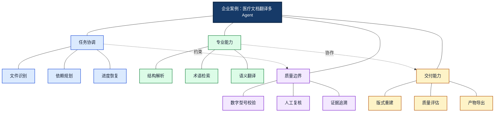

<strong>图谱解读：</strong>本图以“企业案例：医疗文档翻译多 Agent”为中心，分别展开任务协调、专业能力、交付能力和质量边界。虚线表示跨模块的约束或协作，不表示固定执行先后。

企业医疗文档翻译是一种适合检验多 Agent 设计价值的场景，但并非所有处理步骤都需要 LLM Agent。文件类型识别、数字与单位比较、文件导出等确定性操作，通常应实现为工具。

可由 Orchestrator（协调 Agent）规划任务，Document Analysis Agent（文档分析 Agent）识别结构，Terminology Agent（术语 Agent）获取受控术语，Translation Agent（翻译 Agent）生成译文，Layout Agent（排版 Agent）恢复版式，Quality Agent（质量 Agent）执行语义与视觉检查。

系统必须保留原文片段与译文片段映射、术语来源、文档版本、渲染产物和校验记录。若仅版式检查失败，应从布局阶段局部恢复，避免重新翻译全部文本。先以“主 Agent + 专用工具 + 审核工作流”为基线，证明复杂分工有收益后再扩展。

## 15．全局总结：如何建立多 Agent 心智模型

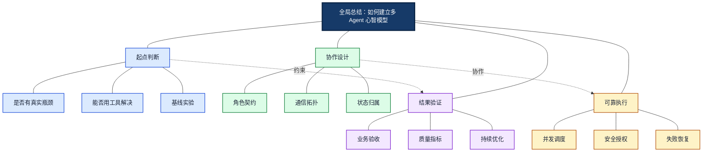

<strong>图谱解读：</strong>本图以“全局总结：如何建立多 Agent 心智模型”为中心，分别展开起点判断、协作设计、可靠执行和结果验证。虚线表示跨模块的约束或协作，不表示固定执行先后。

理解多 Agent 的完整因果链是：任务复杂性造成单体瓶颈，角色专业化产生协作需求，协作需要消息和状态契约，运行时根据依赖调度任务，治理层控制权限与副作用，验证层用可观测指标判断是否值得。

<strong>最终原则：</strong>能用函数解决的不要强行变成 Agent；能用稳定 Workflow 解决的不要增加不必要的自主决策；只有当分工和协作带来可量化价值时，Multi-Agent 才是合理的工程架构。

## 与第六章其他专题的知识衔接

本篇建立“多 Agent 是什么、为什么、何时使用”的整体认知。下一篇 [02-Collaboration-Patterns.md](02-Collaboration-Patterns.md) 深入研究具体协作拓扑与模式；[03-Communication-and-State.md](03-Communication-and-State.md) 深入消息、状态与一致性；[04-LangGraph.md](04-LangGraph.md) 和 [05-AgentScope.md](05-AgentScope.md) 对应两种重要实现路线；[06-Framework-Selection.md](06-Framework-Selection.md) 汇总选型标准。第五码章的 RAG、MCP、Function Calling 与 Agent Skills 则作为各 Agent 的知识与工具能力来源。

## 常见误区与面试判断

| 误区 | 正确认知 |
|---|---|
| Agent 越多越强 | 数量增加也增加通信与错误传播 |
| 多个 LLM 调用就是多 Agent | 需要明确主体、职责和协作机制 |
| 多 Agent 必然更快 | 仅独立分支可有效并行，关键路径决定时延 |
| 投票可以消除幻觉 | 相关错误可能使多数意见同时错误 |
| Handoff 就是复制聊天历史 | 需要明确责任、上下文、控制权与返回路径 |
| Checkpoint 保证只执行一次 | 外部副作用仍需幂等和状态核对 |
| A2A 可以替代 MCP | 前者面向 Agent 互操作，后者面向工具与资源接入 |
| 多 Agent 一致同意即可执行 | 授权必须由可信执行层验证 |

## 参考资料与进一步验证

以下为可用于持续查阅的权威资料与论文。技术框架 API、协议版本及维护状态可能变化，实施前应核对官方当前版本。

1. [LLM-based Multi-Agent Systems Survey](https://link.springer.com/article/10.1007/s44336-024-00009-2) — 多 Agent 组成与理论框架。
2. [Large Language Model based Multi-Agents: A Survey](https://arxiv.org/abs/2402.01680) — 多智能体研究综述。
3. [LangChain Multi-Agent Overview](https://docs.langchain.com/oss/python/langchain/multi-agent) — 主要协作模式与上下文设计。
4. [LangChain Subagents](https://docs.langchain.com/oss/python/langchain/multi-agent/subagents) — 主管与子 Agent。
5. [LangChain Router](https://docs.langchain.com/oss/python/langchain/multi-agent/router) — 路由与专家分发。
6. [LangGraph Persistence](https://docs.langchain.com/oss/python/langgraph/persistence) — 状态持久化与恢复。
7. [AgentScope Documentation](https://doc.agentscope.io/) — AgentScope 组件与多 Agent 开发。
8. [OpenAI Agents SDK](https://openai.github.io/openai-agents-python/) — Handoff、工具、追踪。
9. [Microsoft Agent Framework](https://learn.microsoft.com/en-us/agent-framework/) — Agent 与工作流编排。
10. [AutoGen GitHub](https://github.com/microsoft/autogen) — AutoGen 生态与历史演进。
11. [A2A Protocol](https://github.com/a2aproject/A2A) — 跨 Agent 通信。
12. [MultiAgentBench](https://arxiv.org/abs/2503.01935) — 多 Agent 协作基准。
13. [Why Do Multi-Agent LLM Systems Fail?](https://arxiv.org/abs/2503.13657) — 多 Agent 失败分析。
14. [Multi-Agent Debate Evaluation](https://iclr-blogposts.github.io/2025/blog/mad/) — 多 Agent 辩论效果与局限。

---

<strong>一句话总结：</strong>多 Agent 系统的工程核心是<strong>专业化分工 + 明确协作契约 + 状态与副作用治理 + 可量化的端到端收益</strong>，而不是简单增加 Agent 数量。
