# 02｜多 Agent 协作模式：控制权、任务依赖与可靠执行

> 第六章 · Multi-Agent and Frameworks / Collaboration Patterns  
> 本文是多 Agent 协作模式的系统性知识章节，重点回答「何时分工、如何协作、谁控制、怎样验证」。

## 阅读定位与核心结论

<strong>多 Agent（Multi-Agent，多智能体）不是将多个模型串起来，而是围绕同一业务目标，在多个具有职责边界的执行主体之间分配控制权、信息、资源与结果责任。</strong> 协作模式（Collaboration Pattern）规定了谁选择下一个执行者、任务之间的依赖关系、消息如何传递以及何时终止。它和通信拓扑（Communication Topology）、工作流（Workflow）并非同义词：前者是控制策略，拓扑是连接关系，工作流是可执行的状态转移规则。

从工程实践看，应当首先建立<strong>具备同等工具和知识源的单 Agent 基线</strong>，再因专业化、并行性、上下文隔离、独立验证等实际需求引入多 Agent。新增 Agent 会引入额外模型调用、交接、冲突、状态一致性和权限成本。

本篇接续 [01-Multi-Agent-Fundamentals.md](01-Multi-Agent-Fundamentals.md)，并为 [03-Communication-and-State.md](03-Communication-and-State.md)、[04-LangGraph.md](04-LangGraph.md)、[05-AgentScope.md](05-AgentScope.md) 与 [06-Framework-Selection.md](06-Framework-Selection.md) 提供架构依据。

### 全局知识导航

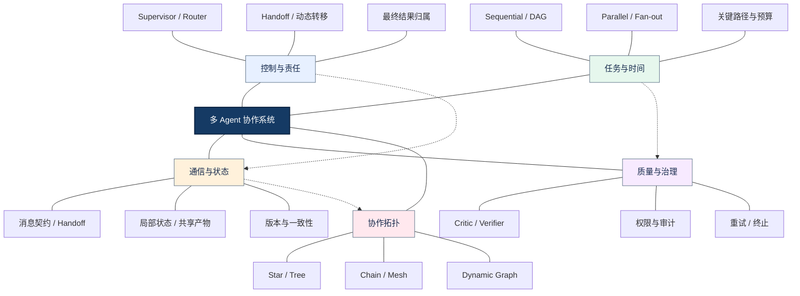

<strong>读图方式：</strong>中心是协作系统；一级分支分别表示控制、任务、信息、治理和拓扑五个设计维度。它们可以组合：一个 Supervisor 可以并行委派 Worker、通过共享产物传递结果，并在 Verifier 失败后重新规划。不要把图中各分支理解成必须依次执行的流水线。

## 一、定义协作问题：从单 Agent 到团队架构

设计协作前，应先问「一个 Agent 为什么做不好」，而不是「怎样增加 Agent 数量」。分工只有在任务边界可表达、交接信息可验证、收益可测量时才有价值。

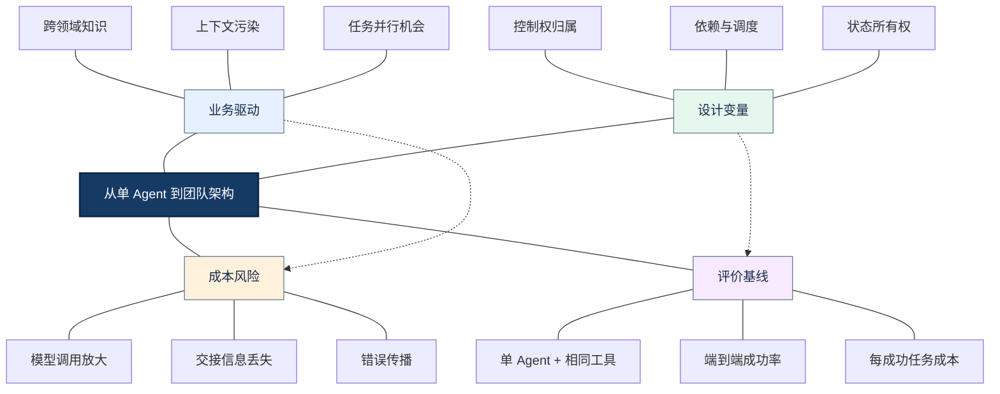

<strong>图谱解读：</strong> 「业务驱动」聚合3个关键要素；「设计变量」聚合3个关键要素；「成本风险」聚合3个关键要素；「评价基线」聚合3个关键要素。虚线表示跨模块约束而非强制执行顺序。

### 1.1 四类真实拆分动机

<strong>专业化</strong>让不同 Agent 使用不同工具、模型、权限或提示约束；<strong>上下文隔离</strong>避免将所有资料堆积在同一个上下文窗口；<strong>并行性</strong>允许无依赖的子任务同时执行；<strong>独立验证</strong>将生产者与审核者分开。角色名称不同而输入、工具和行为相同，并不意味着真正的专业化。

### 1.2 协作模式的正交维度

控制权决定谁可以选择下一步；依赖决定谁必须等待谁；拓扑决定消息连接关系；状态所有权决定谁能修改哪些字段；验证机制决定何时接受结果。<strong>Supervisor + Parallel + DAG + Verifier</strong>是合法组合，并不是四种相互排斥的模式。

### 1.3 何时不应该拆分

固定且可验证的步骤优先使用普通函数或确定性 Workflow。若一个 Agent 通过工具即可完成任务，而拆分后只增加转发和 Token，系统应保持简单。

## 二、控制权模型：Supervisor、Router、Agent as Tool 与 Handoff

控制权（Control Flow Ownership）是区分协作模式的首要标准。最容易混淆的两种实现，是主 Agent 调用专家作为工具，与直接把当前对话交给另一个 Agent。

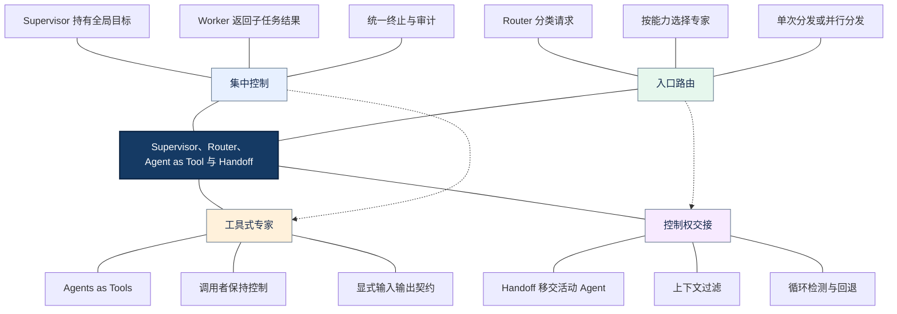

<strong>图谱解读：</strong> 「集中控制」聚合3个关键要素；「入口路由」聚合3个关键要素；「工具式专家」聚合3个关键要素；「控制权交接」聚合3个关键要素。虚线表示跨模块约束而非强制执行顺序。

### 2.1 Supervisor–Worker（主管—工作者）

主管维护全局任务、委派工作并聚合结果；Worker 不需要看到完整会话。优点是治理集中、专业边界清楚；缺点是主管可能成为瓶颈、重复阅读大量中间结果。应让 Worker 返回结构化结论和产物引用，而非冗长聊天历史。

### 2.2 Router–Specialist（路由—专家）

Router 的核心是选择目标，不必持续监督全过程。可使用规则、分类模型或混合决策；分类置信度低时可转人工或通用处理器。Router 的错误可能直接造成错误工具权限或知识源选择，因此需要能力描述和回退路径。

### 2.3 Agents as Tools 与 Handoff 的边界

Agents as Tools 将专业 Agent 封装为工具，调用完成后主 Agent 继续负责用户交互；Handoff 将活动执行主体转移给接收 Agent，适用于客服接管、跨领域对话等场景。交接必须明确输入过滤、权限、最大跳数、返回路径。OpenAI Agents SDK 对两者有明确区分，不能把「工具调用形式的交接」误认为普通函数调用。

### 2.4 权限与控制权不能混淆

Handoff 是控制流变化，不等于授权变化。目标 Agent 只能使用其被授予的工具和数据权限；执行层应重新校验身份与操作范围。

| 对比 | Supervisor | Router | Agent as Tool | Handoff |
|---|---|---|---|---|
| 核心职责 | 多步调度与整合 | 入口分流 | 完成有边界子任务 | 转移活动控制权 |
| 控制权 | 主管持续持有 | 路由后通常结束 | 调用者持有 | 接收者持有 |
| 典型返回 | Worker → 主管 | 专家 → 用户/流程 | 专家 → 主 Agent | 目标 Agent 继续执行 |
| 关键风险 | 中心瓶颈 | 分类错误 | 上下文传递过多 | 交接循环、越权 |

## 三、时间与依赖：Sequential、Parallel、Fan-out/Fan-in

任务依赖（Task Dependency）决定执行时间结构。不要把「有多个 Agent」误认为「能够并行」；只有无依赖、无共享写冲突的任务才能安全并行。

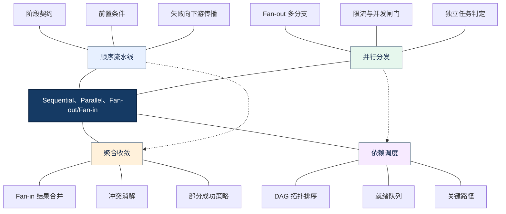

<strong>图谱解读：</strong> 「顺序流水线」聚合3个关键要素；「并行分发」聚合3个关键要素；「聚合收敛」聚合3个关键要素；「依赖调度」聚合3个关键要素。虚线表示跨模块约束而非强制执行顺序。

### 3.1 Sequential（顺序协作）

前一个阶段的产物满足约定 Schema 后，下一个阶段才开始。适合文档解析→翻译→渲染→检查等有明确前后关系的任务。需要校验阶段契约，并避免默认传递完整历史；某些框架的顺序编排可能传递完整对话，需要显式裁剪。

### 3.2 Parallel（并行协作）

Fan-out（扇出）分配相互独立的工作；Fan-in（扇入）等待并聚合。研究任务可并行查询论文、官方文档和代码库；但共享同一文件写入时必须隔离输出或采用版本化提交。

### 3.3 部分失败与聚合语义

聚合可采用 all-required（全部必须成功）、quorum（达到法定数量）、best-effort（尽力而为）或 fallback（回退）。选择必须由业务完整性要求决定，不能仅以降低延迟为目标。证据类任务应保留来源和版本，不应直接拼接相互冲突的结论。

### 3.4 DAG 与动态循环

DAG（Directed Acyclic Graph，有向无环图）描述静态依赖，可用拓扑排序和就绪队列执行。若需要「检查失败→修复→再次检查」的循环，则应在更高层使用状态机（State Machine）或带条件边的执行图，而不是强行在 DAG 内加入环。

### 3.5 关键路径与并行收益

假设解析阶段耗时 3 秒，随后两个独立检索任务分别耗时 5 秒和 4 秒，最后整合耗时 2 秒。忽略额外开销时，顺序耗时 14 秒，而并行关键路径耗时 10 秒。一般情况下：

$$
T_{\mathrm{parallel}} \approx \max(T_1,T_2,\ldots,T_n)+T_{\mathrm{overhead}}
$$

这里的公式仅针对同一批相互独立的任务，不能替代含依赖的完整工作流关键路径分析。若模型 API 限流或聚合器很慢，并行收益会明显下降。

## 四、讨论与验证：Group Chat、Debate、Critic、Verifier

讨论式协作解决「如何综合多种观点」，验证式协作解决「产物是否满足约束」。二者目标不同，不应以无限讨论代替可执行的验证。

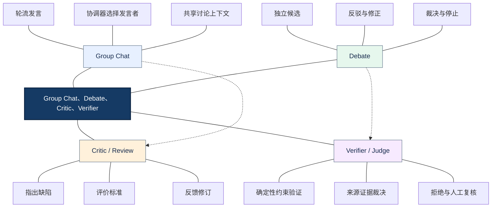

<strong>图谱解读：</strong> 「Group Chat」聚合3个关键要素；「Debate」聚合3个关键要素；「Critic / Review」聚合3个关键要素；「Verifier / Judge」聚合3个关键要素。虚线表示跨模块约束而非强制执行顺序。

### 4.1 Group Chat（群聊）不是全连接网络

Group Chat 指共享讨论语境，实际通信可以由中央协调器管理，常见发言策略有 Round Robin（轮询）、Rule-based（规则选择）、Model-based（模型选择）和 Priority-based（优先级选择）。要规定最大轮次、摘要策略和终止条件。

### 4.2 Debate（辩论）与投票的局限

Debate 是具有候选、反驳、修正、裁决阶段的协议；投票只是聚合方法。相同模型、相同证据产生的错误往往高度相关，多数票并不等于正确。需要独立来源或不同验证路径，且多 Agent 辩论并非普遍优于单 Agent。

### 4.3 Critic 与 Verifier 的职责边界

Critic（批判者）提出问题与修改建议，适合语言质量、结构合理性；Verifier（验证器）依据明确条件判断通过与否，适合数字、单位、型号、Schema 和文件完整性。能够用程序判定的条件应优先使用确定性校验。

### 4.4 审核循环如何收敛

每轮应记录失败原因、修复范围和版本号，只重做受影响部分。最大修复轮次和最低可接受质量阈值必须预先设定；无法通过时转人工或报告未满足的约束。

## 五、组织拓扑：Hierarchical、Swarm、Peer-to-Peer 与 Magentic

协作拓扑决定通信和委派的形状；组织层级则决定责任如何汇总。随着任务复杂度增长，固定编排与动态规划可能混合使用。

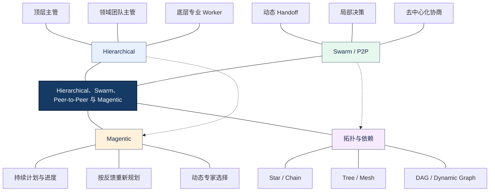

<strong>图谱解读：</strong> 「Hierarchical」聚合3个关键要素；「Swarm / P2P」聚合3个关键要素；「Magentic」聚合3个关键要素；「拓扑与依赖」聚合3个关键要素。虚线表示跨模块约束而非强制执行顺序。

### 5.1 Hierarchical（层级式协作）

顶层处理全局目标，中层管理业务域，底层执行专业任务。好处是缩小单个主管的协调范围；代价是多级转发、上下文压缩、错误定位和权限继承复杂。层级不应无限加深，应明确每层输出契约和升级规则。

### 5.2 Swarm 与 Peer-to-Peer

Swarm 在不同论文和框架中含义不完全相同，有时指动态交接，有时强调去中心化或群体搜索。Peer-to-Peer（对等协作）允许 Agent 直接交互，但仍需全局任务标识、事件日志、循环检测和冲突仲裁。

### 5.3 Magentic 与动态重规划

Magentic 一类架构由管理器维护任务进度，根据中间反馈动态安排专业 Agent。适合开放式研究、跨工具调查和无法预先列出所有步骤的任务；但其规划成本、可预测性和可测试性弱于固定 Workflow。

### 5.4 通信拓扑不等于依赖拓扑

Star（星型）说明消息经过中心；DAG 说明任务依赖无环。星型 Supervisor 也可以运行 DAG 并行任务；树形组织也可以使用共享工作区。设计时应分别绘制「通信关系」「任务依赖」「状态所有权」三个视角。

## 六、协作契约与状态：从自然语言聊天到可验证协议

稳定协作需要将「交给另一个 Agent 做」转换为可追踪的任务协议。自然语言可以描述目标，但关键边界应由结构化字段表达。

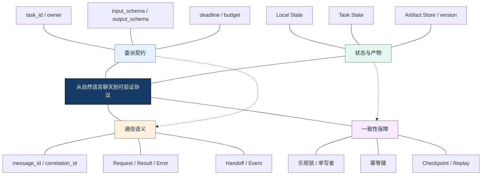

<strong>图谱解读：</strong> 「委派契约」聚合3个关键要素；「状态与产物」聚合3个关键要素；「通信语义」聚合3个关键要素；「一致性保障」聚合3个关键要素。虚线表示跨模块约束而非强制执行顺序。

### 6.1 推荐的任务委派字段

建议包括 task_id、parent_task_id、sender、receiver、goal、input_refs、output_schema、dependencies、deadline、budget、permissions、acceptance_criteria。这是工程建议，不是所有框架统一强制的协议。

### 6.2 局部状态与共享状态

Local State（局部状态）保留专业 Agent 的工作记忆；Task State（任务状态）记录全局阶段和依赖；Artifact Store（产物存储）保存大文件、报告和版本。避免让所有 Agent 读写同一聊天历史或同一文件。

### 6.3 交接时的上下文最小化

传递任务目标、必要证据、约束和产物引用，而不是无差别复制全部对话。对于用户数据与工具权限，应按目标 Agent 的身份重新授权。

### 6.4 一致性、恢复与外部副作用

Checkpoint（检查点）允许恢复，但重放可能重复外部操作。支付、审批、发邮件等写操作应使用 Idempotency Key（幂等键）、状态查询或 Saga（补偿事务）思路。多 Agent 状态一致性属于分布式系统问题，不会因为使用 LLM 而自动解决。

## 七、可靠性与安全：识别协作失效的根因

多 Agent 的失效往往发生在交界处：任务分解、消息交接、状态合并和终止判定。修复策略应对准失效类别，而不是统一增加重试。

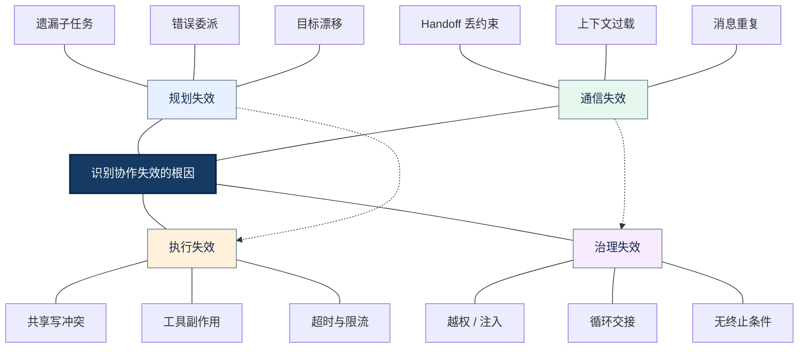

<strong>图谱解读：</strong> 「规划失效」聚合3个关键要素；「通信失效」聚合3个关键要素；「执行失效」聚合3个关键要素；「治理失效」聚合3个关键要素。虚线表示跨模块约束而非强制执行顺序。

### 7.1 常见故障的因果链

错误路由会导致错误专家或知识源；不完整交接会导致下游误解约束；无版本的共享产物会导致并发读写冲突；错误聚合会掩盖相互矛盾的证据。必须在边界处记录输入输出与校验结果。

### 7.2 重试分类

429 限流、暂时网络故障可有界重试并指数退避；权限拒绝、Schema 不合法和业务规则冲突通常需要修正输入或转人工；写操作重试前先查询外部状态，防止重复副作用。

### 7.3 Prompt Injection（提示注入）与权限隔离

外部文档、网页和其他 Agent 消息都可能包含不可信指令。证据内容不得提升为高优先级系统指令。执行层应实施最小权限、工具白名单、参数校验、敏感操作审批和审计。

### 7.4 终止条件

明确成功、失败、用户取消、人工审批等待、最大轮次、最大 Handoff 次数、Token 预算和时间预算。没有终止机制的 Group Chat 与 Swarm 容易循环消耗资源。

## 八、性能与评测：协作是否真正带来收益

评测应同时覆盖结果、过程、成本与安全。多 Agent 的比较基线应是「具有相同模型工具与知识源的单 Agent」，否则无法判断收益来源。

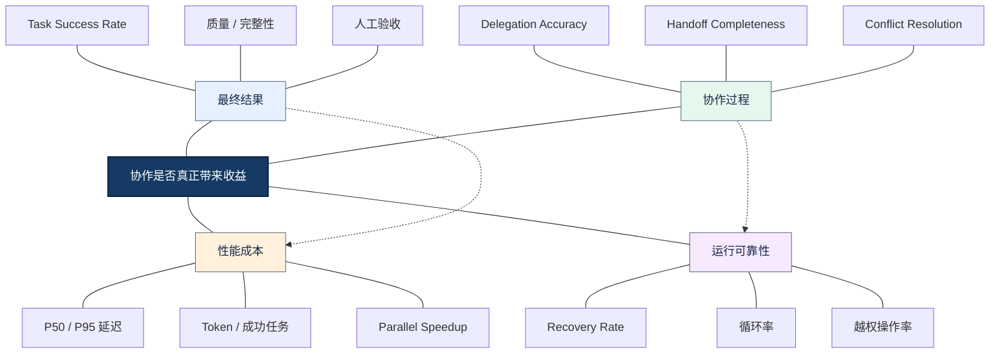

<strong>图谱解读：</strong> 「最终结果」聚合3个关键要素；「协作过程」聚合3个关键要素；「性能成本」聚合3个关键要素；「运行可靠性」聚合3个关键要素。虚线表示跨模块约束而非强制执行顺序。

### 8.1 成本分解

模型推理成本之外还存在协调、检索工具、产物存储、审核和人工介入成本。协作成本应按成功任务统计，而不是只按单次模型调用统计。

### 8.2 协作质量指标

Delegation Accuracy（委派准确率）衡量分配是否正确；Handoff Completeness（交接完整率）衡量必要约束是否保留；Conflict Resolution Rate（冲突解决率）衡量聚合结果是否正确处理分歧。指标需要在固定测试集上定义可复现判定标准。

### 8.3 可观测性与 Trace

使用 Trace ID 贯穿整次任务，Span（调用区间）记录 Agent、工具、交接和校验阶段；同时保留 task_id、artifact_version、模型版本、耗时、Token 与失败类别。敏感信息应脱敏，不应在日志中无控制地存储完整业务文档。

### 8.4 实验设计

固定输入数据、模型版本和预算，对照单 Agent、固定 Workflow、Supervisor 与动态协作。关注平均表现和长尾延迟，统计任务失败原因；只有在质量、吞吐或可维护性方面有稳定收益时才保留复杂协作。

### 8.5 性能公式：收益不能只看加速比

$$
S_{\mathrm{parallel}}=\frac{T_{\mathrm{sequential}}}{T_{\mathrm{parallel}}}
$$

$$
C_{\mathrm{success}}=\frac{C_{\mathrm{total}}}{N_{\mathrm{successful}}}
$$

其中，第二式为实验批次内的平均每成功任务成本；若成功任务数为零，则该指标不可定义，必须单独报告失败与总成本。并行加速比大于 1 也不代表系统更好，还需同时比较任务质量和资源消耗。

## 九、框架落地：如何将模式映射为可执行能力

框架只是承载协作契约的运行时。先定义业务边界和状态模型，再选能支持这些语义的工具，避免为了框架功能而制造额外 Agent。

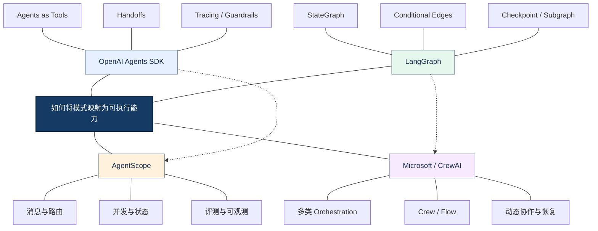

<strong>图谱解读：</strong> 「OpenAI Agents SDK」聚合3个关键要素；「LangGraph」聚合3个关键要素；「AgentScope」聚合3个关键要素；「Microsoft / CrewAI」聚合3个关键要素。虚线表示跨模块约束而非强制执行顺序。

### 9.1 OpenAI Agents SDK

官方区分 Agents as Tools 和 Handoffs；前者由调用者继续负责，后者发生控制权转移。支持追踪交接和工具执行，适合需要清晰专业 Agent 边界的应用。

### 9.2 LangGraph

以显式状态图表达执行节点、条件边和持久化状态，适合复杂依赖、人工审批、检查点与修复循环。多 Agent 可以由子图或 Handoff 组合实现，但不是必须每个节点都使用 LLM。

### 9.3 AgentScope

适合研究 Agent 消息、路由、并发、记忆与多 Agent 协作。应结合具体版本官方 API 确认实现细节，不应把抽象协作概念误写成某个版本的固定接口。

### 9.4 Microsoft Agent Framework 与 CrewAI

Microsoft Agent Framework 提供 Sequential、Concurrent、Handoff、Group Chat、Magentic 等模式；CrewAI 区分角色协作的 Crew 与显式流程控制的 Flow。AutoGen 作为历史技术路线值得研究，但新项目应核对当前维护状态和迁移建议。

## 十、贯穿案例：企业医疗设备文档翻译系统

复杂文档翻译是典型的混合协作任务：有确定性流程、并行资料准备、语义推理和独立质量验证。推荐「Workflow 管主干、Supervisor 管异常、Agent 管专业决策、工具管确定性操作」。

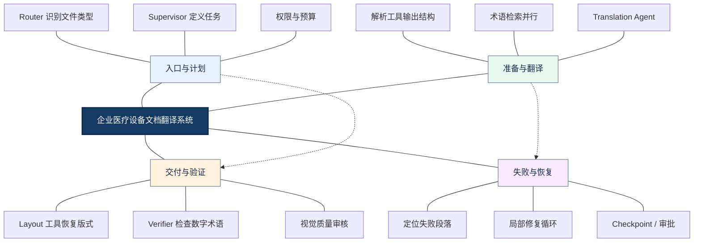

<strong>图谱解读：</strong> 「入口与计划」聚合3个关键要素；「准备与翻译」聚合3个关键要素；「交付与验证」聚合3个关键要素；「失败与恢复」聚合3个关键要素。虚线表示跨模块约束而非强制执行顺序。

### 10.1 为什么不能全用 Group Chat

翻译与排版任务存在明确的输入输出、可测量的约束和固定依赖。无限制群聊会增加 Token 与漂移风险；有状态 Workflow 更容易回归测试。

### 10.2 任务划分

文档类型识别、OCR（Optical Character Recognition，光学字符识别）、文件渲染与数字校验可由工具承担；翻译策略、术语歧义和复杂视觉判断才需要 LLM Agent。不同 Agent 通过段落 ID、页面 ID 和文件版本号交换产物引用。

### 10.3 并行与顺序结合

文档解析后，术语检索和部分版式分析可以并行；翻译依赖原文结构与术语结果；最终排版依赖译文；质量检查依赖源文档和译文产物。局部失败只重做受影响的段落或页面。

### 10.4 人工参与和安全

低置信度专业术语、敏感技术说明和无法自动恢复的排版应进入 Human-in-the-Loop（人在回路中）确认。文件访问权限、产物审计与敏感数据脱敏由系统执行层控制。

## 十一、模式选型总表与常见误区

| 业务特征 | 优先选择 | 避免的误区 |
|---|---|---|
| 固定依赖、明确阶段 | Sequential / Workflow | 所有阶段都变成 LLM Agent |
| 子任务互不依赖 | Parallel + Fan-in | 忽略共享写冲突和限流 |
| 全局目标需要持续协调 | Supervisor–Worker | 主管接收全部完整历史 |
| 只需要入口分类 | Router–Specialist | 将路由误认为持续规划 |
| 专家需要接管交互 | Handoff | 交接即自动继承权限 |
| 多观点讨论 | Group Chat / Debate | 讨论越久就越正确 |
| 可验证产物 | Generator–Verifier | 用 LLM 代替确定性校验 |
| 大规模团队分工 | Hierarchical | 无限制增加层级 |
| 路径无法提前确定 | Magentic / Dynamic Planning | 不限制重规划和预算 |
| 跨系统 Agent 协作 | Peer-to-Peer / A2A | 内部函数调用也强制走网络协议 |

### 11.1 重要知识区别

- <strong>协作模式 vs 通信拓扑：</strong>模式规定控制策略，拓扑规定连接关系。
- <strong>Router vs Supervisor：</strong>前者决定去哪里，后者持续负责做完任务。
- <strong>Agent as Tool vs Handoff：</strong>前者返回调用者，后者转移活动控制权。
- <strong>Group Chat vs Debate：</strong>前者是交流组织形式，后者是具有反驳与裁决的推理协议。
- <strong>Critic vs Verifier：</strong>前者给出评价意见，后者检查明确约束。
- <strong>DAG vs State Machine：</strong>前者表达无环依赖，后者允许有条件循环与状态迁移。
- <strong>并行 vs 高吞吐：</strong>并行减少独立任务的关键路径，不保证服务端限流下的整体吞吐。

## 十二、与第六章其他专题的关系

[01-Multi-Agent-Fundamentals.md](01-Multi-Agent-Fundamentals.md) 回答「为什么需要多 Agent」；本篇回答「采用什么协作关系」。[03-Communication-and-State.md](03-Communication-and-State.md) 继续研究消息、状态、一致性和恢复；[04-LangGraph.md](04-LangGraph.md) 讨论显式状态图和编排；[05-AgentScope.md](05-AgentScope.md) 讨论 Agent 运行时和协作实现；[06-Framework-Selection.md](06-Framework-Selection.md) 在约束和指标基础上做框架选型。

<strong>最终知识主线：</strong>业务目标 → 拆分动机 → 控制权与依赖 → 通信和状态契约 → 可靠性与安全 → 性能评测 → 框架落地。协作模式不应先于业务约束决定，也不应脱离单 Agent 基线评价。

## 十三、权威参考资料与延伸阅读

> 以下链接以官方文档、开源仓库与研究论文为主。框架 API 和维护状态可能随版本变化，工程实现应以所用版本文档为准。

1. [OpenAI Agents SDK — Multi-Agent Orchestration](https://openai.github.io/openai-agents-python/multi_agent/)：Agents as Tools 与 Handoff 的核心区别。
2. [OpenAI Agents SDK — Handoffs](https://openai.github.io/openai-agents-python/handoffs/)：交接配置、输入过滤和控制转移。
3. [OpenAI Agents SDK — Tracing](https://openai.github.io/openai-agents-python/tracing/)：工具、Agent 与 Handoff 追踪。
4. [LangChain — Multi-Agent](https://docs.langchain.com/oss/python/langchain/multi-agent)：Subagents、Router 与协作设计。
5. [LangGraph — Persistence](https://docs.langchain.com/oss/python/langgraph/persistence)：检查点、状态持久化与恢复。
6. [Microsoft Agent Framework — Orchestrations](https://learn.microsoft.com/en-us/agent-framework/workflows/orchestrations/)：顺序、并发、交接、群聊和 Magentic。
7. [Microsoft Agent Framework — Group Chat](https://learn.microsoft.com/en-us/agent-framework/workflows/orchestrations/group-chat)：协调器与发言调度。
8. [AgentScope 官方文档](https://doc.agentscope.io/)：多 Agent 消息、路由和执行能力。
9. [CrewAI 官方文档](https://docs.crewai.com/)：Crews 与 Flows 的协同关系。
10. [AutoGen GitHub](https://github.com/microsoft/autogen)：对话式多 Agent 的历史与演进。
11. [A2A Protocol](https://a2a-protocol.org/latest/)：跨系统 Agent 交互的协议思路。
12. [MultiAgentBench](https://arxiv.org/abs/2503.01935)：协作拓扑与过程评测。
13. [Why Do Multi-Agent LLM Systems Fail?](https://arxiv.org/abs/2503.13657)：协作失效分类与轨迹分析。
14. [Magentic-One](https://arxiv.org/abs/2411.04468)：动态规划型多 Agent 系统。
15. [OWASP Top 10 for LLM Applications](https://genai.owasp.org/llm-top-10/)：提示注入、权限与工具安全。

---

> <strong>一句话总结：</strong>可靠的多 Agent 协作不是「让多个模型一起聊天」，而是以明确控制权组织任务、以依赖关系安排执行、以消息和状态契约传递信息、以验证和治理约束风险，最后用可测量的端到端收益决定架构复杂度。

