# 03｜Agent 通信、共享状态与协作一致性

> 第六章 · 多 Agent 系统与开发框架 · 从消息传递到可恢复的协作执行

<strong>本章核心问题：</strong>多个 Agent 不仅要能够交换信息，更要在异步、并发、重试、超时、进程崩溃与跨系统调用的条件下，正确完成同一个业务任务。

<strong>阅读路径：</strong>通信边界 → 消息契约 → 状态模型 → 并发一致性 → 生命周期与恢复 → 可靠投递与事务 → 框架实现 → 企业案例。

本章与 [01｜多 Agent 基础](./01-Multi-Agent-Fundamentals.md)、[02｜协作模式](./02-Collaboration-Patterns.md) 衔接：前两篇回答“为什么分工、怎样组织协作”，本篇回答“协作过程中信息与事实如何保持正确”。这里的 Agent 指具有模型推理、工具调用或任务执行能力的智能体；它不一定是独立进程，也不意味着所有步骤都必须调用大语言模型。

### 全章知识总网络

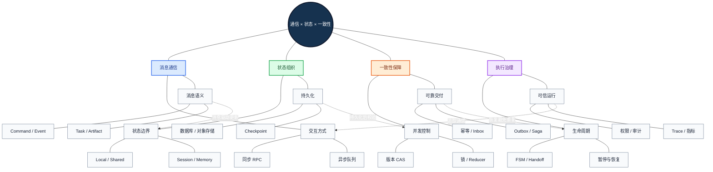

<strong>图谱解读：</strong>中心节点不是单一存储组件，而是四种相互制约的机制。消息送达只解决传输问题；状态持久化保存执行事实；一致性机制防止并发冲突和重复副作用；治理机制让任务可追踪、可授权、可恢复。

## 一、为什么“能聊天”不等于“能协作”

在单 Agent 原型中，一次调用往往同时承担了任务指令、上下文、进度和结果四种职责。进入多 Agent 系统后，这种做法会出现结构性缺陷：消息可能延迟或重复；两个 Worker 可能读取相同的旧版本；上游已经完成外部操作但响应丢失；工作流恢复时可能重复执行不可逆动作。

应当将四个事实分开：<strong>消息已发送</strong>、<strong>任务已完成</strong>、<strong>状态已持久化</strong>、<strong>外部副作用已正确提交</strong>。它们不是同义词，也不一定同时发生。

### 1.1 四个问题域

| 问题域 | 要回答的问题 | 最小可用设计 | 复杂系统增强 |
|---|---|---|---|
| Communication（通信） | 信息怎样抵达、关联、确认？ | 结构化调用 | 队列、超时、重试、协议版本 |
| State（状态） | 当前任务与数据是什么？ | 显式任务对象 | 共享状态、持久化、版本管理 |
| Coordination（协调） | 下一步由谁执行？ | 固定流程或 Router | Supervisor、Handoff、动态 DAG |
| Consistency（一致性） | 并发和故障后结果是否正确？ | 单写者、校验 | CAS、幂等、Outbox、Saga |

<strong>因果关系：</strong>多 Agent 增加执行主体和独立失败点，因此必须显式化消息边界；消息异步化增加时序不确定性，因此需要任务状态和并发控制；任务可恢复又可能重放外部动作，因此必须增加幂等与补偿机制。

### 1.2 前置知识

需要理解进程与线程、同步和异步、HTTP 请求响应、数据库事务、并发竞争、事件驱动架构，以及大模型上下文窗口。没有这些基础，容易把模型对话能力误当成分布式系统可靠性。

### 从协作问题到工程约束

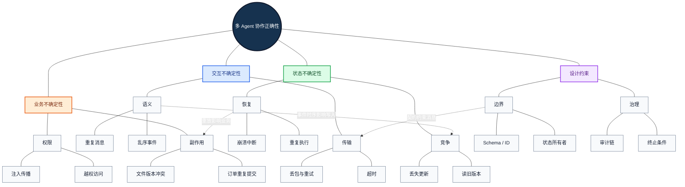

<strong>图谱解读：</strong>协作失败不只是“模型答错”，更可能来自传输、状态、业务副作用和权限边界的叠加。越早区分这些失败域，越容易选择正确的恢复手段。

## 二、通信模型与拓扑：如何传递信息

### 2.1 同进程调用、同步 RPC 与异步消息

RPC（Remote Procedure Call，远程过程调用）让调用者以请求—响应方式调用远端服务。它适合短时、需要立即返回结果的子任务，但调用者要面对网络超时、重试和服务不可用。即使远程调用返回超时，也不能推断对方没有执行。

异步消息将“提交任务”与“执行任务”解耦。生产者（Producer）把消息写入队列，消费者（Consumer）异步处理并确认；这有利于削峰、隔离故障和批处理，但会引入重复投递、积压、乱序及死信处理。

同进程调用延迟较低，适合统一部署的 Agent 工作流；共享对象虽然方便，却不能自动保证并发安全。选择通信方式应从部署边界、持续时间、失败模式和运维成本出发，而非从 Agent 数量出发。

| 方式 | 典型实现 | 优点 | 代价与风险 | 适用 |
|---|---|---|---|---|
| 同进程 | 函数、协程、内部事件 | 简单、低延迟 | 进程级故障域、共享对象竞争 | 单服务编排 |
| 同步 RPC | HTTP / gRPC | 契约清晰、即时反馈 | 超时链、同步等待 | 短时专业工具 |
| 异步任务队列 | RabbitMQ / Redis Streams | 缓冲、重试、解耦 | 投递语义、消费者去重 | 批处理与长任务 |
| 事件流 | Kafka 等 | 可保留、重放、消费组 | 分区顺序、偏移量、运维 | 大规模事件驱动 |

RabbitMQ、Kafka 与 Redis Streams 的持久化、顺序和确认机制并不等价；设计时必须依据所选产品的官方语义，而不能只把它们统称“消息队列”。

### 2.2 Command、Event、Query 与 Result

Command（命令）是要求某个责任主体执行动作，例如 `TranslatePage`；Event（事件）是已经发生的事实，例如 `PageTranslated`。Query（查询）要求获取信息但通常不修改业务状态；Result（结果）承载某次操作的完成信息。一个事件可以有多个订阅者，不能因此假设所有订阅者都已处理成功。

通信拓扑（星型、链型、树型、网状）描述“谁与谁通信”；任务依赖图（DAG，Directed Acyclic Graph，有向无环图）描述“谁必须等待谁”。例如，星型 Supervisor 可以同时调度多个并行 Worker，因此二者不是同一维度。

### 2.3 同步、异步与流式响应的边界

流式输出（Streaming）用于逐步传递进度或增量结果，但临时 Token 流不应被视为持久化业务交付。对关键文件、审批决定或最终结构化结果，应使用持久化 Artifact 或明确的最终任务状态作为权威来源。

### 通信方式与语义的关联

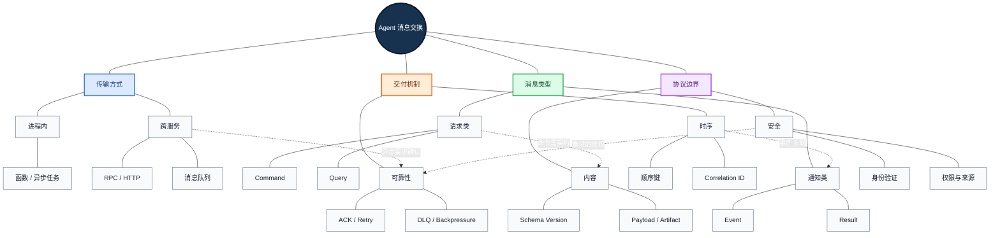

<strong>图谱解读：</strong>传输方式、消息语义和可靠性策略是三个独立选择：使用消息队列并不会自动获得业务幂等；使用 HTTP 也不意味着请求必定只执行一次。

## 三、消息契约：从自然语言到可验证的协作协议

### 3.1 为什么需要 Envelope

Message Envelope（消息信封）是包裹业务载荷的标准元数据。它使接收方能够在不理解全部业务内容的情况下完成路由、去重、关联、超时与审计。

| 字段 | 语义 | 设计约束 |
|---|---|---|
| `message_id` | 一次消息投递的标识 | 全局或业务域内唯一 |
| `task_id` | 所属业务任务 | 跨 Agent 保持稳定 |
| `correlation_id` | 关联请求与响应 | 与消息 ID 不混淆 |
| `causation_id` | 当前事件的直接原因 | 便于追溯因果链 |
| `sender` / `receiver` | 发送者与目标 | 结合真实身份校验 |
| `message_type` | Command / Event / Result / Error | 枚举、版本化 |
| `schema_version` | 消息契约版本 | 支持兼容迁移 |
| `payload` | 小型结构化业务内容 | Schema 校验 |
| `artifact_refs` | 大型产物引用 | 版本、权限、校验和 |
| `deadline` | 截止时间 | 明确超时策略 |
| `trace_id` | 分布式追踪关联 | 不能代替任务 ID |
| `idempotency_key` | 同一逻辑副作用的标识 | 重试时保持不变 |

这是一种<strong>推荐的工程消息契约</strong>，不是所有 Agent 框架的统一内置字段。

### 3.2 Task、Message 与 Artifact

A2A（Agent2Agent，智能体间通信协议）区分 Task（任务生命周期）、Message（交互消息）和 Artifact（任务产物）。一个 Task 可以包含多轮交互和多个产物；一条 Message 不等于一次任务完成；Artifact 可以独立持久化并被后续步骤引用。详见 [A2A 规范](https://a2a-protocol.org/latest/specification/)。

在文档翻译中，`task_id` 关联整份说明书，Message 通知“第 8 页已解析”，Artifact 则指向实际 OCR 结构和原始布局。下游只读取必要的产物版本，不必把全部 PDF 内容塞进对话上下文。

### 3.3 契约演进与信任边界

Schema Evolution（结构演进）要考虑旧消费者：优先增加可选字段，避免静默改变已有字段语义，使用契约测试验证不同版本兼容。外部文档或其他 Agent 的自然语言文本均应视为数据而非高优先级指令；结构校验可以防止字段错误，但不能独立阻止 Prompt Injection（提示注入）。

### 消息契约的多层网络

```mermaid
flowchart TB
    ROOT(("可靠消息契约"))
    B0["身份关联"]
    ROOT --- B0
    B0M0["标识"]
    B0 --- B0M0
    B0M0L0["Message ID"]
    B0M0 --- B0M0L0
    B0M0L1["Task ID"]
    B0M0 --- B0M0L1
    B0M1["因果"]
    B0 --- B0M1
    B0M1L0["Correlation ID"]
    B0M1 --- B0M1L0
    B0M1L1["Causation ID"]
    B0M1 --- B0M1L1
    class B0 blue
    B1["业务语义"]
    ROOT --- B1
    B1M0["内容"]
    B1 --- B1M0
    B1M0L0["Message Type"]
    B1M0 --- B1M0L0
    B1M0L1["Schema Version"]
    B1M0 --- B1M0L1
    B1M1["交付"]
    B1 --- B1M1
    B1M1L0["Payload"]
    B1M1 --- B1M1L0
    B1M1L1["Artifact Reference"]
    B1M1 --- B1M1L1
    class B1 green
    B2["执行约束"]
    ROOT --- B2
    B2M0["时间"]
    B2 --- B2M0
    B2M0L0["Deadline"]
    B2M0 --- B2M0L0
    B2M0L1["Retry Policy"]
    B2M0 --- B2M0L1
    B2M1["副作用"]
    B2 --- B2M1
    B2M1L0["Idempotency Key"]
    B2M1 --- B2M1L0
    B2M1L1["Operation Owner"]
    B2M1 --- B2M1L1
    class B2 orange
    B3["信任治理"]
    ROOT --- B3
    B3M0["来源"]
    B3 --- B3M0
    B3M0L0["Auth / Signature"]
    B3M0 --- B3M0L0
    B3M0L1["Sender Identity"]
    B3M0 --- B3M0L1
    B3M1["审计"]
    B3 --- B3M1
    B3M1L0["Trace ID"]
    B3M1 --- B3M1L0
    B3M1L1["Schema Validation"]
    B3M1 --- B3M1L1
    class B3 purple
    B0M0 -. "任务去重" .-> B2M1
    B1M1 -. "产物授权" .-> B3M0
    B0M1 -. "因果追踪" .-> B3M1
    B2M0 -. "超时须匹配语义" .-> B1M0
    classDef default fill:#f8fafc,stroke:#64748b,color:#172033,stroke-width:1px
    classDef blue fill:#dbeafe,stroke:#2563eb,color:#1e3a8a,stroke-width:2px
    classDef green fill:#dcfce7,stroke:#16a34a,color:#14532d,stroke-width:2px
    classDef orange fill:#ffedd5,stroke:#ea580c,color:#7c2d12,stroke-width:2px
    classDef purple fill:#f3e8ff,stroke:#9333ea,color:#581c87,stroke-width:2px
    classDef rose fill:#ffe4e6,stroke:#e11d48,color:#881337,stroke-width:2px
    classDef teal fill:#ccfbf1,stroke:#0d9488,color:#134e4a,stroke-width:2px
    class ROOT root
    classDef root fill:#16324f,stroke:#0f172a,color:#ffffff,stroke-width:3px
```

<strong>图谱解读：</strong>任务 ID 关联业务，消息 ID 关联传输，幂等键关联一次逻辑副作用。把这三个标识混为一谈，会使重试和去重逻辑失效。

## 四、状态体系：哪些事实应该放在哪里

### 4.1 八类状态与不同生命周期

| 状态 | 定义 | 典型例子 | 存储建议 |
|---|---|---|---|
| Agent Local State | 单 Agent 私有执行信息 | 当前策略、临时草稿 | 进程内或持久化快照 |
| Conversation State | 交互历史与上下文 | 用户要求、消息历史 | 会话存储 |
| Task State | 任务进度和依赖 | 页码、阶段、重试次数 | 事务数据库 |
| Shared State | 多 Agent 协作事实 | 当前译文版本 | 受控共享存储 |
| Memory | 可复用历史信息 | 术语偏好、历史案例 | 数据库或检索系统 |
| Artifact State | 文件及其版本 | PDF、DOCX、质量报告 | 对象存储 / 文件系统 |
| Execution State | 调度器内部运行信息 | 待执行节点、检查点 | 工作流持久化层 |
| Audit State | 追责与审批记录 | 谁在何时批准发布 | 不可随意改写的审计存储 |

Memory（记忆）通常强调跨步骤或跨会话复用；State 强调某次执行的当前事实。具体框架可能使用不同术语，不应据名称推断其持久化语义。

### 4.2 状态所有权比共享范围更重要

State Ownership（状态所有权）指某个字段或业务对象由谁负责提交最终修改。共享读不代表共享写。建议采用单写者（Single Writer）或明确的写入协议：翻译 Agent 产生不可变译文版本，排版 Agent 消费该版本并产生新的版式产物，质量 Agent 只生成检查结果而不直接覆盖源译文。

共享状态不应成为全局可变字典。对于需要多人协作的数据，至少应记录 `owner`、`version`、`updated_at` 和变更来源。

### 4.3 Artifact 的版本与溯源

Artifact Store（产物存储）应保存产物 ID、内容校验和（Checksum）、生成者、输入版本、创建时间与访问策略。这样可以判断某个版式文件究竟基于哪个译文版本生成，也可以识别“翻译已更新但渲染仍旧”的陈旧结果。

### 状态分层与所有权

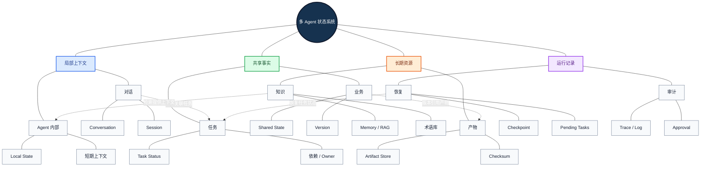

<strong>图谱解读：</strong>共享状态只保存跨节点协作必须共同认可的事实；长文档和大文件放在 Artifact Store；Checkpoint 保存执行位置，审计记录说明为何发生某次状态变化。

## 五、并发控制：两个 Agent 同时修改同一事实怎么办

### 5.1 Lost Update（丢失更新）

A 与 B 都读取 `version=5`，A 提交译文得到版本 6，B 又用旧版本 5 覆盖保存，A 的修改被丢弃。这不是模型理解错误，而是典型并发竞争。

### 5.2 Optimistic Concurrency Control 与 CAS

OCC（Optimistic Concurrency Control，乐观并发控制）假定冲突相对较少，允许并发计算，但在提交时检查版本。CAS（Compare-and-Swap，比较并交换）可以表达“仅当当前版本仍为预期版本时更新”。

$$
\mathrm{commit}(v_{\mathrm{read}},v_{\mathrm{current}})=
\begin{cases}
1,&v_{\mathrm{read}}=v_{\mathrm{current}}\\
0,&v_{\mathrm{read}}\ne v_{\mathrm{current}}
\end{cases}
$$

冲突后应重新读取并根据业务规则合并，不能简单无限重试覆盖。模型推理耗时较长时，通常应在短事务之外完成推理，然后通过版本检查提交。

### 5.3 锁、租约与 Fencing Token

Pessimistic Lock（悲观锁）通过独占访问避免并发修改，适合冲突代价高的短操作；但不适合在持锁期间等待长时间 LLM 推理。Lease（租约）允许锁自动过期，但旧持有者可能在租约过期后仍继续运行。Fencing Token（栅栏令牌）使用单调递增的令牌，要求资源写入端拒绝旧令牌，从而降低过期持有者覆盖新结果的风险。

### 5.4 Reducer（归约器）与合并代数

并行 Agent 同时写入状态时，Reducer 定义如何合并更新。证据集合可做去重并集；计数器可在合适的并发语义下累加；“当前审批状态”则不能简单拼接。

对于顺序不确定的并行更新，理想的合并操作应满足：

$$
a\oplus b=b\oplus a,\qquad (a\oplus b)\oplus c=a\oplus(b\oplus c)
$$

如果重复投递可能发生，还希望满足幂等性：

$$
a\oplus a=a
$$

并非所有 Reducer 都满足这些性质。例如普通列表追加既不交换也不幂等。LangGraph 中配置 Reducer 只是定义合并方式，不会自动使业务写入满足强一致性。

### 5.5 Strong、Eventual 与业务不变量

Strong Consistency（强一致性）是不同强度一致性模型的统称，具体应区分线性一致性、事务隔离等语义；Eventual Consistency（最终一致性）允许副本暂时不同步，但要求在合适条件下最终收敛。审批权限、唯一订单与资金动作需要严格约束；搜索缓存、统计看板可以接受短暂延迟。业务不变量（Invariant）比抽象选择“强”或“弱”更重要。

### 并发冲突与正确提交

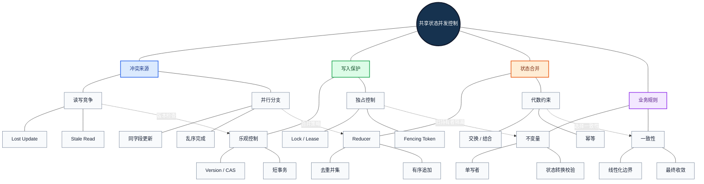

<strong>图谱解读：</strong>状态合并与并发写入保护不能互相替代：Reducer 决定如何合并合法更新，CAS 或锁决定何时允许提交；业务不变量最终决定哪些结果可以接受。

## 六、任务状态机、控制权与 Handoff

FSM（Finite State Machine，有限状态机）定义合法状态和转换条件。建议区分 `created`、`queued`、`running`、`waiting_input`、`waiting_approval`、`succeeded`、`failed`、`cancelled` 等状态，并明确哪些是终态。终态任务不能被延迟到达的旧事件无条件改回 `running`。

状态转换建议使用 `(task_id, expected_version, transition, actor)` 形式提交，并校验当前状态、权限、版本与业务前置条件。工作流 DAG 决定节点依赖；FSM 决定任务生命周期；两者互补。

### 6.1 Handoff（控制权交接）并非数据授权

Handoff 改变当前负责执行的 Agent；它不应自动赋予接收者原 Agent 的全部数据权限或工具权限。交接契约至少应包含任务 ID、当前状态版本、目标 Agent、必要上下文、产物引用、权限范围、返回条件和失败策略。

### 6.2 等待人工输入与失败不是一回事

A2A 中需要补充输入或认证的任务状态属于等待进一步交互的生命周期节点，不应当等同于执行失败。企业审批也应以显式等待状态表示；恢复前需要重新核验状态版本和审批有效性，避免批准了旧版本内容却执行新版本操作。

### 6.3 终止条件

多 Agent 循环需要最大交接跳数、最大重试次数、总预算、截止时间和可验证完成条件。单靠“模型判断已经完成”不够可靠。

### 生命周期与控制权

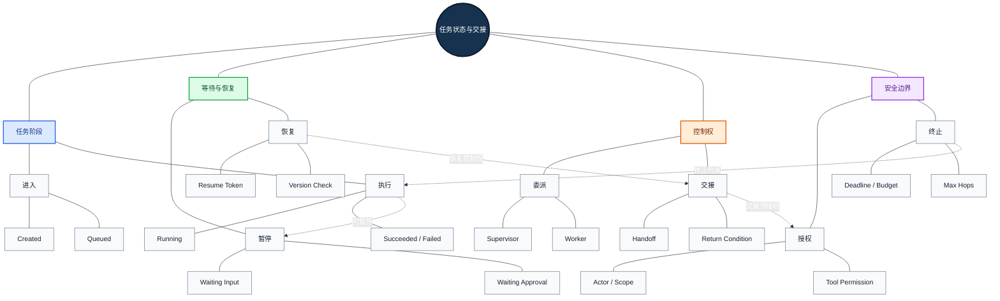

<strong>图谱解读：</strong>状态机回答“允许从哪里到哪里”，Handoff 回答“现在由谁执行”，权限系统回答“这个主体可以做什么”。三者必须分别校验。

## 七、Checkpoint、持久化与恢复语义

Checkpoint（检查点）保存执行过程中可用于恢复的状态快照。LangGraph 提供线程相关的持久化机制；Microsoft Agent Framework 文档介绍在 Superstep（超级步）边界保存执行器状态、待处理消息等内容。不同框架的检查点粒度和恢复 API 并不相同。

### 7.1 Snapshot、Checkpoint 与 Event Sourcing

Snapshot（快照）保存某时刻的数据状态；Checkpoint 还需要包含足以恢复执行位置的信息；Event Sourcing（事件溯源）记录状态变更事件并可通过重放重建状态。一个系统可以组合快照和事件日志，但“支持 Checkpoint”不意味着“使用完整事件溯源”。

### 7.2 恢复为什么危险

假设外部工具已成功发送邮件，但 Agent 在保存成功状态前崩溃。恢复后如果重放该节点，邮件可能再次发送。检查点无法自动判断外部世界是否已发生副作用。应将模型计算、纯函数处理和外部副作用分别设计；对外部操作使用稳定幂等键、状态核对或补偿动作。

### 7.3 Durable Execution（持久化执行）

持久化执行要求执行历史与关键决策能够在进程重启后恢复。其难点是重放期间的非确定性：模型输出、时间、随机数、外部 API 响应都可能改变。应在适当边界记录已确定结果或使用框架提供的持久化任务语义，不可把“重新运行函数”直接当成“无副作用恢复”。

### 7.4 检查点策略

检查点频率过低会增加失败后的重做成本；频率过高会增加写入和存储开销。关键边界通常包括完成高成本模型推理、提交不可变产物、进入人工等待以及准备执行高风险副作用之前。实际粒度受框架支持和业务一致性约束影响。

### 恢复机制与外部世界

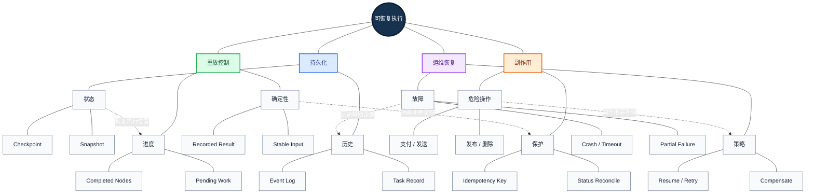

<strong>图谱解读：</strong>Checkpoint 保存“系统记得自己做过什么”，幂等与核对保证“外部世界不会因恢复被错误地再操作一次”。这正是可恢复性与业务正确性的边界。

## 八、消息投递、去重与事务性消息

### 8.1 At-most-once、At-least-once 与 Exactly-once

At-most-once（至多一次）可能丢失消息但避免重复处理；At-least-once（至少一次）通过重试降低丢失风险，但可能重复；Exactly-once（恰好一次）必须限定具体系统边界。某消息系统的事务性处理能力不等于跨外部 API、数据库和文件服务的全局业务恰好一次。

最常见的生产策略是<strong>至少一次投递 + 幂等业务处理 + 明确状态核对</strong>。

### 8.2 幂等键与 Inbox

同一逻辑业务操作在重试时必须复用同一 `idempotency_key`。Inbox（收件箱去重）可记录已处理的消息 ID 或操作 ID，在重复投递时返回已知结果。去重记录必须与业务提交具有适当的原子性，否则仍可能在故障窗口内重复执行。

### 8.3 Transactional Outbox

Transactional Outbox（事务性发件箱）在一个本地事务中同时提交业务状态和待发布事件，随后由发布器异步发送。它解决“数据库更新成功但事件未发送”的裂缝；发布器仍可能重复发送，因此消费者仍需幂等。

### 8.4 Dead Letter Queue 与 Backpressure

DLQ（Dead Letter Queue，死信队列）隔离无法成功处理的消息，防止无限重试。Backpressure（背压）通过限流、并发上限、排队或拒绝控制生产与消费速率。重试应考虑指数退避、抖动和最大次数，避免故障期间所有 Agent 同时重试形成雪崩。

### 可靠消息与副作用边界

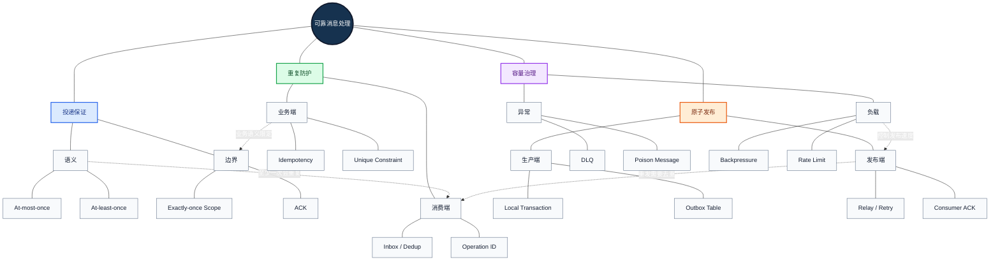

<strong>图谱解读：</strong>Outbox 保护“状态提交与事件待发布”的原子性，Inbox 保护“重复消息不会重复处理”，业务幂等保护“重复调用不会重复造成外部副作用”；三者各自解决不同故障窗口。

## 九、跨系统一致性：Saga 与补偿

Saga（长事务协调模式）把跨服务业务流程拆成多个本地事务，并定义后续失败时的补偿动作。Orchestration（集中编排）由协调器指挥步骤和补偿；Choreography（事件编舞）由参与者根据事件自行触发下一步。两种方式的可观察性、耦合与治理成本不同。

### 9.1 补偿不是数据库回滚

支付退款、取消订单、撤销库存锁定等补偿动作可能是新的业务交易，并不一定完全逆转已经发生的外部影响。发送的邮件无法保证被收回，发布的信息可能已被第三方读取。设计时要标记不可逆操作和人工介入点。

### 9.2 Pivot Transaction

Pivot Transaction（枢轴事务）是业务流程中关键的不可逆提交边界。设计时可在其前安排可补偿步骤，在其后尽量安排可重试、幂等步骤。但具体划分必须依据业务语义，不能机械套用。

### 9.3 何时需要 Saga

只读检索、纯计算或临时文件生成通常不需要 Saga；跨多个独立业务系统进行订单、支付、审批、发布等持久化操作时，才需要认真评估补偿事务与分布式协调。

### 跨系统事务与补偿网络

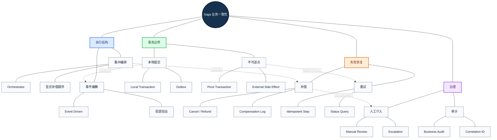

<strong>图谱解读：</strong>Saga 的核心是跨独立提交边界维护业务可接受的结果，而非模拟一个全局数据库锁。补偿失败本身也需要可观测、可重试或人工处理。

## 十、跨 Agent 协议、安全与可观测性

### 10.1 MCP 与 A2A 的边界

MCP（Model Context Protocol，模型上下文协议）主要标准化模型应用连接工具与上下文资源的方式；A2A 主要面向 Agent 间任务交互、能力发现和任务生命周期。二者可以互补：Agent 通过 MCP 使用工具，通过 A2A 与其他 Agent 协作，但不是所有同进程多 Agent 系统都需要部署 A2A 服务。

### 10.2 Trace、Span、Metric 与 Audit

OpenTelemetry（开放遥测）提供跨组件追踪、指标和日志的通用规范。Trace 是端到端调用链，Span 是一次具体操作；Metric 用于聚合延迟和错误率，Audit 则关注可追责的业务事实。`trace_id` 不等于 `task_id`，追踪系统也不应成为任务状态的唯一存储。

推荐记录：消息发送与确认耗时、队列积压、状态冲突率、Handoff 失败率、检查点恢复成功率、重复操作拦截数、每成功任务 Token 成本、P95 延迟、越权拒绝事件。

### 10.3 安全边界

Agent 接收的检索结果、网页和其他 Agent 生成文本都可能包含恶意指令。应进行来源标识、最小权限、工具调用授权、租户隔离、产物访问控制与敏感信息脱敏。Handoff 改变执行主体，不意味着权限自动转移；OpenTelemetry Baggage 等跨服务元数据也不应承载敏感秘密。

### 10.4 失效注入测试

建议人为制造消息重复、延迟、乱序、消费者崩溃、数据库写冲突、审批超时、外部 API 成功但响应丢失等场景，验证系统是否仍满足业务不变量。正常路径通过并不能证明协作系统具备生产可靠性。

### 协议、安全与可观测性

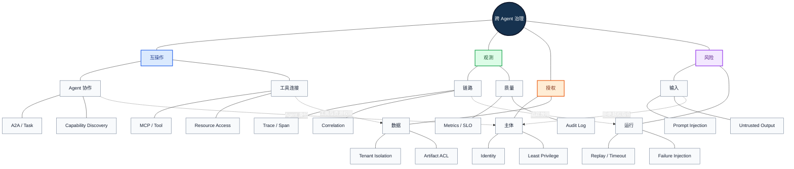

<strong>图谱解读：</strong>协议定义交互边界，授权决定可执行范围，追踪说明发生了什么，故障注入检验约束是否真正生效。不能用“Agent 很聪明”替代任何一层治理。

## 十一、主流框架的状态与通信实现

### 11.1 LangGraph

LangGraph 以 State Graph 组织节点和条件边。State Schema 定义共享字段，Reducer 定义并行更新的合并方式；Persistence/Checkpoint 负责保存执行状态；Command 可表达状态更新和控制流转移。应特别研究 `thread_id`、检查点粒度、节点重试、Interrupt（中断）和外部副作用的隔离。官方文档：[Graph API](https://docs.langchain.com/oss/python/langgraph/graph-api)、[Persistence](https://docs.langchain.com/oss/python/langgraph/persistence)。

### 11.2 AgentScope

AgentScope 将消息与 Memory 管理、State/Session 序列化作为重要机制。Memory 关注消息存储和组织；State/Session 关注 Agent 运行时可恢复的状态。需要区分本地状态保存与跨 Agent 共享数据库的事务一致性，两者不是同一能力。官方文档：[Memory](https://doc.agentscope.io/tutorial/task_memory.html)、[State/Session](https://doc.agentscope.io/tutorial/task_state.html)。

### 11.3 Microsoft Agent Framework

其工作流机制区分执行器私有状态与共享状态作用域，并提供工作流 Checkpoint。重点在于 Executor 的状态边界、消息调度、Superstep 和恢复语义。官方文档：[Workflow State](https://learn.microsoft.com/en-us/agent-framework/workflows/state)、[Checkpoints](https://learn.microsoft.com/en-us/agent-framework/workflows/checkpoints)。

| 比较项 | LangGraph | AgentScope | Microsoft Agent Framework |
|---|---|---|---|
| 主要抽象 | State Graph / Node | Agent / Message / Memory | Workflow / Executor |
| 状态重点 | Schema / Reducer | Memory / State Module | Private / Shared Scope |
| 恢复关注 | Checkpointer / Thread | 状态与会话序列化 | Workflow Checkpoint |
| 业务层仍需处理 | 外部副作用幂等 | 跨进程共享一致性 | 跨服务事务与授权 |

<strong>工程判断：</strong>框架解决的是编排和部分运行时机制，不会自动保证跨外部 API 的全局 Exactly-once，也不会自动定义企业业务权限。选型时应通过故障注入测试验证具体版本的能力，而非只对比宣传术语。

### 框架能力与业务责任

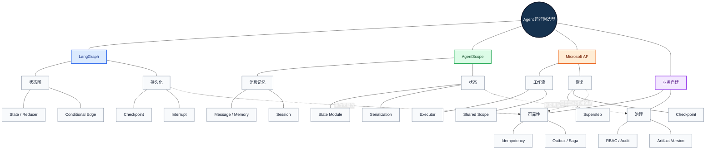

<strong>图谱解读：</strong>框架各有状态抽象，但幂等、业务事务、产物版本和租户权限必须与具体系统共同设计。选型应先确定失败边界和持久化需求，再决定框架。

## 十二、贯穿案例：医疗设备文档翻译的可恢复协作系统

### 12.1 业务目标与角色

一个文档翻译任务需要解析 PDF 或 Word，获取术语，执行中英翻译，恢复布局，进行数字/型号/术语/漏译检查，并输出可交付文件。推荐由 Orchestrator 维护任务生命周期；Parser、Translator、Layout、Quality 作为专业执行单元；确定性的 OCR、渲染、文件校验优先使用工具实现。

### 12.2 数据模型

| 对象 | 关键字段 | 所有者与约束 |
|---|---|---|
| TranslationTask | `task_id,status,version` | 编排器负责合法状态转换 |
| SourceArtifact | `artifact_id,checksum,revision` | 输入不可变 |
| Segment | `segment_id,source,layout_ref` | 解析器生成稳定 ID |
| TranslationRevision | `segment_id,target,revision` | 翻译器产生新版本，不覆盖历史 |
| LayoutArtifact | `input_revision,output_ref` | 排版器绑定译文版本 |
| QualityReport | `checks,issues,score` | 校验器记录证据和结果 |
| AgentExecution | `attempt,agent_id,status` | 运行时记录重试与耗时 |
| Approval | `approved_revision,actor,time` | 只对特定版本生效 |

### 12.3 消息与产物流转

创建任务时生成 Task ID；解析完成后持久化结构化段落与布局 Artifact；翻译阶段按段落 ID 生成译文版本；排版只消费指定译文版本；校验生成独立报告；审批必须绑定待发布产物的校验和。

如果译文版本改变，旧 LayoutArtifact 和旧 Approval 不应继续被视为当前有效。这样把跨 Agent 的一致性问题转化为明确的版本依赖。

### 12.4 三类故障演练

<strong>故障 A：翻译成功，渲染失败。</strong> 从已持久化译文版本恢复渲染，不重新请求翻译模型；检查版本是否仍有效。

<strong>故障 B：两个修复 Agent 同时修改同一段。</strong> 采用单写者或版本 CAS，只接受基于当前版本的提交；失败者重新读取并提出修复建议。

<strong>故障 C：上传完成但回执丢失。</strong> 使用稳定操作 ID 查询上传状态；不得因超时盲目重复创建交付物。

### 12.5 关键验收标准

除了译文准确率，还应验证：任务成功率、产物版本一致率、恢复后重复翻译率、幂等拦截率、并发冲突处理率、P95 端到端耗时、人工审批绑定正确率和每份成功文档成本。

### 企业文档翻译的中心协作网络

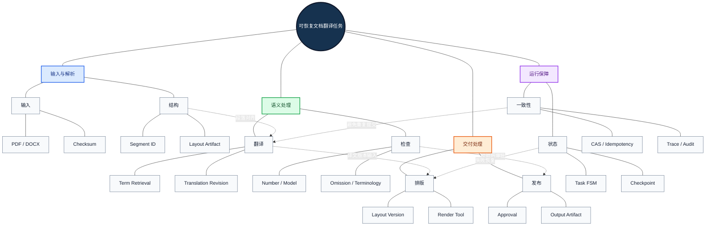

<strong>图谱解读：</strong>这张图以一个业务任务为中心，而不是以某个模型为中心。输入结构、译文版本、排版产物、质量报告和审批状态构成可追踪的依赖网络；恢复和幂等横跨所有执行分支。

## 十三、工程选型与系统性误区

| 业务条件 | 推荐优先方案 | 不建议直接采用 |
|---|---|---|
| 单机原型、任务短 | 进程内消息 + 显式状态 | 过早部署复杂消息集群 |
| 多页批处理、长任务 | 持久化任务队列 + Checkpoint | 仅靠 HTTP 长连接等待 |
| 并行写入少 | 单写者 + 版本 CAS | 所有字段全局共享可写 |
| 并行证据聚合 | 明确 Reducer + 去重 | 无序追加当成确定性结果 |
| 外部写操作可重试 | 稳定幂等键 + 状态核对 | 失败就无条件重放 |
| 数据库更新并发消息发布 | Outbox + 消费端去重 | 先提交数据库再随意发消息 |
| 跨服务业务副作用 | Saga / 补偿与人工介入 | 假设能全局回滚 |
| 高敏感审批与交付 | 版本绑定 + 权限校验 + 审计 | 只在 Prompt 中声明“需审批” |

### 13.1 十个必须纠正的误区

1. Agent 之间能互相发送自然语言，不等于具有可靠消息协议。
2. Shared Memory 不等于共享业务数据库，更不等于强一致性。
3. Redis、Kafka 或 RabbitMQ 是基础设施，不自动定义业务正确性。
4. Checkpoint 不保证外部副作用只执行一次。
5. 任务完成消息不等于最终文件已经持久化并可访问。
6. Handoff 不自动继承原 Agent 的权限。
7. Reducer 不会自动修复所有并发冲突。
8. 事件重放不是把所有工具调用重新执行一遍。
9. 追踪 ID 不应替代任务 ID、业务操作 ID 或幂等键。
10. 多 Agent 框架提供的恢复功能，不等于完整的分布式事务系统。

### 13.2 与其他章节的关系

本篇依赖第六章 [01｜多 Agent 基础](./01-Multi-Agent-Fundamentals.md) 的 Agent 边界与第六章 [02｜协作模式](./02-Collaboration-Patterns.md) 的控制权模型，并为 [04｜LangGraph](./04-LangGraph.md)、[05｜AgentScope](./05-AgentScope.md)、[06｜框架选型](./06-Framework-Selection.md) 提供评估维度。第五章 [MCP](../05-Agent-Knowledge-and-Tools/05-MCP.md) 关注工具与资源接入；本篇则关注 Agent 之间的运行时信息、状态与一致性。

## 十四、知识总结：从消息到业务正确性

一个多 Agent 系统可按如下顺序判断是否具备生产可靠性：首先，任务、消息和产物有独立标识与契约；其次，关键状态具有明确所有者、版本和合法转换；再次，检查点能够恢复执行位置；然后，所有可能重放的外部动作具备幂等或补偿设计；最后，权限、审计和故障注入能够验证系统在异常条件下仍满足业务约束。

<strong>最终结论：</strong>通信让 Agent 能够协作，状态让协作可以持续，一致性让并发结果可信，幂等与补偿让恢复不会破坏业务，观测与授权让系统可交付、可维护、可审计。

## 十五、参考资料与进一步阅读

1. [A2A Protocol Specification](https://a2a-protocol.org/latest/specification/) — Agent 间 Task、Message、Artifact 与生命周期。
2. [A2A GitHub](https://github.com/a2aproject/A2A) — 规范、示例和实现。
3. [Model Context Protocol Specification](https://modelcontextprotocol.io/specification/) — 工具与上下文协议边界。
4. [LangGraph Graph API](https://docs.langchain.com/oss/python/langgraph/graph-api) — State、Reducer、节点与路由。
5. [LangGraph Persistence](https://docs.langchain.com/oss/python/langgraph/persistence) — Checkpoint、线程与恢复。
6. [AgentScope Memory](https://doc.agentscope.io/tutorial/task_memory.html) — 消息与记忆管理。
7. [AgentScope State / Session](https://doc.agentscope.io/tutorial/task_state.html) — 状态注册、序列化与恢复。
8. [Microsoft Agent Framework — Workflow State](https://learn.microsoft.com/en-us/agent-framework/workflows/state) — 执行器状态与共享作用域。
9. [Microsoft Agent Framework — Checkpoints](https://learn.microsoft.com/en-us/agent-framework/workflows/checkpoints) — 工作流检查点。
10. [Microsoft Azure Architecture Center — Saga](https://learn.microsoft.com/en-us/azure/architecture/patterns/saga) — 长事务与补偿。
11. [Microsoft Azure Architecture Center — Transactional Outbox](https://learn.microsoft.com/en-us/azure/architecture/databases/guide/transactional-outbox-cosmos) — 本地事务与事件可靠发布。
12. [Microsoft Azure Architecture Center — Compensating Transaction](https://learn.microsoft.com/en-us/azure/architecture/patterns/compensating-transaction) — 补偿策略。
13. [OpenTelemetry Documentation](https://opentelemetry.io/docs/) — 追踪、指标与日志。
14. [OWASP Top 10 for LLM Applications](https://genai.owasp.org/llm-top-10/) — 提示注入与 Agent 安全风险。

> 版本说明：以上资料用于理解设计原理和典型实现。框架接口、检查点细节和协议字段可能随版本演进；工程实现前应对照所使用的确切版本再次核验。

