# LangGraph：从图式 Agent 编排到生产级有状态工作流

> 第六章 · 多 Agent 与框架 · 04-LangGraph  
> 阅读路线：技术定位 → 图抽象 → 状态合并 → 执行调度 → 动态协作 → 持久化恢复 → 可靠性 → 工程案例。  
> 本文依据 LangGraph 1.x 官方资料组织；具体 API 应以项目锁定版本的文档为准。

LangGraph 解决的不是“如何让模型说话”，而是<strong>如何让模型、工具和专业 Agent 在有状态、可循环、可恢复的执行系统中协同工作</strong>。理解它需要区分四层：图结构定义控制关系，状态更新传递执行事实，运行时调度节点，持久化与应用级治理处理故障及业务副作用。

## 全局知识导航

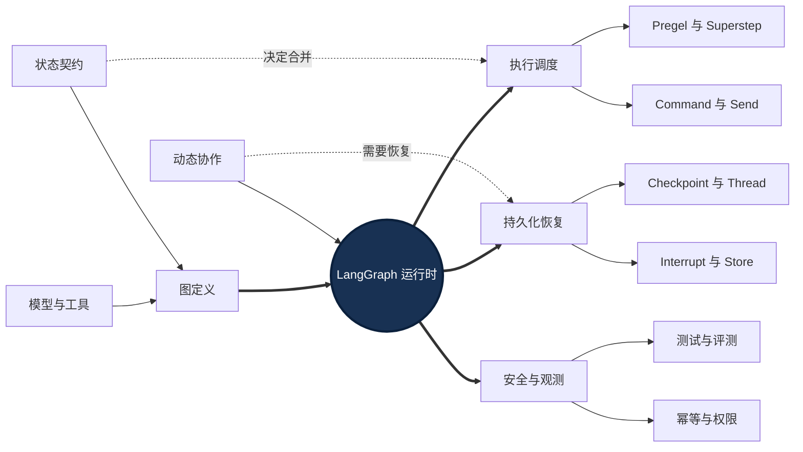

图谱解读：左侧的模型工具、状态契约和协作需求共同进入运行时；右侧将其展开为执行、持久化和治理能力。<strong>运行时的成功不自动等于外部业务操作的成功。</strong>

## 阅读前置：必须区分的几个概念

| 概念 | 所在层次 | 不应混淆为 |
|---|---|---|
| Graph / StateGraph | 控制流定义 | 图片绘制工具 |
| Node | 执行单元 | 必然是独立 Agent |
| Edge | 执行转移关系 | 数据库关联 |
| State | 图执行共享信息 | 完整业务数据库 |
| Reducer | 状态更新合并规则 | 通用冲突解决器 |
| Checkpoint | 可恢复执行快照 | 跨系统事务 |
| Thread | 持久化执行标识 | 操作系统线程 |
| Store | 跨线程应用数据 | 自动带权限的企业知识库 |


## 01｜定位与生态边界

LangGraph 是面向有状态 Agent 工作流的低层编排运行时，不是模型、向量数据库，也不是 LangChain 的简单可视化插件。它允许确定性步骤和模型决策共同构成可循环执行的图。

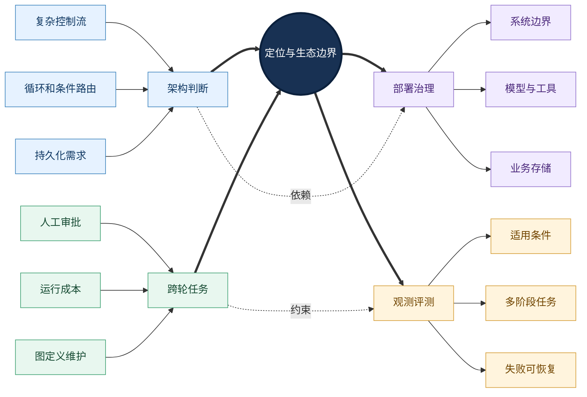

<strong>图谱解读：</strong> 该图以“定位与生态边界”为中心，将 架构判断、跨轮任务、部署治理 和 观测评测 四组问题关联起来。虚线表示设计约束或跨模块依赖，不表示真实的运行时调用顺序。

### 核心机制与工程含义

LangChain 提供模型、工具与高级 Agent 抽象；LangGraph 提供图执行、状态更新、检查点、暂停恢复；LangSmith 偏向追踪、评测和应用运维。一个简单的单轮工具问答无需强行引入复杂图。

## 02｜StateGraph、Node 与 Edge

StateGraph 描述状态字段和节点间控制关系。Node 是接收状态并返回更新的执行单元，不必是 LLM Agent；Edge 决定后继执行。START 和 END 表示图入口与结束，不是普通业务节点。

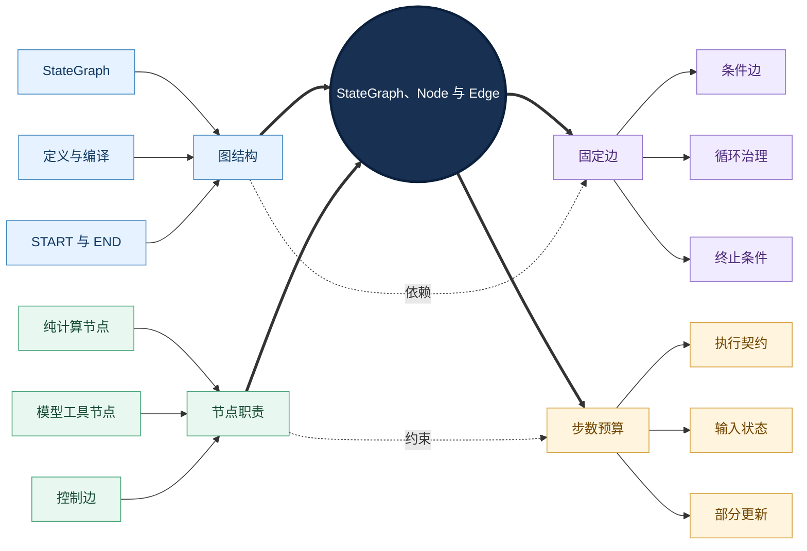

<strong>图谱解读：</strong> 该图以“StateGraph、Node 与 Edge”为中心，将 图结构、节点职责、固定边 和 步数预算 四组问题关联起来。虚线表示设计约束或跨模块依赖，不表示真实的运行时调用顺序。

### 核心机制与工程含义

编译后的图是可执行运行时对象；compile 不是机器码编译。固定边表达确定依赖，条件边根据状态选择下一步。循环必须定义可判定的退出条件及执行预算。

## 03｜State Schema 与 Reducer

State Schema 定义图中字段的类型和含义。节点通常返回部分状态更新，而不是每次返回整个状态。Reducer 指定同一字段接收多次更新时如何合并；未配置归约的字段通常采用覆盖语义。

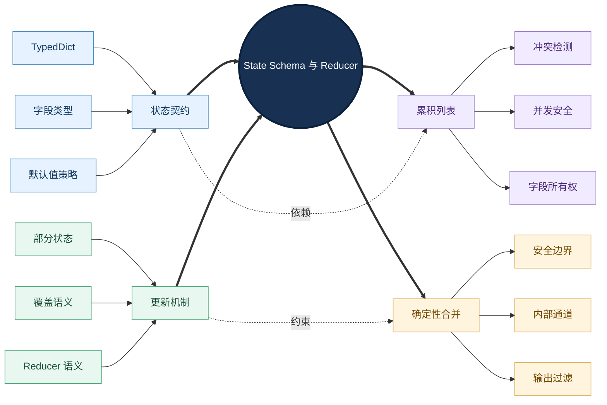

<strong>图谱解读：</strong> 该图以“State Schema 与 Reducer”为中心，将 状态契约、更新机制、累积列表 和 确定性合并 四组问题关联起来。虚线表示设计约束或跨模块依赖，不表示真实的运行时调用顺序。

### 核心机制与工程含义

TypedDict 更轻量；dataclass 适合默认值与对象组织；Pydantic 可提供运行时校验但增加开销。对于并行写入同一键，必须使用有明确语义的归约规则；合并列表并不等于解决事实冲突。

对于更新规则，假设某状态字段的当前值为 $s$，节点返回更新 $u$，归约规则为 $R$，则新状态可抽象为：

$$
s_{t+1}=R(s_t,u_t)
$$

如果是覆盖型更新，$R(s,u)=u$；如果是列表累积，可能采用连接操作。并行时，若合并不满足预期的交换律或结合律，结果可能受到更新顺序影响。应优先设计不可变结果、稳定 ID 与确定性的聚合策略。

| 字段类型 | 典型策略 | 注意事项 |
|---|---|---|
| `messages` | 消息专用归约器 | 消息 ID、删除与更新语义 |
| `evidence` | 追加后按来源去重 | 防止重复证据放大权重 |
| `approval_status` | 单一所有者或状态机 | 不能用简单列表拼接决定审批 |
| `artifact_version` | 显式版本检查 | 不允许过期节点覆盖新产物 |

## 04｜Pregel、Channel 与 Superstep

LangGraph 的图执行受到 Pregel 图计算模型启发：运行时将执行划分为 Superstep（超级步），同一阶段的就绪节点可并行运行，阶段边界应用状态更新并激活后续节点。

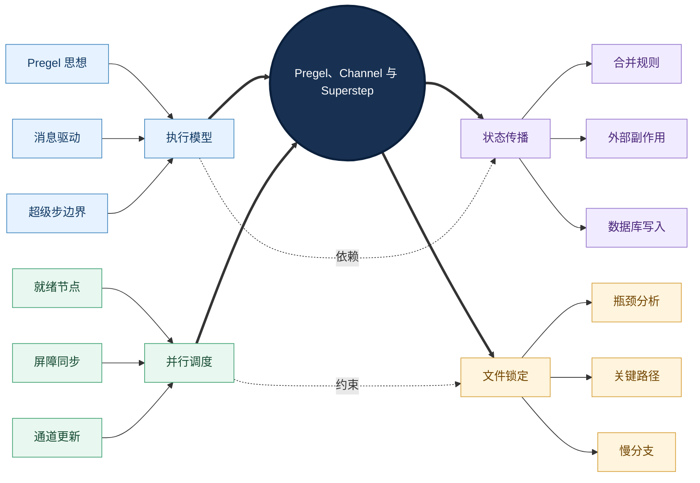

<strong>图谱解读：</strong> 该图以“Pregel、Channel 与 Superstep”为中心，将 执行模型、并行调度、状态传播 和 文件锁定 四组问题关联起来。虚线表示设计约束或跨模块依赖，不表示真实的运行时调用顺序。

### 核心机制与工程含义

Channel（通道）承载运行时值及更新行为；Reducer 是开发者定义状态合并语义的重要接口。超级步内并发不意味着对外部数据库或文件的并发写天然安全。

假设图中存在 A → {B, C} → D，且 B、C 没有依赖，则理想关键路径耗时近似为：

$$
T_{\mathrm{path}}=T_A+\max(T_B,T_C)+T_D
$$

真实耗时还需要考虑调度、模型 API 限流、网络、检查点写入和聚合开销。多个节点处于同一 Superstep 不保证一定在不同 CPU 核心或不同机器上执行。

## 05｜控制流：Conditional Edge、Command、Send

Conditional Edge 用路由函数决定分支；Command 可在节点结果中同时携带状态更新与下一步控制信息；Send 允许根据运行时数据生成多个任务实例，常用于 MapReduce 风格扇出。

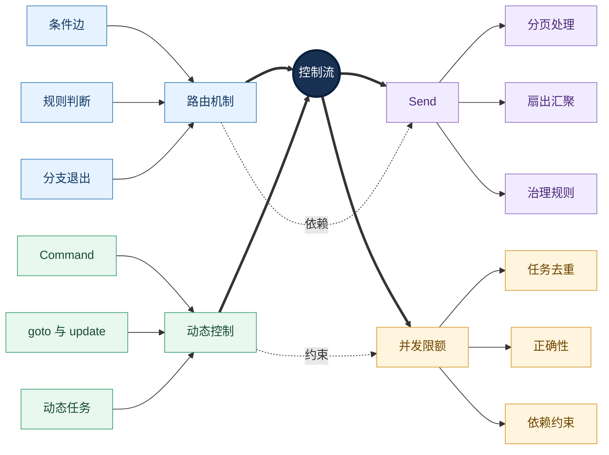

<strong>图谱解读：</strong> 该图以“控制流”为中心，将 路由机制、动态控制、Send 和 并发限额 四组问题关联起来。虚线表示设计约束或跨模块依赖，不表示真实的运行时调用顺序。

### 核心机制与工程含义

Command 和固定边混用时须理解两者可能都触发后继节点，避免意外重复执行。Send 的并行结果必须定义汇聚字段和归约规则。动态路由不等于无约束自主决策。

### 最小机制示例（Python，展示语义而非完整业务实现）

```python
from typing import Annotated, TypedDict
import operator
from langgraph.graph import StateGraph, START, END
from langgraph.types import Send

class State(TypedDict):
    pages: list[str]
    results: Annotated[list[str], operator.add]

def fan_out(state: State):
    return [Send("translate_page", {"page": page}) for page in state["pages"]]

def translate_page(state: dict):
    return {"results": [state["page"].upper()]}

builder = StateGraph(State)
builder.add_node("translate_page", translate_page)
builder.add_conditional_edges(START, fan_out)
builder.add_edge("translate_page", END)
graph = builder.compile()
```

此例仅演示动态任务分发与列表归约；真实文档翻译必须增加页面 ID、稳定排序、限流、异常处理和术语一致性控制。列表连接的完成顺序不应被当作原文顺序。

## 06｜协作模式在图中的实现

ReAct（Reasoning and Acting，推理与行动）可以用模型节点和工具节点形成闭环；Router 通过条件边选择专业路径；Supervisor 通过集中控制节点委派；Handoff 通过控制权转移将后续执行交给目标 Agent。

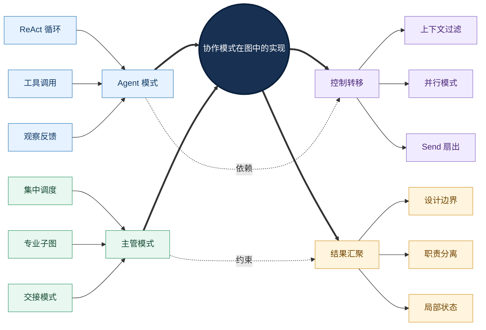

<strong>图谱解读：</strong> 该图以“协作模式在图中的实现”为中心，将 Agent 模式、主管模式、控制转移 和 结果汇聚 四组问题关联起来。虚线表示设计约束或跨模块依赖，不表示真实的运行时调用顺序。

### 核心机制与工程含义

协作模式是系统层设计，节点和子图是实现单元。不能将每个节点都叫 Agent，也不能将所有 Agent 放在同一个共享消息列表中而不划分权限与状态所有权。

## 07｜Subgraph：模块化与状态边界

Subgraph（子图）是作为父图节点调用的另一张图，适合封装检索、翻译、质量检查等专业工作流。父子图共享字段时可以直接组合；状态 Schema 不同时需要适配输入输出。

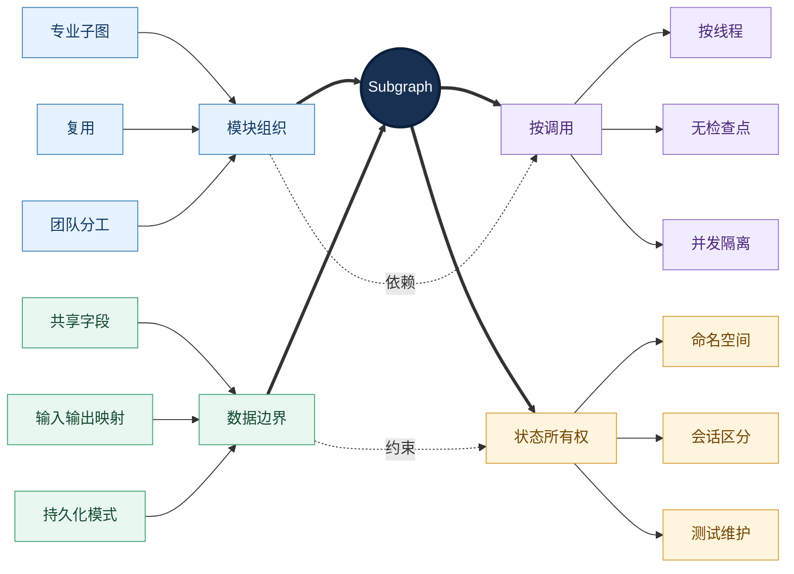

<strong>图谱解读：</strong> 该图以“Subgraph”为中心，将 模块组织、数据边界、按调用 和 状态所有权 四组问题关联起来。虚线表示设计约束或跨模块依赖，不表示真实的运行时调用顺序。

### 核心机制与工程含义

子图可以选择每次调用独立状态、跨同一线程保留状态或禁用检查点。选择取决于 Agent 是否需要持续会话、并发调用隔离及恢复要求。共享 Schema 方便协作但可能增加耦合。

## 08｜持久化：Checkpoint、Thread、Store

Checkpoint 保存图执行历史中的状态快照；Thread 是通过 thread_id 关联的一条持久化执行历史，并非操作系统线程；Store 则可用于跨 Thread 的应用数据和长期记忆。

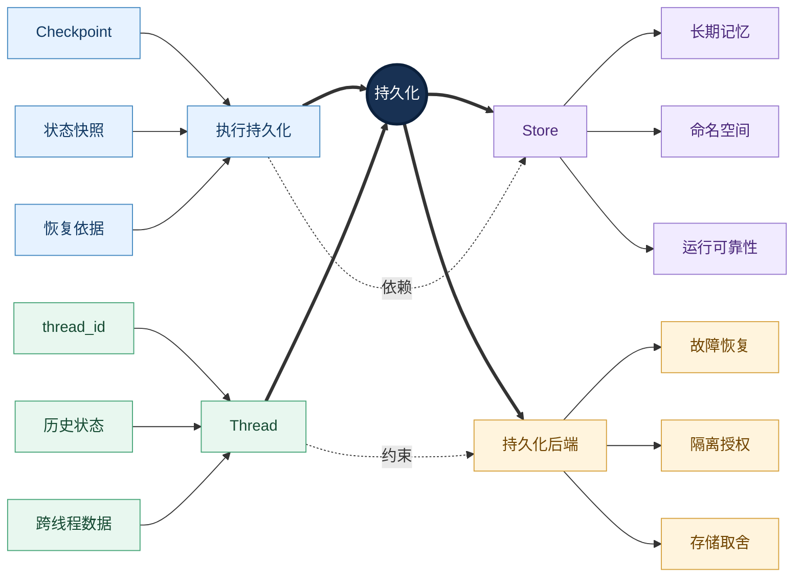

<strong>图谱解读：</strong> 该图以“持久化”为中心，将 执行持久化、Thread、Store 和 持久化后端 四组问题关联起来。虚线表示设计约束或跨模块依赖，不表示真实的运行时调用顺序。

### 核心机制与工程含义

开发可使用内存存储，跨进程恢复需持久化 Checkpointer。Checkpoint 不等于完整事件溯源，也不自动回滚外部副作用。Thread ID 不是访问控制机制。Store 不是自动具备企业权限过滤的知识库。

### Checkpoint 与 Store 的生命周期差异

| 问题 | Checkpointer | Store |
|---|---|---|
| 主要键 | thread_id 等执行配置 | namespace 与 key 等应用键 |
| 核心对象 | 图状态和执行历史 | 跨线程应用数据 |
| 恢复用途 | 暂停、继续、历史状态 | 读取长期信息 |
| 安全问题 | 越权访问历史 Thread | 跨用户命名空间泄露 |

建议将大体积 PDF、Word、图片放入独立对象存储，State 只记录 artifact_id、checksum 和版本。Checkpoint 可恢复图状态，但不能替代业务文件版本管理。

## 09｜Interrupt、人工审批与 Time Travel

interrupt() 可以暂停图执行并向外部请求输入，恢复通常通过 Command(resume=...) 完成。Time Travel 允许基于历史检查点检查、分叉或重放图状态。

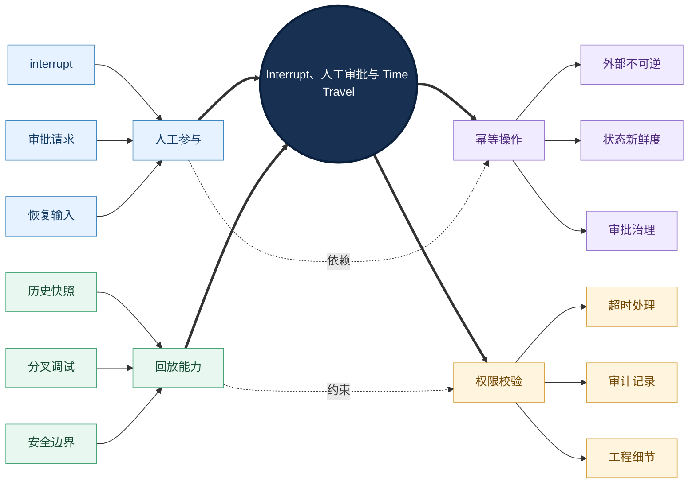

<strong>图谱解读：</strong> 该图以“Interrupt、人工审批与 Time Travel”为中心，将 人工参与、回放能力、幂等操作 和 权限校验 四组问题关联起来。虚线表示设计约束或跨模块依赖，不表示真实的运行时调用顺序。

### 核心机制与工程含义

节点恢复时 interrupt 前的代码可能再次运行，故不可在暂停前放置无幂等保护的扣费、发布等操作。时间旅行重放图状态，不会逆转外部世界已发生的业务操作。

### 审批恢复的关键边界

1. 审批前构造明确的请求数据，写入可追踪状态。
2. 使用 `interrupt()` 暂停，保存线程上下文。
3. 审批方依据身份和当前业务版本作出决定。
4. 通过 `Command(resume=...)` 恢复执行。
5. 执行副作用前再次验证审批有效性和幂等键。

特别注意：恢复可能重新进入节点起始位置，因此将不可逆动作放在暂停之前属于危险设计。

## 10｜Streaming 与可观测性

Streaming（流式输出）可以输出模型 Token、节点状态更新、执行事件或自定义业务进度。Trace（追踪）和 Span（片段）帮助定位模型调用、工具调用、路由与失败位置。

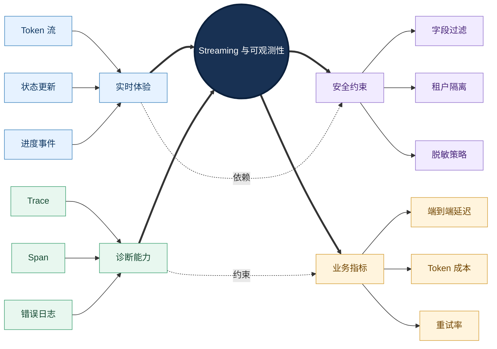

<strong>图谱解读：</strong> 该图以“Streaming 与可观测性”为中心，将 实时体验、诊断能力、安全约束 和 业务指标 四组问题关联起来。虚线表示设计约束或跨模块依赖，不表示真实的运行时调用顺序。

### 核心机制与工程含义

流式事件不等于持久化完成。UI 展示的进度应以权威任务状态为准。需要注意内部状态流可能暴露敏感字段，生产系统必须过滤输出并设置用户/租户授权。

## 11｜Graph API 与 Functional API

Graph API 显式定义 StateGraph、节点与边，适合复杂路由、循环、可视化结构和多 Agent 协作。Functional API 通过 entrypoint 和 task 将持久化执行融入普通 Python 函数结构。

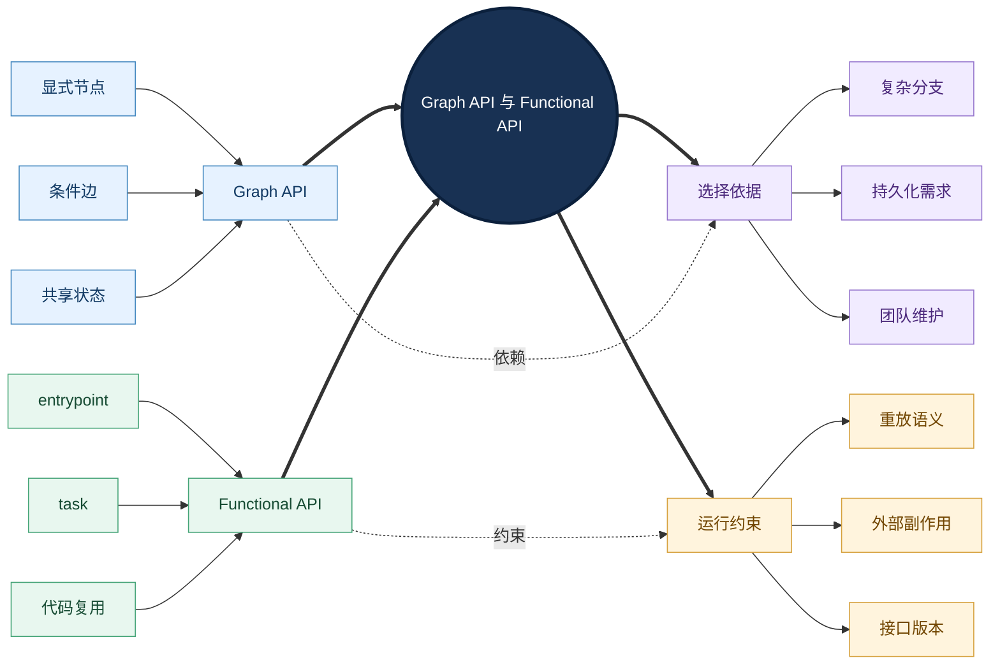

<strong>图谱解读：</strong> 该图以“Graph API 与 Functional API”为中心，将 Graph API、Functional API、选择依据 和 运行约束 四组问题关联起来。虚线表示设计约束或跨模块依赖，不表示真实的运行时调用顺序。

### 核心机制与工程含义

两者并非“高级/低级”简单等级关系，而是控制流表达方式不同。Graph API 强调结构可见，Functional API 强调保持函数式组织；需要根据调试方式、团队习惯和工作流复杂度选择。

## 12｜可靠性：Retry、Timeout、Error Handler

可靠性治理需要分层：Retry 处理暂时性失败；Timeout 限制节点执行时间；Error Handler 负责重试耗尽后的状态更新或转移；Checkpoint 负责执行恢复；幂等保证重复运行不产生重复副作用。

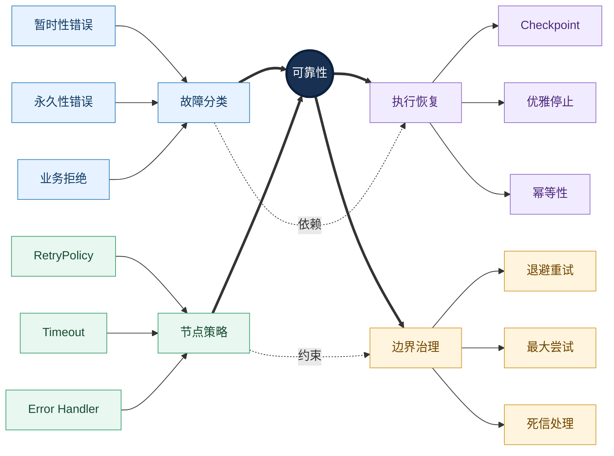

<strong>图谱解读：</strong> 该图以“可靠性”为中心，将 故障分类、节点策略、执行恢复 和 边界治理 四组问题关联起来。虚线表示设计约束或跨模块依赖，不表示真实的运行时调用顺序。

### 核心机制与工程含义

LangGraph 1.2 系列增强了节点级超时和错误处理机制；使用时应核对当前版本文档，尤其是异步节点适用条件。优雅停止在执行边界协作退出，不应理解为立即中断任意阻塞外部调用。

### 失败策略矩阵

| 失败类型 | 首选措施 | 不宜采用 |
|---|---|---|
| 模型 API 暂时限流 | 指数退避与并发限制 | 无限立即重试 |
| 输出 Schema 错误 | 验证后定向修复或失败退出 | 原样重复相同请求 |
| 外部写入响应丢失 | 幂等键与远端状态核对 | 直接重新提交 |
| 人工审批超时 | 挂起或业务超时策略 | 自动视为批准 |
| 节点资源耗尽 | 限流、隔离、降级 | 无上限扩容子任务 |

如果单次失败概率为 $p$，且重试之间独立、总尝试次数为 $n$，则理论至少一次成功概率为：

$$
P_{\mathrm{success}}=1-p^n
$$

这是用于解释重试收益的理想化模型；实际限流、持续故障和错误关联会破坏独立性假设。

## 13｜测试、评测与性能优化

LangGraph 测试不仅验证最终文本，还应覆盖节点输出、条件路由、Reducer 合并、子图契约、暂停恢复、异常注入和外部副作用幂等。评测基线应是具备相同工具的简化实现。

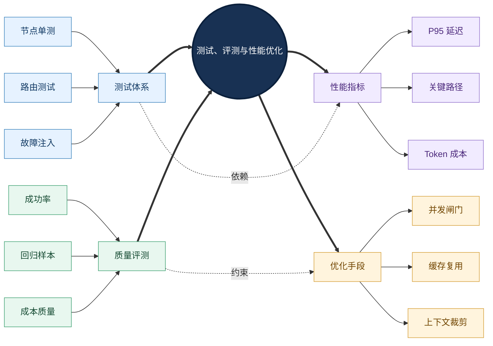

<strong>图谱解读：</strong> 该图以“测试、评测与性能优化”为中心，将 测试体系、质量评测、性能指标 和 优化手段 四组问题关联起来。虚线表示设计约束或跨模块依赖，不表示真实的运行时调用顺序。

### 核心机制与工程含义

性能优化要区分模型延迟、工具延迟、关键路径、并行收益、检查点 I/O 与上下文成本。盲目增加 Agent 或并行节点可能受到 API 限流和资源争用反噬。

## 14｜企业案例：医疗文档翻译工作流

以复杂 PDF/Word 翻译为例，主图负责文件识别、解析、翻译、版式恢复、质量检查与交付；专业子图承担语义判断；普通工具承担文件解析、渲染和可确定性验证。

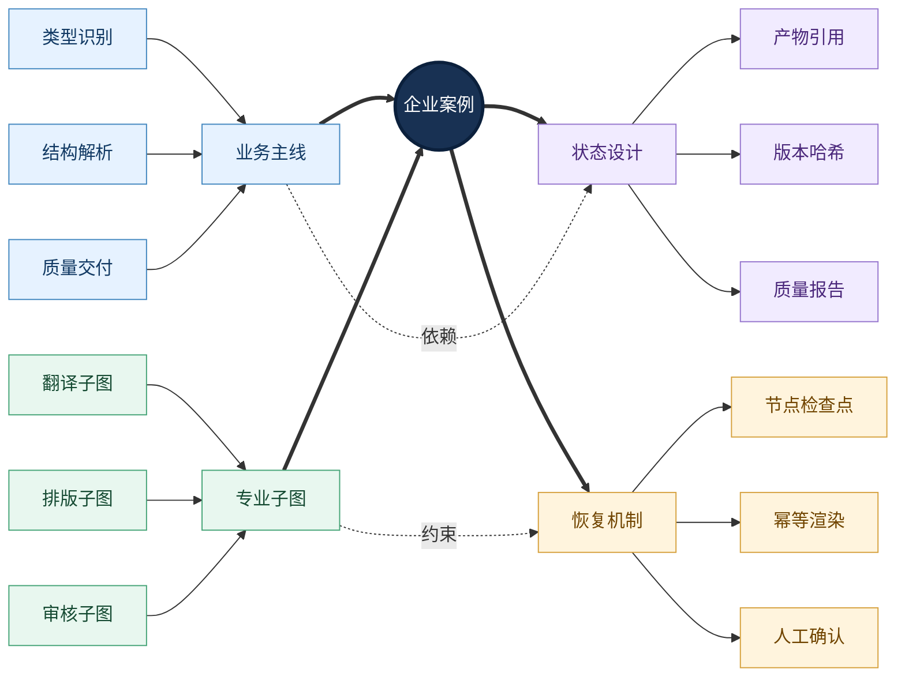

<strong>图谱解读：</strong> 该图以“企业案例”为中心，将 业务主线、专业子图、状态设计 和 恢复机制 四组问题关联起来。虚线表示设计约束或跨模块依赖，不表示真实的运行时调用顺序。

### 核心机制与工程含义

扫描型文档进入 OCR 分支；翻译与版式依赖结构化段落 ID；校验发现术语错误返回翻译子图，发现裁切返回排版子图。跨页段落和表格不能无条件按页独立处理。中间产物应不可变、带版本号与哈希，状态保存引用而非完整文件。

### 面向翻译业务的可执行契约

| 节点/子图 | 输入 | 输出 | 失败恢复策略 |
|---|---|---|---|
| 文档识别 | 原文件引用 | 类型、页数、可提取性 | 规则兜底与人工确认 |
| 结构解析 | 文件引用与类型 | 段落、表格、图片锚点 | 分页重试与缺失检查 |
| 术语检索 | 领域与文本片段 | 术语版本及证据 | 缓存与检索降级 |
| 翻译子图 | 文本块、术语约束 | 带 ID 的译文 | 仅重翻失败块 |
| 版式恢复 | 布局与译文版本 | 输出文件引用 | 幂等渲染 |
| 质量检查 | 原文、译文、输出文件 | 错误分类与证据 | 定向路由修复 |
| 人工审批 | 风险报告 | 审批记录 | 挂起、超时和审计 |

建议将段落 ID、源文件哈希、术语版本和译文版本作为产物依赖链的基础。质量检查发现过期译文时，应拒绝基于旧版本继续渲染。

## 15｜架构选型、常见误区与知识网络

LangGraph 的工程价值来自明确的图执行、状态传播、动态路由和持久化边界，而不是“图越复杂越先进”。要同时验证图执行正确性、状态持久化正确性与外部业务副作用正确性。

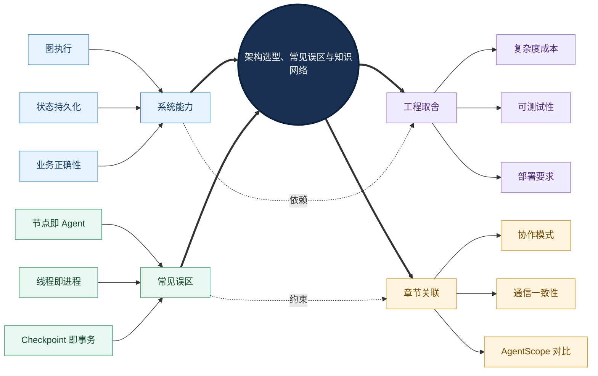

<strong>图谱解读：</strong> 该图以“架构选型、常见误区与知识网络”为中心，将 系统能力、常见误区、工程取舍 和 章节关联 四组问题关联起来。虚线表示设计约束或跨模块依赖，不表示真实的运行时调用顺序。

### 核心机制与工程含义

与前文多 Agent 协作模式、通信与状态管理形成承接；与后续 AgentScope 和框架选型形成比较。若任务短小、无复杂分支和恢复要求，简单函数或高级 Agent API 往往更经济。

## 关键技术对比与章节关联

| 需要解决的问题 | 优先采用 | 不要误以为 |
|---|---|---|
| 复杂分支与循环 | StateGraph + Conditional Edge | 只能用 DAG |
| 动态任务数量 | Send + Reducer | 并行自动保证顺序 |
| 动态控制权交接 | Command / 子图 | Handoff 等于共享全部上下文 |
| 中断与继续 | Checkpointer + Interrupt | Checkpoint 自动回滚外部 API |
| 跨会话数据 | Store / 业务存储 | Thread 等于用户身份 |
| 稳定外部写操作 | 幂等、版本控制、事务 | 图状态成功即业务成功 |
| 运行时分析 | Streaming、Tracing、Evaluation | Token 流等于最终交付 |

<strong>与本章其他文件的联系：</strong>《01-Multi-Agent-Fundamentals》回答为什么需要多个 Agent；《02-Collaboration-Patterns》回答如何分工与交接；《03-Communication-and-State》解释通信、一致性和可靠交付；本文回答 LangGraph 如何实现上述能力；后续《05-AgentScope》与《06-Framework-Selection》则比较另一套工程抽象和实际选型。

## 权威资料与延伸阅读

1. [LangGraph Overview](https://docs.langchain.com/oss/python/langgraph/overview) — 定位、版本和运行时能力。
2. [Graph API](https://docs.langchain.com/oss/python/langgraph/graph-api) — StateGraph、Reducer、Node、Edge、Command、Send。
3. [Thinking in LangGraph](https://docs.langchain.com/oss/python/langgraph/thinking-in-langgraph) — 工作流设计思想。
4. [Persistence](https://docs.langchain.com/oss/python/langgraph/persistence) — Thread、Checkpoint、Store。
5. [Interrupts](https://docs.langchain.com/oss/python/langgraph/interrupts) — 人工审批、暂停与恢复。
6. [Subgraphs](https://docs.langchain.com/oss/python/langgraph/use-subgraphs) — 子图边界与持久化。
7. [Streaming](https://docs.langchain.com/oss/python/langgraph/streaming) — 实时事件与状态更新。
8. [Time Travel](https://docs.langchain.com/oss/python/langgraph/use-time-travel) — 历史状态检查与回放。
9. [Functional API](https://docs.langchain.com/oss/python/langgraph/use-functional-api) — 函数式编排。
10. [Fault Tolerance](https://docs.langchain.com/oss/python/langgraph/fault-tolerance) — 重试、超时和错误处理。
11. [Testing](https://docs.langchain.com/oss/python/langgraph/test) — 图与节点测试。
12. [LangGraph GitHub](https://github.com/langchain-ai/langgraph) — 源码、发布记录和 Issues。
13. [LangGraph Releases](https://github.com/langchain-ai/langgraph/releases) — 版本变更。
14. [Archived LangGraph Supervisor Repository](https://github.com/langchain-ai/langgraph-supervisor-py) — 历史 Supervisor 实现，仅作设计参考。

> 版本提醒：LangGraph 更新频繁，本文强调稳定概念及设计原则；节点超时、错误处理器、子图持久化和流式输出等细节应以项目锁定版本的官方文档和实际测试为准。

## 全章总结

<strong>LangGraph 的本质是将 Agent 决策放入有状态、可控、可恢复的执行图中。</strong> 图结构表达依赖，State/Reducer 约束数据变化，Pregel/Superstep 组织调度，Command/Send 支持动态协作，Subgraph 建立模块边界，Checkpoint/Thread/Store 负责不同范围的持久化，Interrupt 提供人工治理，Retry/Timeout/Error Handler 处理故障；外部事务、幂等、授权和产物一致性仍需应用层负责。
