# 05｜AgentScope：核心理念、运行机制与企业级 Agent 工程

> 第六章「多 Agent 与框架」· 第五篇。研究范围：AgentScope 2.x 的 Agent 抽象、模型适配、消息、工具、记忆、规划、协作、状态、观测与工程部署。本文以官方文档及源码仓库为依据；不同版本的 API 以实际安装版本为准。

<strong>核心命题：</strong>AgentScope 不只是多 Agent 对话框架，而是以 Agent 为中心，将模型推理、结构化交互、工具执行、上下文管理和团队协作组合起来的开发框架。理解它，必须同时回答「Agent 怎样行动」「信息怎样进入模型」「工具怎样执行」「多个 Agent 怎样协作」「状态怎样保存」「系统怎样可靠交付」六个问题。

<strong>阅读路线：</strong> 先理解 Agent 的内部执行，再理解消息与能力层，随后进入记忆、计划、多 Agent 编排和状态恢复，最后讨论治理、测试与企业案例。与本章前文的关系：`01-Multi-Agent-Fundamentals.md` 解释多 Agent 的边界，`02-Collaboration-Patterns.md` 解释协作拓扑，`03-Communication-and-State.md` 解释通信一致性，`04-LangGraph.md` 解释图式运行时；本篇聚焦 AgentScope 的具体实现。

## 0. 全局知识网络与学习依赖

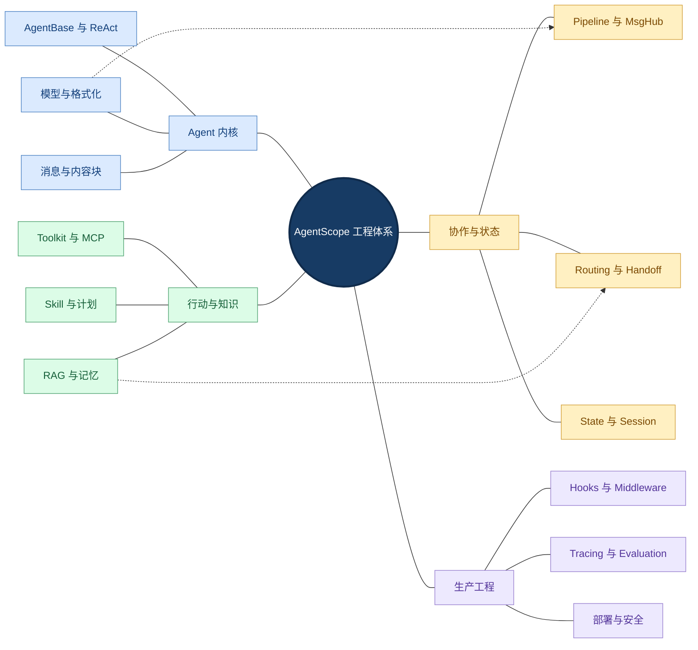

<strong>图谱解读：</strong>左侧是单个 Agent 的内部能力和知识来源，右侧是跨 Agent 协作及生产治理。模型与 Formatter 决定输入输出契约；工具、记忆和计划改变可执行能力；Pipeline、Handoff 与 Session 决定协作的生命周期；评测与权限约束最终交付质量。图中的跨分支虚线表示「模型输入依赖状态上下文」「知识结果会参与协作决策」，而非调用顺序。

核心分层可归纳为：<strong>能力抽象层（Agent/Model/Tool）→ 交互与上下文层（Msg/Formatter/Memory）→ 协作层（Pipeline/Routing）→ 运行治理层（State/Tracing/Evaluation）</strong>。这是一种便于学习的工程划分，不是官方源码目录的逐项复制。

## 1. 框架定位、演进与技术边界

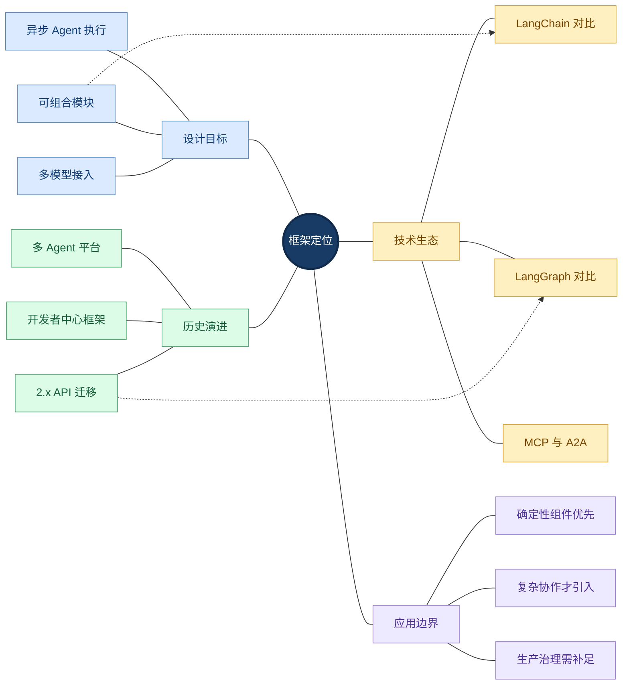

<strong>图谱解读：</strong>左侧两组代表该主题的输入条件与核心机制，右侧两组代表协作影响和工程约束。虚线表示跨模块依赖，阅读时应结合下文区分数据流、控制流与权限边界。

AgentScope（智能体开发框架）把 Agent 定义为能够接收消息、调用模型与工具并产生回复的运行主体。框架强调开发者可以显式选择模型、格式化器、工具和记忆实现。<strong>框架抽象不是业务可靠性的充分条件</strong>：它可以降低 Agent 组合的开发成本，但业务事务、鉴权、跨进程持久化和审计仍要根据部署环境设计。

从演进角度看，AgentScope 早期研究关注多 Agent 平台的灵活性与鲁棒性，后续版本逐步强调开发者体验、异步执行和组件组合。阅读教程必须区分 1.x 和 2.x 的 API，不能把历史 `DialogAgent` 示例直接当作 2.x 的标准写法。最稳妥的做法是固定依赖版本、记录示例运行环境，再核对该版本的官方教程。

LangGraph 以状态图和控制流为主要组织入口，AgentScope 以 Agent 对象和消息/工具组合为主要入口。前者在复杂可视化流程和检查点编排方面有清晰的抽象，后者在 ReActAgent、Toolkit、MsgHub 等模块组合方面更直观；它们可以解决重叠问题，不能简单判定谁绝对更强。

## 2. AgentBase、ReActAgent 与执行循环

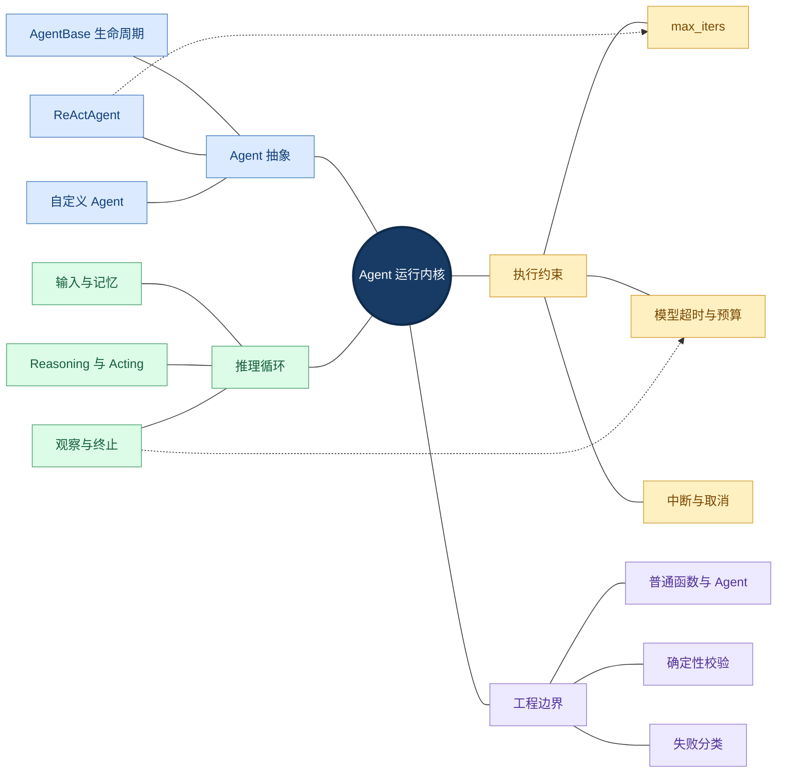

<strong>图谱解读：</strong>左侧两组代表该主题的输入条件与核心机制，右侧两组代表协作影响和工程约束。虚线表示跨模块依赖，阅读时应结合下文区分数据流、控制流与权限边界。

AgentBase 提供 Agent 的基础抽象，ReActAgent 则将 ReAct（Reasoning and Acting，推理与行动）范式落地为可复用组件。一次回复通常包含：接收 Msg → 读取上下文 → Formatter 构造模型输入 → 模型返回回答或工具调用 → Toolkit 执行 → 工具结果进入消息上下文 → 再次推理直至结束。

ReAct 并不保证每一步都有可供用户读取的完整内部推理。应把它理解为<strong>决策—行动—观察的运行范式</strong>，而不是要求模型暴露私有思维链。`max_iters` 约束循环轮数，但不能替代外部 API 超时、总 Token 预算、并发限额和截止时间。工具错误应分类：临时网络故障适合有限重试，参数 Schema 错误适合修正调用，权限拒绝必须停止或升级审批。

Agent 的粒度应由任务不确定性决定。文档页码排序、哈希校验和单位格式检测等确定性步骤，通常应实现为普通函数或 Tool；只有需要语言理解、证据综合、动态选择的部分才值得交给 Agent。

### ReActAgent 的关键配置

| 组件或参数 | 职责 | 设计检查点 |
|---|---|---|
| `name` / `sys_prompt` | 身份和行为边界 | 避免角色提示词承担授权责任 |
| `model` / `formatter` | 模型调用与消息转换 | 同时验证协议和能力 |
| `toolkit` | 工具注册与执行 | 参数校验、权限、超时 |
| `memory` / `long_term_memory` | 上下文与长期信息 | 生命周期、压缩损失、隐私 |
| `parallel_tool_calls` | 工具并行调用 | 冲突资源与并发上限 |
| `max_iters` | 循环上限 | 配合预算和截止时间 |
| `plan_notebook` | 计划组织 | 与工作流调度解耦 |

## 3. Msg、ContentBlock 与 Formatter

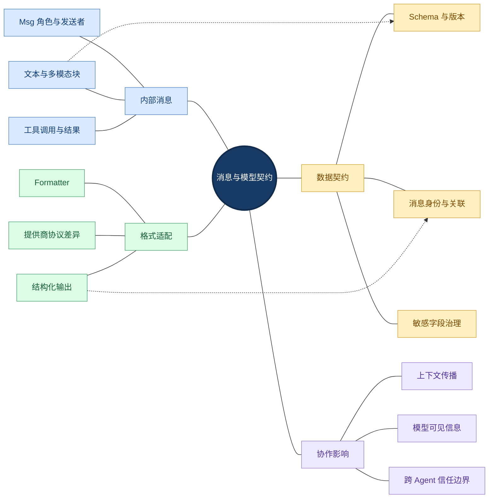

<strong>图谱解读：</strong>左侧两组代表该主题的输入条件与核心机制，右侧两组代表协作影响和工程约束。虚线表示跨模块依赖，阅读时应结合下文区分数据流、控制流与权限边界。

Msg（Message，消息）承载发送者、角色、内容等交互信息。内容可能由文本、图片、工具调用及工具结果等 ContentBlock（内容块）组成。<strong>消息不是纯字符串，也不是完整的业务任务状态。</strong> 这一区别决定了复杂文件不宜反复嵌入聊天历史，而应使用 Artifact（产物）引用。

Formatter（格式化器）将内部消息适配为具体模型 API 接受的消息结构。模型之间在多模态内容、工具参数、结构化输出和流式协议方面存在差异，因此更换 Model 时必须同时核对 Formatter 的兼容性。结构化输出能降低解析歧义，却不能保证语义正确；例如设备型号字段类型合法，内容仍可能被模型改写。

消息传播还涉及信任：检索结果、外部文档、其他 Agent 的回复都是数据输入，不能因为它们被封装为 Msg 就升级为系统指令。企业级系统应在消息入口进行来源标识、Schema 验证、敏感数据过滤，并记录任务关联 ID。

## 4. Model、模型能力与动态路由

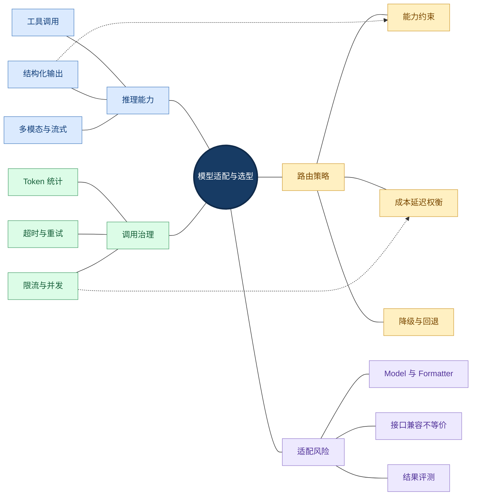

<strong>图谱解读：</strong>左侧两组代表该主题的输入条件与核心机制，右侧两组代表协作影响和工程约束。虚线表示跨模块依赖，阅读时应结合下文区分数据流、控制流与权限边界。

Model 层负责向模型服务发起推理请求。兼容 OpenAI 风格的 HTTP 接口，只能说明请求协议可能相近，并不保证工具调用、多模态输入、JSON Schema 和流式响应完全等价。接入新模型至少需要进行四类契约测试：纯文本、工具调用、结构化输出和异常返回。

动态模型路由（Model Routing）可依据任务难度、风险、成本和延迟选择模型。对于设备型号审查、医疗术语一致性等高风险任务，不能仅按价格选择最便宜模型。模型路由的正确性应以真实任务集衡量，包括回退触发率、成功率、P95 延迟和单位任务成本。

对于模型请求，指数退避（Exponential Backoff）是常见重试策略，但必须设置最大次数并区分可重试异常。若一次请求可能触发外部业务副作用，不能只依赖模型调用重试机制，应在工具服务端额外设置幂等保护。

## 5. Toolkit、ToolResponse 与工具生命周期

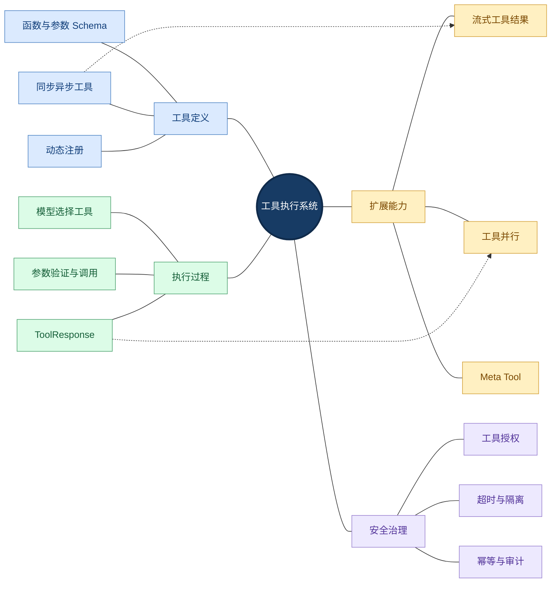

<strong>图谱解读：</strong>左侧两组代表该主题的输入条件与核心机制，右侧两组代表协作影响和工程约束。虚线表示跨模块依赖，阅读时应结合下文区分数据流、控制流与权限边界。

Toolkit（工具包）承担工具注册、Schema 提取、统一执行和结果组织等职责。它把 Python 函数或外部能力转成模型可选择的工具，但<strong>注册不等于授权，调用成功不等于业务正确</strong>。ToolResponse 应能表达执行内容与失败信息，业务应用还应记录操作 ID、状态码和产物引用。

异步 I/O 工具可以提高等待网络和数据库期间的并发利用率，但 CPU 密集型 OCR、PDF 渲染和大型图像处理不会因为声明为 `async` 自动变快。它们可能需要进程池或独立 Worker。并行工具调用还必须考虑对同一文件或数据库记录的写入冲突。

工具流式返回需要确认是「增量 Delta」还是「累积 Snapshot」语义。AgentScope 官方工具文档描述了累积式流内容；消费者如果对每个快照重复追加，就会产生重复文本。对于删除、发布、付款等高风险工具，应该增加显式审批和服务端授权。

### 工具调用的最小正确性契约

工具应具有稳定名称、参数 Schema、错误分类、超时策略和明确的副作用声明。只读检索与外部写操作应分开授权。工具执行的返回结果至少能区分成功、业务拒绝、临时失败和不可恢复错误；对于文件产物，还应返回版本化引用，而不是仅返回「已完成」文本。

## 6. MCP、Agent Skill 与能力扩展

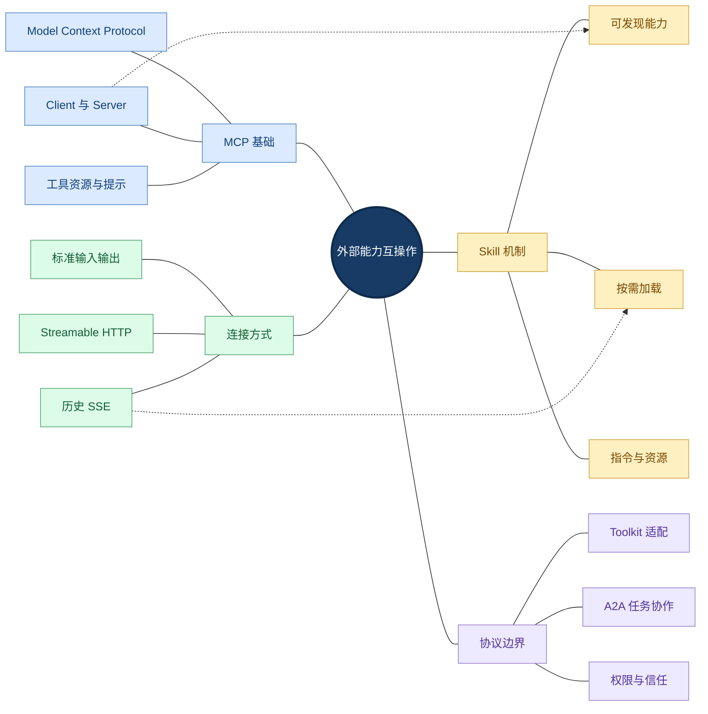

<strong>图谱解读：</strong>左侧两组代表该主题的输入条件与核心机制，右侧两组代表协作影响和工程约束。虚线表示跨模块依赖，阅读时应结合下文区分数据流、控制流与权限边界。

MCP（Model Context Protocol，模型上下文协议）为模型应用接入外部工具、资源和提示能力提供互操作接口。AgentScope 的 MCP 客户端负责建立连接并发现可用工具，再将其纳入 Agent 的工具执行链路。stdio 适合本地子进程；Streamable HTTP 适合远程服务；SSE 是部分旧实现使用的传输方式，具体兼容性应以协议版本和服务端实现为准。

Agent Skill（智能体技能）更偏向将任务指导、资源和可复用操作组织为可发现的能力包；它与可执行工具不同，不能把一份技能说明文件视作已经实现了外部操作。技能内容也可能来自不可信来源，加载前应检查来源、权限和资源访问范围。

MCP 与 A2A（Agent2Agent，智能体间协议）的边界尤其重要：MCP 侧重 Agent 对工具和资源的调用，A2A 侧重独立 Agent 间任务委派与结果交付。一个系统可以同时使用两者，Toolkit 仍是 AgentScope 内部组织工具的重要抽象。

## 7. Memory、Context、长期记忆与 RAG

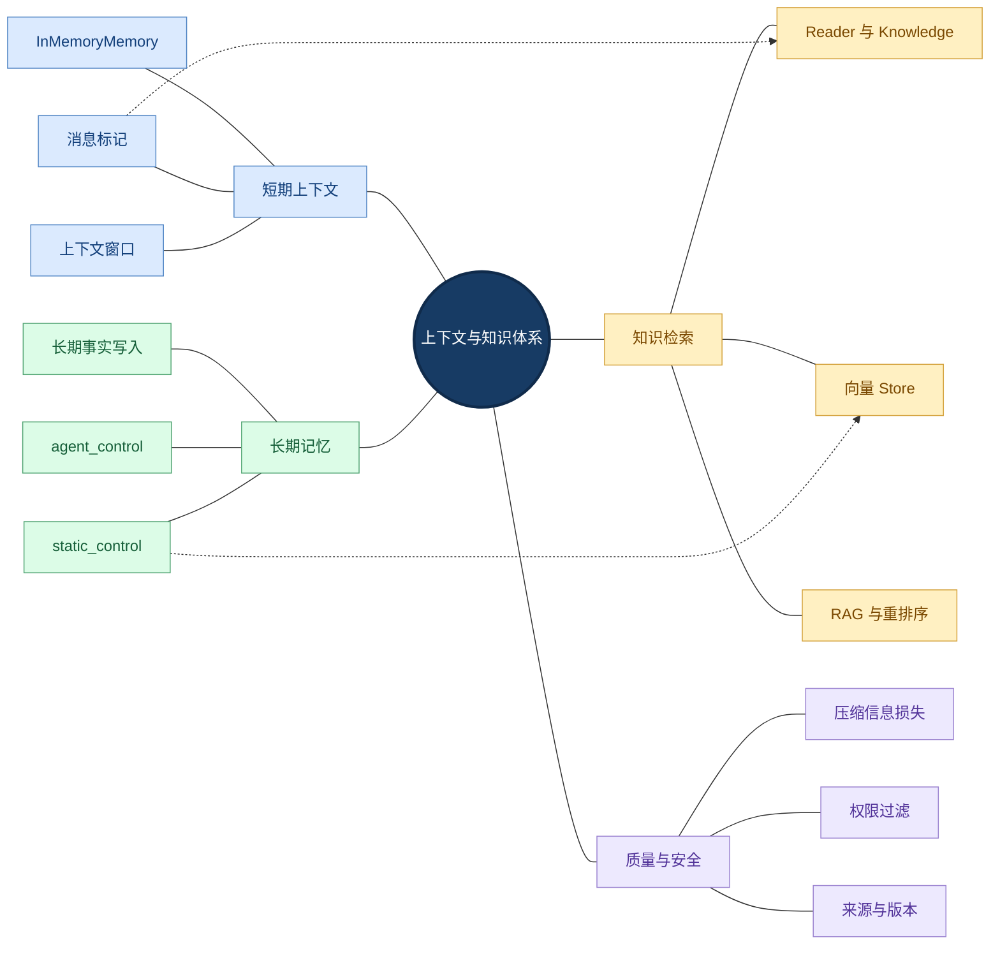

<strong>图谱解读：</strong>左侧两组代表该主题的输入条件与核心机制，右侧两组代表协作影响和工程约束。虚线表示跨模块依赖，阅读时应结合下文区分数据流、控制流与权限边界。

Memory（记忆）在 AgentScope 中主要负责消息存储与管理，Context（上下文）则是当前模型推理实际可见的信息集合。两者不能画等号：存储的消息可能经过过滤、裁剪或摘要后才进入模型。Long-Term Memory（长期记忆）强调跨交互可复用的信息，RAG（Retrieval-Augmented Generation，检索增强生成）则强调从外部知识源检索证据辅助回答。

记忆压缩（Memory Compression）用于控制上下文窗口和成本，但摘要可能遗漏型号、单位、数字和否定条件。业务关键事实应保存为结构化字段或版本化产物，而不是只保留压缩摘要。`agent_control`、`static_control` 等长期记忆管理策略涉及写入时机和控制权，不意味着记忆自动可信。

AgentScope 的 RAG 模块涉及 Reader、Knowledge 与 Store 等抽象，可接入文档读取和向量存储。企业级 RAG 仍需分块、权限过滤、混合检索、重排序、引用溯源、增量更新与召回评测。翻译术语库应结合精确型号匹配和语义检索；检索结果必须携带来源与版本，以免过期术语污染输出。

### 上下文预算的定量理解

设模型上下文上限为 $B$，系统指令、历史消息、检索证据、工具输出和生成预留分别占用 $S,H,R,T,O$，则必须满足：

$$
S + H + R + T + O \le B
$$

这一约束说明：增加检索证据不必然提高质量，因为它会挤占历史消息或输出预算。需要同时衡量证据相关性、信息损失和任务成功率。

## 8. PlanNotebook：规划与执行的边界

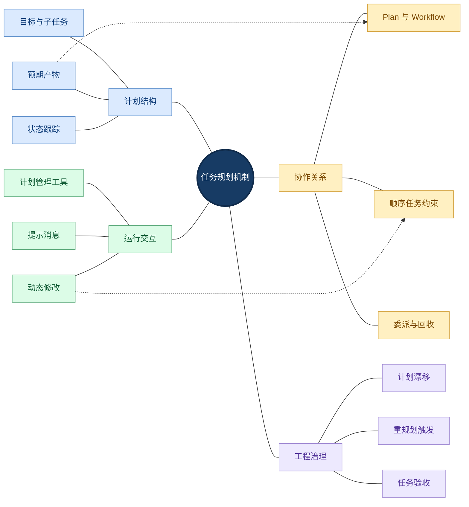

<strong>图谱解读：</strong>左侧两组代表该主题的输入条件与核心机制，右侧两组代表协作影响和工程约束。虚线表示跨模块依赖，阅读时应结合下文区分数据流、控制流与权限边界。

PlanNotebook（计划笔记本）为复杂任务提供可维护的任务清单和状态跟踪。它能帮助 Agent 将宽泛目标拆成更容易检查的子任务，但计划本身并不保证子任务已经完成，更不等于底层任务调度器。官方计划教程中的子任务按顺序组织，不能直接据此推断任意 DAG（Directed Acyclic Graph，有向无环图）并行执行能力。

Plan 侧重「做什么」，Workflow 侧重「由谁、在何种依赖关系下执行」。对于复杂翻译任务，计划可列出解析、翻译、排版和质量检查；真正的并行调度、资源限制、失败重试和阶段验收，仍应由 Pipeline 或应用编排器控制。

工程上应为每个子任务定义输入、预期产物、完成条件和失败处理。重规划应由明确事件触发，例如术语检索失败、质量评分低于阈值或发现跨页结构，而不是模型每轮都任意重写计划。

## 9. Pipeline、MsgHub 与多 Agent 协作

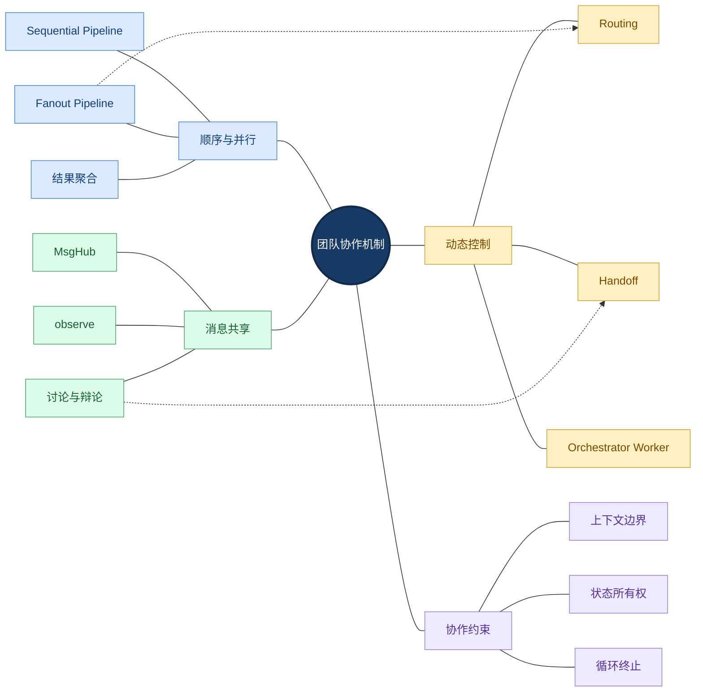

<strong>图谱解读：</strong>左侧两组代表该主题的输入条件与核心机制，右侧两组代表协作影响和工程约束。虚线表示跨模块依赖，阅读时应结合下文区分数据流、控制流与权限边界。

Pipeline（流水线）定义多个 Agent 的调用组合。Sequential Pipeline 适合前后依赖明确的任务；Fanout Pipeline 适合独立专家并行给出候选结果，再由聚合器处理。并行收益依赖任务独立性，不能简单认为增加 Agent 数量就会线性加速。

MsgHub（消息中心）适合共享讨论上下文：参与者产生消息后，其他参与者可通过 `observe` 接收。它是应用层协作机制，不等于 Kafka、RabbitMQ 等持久化消息中间件，也不能自动提供可靠投递、跨进程恢复或全局恰好一次执行。

Routing（路由）负责选择执行者，Handoff（控制权交接）负责转移执行权。Supervisor/Orchestrator 可以选择 Worker 并汇总结果，但必须约束最大委派深度、上下文传递范围和返回条件。对于并行写同一业务对象的任务，需要独立的版本控制或单写入者策略。

### 并行加速的上界

当任务中可并行部分比例为 $p$，并行执行单元数量为 $n$ 时，理想化加速比可用 Amdahl 定律近似：

$$
S(n) = \frac{1}{(1-p) + \frac{p}{n}}
$$

实际 Agent 系统还会受到模型速率限制、消息聚合、共享存储和长尾节点的影响，通常达不到理想值。

## 10. TeamPipeline、SOP 与 A2A

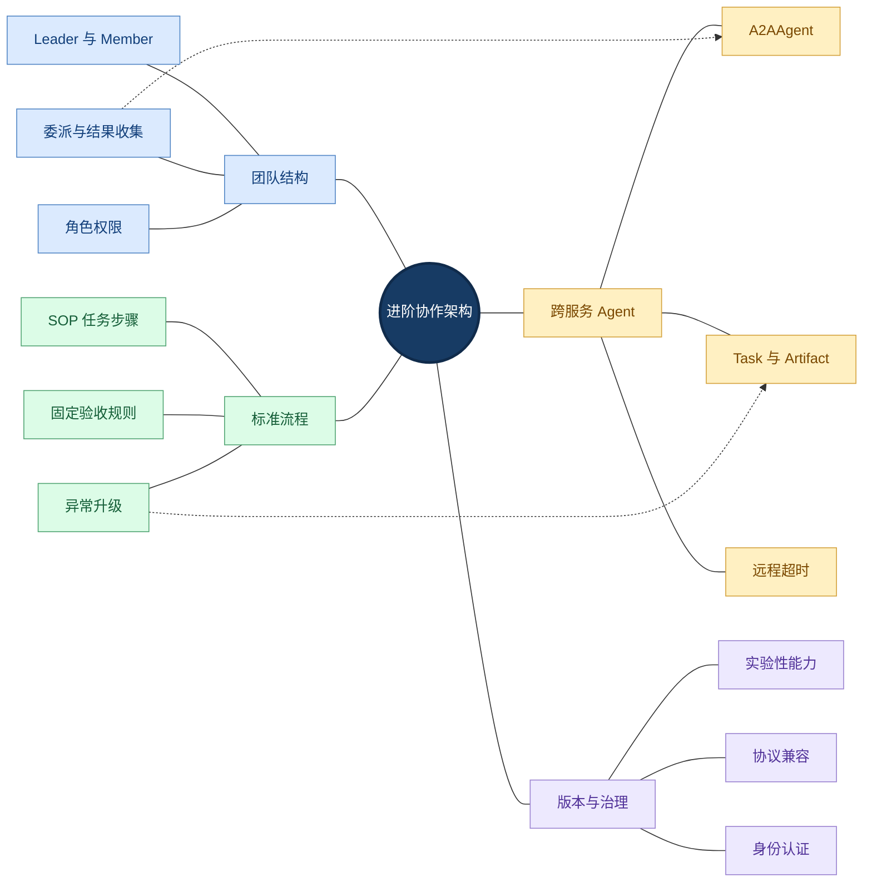

<strong>图谱解读：</strong>左侧两组代表该主题的输入条件与核心机制，右侧两组代表协作影响和工程约束。虚线表示跨模块依赖，阅读时应结合下文区分数据流、控制流与权限边界。

团队式编排通过 Leader/Member 角色分配任务责任，适合动态分工；SOP（Standard Operating Procedure，标准操作程序）通过预先约束步骤和验收条件降低随机性，适合审计要求高的业务。二者不是互斥关系：团队可以按照 SOP 完成工作，但 SOP 不能替代工具授权或业务事务。

A2A 面向独立 Agent 的跨服务协作。其 Task、Message、Artifact 区分工作生命周期、交互信息和交付产物。远程任务可能长期运行，需要明确任务 ID、认证、状态查询、取消、超时和产物获取机制。不能把一次 HTTP 成功响应当作远程任务已完成。

TeamPipeline、SOP、A2A 相关接口处于持续演进中，部分功能在官方更新中带有实验性说明。正式工程应锁定版本、建立集成测试，不应把预览接口直接视作长期稳定契约。

## 11. Hooks、Middleware 与横切治理

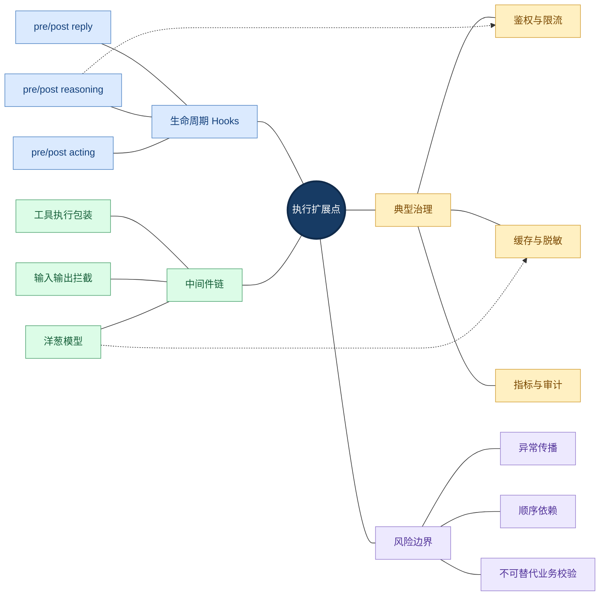

<strong>图谱解读：</strong>左侧两组代表该主题的输入条件与核心机制，右侧两组代表协作影响和工程约束。虚线表示跨模块依赖，阅读时应结合下文区分数据流、控制流与权限边界。

Hooks（钩子）是在 Agent 生命周期特定阶段插入逻辑的扩展点，例如回复、观察、推理或行动的前后。Middleware（中间件）更强调包裹执行链并拦截输入输出。两者都适合实现横切关注点（Cross-Cutting Concerns），但生命周期钩子与工具执行中间件并不具有完全相同的 API 和异常语义。

例如，工具执行前中间件可检查当前用户是否允许写入目标文件，执行后记录耗时和错误；Hooks 可在 Agent 推理前注入必要上下文，在回复后收集质量指标。若多个中间件嵌套，执行顺序会影响日志、异常处理和缓存行为，应编写顺序测试。

不能仅靠 Prompt 让模型遵守权限。权限校验应在真正执行外部动作的服务端发生。脱敏与审计还需要覆盖模型输入、工具参数、异常日志和流式输出，防止敏感数据通过其他路径泄露。

## 12. StateModule、Session 与恢复边界

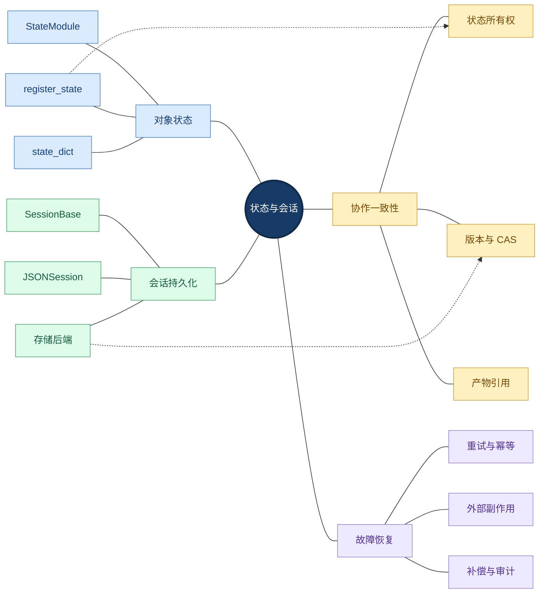

<strong>图谱解读：</strong>左侧两组代表该主题的输入条件与核心机制，右侧两组代表协作影响和工程约束。虚线表示跨模块依赖，阅读时应结合下文区分数据流、控制流与权限边界。

StateModule 提供对象状态注册、导出和加载的基础机制，Session 管理一组状态对象的保存与恢复。这里的「状态恢复」主要是框架对象数据的恢复，并不意味着整个业务世界被回滚，也不保证已经调用的外部 API 不会重复执行。

对于多 Agent 共享数据，建议区分 Agent Local State（局部状态）、Task State（任务状态）、Shared State（共享状态）和 Artifact State（产物状态）。并发写入应采用单写入者、版本号或 CAS（Compare-And-Swap，比较并交换）等机制。大型 PDF、Word 和图像不宜直接存储为会话 JSON，应保存稳定的产物引用和内容哈希。

如果翻译完成后文件已经上传，但 Session 保存前进程崩溃，恢复时可能重复上传。解决方式是业务操作 ID、幂等键、产物去重和外部状态核对。涉及不可逆动作时还需要审批或补偿事务。<strong>Session 恢复与业务恰好一次是两个不同问题。</strong>

### 幂等操作的数学定义

对同一业务操作 $f$，若重复应用不改变最终效果，则满足：

$$
f(f(x)) = f(x)
$$

这是业务效果的抽象定义，不代表任意 Agent 工具天然幂等。服务端仍需使用稳定的业务操作标识和去重存储。

## 13. Tracing、Studio 与 Evaluation

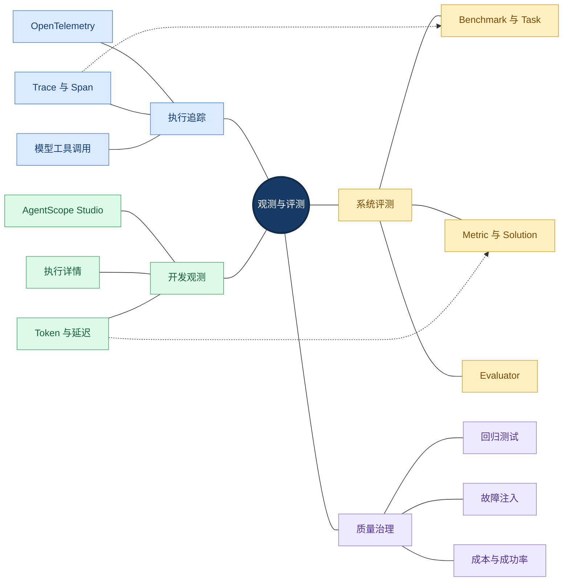

<strong>图谱解读：</strong>左侧两组代表该主题的输入条件与核心机制，右侧两组代表协作影响和工程约束。虚线表示跨模块依赖，阅读时应结合下文区分数据流、控制流与权限边界。

Tracing（分布式追踪）用于将一次 Agent 任务中的模型请求、工具调用和子 Agent 交互关联起来。OpenTelemetry（开放遥测）定义了 Trace（链路）、Span（片段）和指标等观测信号。AgentScope Studio 可以辅助查看运行过程，但可视化本身不构成权限、正确性或审计保证。

Evaluation（评测）应覆盖任务结果与执行过程。官方评测抽象涉及 Benchmark（基准集）、Task（任务）、Metric（指标）、Solution（待评方案）和 Evaluator（评测器）。在工程实践中，既要检查最终输出，也要检查工具调用参数、路由决策、状态恢复和重复副作用。

建议建立稳定的离线基准集，分别记录成功率、质量分、P95 延迟、每成功任务成本、工具错误率和人工介入率。模型、Prompt、工具 Schema 或路由策略发生变化时，应对同一基准集做回归测试，而不是凭少量主观案例判断提升。

## 14. Agent Service、部署与安全

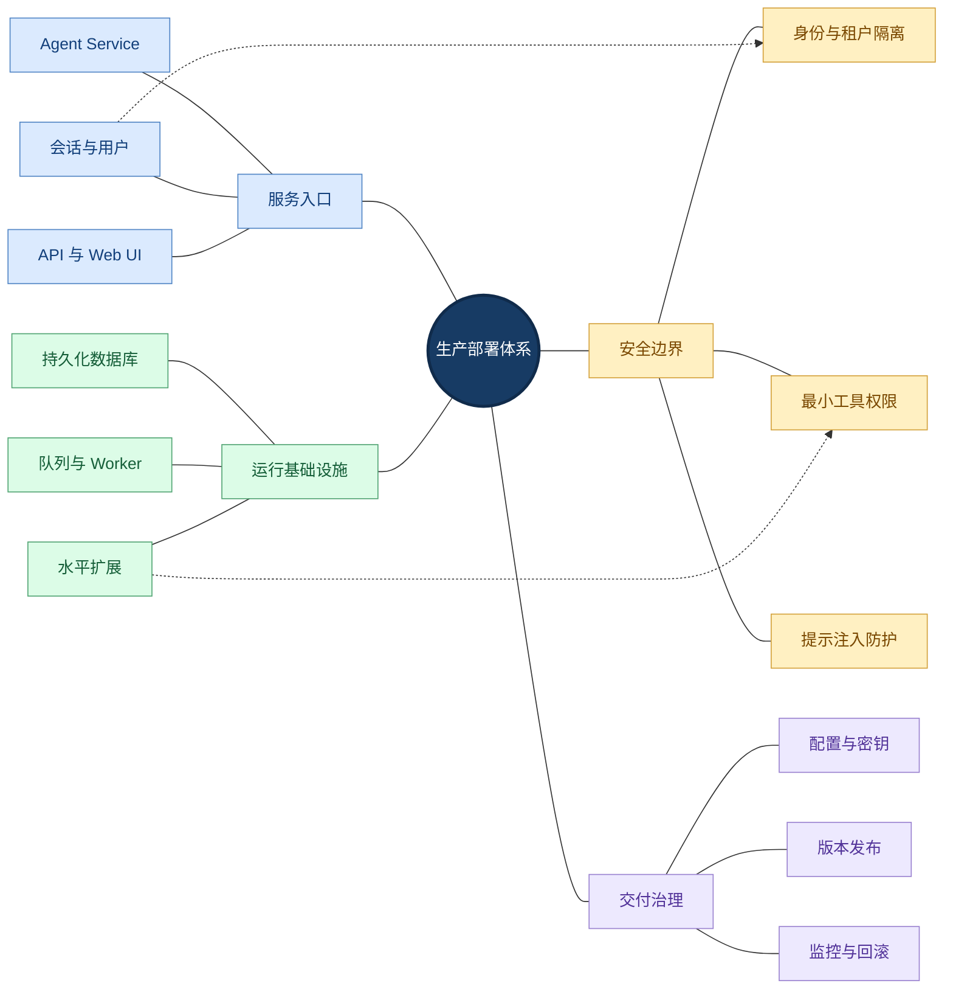

<strong>图谱解读：</strong>左侧两组代表该主题的输入条件与核心机制，右侧两组代表协作影响和工程约束。虚线表示跨模块依赖，阅读时应结合下文区分数据流、控制流与权限边界。

从 SDK 原型进入企业部署后，需要补充身份认证、会话隔离、密钥管理、任务队列、持久化存储和运行监控。Agent Service 可以提供服务化相关能力，但实际安全与高可用水平仍取决于部署拓扑、后端实现和应用配置。

对多实例系统，内存 Memory 无法天然在实例间共享；异步 Worker 也需要可靠的任务领取与失败重投机制。文件型产物应存入具备访问控制的持久化存储，并通过数据库记录元数据和版本。对涉及医疗设备文件的系统，敏感内容应最小化发送到模型和日志平台。

安全应分三层：用户能否访问任务、Agent 能否调用工具、工具能否操作目标资源。三者需要独立校验。外部检索文本和 MCP 服务返回内容均属于可能不可信的数据源，不能直接升级为系统指令。

## 15. 企业案例：医疗设备文档翻译 Agent

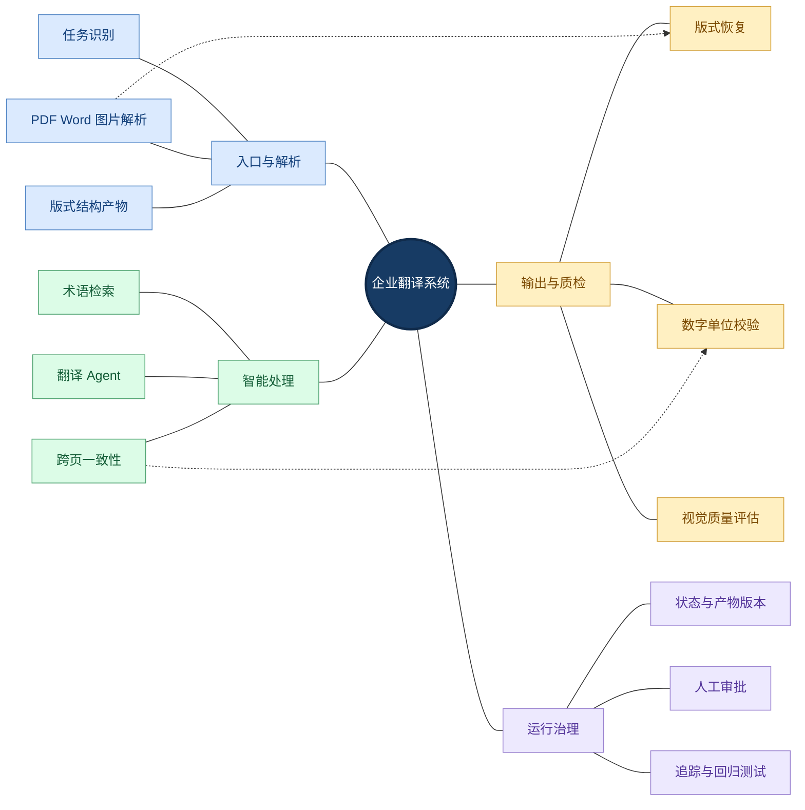

<strong>图谱解读：</strong>左侧两组代表该主题的输入条件与核心机制，右侧两组代表协作影响和工程约束。虚线表示跨模块依赖，阅读时应结合下文区分数据流、控制流与权限边界。

以医疗设备文档翻译为例，推荐由 Orchestrator 负责判断任务类型和选择执行路径，由普通工具完成 PDF/Word 解析、OCR（Optical Character Recognition，光学字符识别）、布局提取和渲染，由 Translation Agent 处理术语约束与译文生成，由 Quality Agent 或确定性规则检测漏译、数字、单位、设备型号和视觉问题。

<strong>为什么不应所有模块都 Agent 化？</strong> 解析和渲染有明确的输入输出契约；让 LLM 每次决定底层算法不仅增加成本，还会放大结果波动。Agent 应主要用于开放性判断和动态协调，确定性任务应使用可测试的工具或服务。质量闭环也不能让同一模型无限自我评价，应引入独立规则、可重复测试和人工兜底。

对跨页段落和表格，不能简单将每页完全独立翻译；需要在解析阶段恢复阅读顺序和跨页逻辑，在翻译阶段共享术语版本和章节上下文。并行翻译应按逻辑块拆分，聚合时验证段落顺序、页码、表格结构和引用关系。大文件使用产物引用而非将全部内容塞入 Memory。

可靠性方面，任务状态、会话状态与产物状态应分别持久化。每个阶段输出携带 `task_id`、`artifact_id`、`source_hash`、`version` 和 `status`；失败后优先复用已校验的中间产物。对于低置信度术语、型号冲突和高风险改写，进入人工确认而非盲目自动重试。

### 端到端建议状态契约

| 对象 | 最小字段 | 设计目的 |
|---|---|---|
| Task | `task_id`, `status`, `version` | 控制全局生命周期 |
| AgentRun | `agent_id`, `attempt`, `trace_id` | 追踪每次执行 |
| Artifact | `artifact_id`, `hash`, `type` | 中间产物去重与版本 |
| Segment | `segment_id`, `source_ref`, `target_ref` | 译文与原文映射 |
| QualityReport | `issue_type`, `severity`, `evidence` | 可解释质量反馈 |
| Approval | `approver`, `decision`, `timestamp` | 人工审核与审计 |

<strong>失败恢复示例：</strong>若翻译成功但排版失败，系统应读取已校验的译文 Artifact 并重新排版，而不是再次调用翻译模型。若术语版本改变，则相关译文应被标记为过期并重新验证。

## 16. 框架选型、误区与知识总结

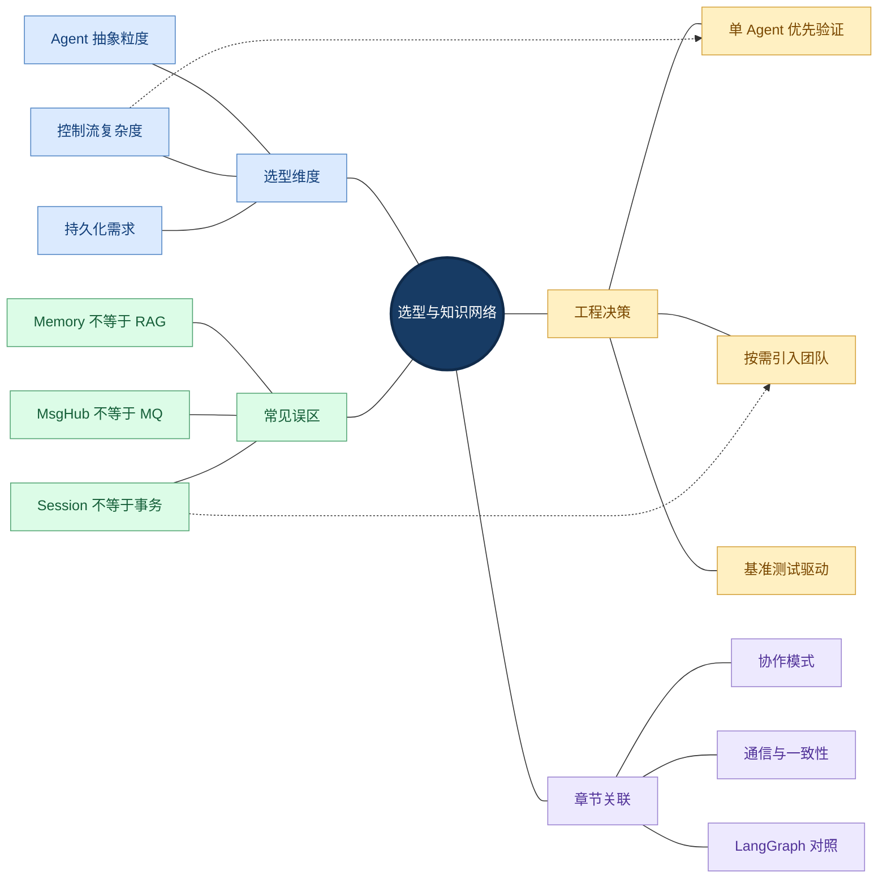

<strong>图谱解读：</strong>左侧两组代表该主题的输入条件与核心机制，右侧两组代表协作影响和工程约束。虚线表示跨模块依赖，阅读时应结合下文区分数据流、控制流与权限边界。

AgentScope 与 LangGraph 的区别首先是<strong>编排入口与运行抽象</strong>：AgentScope 更强调 Agent 组件的组合，LangGraph 更强调显式图与状态转换。选择时应评估团队熟悉程度、业务控制流复杂度、工具生态、会话持久化、可观测性和部署要求，而不是根据示例代码行数做决定。

常见误区包括：认为 ReActAgent 自带完整业务事务；把 MsgHub 当作持久化消息队列；把 Memory 当作 RAG 知识库；把 PlanNotebook 当作通用并行调度器；把 Session 序列化当作外部副作用恢复；认为注册工具就自动安全。它们分别混淆了推理、通信、存储、规划、调度和治理的边界。

一个务实的决策顺序是：先验证单 Agent 加工具能否完成任务；再确定是否存在可并行、可委派的独立专业任务；然后决定是否需要 Pipeline、MsgHub、Handoff 或远程 A2A；最后依据失败恢复、审计和规模要求选择持久化与部署方案。<strong>多 Agent 是复杂度投资，只有可测量的收益才能证明它值得引入。</strong>

## 17. AgentScope 与其他模块的对照矩阵

| 需求 | AgentScope 对应机制 | 仍需业务层补充 | 相关章节 |
|---|---|---|---|
| 单 Agent 工具调用 | ReActAgent、Toolkit | 工具权限、幂等、审计 | Agent Core Components |
| 消息与上下文 | Msg、Formatter、Memory | Schema 版本、敏感信息治理 | Communication and State |
| 专家协作 | Pipeline、MsgHub、Routing、Handoff | 状态所有权、任务验收 | Collaboration Patterns |
| 复杂任务规划 | PlanNotebook | 动态 DAG 调度、资源配额 | Working Patterns |
| 知识检索 | Reader、Knowledge、Store | 混合检索、权限、评测 | Knowledge and Tools |
| 恢复与持久化 | StateModule、Session | 外部副作用、事务与去重 | Communication and State |
| 质量评测 | Tracing、Studio、Evaluation | 企业基准集与回归门禁 | Enterprise Engineering |
| 显式图执行 | Pipeline / 应用编排 | 图级控制和检查点设计 | LangGraph |

<strong>最终心智模型：</strong>Model 负责生成决策候选，Formatter 保证模型协议适配，Msg 承载交互，Memory/Context 决定可见历史，Toolkit/MCP 提供外部行动能力，PlanNotebook 管理计划，Pipeline/MsgHub/Handoff 组织团队协作，StateModule/Session 管理对象状态，Hooks/Middleware 执行横切治理，Tracing/Evaluation 为系统提供证据。企业业务的正确性最终还取决于明确的数据契约、工具权限、状态版本、产物校验和可靠恢复策略。

## 18. 权威参考资料与进一步阅读

> 下列资料以 AgentScope 官方文档和官方源码为主。具体 API 可能随版本调整，使用时应核对对应的版本导航与变更记录。

1. [AgentScope 官方仓库](https://github.com/agentscope-ai/agentscope)：源码、示例、发布与功能演进。
2. [AgentScope 官方文档](https://doc.agentscope.io/)：2.x 模块索引。
3. [ReActAgent](https://doc.agentscope.io/tutorial/quickstart_agent.html)：模型、格式化器、工具、记忆和 Agent 初始化。
4. [Agent 基础](https://doc.agentscope.io/tutorial/task_agent.html)：Agent 运行机制。
5. [Toolkit](https://doc.agentscope.io/tutorial/task_tool.html)：工具注册、调用与响应。
6. [MCP](https://doc.agentscope.io/tutorial/task_mcp.html)：外部工具协议接入。
7. [Memory](https://doc.agentscope.io/tutorial/task_memory.html)：消息存储与管理。
8. [State/Session](https://doc.agentscope.io/tutorial/task_state.html)：对象状态与会话保存。
9. [PlanNotebook](https://doc.agentscope.io/tutorial/task_plan.html)：计划管理。
10. [Pipeline / MsgHub](https://doc.agentscope.io/tutorial/task_pipeline.html)：顺序、扇出与消息协作。
11. [Routing](https://doc.agentscope.io/tutorial/workflow_routing.html)：结构化路由和工具路由。
12. [Handoffs](https://doc.agentscope.io/tutorial/workflow_handoffs.html)：动态任务交接。
13. [Hooks](https://doc.agentscope.io/tutorial/task_hook.html)：Agent 生命周期扩展。
14. [Middleware](https://doc.agentscope.io/tutorial/task_middleware.html)：工具调用中间件。
15. [RAG](https://doc.agentscope.io/tutorial/task_rag.html)：文档读取与知识检索。
16. [Tracing](https://doc.agentscope.io/tutorial/task_tracing.html)：OpenTelemetry 调用链。
17. [Evaluation](https://doc.agentscope.io/tutorial/task_eval.html)：基准测试和评测器。
18. [AgentScope FAQ](https://agentscope.io/blog/agentscope-faq/)：版本与部署问题。
19. [MCP 官方规范](https://modelcontextprotocol.io/specification/)：工具互操作协议。
20. [A2A 官方规范](https://a2a-protocol.org/latest/specification/)：独立 Agent 间任务协议。
21. [ReAct 原始论文](https://arxiv.org/abs/2210.03629)：推理与行动结合的理论来源。
22. [OpenTelemetry 官方文档](https://opentelemetry.io/docs/)：可观测性语义与实现。

---

<strong>本篇结论：</strong>掌握 AgentScope 不是记住若干类名，而是理解「模型如何形成行动意图—工具如何可靠执行—消息与记忆如何塑造上下文—多个 Agent 如何协作—状态如何恢复—系统如何被验证」这一完整因果链。下一篇 `06-Framework-Selection.md` 将以这些可测量的能力和工程边界为依据，对 Agent 框架进行系统选型。

