# Agent 框架选型与技术权衡：从架构决策到生产验证

> 所属章节：`06-Multi-Agent-and-Frameworks/06-Framework-Selection.md`  
> 适用范围：Agent 框架、编排运行时、多 Agent 协作及企业工程选型  
> 技术基线：以 2026 年 10 月的公开框架生态为研究背景；具体 API、支持矩阵与维护状态以实际采用版本的官方文档和 Release 为准。  
> 阅读路线：业务约束 → 架构复杂度 → 框架分类 → 机制比较 → 可靠性与安全 → 实验评价 → 企业案例 → 决策与迁移。

<strong>本章核心论点：</strong>先确定业务所需的控制权、状态边界和恢复语义，再选择实现这些机制的框架；框架选型不是品牌投票，而是可复现、可解释、可迁移的工程决策。本文所有评分权重、示例架构与建议均为设计方法或待验证假设，不应当作框架性能实测结论。

## 阅读前的术语与范围

- <strong>Agent（智能体）</strong>：能够基于任务与环境信息选择行动、调用工具并利用反馈调整行为的软件执行单元。
- <strong>LLM（Large Language Model，大语言模型）</strong>：提供自然语言理解、生成及部分任务决策能力的模型。
- <strong>Workflow（工作流）</strong>：显式规定步骤、依赖、分支与终止条件的执行过程。
- <strong>SDK（Software Development Kit，软件开发工具包）</strong>：供应用开发者调用的一组接口与库；不自动等同于完整生产运行平台。
- <strong>Runtime（运行时）</strong>：负责调度、执行、恢复、状态传播与生命周期管理的基础设施。
- <strong>PoC（Proof of Concept，概念验证）</strong>：使用受控实验验证候选技术是否满足关键要求。
- <strong>SLA（Service Level Agreement，服务等级协议）</strong>与 <strong>SLO（Service Level Objective，服务等级目标）</strong>：分别是服务承诺与可度量的内部目标。

与本章相关的前置内容包括 [多 Agent 基础](./01-Multi-Agent-Fundamentals.md)、[协作模式](./02-Collaboration-Patterns.md)、[通信与状态](./03-Communication-and-State.md)、[LangGraph](./04-LangGraph.md) 和 [AgentScope](./05-AgentScope.md)。

## 一｜为什么框架选型必须从业务约束开始

### 为什么框架选型必须从业务约束开始：中心辐射知识网络

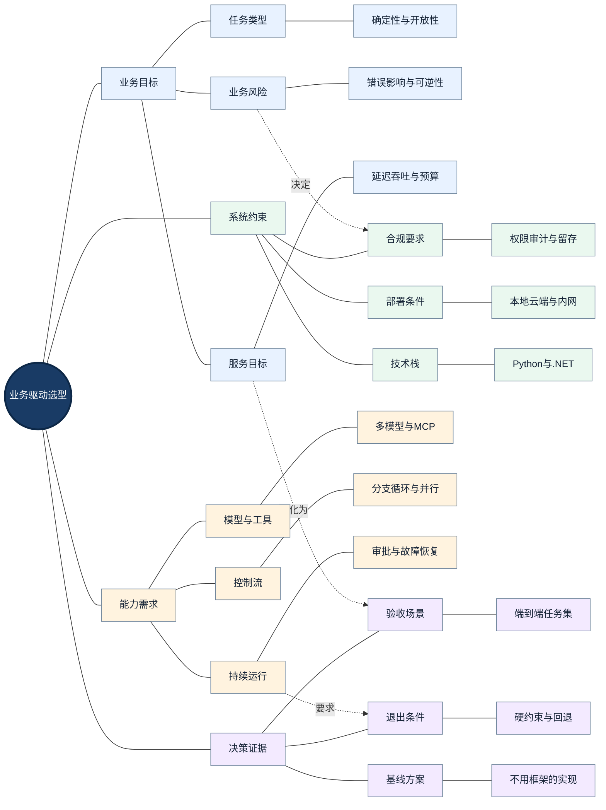

> <strong>图谱解读：</strong>中心节点表示本节的工程决策对象，四个方向的知识分支分别表示不同约束、机制与证据。虚线是跨模块依赖或影响关系，并非执行顺序。

选型的第一步是将业务语言翻译为工程能力。例如“翻译结果必须可以交付”并不直接要求某个 Agent 框架，而是要求文档解析完整性、译文正确性、版式稳定性、失败可恢复性与可审计性。只有明确这些验收标准，才能评估框架的实际价值。

<strong>硬约束</strong>必须在打分之前判断：语言和运行环境、私有化部署、模型兼容性、数据出境限制、人工审批、跨进程恢复、预算上限。某个框架若不能满足不可妥协的条件，不应依靠其他维度的高分抵消。

<strong>软目标</strong>则可以权衡：开发速度、可视化程度、生态成熟度、学习成本、部署复杂度和供应商依赖。尤其要区分“框架提供接口”与“生产环境已验证该能力”——两者之间还隔着测试、监控和运维设计。

| 需求描述 | 可测试的技术要求 | 验证方法 |
|---|---|---|
| 长文档翻译不能从头重跑 | 分阶段持久化与中间产物复用 | 运行中杀进程并恢复 |
| 设备型号不得被错误改写 | 结构化规则校验与人工升级 | 术语、数字、型号对抗集 |
| 多人同时使用 | 任务隔离、租户授权、并发配额 | 并发及越权测试 |
| 可审计 | 任务链路、版本、输入输出哈希 | 重放追踪与审计检查 |
| 成本可控 | 模型路由、缓存、预算与退避 | 固定任务集测成本分布 |

## 二｜先选架构复杂度，再选框架

### 先选架构复杂度，再选框架：中心辐射知识网络

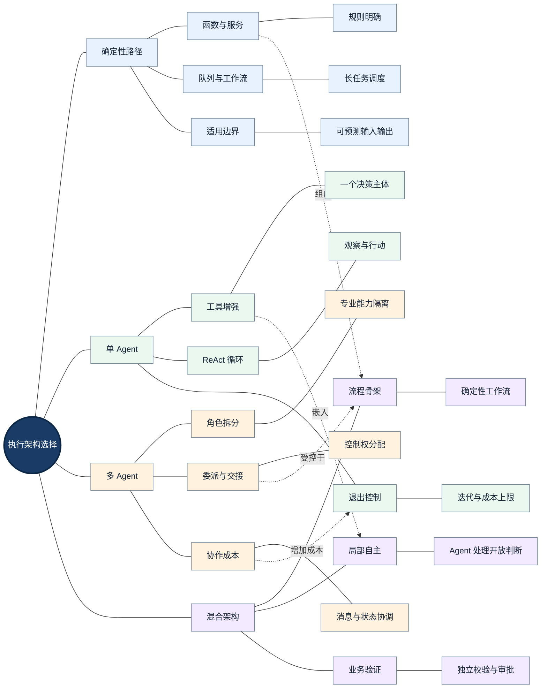

> <strong>图谱解读：</strong>中心节点表示本节的工程决策对象，四个方向的知识分支分别表示不同约束、机制与证据。虚线是跨模块依赖或影响关系，并非执行顺序。

<strong>确定性流程优先</strong>不是否定 Agent，而是将 Agent 的不确定性限制在确实需要语义判断和开放性决策的环节。若任务仅需固定 API 调用与数据变换，普通函数和工作流通常更容易测试与审计。若需要模型选择工具、补充信息或动态规划，则引入单 Agent。只有专业上下文、工具权限、目标函数或任务所有权明显不同，才考虑多 Agent。

| 方案 | 优点 | 代价 | 适用场景 |
|---|---|---|---|
| 普通 Python / 服务编排 | 可预测、低抽象成本 | 动态决策需自行开发 | 解析、渲染、校验、固定流水线 |
| 单 Agent + Tools | 简单灵活、上下文集中 | 工具空间膨胀、循环与提示词复杂 | 受限问答、工具助理 |
| 多 Agent | 专业分工、权限和上下文隔离 | 协调延迟、错误传播、成本上升 | 研究、审核、复杂跨域任务 |
| 工作流 + 局部 Agent | 控制流稳定、局部具备自主性 | 状态契约设计更复杂 | 企业文档、审批、长任务 |

一个实用判断是：<strong>先建立最简单的可测基线，再要求复杂架构证明其收益。</strong> 多 Agent 的价值应体现在成功率、质量、故障隔离或维护性上，而不是 Agent 数量。

## 三｜框架、协议、运行平台如何分层

### 框架、协议、运行平台如何分层：中心辐射知识网络

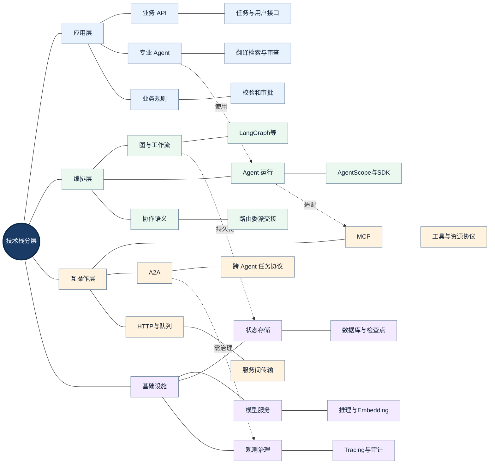

> <strong>图谱解读：</strong>中心节点表示本节的工程决策对象，四个方向的知识分支分别表示不同约束、机制与证据。虚线是跨模块依赖或影响关系，并非执行顺序。

框架比较前必须先统一类别：Agent SDK 提供 Agent、工具与执行接口；编排框架显式管理图、状态和控制流；互操作协议规定跨组件通信方式；运行平台负责服务部署、会话、权限、可观测性和伸缩。一个项目可以同时采用这些层次的多个技术，不需要将它们误判为互斥竞争品。

<strong>MCP（Model Context Protocol，模型上下文协议）</strong>主要标准化模型应用与外部工具、资源和提示等能力的交互；<strong>A2A（Agent2Agent，智能体间通信协议）</strong>侧重独立 Agent 之间的发现、任务委派与结果交换。两者不是 Agent 编排框架，也不自动提供端到端事务一致性。

还应区分 <strong>Agent as Tool（将 Agent 作为工具调用）</strong>与 <strong>Handoff（控制权交接）</strong>：前者由上层管理 Agent 继续承担总体控制和最终响应责任，后者将会话或任务的控制权转交专业 Agent。

## 四｜主流框架的抽象模型与适配性

### 主流框架的抽象模型与适配性：中心辐射知识网络

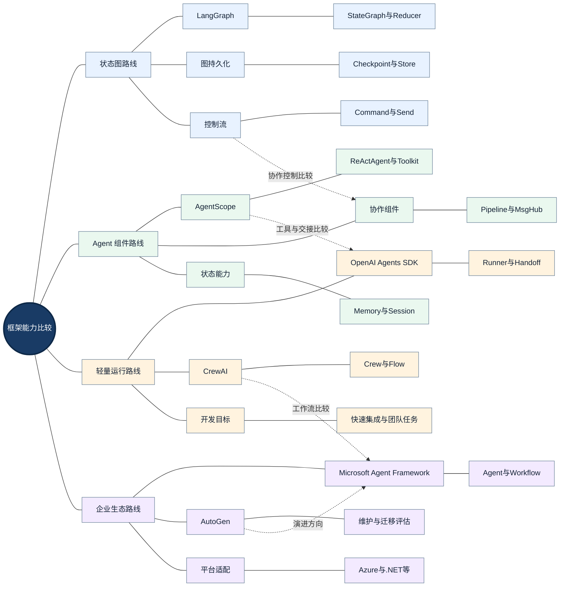

> <strong>图谱解读：</strong>中心节点表示本节的工程决策对象，四个方向的知识分支分别表示不同约束、机制与证据。虚线是跨模块依赖或影响关系，并非执行顺序。

### 4.1 LangGraph：图、状态与恢复语义优先

LangGraph 使用 StateGraph、节点、边与 Reducer 明确表示控制流和状态更新，支持条件路由、循环、子图、动态任务分发和持久化执行。其优势是复杂路径可显式检查，适合人工审批、长任务和修复闭环。代价是开发者需要设计状态 Schema、Reducer、检查点与恢复策略；图结构也可能随着业务扩展而复杂化。参见 [LangGraph 官方概览](https://docs.langchain.com/oss/python/langgraph/overview) 与 [持久化文档](https://docs.langchain.com/oss/python/langgraph/persistence)。

### 4.2 AgentScope：Agent 对象及能力组合优先

AgentScope 通过 ReActAgent、Msg、Formatter、Toolkit、Memory、Pipeline、MsgHub 等组件组织推理、工具、记忆与协作。适合需要自定义 Agent 内部行为、接入丰富工具并组织专业 Agent 的应用。评估时需核对 2.x 的具体版本、异步 API、状态持久化、工具权限与服务化方案。参见 [AgentScope 官方文档](https://doc.agentscope.io/) 和 [官方仓库](https://github.com/agentscope-ai/agentscope)。

### 4.3 OpenAI Agents SDK：代码优先的 Agent 运行抽象

OpenAI Agents SDK 提供 Agent、Runner、工具、Handoff、Guardrails 等概念，适合用较少的编排代码构建工具增强和多 Agent 应用。重点考察模型提供商适配、会话持久化、追踪能力和复杂工作流是否需要补充外部编排。参见 [官方 Python SDK](https://openai.github.io/openai-agents-python/)。

### 4.4 Microsoft Agent Framework 与 AutoGen

Microsoft Agent Framework 将 Agent 与 Workflow 组合，适合已有 Microsoft 技术栈并需要企业级编排的团队。AutoGen 具有重要的多 Agent 研究价值，但新项目必须核查其当前维护状态与微软推荐迁移路线；不应把旧教程视为最新选型依据。参见 [Agent Framework 文档](https://learn.microsoft.com/en-us/agent-framework/overview) 与 [AutoGen 仓库](https://github.com/microsoft/autogen)。

### 4.5 CrewAI：角色协作与 Flow 双路线

CrewAI 不只有 Crew/Task 的角色协作模式，还提供 Flow 的事件驱动执行、状态和持久化能力。应分别比较 Crew 和 Flow，而不是只根据角色设定判断它的控制流能力。参见 [CrewAI 文档](https://docs.crewai.com/)。

| 框架 | 默认切入点 | 重点评估机制 | 不应直接假设 |
|---|---|---|---|
| LangGraph | 图和共享状态 | Reducer、Checkpoint、Interrupt、Subgraph | 检查点等于外部事务 |
| AgentScope | Agent 和工具组件 | ReAct、Toolkit、Memory、Pipeline、Session | Session 自动实现分布式恢复 |
| OpenAI Agents SDK | Agent 与 Runner | Handoff、Agent as Tool、工具与 Guardrails | SDK 自带完整企业工作流平台 |
| Microsoft Agent Framework | Agent + Workflow | 编排、状态、.NET/Python 集成 | 微软生态之外一定不适用 |
| CrewAI | Crew + Flow | 角色任务、事件流、持久化 | 只能进行角色扮演 |
| AutoGen | 消息与团队 | 既有系统维护、迁移成本 | 历史热门代表新项目默认推荐 |

<strong>版本敏感提示：</strong>此表是抽象层级比较，不是逐版本 API 支持矩阵。生产选型必须锁定版本，并对关键能力进行现场验证。

## 五｜控制流与协作机制的选型

### 控制流与协作机制的选型：中心辐射知识网络

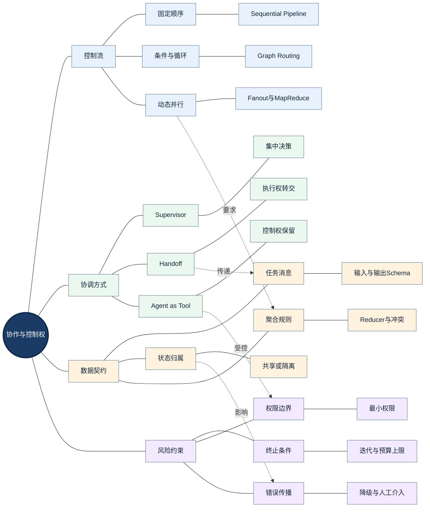

> <strong>图谱解读：</strong>中心节点表示本节的工程决策对象，四个方向的知识分支分别表示不同约束、机制与证据。虚线是跨模块依赖或影响关系，并非执行顺序。

<strong>Supervisor（监督者）</strong>集中决定由哪个 Worker 执行；<strong>Handoff</strong>将控制权转交另一 Agent；<strong>Pipeline（流水线）</strong>强调预先定义的步骤依赖；<strong>MapReduce（映射归约）</strong>强调并行分发与结果聚合。它们描述的是协作模式，而不是特定框架的专有能力。

若所有步骤顺序明确，使用固定流水线比让 Supervisor 每一步重新判断更可预测。若任务类型在运行时变化，采用条件路由或 Supervisor。若子任务可以独立执行，可并行处理，但聚合前必须明确排序、冲突与失败策略。若涉及高风险动作，应将执行权与审批权分离。

| 业务条件 | 首选机制 | 必须补充的控制 |
|---|---|---|
| 固定步骤且结果可校验 | Pipeline / Workflow | 每步契约、重试与终止 |
| 多类型任务分类 | Router / Conditional Edge | 分类置信度与兜底 |
| 专业 Agent 共享上下文 | Supervisor / MsgHub | 消息范围与权限隔离 |
| 独立 Agent 负责子任务 | Handoff / A2A | 控制权、超时、任务 ID |
| 批量独立文档或页面 | Fanout / Send | 并发闸门、结果归并 |
| 质量失败需要修复 | 条件循环 | 最大次数、错误分类、人工升级 |

重要区别：<strong>并行能力不等于并行安全。</strong> 两个节点可以同时运行，但若同时修改同一个 Word 文件，仍可能出现写入竞争；必须采用产物隔离、版本检查或单写者模式。

## 六｜状态、持久化与恢复语义

### 状态、持久化与恢复语义：中心辐射知识网络

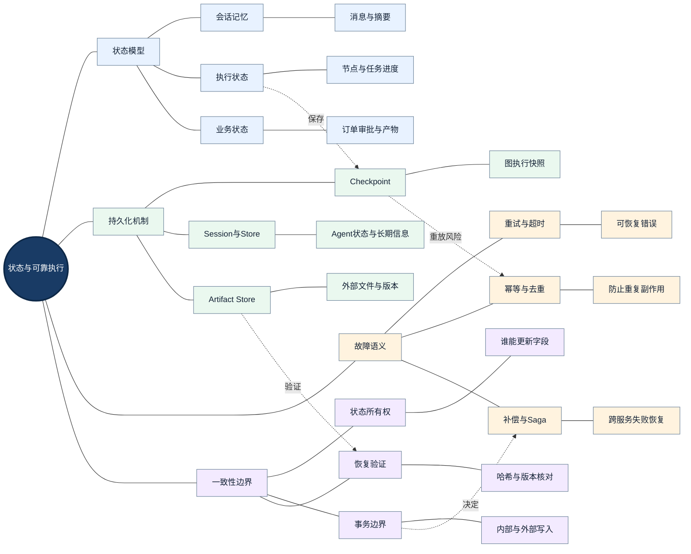

> <strong>图谱解读：</strong>中心节点表示本节的工程决策对象，四个方向的知识分支分别表示不同约束、机制与证据。虚线是跨模块依赖或影响关系，并非执行顺序。

<strong>Checkpoint（检查点）</strong>记录执行进度；<strong>Session（会话）</strong>组织 Agent 状态；<strong>Store（存储）</strong>可以保存跨执行上下文的长期信息；<strong>Artifact Store（产物存储）</strong>负责文件与版本。它们服务于不同的数据生命周期，不可相互替代。

长任务的核心不是“是否支持保存状态”，而是<strong>恢复到哪里、会重跑哪些操作、如何验证外部副作用</strong>。例如节点在上传文件后、记录成功状态前崩溃，恢复后可能再次上传。若外部系统不支持事务回滚，就需要使用业务幂等键、写入前查询、产物内容哈希或补偿操作。

<strong>At-least-once（至少一次）</strong>意味着可能重复投递或执行；<strong>At-most-once（至多一次）</strong>意味着可能丢失；<strong>Exactly-once（恰好一次）</strong>通常必须限定在明确的事务边界内讨论。Agent 框架的状态持久化并不能自动为第三方 API 提供端到端恰好一次保证。

<strong>Saga（长事务补偿模式）</strong>将跨服务业务过程拆分为若干局部事务与相应补偿步骤，适合无法使用统一数据库事务的场景。但补偿不一定能够恢复所有外部效果，例如已发送邮件或已被第三方读取的文件。

| 失败点 | 风险 | 应用层保护 |
|---|---|---|
| 模型调用超时 | 重复计费或重复生成 | 超时预算、缓存、请求标识 |
| 工具成功后状态保存失败 | 重复外部写入 | 幂等键、状态核对 |
| 多分支同时更新状态 | 更新冲突 | Reducer、字段所有权 |
| 重启后加载旧产物 | 结果版本不一致 | 内容哈希、版本戳 |
| 审批期间程序重启 | 人工决策丢失 | 持久化审批记录、恢复测试 |

## 七｜性能、成本与可观测性

### 性能、成本与可观测性：中心辐射知识网络

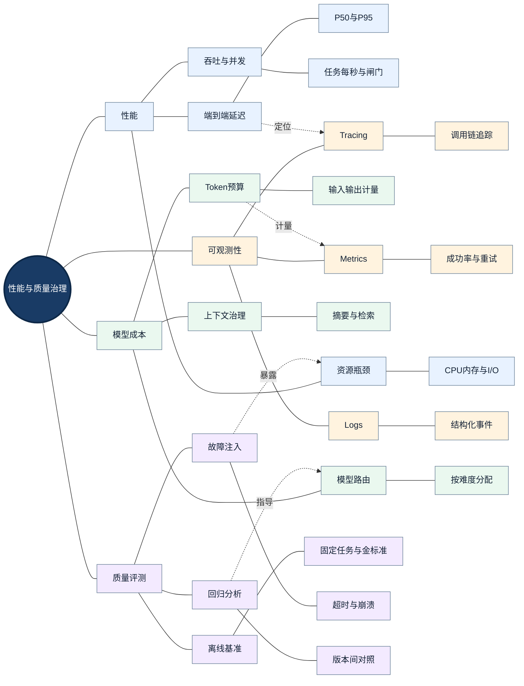

> <strong>图谱解读：</strong>中心节点表示本节的工程决策对象，四个方向的知识分支分别表示不同约束、机制与证据。虚线是跨模块依赖或影响关系，并非执行顺序。

<strong>P95（第 95 百分位延迟）</strong>表示 95% 的请求延迟不高于该值，比平均延迟更能反映尾部体验。吞吐量必须在给定硬件、并发、任务规模和模型限流条件下比较，否则数值不可比。

对顺序依赖的任务，粗略的端到端延迟为：

$$
T_{\mathrm{seq}}=\sum_{i=1}^{n}T_i+T_{\mathrm{coord}}
$$

对完全独立、可并行的分支，理想情况下的关键路径近似为：

$$
T_{\mathrm{parallel}}\approx\max_{1\le i\le n}T_i+T_{\mathrm{merge}}+T_{\mathrm{coord}}
$$

这些公式只是理解结构的近似模型，未包含队列等待、资源竞争、速率限制、失败重试与长尾请求，因此不能直接当作真实性能预测。

<strong>OpenTelemetry（开放遥测）</strong>可用于统一追踪和指标；Tracing（分布式追踪）帮助定位模型调用、工具执行、状态保存和重试之间的耗时与错误传播。观测能力不是质量保证，必须结合离线评测与故障注入。

| 指标 | 业务意义 | 采集注意 |
|---|---|---|
| 任务成功率 | 完成用户目标的比例 | 明确成功判定标准 |
| 端到端 P95 | 用户等待体验 | 包含排队与审批等待的定义需一致 |
| 工具错误率 | 外部依赖稳定性 | 按错误类别统计 |
| 平均 Token 成本 | 模型开销 | 记录模型、版本和缓存 |
| 恢复成功率 | 故障韧性 | 明确崩溃注入位置 |
| 重复副作用率 | 数据一致性 | 需要外部业务记录核对 |
| 人工介入率 | 自动化程度与风险 | 区分主动审核和异常升级 |

## 八｜安全、合规、部署与供应商锁定

### 安全、合规、部署与供应商锁定：中心辐射知识网络

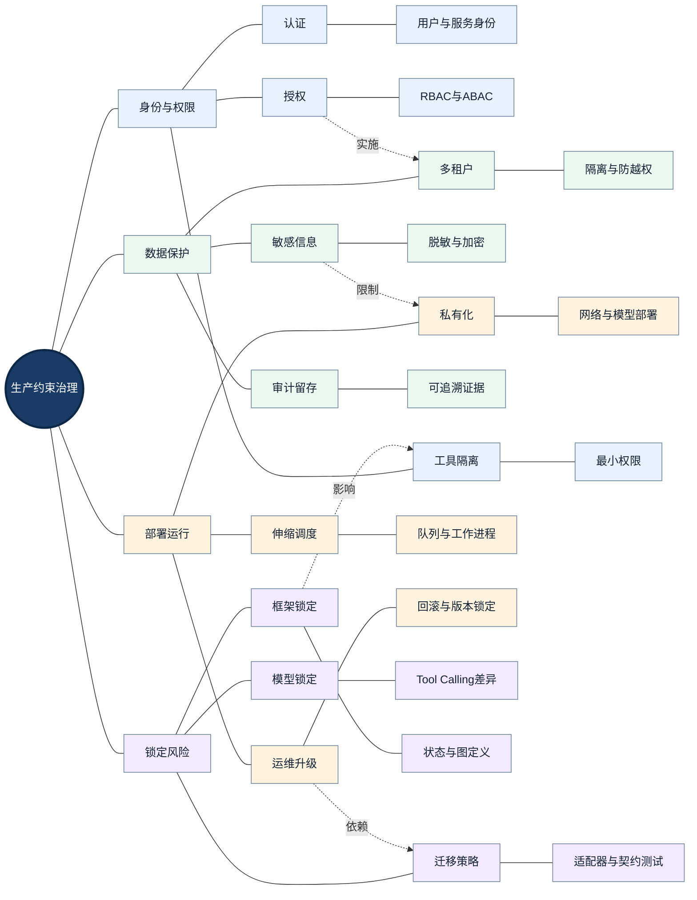

> <strong>图谱解读：</strong>中心节点表示本节的工程决策对象，四个方向的知识分支分别表示不同约束、机制与证据。虚线是跨模块依赖或影响关系，并非执行顺序。

<strong>RBAC（Role-Based Access Control，基于角色的访问控制）</strong>按照角色授予权限；<strong>ABAC（Attribute-Based Access Control，基于属性的访问控制）</strong>结合用户、资源和环境属性决定是否授权。Agent 生成的工具调用不能绕过服务端授权校验。

<strong>Prompt Injection（提示注入）</strong>可能来自用户输入、检索文档、网页或工具响应。框架内置 Guardrail（防护规则）有帮助，但不能替代业务授权、输出验证和隔离执行环境。对上传文档的解析与外部工具执行应实施沙箱、大小限制和恶意文件检查。

框架锁定不仅发生在模型 API，也发生在工作流定义、状态 Schema、检查点序列化格式、工具适配与监控平台。建议将业务对象与框架内部对象分离：使用独立的 `TaskState`、`ArtifactRef`、`ToolResult` 等领域契约，通过适配器接入不同框架。

升级前要执行状态迁移演练：历史任务能否恢复、旧节点名称是否仍有效、状态字段是否兼容、工具参数是否变化、失败任务能否安全回滚。对长时间运行的 Agent 系统，<strong>向后兼容的检查点设计</strong>比仅让新任务通过测试更重要。

## 九｜可复现的 PoC 与多准则决策

### 可复现的 PoC 与多准则决策：中心辐射知识网络

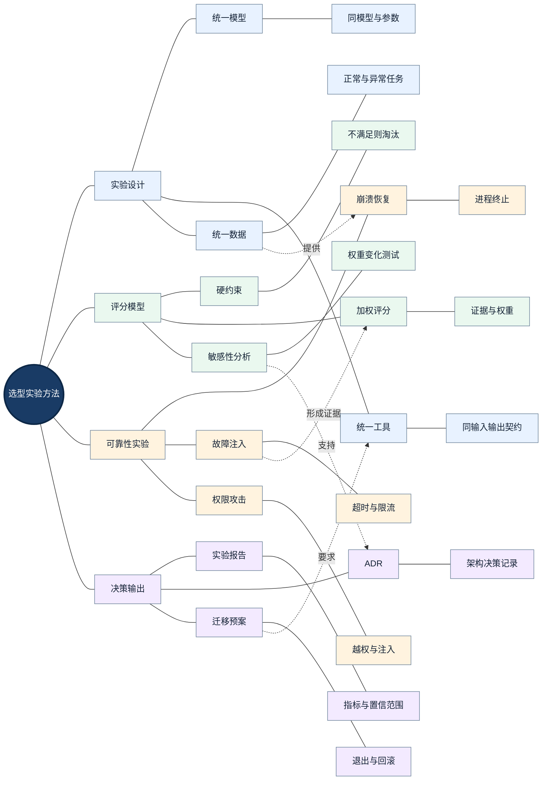

> <strong>图谱解读：</strong>中心节点表示本节的工程决策对象，四个方向的知识分支分别表示不同约束、机制与证据。虚线是跨模块依赖或影响关系，并非执行顺序。

<strong>MCDA（Multi-Criteria Decision Analysis，多准则决策分析）</strong>允许在多个维度之间进行透明权衡，但应先完成硬约束筛选，再进行软目标打分。加权总分可定义为：

$$
S_j=\sum_{i=1}^{m}w_i r_{ij},\qquad \sum_{i=1}^{m}w_i=1
$$

其中，$S_j$ 是候选框架 $j$ 的总分，$w_i$ 是评价维度 $i$ 的权重，$r_{ij}$ 是框架 $j$ 在维度 $i$ 的<strong>实测或有证据支持的评分</strong>。没有证据的项目应标记“待验证”，不能用猜测分数替代。

<strong>敏感性分析</strong>要求改变关键权重，检查排名是否稳定。如果可靠性权重略微变化就导致候选框架排序颠倒，应在决策记录中明确这一不确定性。

### 9.1 示例权重（非行业标准）

| 评价维度 | 权重 | 核心证据 |
|---|---:|---|
| 可靠性与恢复 | 20% | 故障注入与恢复测试 |
| 控制流与状态 | 20% | 路由、并行、状态冲突测试 |
| 工具与模型兼容 | 15% | 真实 SDK 与工具适配 |
| 性能与成本 | 15% | P95、吞吐、Token 与基础设施成本 |
| 安全与部署 | 15% | 授权、隔离、私有化部署验证 |
| 观测与测试 | 10% | Trace 完整性、回归覆盖率 |
| 开发与维护 | 5% | 开发工时、升级演练 |

### 9.2 六组统一对照实验

| 实验 | 场景 | 验证重点 |
|---|---|---|
| E1 | 单 Agent 调用多个工具 | 工具成功率、延迟、成本 |
| E2 | 多 Agent 路由与 Handoff | 路由准确率、上下文完整性 |
| E3 | 并行任务与结果聚合 | 并发吞吐、合并正确性 |
| E4 | 工具成功后立即杀进程 | 重复副作用、恢复成功率 |
| E5 | 人工审批期间重启服务 | 状态持久化、审批恢复 |
| E6 | 真实长文档端到端处理 | 交付质量、P95、总成本 |

对照实验必须使用相同业务数据、模型版本、温度、工具接口、并发配置、预算和失败判定。建议记录重复运行的均值、分位数、失败类型和样本数；若统计样本不足，不应做确定性的性能排名。

<strong>ADR（Architecture Decision Record，架构决策记录）</strong>应写明：背景、硬约束、候选方案、实验证据、取舍、风险、触发重新评估的条件，以及回退方案。

## 十｜企业文档翻译 Agent 的选型推演

### 企业文档翻译 Agent 的选型推演：中心辐射知识网络

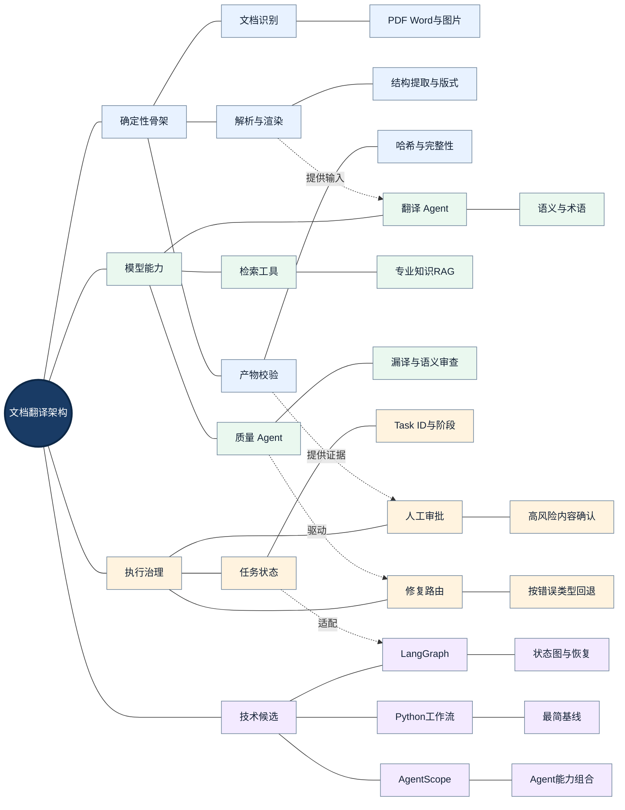

> <strong>图谱解读：</strong>中心节点表示本节的工程决策对象，四个方向的知识分支分别表示不同约束、机制与证据。虚线是跨模块依赖或影响关系，并非执行顺序。

企业文档翻译具有两类性质不同的任务：文档解析、排版和文件写入偏确定性；术语翻译、语义判断和复杂质量审查偏开放性。推荐将<strong>确定性工作流作为骨架，局部嵌入专业 Agent</strong>，并将业务状态、产物存储和审批记录设计成独立于框架的领域模块。

### 10.1 三种候选实现

| 方案 | 实现思路 | 优点 | 需要补齐的部分 |
|---|---|---|---|
| A：Python 工作流 + 模型 API | 程序控制解析、翻译、渲染、校验 | 依赖少、容易测试 | 长任务恢复、审批、复杂路由需自建 |
| B：AgentScope + 业务调度 | ReActAgent 管理专业判断，Toolkit 调用工具 | Agent 能力组合灵活 | 外部持久化、产物幂等与运行治理 |
| C：LangGraph + 专业节点/子图 | 图管理条件路由、循环、检查点与审批 | 状态和执行路径显式 | 状态设计、图维护和存储成本 |

这三种方案是<strong>待实验验证的架构候选</strong>，不是对现有项目的迁移命令。若现有 AgentScope 实现已稳定运行，优先通过 E4/E5/E6 证明瓶颈是否来自框架，而不是凭抽象偏好重写。

### 10.2 任务状态与产物契约

建议状态只保存 `task_id`、`source_artifact_id`、`document_type`、`stage`、`terminology_version`、`translation_artifact_id`、`layout_artifact_id`、`quality_report_id`、`approval_status` 和 `retry_count` 等引用与元数据；大型 PDF、图片与 Word 二进制应放在产物存储中。

每次生成中间结果记录输入哈希、模型版本、Prompt 版本、术语库版本和生成时间，保证恢复时可以验证缓存是否仍有效。

### 10.3 质量修复闭环

术语错误返回翻译模块；版式裁切返回布局模块；解析遗漏返回解析模块；高风险设备型号错误进入人工确认。每条回路必须设置次数上限、累计成本上限与失败终态。人工确认应先于不可逆业务动作。

### 10.4 真实工程瓶颈

PDF 页面并行并不总是安全：跨页段落、连续表格、全局目录和术语一致性要求全局上下文。MinerU 等解析服务可能消耗大量 CPU、内存或 GPU 资源；模型 API 受限流和 Token 成本约束；排版引擎的输出也需要视觉回归与结构校验。因此，是否采用图框架不是唯一性能决定因素，<strong>分块策略、并发闸门、缓存复用和产物校验</strong>同样关键。

## 十一｜版本演进、迁移与长期维护

### 版本演进、迁移与长期维护：中心辐射知识网络

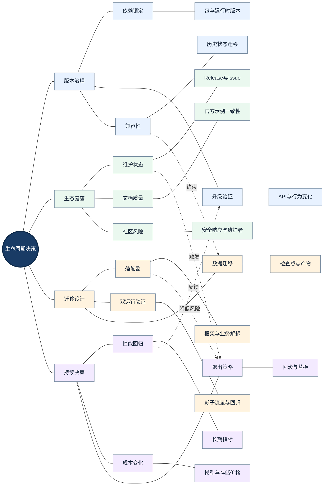

> <strong>图谱解读：</strong>中心节点表示本节的工程决策对象，四个方向的知识分支分别表示不同约束、机制与证据。虚线是跨模块依赖或影响关系，并非执行顺序。

Agent 框架生态更新较快，选型结论需要明确时间与版本边界。对现有 AutoGen 项目应重点核对官方维护状态与 Microsoft Agent Framework 迁移文档；对 AgentScope 需核对 1.x 与 2.x 的 API 差异；对 LangGraph 需核对图结构与检查点兼容；对 CrewAI 需同时考察 Crew 和 Flow。

迁移应采用<strong>领域契约先行</strong>：先把业务状态、工具接口、产物引用、错误分类和审计字段从框架内部对象中抽离，再以适配器接入候选框架。进行影子运行、固定基准回归、历史任务恢复演练，最后逐步切换流量。

生产系统不应把“能运行新任务”作为唯一升级标准。长期任务可能使用旧版状态字段和节点名；升级必须回答旧任务能否恢复、失败能否补偿、数据是否需要迁移以及回滚是否可行。

## 十二｜常见误区、知识关联与最终决策

### 常见误区、知识关联与最终决策：中心辐射知识网络

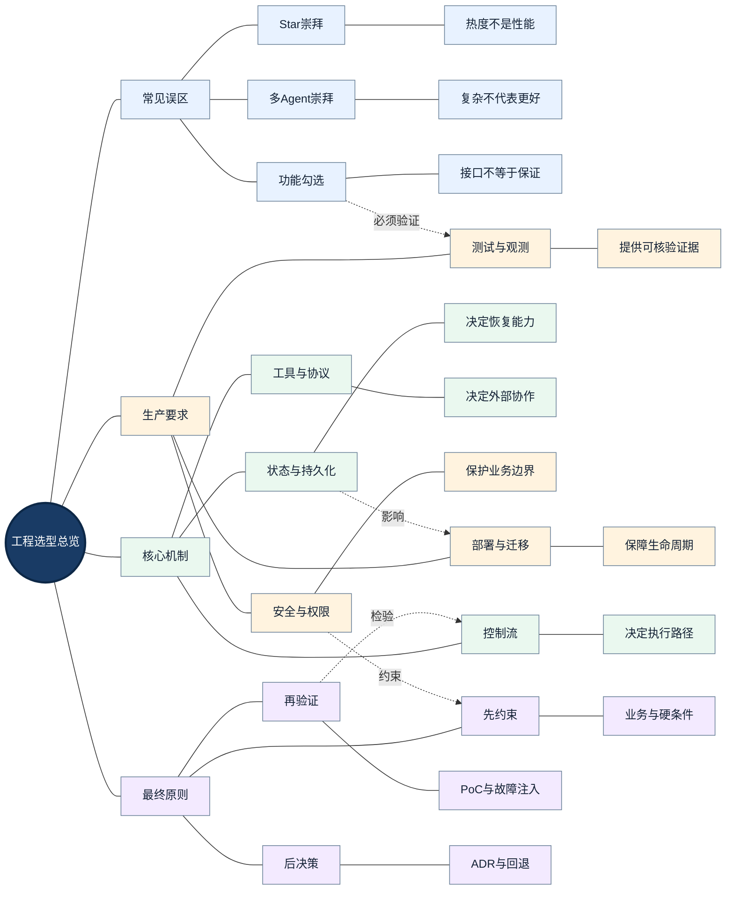

> <strong>图谱解读：</strong>中心节点表示本节的工程决策对象，四个方向的知识分支分别表示不同约束、机制与证据。虚线是跨模块依赖或影响关系，并非执行顺序。

<strong>误区一：GitHub Star 多就是最优框架。</strong> 社区活跃度可以作为维护风险的参考，却不能替代同场景实测。

<strong>误区二：多 Agent 一定比单 Agent 更智能。</strong> 专业分工可能提高质量，也可能引入协调延迟、状态冲突和错误传播；收益必须由对照实验确认。

<strong>误区三：支持持久化就能保证外部操作恰好一次。</strong> 框架检查点不能自动涵盖外部 API 的事务边界。

<strong>误区四：支持 MCP 就代表拥有全部工具能力。</strong> 协议兼容不代表具体工具存在、授权有效或调用语义一致。

<strong>误区五：支持多模型就不存在供应商锁定。</strong> Tool Calling、结构化输出、多模态和状态序列化仍可能产生差异。

<strong>误区六：采用图框架一定优于普通 Python。</strong> 图编排的收益依赖复杂控制流、状态恢复与可审计需求；简单流程可能增加抽象成本。

<strong>误区七：Tracing 等于自动质量保障。</strong> 追踪回答“发生了什么”，评测回答“是否正确”，安全控制回答“是否允许”。三者不可互相替代。

### 与第六章其他知识的关系

[多 Agent 基础](./01-Multi-Agent-Fundamentals.md) 决定是否需要专业分工；[协作模式](./02-Collaboration-Patterns.md) 决定控制权和通信拓扑；[通信与状态](./03-Communication-and-State.md) 决定一致性与恢复边界；[LangGraph](./04-LangGraph.md) 和 [AgentScope](./05-AgentScope.md) 提供两条不同的实现路线。本章则把这些机制转化为<strong>可量化、可解释、可复现的选型方法</strong>。

### 最终决策准则

先用最简单的方案建立基线；对必要的控制流、状态恢复、工具安全和企业部署设置硬约束；再通过统一 PoC、故障注入、成本分析与敏感性分析比较候选方案；最后形成包含版本、证据、风险和回退策略的 ADR。框架不是最终目标，<strong>长期稳定交付业务结果</strong>才是选型成功的标准。

## 参考资料与继续研究入口

以下优先列出官方资料。由于框架版本持续演进，具体 API、版本支持与维护状态应以实施时的官方 Release 和对应版本文档为准。

1. [LangGraph Overview](https://docs.langchain.com/oss/python/langgraph/overview) — 框架定位与运行能力。
2. [LangGraph Graph API](https://docs.langchain.com/oss/python/langgraph/graph-api) — 状态、节点、边、Reducer、动态路由。
3. [LangGraph Persistence](https://docs.langchain.com/oss/python/langgraph/persistence) — 检查点、Thread 与 Store。
4. [LangGraph Interrupts](https://docs.langchain.com/oss/python/langgraph/interrupts) — 人工审批与暂停恢复。
5. [LangGraph GitHub](https://github.com/langchain-ai/langgraph) — 源码与 Release。
6. [AgentScope Documentation](https://doc.agentscope.io/) — Agent、Toolkit、Memory、Pipeline、Session、Tracing。
7. [AgentScope GitHub](https://github.com/agentscope-ai/agentscope) — 官方源码与版本演进。
8. [OpenAI Agents SDK Python](https://openai.github.io/openai-agents-python/) — Agent、Runner、Tools、Handoff 与 Guardrails。
9. [Microsoft Agent Framework](https://learn.microsoft.com/en-us/agent-framework/overview) — Agent 与 Workflow 组合。
10. [Microsoft AutoGen GitHub](https://github.com/microsoft/autogen) — 历史架构与维护状态。
11. [CrewAI Documentation](https://docs.crewai.com/) — Crew 与 Flow。
12. [Model Context Protocol](https://modelcontextprotocol.io/) — MCP 规范与工具互操作。
13. [Agent2Agent Protocol](https://a2a-protocol.org/) — 独立 Agent 的互操作。
14. [OpenTelemetry Documentation](https://opentelemetry.io/docs/) — 分布式追踪与指标。
15. [Google SRE Books](https://sre.google/books/) — SLO、可靠性与运行治理。
16. [Microsoft Azure Architecture Center](https://learn.microsoft.com/en-us/azure/architecture/) — 企业架构、可靠性与模式参考。

---

> <strong>章节总结：</strong>技术选型的核心知识网络由“业务约束—架构复杂度—控制权—状态与恢复—工具与协议—安全与部署—实验评价—版本迁移”构成。框架比较只有嵌入这一完整网络，才能得到可执行、可审计且可持续修正的工程决策。

