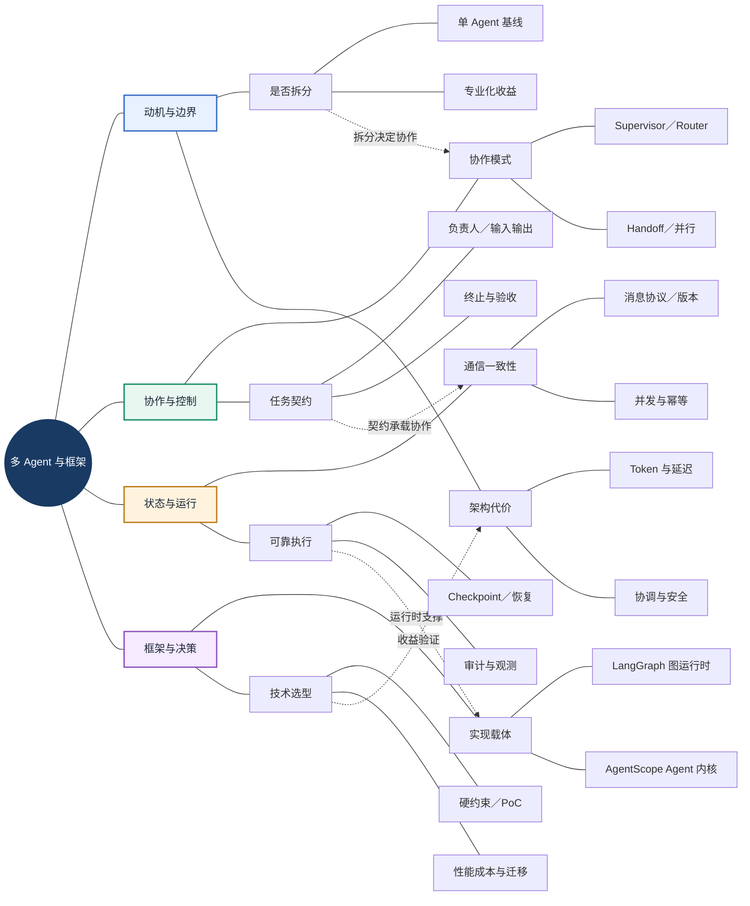
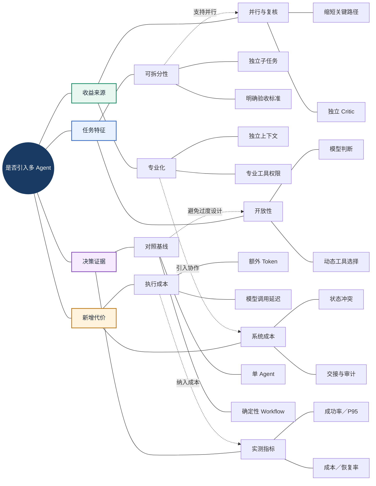
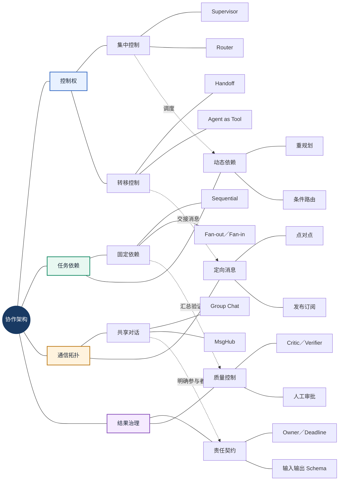
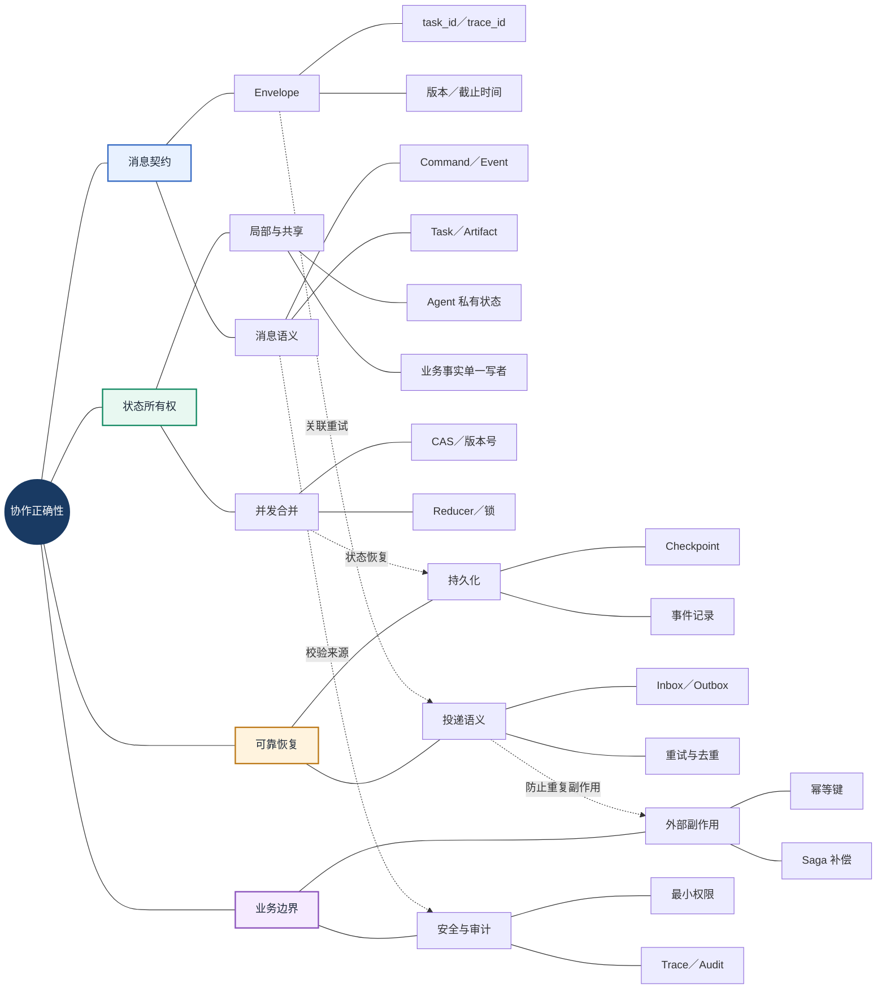
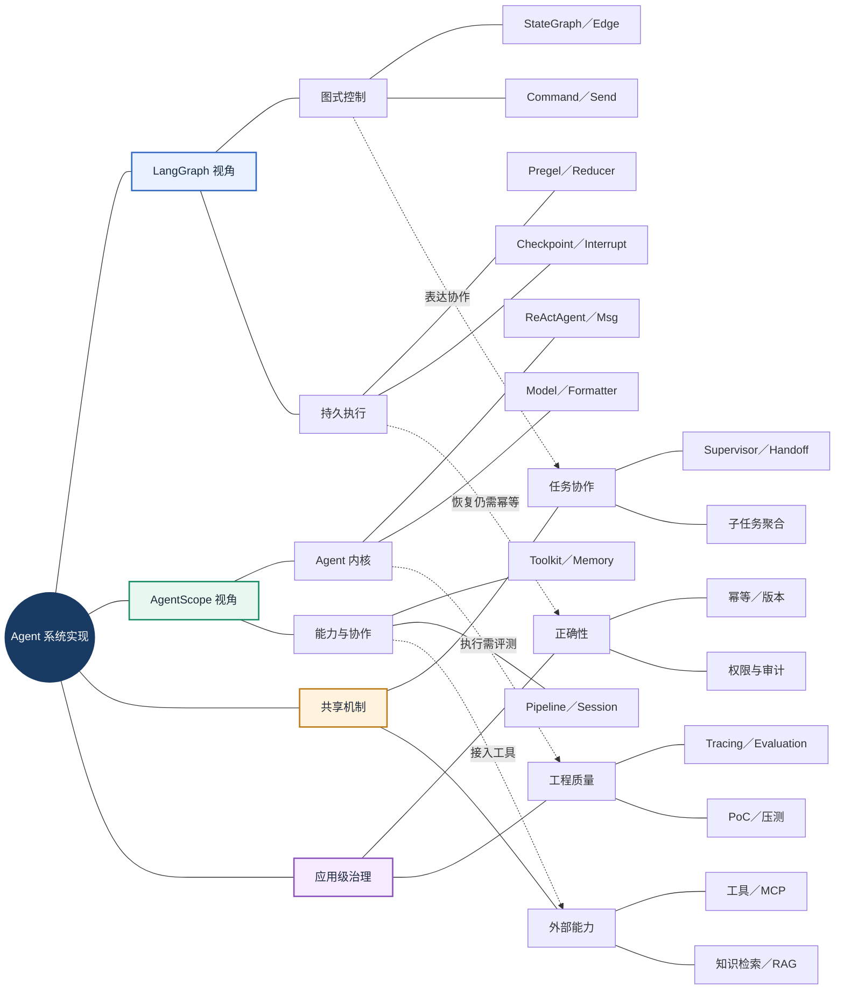
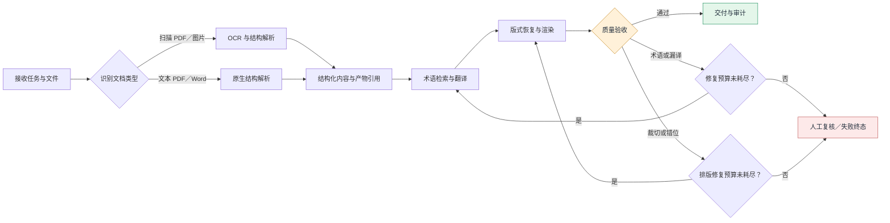
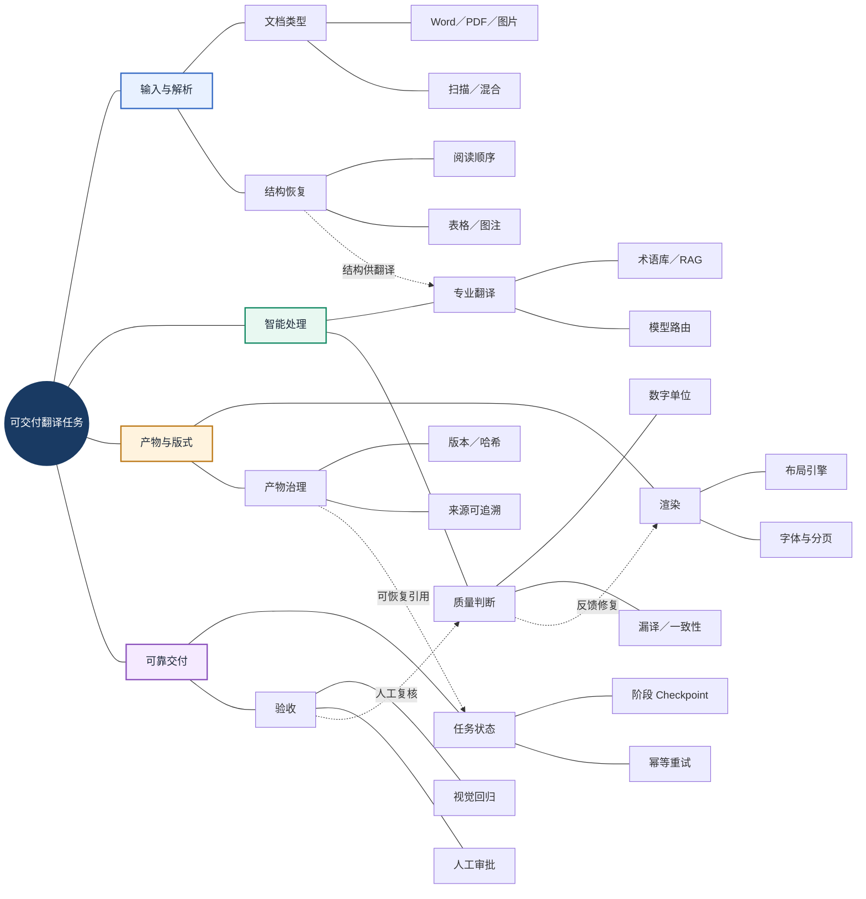
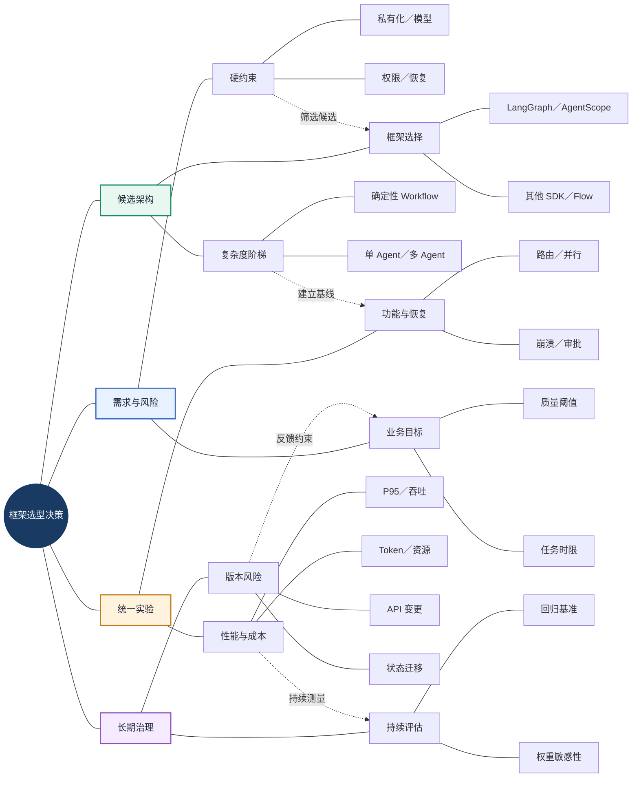
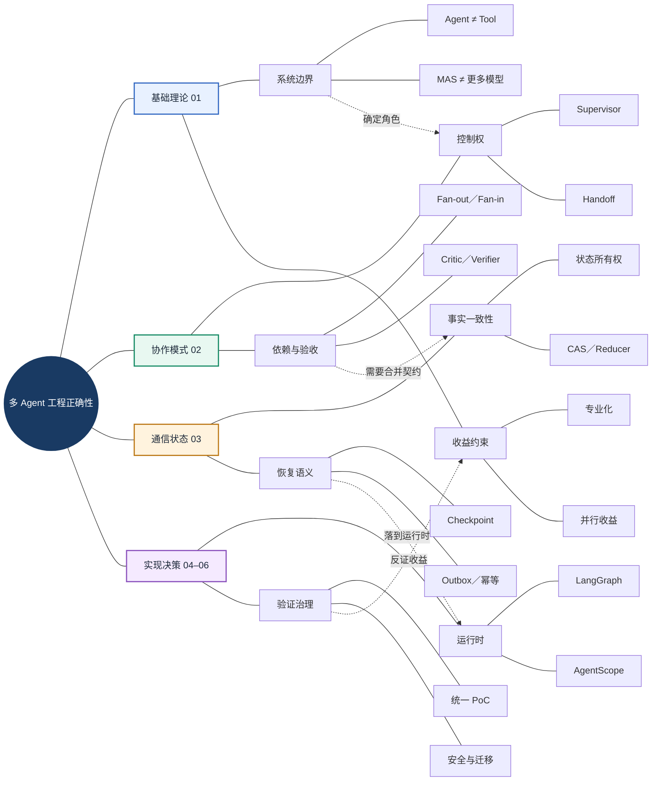

# 第六章｜多 Agent 与框架：从协作原理到工程选型

> <strong>章节定位：</strong>将多智能体系统（Multi-Agent System，MAS）的设计原则、协作机制、通信一致性、框架运行时与工程决策整合为一套可执行的知识体系。  
> <strong>阅读方式：</strong>先阅读本 README 建立整体认知，再沿六篇专题文档逐层深入。  
> <strong>内容依据：</strong>本章目录内六篇正文；框架版本与具体 API 以各篇所引官方资料及项目锁定版本为准。

<strong>一句话总览：</strong>多 Agent 不是把多个模型串联，而是在明确任务契约、控制权、状态所有权与故障边界后，组织多个专业执行主体可靠地完成共同目标；框架只是这些机制的实现载体。

## 一、全章知识地图：六篇文档如何组成一个系统

本章围绕四个相互依赖的问题展开：<strong>为什么拆分</strong>、<strong>如何协作</strong>、<strong>如何保持执行正确</strong>、<strong>如何选框架并证明价值</strong>。它们分别由基础篇、协作篇、通信状态篇和框架实践篇承接。

### 1.1 全局中心辐射知识网络

<strong>图谱解读：</strong>四组分支并非平行目录：任务拆分引出控制权分配，控制权依赖通信与状态契约，运行时承载执行与恢复，最后通过选型实验验证收益是否抵消新增复杂度。

### 1.2 六篇专题导航

| 学习顺序 | 文档入口 | 必须掌握的核心问题 | 阅读后应能做什么 |
|---|---|---|---|
| 01 | [多 Agent 基础](./01-Multi-Agent-Fundamentals.md) | 何时需要 MAS，Agent、Tool、Workflow 和 Team 如何区分 | 论证拆分的必要性与代价 |
| 02 | [协作模式](./02-Collaboration-Patterns.md) | 谁持有控制权，顺序、并行、路由和交接如何组合 | 选择协作拓扑与任务分工 |
| 03 | [通信与状态](./03-Communication-and-State.md) | 消息、共享事实、并发、持久化与恢复如何保证正确 | 设计消息契约、状态机与幂等边界 |
| 04 | [LangGraph](./04-LangGraph.md) | 图、Reducer、Pregel、Checkpoint、Interrupt 如何配合 | 实现可循环、可恢复的图式编排 |
| 05 | [AgentScope](./05-AgentScope.md) | Agent、Msg、Toolkit、Memory、Pipeline、Session 如何协同 | 实现可扩展的 Agent 能力与团队协作 |
| 06 | [框架选型与技术权衡](./06-Framework-Selection.md) | 如何在硬约束下比较框架并开展可复现 PoC | 输出有证据的架构选型结论 |

<strong>阅读提示：</strong>第 04、05 篇是两种实现视角，不是必须按顺序部署的两个组件；第 06 篇应在理解前三篇机制和至少一种实现后阅读。

## 二、从单 Agent 到多 Agent：拆分必须创造净收益

复杂任务不天然需要多个 Agent。只有专业化、并行执行、上下文隔离、独立验证或权限隔离带来的收益，足以抵消通信、协调、重复推理与故障传播成本时，拆分才成立。基线应是<strong>使用同样工具与知识源的单 Agent 或确定性工作流</strong>。

### 2.1 架构复杂度与收益网络

<strong>图谱解读：</strong>不要把“任务复杂”直接推导为“Agent 越多越好”。拆分条件、收益来源、额外代价和对照实验共同构成架构决策闭环。

关键概念边界：<strong>Tool（工具）</strong>提供可调用能力，<strong>Agent（智能体）</strong>基于任务与反馈选择行动，<strong>Workflow（工作流）</strong>显式规定依赖和状态转移，<strong>Team（团队）</strong>描述多个 Agent 的责任组织。一个 Workflow 可以包含 Agent 节点，也可以只有确定性程序节点。

延伸阅读：[01｜多 Agent 基础](./01-Multi-Agent-Fundamentals.md) 的拆分动机、架构谱系、成本与评测。

## 三、协作的本质：控制权、任务依赖与信息拓扑

协作模式并不是“多个 Agent 相互聊天”的不同名称。它同时涉及<strong>谁决定下一步</strong>、<strong>任务能否并行</strong>、<strong>消息发给谁</strong>、<strong>谁对最终结果负责</strong>。这些维度可以正交组合。

### 3.1 协作模式的四维关系网

<strong>图谱解读：</strong>Supervisor、Router、Handoff 主要涉及控制权；Sequential、Parallel 主要涉及依赖；MsgHub 主要涉及消息传播。不要把三者混为一种“协作模式”。

<strong>工程选择：</strong>固定处理步骤优先使用确定性流水线；可独立处理的子任务适合 Fan-out/Fan-in；任务类型不确定时使用 Router；需要专家自主完成子任务时采用 Supervisor–Worker；涉及高风险写操作时加入明确审批节点。

延伸阅读：[02｜协作模式](./02-Collaboration-Patterns.md) 的控制权模型、协作契约、拓扑和终止条件。

## 四、通信、状态与一致性：从“能协作”到“可正确恢复”

当多个 Agent 共享任务时，最危险的错误不一定来自模型，而可能来自重复消息、并发覆盖、错误状态恢复或外部副作用。必须区分<strong>消息内容</strong>、<strong>业务事实</strong>、<strong>执行检查点</strong>和<strong>文件产物</strong>。

### 4.1 消息—状态—事务的知识网络

<strong>图谱解读：</strong>消息送达不意味着业务完成，状态已保存不意味着外部操作恰好执行一次。正确性必须贯穿消息标识、状态更新、检查点、外部事务与审计。

| 容易混淆的概念 | 正确边界 |
|---|---|
| Msg / Message | 交互内容与协作指令，不等于完整业务状态 |
| Shared State | 多执行者共享的事实，需要字段所有权和更新规则 |
| Checkpoint | 运行状态快照，不自动回滚外部系统 |
| Artifact | 文件或中间产物，应有 ID、版本与来源 |
| At-least-once | 允许重复投递，需要消费端去重 |
| Exactly-once | 不能仅凭框架重试能力推断跨系统恰好一次业务效果 |

延伸阅读：[03｜通信与状态](./03-Communication-and-State.md) 的 CAS（Compare-and-Swap，比较并交换）、Outbox、Saga、任务状态机和故障注入。

## 五、框架如何承载协作机制：LangGraph 与 AgentScope

前面三篇讨论的是<strong>应当具备什么机制</strong>；这里讨论<strong>框架如何组织这些机制</strong>。LangGraph 的主要入口是图与状态运行时，AgentScope 的主要入口是 Agent 对象及其能力组合。两者有重叠能力，不能仅凭名称判断某项能力是否独有。

### 5.1 两种实现视角与共同工程底座

<strong>图谱解读：</strong>框架负责组织 Agent 行为和运行机制，业务层仍须承担权限、文件一致性、幂等、审计与最终验收。图式控制和 Agent 内核是不同的抽象切入点。

| 对比点 | LangGraph | AgentScope | 选型时真正要问的问题 |
|---|---|---|---|
| 核心抽象 | StateGraph、Node、Edge、State | Agent、Msg、Toolkit、Memory | 项目复杂度主要来自控制流还是 Agent 行为？ |
| 动态协作 | 条件边、Command、Send、Subgraph | Pipeline、Routing、Handoff、MsgHub | 任务依赖和控制权如何表达？ |
| 状态与恢复 | Checkpointer、Thread、Store、Interrupt | StateModule、Session、Memory | 具体版本和存储配置满足什么恢复语义？ |
| 工具能力 | 节点与工具集成 | Toolkit、MCP、Agent Skill | 工具鉴权、Schema 与错误如何管理？ |
| 质量治理 | Tracing、测试、应用级评测 | Tracing、Studio、Evaluation | 是否可复现故障并度量收益？ |

延伸阅读：[04｜LangGraph](./04-LangGraph.md) 与 [05｜AgentScope](./05-AgentScope.md)。

## 六、企业任务如何运行：控制流、数据流与恢复路径

以医疗设备文档翻译为例，解析、翻译、排版与质量检查存在固定依赖；文档类型选择、术语审查和质量修复则存在动态分支。因此应采用<strong>确定性工作流骨架 + 局部 Agent 推理 + 独立校验</strong>，并将大文件保存为 Artifact 引用。

### 6.1 执行与反馈闭环（此图刻意采用流程图，而非知识图谱）

<strong>图谱解读：</strong>这张图强调执行先后和失败回路。质量检查不能只返回“重试”，而应按错误类型回到对应阶段，并受次数、时间与成本预算约束。

### 6.2 企业文档翻译的横向能力网络

<strong>图谱解读：</strong>此图展示同一业务目标周围的能力依赖，而非执行顺序。文档结构质量影响翻译，翻译结果影响排版，产物版本支持恢复，验收结果决定修复或交付。

<strong>边界提醒：</strong>LangGraph 的 Checkpoint 或 AgentScope 的 Session 都不能替代文件事务、业务幂等与审批审计；PDF 跨页表格、Word 域与图注等复杂结构需要专门解析和回归测试。

## 七、从框架能力到工程决策：选型不是功能打分比赛

先筛掉不满足硬约束的方案，再对候选架构进行统一 PoC（Proof of Concept，概念验证）。硬约束可包括部署方式、Python 版本、模型兼容性、数据隔离、人工审批与长任务恢复；评分维度可包括成功率、成本、延迟、可维护性和安全。

### 7.1 选型与验证的闭环网络

<strong>图谱解读：</strong>框架比较应以业务约束为起点，经过候选架构、统一实验、维护评估后再形成结论。排名是特定需求下的证据，而非永远有效的框架优劣表。

### 7.2 一个可解释的多准则评分模型

对满足硬约束的候选框架，可使用多准则决策分析（Multi-Criteria Decision Analysis，MCDA）进行辅助评分：

$$
S_j = \sum_{i=1}^{n} w_i r_{ij}, \qquad \sum_{i=1}^{n} w_i = 1
$$

其中，$S_j$ 为候选方案 $j$ 的综合评分，$w_i$ 为评价维度 $i$ 的权重，$r_{ij}$ 为实测或可审计证据支持的标准化评分。权重属于业务决策参数，<strong>不是框架固有性能</strong>；应进行敏感性分析，并保留原始测试数据。

### 7.3 六类优先 PoC

| 测试 | 验证内容 | 失败时优先定位 |
|---|---|---|
| 工具调用 | Schema、参数、结果与异常 | 模型／Formatter／Toolkit |
| 路由交接 | Supervisor、Handoff、责任归属 | 协作契约与控制权 |
| 并行聚合 | 冲突、Reducer、结果完整性 | 任务分解与状态合并 |
| 故障恢复 | 进程终止、重放、幂等 | Checkpoint／Session／外部事务 |
| 人工审批 | 暂停、授权、继续执行 | 状态机与权限 |
| 端到端业务 | 质量、P95、成本、回归 | 整体架构与关键路径 |

延伸阅读：[06｜框架选型与技术权衡](./06-Framework-Selection.md) 的候选框架比较、权重模型、PoC 和迁移策略。

## 八、跨篇知识关系：关键概念不要混淆

六篇文章的关系不是六个互不相干的知识岛，而是一个由业务约束、控制权、消息状态、执行运行时和治理证据共同构成的网络。

### 8.1 跨篇依赖与误区纠偏

<strong>图谱解读：</strong>横向联系贯穿整章：多 Agent 设计的成功不能仅由最终回答判断，还必须通过任务验收、状态正确性、可恢复性、成本和安全证据共同证明。

| 核心区分 | 不能混同的原因 | 深入阅读 |
|---|---|---|
| 协作拓扑 vs 执行依赖 | 谁能通信与谁必须先执行是不同关系 | [02](./02-Collaboration-Patterns.md) |
| Handoff vs 授权 | 交接控制权不代表自动授予数据访问权 | [02](./02-Collaboration-Patterns.md)、[03](./03-Communication-and-State.md) |
| Reducer vs 数据库事务 | 内部状态合并不保证外部写操作原子性 | [03](./03-Communication-and-State.md)、[04](./04-LangGraph.md) |
| Memory vs Checkpoint vs Store | 会话消息、执行快照和跨任务知识生命周期不同 | [04](./04-LangGraph.md)、[05](./05-AgentScope.md) |
| MCP vs A2A vs Agent 框架 | 工具互操作、Agent 互操作与应用编排属于不同层次 | [03](./03-Communication-and-State.md)、[06](./06-Framework-Selection.md) |
| Agent 能力 vs 业务正确性 | 能调用工具不代表具备幂等、审计和交付保证 | [05](./05-AgentScope.md)、[06](./06-Framework-Selection.md) |

## 九、按目标选择学习路径

| 学习目标 | 推荐阅读路径 | 预期产出 |
|---|---|---|
| 从零理解多 Agent | [01](./01-Multi-Agent-Fundamentals.md) → [02](./02-Collaboration-Patterns.md) → [03](./03-Communication-and-State.md) | 能说明多 Agent 何时值得采用 |
| 构建图式长任务系统 | [03](./03-Communication-and-State.md) → [04](./04-LangGraph.md) → [06](./06-Framework-Selection.md) | 可恢复的状态图设计 |
| 构建工具增强 Agent | [01](./01-Multi-Agent-Fundamentals.md) → [05](./05-AgentScope.md) → [02](./02-Collaboration-Patterns.md) | 专业 Agent 与 Toolkit 组合 |
| 解决一致性与故障恢复 | [03](./03-Communication-and-State.md) → [04](./04-LangGraph.md) → [05](./05-AgentScope.md) | 状态契约、幂等与恢复方案 |
| 企业框架选型或面试 | [01](./01-Multi-Agent-Fundamentals.md) → [06](./06-Framework-Selection.md) → 按需查阅 [04](./04-LangGraph.md) / [05](./05-AgentScope.md) | 有测试证据的选型理由 |

## 十、章节最终总结：六个必须记住的工程判断

1. <strong>先论证拆分收益：</strong>多 Agent 是有代价的架构选择，而不是复杂任务的默认答案。
2. <strong>先定义控制权：</strong>谁负责路由、交接、审批和最终结果，必须在实现前明确。
3. <strong>先设计状态契约：</strong>消息格式、字段所有权、版本、并发与恢复决定协作能否正确执行。
4. <strong>区分运行时与业务事务：</strong>框架持久化不能替代外部系统的幂等、权限与补偿。
5. <strong>框架是手段：</strong>LangGraph 偏重图式状态编排，AgentScope 偏重 Agent 内核与能力组合，具体能力须按版本验证。
6. <strong>用实验而非印象选型：</strong>统一基线、故障注入、质量指标、P95、成本和维护风险共同决定生产方案。

### 下一步学习

完成本章后，可以继续进入仓库的 第七章「企业级工程与部署」，进一步研究可观测性、安全、测试、部署与运维。若第七章目录名称或文件尚未在仓库中创建，请以仓库实际路径为准。

---

<strong>资料边界：</strong>本 README 依据本章六篇专题正文归纳，不替代正文中的实现细节、版本约束与官方参考资料。涉及具体 API、框架版本、协议更新及性能结论时，应返回对应专题文档和其官方来源核对。

