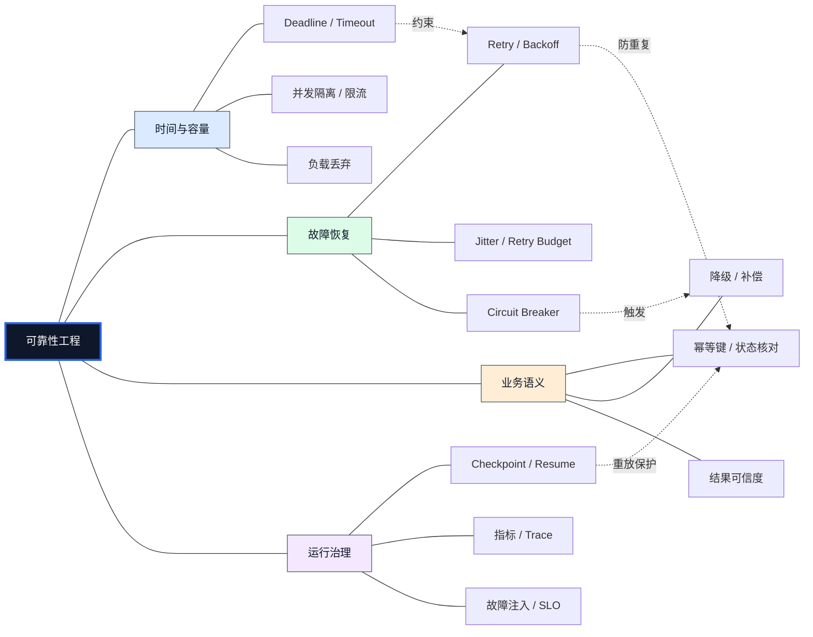
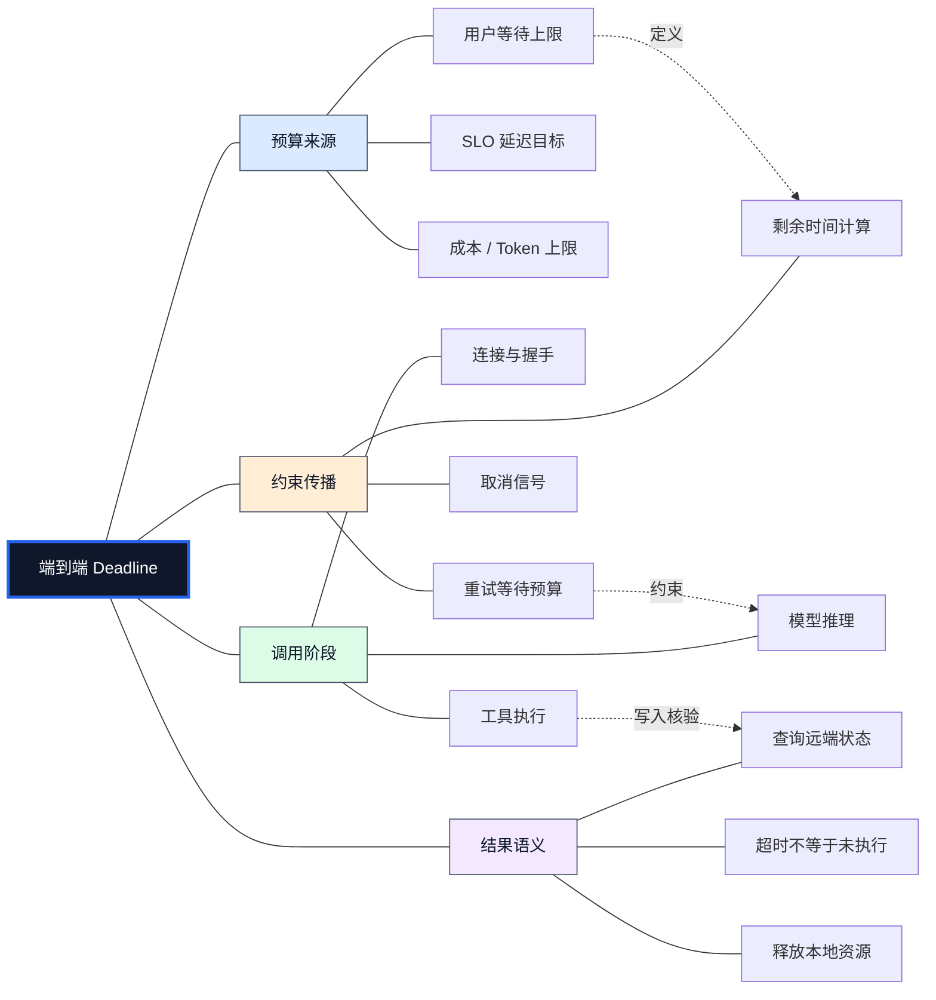
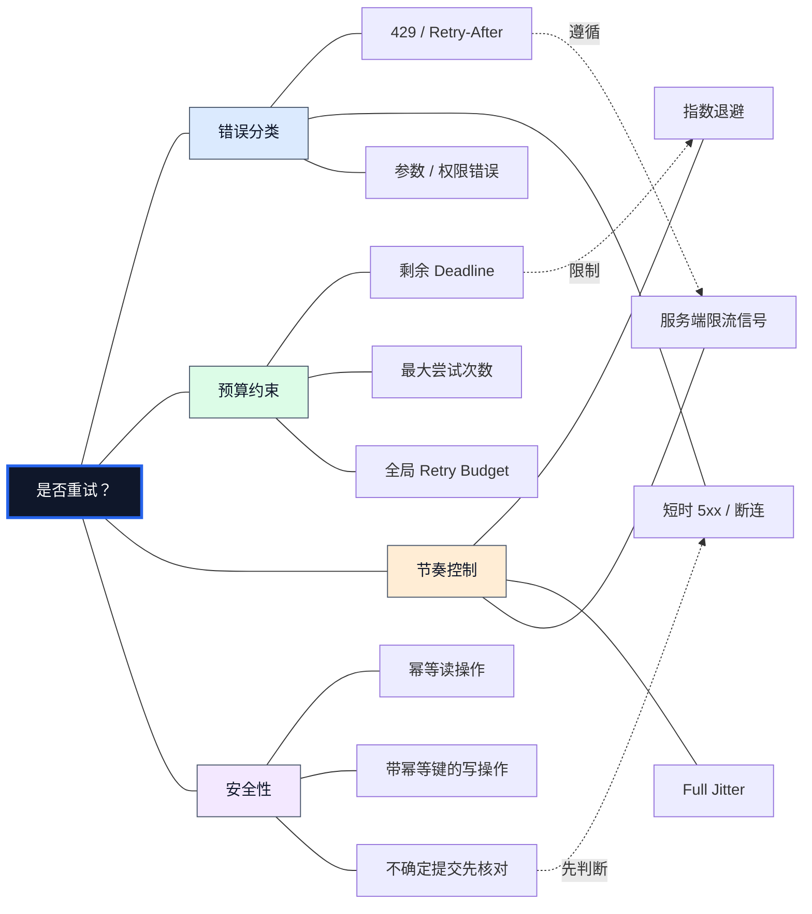
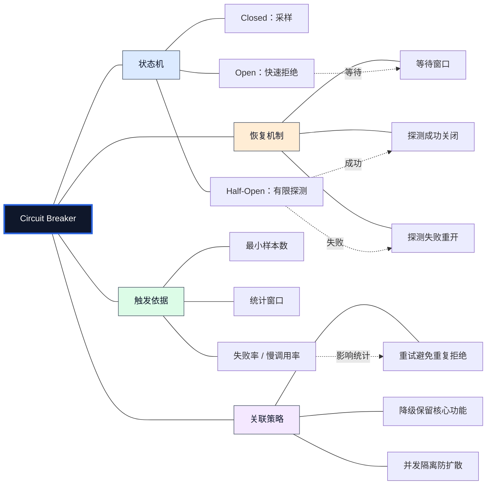
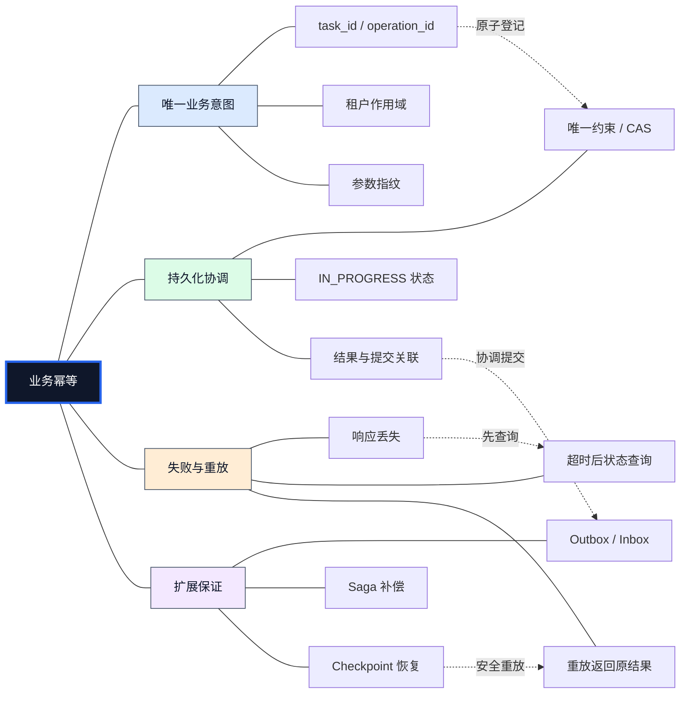
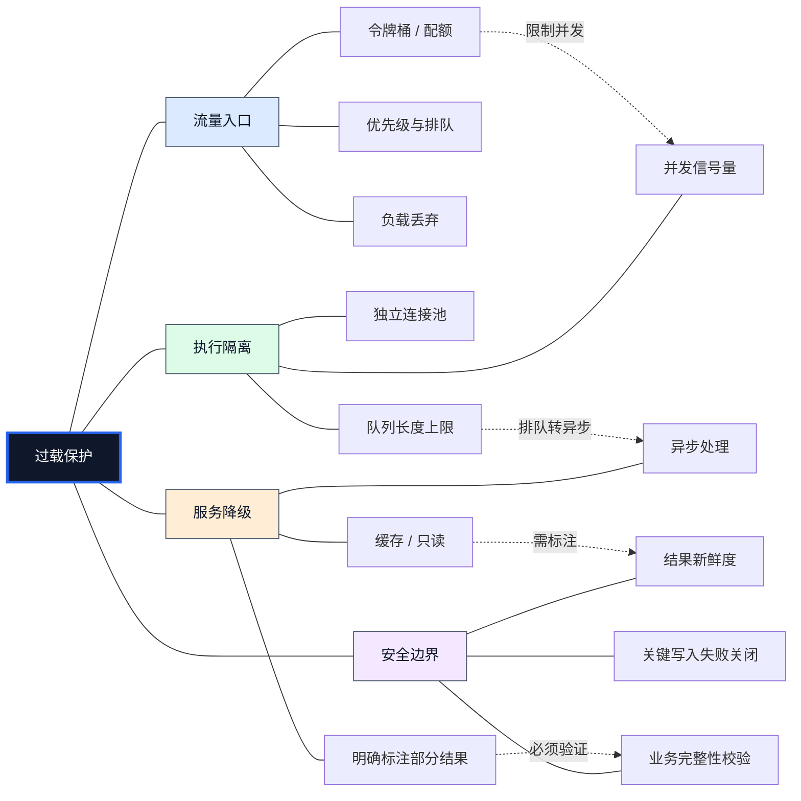
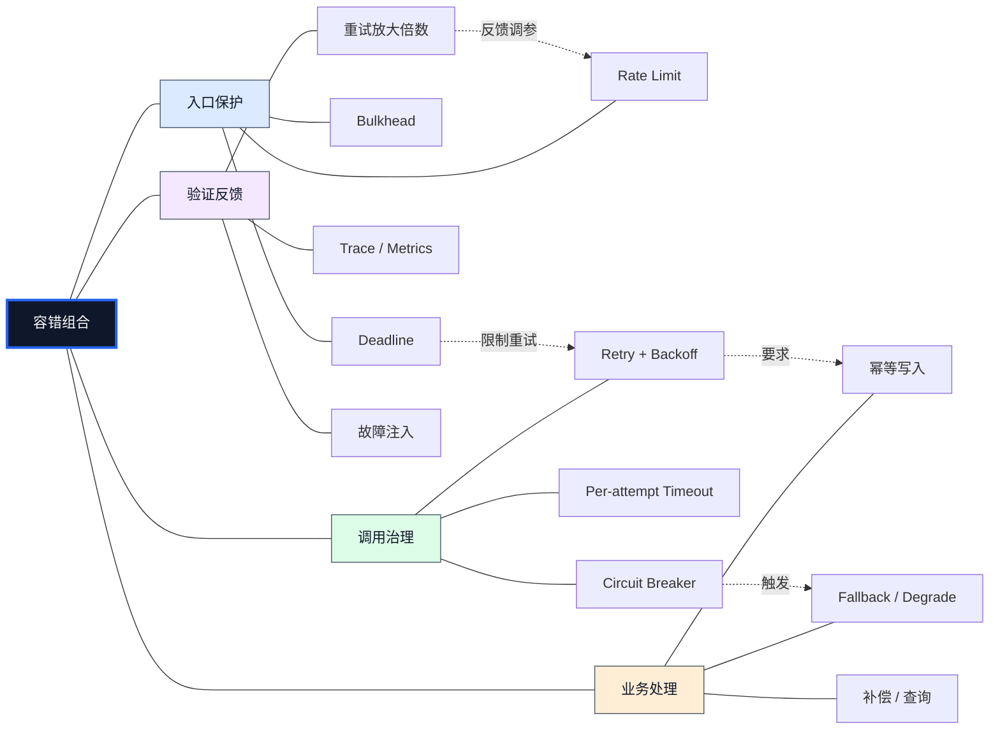
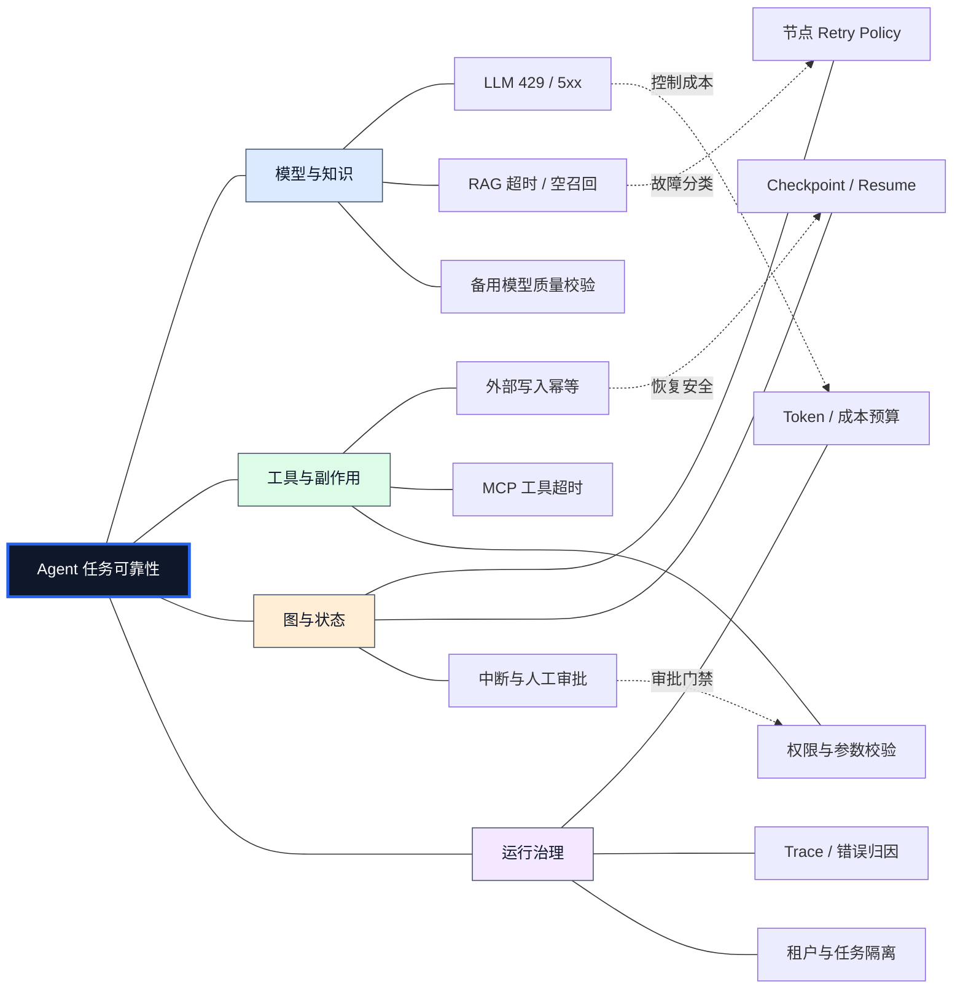
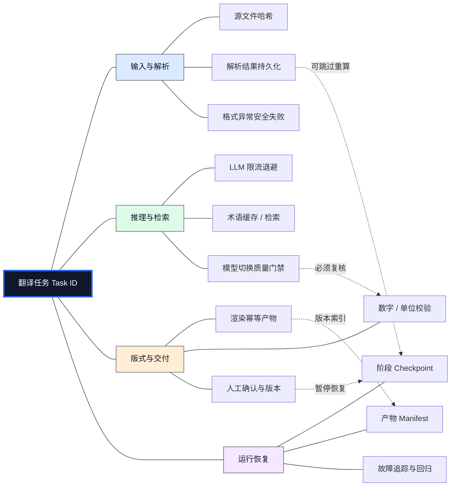
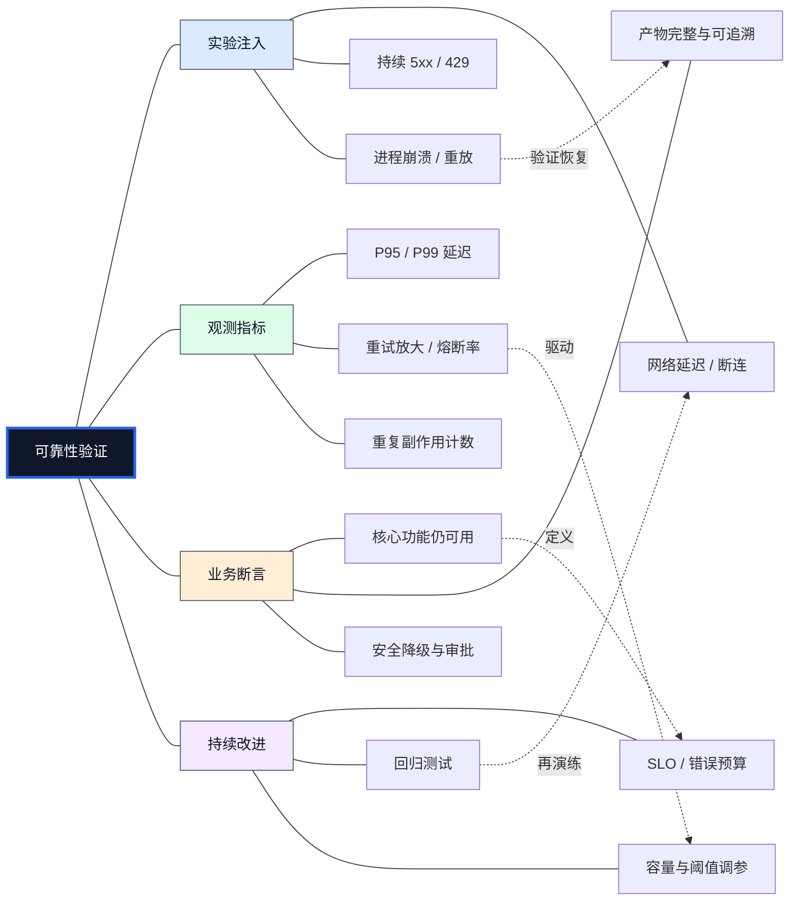

# 超时、重试、降级、熔断与幂等：Agent 系统可靠性与容错工程

> 第七章 · 企业级工程与部署 · 01-Reliability-and-Fault-Tolerance  
> 学习目标：理解故障传播的因果链、各容错机制的职责边界、组合顺序与恢复语义，并能设计可测试、可观测、可恢复的企业级 Agent 服务。

<strong>核心命题：</strong>可靠性不是“失败后再调用一次”，而是在不确定的网络、有限的资源和可能重复执行的环境中，同时保护<strong>用户体验、系统容量、业务正确性和恢复能力</strong>。Agent 还会引入长时任务、模型限流、工具副作用、多节点状态和成本预算，因此必须从端到端链路设计容错。[1][2][3]

## 1. 可靠性问题的起点：部分失败与级联故障

分布式系统中，调用方和被调用方无法共享一个可靠的“操作已完成”瞬时事实。请求超时可能表示服务器未收到请求、服务器正在处理、操作已经提交但响应丢失，或者调用方本地取消。<strong>观察到失败不等于业务未执行。</strong>

<strong>部分失败（Partial Failure）</strong>指部分节点或依赖不可用而其他组件仍可工作；<strong>瞬时故障（Transient Failure）</strong>指短期可恢复错误；<strong>级联故障（Cascading Failure）</strong>指故障通过等待、重试、排队和资源竞争传播。Google SRE 讨论了过载与级联失败的正反馈机制。[2]

### 1.1 可靠性防护总网络

<strong>图谱解读：</strong>四个分支不是互斥选项：时间预算限制每次尝试，恢复策略决定是否再试，幂等保护重复副作用，观测和演练验证组合是否有效。若仅配置 Retry 而不配置容量保护，系统可能在故障期间自我放大流量。

### 1.2 可靠性的量化目标

可用性（Availability）描述服务在目标窗口内可提供服务的比例；SLO（Service Level Objective，服务等级目标）是内部约定的可靠性目标，SLA（Service Level Agreement，服务等级协议）通常包含面向客户的承诺和后果；SLI（Service Level Indicator，服务等级指标）是测量值。[2]

$$
A = \frac{T_{\mathrm{available}}}{T_{\mathrm{total}}}
$$

仅有请求成功率不够：Agent 可能返回 HTTP 200，却交付错误的译文、缺失文件或未经确认的降级结果。需要同时度量<strong>技术成功、业务成功、质量合格和可恢复性</strong>。

## 2. 超时与截止时间：先确定停止条件

<strong>Timeout（超时）</strong>是允许等待的时长；<strong>Deadline（截止时间）</strong>是请求必须结束的时间边界。连接、连接池等待、DNS、TLS、首字节、读写和整体请求的超时语义取决于客户端，不能默认“设置 timeout 就覆盖所有阶段”。[1]

$$
T_{\mathrm{remaining}} = D - t_{\mathrm{now}}
$$

每个节点应在剩余预算内运行；跨服务传递绝对时间时需处理时钟偏差，可使用运行时原生 deadline 或传播剩余时长。取消本地等待不保证远端推理或数据库事务已停止。对于写操作，超时后应先查询操作状态或使用原幂等键重试。[1][3]

### 2.1 时间预算关系网络

<strong>图谱解读：</strong>用户总预算必须先于节点预算确定；工具调用即使本地超时，外部副作用仍可能已经生效，因此超时策略必须连接业务状态核对。

假设某工作流包括模型调用、知识检索和渲染：单节点各自设置 30 秒并不意味着整体会在 30 秒内完成。总时间应计入重试等待、排队、序列化和清理时间。

$$
T_{\mathrm{total}} = \sum_{i=1}^{n} T_i + \sum_{i=1}^{n-1} W_i + T_{\mathrm{overhead}}
$$

## 3. 重试：只对有恢复希望且可安全重放的失败再次尝试

<strong>Retry（重试）</strong>需要同时满足四项条件：错误具有瞬时性；操作可以安全重放或具有幂等保护；剩余时间和调用预算充足；依赖服务未处于必须拒绝流量的状态。429、部分 502/503/504 和连接重置可能允许重试，但必须遵守服务端的 `Retry-After` 等约束；参数错误、鉴权失败、明确的业务拒绝通常不应盲目重试。[1][3]

<strong>Exponential Backoff（指数退避）</strong>让等待随尝试轮次增长；<strong>Jitter（随机抖动）</strong>降低大量客户端同步重试的尖峰；<strong>Retry Budget（重试预算）</strong>限制全局额外请求量。[1]

$$
B_k = \min(B_{\max}, B_0 2^k)
$$

$$
W_k \sim U(0,B_k)
$$

后式是 Full Jitter 的一种常见形式，并非所有 SDK 默认策略。`k` 的起始值、最大次数是否包含首次尝试必须在接口契约中明确。

### 3.1 重试策略决策网络

<strong>图谱解读：</strong>重试是多条件决策，不是捕获异常后立即再次请求。尤其应避免多个调用层同时配置独立重试：若五层各自最多尝试三次，最底层理论上可能承受 243 次调用尝试，AWS Builders Library 以此说明重试放大风险。[1]

### 3.2 重试预算的工程实现

可按服务或依赖配置 Token Bucket（令牌桶）：正常请求产生或补充少量重试额度，额外尝试必须消耗令牌。预算耗尽后快速失败或进入安全降级；不能让“救火流量”挤占正常流量。不要同时依赖 SDK、HTTP 网关、服务网格和应用节点的隐式重试而不统计总尝试数。

## 4. 熔断：持续故障时停止无意义调用

<strong>Circuit Breaker（熔断器）</strong>通常有 Closed（关闭，允许调用）、Open（打开，拒绝普通调用）、Half-Open（半开，有限探测）三个状态。通过滑动窗口、最小样本数、失败率或慢调用率判断依赖健康，并通过恢复探测控制重新放量。[3][5]

### 4.1 熔断器与外围保护网络

<strong>图谱解读：</strong>熔断器控制“是否调用”，重试控制“失败后是否再试”，降级控制“无法调用时提供什么服务”。熔断器不是修复器；本地进程熔断状态也不等于全局依赖健康。[3]

配置要防止小样本误触发、半开探测过量和恢复后瞬时流量冲击。不同库对慢调用、异常分类、半开并发和窗口语义不同，生产环境应通过故障注入验证。

## 5. 幂等：解决响应丢失后的重复副作用

<strong>Idempotency（幂等性）</strong>要求同一业务意图重复提交时不会重复产生业务效果。调用方超时不代表服务端未提交；在支付、订单、文件写入、邮件发送和工具调用中，最危险的情形是“服务端已完成，响应丢失”。Stripe 的幂等请求接口展示了用幂等键识别同一业务尝试的做法。[6]

<strong>Idempotency Key（幂等键）</strong>应绑定租户、业务操作和请求参数摘要，并具有足够长的保留期限。服务端通过唯一约束或事务记录执行状态：`NEW → IN_PROGRESS → SUCCEEDED / FAILED`；相同键、不同参数应拒绝或显式报告冲突。并发首次请求必须原子争夺执行权，不能先查后写而无锁。[6]

### 5.1 幂等与恢复语义网络

<strong>图谱解读：</strong>检查点负责保存执行位置，幂等负责保护外部副作用，Outbox/Inbox 处理消息与数据库写入的协调，Saga（长事务补偿模式）用于多步骤业务失败后的补偿。它们解决不同问题，不可相互替代。

### 5.2 原子性与执行保证

<strong>At-most-once（至多一次）</strong>可能丢任务；<strong>At-least-once（至少一次）</strong>可能重复投递；<strong>Exactly-once（恰好一次）</strong>必须在明确的状态与系统边界内讨论。幂等使重复投递更安全，但不能保证所有外部副作用在任意崩溃点恰好执行一次。对不支持幂等的外部接口，需要业务状态核对、补偿或人工确认。

## 6. 降级、资源隔离、限流与负载丢弃

<strong>Graceful Degradation（优雅降级）</strong>是在依赖不可用时保留安全的核心能力；<strong>Bulkhead（舱壁隔离）</strong>通过独立并发池、连接池或信号量限制故障范围；<strong>Rate Limiting（限流）</strong>限制单位时间请求量；<strong>Load Shedding（负载丢弃）</strong>在接近容量极限时主动拒绝低优先级请求。[2][3][5]

### 6.1 容量保护网络

<strong>图谱解读：</strong>限流约束速率，隔离约束并发占用，负载丢弃保护容量，降级改变交付能力。不能将降级结果伪装成完整成功，尤其不能用“默认通过”替代权限校验、财务审批或关键医疗信息核验。[2]

## 7. 组合顺序与策略冲突：真正的工程难点

一个外部工具调用的建议边界是：先检查业务 Deadline 与容量 → 熔断许可 → 单次调用超时 → 按错误类型评估重试 → 预算与退避 → 失败处理/降级 → 业务状态核对。不同中间件装饰器的包裹顺序会影响熔断统计、尝试次数和整体耗时，必须以运行时语义和测试结果为准。[3][5]

### 7.1 策略依赖与冲突网络

<strong>图谱解读：</strong>一条调用链中有多个保护层，但不能无限叠加相同机制。重试要知道总预算，熔断要知道真实尝试结果，业务层要知道调用可能已生效。生产系统应记录“用户请求数”和“底层实际调用数”以量化重试放大。

### 7.2 常见误配

| 误配 | 后果 | 改进 |
|---|---|---|
| 每层都重试 | 乘法式请求放大 | 统一重试边界，关闭重复层的隐式重试 |
| 节点超时大于总 Deadline | 用户已放弃，任务仍消耗资源 | 传播剩余预算 |
| 重试不校验幂等 | 重复创建、重复扣费 | 幂等键、状态查询与补偿 |
| 熔断器样本过小 | 偶发失败引发误熔断 | 最小调用数和合理统计窗口 |
| 降级直接返回成功 | 隐藏质量问题 | 标注受限结果并保留审计 |
| 无限队列 | 高延迟与内存耗尽 | 有界队列、背压、负载丢弃 |
| Checkpoint 等于外部事务 | 恢复后重复副作用 | 业务幂等与原子提交设计 |

## 8. Agent 特有的可靠性边界

传统 RPC 通常处理较短请求，Agent 工作流可能执行数分钟甚至更久，还可能调用不可重复的外部工具。必须分清：<strong>模型调用、工具调用、Agent 节点、任务工作流、外部业务事务</strong>五个不同故障边界。LangGraph 支持节点重试、超时与错误处理，并提供状态持久化与恢复机制；具体 API 与行为应以所用版本的官方文档为准。[7][8]

### 8.1 Agent 工作流容错网络

<strong>图谱解读：</strong>模型限流与业务写入失败不能套用相同策略。模型请求可有限重试，但会增加费用；业务写入必须保护副作用；检查点帮助恢复图执行，但不能自动保证外部 API 事务的一致性。

### 8.1 LangGraph、AgentScope 与应用层职责

| 层次 | 可利用的机制 | 应用层仍需实现 |
|---|---|---|
| LangGraph | 图状态、节点重试/错误处理、检查点、恢复 | 外部事务、幂等、全局配额、权限 |
| AgentScope | Agent、工具、状态与会话等扩展点 | 工具级超时/重试策略验证、业务状态核对、跨服务治理 |
| HTTP/SDK | 连接超时、响应状态、部分内置重试 | 防止重复重试、统一 Deadline、错误分类 |
| 消息队列 | 重投、确认、延迟与死信能力（因产品而异） | 消费端幂等、业务补偿与数据一致性 |

## 9. 企业文档翻译 Agent：端到端容错设计

以 PDF、Word、图片翻译为例：输入文件 → 解析 → 分块 → 术语检索 → 翻译 → 版式重建 → 视觉与规则校验 → 导出。该流程既包含可重复的纯计算，又包含外部模型调用、文件写入和人工确认，必须按阶段区别处理。

### 9.1 文档翻译的可靠性交付网络

<strong>图谱解读：</strong>最重要的是把“模型生成结果”和“最终交付文件”分开：译文可能正确而排版失败；渲染可能成功而文件写入响应丢失。各阶段使用输入哈希、版本化产物和独立质量门禁，才能定位和恢复。

### 9.2 推荐的阶段性容错策略

| 阶段 | 典型故障 | 恢复策略 | 不能忽略的约束 |
|---|---|---|---|
| PDF / Word 解析 | 文件损坏、解析超时 | 限时、备用解析器、错误标记 | 不得静默丢页或丢表格 |
| RAG 检索 | 向量库超时、无召回 | 有限重试、关键词回退 | 回退结果要保留来源和置信度 |
| LLM 翻译 | 429、网络中断、超预算 | 退避、预算、必要时备用模型 | 型号、术语、数字必须再校验 |
| 布局重建 | 字体缺失、内容溢出 | 局部重排、安全回退 | 不能悄悄裁切内容 |
| 视觉质检 | 误报、模型不稳定 | 规则交叉验证、人工复核 | 不允许无限修复循环 |
| 文件导出 | 写入后响应丢失 | 产物 ID、临时文件原子替换、状态查询 | 防重复覆盖与版本丢失 |
| 长任务恢复 | 进程崩溃、节点重放 | 阶段持久化、幂等与产物复用 | Checkpoint 不能替代外部事务 |

### 9.3 任务状态机与恢复规则

推荐定义 `PENDING → RUNNING → WAITING_RETRY / WAITING_APPROVAL → SUCCEEDED / FAILED / CANCELLED`。任务进入 `SUCCEEDED` 必须同时满足译文完整性、必要质量检查和输出文件可读取等交付条件。崩溃恢复应先查询最后持久化阶段与外部产物是否存在，再决定重算或复用；对未知状态的写操作不能盲目重放。

## 10. 可靠性验证：故障注入、观测与验收

<strong>Chaos Engineering（混沌工程）</strong>通过受控注入延迟、断连、429/5xx、进程崩溃、队列拥塞等故障，验证系统是否符合可靠性假设。应先建立正常基线，再限定实验范围、观察影响、恢复环境，并把发现转化为自动回归。[2][3]

### 10.1 可靠性验证闭环网络

<strong>图谱解读：</strong>故障注入验证的是系统行为而非单个异常分支。一次完整演练至少回答：是否及时停止等待、是否放大下游负载、是否重复副作用、是否正确降级、是否恢复任务状态。

### 10.1 推荐的测试矩阵

| 故障注入 | 核心断言 | 关键指标 |
|---|---|---|
| 慢响应 | Deadline 内结束等待 | 超时率、P99、取消残留任务 |
| 瞬时断连 | 有限重试恢复 | 恢复率、额外请求数 |
| 持续 5xx | 熔断且无重试风暴 | 熔断转换、下游流量 |
| 429 限流 | 遵循退避与预算 | Retry-After 遵循率、费用 |
| 响应丢失 | 写操作不重复生效 | 重复产物/重复扣费数 |
| 工具线程占满 | 其他关键工具仍可用 | 隔离池占用、排队长度 |
| 中途崩溃 | 恢复且不重复副作用 | 恢复成功率、重放次数 |
| 降级路径 | 结果标注受限状态 | 质量合格率、降级比例 |

### 10.2 可观测性与安全

建议统一记录 Trace ID、Task ID、Agent/Node、Tool、attempt、timeout、error class、retry decision、circuit state、checkpoint version 和 artifact version。指标标签避免使用原始用户 ID、文档内容或高基数幂等键；敏感数据应脱敏并设置审计权限。对每次失败需要能回答：故障源在哪里、是否重试、为什么重试、是否写入、恢复后是否重复执行。

## 11. 关键选型与工程检查清单

| 问题 | 推荐决策依据 |
|---|---|
| 什么时候重试？ | 可恢复错误 + 可安全重放 + 时间/次数/全局预算充足 |
| 什么时候熔断？ | 依赖持续失败且无继续调用价值；考虑已有平台保护 |
| 什么时候降级？ | 存在业务认可、可标注、可校验的替代结果 |
| 什么时候隔离？ | 下游等待可能耗尽共享线程、连接或模型并发 |
| 什么时候使用 Checkpoint？ | 长任务、昂贵中间步骤、审批或进程恢复需求 |
| 什么时候必须幂等？ | 可能重试/重放的外部写入与不可逆业务操作 |
| 什么时候需要补偿？ | 多步外部操作已部分成功，无法统一事务回滚 |
| 什么时候停止自动恢复？ | 超预算、不可判定副作用、权限风险或质量门禁失败 |

## 12. 常见误区与面试问答

<strong>Q1：超时是不是服务端失败？</strong> 不是。调用方放弃等待时，服务端可能仍在执行或已经提交。写操作需核对状态。

<strong>Q2：为什么不能所有层都配置三次重试？</strong> 重试层数叠加会放大下游请求，可能把短暂故障变成级联故障。[1]

<strong>Q3：熔断和限流有何区别？</strong> 熔断根据依赖失败状况拒绝调用；限流根据速率/配额控制请求进入，两者可组合。

<strong>Q4：幂等与 Exactly-once 是否相同？</strong> 不同。幂等控制重复业务效果；恰好一次必须限定事务和交付边界。

<strong>Q5：Agent 有 Checkpoint 还需要幂等吗？</strong> 需要。Checkpoint 保存执行状态，不会自动回滚或去重外部副作用。

<strong>Q6：为什么不能把所有失败都降级成成功？</strong> 这会隐藏质量、安全和合规问题。降级必须明确标注可用范围与可信度。

## 13. 与其他 Agent 知识模块的关联

- [Agent 状态管理](../03-Agent-Core-Components/05-State-Management.md)：任务状态、快照与上下文一致性。
- [多 Agent 通信与状态](../06-Multi-Agent-and-Frameworks/03-Communication-and-State.md)：消息重投、状态所有权与跨 Agent 恢复。
- [LangGraph](../06-Multi-Agent-and-Frameworks/04-LangGraph.md)：图节点重试、持久化和人机协同恢复。
- [AgentScope](../06-Multi-Agent-and-Frameworks/05-AgentScope.md)：Agent、工具、Session 与协作组件。
- [性能与成本](02-Performance-and-Cost.md)：重试预算、模型成本与并发容量。
- [可观测性](03-Observability.md)：错误归因、指标和分布式追踪。
- [评测](04-Evaluation.md)：故障场景与质量回归。
- [安全与权限](05-Security-and-Permissions.md)：工具调用权限和高风险写入保护。
- [部署与运维](06-Deployment-and-Operations.md)：多实例、限流、监控和恢复演练。
- [生产就绪](07-Production-Readiness.md)：发布门禁、SLO 与故障预案。

## 14. 权威参考资料

> 以下优先选用官方文档与权威工程资料。不同框架版本的默认参数和 API 会变化，正式落地应锁定版本并复核文档。

1. [AWS Builders Library — Timeouts, retries, and backoff with jitter](https://aws.amazon.com/builders-library/timeouts-retries-and-backoff-with-jitter/)：超时、退避、抖动、重试放大与安全重放。
2. [Google SRE — Addressing Cascading Failures](https://sre.google/sre-book/addressing-cascading-failures/)：级联故障、过载保护、负载丢弃与降级。
3. [Microsoft Azure — Circuit Breaker Pattern](https://learn.microsoft.com/en-us/azure/architecture/patterns/circuit-breaker)：熔断状态与恢复机制。
4. [Microsoft Azure — Transient Fault Handling](https://learn.microsoft.com/en-us/azure/architecture/best-practices/transient-faults)：瞬时故障与重试设计。
5. [Resilience4j 官方文档](https://resilience4j.readme.io/docs/getting-started)：Retry、CircuitBreaker、TimeLimiter、Bulkhead 和 RateLimiter。
6. [Stripe — Idempotent Requests](https://docs.stripe.com/api/idempotent_requests)：幂等键与重复写入防护。
7. [LangGraph — Fault Tolerance 源文档](https://github.com/langchain-ai/docs/blob/main/src/oss/langgraph/fault-tolerance.mdx)：节点超时、重试和错误处理。
8. [LangGraph — Persistence](https://docs.langchain.com/oss/python/langgraph/persistence)：Checkpoint、Thread 与恢复语义。
9. [OpenTelemetry — Concepts](https://opentelemetry.io/docs/concepts/)：Tracing、Metrics 与 Logs。
10. [Google SRE — Service Level Objectives](https://sre.google/sre-book/service-level-objectives/)：SLI、SLO 与可靠性目标。

---

## 15. 本章总结

<strong>可靠性设计的核心顺序：</strong>先定义用户可接受的时间和业务正确性边界，再识别依赖故障类型，配置有预算的超时与重试；对持续故障引入熔断、限流和资源隔离；对可接受的业务路径提供明确降级；对可能重放的写操作实现幂等、状态核对与必要补偿；最后通过检查点、可观测性和故障注入证明系统可恢复。

<strong>最关键的工程判断：</strong>容错不是让所有请求都“最终返回成功”，而是让失败的范围、时间、成本和业务影响都处于可控制、可解释、可验证的边界内。

