# 并发、缓存、性能与成本：企业级 Agent 系统优化工程

> 第七章 · 企业级工程与部署 / 02-Performance-and-Cost  
> 学习目标：建立“目标度量 → 瓶颈识别 → 调度与缓存 → 推理与编排 → 成本治理 → 实验验证”的闭环。  
> 核心原则：<strong>在质量、可靠性、安全和预算约束下优化每个合格任务的端到端效率。</strong>

## 阅读导航

1. [性能优化的目标与约束](#一性能优化的目标与约束)
2. [度量体系与排队理论](#二度量体系与排队理论)
3. [工作流关键路径与并发调度](#三工作流关键路径与并发调度)
4. [批处理、背压与容量治理](#四批处理背压与容量治理)
5. [分层缓存与一致性](#五分层缓存与一致性)
6. [LLM 推理引擎与内存效率](#六llm-推理引擎与内存效率)
7. [Agent 编排与模型路由](#七agent-编排与模型路由)
8. [成本模型与 FinOps](#八成本模型与-finops)
9. [API 与自部署选型](#九api-与自部署选型)
10. [文档翻译 Agent 工程案例](#十文档翻译-agent-工程案例)
11. [实验、可观测性与持续优化](#十一实验可观测性与持续优化)
12. [常见误区、面试问题与总结](#十二常见误区面试问题与总结)

---

## 一、性能优化的目标与约束

### 1.1 从单次模型速度到任务级效率

大语言模型（Large Language Model，LLM）只是 Agent 执行链路中的一个环节。真实业务可能包含输入解析、检索增强生成（Retrieval-Augmented Generation，RAG）、工具调用、模型推理、状态持久化、质量检验和结果交付。即使单次模型推理很快，只要上游解析串行、下游排队严重或质量校验反复失败，用户仍会感受到高延迟。

因此，优化目标不应只看“每秒生成多少 Token”，而应同时考虑：响应速度、单位时间完成的工作量、资源占用、费用、质量合格率和服务可靠性。<strong>最便宜的一次调用，不一定是最便宜的一次合格交付。</strong>

### 1.2 四维优化目标与硬约束

| 维度 | 主要问题 | 代表性指标 | 不可忽略的约束 |
|---|---|---|---|
| 延迟（Latency） | 用户等多久 | P50/P95/P99、TTFT、任务完成时间 | 超时预算、交互体验 |
| 吞吐（Throughput） | 单位时间处理多少 | QPS、TPS、页/小时、任务/分钟 | 下游容量与限流 |
| 资源效率（Resource Efficiency） | 资源是否被有效使用 | CPU/GPU 利用率、显存、队列深度 | 内存峰值、隔离与稳定性 |
| 成本效率（Cost Efficiency） | 合格交付花费多少 | 单任务成本、合格任务成本、单位页面成本 | 质量、安全、预算 |

QPS（Queries per Second）通常表示每秒请求量；TPS 在推理上下文中常指 Tokens per Second，即每秒 Token 数，必须明确统计口径，避免与事务系统中的 Transactions per Second 混淆。TTFT（Time to First Token）为首 Token 延迟。

#### 全章总览：中心辐射知识网络

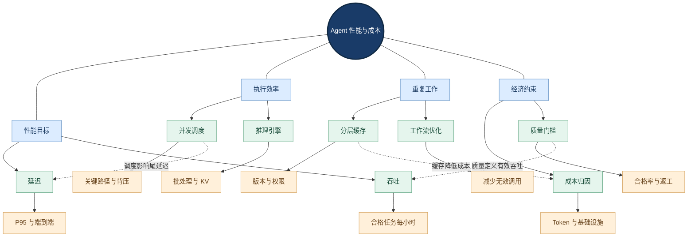

**图谱解读：**中心节点代表本节的优化对象；蓝色是一级能力，绿色是关键机制，橙色是工程细节；虚线标注跨模块约束或依赖。图谱仅表达结构关系，实际执行顺序由工作流依赖决定。

### 1.3 优化决策的因果链

首先定义任务级服务水平目标（Service Level Objective，SLO），例如“指定规模文档的 P95 完成时间和合格率”；随后采集每阶段耗时、排队和失败数据；通过关键路径定位瓶颈；选择并发、缓存、模型或资源优化；最后用相同数据集做回归验证。不能先引入复杂框架再寻找性能收益。相关的可靠性边界详见 [01-Reliability-and-Fault-Tolerance.md](01-Reliability-and-Fault-Tolerance.md)。

## 二、度量体系与排队理论

### 2.1 指标口径：用户时间与服务时间不同

端到端（End-to-End，E2E）延迟包含排队、执行、网络往返、重试和输出持久化；模型服务时间仅是其中一部分。P50、P95、P99 是响应时间分布的百分位数，而非平均值。TTFT 适合流式交互；TPOT（Time per Output Token）通常表示生成阶段每个输出 Token 的平均耗时，具体实现可能排除首 Token，应记录定义。

<strong>注意：</strong>流式输出可以改善用户的首次反馈体验，但不必然缩短任务完成时间。对于必须生成完整 PDF 的任务，最终完成时间比 TTFT 更重要。

### 2.2 Little 定律与系统稳定性

Little 定律（Little's Law）描述稳定系统中平均在系统任务数、吞吐率与平均停留时间的关系：

$$
L = \lambda W
$$

其中，L 为平均在系统任务数，λ 为长期平均吞吐率，W 为平均停留时间。假设每秒完成 5 个任务，平均停留 4 秒，则平均同时在系统内的任务数约为 20。<strong>这不是提高并发必然提高吞吐的因果公式。</strong>

### 2.3 利用率与尾延迟

在简化的 M/M/1 排队模型（泊松到达、指数服务时间、单服务台）中：

$$
W = \frac{1}{\mu - \lambda}, \qquad \lambda < \mu
$$

其中 μ 为服务速率，λ 为到达速率。到达速率逼近服务速率时，等待时间快速上升。真实 LLM 推理具有变长序列、动态批处理和共享 GPU 等特征，不应直接用 M/M/1 精确预测，而应将其作为<strong>容量接近饱和会放大排队</strong>的直觉模型。

### 2.4 服务时间分解与观测

$$
T_{\mathrm{e2e}} = T_{\mathrm{queue}} + T_{\mathrm{network}} + T_{\mathrm{compute}} + T_{\mathrm{storage}} + T_{\mathrm{other}}
$$

该式是互斥时间区间的概念性分解；存在并行阶段时，不能简单累加各节点耗时，应使用关键路径。可观测性需同时提供直方图、追踪跨度、队列长度、限流次数和失败率。

#### 度量与排队：中心辐射知识网络

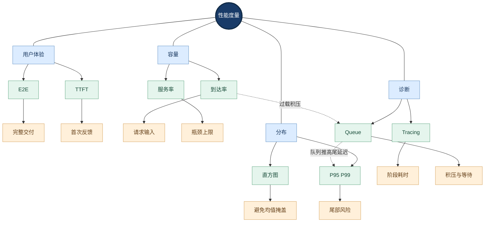

**图谱解读：**中心节点代表本节的优化对象；蓝色是一级能力，绿色是关键机制，橙色是工程细节；虚线标注跨模块约束或依赖。图谱仅表达结构关系，实际执行顺序由工作流依赖决定。

## 三、工作流关键路径与并发调度

### 3.1 并发、并行、异步与流水线

并发（Concurrency）表示多个任务在一段时间内交错推进；并行（Parallelism）表示在同一时刻实际执行；异步输入输出（Asynchronous I/O）允许线程在等待网络或磁盘时继续处理其他任务；流水线（Pipelining）让不同任务处于不同处理阶段。它们解决的问题不同：异步不会自动加速 CPU 密集型 PDF 解析，增加进程也不会提高受 API 配额约束的模型吞吐。

### 3.2 工作流依赖图与关键路径

对于串行阶段，总耗时近似为：

$$
T_{\mathrm{serial}} = \sum_{i=1}^{n} T_i
$$

当页面解析、翻译与校验构成有向无环图（Directed Acyclic Graph，DAG）时，完成时间取决于最长依赖路径和资源争用。页面 A、B 可以并发翻译，但文档合并仍需等待必要的上游任务。对独立页面并发前，必须检查跨页表格、章节上下文、术语一致性和最终输出顺序。

### 3.3 受控并发与资源隔离

信号量（Semaphore）限制同时访问某个依赖的任务数量；连接池限制数据库连接；进程池适合可并行的 CPU 密集型任务；独立队列避免慢任务阻塞快任务。建议分别设置 LLM、OCR、检索、渲染的资源预算，而不是全系统共用一个无界并发值。

| 工作负载 | 推荐执行方式 | 主要限制 |
|---|---|---|
| API 模型调用 | 异步 I/O + 信号量 | 请求/Token 配额、超时 |
| PDF 解析 | 有界进程池 | CPU、内存峰值 |
| 向量检索 | 异步请求或连接池 | 索引吞吐、数据库连接 |
| 视觉 OCR | 服务级队列与独立配额 | GPU/CPU、图像大小 |
| 页面渲染 | 有界任务池 | CPU、字体和内存 |

### 3.4 并发上限的实验确定

固定模型、数据集、输入长度分布和质量门槛，从低并发逐级升高，记录吞吐、P95、错误率、429 限流、队列时间与每任务成本。找到吞吐增长变缓而尾延迟恶化的拐点，保留容量余量。不能只根据 CPU 利用率选并发数。

#### 执行图与调度：中心辐射知识网络

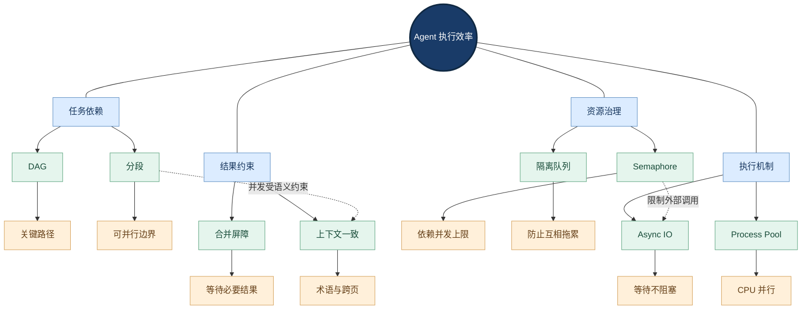

**图谱解读：**中心节点代表本节的优化对象；蓝色是一级能力，绿色是关键机制，橙色是工程细节；虚线标注跨模块约束或依赖。图谱仅表达结构关系，实际执行顺序由工作流依赖决定。

## 四、批处理、背压与容量治理

### 4.1 静态批处理、动态批处理、连续批处理

静态批处理（Static Batching）由调用方提前组合输入；动态批处理（Dynamic Batching）由推理服务器等待短暂窗口合并请求；连续批处理（Continuous Batching）允许自回归生成请求在不同生成迭代加入和退出。后者尤其适合不同输出长度的 LLM 请求。批处理提高设备利用率，但增加排队、内存占用与尾延迟的风险；必须在吞吐与延迟之间选取平衡点。

### 4.2 背压、限流和负载丢弃

背压（Backpressure）让上游感知下游处理能力不足，减少新任务注入或延缓生产。限流（Rate Limiting）控制单位时间准入请求数；负载丢弃（Load Shedding）在过载时拒绝低优先级工作。三者与信号量不同：信号量限制在途数量，速率限制控制时间窗口内流量，背压调节生产速度，负载丢弃保护系统不崩溃。

推荐组合：有界队列 → 任务优先级 → 依赖级信号量 → RPM/TPM 预算 → 超时与取消 → 过载时明确拒绝。RPM 为 Requests per Minute（每分钟请求数），TPM 为 Tokens per Minute（每分钟 Token 数）。

### 4.3 自动扩缩容与冷启动

自动扩缩容（Autoscaling）应参考排队深度、请求速率、GPU 内存和延迟，而不只看 CPU。新增推理实例可能涉及模型权重加载、缓存预热和容器启动，因此短时突发流量更依赖已有容量余量与排队控制。扩容也无法解决供应商统一的 API 配额限制。

#### 容量保护：中心辐射知识网络

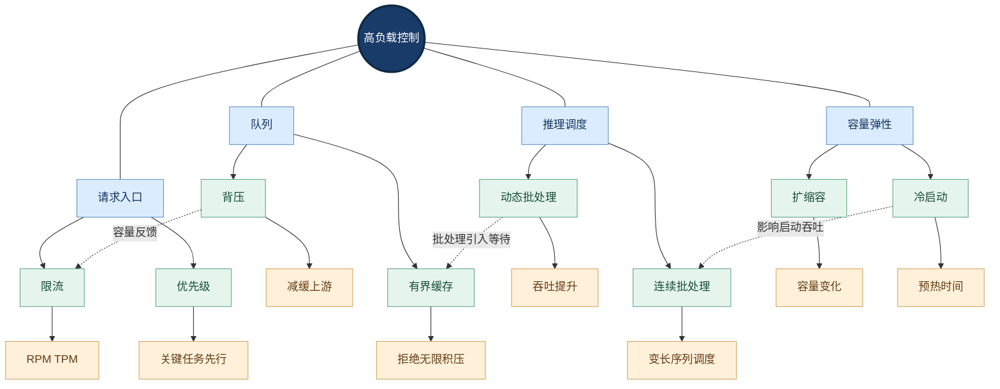

**图谱解读：**中心节点代表本节的优化对象；蓝色是一级能力，绿色是关键机制，橙色是工程细节；虚线标注跨模块约束或依赖。图谱仅表达结构关系，实际执行顺序由工作流依赖决定。

## 五、分层缓存与一致性

### 5.1 缓存的是哪一层计算

| 缓存类型 | 缓存内容 | 收益 | 正确性边界 |
|---|---|---|---|
| 结果缓存 | 精确匹配的工具/API 结果 | 减少外部调用 | TTL、业务版本 |
| Embedding 缓存 | 文本向量 | 避免重复向量化 | 模型、维度与归一化版本 |
| 检索缓存 | RAG 候选结果 | 减少索引访问 | 权限、知识库更新 |
| LLM 响应缓存 | Prompt 与参数对应结果 | 减少模型费用 | 非确定性、上下文差异 |
| 语义缓存 | 语义近似请求结果 | 扩大命中范围 | 语义相似不等于业务等价 |
| 前缀/KV 缓存 | 注意力历史计算状态 | 减少重复 Prefill | 精确前缀、引擎规则、隔离 |

TTL（Time to Live，生存时间）只是过期策略，不等于一致性保障。Cache-Aside（旁路缓存）通常先读缓存，未命中后读原始数据并写回。对知识库检索、翻译术语、模型 Prompt 等可版本化数据，推荐缓存键包含必要的文档版本、租户、权限域、模型版本、语言方向和规范化输入哈希。

### 5.2 精确缓存与语义缓存的差异

精确缓存依据确定的键等价关系；语义缓存通常用向量相似度寻找近似答案。设备型号 A 与型号 B 的维护周期问题可能语义相似，但答案不可复用。对数字、法律、医疗、设备参数和权限敏感输出，语义缓存必须经过严格的业务条件过滤与重新校验，不宜直接把相似度阈值当作正确性证明。

### 5.3 缓存击穿、穿透、雪崩

缓存击穿指热点键失效时大量请求同时回源；缓存穿透指不存在的键反复回源；缓存雪崩指大量键集中失效。常见防护包括请求合并（Singleflight）、负缓存、过期时间随机扰动、热点预热和限流。缓存命中率高不代表系统一定安全，必须监测回源峰值、旧数据比例与跨租户隔离。

#### 缓存分层与一致性：中心辐射知识网络

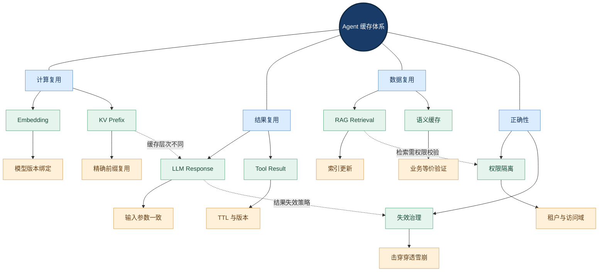

**图谱解读：**中心节点代表本节的优化对象；蓝色是一级能力，绿色是关键机制，橙色是工程细节；虚线标注跨模块约束或依赖。图谱仅表达结构关系，实际执行顺序由工作流依赖决定。

## 六、LLM 推理引擎与内存效率

### 6.1 Prefill 与 Decode

自回归推理通常包含预填充（Prefill，处理输入上下文）与逐 Token 解码（Decode，迭代生成输出）。长输入短输出更关注 Prefill、首 Token 延迟和上下文处理；短输入长输出更关注 Decode、内存带宽和每 Token 生成速度。比较模型时必须固定输入/输出长度分布，不能只公布一个“Tokens/s”。

### 6.2 KV Cache 与 PagedAttention

KV Cache（Key-Value Cache，键值缓存）保留历史 Token 的注意力键值状态，避免每一步重复计算整个历史。其内存通常随上下文长度和并发请求数量增加。PagedAttention 通过分块管理 KV 缓存并将逻辑连续块映射到物理块，提高内存使用效率、减少碎片；它不是让全部注意力计算凭空消失。vLLM 的自动前缀缓存（Automatic Prefix Caching）则在符合引擎复用条件时共享重复前缀计算，属于另一层优化。

### 6.3 量化与硬件适配

量化（Quantization）降低权重或激活的表示精度，例如 INT8、INT4、FP8。可能降低显存和带宽需求，但是否提速取决于硬件算子、模型结构、批大小与内存瓶颈。评测不仅需要吞吐，还应检查翻译术语、数字、结构化输出与长上下文质量。

### 6.4 推理框架选型

| 方案 | 适用情境 | 核心研究重点 |
|---|---|---|
| vLLM | 高并发生成式模型服务 | PagedAttention、连续批处理、前缀缓存 |
| NVIDIA Triton | 多模型服务与推理部署 | 动态批处理、模型实例、队列指标 |
| 本地 CPU 推理 | 轻量、离线或资源受限 | 量化、线程数、内存、可接受吞吐 |
| 云 API | 低运维成本、弹性调用 | 限流、价格、缓存计费、模型质量 |

注意框架能力依版本、硬件和模型支持情况变化；不能仅根据功能列表推断性能排名。

#### 推理引擎机制：中心辐射知识网络

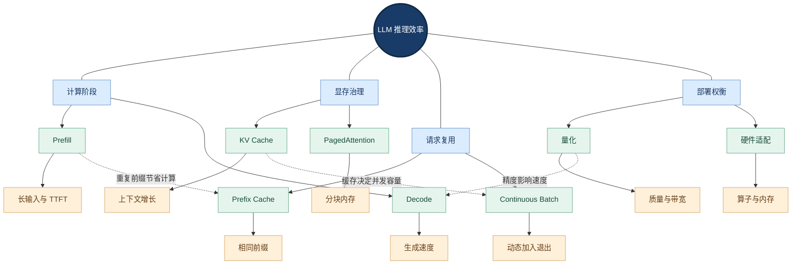

**图谱解读：**中心节点代表本节的优化对象；蓝色是一级能力，绿色是关键机制，橙色是工程细节；虚线标注跨模块约束或依赖。图谱仅表达结构关系，实际执行顺序由工作流依赖决定。

## 七、Agent 编排与模型路由

### 7.1 优化优先级：先减少无效工作

在 Agent 层，工具调用次数、循环深度、上下文长度和重复校验可能比单次推理速度更影响总成本。应优先将确定性任务交给规则与程序、限制无界反思循环、复用已验证中间结果、并行独立工具、对失败节点进行局部恢复。减少校验步骤之前必须证明质量不下降。

### 7.2 模型路由与级联

模型路由（Model Routing）按复杂度、风险、上下文、语言方向与任务类别选择模型；模型级联（Model Cascading）先尝试低成本方案，再在校验失败或不确定性高时升级模型。高风险任务不能只依赖模型自报置信度，必须在带标注测试集上校准阈值，并统计误路由造成的返工成本。

### 7.3 上下文压缩的收益与风险

减少无关历史、优化 RAG Top-K、压缩冗余检索结果、裁剪工具输出，可以降低输入 Token 和 Prefill 开销。但压缩可能丢失关键数字、术语和引用依据。正确策略是<strong>保留任务相关证据与可追溯来源</strong>，而不是无条件追求最短 Prompt。详见 [../05-Agent-Knowledge-and-Tools/README.md](../05-Agent-Knowledge-and-Tools/README.md) 与 [../06-Multi-Agent-and-Frameworks/README.md](../06-Multi-Agent-and-Frameworks/README.md)。

### 7.4 投机执行与投机解码不是一回事

Agent 层投机执行（Speculative Execution）可并发启动候选工具或检索策略以换取更低延迟，但会产生额外费用。推理引擎中的投机解码（Speculative Decoding）则是通过草稿生成与目标模型验证等机制加速 Token 生成。两者属于不同优化层次，均需要基于真实工作负载验证收益。

#### 编排优化：中心辐射知识网络

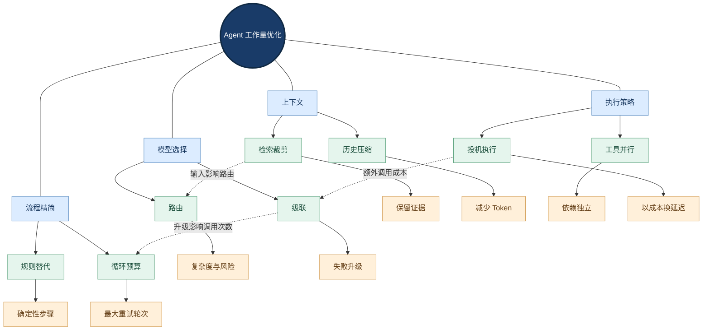

**图谱解读：**中心节点代表本节的优化对象；蓝色是一级能力，绿色是关键机制，橙色是工程细节；虚线标注跨模块约束或依赖。图谱仅表达结构关系，实际执行顺序由工作流依赖决定。

## 八、成本模型与 FinOps

### 8.1 成本边界必须完整

财务运营（Financial Operations，FinOps）强调将成本可见性、归因和工程决策结合。Agent 总成本不仅有模型 API，还包括算力、存储、网络、工具、日志、人工审核、失败重试与运维。建议统一按任务 ID、租户、模型版本、工作流节点记录成本。

$$
C_{\mathrm{total}} = C_{\mathrm{model}} + C_{\mathrm{compute}} + C_{\mathrm{storage}} + C_{\mathrm{network}} + C_{\mathrm{tools}} + C_{\mathrm{operations}}
$$

在仅按输入/输出 Token 分别计费的简化 API 模型下：

$$
C_{\mathrm{model}} = \frac{N_{\mathrm{in}} P_{\mathrm{in}} + N_{\mathrm{out}} P_{\mathrm{out}}}{U}
$$

其中 N 为计费 Token 数，P 为对应单位价格，U 为价格表计费单位（如百万 Token）。实际供应商还可能按缓存输入、批处理、工具或其他资源分别计费，不能用该式直接替代真实账单。

### 8.2 每合格任务成本

在每次尝试成本相同、尝试独立、成功概率为 p 且可无限重试的理想模型中：

$$
C_{\mathrm{qualified}} \approx \frac{C_{\mathrm{attempt}}}{p}
$$

实际系统需要统计最大重试次数、修复路径、人工复核与失败后仍需支付的费用。应同时报告“每请求成本”和“每合格任务成本”，避免选择表面便宜但错误率高的模型。

### 8.3 成本治理闭环

为每个工作流设定预算上限、模型级价格表版本、Token 预估与实际用量、异常费用告警、超预算降级策略和成本回归基线。成本优化必须与质量评估和可靠性指标一起审查，不能把减少质量检查当作纯收益。

#### 成本归因与质量：中心辐射知识网络

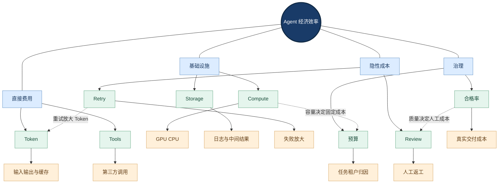

**图谱解读：**中心节点代表本节的优化对象；蓝色是一级能力，绿色是关键机制，橙色是工程细节；虚线标注跨模块约束或依赖。图谱仅表达结构关系，实际执行顺序由工作流依赖决定。

## 九、API 与自部署选型

### 9.1 两类方案的成本结构

API 通常以请求用量为主，降低早期固定运维投入；自部署需要承担计算资源、空闲容量、模型更新、故障恢复、监控与人员成本。两者在隐私、合规、网络和供应商锁定方面也有差异。

在固定成本 F、自部署每任务增量成本低于 API 每任务成本的线性假设下，盈亏平衡任务量可写为：

$$
N^* = \frac{F}{c_{\mathrm{api}} - c_{\mathrm{self}}}, \qquad c_{\mathrm{api}} > c_{\mathrm{self}}
$$

实际比较应按相同质量门槛、时间周期、峰值容量和任务分布计算；自部署的空闲 GPU 与维护成本不能忽略。

### 9.2 选型决策矩阵

| 条件 | 倾向方案 | 原因 |
|---|---|---|
| 请求量低且波动大 | API | 固定成本低、弹性方便 |
| 长期稳定高负载 | 评估自部署 | 可能摊薄固定成本 |
| 严格内网与数据控制 | 私有化或合规专有服务 | 数据边界与审计要求 |
| 模型迭代快、团队运维能力有限 | API | 版本切换与维护成本较低 |
| 强依赖自定义推理调度 | 自部署 | 可控制批处理、缓存与资源配置 |

<strong>结论：</strong>没有脱离任务质量、峰谷流量、运维能力和合规约束的绝对最优部署方式。

#### 部署经济性：中心辐射知识网络

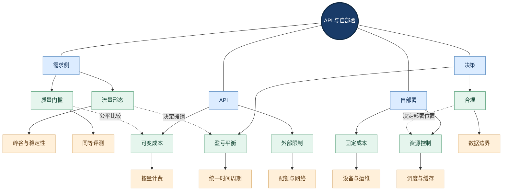

**图谱解读：**中心节点代表本节的优化对象；蓝色是一级能力，绿色是关键机制，橙色是工程细节；虚线标注跨模块约束或依赖。图谱仅表达结构关系，实际执行顺序由工作流依赖决定。

## 十、文档翻译 Agent 工程案例

### 10.1 任务阶段与瓶颈

企业文档翻译通常包含文档类型检测、PDF/Word 结构解析、OCR、分段与术语管理、翻译、质量校验、版面重建、文件渲染和持久化。其性能特征不一致：OCR 与渲染可能受 CPU/GPU 限制，模型翻译可能受外部 API 限流，跨页表格与统一术语可能限制页面并发。

| 阶段 | 主要瓶颈 | 可行优化 | 必须守住的质量门槛 |
|---|---|---|---|
| 类型检测 | 无效解析尝试 | 快速路径识别 | 不误判扫描页 |
| 结构解析 | CPU/复杂布局 | 按需解析、结构缓存 | 阅读顺序与表格完整 |
| OCR | 图像处理与模型调用 | 按需 OCR、区域级处理 | 数字与文字识别 |
| 翻译 | Token 与网络等待 | 分段并发、术语复用、路由 | 准确、术语一致 |
| 校验 | 二次调用成本 | 规则优先、风险分层 | 漏译、错译检出 |
| 排版渲染 | 字体测量、内存 | 局部修复、增量处理 | 图注、表格与页码 |
| 恢复 | 重复工作 | 检查点、幂等输出 | 不重复副作用 |

### 10.2 关键路径与流水线

如果各页面互相独立，可让第 2 页解析与第 1 页翻译重叠执行；但遇到跨页表格、全局术语统一、章节上下文或最终合并时，必须建立依赖屏障。对“长文档总完成时间”的优化不能简单照搬“聊天 TTFT”的指标。

### 10.3 缓存设计

可考虑缓存页面结构树、文本块哈希、已确认术语、Embedding 与校验通过的中间结果。译文缓存键需绑定源文本、目标语言、术语表版本、模型/Prompt 版本和业务上下文。模型返回后丢失响应的场景需结合幂等键与持久化状态，不能仅依赖缓存避免重复执行。

### 10.4 风险驱动的质量校验

先用确定性规则检查数字、单位、型号、段落数量、表格行列和空白区域，再对高风险页面调用视觉或语言模型复核。是否跳过低风险模型校验，应由带标注的回归测试集证明，而不是凭主观判断。

### 10.5 推荐实验矩阵

| 实验 | 自变量 | 记录指标 | 判断标准 |
|---|---|---|---|
| 并发实验 | 1/2/4/8/16 | P95、吞吐、429、内存 | 质量不降且尾延迟可控 |
| 缓存实验 | 关闭/精确/分层 | 命中率、成本、正确率 | 无权限与版本错误 |
| 模型实验 | 模型 A/B、路由阈值 | 术语、数字、合格率、成本 | 合格任务成本最优 |
| 工作流实验 | 串行/并发/流水线 | 总完成时间、资源峰值 | 结果一致、可恢复 |
| 长文档实验 | 10/50/100 页 | 内存、耗时、失败率 | 资源受控、无内容遗漏 |
| 故障实验 | 超时/429/响应丢失 | 重试费用、恢复时间 | 无重复输出副作用 |

以上是<strong>待执行的实验设计</strong>，不是实际性能数据。

#### 文档翻译优化案例：中心辐射知识网络

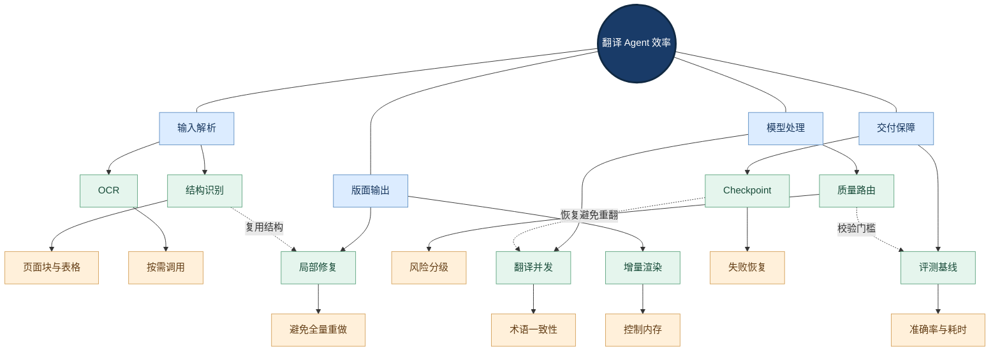

**图谱解读：**中心节点代表本节的优化对象；蓝色是一级能力，绿色是关键机制，橙色是工程细节；虚线标注跨模块约束或依赖。图谱仅表达结构关系，实际执行顺序由工作流依赖决定。

## 十一、实验、可观测性与持续优化

### 11.1 性能实验的有效性

实验必须固定版本、硬件、输入长度分布、并发模型、预热方式、缓存状态与成功标准；分别测量冷缓存和热缓存。避免把第一次加载模型的冷启动时间混入稳态性能，或只报告最快的一次结果。

### 11.2 端到端追踪与归因

OpenTelemetry 可用于统一采集 Traces（分布式追踪）、Metrics（指标）和 Logs（日志）；Prometheus 常用于时间序列指标采集。建议为每个任务和节点记录 trace_id、任务类型、输入/输出 Token、缓存命中、模型版本、队列时间、重试次数、失败类别和费用。注意日志中对文档内容与个人数据做脱敏。

### 11.3 回归门禁与 SLO

性能变更必须同时检查质量、P95、失败率、每合格任务成本和资源峰值。可采用影子流量（Shadow Traffic）、小比例灰度与回滚门槛，但影子请求仍可能产生费用和外部副作用，必须使用安全隔离和只读策略。

### 11.4 与可靠性和安全的协作

重试会放大 Token 费用与流量；缓存可能导致过期与越权；限流影响服务可用性；更激进的并发可能增加资源耗尽风险。性能策略必须与 [01-Reliability-and-Fault-Tolerance.md](01-Reliability-and-Fault-Tolerance.md)、[03-Observability.md](03-Observability.md)、[04-Evaluation.md](04-Evaluation.md) 和 [05-Security-and-Permissions.md](05-Security-and-Permissions.md) 共同设计。

#### 优化验证闭环：中心辐射知识网络

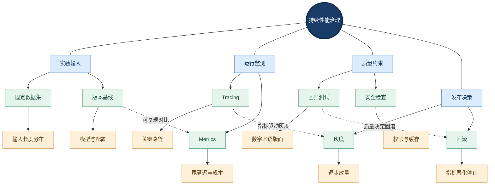

**图谱解读：**中心节点代表本节的优化对象；蓝色是一级能力，绿色是关键机制，橙色是工程细节；虚线标注跨模块约束或依赖。图谱仅表达结构关系，实际执行顺序由工作流依赖决定。

## 十二、常见误区、面试问题与总结

### 12.1 易混概念速查

| 容易混淆的概念 | 关键区别 |
|---|---|
| 并发与并行 | 同期推进不等于同刻执行 |
| 异步与多进程 | 异步优化等待，多进程可并行 CPU 工作 |
| 吞吐与延迟 | 高吞吐不保证单请求低延迟 |
| 速率限制与信号量 | 单位时间流量与在途任务数不同 |
| 背压与负载丢弃 | 调节生产速度与拒绝任务不同 |
| 精确缓存与语义缓存 | 键等价与语义近似不同 |
| 响应缓存与 KV Cache | 保存结果与保存推理内部状态不同 |
| 动态批处理与连续批处理 | 请求级聚合与生成迭代级调度不同 |
| Prefill 与 Decode | 输入处理与逐 Token 生成不同 |
| 模型调用成本与交付成本 | 单次费用与最终合格结果费用不同 |

### 12.2 面试与设计评审问题

1. <strong>为什么增加并发后 P99 恶化？</strong> 检查排队、下游配额、批处理等待、内存争用、长尾输入和重试放大，而非仅检查 CPU。
2. <strong>怎样确定 Agent 工作流可并行部分？</strong> 建立依赖图，识别关键路径，并验证跨页、状态与外部副作用约束。
3. <strong>为什么语义缓存可能不安全？</strong> 相似语义不等于业务等价，且缓存需绑定权限、版本与数据时效。
4. <strong>KV Cache 与 Redis 缓存有什么不同？</strong> 前者复用模型注意力状态，后者通常存业务结果或中间数据。
5. <strong>如何比较两个价格不同的模型？</strong> 固定质量门槛和任务集，比较合格率、延迟、重试、人工返工与每合格任务成本。
6. <strong>何时选择自部署？</strong> 需要综合长期负载、峰值容量、合规、团队运维能力、质量与真实总拥有成本。
7. <strong>如何避免性能优化引发事故？</strong> 建立质量、安全、可靠性门禁，灰度上线并保留回滚路径。

### 12.3 核心知识网络归纳

性能治理的完整因果链为：<strong>定义质量与 SLO → 观测端到端时间 → 分析排队与关键路径 → 约束并发与批处理 → 复用可验证的计算 → 优化推理和编排 → 核算合格交付成本 → 用回归实验验证</strong>。其中，缓存、路由、并发和成本并非相互独立的开关：任何一项改动都可能影响其他三项。

### 12.4 参考资料（官方文档优先）

1. [NVIDIA Triton Inference Server — Batcher](https://docs.nvidia.com/deeplearning/triton-inference-server/user-guide/docs/user_guide/batcher.html)：动态批处理、队列与调度。
2. [NVIDIA Triton — Metrics](https://docs.nvidia.com/deeplearning/triton-inference-server/user-guide/docs/user_guide/metrics.html)：推理服务指标。
3. [vLLM — Automatic Prefix Caching](https://docs.vllm.ai/en/latest/design/prefix_caching/)：前缀缓存设计。
4. [vLLM GitHub](https://github.com/vllm-project/vllm)：推理引擎及工程实现。
5. [Efficient Memory Management for Large Language Model Serving with PagedAttention](https://arxiv.org/abs/2309.06180)：PagedAttention 论文。
6. [Orca: A Distributed Serving System for Transformer-Based Generative Models](https://www.usenix.org/conference/osdi22/presentation/yu)：迭代级调度研究。
7. [LangChain Embedding Integrations](https://docs.langchain.com/oss/python/integrations/embeddings)：向量模型与集成入口。
8. [AWS Well-Architected — Performance Efficiency](https://docs.aws.amazon.com/wellarchitected/latest/performance-efficiency-pillar/)：性能架构原则。
9. [AWS Well-Architected — Cost Optimization](https://docs.aws.amazon.com/wellarchitected/latest/cost-optimization-pillar/)：成本治理原则。
10. [OpenTelemetry Documentation](https://opentelemetry.io/docs/)：指标、追踪与日志。
11. [Prometheus Documentation](https://prometheus.io/docs/introduction/overview/)：指标监测。
12. [FinOps Foundation Framework](https://www.finops.org/framework/)：成本归因与运营框架。

> 文档中的公式为通用工程模型，性能收益、阈值和部署选型均须由实际工作负载验证；框架功能随版本变化，应以部署时对应版本的官方文档为准。

