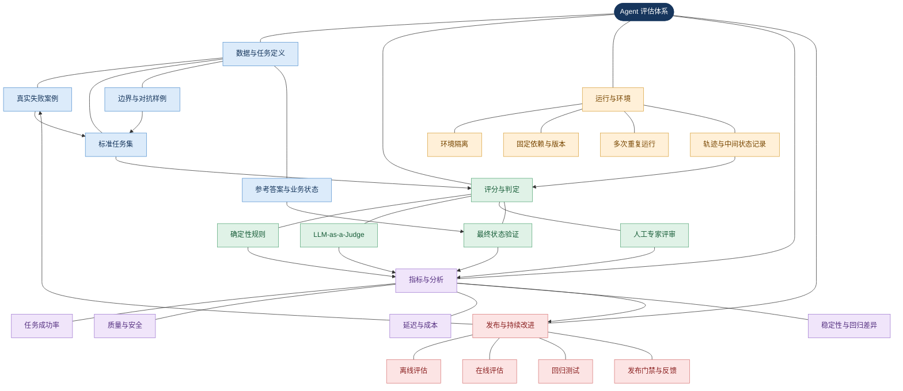
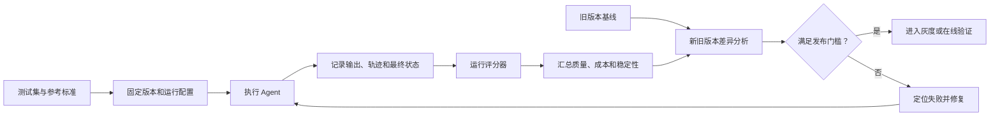
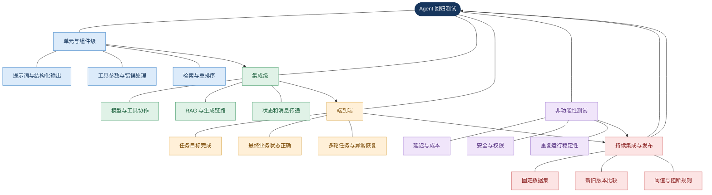
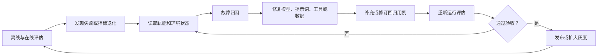
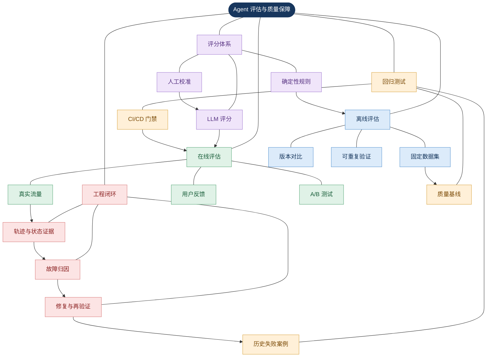

# 离线/在线评估与回归测试：Agent 质量保障体系

> 本文围绕企业级 AI Agent
> 的评估、离线与在线验证、评分器设计、回归测试及工程化闭环展开。核心观点是：**Agent
> 评估不只是检查最终回答是否正确，而是验证系统能否稳定、安全、可追溯地完成用户目标。**

## 1. 本章定位与核心问题

传统软件通常依靠明确的输入输出契约、单元测试和集成测试验证行为。大语言模型（Large
Language Model，LLM）及 Agent
系统则具有额外的不确定性：同一输入可能产生不同措辞、工具调用路径和执行结果；最终回答看似合理，却可能没有真正完成操作；前序步骤的错误会影响后续状态；开放式任务通常存在多种合理答案；模型、提示词、检索数据、工具接口及外部环境的变化都可能改变系统行为。

因此，Agent
评估需要同时检查**最终结果、执行过程、运行成本、稳定性和安全约束**。例如，退款
Agent
回复”退款成功”并不等于退款成功；还必须检查退款系统中的实际交易状态、退款金额、授权流程和审计记录。

### 1.1 核心术语

| 概念       | 英文名称                  | 作用                                   |
|:-----------|:--------------------------|:---------------------------------------|
| 测试任务   | Task / Test Case          | 描述输入、环境、目标和成功条件         |
| 评估数据集 | Evaluation Dataset        | 保存一组可重复运行的任务               |
| 参考答案   | Reference Answer / Golden | 提供预期答案、事实或行为标准           |
| 评分器     | Grader / Evaluator        | 判断输出、轨迹或最终状态是否符合要求   |
| 评估指标   | Evaluation Metric         | 将质量、正确率、耗时等转化为可比较结果 |
| 执行轨迹   | Trace / Trajectory        | 记录模型调用、工具调用、检索和中间结果 |
| 最终状态   | Outcome / Final State     | 验证任务执行后系统实际达成的结果       |
| 评估运行器 | Evaluation Harness        | 执行任务、隔离环境、收集记录并汇总评分 |
| 回归基线   | Regression Baseline       | 作为新旧版本比较的参考结果             |

<strong>需要区分：</strong>评估维度是要验证的目标，指标是量化目标的方法，评分器是执行判定的机制。测试任务规定成功标准，评分器把标准转化为判定逻辑，指标汇总任务结果，基线记录历史表现，执行轨迹帮助解释评分变化。

## 2. Agent 评估的整体知识网络

**图谱解读：**
数据与任务定义决定”测什么”；运行环境保证比较公平；评分机制形成可判定结果；指标用于分析质量、稳定性和成本变化；发布流程将结论转化为发布、回滚或补充测试的决策。这是知识关系图，不意味着所有任务必须严格按单一路径执行。

### 2.1 六类评估目标

| 维度       | 核心问题                               | 常见验证方式                     |
|:-----------|:---------------------------------------|:---------------------------------|
| 任务正确性 | 是否解决用户真正的问题？               | 参考答案、业务规则、结果断言     |
| 执行正确性 | 是否正确选择工具、传参并处理返回值？   | 工具调用检查、参数校验、轨迹分析 |
| 过程质量   | 是否存在无效循环、过多调用或错误重试？ | 步数、调用次数、轨迹评分         |
| 可靠性     | 重复运行是否稳定？                     | 多次试验、成功率、波动分析       |
| 效率与成本 | 是否在时间、Token 和费用预算内完成？   | 延迟、Token、调用成本            |
| 安全与合规 | 是否遵守权限、数据访问及业务约束？     | 规则测试、安全评估、审计检查     |

## 3. 离线评估：在受控环境中验证能力

离线评估（Offline
Evaluation）是在受控环境中，使用预先准备的测试数据、参考标准和评分规则，对模型或完整
Agent
进行测试。它用于验证当前版本的任务能力、比较模型或提示词、判断检索策略是否改善证据质量，以及发现工具或工作流修改造成的退化。

### 3.1 构建评估数据集

数据集应来自四类来源：

1.  **正常任务：** 高频、典型且预期行为明确的任务。
2.  **历史失败：** 线上报错、错误回答、工具调用失败和用户投诉。
3.  **边界情况：** 缺少参数、空结果、超长输入、数据冲突、权限不足等。
4.  **对抗与安全样例：** 提示注入、越权请求、敏感数据访问及工具滥用等。

早期可从一批真实失败和典型任务开始，再根据任务复杂度、风险和统计不确定性逐步扩充。任何固定样本量都不应被当成适用于所有项目的硬性标准。

每条用例建议记录
`case_id`、`input`、`expected_behavior`、`reference_answer`、`environment`、`assertions`、`risk_level`
和 `tags`。

### 3.2 数据集划分与泄漏

| 数据集     | 主要用途                           |
|:-----------|:-----------------------------------|
| 开发集     | 调试提示词、规则和工作流           |
| 验证集     | 比较候选方案、选择配置             |
| 回归集     | 保护已验证的既有能力               |
| 隐藏测试集 | 尽可能避免开发过程中反复针对它调优 |

如果持续针对固定测试集修改提示词，系统可能只是适应样例，而非获得泛化能力。因此要版本化测试集，定期加入新的真实失败案例，并在适当情况下保留未参与调优的测试样例。

### 3.3 离线评估运行机制

离线评估的优势是可重复、易调试、便于版本对比；局限是静态数据可能无法覆盖真实用户长尾输入，测试环境也可能与生产环境不一致。**旧版本基线是关键**：没有历史参照，就很难判断新版本究竟改善还是退化。

## 4. 在线评估：验证真实流量中的实际表现

在线评估（Online Evaluation）在真实生产流量或受控线上试验中评估 Agent
的表现。它关注真实用户、真实数据和真实依赖条件下的效果。常见方式包括生产轨迹采样、用户反馈、人工抽检、影子流量、A/B
测试以及生产质量与成本监测。

### 4.1 在线评估方式比较

| 模式         | 原理                                         | 适用场景         | 主要风险               |
|:-------------|:---------------------------------------------|:-----------------|:-----------------------|
| 生产轨迹采样 | 从真实请求抽样并评分                         | 发现长尾失败     | 采样偏差、隐私风险     |
| 用户反馈     | 收集点赞、投诉、纠错                         | 判断用户感知质量 | 反馈稀疏、群体偏差     |
| 人工抽检     | 专家检查输出和执行记录                       | 校准自动评分器   | 人力成本高             |
| 影子流量     | 将请求副本发送给候选版本，不影响真实用户结果 | 发布前比较版本   | 资源成本和副作用风险   |
| A/B 测试     | 将用户或请求分配给不同版本                   | 验证真实业务收益 | 分流偏差、实验污染     |
| 生产告警     | 监测错误率、延迟、成本和质量信号             | 发现线上退化     | 代理指标不等于真实质量 |

如果候选 Agent
会执行退款、发送邮件或修改数据库等副作用操作，不能简单地让影子版本重复执行真实动作。应采用只读模式、模拟工具或隔离环境。

### 4.2 A/B 测试的指标设计

在线实验应同时设置：

- **主要指标：** 任务完成率或有效解决率。
- **次要指标：** 回答质量、用户满意度、工具调用成功率。
- **护栏指标（Guardrail Metrics）：**
  延迟、错误率、成本、权限违规和安全事件。

只有主要指标改善且关键护栏没有恶化时，才有理由扩大灰度范围。还应检查样本量、分组公平性、任务难度、用户跨组污染、时间周期及统计波动。

### 4.3 在线评估与生产监控的区别

| 维度 | 在线评估                       | 生产监控                       |
|:-----|:-------------------------------|:-------------------------------|
| 目的 | 判断行为质量与业务效果         | 发现运行异常与服务退化         |
| 信号 | 正确性、任务完成率、用户满意度 | 错误率、延迟、资源使用、可用性 |
| 数据 | 生产轨迹、反馈、实验分组       | 日志、指标、追踪、告警         |
| 输出 | 质量评分、实验结论、版本比较   | 告警、异常诊断、运行状态       |

监控告诉我们”系统是否出现异常”，在线评估进一步帮助回答”任务质量是否下降，以及下降发生在哪类任务上”。

## 5. 评分器设计：如何判断 Agent 做得好不好

评分器是评估体系的关键。测试集再全面，如果评分器不可靠，评估结论仍然不可信。常见方法包括确定性规则、LLM-as-a-Judge
和人工评审。

### 5.1 三类评分器

| 方式           | 原理                               | 优势                     | 局限                     |
|:---------------|:-----------------------------------|:-------------------------|:-------------------------|
| 确定性评分器   | 按规则、测试结果和状态断言判定     | 便宜、可复现、易调试     | 难以处理开放式语义       |
| LLM-as-a-Judge | 用大模型按标准评估另一个模型的结果 | 适合语义、风格和复杂任务 | 可能有偏差、成本和随机性 |
| 人工评分       | 由领域专家或标注人员判断           | 适合复杂业务，可用于校准 | 慢、贵，评审者可能有分歧 |

LLM-as-a-Judge
的意思是”大语言模型作为评判者”。对于能确定性验证的内容，应优先使用规则，例如
JSON
合法性、必需字段、工具名称、参数范围、业务状态、测试是否通过，以及调用次数或费用是否超预算。

### 5.2 LLM 评分的偏差与校准

可使用评分量表（Rubric-based
Scoring），明确评价维度、各等级含义、可接受与不可接受示例、硬性约束以及证据不足时的处理方式。

重点防范：

- **位置偏差：** 对先出现或后出现的答案有系统性偏好。
- **长度偏差：** 无理由偏好更长的答案。
- **自我偏好：** 偏好与评分模型自身风格相似的输出。
- **标准含糊：** 不同运行对标准理解不一致。
- **共同失效：** 被评估系统与评判模型忽略同一种错误。

应使用人工标注样例校准评分器，检查其与专家判断的一致性，并定期复查错误案例。

### 5.3 多评分器组合

对高风险任务，单一总分可能掩盖严重问题。建议采用”硬性约束 +
多维质量评分”：

- 硬性约束：权限、安全、关键业务结果必须通过。
- 质量维度：正确性、完整性、相关性、可读性。
- 运行维度：延迟、Token、工具调用次数。
- 稳定性维度：重复执行成功率。

如果任务涉及不可逆操作，即使质量总分很高，只要权限检查失败，就不应通过评估。

## 6. 关键指标与计算方法

### 6.1 任务成功率

设总测试任务数为 \(N\)，通过全部必要验收条件的任务数为 \(N_{\mathrm{pass}}\)，则：

$$
\mathrm{SuccessRate}=\frac{N_{\mathrm{pass}}}{N}
$$

必须提前定义”成功”。检索问答可能要求事实正确且有证据支持；工具 Agent
可能要求目标系统状态发生预期变化。最终文本看起来合理，不能替代必要条件检查。

### 6.2 Pass@k 与 Pass^k

- **Pass@k：** 在 \(k\) 次尝试中，至少有一次成功。
- **Pass^k：** 在 \(k\) 次尝试中，所有尝试都成功。

如果每次尝试的成功概率都是 \(p\)，且各次尝试相互独立，则：

$$
\mathrm{Pass@k}=1-(1-p)^k
$$

$$
\mathrm{Pass}^{k}=p^k
$$

允许多次尝试后成功的任务可以关注
Pass@k；要求每次执行都稳定成功的任务更应关注
Pass^k。若共享环境故障或固定配置会影响多次运行，则独立性假设不成立，不能直接套用该公式。

### 6.3 RAG 专项指标

检索增强生成（Retrieval-Augmented
Generation，RAG）需要分别评价检索阶段和生成阶段。

| 指标           | 英文名称            | 衡量内容                       |
|:---------------|:--------------------|:-------------------------------|
| 上下文精确率   | Context Precision   | 检索结果中相关内容的排序和占比 |
| 上下文召回率   | Context Recall      | 参考答案需要的信息是否被检索到 |
| 忠实度         | Faithfulness        | 回答主张是否受到上下文支持     |
| 回答相关性     | Answer Relevancy    | 回答是否针对用户问题           |
| 事实正确性     | Factual Correctness | 回答事实是否符合参考标准       |
| 工具调用准确性 | Tool Call Accuracy  | 是否选择合适工具并正确调用     |

这些指标不可互相替代。回答相关性高不代表事实一定正确；忠实度高也不代表回答覆盖了用户需要的全部信息。

### 6.4 质量、延迟、成本与安全联合评价

企业级 Agent 至少需要联合考察任务成功率、端到端延迟及高分位延迟、每任务
Token、模型和工具调用成本、重试次数、异常率，以及安全与权限约束通过率。比较时应固定任务集、模型版本和运行环境，避免将测试条件变化误判为系统改进。

## 7. 回归测试：防止修改破坏既有能力

回归测试（Regression
Testing）是在修改系统后重新执行既有测试，确认原有功能和质量没有出现不可接受的退化。潜在回归来源包括模型版本、系统提示词、工具描述、RAG
切分与重排序、工具参数、Agent
路由、并发状态、缓存、重试、降级策略、依赖库和外部 API 的变化。

### 7.1 能力评估与回归评估

| 维度       | 能力评估                     | 回归评估                 |
|:-----------|:-----------------------------|:-------------------------|
| 核心问题   | 新能力是否实现，上限在哪里？ | 已有能力是否仍然可靠？   |
| 测试集     | 重点覆盖尚未解决的难题       | 覆盖已验证场景和历史失败 |
| 初始通过率 | 可以较低，以暴露能力边界     | 应接近既定质量基线       |
| 用途       | 研发探索、方案比较           | 发布门禁、质量保护       |

回归测试不要求所有分数绝对不变。LLM
输出可能有随机波动，系统也可能存在合理取舍。应预先定义硬性门槛、允许变化范围及人工审查条件。

### 7.2 建立回归测试集的实践

1.  每次修复生产缺陷，都新增或更新对应测试用例。
2.  对权限、关键业务状态修改、数据丢失和不可逆操作设置严格验收条件。
3.  同时测试”应该调用工具”和”不应该调用工具”的情况。
4.  同时保留端到端和组件级测试。
5.  固定模型、提示词、依赖、数据和工具状态。
6.  保存历史基线，比较成功率、质量、延迟和成本。
7.  审查失败轨迹，区分 Agent、环境、测试任务与评分器问题。

### 7.3 回归测试分层图

图谱解读：组件测试用于快速定位局部问题，集成测试验证模块协作，端到端测试验证用户目标，非功能测试保护性能、安全与稳定性，持续集成系统统一执行发布判定。每次提交不一定需要运行全部测试，可按风险和耗时分层执行。

### 7.4 CI/CD 发布门禁

持续集成与持续交付（Continuous Integration / Continuous
Delivery，CI/CD）可以自动运行回归测试。门禁可以包括：

- 必须通过的确定性测试。
- 核心任务成功率不低于最低阈值。
- 高风险安全测试全部通过。
- 关键质量指标不得超过容忍范围地下降。
- 延迟与成本不突破预算。
- 评分器或测试环境故障时，不得将无效结果直接判定为通过。

必须区分**测试失败、测试基础设施失败和评分器故障**。否则可能把环境故障误判为模型退化，或在评分器失效时错误放行。

## 8. 从评估结果定位故障

评估不仅用于给分，还应帮助回答系统为什么失败、应该改哪里。

| 现象                     | 优先检查对象                           | 推荐证据                     |
|:-------------------------|:---------------------------------------|:-----------------------------|
| 答案错误但检索证据正确   | 生成提示词、上下文组装、模型输出       | 输入上下文、模型请求与回答   |
| 关键证据缺失             | 检索、切分、过滤、重排序               | 检索候选、排序分数、参考证据 |
| 工具选择正确但任务失败   | 参数、权限、工具返回、业务状态         | 工具记录、返回码、状态快照   |
| 单次成功但重复运行不稳定 | 随机性、环境隔离、共享状态             | 多次运行轨迹和失败分布       |
| 自动评分低但人工认为正确 | 任务定义、参考答案、评分器             | 评分理由、反例、人工复核     |
| 质量提高但延迟和成本上升 | 模型调用数、上下文长度、重试策略       | Token、耗时分布、调用次数    |
| 离线通过但线上下降       | 流量分布、外部依赖、用户行为、环境差异 | 生产轨迹、线上指标、分组结果 |

### 8.1 从失败到修复的闭环

如果修复只解决当前案例，却不把案例固化成回归测试，同类问题很可能在后续改动中再次出现。测试集既是质量门禁，也是团队积累失败经验的载体。

## 9. 主流评估框架与工程选型

| 方案          | 主要定位                                  | 适用场景                               | 选型关注点                     |
|:--------------|:------------------------------------------|:---------------------------------------|:-------------------------------|
| DeepEval      | 测试用例、LLM 评分、Agent 轨迹评估、CI/CD | 测试驱动迭代 Agent                     | 指标匹配、评分成本、集成方式   |
| Ragas         | RAG 与 Agent 质量指标                     | 关注检索、忠实度、回答相关性和工具调用 | 指标适用前提、参考数据要求     |
| MLflow        | 评估运行、评分器、轨迹管理、实验记录      | 管理评估历史并比较版本                 | 存储、部署、实验组织           |
| OpenTelemetry | 统一采集日志、指标和追踪                  | 将运行证据接入评估与监控平台           | 采集覆盖、语义、隐私和成本     |
| 自建评估平台  | 任务集、规则、评分、门禁与业务状态检查    | 流程特殊、数据敏感或高度定制           | 维护成本、评分一致性、可追溯性 |

这些方案可以组合使用，并非互斥。先定义任务、指标和验收标准，再选择工具。

### 9.1 参考链接

- [Anthropic：Demystifying evals for AI
  agents](https://www.anthropic.com/engineering/demystifying-evals-for-ai-agents)
- [DeepEval：AI Agent Evaluation
  Quickstart](https://deepeval.com/docs/getting-started-agents)
- [Ragas：Available
  Metrics](https://docs.ragas.io/en/latest/concepts/metrics/available_metrics/)
- [MLflow：Evaluating Production
  Traces](https://mlflow.org/docs/latest/genai/eval-monitor/running-evaluation/traces/)
- [MLflow：GenAI Evaluation
  API](https://mlflow.org/docs/latest/api_reference/python_api/mlflow.genai.html)
- [A Survey on Evaluation of Large Language
  Models](https://arxiv.org/abs/2307.03109)

## 10. 工程落地最佳实践

### 10.1 让任务定义可判定

模糊的”回答得好一点”无法形成稳定的通过条件。更好的定义是：“关键事实必须有来源支持；缺少证据时明确说明；不得泄露受限信息。”它可以拆分成多个可检查标准。

### 10.2 评分器自身也要测试

检查已知正确样例是否通过、已知错误样例是否失败、等价表达是否被错误拒绝、边界值是否正确、评分器升级是否改变历史结果，以及人工评审与自动评分是否存在系统性分歧。

### 10.3 防止测试集过拟合

保留开发集、验证集和回归集的用途边界；定期从真实失败中加入新样例；保留未参与调优的样例；检查系统是否通过无效捷径满足评分器。

### 10.4 控制随机性与环境噪声

重复评估时尽量固定模型版本、提示词、测试数据、工具状态和运行环境。对必须访问外部系统的任务，记录环境差异并隔离副作用。共享环境故障会使多次失败并非独立证据，因此应避免机械套用独立试验假设。

### 10.5 不要把代理指标当作真实目标

- 回答更长不一定更完整。
- Token 更多不一定推理更好。
- 工具调用更多不一定成功率更高。
- 成功率提高不意味着安全性同步提高。
- 用户反馈积极不代表事实完全正确。

评估体系应综合多类证据，而不是用单一总分替代所有判断。

## 11. 评估数据与结果管理

| 数据对象 | 建议保存的信息                     | 用途               |
|:---------|:-----------------------------------|:-------------------|
| 测试用例 | 输入、预期行为、验收条件、风险等级 | 保证任务定义可复现 |
| 运行配置 | 模型、提示词、工具版本和参数       | 解释版本差异       |
| 执行记录 | 轨迹、工具调用、返回结果、环境信息 | 定位故障           |
| 评分记录 | 指标值、评分器版本、评分理由       | 分析质量变化       |
| 回归基线 | 参考版本指标和允许范围             | 判断是否退化       |
| 发布记录 | 版本、门禁结果、审批、回滚情况     | 审计与复盘         |

建议为每次评估生成唯一运行标识，并将结果关联到具体代码提交、模型配置和数据集版本。

## 12. 与其他 Agent 模块的关系

| 关联模块                 | 评估关注点                       | 主要证据                     |
|:-------------------------|:---------------------------------|:-----------------------------|
| Prompt Engineering       | 指令遵循、格式稳定性、边界行为   | 输入、输出、结构化结果       |
| RAG 与知识检索           | 召回率、排序质量、证据支持度     | 检索结果、上下文、参考证据   |
| Tools / Function Calling | 工具选择、参数正确性、执行结果   | 工具调用轨迹、返回码         |
| Memory                   | 历史信息读取、更新和隔离         | 状态快照、跨轮任务结果       |
| Multi-Agent 协作         | 路由、分工、交接和最终目标       | 父子轨迹、消息、最终状态     |
| Reliability              | 超时、重试、熔断、降级后的成功率 | 故障注入结果、恢复记录       |
| Observability            | 执行证据是否完整                 | 日志、指标、分布式追踪       |
| Security & Permissions   | 越权、敏感数据泄露、危险操作     | 权限断言、安全测试、审计日志 |
| Performance & Cost       | 质量与延迟、Token、费用权衡      | 成功率、耗时、成本           |

Observability 为评估提供证据，Evaluation
将证据转化为质量结论，Reliability 保障异常条件下的运行，Security
提供不能被质量总分抵消的安全约束。

## 13. 总结：核心知识网络与选型原则

图谱解读：离线评估提供受控比较，在线评估检验真实业务效果，回归测试保护已有能力，评分体系形成可解释判断，工程闭环将发现的问题转化为修复与新测试。五者相互依赖，共同形成持续质量保障体系。

<strong>核心结论：</strong>

1.  先定义成功，再设计评分。
2.  离线评估与在线评估互补：前者控制变量，后者检验真实环境。
3.  历史失败必须沉淀为回归用例，核心能力需要长期基线。
4.  能确定性验证的内容优先使用规则、测试或业务状态断言。
5.  评分器本身需要校准，并保留人工复核和失败轨迹分析。
6.  质量、成本、稳定性和安全性需要联合评估；高质量回答不能抵消越权操作。
7.  将评估纳入工程生命周期，使测试集、执行轨迹、版本基线、发布门禁和线上反馈形成闭环。

本文适合作为 `07-Enterprise-Engineering-and-Deployment/04-Evaluation.md`
的主体内容，并应与
`03-Observability.md`、`01-Reliability-and-Fault-Tolerance.md`、`02-Performance-and-Cost.md`
和 `05-Security-and-Permissions.md` 建立横向关联。
