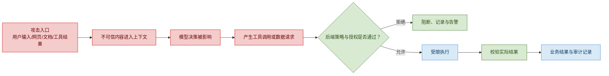
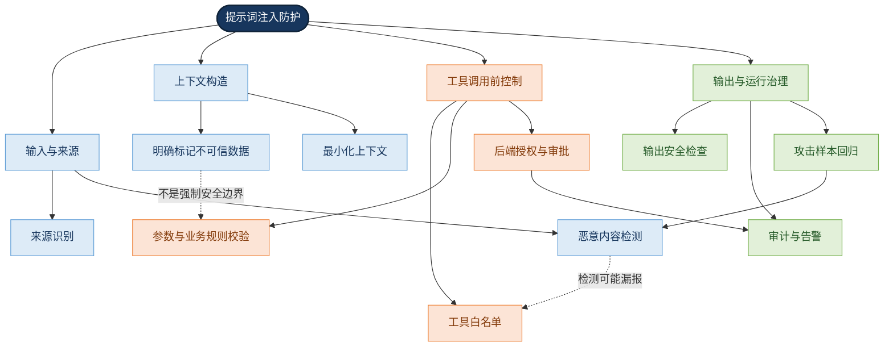
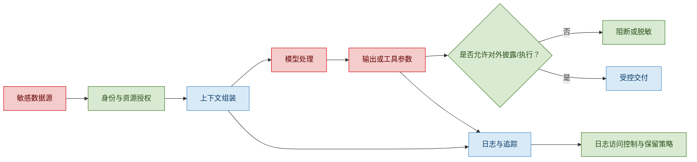
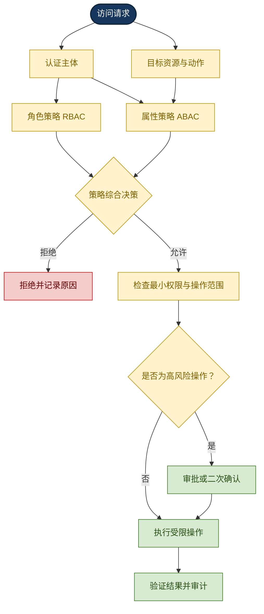
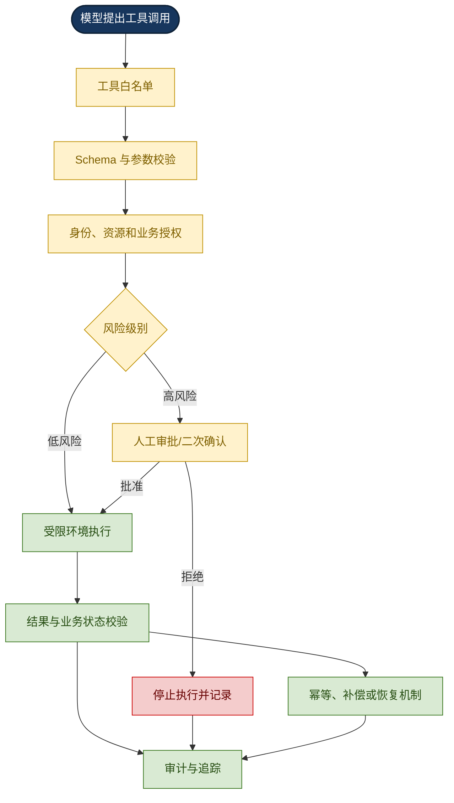
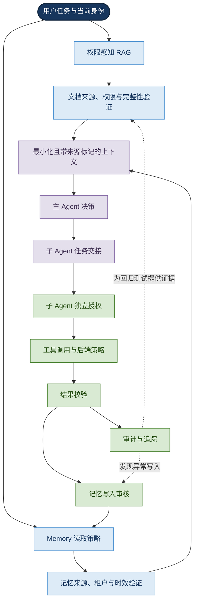
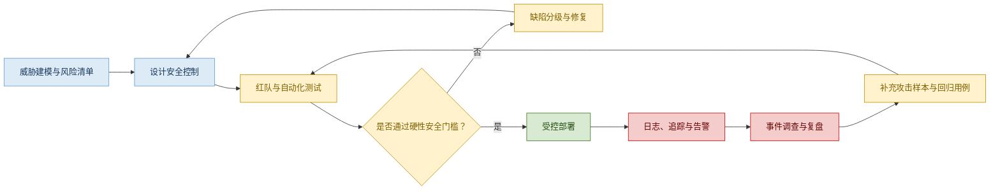

# 提示词注入、数据安全与权限

> 本文围绕企业级 AI Agent 的安全边界展开，梳理提示词注入、数据保护、身份与授权、工具执行、RAG/Memory 安全，以及安全测试与运行治理之间的依赖关系。
>
> <strong>核心观点：模型可以提出行动建议，但实际权限必须由确定性的系统机制执行。</strong> 提示词、检测器和模型自我约束只能作为纵深防御的一部分，不能替代后端授权、执行隔离与审计。

## 1. 本章目标与整体认知

学习本章后，应能够：

- 识别直接提示词注入、间接提示词注入和多模态注入的入口与影响。
- 解释数据分类、最小化、脱敏、隔离、加密和生命周期管理各自解决的问题。
- 区分身份认证（Authentication）与授权（Authorization），理解 RBAC、ABAC 和最小权限。
- 为工具调用设计白名单、参数校验、服务端授权、审批和隔离执行机制。
- 识别 RAG、Memory 与多 Agent 协作中的数据投毒、权限穿透和信任传递风险。
- 将威胁建模、安全测试、审计、告警和事件响应组成持续治理闭环。

## 2. 全局中心辐射式知识图谱

```mermaid
flowchart TB
    S(["Agent 安全与权限<br/>核心目标：约束数据访问和实际行动"])

    S --> A["提示词注入与指令边界"]
    S --> B["数据安全与隐私"]
    S --> C["身份认证与授权"]
    S --> D["工具调用与执行隔离"]
    S --> E["RAG、Memory 与多 Agent"]
    S --> F["测试、审计与运行治理"]

    A --> A1["直接注入"]
    A --> A2["间接注入：网页、文档、工具结果"]
    A --> A3["多模态注入"]
    A --> A4["上下文标记与输入/输出检测"]

    B --> B1["数据分类分级"]
    B --> B2["数据最小化与脱敏"]
    B --> B3["传输/静态加密与密钥管理"]
    B --> B4["保留、删除与日志保护"]

    C --> C1["Authentication：确认身份"]
    C --> C2["Authorization：检查权限"]
    C --> C3["RBAC：基于角色"]
    C --> C4["ABAC：基于属性"]
    C --> C5["最小权限与短期凭证"]

    D --> D1["工具白名单"]
    D --> D2["Schema 与业务参数校验"]
    D --> D3["服务端资源授权"]
    D --> D4["审批、沙箱、网络出口控制"]
    D --> D5["结果校验、幂等与补偿"]

    E --> E1["权限感知检索"]
    E --> E2["文档来源与知识投毒"]
    E --> E3["记忆写入/读取/删除"]
    E --> E4["Agent 身份与消息信任边界"]

    F --> F1["威胁建模"]
    F --> F2["红队与回归测试"]
    F --> F3["日志、Trace 与审计"]
    F --> F4["告警、撤权、隔离与复盘"]

    A2 -. "不可信内容可能影响模型决策" .-> D1
    A4 -. "只能辅助防护" .-> D3
    B2 -. "限制上下文暴露" .-> E1
    C2 --> D3
    C5 --> D4
    E1 --> B2
    E2 -. "间接注入入口" .-> A2
    E3 -. "持久化污染风险" .-> E2
    D5 --> F3
    F2 --> A4
    F2 --> D2
    F3 --> F4

    classDef core fill:#17365D,color:#FFFFFF,stroke:#10243A,stroke-width:2px;
    classDef prompt fill:#DDEBF7,color:#17365D,stroke:#5B9BD5;
    classDef data fill:#E2F0D9,color:#285C2B,stroke:#70AD47;
    classDef identity fill:#FFF2CC,color:#7F6000,stroke:#BF9000;
    classDef tool fill:#FCE4D6,color:#843C0C,stroke:#ED7D31;
    classDef context fill:#E4DFEC,color:#403152,stroke:#8064A2;
    classDef ops fill:#D9EAD3,color:#274E13,stroke:#6AA84F;
    class S core;
    class A,A1,A2,A3,A4 prompt;
    class B,B1,B2,B3,B4 data;
    class C,C1,C2,C3,C4,C5 identity;
    class D,D1,D2,D3,D4,D5 tool;
    class E,E1,E2,E3,E4 context;
    class F,F1,F2,F3,F4 ops;
```

<strong>图谱解读：</strong> 中心节点是“Agent 安全与权限”，外围六个分支分别描述攻击入口、数据保护、身份授权、执行控制、上下文生态和运行治理。跨分支连线表示真实工程中的依赖：间接提示词注入可能借助工具形成影响；RAG 权限过滤依赖身份授权；审计和回归测试又反过来验证这些防护是否有效。安全不是单个提示词或独立 Agent 的功能，而是贯穿整条任务链的控制体系。

## 3. 威胁模型：从攻击入口到业务影响

### 3.1 安全对象与信任边界

Agent 系统需要保护的对象包括：

- 企业文档、数据库记录、向量索引和业务系统数据；
- 用户身份、工作负载身份、访问令牌与 API 密钥；
- 系统提示词、内部配置、工具定义与任务上下文；
- 会话历史、长期记忆、检索片段和子 Agent 消息；
- 工具执行环境、文件系统、网络出口和外部服务；
- 日志、追踪记录、评估样本及安全事件证据。

信任边界至少存在于：用户与应用之间、应用与模型服务之间、模型与工具之间、检索系统与模型上下文之间、主 Agent 与子 Agent 之间，以及内部服务与外部网络之间。每跨越一个边界，都需要明确数据来源、身份、允许操作和验证责任。

### 3.2 典型攻击链

<strong>图谱解读：</strong> 攻击链并不意味着提示词注入必然成功。关键的强制控制点是工具执行前的服务端策略和授权检查；即使模型被误导，后端仍应能够拒绝未授权动作。结果校验和审计则用于确认执行状态并支持事后追溯。

### 3.3 威胁建模的实用步骤

1. 识别资产及其敏感等级。
2. 标注用户、模型、工具、数据源和外部服务之间的信任边界。
3. 列出每条边界上可传入的数据、身份和操作。
4. 评估机密性、完整性、可用性及业务影响。
5. 为每项风险指定预防、检测、响应和恢复措施。
6. 将可验证的安全要求转化为测试用例与上线门槛。

可参考 STRIDE（Spoofing、Tampering、Repudiation、Information Disclosure、Denial of Service、Elevation of Privilege）威胁分类法辅助检查身份伪装、数据篡改、抵赖、信息泄露、拒绝服务和权限提升等问题；它是通用威胁建模工具，不是 Agent 专属风险清单。

## 4. 提示词注入与指令边界

### 4.1 定义与分类

提示词注入（Prompt Injection）是指不可信输入或外部内容影响模型，使其偏离预期任务、违反约束或产生非预期行为。

| 类型 | 入口 | 示例与风险 |
|---|---|---|
| 直接提示词注入（Direct Prompt Injection） | 用户直接输入 | 要求忽略已有规则、泄露内部内容或调用未授权工具 |
| 间接提示词注入（Indirect Prompt Injection） | 网页、邮件、PDF、Word、知识库、工具返回值 | 正常摘要任务中，文档夹带要求模型执行其他动作的内容 |
| 多模态提示词注入（Multimodal Prompt Injection） | 图片文字、截图、音频转录等模型可感知内容 | 恶意指令通过图像或其他模态进入上下文 |

### 4.2 为什么提示词不是权限边界

系统提示词可以说明角色、任务和安全要求，但不能替代数据库权限、操作系统权限、业务规则或 API 授权。分隔符、XML 标签和 JSON 封装有助于区分指令与数据，却不能保证模型完全不受恶意内容影响。

应采用分层控制：

- <strong>指令层：</strong> 明确任务边界、数据可信度和拒绝条件。
- <strong>检测层：</strong> 对输入、检索内容和输出执行风险检测。
- <strong>决策层：</strong> 限制可用工具，并对调用意图和参数进行策略判定。
- <strong>执行层：</strong> 由服务端进行身份授权、资源限制和业务规则校验。
- <strong>治理层：</strong> 通过审计、红队测试和回归集持续验证防护。

### 4.3 提示词注入防护关系图

<strong>图谱解读：</strong> 输入检测和上下文标记能降低风险，但不能独立保证安全。工具调用前的白名单、参数校验和服务端授权是关键执行边界；运行审计与回归测试负责发现遗漏并持续改进。

## 5. 数据安全与隐私保护

### 5.1 数据生命周期

数据可能经过用户输入、会话历史、RAG、Memory、模型上下文、工具参数、业务数据库、缓存和日志。任何环节都可能形成额外暴露面。因此需要在数据进入、使用、传输、存储、共享、保留和删除各阶段明确控制要求。

### 5.2 核心控制措施

| 控制措施 | 解决的问题 | 工程要点 |
|---|---|---|
| 数据分类分级 | 不同数据需要不同保护强度 | 明确公开、内部、敏感、受限等类别及责任人 |
| 数据最小化 | 减少无必要的数据暴露 | 只把完成当前任务必需的信息放入上下文 |
| 脱敏与遮蔽 | 降低敏感字段进入模型、日志或输出的风险 | 按数据类型选择遮蔽、令牌化或删除 |
| 传输加密 | 保护网络传输中的数据 | 使用安全传输协议并验证服务端身份 |
| 静态加密 | 降低存储介质泄露的影响 | 加密数据库、备份和必要的文件存储 |
| 密钥管理 | 防止凭证泄露和长期滥用 | 秘密管理服务、权限隔离、轮换与撤销 |
| 保留与删除 | 控制数据长期积累和合规风险 | 明确保留周期、删除范围及备份处理 |
| 日志保护 | 防止观测系统成为二次泄露源 | 限制访问，避免记录完整令牌、密钥和不必要的原文 |

脱敏并不等于匿名化；加密也不能解决已经被授权读取的数据在模型上下文中被错误使用的问题。必须结合访问控制、数据最小化和输出约束。

### 5.3 敏感信息泄露路径

<strong>图谱解读：</strong> 数据安全需要覆盖上下文组装、模型输出、工具参数以及日志系统。授权决定数据能否进入处理流程；输出控制决定数据能否对外披露；日志系统则必须在提供诊断价值的同时避免复制敏感数据。

## 6. 身份认证、授权与最小权限

### 6.1 关键术语

- <strong>身份认证（Authentication）：</strong> 确认请求者或工作负载是谁。
- <strong>授权（Authorization）：</strong> 判断某主体是否可以对指定资源执行特定动作。
- <strong>凭证（Credential）：</strong> 用于证明身份或建立访问能力的密钥、证书或其他材料。
- <strong>访问令牌（Access Token）：</strong> 用于向受保护资源提出访问请求的令牌。
- <strong>最小权限（Least Privilege）：</strong> 只授予完成当前任务所需的最低权限。
- <strong>职责分离（Separation of Duties）：</strong> 将关键操作分配给不同角色或主体，以降低单点滥用风险。

身份认证成功并不意味着拥有全部资源权限。工具可被调用，也不意味着它可以对任意资源执行任意操作。

### 6.2 RBAC 与 ABAC

| 维度 | RBAC（基于角色的访问控制） | ABAC（基于属性的访问控制） |
|---|---|---|
| 决策依据 | 用户或工作负载所属角色及角色权限 | 主体、资源、动作、环境等属性 |
| 优点 | 规则直观，便于管理常见职能权限 | 灵活，可表达动态、细粒度的条件 |
| 难点 | 角色膨胀、角色权限过大 | 策略复杂、属性缺失或冲突 |
| 适用场景 | 部门、岗位、常规工具权限 | 文档密级、项目归属、资源所有权、时间和环境条件 |

实际系统可以组合使用：先判断用户是否具备某个角色，再根据资源归属、数据等级和动作类型做属性级判断。

### 6.3 Agent 中的身份层次

通常需要区分：

1. <strong>最终用户身份：</strong> 谁发起了任务。
2. <strong>Agent/工作负载身份：</strong> 哪个服务或 Agent 正在请求资源。
3. <strong>工具服务身份：</strong> 工具服务使用什么身份访问下游系统。

若所有请求都使用一个高权限服务账号，可能产生权限扩大：普通用户只能访问少量文档，但 Agent 服务账号却能读取整个知识库。应明确采用用户委托、工作负载身份或二者组合，并在每次实际资源访问时执行授权。

### 6.4 授权决策图

<strong>图谱解读：</strong> 授权不是一次性的“用户登录成功”判断，而是围绕主体、资源、动作和上下文作出决策。高风险操作应增加审批；最终执行仍需限制资源范围并校验实际结果。

### 6.5 令牌与 MCP 安全

Model Context Protocol（MCP，模型上下文协议）用于连接模型应用与外部工具、资源或服务。具体安全实现取决于所使用的协议版本、传输方式和授权模式。

工程检查重点包括：

- 安全存储凭证，避免写入代码仓库、普通日志或模型上下文。
- 校验令牌的签发方、有效期、权限范围及目标受众。
- 对适用的 OAuth 授权码流程使用 PKCE（Proof Key for Code Exchange，授权码交换证明密钥）等防护机制。
- 使用面向目标资源的授权凭证，避免把发给某个服务的令牌不加区分地转发到另一个上游服务。
- 限制令牌权限和有效期，提供轮换、撤销和泄露响应机制。
- 将 MCP 工具调用与下游业务授权分开验证：协议层允许连接不等于业务层允许操作。

## 7. 工具调用安全与执行隔离

### 7.1 将工具调用视为不可信提案

模型生成的工具调用应被视为“建议执行的操作”，而不是已经获得授权的命令。后端必须独立验证工具名称、参数、身份、资源、业务规则和执行环境。

### 7.2 工具安全控制层

| 层次 | 需要检查的内容 | 常用机制 |
|---|---|---|
| 工具发现 | 当前任务是否需要该工具 | 工具白名单、动态暴露最小能力集 |
| 调用意图 | 操作是否符合业务目标 | 策略引擎、风险分级 |
| 参数验证 | 类型、长度、枚举、边界、路径和 URL 是否安全 | Schema 校验、语义验证、允许列表 |
| 资源授权 | 当前主体是否可操作目标资源 | 服务端授权、资源归属校验 |
| 执行隔离 | 能访问哪些文件、进程、网络和系统资源 | 沙箱、容器隔离、网络出口限制、配额 |
| 高风险审批 | 是否需要用户或管理员确认 | 人工审批、二次确认、审批内容绑定 |
| 结果校验 | 操作是否实际成功，状态是否符合预期 | 返回值验证、状态复核、幂等控制 |
| 审计与恢复 | 如何追踪和补救 | 审计事件、补偿操作、回滚或恢复流程 |

### 7.3 常见执行风险

- <strong>SSRF（Server-Side Request Forgery，服务端请求伪造）：</strong> 诱导服务端请求不应访问的内部地址或云元数据服务。应校验目标地址、限制网络出口，并处理 DNS 解析与重定向风险。
- <strong>命令注入：</strong> 不可信参数进入 Shell 或其他解释器。优先使用参数化 API，避免拼接命令，并限制可执行程序和参数范围。
- <strong>路径穿越：</strong> 用户提供的路径绕过预期目录。应规范化路径、限制允许根目录，并验证符号链接等边界情况。
- <strong>不安全输出处理：</strong> 将模型生成内容直接当作 SQL、HTML 或脚本执行。应使用参数化查询、上下文转义和专门的安全 API。
- <strong>资源耗尽：</strong> 通过无限循环、过量工具调用、过大检索或重试造成服务不可用或成本失控。应设置超时、预算、并发上限和调用次数限制。

### 7.4 工具执行与审批关系图

<strong>图谱解读：</strong> 白名单、参数校验和授权是相互独立的检查：参数格式正确不代表有权访问资源；用户有权访问资源也不代表当前操作符合业务规则。审批应绑定具体操作与参数，执行后还要校验状态并留下审计证据。

## 8. RAG、Memory 与多 Agent 安全

### 8.1 RAG 的安全要求

Retrieval-Augmented Generation（RAG，检索增强生成）通过检索外部知识为模型补充上下文。安全设计不能只追求语义相关性，还需要验证文档来源、访问权限、租户边界和内容完整性。

| 风险 | 成因 | 防护 |
|---|---|---|
| 未授权检索 | 只按相似度检索，不校验用户权限 | 权限感知检索、访问时复核 |
| 知识投毒 | 恶意或错误内容进入索引 | 来源审核、版本管理、完整性校验 |
| 间接注入 | 文档中包含影响模型行为的恶意指令 | 将检索内容视为不可信数据、工具执行前授权 |
| 跨租户泄露 | 共享索引或缓存缺少租户隔离 | 租户隔离、权限过滤、缓存键隔离 |
| 撤权延迟 | 文档权限更新未同步 | 权限更新传播、查询时复核 |
| 内容篡改 | 数据源或索引内容被未授权修改 | 来源追踪、变更审计、完整性保护 |

### 8.2 安全检索的建议步骤

1. 从已认证会话获得用户或工作负载身份。
2. 获取当前可访问资源范围或安全过滤条件。
3. 在检索阶段尽可能过滤无权访问的候选文档。
4. 对实际读取的文档执行服务端授权复核。
5. 只将授权通过且完成必要风险检查的内容组装进上下文。
6. 对输出和工具调用继续执行安全检查。
7. 当权限发生变化时，保证撤权和缓存失效机制能及时生效。

只依赖向量数据库的静态元数据过滤并不充分，因为文档权限、用户角色和组织关系可能发生变化。

### 8.3 Memory 安全

Memory（记忆）将信息保留到后续交互中，可能把短期恶意内容转化为长期风险。应区分事实、用户偏好、任务状态和待执行指令，并为不同类别设置不同的写入与读取策略。

重点控制包括：

- 写入前验证来源、敏感性、可信度和持久化必要性；
- 读取时执行用户、项目、租户和资源级授权；
- 避免把未经验证的外部指令直接保存为长期行为规则；
- 支持过期、纠错、撤销、删除和审计；
- 记录必要的来源与版本信息，以便追踪污染路径。

### 8.4 多 Agent 安全

多 Agent 系统应将子 Agent 输出视为需要验证的消息，而不是天然可信的内部指令。主 Agent 不能仅因为任务来自内部 Agent 就放宽权限检查。

每次交接都应明确：

- 来源 Agent 与目标 Agent；
- 任务范围和允许的操作；
- 传递的数据是否包含敏感内容；
- 目标 Agent 的独立身份和权限；
- 返回结果的验证规则；
- 是否允许将结果写入长期记忆或触发外部操作。

### 8.5 上下文生态的跨模块关系图

<strong>图谱解读：</strong> RAG 和 Memory 都会向上下文供给信息，但它们各自需要来源与权限检查。上下文进入主 Agent 后，跨 Agent 交接不能继承无边界的信任；工具执行仍需独立授权。执行结果写入 Memory 前也应再次审核，形成从读取到执行再到持久化的安全闭环。

## 9. 安全测试、评估与回归

### 9.1 测试矩阵

| 测试类别 | 测试场景 | 预期控制 |
|---|---|---|
| 直接注入 | 用户要求忽略安全规则 | 不应突破系统权限与业务约束 |
| 间接注入 | 网页或文档夹带恶意指令 | 内容不能自行授予工具权限 |
| 越权读取 | 请求读取其他部门或租户数据 | 后端拒绝访问 |
| 工具滥用 | 调用未开放工具或危险操作 | 白名单、策略或授权阻止 |
| 参数攻击 | 异常路径、URL、SQL 参数或超长输入 | 参数验证和执行隔离生效 |
| 凭证泄露 | 令牌出现在提示词、输出或日志中 | 不泄露或按策略遮蔽，触发必要告警 |
| Memory 污染 | 将恶意指令写入长期记忆 | 写入验证阻止不可信持久化 |
| 子 Agent 越权 | 子 Agent 尝试超出任务范围访问资源 | 独立身份和授权策略生效 |
| 资源滥用 | 无限循环、过量工具调用、过大输入 | 超时、预算、配额和熔断生效 |
| 审计完整性 | 高风险操作执行后检查证据 | 能关联发起者、策略、审批和结果 |

### 9.2 安全指标

安全指标应反映控制是否生效，而不仅是模型回答是否看起来合理。例如：

- 未授权访问拦截率；
- 安全策略误拒绝率；
- 提示词注入测试集的攻击成功率；
- 高风险操作审批覆盖率；
- 敏感信息泄露测试通过率；
- 凭证与秘密扫描发现数量；
- 安全回归测试通过率；
- 从发现异常到撤销权限或隔离工具的响应时间。

这些指标需要明确测试集、统计口径和严重程度分级。攻击检测器的分数不能替代后端授权的硬性判断；对于明确禁止的操作，必须设置不可被其他指标抵消的上线门槛。

### 9.3 从安全发现到回归闭环

<strong>图谱解读：</strong> 安全治理是持续循环而不是一次性验收。红队发现的问题应转化为可重复的测试；运行期事件应反哺风险清单和回归集。上线判断应优先检查越权访问、敏感数据泄露和高风险操作等硬性约束。

## 10. 审计、可观测性与事件响应

### 10.1 建议记录的审计字段

- 请求、会话、任务或 Trace 的关联标识；
- 用户身份或工作负载身份；
- 工具名称、操作类型和必要的参数摘要；
- 授权决策、拒绝原因与策略版本；
- 审批主体、审批时间和审批对象；
- 执行结果、异常类型和关键时间戳；
- 需要时记录资源标识的脱敏形式。

审计记录应支持关联分析，但不应无差别保存完整令牌、密钥、敏感文档正文或不必要的个人数据。日志访问权限、保留期限、完整性保护和删除策略同样属于安全设计的一部分。

### 10.2 事件响应流程

发生安全事件时，应根据影响范围采取以下措施：

1. 识别受影响的用户、数据、工具和工作负载。
2. 阻断正在发生的危险调用，必要时临时禁用相关工具。
3. 撤销或轮换可能泄露的凭证。
4. 隔离受影响的执行环境和数据通道。
5. 保全必要审计证据并限制其访问。
6. 评估数据是否泄露、业务状态是否被修改。
7. 执行恢复或补偿操作。
8. 复盘根因，补充防护和自动化回归用例。

事件响应不应只依赖模型自己报告异常，应使用工具执行结果、后端策略日志和业务状态作为证据。

## 11. 工程选型与常见误区

### 11.1 关键机制对比

| 机制 | 适合解决的问题 | 不应被误认为 |
|---|---|---|
| 提示词约束 | 引导模型按预期行为工作 | 强制授权边界 |
| 注入检测器 | 发现部分可疑输入或上下文 | 能识别所有攻击的完整防线 |
| RAG 权限过滤 | 缩小检索候选范围 | 永久有效的授权事实 |
| RBAC | 管理常见角色权限 | 能覆盖所有动态资源条件 |
| ABAC | 表达细粒度的动态策略 | 无需测试的简单配置 |
| 工具白名单 | 限制模型可调用的能力集合 | 工具内部不需要授权 |
| 沙箱 | 限制执行环境影响范围 | 可以替代业务权限校验 |
| 人工审批 | 对高影响操作增加确认 | 审批对象可与执行参数脱离 |
| 审计日志 | 追溯访问、决策与操作结果 | 记录越多就越安全 |
| 红队与回归测试 | 发现已知与新出现的安全缺陷 | 一次通过即可永久安全 |

### 11.2 常见误区

- <strong>误区一：</strong> 系统提示词写了“禁止泄露”，就能防止泄露。  
  <strong>纠正：</strong> 仍需资源级授权、数据最小化、输出控制和审计。

- <strong>误区二：</strong> 文档来自内部知识库，因此可信。  
  <strong>纠正：</strong> 内部内容也可能过期、被污染或包含间接提示词注入。

- <strong>误区三：</strong> 用户通过登录验证后，Agent 就可以代表用户访问所有工具。  
  <strong>纠正：</strong> 每个资源和动作仍需要授权；工作负载身份不能自动继承用户全部权限。

- <strong>误区四：</strong> 工具参数符合 JSON Schema，就可以安全执行。  
  <strong>纠正：</strong> Schema 只验证结构与类型，仍需业务约束、身份授权和执行隔离。

- <strong>误区五：</strong> 只在最终回答前检查敏感信息就足够。  
  <strong>纠正：</strong> 敏感信息可能已进入外部模型、工具参数、日志或长期记忆。

- <strong>误区六：</strong> 内部 Agent 的输出可以直接信任。  
  <strong>纠正：</strong> 每个 Agent 都应具有清晰的身份、任务范围和权限边界。

- <strong>误区七：</strong> 安全只需要上线前测试。  
  <strong>纠正：</strong> 模型、数据、权限和工具持续变化，必须持续监控并进行回归验证。

## 12. 与其他 Agent 模块的关系

| 相关模块 | 关联方式 |
|---|---|
| Prompt & Instructions | 定义任务和安全约束，但不能取代服务端强制控制 |
| Context Engineering | 决定哪些信息进入模型上下文，需要来源标记、最小化和信任边界 |
| Memory | 需要控制写入、读取、隔离、过期和删除，防止长期污染 |
| Tools / Function Calling | 必须执行工具白名单、参数验证、授权、隔离和结果校验 |
| RAG / Hybrid Search / Reranking | 检索质量之外，还需保证权限、来源和租户隔离 |
| State Management | 状态变更需要合法性检查、并发控制和审计 |
| Multi-Agent Collaboration | 任务交接需要身份、数据范围和操作权限约束 |
| Reliability & Fault Tolerance | 安全拒绝、工具失败和凭证异常应有安全失败与恢复策略 |
| Performance & Cost | 安全检测、授权与审批会带来成本，需要合理设计缓存与执行路径，但不能绕过权限检查 |
| Observability | 提供安全事件的日志、追踪、告警和关联证据 |
| Evaluation | 将攻击样本和权限边界转化为可重复的安全测试 |
| Deployment & Operations | 负责秘密管理、网络隔离、运行时策略、补丁和凭证轮换 |
| Production Readiness | 将安全门槛、事故响应、回滚与责任分工纳入生产准入 |

## 13. 参考资料与延伸阅读

以下资料用于建立本章的主要参考框架。标准和在线文档可能持续更新，正式引用时应注明具体版本与访问日期。

### OWASP

- [OWASP Top 10 for Large Language Model Applications](https://owasp.org/www-project-top-10-for-large-language-model-applications/)
- [OWASP Agentic AI Threats and Mitigations](https://genai.owasp.org/resource/agentic-ai-threats-and-mitigations/)
- [OWASP：Excessive Agency](https://genai.owasp.org/llmrisk/llm062025-excessive-agency/)

### NIST

- [NIST AI Risk Management Framework](https://www.nist.gov/itl/ai-risk-management-framework)
- [NIST AI RMF Playbook](https://airc.nist.gov/AI_RMF_Knowledge_Base/Playbook)
- [NIST AI 600-1：Artificial Intelligence Risk Management Framework: Generative Artificial Intelligence Profile](https://doi.org/10.6028/NIST.AI.600-1)

### Google

- [Google Secure AI Framework（SAIF）](https://www.saif.google/)
- [SAIF Map](https://www.saif.google/secure-ai-framework/saif-map)
- [SAIF Controls](https://saif.google/secure-ai-framework/controls)
- [SAIF Risks](https://saif.google/secure-ai-framework/risks)

### Microsoft

- [Prompt Injection](https://learn.microsoft.com/en-us/security/zero-trust/catalog-ai-attack-techniques/prompt-injection)
- [Defend Against Indirect Prompt Injection](https://learn.microsoft.com/en-us/security/zero-trust/sfi/defend-indirect-prompt-injection)
- [Input, Context and Retrieval Hygiene](https://learn.microsoft.com/en-us/security/zero-trust/catalog-ai-defense-capabilities/input-context-retrieval-hygiene)
- [Protect Workload Identities](https://learn.microsoft.com/en-us/entra/fundamentals/zero-trust-protect-identities)

### Model Context Protocol

- [MCP Authorization Security Considerations](https://github.com/modelcontextprotocol/modelcontextprotocol/blob/main/docs/specification/2026-07-28/basic/authorization/security-considerations.mdx)
- [MCP Authorization Specification](https://github.com/modelcontextprotocol/modelcontextprotocol/blob/main/docs/specification/2025-06-18/basic/authorization.mdx)

## 14. 本章总结

本章的核心不是让模型“永远不犯错”，而是建立一种能够承受模型犯错、输入恶意和外部数据不可信的系统设计。

- 提示词注入属于模型行为风险，必须与工具执行权限和后端安全边界结合治理。
- 数据安全贯穿输入、上下文、检索、记忆、工具、日志和数据保留的整个生命周期。
- 身份认证用于确认主体，授权用于判断具体资源与动作是否允许；RBAC 和 ABAC 可组合使用。
- 工具调用应遵循白名单、参数验证、服务端授权、受限执行、结果校验和审计。
- RAG、Memory 和多 Agent 会引入新的信任边界，不能因为数据或消息来自内部组件就默认可信。
- 安全测试、运行监控和事件响应构成持续闭环，必须将已发现的问题转化为回归用例。

最终应形成的工程原则是：<strong>模型负责理解和提出方案，策略与权限系统负责决定是否允许，受限执行环境负责落实边界，审计和测试负责验证控制是否持续有效。</strong>

---

## 附录：术语速查

| 术语 | 英文全称 | 简要说明 |
|---|---|---|
| Agent | AI Agent | 能基于上下文选择工具并执行多步骤任务的 AI 系统 |
| Prompt Injection | Prompt Injection | 利用输入或外部内容影响模型行为的攻击 |
| RAG | Retrieval-Augmented Generation | 检索外部知识并将其用于生成 |
| Memory | Memory | 跨步骤或跨会话保留的信息机制 |
| Authentication | Authentication | 身份认证 |
| Authorization | Authorization | 访问授权 |
| RBAC | Role-Based Access Control | 基于角色的访问控制 |
| ABAC | Attribute-Based Access Control | 基于属性的访问控制 |
| MCP | Model Context Protocol | 连接模型应用与外部工具和资源的协议 |
| PKCE | Proof Key for Code Exchange | OAuth 授权码流程的安全增强机制 |
| SSRF | Server-Side Request Forgery | 服务端请求伪造 |
| Threat Modeling | Threat Modeling | 系统化识别威胁、攻击路径和安全控制的过程 |
| Red Teaming | Red Teaming | 通过模拟攻击评估系统防护能力 |
| Defense in Depth | Defense in Depth | 使用多层、相互补充的安全控制降低单点失效风险 |
| Least Privilege | Least Privilege | 只授予完成任务所需的最低权限 |
