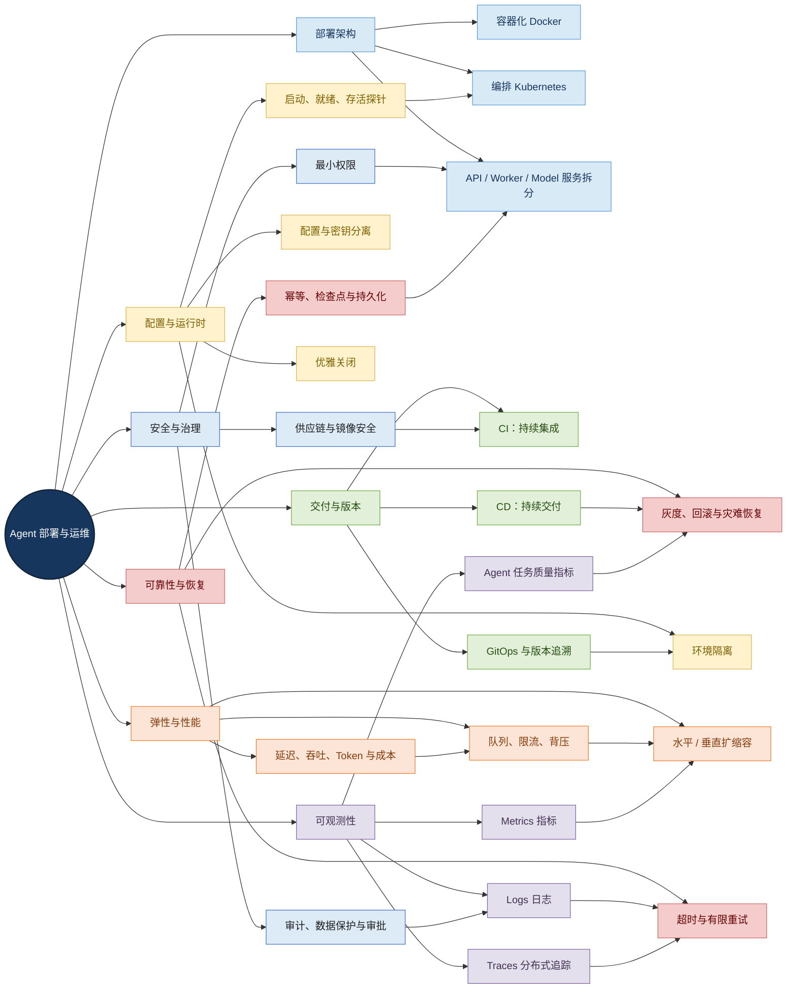
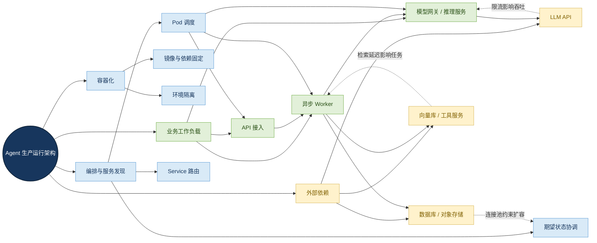
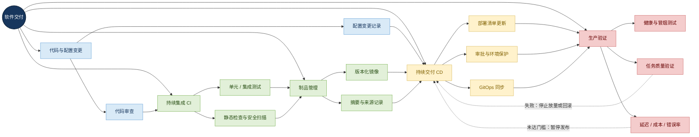
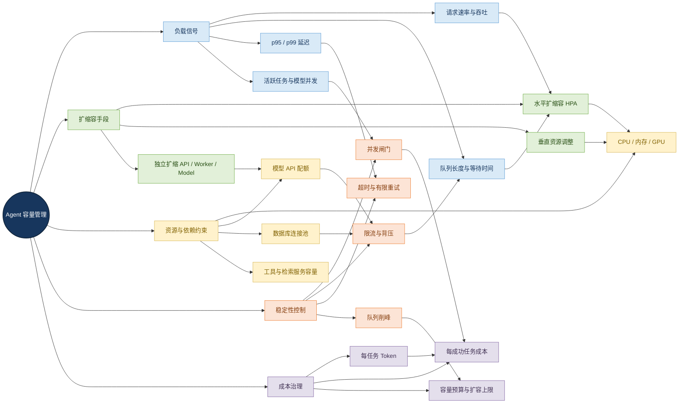
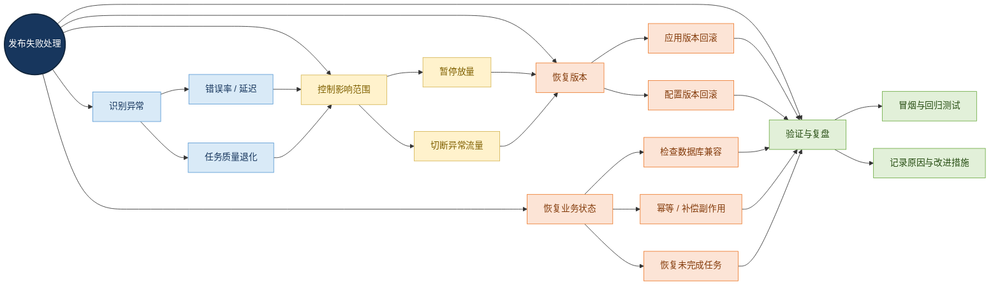
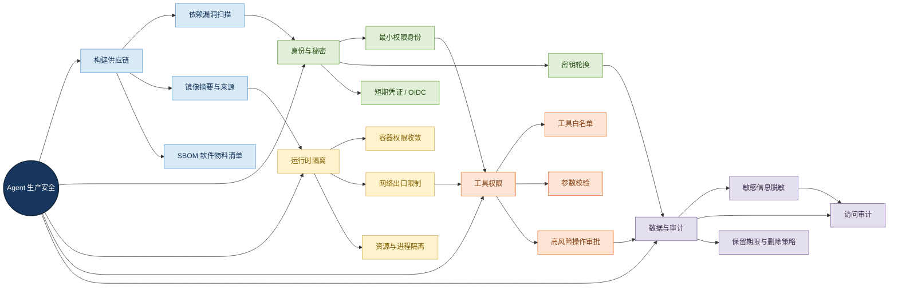
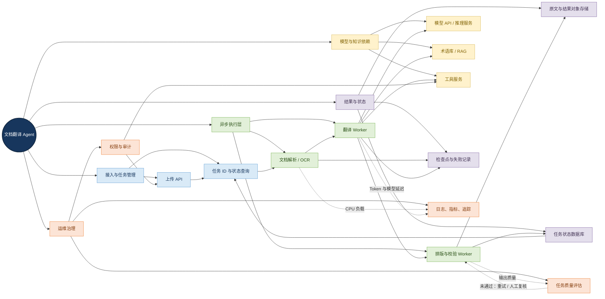
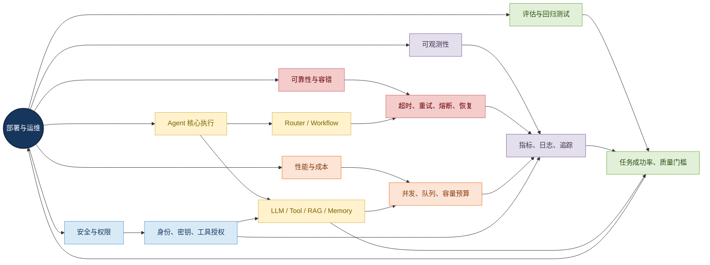

# 第七章 06：部署架构、配置与运维

> 学习目标：理解 Agent 如何从开发环境中的代码转化为可部署、可扩展、可观测、可恢复并且能够安全持续交付的生产服务。
>
> 本文定位：本章知识总结与技术学习材料。部署技术的具体选择应结合业务规模、基础设施、合规要求和团队运维能力，不存在适用于所有场景的唯一方案。

## 一、本章全局认知：部署与运维是一套协同系统

Agent 的生产化不是“把代码放到服务器上”这么简单。一个 Agent 任务可能经过请求接入、任务路由、检索、模型推理、工具调用、状态更新、结果校验和交付等多个阶段；每个阶段都可能依赖独立服务，并受到资源、网络、配额、权限和业务质量的共同影响。

因此，本章围绕一条主线展开：

<strong>可复现的交付物 → 受控的部署与配置 → 稳定的运行与扩缩容 → 持续观测与质量验证 → 故障恢复和安全治理。</strong>

### 1.1 全局中心辐射式知识图谱

<strong>图谱解读：</strong> 中心节点是“Agent 部署与运维”，外围分别是架构、交付、运行时、性能、观测、可靠性和安全。跨分支连线强调这些模块并非独立存在：指标驱动扩缩容，配置和探针影响运行状态，观测数据帮助定位故障，发布验证又依赖业务质量评估与安全门槛。

## 二、部署架构：把 Agent 拆分成可管理的运行单元

### 2.1 部署架构的基本层次

企业级 Agent 系统通常可以划分为四个逻辑层：

| 层次 | 典型组件 | 主要职责 |
|---|---|---|
| 交付层 | Git、CI/CD、镜像仓库、部署清单 | 构建、测试、发布和版本追溯 |
| 运行与编排层 | Docker、Kubernetes、Service、Gateway | 进程隔离、调度、服务发现和实例管理 |
| Agent 与依赖层 | Agent API、Workflow、LLM、Tool、RAG、Memory、数据库、队列 | 执行任务、访问依赖和保存状态 |
| 运维治理层 | 指标、日志、追踪、告警、审计、备份 | 判断健康状态、定位故障和恢复服务 |

这是一种逻辑划分，并不要求每一层都使用独立产品。小型系统可以将多个组件部署在同一台机器上；随着负载、可靠性和团队协作需求增长，再逐步拆分为独立服务。

### 2.2 容器、编排与服务拆分的关系

<strong>图谱解读：</strong> 容器负责封装运行环境，编排系统负责管理实例和服务发现，业务工作负载负责执行 Agent 任务，外部依赖提供模型、存储与工具能力。服务拆分的价值在于可以分别扩缩和治理，但拆分过度会增加网络调用、部署和排障成本。

### 2.3 Docker 与 Kubernetes 的职责边界

| 技术 | 解决的问题 | 不应误认为它解决的问题 |
|---|---|---|
| Docker | 构建和运行容器镜像，封装应用及其依赖 | 不自动提供完整的多实例调度、业务恢复和发布治理 |
| Kubernetes | 调度工作负载、服务发现、期望状态协调、滚动更新和扩缩容 | 不自动保证业务逻辑正确，也不代替数据库备份和任务幂等设计 |
| Service / Gateway | 为服务提供稳定访问入口或请求路由 | 不自动消除下游限流和应用内部瓶颈 |
| 镜像仓库 | 保存可版本化的交付物 | 不保证镜像自身无漏洞或构建过程可信 |

Kubernetes 的 Deployment 通过声明式期望状态管理副本和发布过程；控制器负责协调实际状态。应用仍需提供正确的健康检查、资源声明、状态管理和安全策略。

### 2.4 为什么 Agent 常常需要 API 与 Worker 分离？

同步 API 适合接收请求、进行参数校验、创建任务并返回任务标识；异步 Worker 适合执行文档解析、长时间模型调用、批处理和多步骤工作流。

分离后可以分别控制：

- API 实例数量与接入延迟；
- Worker 并发量与任务积压；
- 模型服务的并发和资源；
- 文档解析等 CPU 密集型任务；
- 任务重试、检查点与恢复策略。

但异步化会引入队列持久化、任务状态机、重复投递和结果一致性等问题，因此不能仅为了“架构看起来更复杂”就拆分服务。

## 三、交付生命周期：CI、CD、GitOps 与版本管理

### 3.1 从代码变更到生产验证

<strong>图谱解读：</strong> CI 负责验证变更并生成制品，CD 负责将制品部署到环境，GitOps 负责对齐 Git 中声明的期望状态，生产验证负责确认发布结果是否满足门槛。失败时应停止放量、回滚或切回稳定版本，而不是只看部署命令是否成功。

### 3.2 CI、CD 与 GitOps 的区别

| 概念 | 英文全称 | 关键职责 |
|---|---|---|
| CI | Continuous Integration，持续集成 | 自动测试和验证代码变更，构建交付制品 |
| CD | Continuous Delivery / Deployment，持续交付 / 持续部署 | 将经过验证的制品交付到目标环境；持续部署通常意味着满足条件后自动发布 |
| GitOps | Git-based Operations，基于 Git 的运维实践 | 以版本控制中的声明式配置作为期望状态来源，持续检测并同步环境 |
| IaC | Infrastructure as Code，基础设施即代码 | 用可审查、可版本化的定义管理基础设施 |

GitOps 并不意味着配置天然正确。错误的配置也可能被正确地同步到集群，所以仍需要代码审查、策略校验、测试、审批和回滚方案。

### 3.3 Agent 发布清单应记录什么？

Agent 的有效版本不只有应用镜像，还可能包含：

- 应用代码和依赖锁定文件；
- 模型名称、供应商、模型版本或推理服务镜像；
- Prompt 模板和工作流定义；
- Tool Schema、工具服务版本和授权策略；
- RAG 索引版本与 Embedding 模型版本；
- 数据库迁移版本和特性开关；
- 运行配置及其变更记录。

<strong>工程要点：</strong> 应记录每次发布的组件版本及其兼容关系。即使应用镜像不变，外部模型版本或检索索引变化也可能改变 Agent 的实际行为。

## 四、配置、环境隔离与进程生命周期

### 4.1 配置分类与管理方式

| 配置类型 | 示例 | 推荐管理方式 |
|---|---|---|
| 普通运行配置 | 端口、日志级别、超时 | 环境变量、配置文件或配置中心 |
| 环境依赖配置 | 数据库地址、模型端点 | 环境级配置或配置中心 |
| 敏感凭证 | API Key、数据库密码、访问令牌 | 秘密管理系统或受控 Secret 机制 |
| 业务策略 | 允许使用的工具、最大执行步数、审批阈值 | 版本化策略配置，变更需要审查 |
| 动态运行参数 | 并发上限、灰度比例、特性开关 | 受控动态配置，并记录变更 |

配置与代码分离能够减少环境切换时的代码分支，但不代表所有配置都应该存放在同一处。尤其不能把生产密钥直接写入普通配置文件或提交到 Git。

### 4.2 Kubernetes 的三类探针

| 探针 | 英文 | 目的 | 失败的典型影响 |
|---|---|---|---|
| 存活探针 | Liveness Probe | 判断进程是否处于需要重启才能恢复的异常状态 | 达到失败阈值后可能重启容器 |
| 就绪探针 | Readiness Probe | 判断实例当前是否适合接收业务请求 | 实例暂时不接收正常业务流量 |
| 启动探针 | Startup Probe | 判断初始化时间较长的应用是否完成启动 | 启动阶段可避免其他探针过早判定失败 |

对 Agent 服务，健康检查应轻量、稳定。模型 API 暂时变慢，不一定意味着 Agent 进程已经死亡；数据库短暂不可用时，是否影响就绪状态，要看该实例还能否提供有效服务。

健康检查也不能替代业务验收：API 返回 HTTP 200，并不代表任务正确完成、工具调用有效或输出质量合格。

### 4.3 优雅启动与关闭

优雅关闭（Graceful Shutdown）是指停止接收新任务，给正在处理的请求合理的完成时间，并在退出前保存必要状态或释放资源。

对于 Agent，需要进一步考虑：

- 新任务何时停止进入实例；
- 正在运行的任务能否继续完成；
- 未完成任务的状态是否已持久化；
- 进程退出后，队列是否会重新投递任务；
- 重试是否会重复执行外部副作用；
- 模型请求和工具调用是否支持取消；
- 结果文件与任务状态是否保持一致。

长任务不应只依赖进程内存存活。更稳妥的做法是持久化任务状态，并由可恢复的执行器管理任务生命周期。

## 五、弹性扩缩容、性能与成本

### 5.1 扩缩容的多维知识网络

<strong>图谱解读：</strong> 容量管理从负载信号出发，选择扩缩容方式，但最终受到模型配额、数据库连接池和工具服务容量的约束。并发闸门、背压和队列削峰负责控制进入系统的工作量；成本指标则限制无节制扩容。

### 5.2 水平扩缩容与垂直扩缩容

| 方式 | 调整对象 | 优点 | 局限 |
|---|---|---|---|
| 水平扩缩容 | 实例数量 | 可分散请求，适合可横向扩展的工作负载 | 受下游容量和共享状态约束 |
| 垂直扩缩容 | 单实例 CPU、内存等资源 | 适合单个任务资源需求较高的情况 | 资源存在上限，调整方式与运行平台有关 |
| 队列削峰 | 任务进入和执行速率 | 缓解突发流量对执行服务的冲击 | 可能增加等待时间，需要持久化与任务治理 |
| 并发限制 | 同时执行的任务或调用数 | 保护内存、连接池和模型配额 | 设置过低会降低有效吞吐量 |

### 5.3 为什么 CPU 低也可能很慢？

Agent 请求可能大部分时间花在等待远程模型、检索服务或工具返回。此时 CPU 使用率不高，但端到端延迟仍可能很大。

容量规划应综合观察：

- 请求到达速率和成功吞吐量；
- 活跃任务数、排队长度、最老任务等待时间；
- p50、p95、p99 延迟；
- 模型调用并发、错误率、限流次数；
- CPU、内存、GPU 显存和连接池占用；
- 每个任务的模型调用次数、Token 消耗和成本。

<strong>关键原则：</strong> 扩容应用实例不一定提高端到端吞吐量。如果瓶颈在模型配额或共享数据库，增加实例反而可能放大下游压力。

### 5.4 需要理解的性能指标

- <strong>吞吐量：</strong> 单位时间内完成的请求或任务数量。
- <strong>延迟：</strong> 请求或任务从开始到结束所经历的时间。
- <strong>并发：</strong> 某一时刻正在执行或等待的工作数量。
- <strong>队列等待时间：</strong> 任务进入执行器前的等待时间。
- <strong>Token 消耗：</strong> 模型处理输入和生成输出所消耗的 Token 数量。
- <strong>单位成功任务成本：</strong> 为完成一个通过业务验收的任务所消耗的综合成本。

只看平均延迟容易忽略长尾请求。p95 表示 95% 的观测值不高于该分位点；p99 对尾部慢请求更敏感。对长任务 Agent，应分别测量 API 响应延迟与完整任务耗时。

## 六、发布策略、灰度验证与回滚

### 6.1 常见发布策略对比

| 策略 | 工作机制 | 优势 | 主要风险 |
|---|---|---|---|
| 滚动发布 | 逐步替换旧实例 | 资源开销较低，适合常规服务升级 | 新旧版本可能并存，必须考虑兼容性 |
| 蓝绿发布 | 同时准备新旧环境，再切换流量 | 切换边界明确，便于回切 | 需要额外资源，状态兼容仍需处理 |
| 金丝雀发布 | 先向少量流量开放新版本，再逐步放量 | 可在扩大影响范围前观察新版本 | 需要流量路由、监控对比和明确停止条件 |

### 6.2 Agent 发布不能只检查 HTTP 状态码

发布新模型、新 Prompt、新工作流或新工具版本时，应同时验证：

- 基础服务是否健康；
- 关键任务成功率是否下降；
- 工具调用错误率是否上升；
- p95 / p99 延迟是否超过门槛；
- Token 和单位成功任务成本是否异常；
- 输出完整性、准确性和格式保留是否退化；
- 安全策略和授权边界是否仍然有效。

### 6.3 回滚的完整边界

<strong>图谱解读：</strong> 发布失败处理既包括代码和配置回滚，也包括未完成任务恢复、数据库兼容和外部副作用补偿。应用版本恢复成功不等于整个业务系统已经恢复。

## 七、可观测性：用指标、日志和追踪构成闭环

### 7.1 三类遥测数据的分工

| 类型 | 英文 | 回答的问题 | Agent 示例 |
|---|---|---|---|
| 指标 | Metrics | 整体表现如何？ | 成功率、吞吐量、延迟、Token 消耗 |
| 日志 | Logs | 某一时刻发生了什么？ | 工具调用失败、授权拒绝、任务状态变化 |
| 分布式追踪 | Distributed Tracing | 请求经过哪些组件，时间花在哪里？ | API → Router → RAG → LLM → Tool → Validator |

三者相互补充：指标发现异常，追踪定位耗时和调用路径，日志解释具体事件。

### 7.2 Agent 专用观测维度

| 观测层 | 建议指标或事件 | 能发现的问题 |
|---|---|---|
| 任务层 | 完成率、失败率、取消数、超时数、执行步数 | 工作流中断或任务质量下降 |
| 模型层 | 调用延迟、错误率、限流、Token、模型版本 | 模型服务变慢、配额耗尽或成本上升 |
| 工具层 | 调用量、成功率、耗时、参数校验失败、权限拒绝 | 工具故障、错误参数或越权尝试 |
| RAG 层 | 检索延迟、返回数量、分数分布、索引版本 | 召回质量下降或索引不一致 |
| 运行层 | CPU、内存、队列长度、重启次数、连接池占用 | 资源不足、积压或运行异常 |
| 业务质量层 | 任务验收通过率、完整性、格式保留、安全测试结果 | 服务正常但业务输出退化 |

### 7.3 可观测性与隐私

详细遥测有助于排障，但 Agent 输入、输出、检索片段和工具参数可能包含企业机密或个人信息。

建议默认记录必要的调用元数据，谨慎采集完整 Prompt、原始文档和工具内容；对敏感字段脱敏，限制日志与 Trace 的访问权限，设定保留期限，并避免把高基数或敏感内容直接作为指标标签。

## 八、可靠性与任务恢复

### 8.1 高可用、弹性、故障恢复和灾难恢复

| 概念 | 核心问题 | 典型措施 |
|---|---|---|
| 高可用 | 实例或节点故障后，服务能否继续 | 多实例、健康检查、故障转移 |
| 弹性 | 负载变化时能否调整容量 | 自动扩缩容、队列和并发控制 |
| 故障恢复 | 组件失败后能否继续任务或恢复状态 | 超时、有限重试、持久化、幂等和补偿 |
| 灾难恢复 | 整个区域或关键基础设施失效后能否恢复 | 备份、异地恢复、恢复演练 |

多实例不能代替备份，自动重启不能保证长任务恢复，回滚应用也不能自动撤销已经发生的外部副作用。

### 8.2 Agent 任务恢复机制

长任务应考虑：

- 任务状态持久化与状态版本；
- 步骤级检查点；
- 有限次数重试与指数退避；
- 幂等键与重复提交检测；
- 失败任务队列或死信队列；
- 人工恢复、取消和超时；
- 外部副作用的补偿操作；
- 任务状态与结果文件的一致性校验。

最重要的判断是：哪些步骤可以安全重试，哪些步骤可能已经产生不可逆的外部影响。

### 8.3 重试、幂等与补偿的区别

| 机制 | 目的 | 典型场景 |
|---|---|---|
| 重试 | 对可能暂时失败的操作再次执行 | 网络抖动、短暂限流 |
| 幂等 | 多次执行同一操作仍只产生预期的一次业务效果 | 重复提交任务、消息重复投递 |
| 补偿 | 对已完成但需要撤销或抵消的业务动作执行后续操作 | 订单取消、资源释放、业务流程回退 |
| 检查点 | 记录任务执行进度，避免失败后从头开始 | 长时间文档处理、多步骤工作流 |

重试必须有边界。对于可能产生外部副作用的工具调用，只有在操作语义和幂等机制明确时，才能安全地自动重试。

## 九、安全、权限与软件供应链

### 9.1 安全治理贯穿交付和运行全过程

<strong>图谱解读：</strong> 安全不应只在代码开发阶段检查。构建供应链影响交付物可信度，身份和秘密管理决定服务能访问什么，运行时隔离限制故障和攻击影响范围，工具权限控制 Agent 能执行哪些动作，审计与数据保护则保证过程可追溯。

### 9.2 Agent 场景中的特殊安全要求

- 模型生成的工具调用必须经过服务端授权与参数校验。
- 高风险操作应有独立的权限、审批和审计机制。
- 工具服务不应仅凭模型输出决定是否允许执行。
- 日志和追踪中不得无差别暴露密钥、原始文档和敏感上下文。
- 网络出口和服务身份应遵循最小权限原则。
- 模型、Prompt、工具 Schema 和策略变更应具有版本记录和发布验证。

## 十、企业级案例：文档翻译 Agent 的部署设计

以一个包含文档解析、模型翻译、版面重建和质量校验的 Agent 为例，可以采用如下逻辑架构：

<strong>图谱解读：</strong> 接入层登记任务并提供状态查询，异步执行层分别处理解析、翻译和质量校验，模型及知识依赖提供执行能力，持久化层保存任务状态与文件，运维治理层负责监控、质量评估和审计。跨模块关系体现了性能、质量、安全和任务恢复的相互约束。

### 10.1 建议优先验证的工程问题

1. 解析、翻译、排版与校验是否可以独立扩缩容？
2. 任务失败后能否从最近的安全检查点继续？
3. 同一任务重复提交是否会产生重复输出或覆盖文件？
4. 模型 API 限流时，是否有并发控制、排队和有限重试？
5. 输出文件与任务状态是否能保持一致？
6. 新 Prompt 或模型版本是否有固定测试集和质量门槛？
7. 任务日志是否能关联到对应 Trace，同时避免泄露文档内容？
8. 结果质量不合格时，是否可以安全回退或转人工复核？

## 十一、常见误区与面试问题

### 11.1 常见误区

| 误区 | 正确认知 |
|---|---|
| 使用 Docker 就完成了生产部署 | Docker 解决容器化，不自动提供完整发布、监控、授权和恢复体系 |
| Kubernetes 自动解决所有高可用问题 | 应用状态、数据备份、外部依赖和跨区域恢复仍需独立设计 |
| 构建成功就可以上线 | 还需测试、部署验证、业务质量门槛和安全门槛 |
| 健康检查返回 200 就说明 Agent 正常 | 服务存活不等于任务质量、工具权限和业务状态正确 |
| CPU 低说明没有性能瓶颈 | 可能受模型限流、网络等待、数据库连接池或队列积压限制 |
| 增加实例一定提高吞吐量 | 下游容量不足时，扩容可能加剧拥塞 |
| 回滚镜像就能恢复系统 | 数据迁移、外部副作用和持久状态需要单独恢复或补偿 |
| 日志越详细越好 | 过量记录可能导致隐私泄露、成本增加和排障噪声 |
| GitOps 自动保证发布安全 | GitOps 负责状态同步，不负责证明配置和业务逻辑正确 |

### 11.2 面试高频问题

- Docker、Kubernetes、CI/CD 和 GitOps 分别解决什么问题？
- Kubernetes 中 Deployment、Service、Pod 与探针如何协作？
- 如何为 Agent 设计滚动发布、金丝雀发布和回滚？
- 如何监控跨多个模型与工具调用的任务？
- 长任务在进程重启后如何恢复？
- 为什么只根据 CPU 利用率进行扩缩容可能不够？
- 如何安全管理生产环境的模型 API Key？
- 如何验证新模型或新 Prompt 是否适合上线？
- 如何处理重复执行、下游限流和不可逆工具副作用？
- 如何平衡任务质量、延迟、可用性和成本？

## 十二、与其他 Agent 模块的关系

<strong>图谱解读：</strong> 部署与运维是其他 Agent 模块在生产环境中的承载和治理基础。可靠性机制决定故障如何处理，性能与成本决定容量边界，可观测性提供运行证据，评估决定业务质量是否达标，安全与权限则约束所有工具和数据访问。

## 十三、技术选型与工程决策清单

在选择部署方案时，建议依次回答以下问题：

1. <strong>负载形态是什么？</strong> 是短请求、长任务、批处理，还是实时模型推理？
2. <strong>哪些组件需要独立扩缩容？</strong> API、Worker、模型服务和检索服务的瓶颈是否不同？
3. <strong>哪些状态必须持久化？</strong> 任务进度、检查点、文件、对话状态和外部操作记录分别保存在哪里？
4. <strong>如何发布和回滚？</strong> 是否具备制品追溯、灰度、质量门槛与状态兼容策略？
5. <strong>如何发现和定位故障？</strong> 指标、日志和 Trace 能否关联到任务 ID？
6. <strong>如何控制下游压力？</strong> 是否有并发限制、队列、超时、限流和背压？
7. <strong>如何保护数据与权限？</strong> 密钥、工具、网络出口和审计是否遵循最小权限原则？
8. <strong>如何证明可以上线？</strong> 是否有代表性测试集、生产冒烟测试、质量指标和回归机制？

### 13.1 方案选择参考

| 场景 | 可优先考虑 | 需要额外关注 |
|---|---|---|
| 本地开发或原型 | 单机运行或 Docker Compose | 环境复现、配置与密钥管理 |
| 小型内部服务 | 容器化应用 + 自动化交付 | 备份、监控、回滚与运维成本 |
| 多服务生产系统 | Kubernetes + CI/CD，必要时采用 GitOps | 集群治理、网络、存储、权限和容量 |
| 长任务 Agent | API + 持久化任务队列 + Worker | 检查点、幂等、重复投递和任务恢复 |
| 自部署模型 | 独立模型服务与资源隔离 | GPU / 显存、批处理、模型版本和推理吞吐 |
| 高风险企业流程 | 受控工具服务 + 审批 + 审计 | 最小权限、不可逆副作用与合规要求 |

## 十四、权威参考资料

以下链接用于后续深入阅读。技术版本和具体功能可能随项目更新，实施时应以目标版本的官方文档为准。

### 14.1 容器与 Kubernetes

- [Kubernetes：Deployments](https://kubernetes.io/docs/concepts/workloads/controllers/deployment/) — 声明式部署、副本管理、滚动更新与回滚。
- [Kubernetes：探针](https://kubernetes.io/docs/concepts/configuration/liveness-readiness-startup-probes/) — 存活、就绪和启动探针。
- [Kubernetes：容器资源管理](https://kubernetes.io/docs/concepts/configuration/manage-resources-containers/) — CPU、内存等资源请求与限制。
- [Kubernetes：Horizontal Pod Autoscaling](https://kubernetes.io/docs/concepts/workloads/autoscaling/horizontal-pod-autoscale/) — 水平扩缩容机制。

### 14.2 CI/CD 与 GitOps

- [Argo CD 官方文档](https://argo-cd.readthedocs.io/en/stable/) — GitOps、同步、漂移检测和多环境部署。
- [Argo CD 自动同步](https://argo-cd.readthedocs.io/en/stable/user-guide/auto_sync/) — 自动同步语义与限制。
- [GitHub Actions：安全强化部署](https://docs.github.com/actions/how-tos/secure-your-work/security-harden-deployments) — 部署环境、审批和 OIDC。
- [NIST DevSecOps 参考模型](https://pages.nist.gov/nccoe-devsecops/notational-reference-model.html) — 安全开发、部署验证和运行治理。

### 14.3 模型服务

- [KServe 官方文档](https://kserve.github.io/website/) — Kubernetes 上的模型服务与推理部署。
- [KServe：Canary Rollout](https://kserve.github.io/website/docs/model-serving/predictive-inference/rollout-strategies/canary-example) — 模型流量分配和灰度发布。

### 14.4 可观测性

- [OpenTelemetry：Semantic Conventions](https://opentelemetry.io/docs/concepts/semantic-conventions/) — 指标、日志和追踪的语义约定。
- [OpenTelemetry：Metrics](https://opentelemetry.io/docs/concepts/signals/metrics/) — 指标的用途与语义。
- [OpenTelemetry GenAI 语义约定](https://github.com/open-telemetry/semantic-conventions/tree/main/docs/gen-ai) — 生成式 AI 相关观测约定；需确认具体约定的成熟度和 SDK 支持情况。
- [Prometheus：告警规则](https://prometheus.io/docs/prometheus/latest/configuration/alerting_rules/) — 指标告警规则。

### 14.5 应用架构原则

- [The Twelve-Factor App](https://12factor.net/) — 配置分离、日志、进程模型与可处置性。

## 十五、本章总结

部署与运维的核心目标，是让 Agent 不仅“能够运行”，还能够在持续变化的负载、依赖故障、版本升级和安全约束下，稳定完成业务任务。

本章知识网络可以归纳为：

- <strong>部署架构</strong>决定组件如何运行和协作；
- <strong>CI/CD 与 GitOps</strong>决定版本如何验证、交付和同步；
- <strong>配置与运行时治理</strong>决定服务如何启动、接收请求和安全退出；
- <strong>弹性与容量管理</strong>决定系统如何应对负载变化及下游约束；
- <strong>发布与回滚</strong>决定变更如何控制风险；
- <strong>可观测性</strong>提供发现、定位和验证问题的证据；
- <strong>可靠性与恢复</strong>决定任务失败后能否安全继续；
- <strong>安全治理</strong>贯穿构建、发布、运行、工具执行和数据处理全过程。

真正的企业级 Agent 部署，不是堆叠更多基础设施，而是围绕任务质量、可靠性、性能、成本和安全，建立可验证、可追踪、可恢复的工程闭环。
