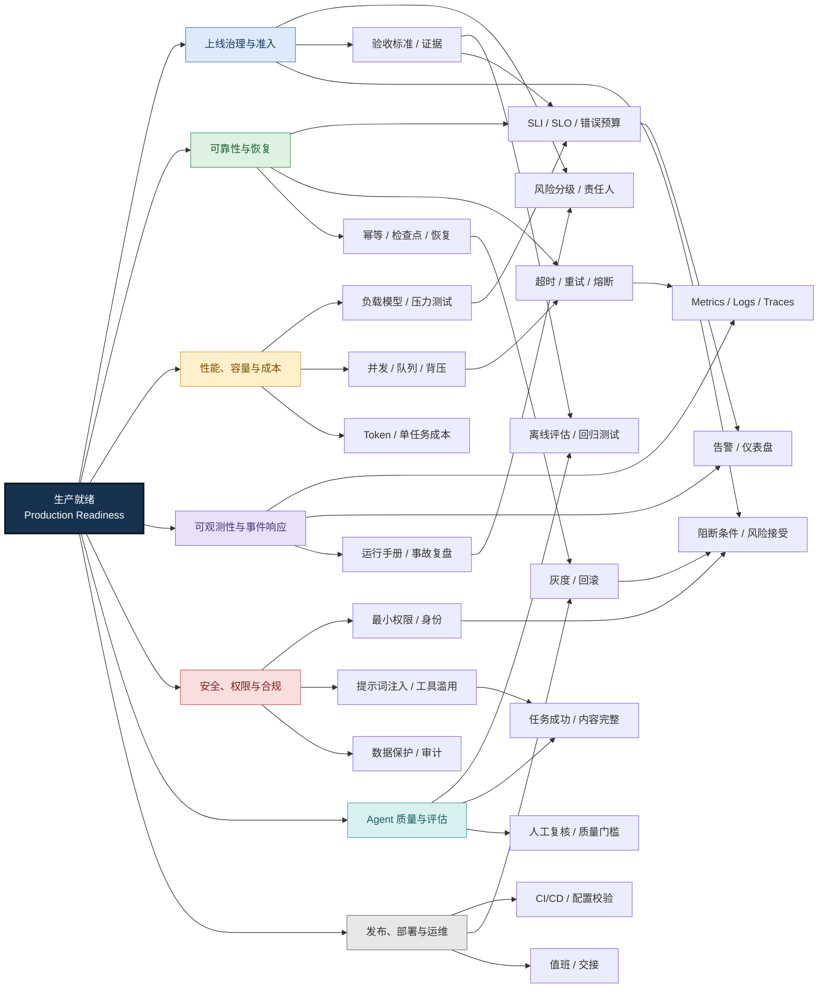
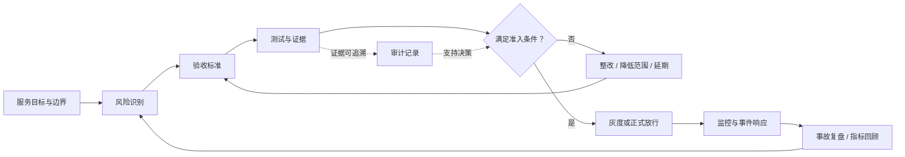
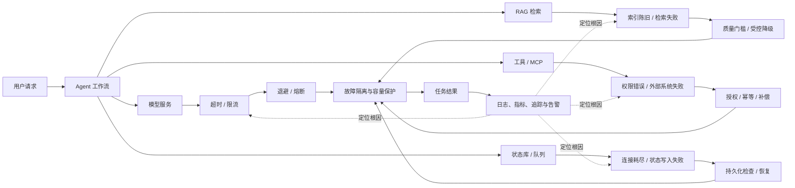
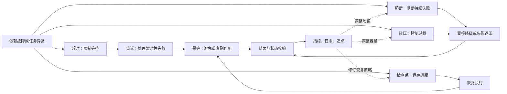
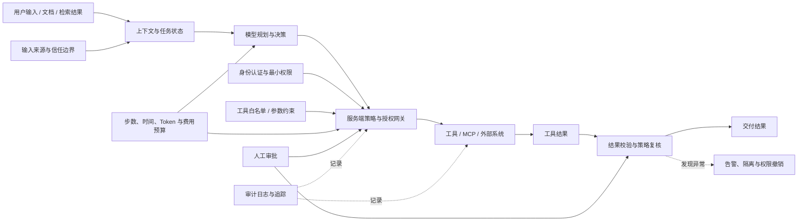
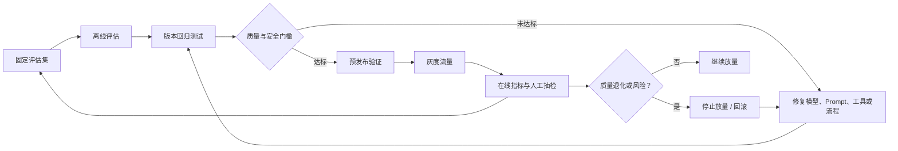
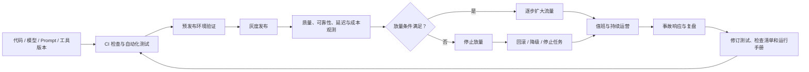

# 企业级上线检查清单：生产就绪、风险治理与持续运营

> 核心主线：风险识别 → 验收标准 → 验证证据 → 上线决策 → 持续运营

## 1. 本章定位

<strong>生产就绪（Production
Readiness）不是应用能够启动，而是系统能够在真实业务环境中安全、可靠、可观测、可维护地持续提供服务。</strong>生产就绪评审需要同时回答：是否满足业务目标；依赖故障时能否限制影响并恢复；权限与数据是否安全；团队能否发现和定位问题；上线决定是否有可复核的证据。

Google SRE 的生产就绪评审（Production Readiness
Review，PRR）和上线检查清单强调，应根据服务特征定制检查项，并将可靠性要求前置到设计和开发阶段，而不是只在发布前机械打勾。

## 2. 中心辐射式知识网络

<strong>图谱解读：</strong>生产就绪是中心节点，外围七个分支涵盖治理、可靠性、性能、可观测性、安全、质量和发布运维。跨分支连线表示它们彼此制约：验收证据影响上线决策；SLO
依赖监控；重试会影响容量；安全策略约束工具行为；回滚能力决定发布风险。

## 3. 上线评审与准入门槛

### 3.1 评审闭环

1.  **定义服务边界**：明确业务用途、重要性、负责人、依赖组件和运行环境。
2.  **识别风险**：检查架构、容量、故障处理、安全、数据保护、质量和运维准备。
3.  **设定验收标准**：将“稳定”“安全”“足够快”等模糊要求转为可验证条件。
4.  **收集证据**：使用测试报告、配置检查、故障演练、监控数据和审计记录证明条件成立。
5.  **处理未通过项**：指定优先级、责任人、期限；明确阻断上线项与可接受的剩余风险。
6.  **作出决定**：放行、限量灰度、延期或回滚。
7.  **持续复审**：模型、工具权限、架构或业务范围变化后重新评估。

### 3.2 风险分级示例

| 等级           | 含义                                   | 示例                                       | 建议处理                   |
|----------------|----------------------------------------|--------------------------------------------|----------------------------|
| P0：阻断上线   | 存在不可接受的安全、数据或核心业务风险 | 未授权工具执行；关键数据不可恢复           | 修复并重新验证             |
| P1：有条件放行 | 风险可限制，但需明确接受和跟踪         | 非关键监控缺口；容量余量偏低且已有保护措施 | 书面接受、设期限、持续监控 |
| P2：持续改进   | 不影响当前上线安全，但有优化价值       | 仪表盘可读性、非关键自动化                 | 纳入后续迭代               |

以上分级是工程建议，并非所有组织统一的强制标准。每项检查建议记录检查项、风险描述、验收标准、责任人、验证人、证据链接、状态、处置方案、风险接受人及复审日期。

<strong>图谱解读：</strong>上线评审必须形成证据闭环。生产运行数据和事故复盘会反向修订风险清单与验收标准，因此
PRR 不是一次性审批。

## 4. 架构、依赖与故障传播

企业级 Agent 常见依赖包括请求入口和身份认证、Router
或工作流引擎、模型服务、RAG（Retrieval-Augmented
Generation，检索增强生成）、工具服务与 MCP（Model Context
Protocol，模型上下文协议）、数据库、缓存、消息队列、对象存储、结果校验和审计系统。

评审不仅要检查组件能否独立运行，还要确认调用关系、超时预算、身份认证、并发限制、错误传播和降级行为。

| 故障场景       | 可能后果                 | 检查重点                                   |
|----------------|--------------------------|--------------------------------------------|
| 模型超时或限流 | 任务积压、重试风暴       | 端到端超时、有限重试、配额监控、退避和抖动 |
| 检索服务不可用 | 依据不足、质量下降       | 缓存、受控降级、是否允许无检索执行         |
| 工具调用失败   | 工作流中断或副作用不确定 | 错误分类、幂等、补偿、状态持久化           |
| 数据库不可用   | 状态无法保存             | 连接池、持久化、恢复验证                   |
| 消息重复投递   | 重复写入或重复动作       | 幂等键、状态机、重复任务检测               |
| 共享依赖过载   | 多个 Agent 同时失败      | 限流、背压、隔离舱和负载削减               |
| 错误配置发布   | 服务异常或权限扩大       | 配置校验、灰度、回滚、变更审计             |

<strong>图谱解读：</strong>工作流是多个依赖的汇聚点。技术层面可以降级，不代表业务层面必须接受错误结果；质量门槛需要与故障处理协作。

## 5. 可靠性目标与恢复机制

### 5.1 SLI、SLO 与 SLA

- **SLI（Service Level
  Indicator，服务等级指标）**：实际测量的服务表现，如成功率、延迟和任务完整率。
- **SLO（Service Level Objective，服务等级目标）**：希望 SLI
  在指定时间窗口达到的目标。
- **SLA（Service Level
  Agreement，服务等级协议）**：面向客户或业务方的服务承诺，可能规定未达标后的责任或补偿。

对 Agent，除 API
可用率外，还应关注任务最终成功率、输出质量、格式完整率和单个成功任务成本。HTTP
200 不等于业务任务正确完成。

### 5.2 可靠性机制对比

| 机制                      | 解决的问题                         | 设计注意事项                     |
|---------------------------|------------------------------------|----------------------------------|
| Timeout（超时）           | 避免无限等待和资源占用             | 为整条调用链分配端到端时间预算   |
| Retry（重试）             | 处理暂时性故障                     | 限制次数，使用退避和随机抖动     |
| Idempotency（幂等性）     | 防止重复执行产生额外副作用         | 设计幂等键、去重窗口和状态校验   |
| Circuit Breaker（熔断器） | 避免持续调用故障依赖               | 定义开启、半开和关闭条件         |
| Bulkhead（隔离舱）        | 防止共享资源引发故障扩散           | 按租户、任务或依赖隔离资源       |
| Backpressure（背压）      | 处理能力低于到达速度时限制上游负载 | 有界队列、拒绝策略和负载反馈     |
| Checkpoint（检查点）      | 使长任务可从已保存进度恢复         | 在安全边界保存并校验状态版本     |
| Compensation（补偿）      | 纠正已完成的部分业务动作           | 明确补偿语义，不假设操作都可撤销 |

<strong>图谱解读：</strong>这些机制不能互相替代。重试需要幂等保护，熔断需要监控信号，背压需要容量反馈，检查点需要持久化状态；结果校验用于防止“执行恢复了”但交付错误结果。

## 6. 性能、容量与成本

上线前要建立日常、峰值和突发负载模型，测量每个任务的模型调用、工具调用、检索次数、Token
用量、资源消耗和等待时间，并验证下游配额、连接池、队列上限及过载行为。

| 测试类型         | 验证目标                            |
|------------------|-------------------------------------|
| 接口基准测试     | 单接口延迟与吞吐                    |
| 组件压力测试     | 模型、工具、检索或数据库的性能边界  |
| 端到端负载测试   | 完整 Agent 工作流在目标负载下的表现 |
| 峰值与突发测试   | 瞬时流量变化时的稳定性              |
| 长时间稳定性测试 | 内存、连接泄漏和队列持续增长        |
| 故障注入测试     | 依赖失败时的降级、隔离和恢复        |
| 成本测试         | 成功任务成本、重试和异常调用开销    |

不能只压测 HTTP 入口。增加 Worker
可能提升吞吐量，也可能先耗尽模型配额、数据库连接或外部工具容量。建议观测
p50、p95、p99 延迟、队列长度、重试率、任务成功率和每个成功任务的总成本。

<strong>优化原则：</strong>在业务质量与安全门槛不下降的前提下优化延迟、吞吐和成本，而不是孤立追求更低
Token 消耗。

## 7. 可观测性与事件响应

- **Metrics（指标）**：回答整体表现如何，支持趋势、告警和容量分析。
- **Logs（日志）**：记录具体事件和错误原因。
- **Traces（分布式追踪）**：还原请求经过的组件、调用关系和耗时。
- **Audit
  Logs（审计日志）**：记录谁在何时对什么资源执行了什么操作以及结果。

建议用 `task_id` 标识业务任务，用 `trace_id`
关联跨服务调用，并记录适用的 `span_id`、父子关系和版本信息。不要将高基数
ID
直接用作所有指标标签；模型输入、文档正文和工具参数也不应默认完整写入日志。

| Span 类型       | 建议记录                         | 诊断目标                |
|-----------------|----------------------------------|-------------------------|
| Workflow Span   | 任务 ID、总耗时、最终状态        | 任务是否完成            |
| Agent Span      | Agent 名称、角色、阶段           | 哪个 Agent 负责哪个步骤 |
| LLM Span        | 模型版本、耗时、Token、结束原因  | 模型调用是否异常        |
| Tool Span       | 工具名、参数摘要、返回状态       | 工具失败或误用          |
| Retrieval Span  | 检索策略、结果数、分数分布       | 检索质量是否退化        |
| Handoff Span    | 来源 Agent、目标 Agent、交接状态 | 多 Agent 协作是否异常   |
| Validation Span | 规则结果、错误类型、修复次数     | 质量问题出现在哪里      |

事件响应应包含发现、确认影响、分级升级、止损、恢复、验证、沟通和复盘。运行手册要说明症状、诊断步骤、回滚方式、依赖关系、负责人和升级渠道；复盘改进项要有责任人、期限和可验证的完成标准。

## 8. Agent 安全、权限与治理

OWASP《Top 10 for Agentic Applications
2026》关注目标劫持、工具滥用、身份与权限滥用、供应链漏洞、意外代码执行、记忆与上下文投毒、Agent
间通信风险、级联故障、人与 Agent 的信任风险及恶意或失控 Agent。NIST AI
RMF 及生成式 AI 配套资料可用于构建全生命周期风险治理。

| 风险类别              | 上线控制重点                               |
|-----------------------|--------------------------------------------|
| 目标劫持              | 防止外部文档或网页改变授权任务目标         |
| 工具滥用              | 工具白名单、参数校验、调用预算和高风险审批 |
| 身份与权限滥用        | 最小权限、独立身份、短期凭证和授权范围检查 |
| 供应链漏洞            | 审查工具包、MCP 服务、依赖和配置来源       |
| 意外代码执行          | 沙箱、网络出口限制、文件系统和命令执行限制 |
| 记忆与上下文投毒      | 来源验证、上下文隔离和持久记忆治理         |
| Agent 间通信风险      | 身份验证、消息来源验证和委托权限检查       |
| 级联故障              | 限流、熔断、隔离舱、步数和资源预算         |
| 人与 Agent 的信任利用 | 高风险动作审批、结果核验和执行记录         |
| 恶意或失控 Agent      | Agent 注册、行为监控、权限撤销和异常隔离   |

<strong>图谱解读：</strong>模型可以提出候选动作，但不应成为唯一的授权决策点。服务端需要独立检查身份、权限、参数、预算和风险策略；执行后还需校验结果并记录审计。高风险操作应通过明确的审批或二次授权机制控制。

上线安全检查还应覆盖：跨用户记忆和缓存隔离、敏感数据脱敏、工具凭证撤销、停止任务能力、网络出口限制、依赖供应链审查以及安全事件响应。

## 9. Agent 质量评估与上线门槛

Agent
质量至少包含任务完成度、内容正确性、结构完整性、工具行为、安全合规和资源效率。文档翻译
Agent
还应验证数字与单位一致性、表格结构、图注、分页、文本裁切和导出可读性。

<strong>图谱解读：</strong>离线评估发现已知问题，回归测试防止历史能力退化，预发布验证真实依赖，灰度阶段观察真实流量。在线数据应反馈到评估集，形成持续改进循环。

## 10. 部署、发布与运维

上线前应检查代码、模型、Prompt、工具
Schema、配置和镜像是否有版本记录；密钥是否通过受控机制注入；数据库迁移是否有兼容与恢复方案；健康检查、资源限制、扩缩容、访问控制和网络策略是否经过验证；是否准备值班、运行手册和回滚流程。

灰度发布可按租户、流量比例、任务类型或业务区域逐步放量。回滚不能只考虑应用镜像，还要考虑数据库结构、模型版本、Prompt、工具
Schema、索引和正在执行的长任务是否兼容。

<strong>图谱解读：</strong>发布治理覆盖应用代码之外的模型、Prompt、工具和索引版本。放量判断应综合业务质量、可靠性、延迟、成本和安全信号；事故复盘要反向更新测试与检查清单。

## 11. 企业应用示例：文档翻译 Agent

| 检查领域 | 验证场景                         | 验收证据                     |
|----------|----------------------------------|------------------------------|
| 功能质量 | 中译英、英译中、多类型文档       | 固定测试集与内容完整性报告   |
| 格式保留 | 表格、图注、页眉页脚、跨页内容   | 结构比对与视觉回归报告       |
| 稳定性   | 模型超时、工具失败、任务中断     | 故障注入和恢复测试记录       |
| 性能     | 长文档、批量任务、并发处理       | 延迟分布、吞吐量和资源曲线   |
| 成本     | Token、模型调用、重试与校验      | 单个成功任务的成本统计       |
| 可观测性 | 定位一次失败任务的完整链路       | 任务日志、Trace 和告警记录   |
| 安全     | 恶意文档、越权工具、敏感数据泄露 | 安全测试报告与授权审计记录   |
| 发布治理 | 模型或 Prompt 更新               | 版本记录、回归结果和回滚演练 |

不能只统计“翻译成功的文件数量”。还应检查任务是否完整结束、输出是否可读、版式是否达到交付标准、异常是否被正确报告，以及失败任务能否安全恢复或重试。

## 12. 常见误区与工程难点

| 误区               | 问题                          | 改进方式                         |
|--------------------|-------------------------------|----------------------------------|
| 服务能启动就算就绪 | 未验证依赖故障、容量和安全    | 按风险建立准入标准与证据         |
| 只看 HTTP 200      | 技术成功不代表业务正确        | 监控端到端状态和质量             |
| 重试越多越可靠     | 可能产生副作用和重试风暴      | 有界重试、退避、幂等和熔断       |
| 只看 CPU、内存     | 无法发现内容错误和工具误用    | 增加业务指标和追踪               |
| 只做离线评估       | 真实输入、依赖和负载不同      | 离线回归、预发布和灰度结合       |
| 信任模型生成的命令 | 可能受注入影响或生成危险参数  | 服务端授权、参数校验和审批       |
| 只回滚应用镜像     | 模型、Prompt 和状态可能不兼容 | 设计跨版本兼容与完整恢复方案     |
| 只看平均延迟       | 尾延迟掩盖慢请求              | 同时观察 p50、p95、p99           |
| 日志越详细越好     | 可能泄露敏感数据              | 脱敏、最小化、保留期限和访问控制 |
| 清单通过后不再复审 | 风险随系统变化                | 重大变更后重新评估               |

## 13. 上线检查清单

### 治理与准入

- [ ] 明确业务负责人、技术负责人和运维责任人。
- [ ] 明确服务范围、依赖关系和风险等级。
- [ ] 为关键检查项定义可验证的验收标准。
- [ ] 为未通过项指定责任人、期限和处置措施。
- [ ] 对风险例外保留书面接受记录。

### 架构与可靠性

- [ ] 维护关键依赖清单。
- [ ] 为外部调用设置超时、有限重试和退避策略。
- [ ] 对有副作用的操作实现幂等或补偿机制。
- [ ] 验证熔断、限流、背压和隔离策略。
- [ ] 验证长任务检查点、恢复和重复执行处理。
- [ ] 完成关键数据备份及恢复演练。

### 性能与成本

- [ ] 明确日常、峰值和突发负载模型。
- [ ] 完成组件、端到端、峰值和稳定性测试。
- [ ] 验证队列上限、并发闸门和过载保护。
- [ ] 监控 Token、模型调用次数、重试和成功任务成本。
- [ ] 验证扩容、降级和资源不足时的行为。

### 可观测性与事件响应

- [ ] 建立业务指标、技术指标和关键告警。
- [ ] 用任务 ID 与 Trace 关联跨组件调用。
- [ ] 为核心故障准备运行手册和升级渠道。
- [ ] 检查日志脱敏、访问控制和保留策略。
- [ ] 演练故障发现、止损、恢复和复盘流程。

### Agent 质量与安全

- [ ] 建立固定评估集和版本回归测试。
- [ ] 验证任务完成度、内容正确性和结构完整性。
- [ ] 验证工具白名单、参数约束和最小权限。
- [ ] 测试提示词注入、工具滥用和上下文投毒。
- [ ] 为高风险操作设置审批或二次授权。
- [ ] 验证停止任务、撤销凭证和隔离异常 Agent 的能力。

### 发布与运维

- [ ] 记录代码、模型、Prompt、工具和配置版本。
- [ ] 完成预发布验证和灰度策略设计。
- [ ] 演练应用回滚、配置恢复和任务恢复。
- [ ] 准备值班安排、责任交接和用户沟通方案。
- [ ] 明确上线后观察窗口和继续放量条件。

## 14. 与其他 Agent 模块的关系

- **Prompt
  与上下文工程**：影响行为边界、提示词注入风险、输出稳定性和可评估性。
- **Memory 与
  RAG**：影响事实依据、数据隔离、检索质量、隐私和上下文投毒风险。
- **Tools 与
  MCP**：影响权限边界、外部副作用、超时、幂等、审计和供应链风险。
- **State 与
  Workflow**：影响任务持久化、检查点、恢复、重复执行和状态一致性。
- **Multi-Agent 协作**：增加委托权限、消息验证、跨 Agent
  状态和级联故障问题。
- **Observability**：为上线准入、故障定位、质量分析和持续改进提供证据。
- **Evaluation**：把业务要求转为可复现测试、回归门槛和在线质量信号。
- **Deployment &
  Operations**：将安全、可靠性和质量要求落实为发布、值班和恢复流程。

## 15. 总结

生产就绪的逻辑链路是：

1.  **风险识别**决定需要检查什么；
2.  **验收标准**把风险转为可判断的条件；
3.  **验证证据**证明条件是否满足；
4.  **上线决策**决定放行、灰度、延期或回滚；
5.  **持续运营**通过监控、事故响应和复盘发现新风险；
6.  **知识回流**把经验转化为新的测试、控制措施和准入标准。

<strong>核心原则：</strong>生产就绪不是一次性审批，而是持续验证系统能否在真实业务条件下安全、可靠地交付结果。对
Agent
系统，必须同时验证服务是否运行、任务是否完成、结果是否正确、行为是否安全以及成本是否可控。

## 16. 参考资料

1.  Google SRE Book — Evolving SRE Engagement Model / Production
    Readiness Review  
    https://sre.google/sre-book/evolving-sre-engagement-model/
2.  Google SRE Book — Launch Coordination Checklist  
    https://sre.google/sre-book/launch-checklist/
3.  Google Cloud — Well-Architected Framework  
    https://docs.cloud.google.com/architecture/framework
4.  Kubernetes — Production Environment  
    https://kubernetes.io/docs/setup/production-environment/
5.  OpenTelemetry — GenAI Semantic Conventions  
    https://github.com/open-telemetry/semantic-conventions-genai
6.  OWASP GenAI Security Project — Top 10 for Agentic Applications
    2026  
    https://genai.owasp.org/resource/owasp-top-10-for-agentic-applications-for-2026/
7.  NIST — Artificial Intelligence Risk Management Framework: Generative
    Artificial Intelligence Profile  
    https://www.nist.gov/publications/artificial-intelligence-risk-management-framework-generative-artificial-intelligence
