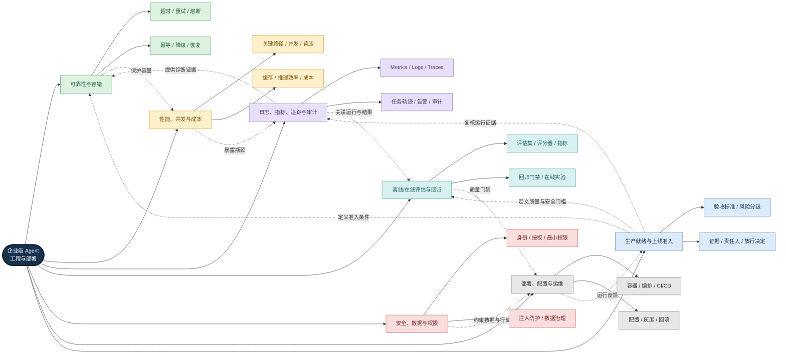
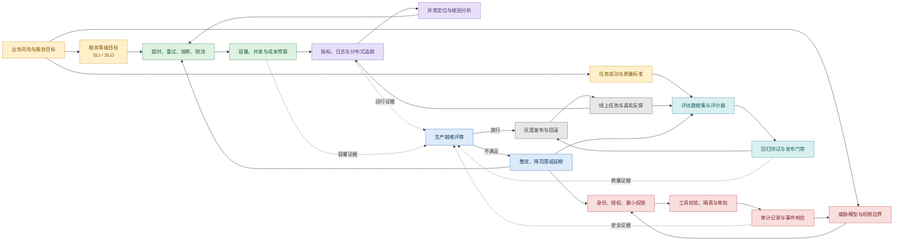
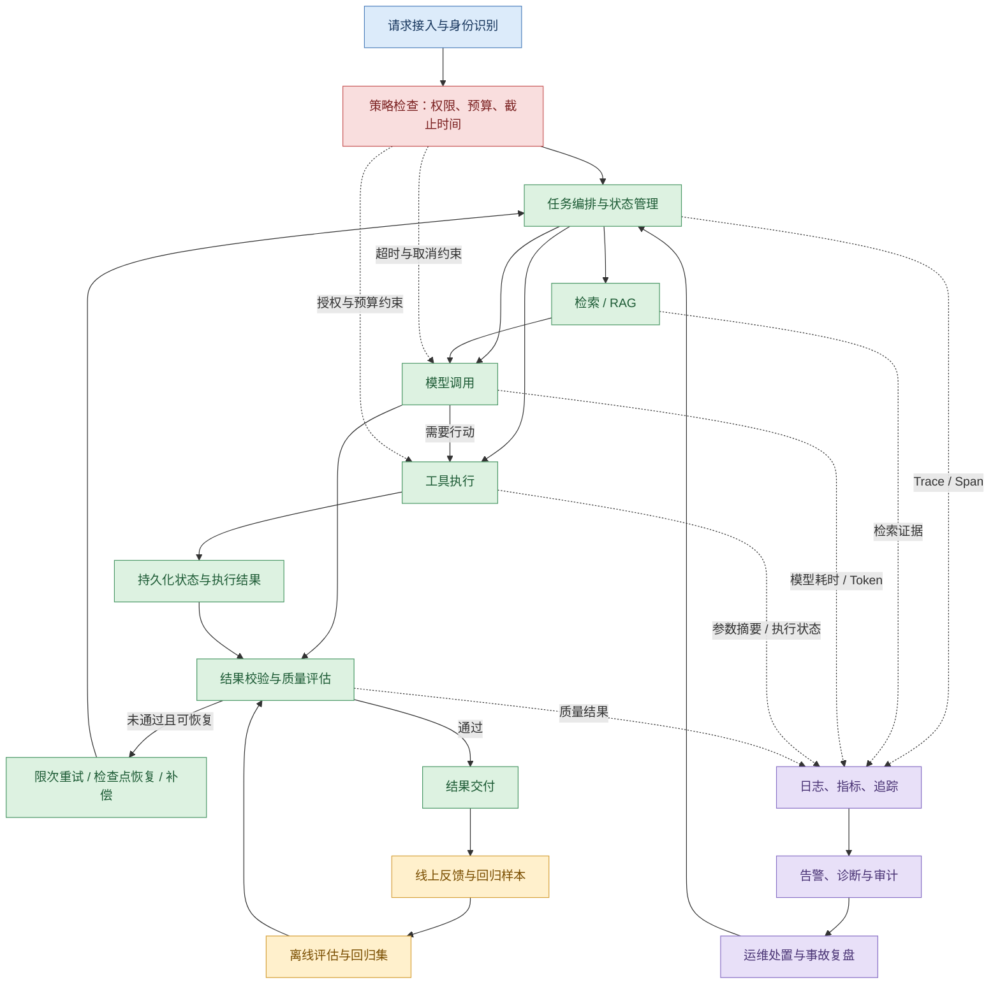
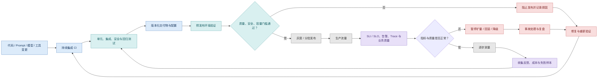

# 第七章：企业级工程与部署

> 学习目标：理解 Agent 从开发原型走向企业级生产服务所需的可靠性、性能、可观测性、质量评估、安全治理、部署运维与上线准入机制。
>
> <strong>本章核心观点：</strong>企业级 Agent 不只是“能够回答问题”的模型应用，而是一个必须在真实业务约束下持续完成任务的工程系统。生产能力来自多个模块协同：可靠性限制故障传播，性能与成本治理保障可持续运行，可观测性解释运行行为，评估验证任务质量，安全与权限控制实际行动，部署运维保证交付和恢复，生产就绪评审则把这些能力转化为可验证的上线决策。

---

## 一、先建立全局认知：七个主题共同构成生产能力

<strong>图谱解读：</strong>中心节点是“企业级 Agent 工程与部署”，七个分支分别回答不同问题：系统能否扛住故障、能否高效运行、出了问题能否定位、结果是否可靠、安全边界是否成立、服务如何交付运行，以及是否具备上线资格。虚线表示跨模块的反馈与约束，而不是固定的执行先后顺序。例如，重试策略会增加请求量，因此必须与并发上限和成本预算共同设计；评估结果则需要结合 Trace 和业务状态，才能区分“模型调用成功”与“任务真正成功”。

## 二、核心模块关系：从风险控制到证据闭环

<strong>图谱解读：</strong>本图强调“风险—控制—证据—决策—反馈”。SLI（服务等级指标，Service Level Indicator）与 SLO（服务等级目标，Service Level Objective）将可靠性要求量化；威胁模型把安全要求落实到身份、授权和工具执行边界；评估集和回归门禁把质量要求落实为可重复验证的条件。生产就绪评审不替代这些工程机制，而是汇总它们提供的证据，决定放行、整改或限制发布范围。

## 三、Agent 生产运行机制：一次任务如何被可靠地完成

<strong>图谱解读：</strong>Agent 的生产执行不是单次 LLM（大语言模型，Large Language Model）调用，而是受身份、权限、预算和截止时间约束的多阶段任务。状态持久化支持恢复，结果校验判断任务是否真正达标；日志、指标和追踪解释运行过程，审计记录则服务于责任追溯。恢复路径必须区分可安全重试的操作与具有外部副作用的操作，后者通常需要幂等键、状态核验或补偿机制。

## 四、发布与持续改进：从提交代码到生产反馈

<strong>图谱解读：</strong>Agent 的发布对象不止代码，还可能包括提示词、模型版本、工具定义、检索配置和评估器。CI（持续集成，Continuous Integration）阶段需要检查这些变更的兼容性；灰度阶段要观察业务成功率、延迟、成本和安全信号；出现异常时应具备暂停扩量、回滚或降级能力。线上失败样本应进入评估与回归流程，避免同类问题反复发生。

---

## 五、七份知识文档：按问题链路深入学习

建议按以下顺序学习。每篇正文均包含自身的概念解释、知识图谱、工程机制、实践建议、常见误区及参考资料；本 README 负责建立全局联系，不替代正文细节。

### 1. [超时、重试、降级、熔断与幂等：可靠性与容错工程](./01-Reliability-and-Fault-Tolerance.md)

<strong>核心问题：</strong>依赖服务变慢、超时或部分失败时，如何避免故障扩散并保证业务状态正确？

- 从部分失败、级联故障和时间预算理解可靠性问题。
- 区分超时与截止时间、重试与恢复、熔断与限流、降级与负载丢弃。
- 通过幂等、检查点、状态机和补偿处理重复执行及不确定结果。
- 将容错策略组合起来验证，避免重试风暴、预算冲突和资源耗尽。

<strong>与其他文档的联系：</strong>容错策略直接影响并发和成本；其效果需要可观测性验证，任务恢复与部署编排共同决定服务的恢复能力。

### 2. [并发、缓存、性能与成本：企业级 Agent 系统优化工程](./02-Performance-and-Cost.md)

<strong>核心问题：</strong>如何在质量、可靠性和预算约束下缩短任务耗时、提高吞吐并控制单任务成本？

- 先建立端到端延迟、吞吐、资源使用、质量与成本的度量口径。
- 用关键路径分析、排队理论、受控并发、批处理和背压识别瓶颈。
- 区分精确缓存与语义缓存，处理一致性、缓存击穿、穿透和雪崩。
- 理解模型推理的 Prefill、Decode、KV Cache、量化与模型路由。
- 使用每个合格任务的成本，而不是只看单次调用价格，评价优化收益。

<strong>与其他文档的联系：</strong>重试会增加负载，缓存可能影响结果新鲜度，模型路由可能影响质量；因此性能优化必须同时接受可靠性、评估和安全约束。

### 3. [日志、追踪、监控与审计：Agent 系统可观测性](./03-Observability.md)

<strong>核心问题：</strong>如何回答“发生了什么、系统整体表现如何、问题在哪一步、谁执行了什么操作”？

- 明确日志（Logs）、指标（Metrics）、分布式追踪（Traces）和审计记录（Audit Logs）的职责边界。
- 以 OpenTelemetry 的统一语义和上下文传播关联请求、模型调用、检索、工具执行与多 Agent 交接。
- 为 Workflow、Agent、LLM、Tool、Retrieval、Handoff、Validation 等阶段建立有用的 Span。
- 用 SLI、SLO、告警、采样、标签基数治理和数据脱敏平衡诊断能力与成本。
- 将运行轨迹和业务结果关联，避免把 API 调用成功误判为任务成功。

<strong>与其他文档的联系：</strong>可观测性为可靠性诊断、性能归因、质量评估、事件响应和上线准入提供证据，但不能替代审计或独立的结果校验。

### 4. [离线/在线评估与回归测试：Agent 质量保障体系](./04-Evaluation.md)

<strong>核心问题：</strong>如何把“回答看起来不错”变成可重复、可比较、可用于发布决策的质量证据？

- 用明确的任务定义、评估数据集、成功条件和参考标准降低主观性。
- 结合规则评分、代码执行、人工评审和模型评分器，评估结果与执行轨迹。
- 理解任务成功率、Pass@k、Pass^k、RAG 指标及质量—延迟—成本—安全的联合评价。
- 区分离线能力评估、回归测试、线上监控和在线实验的作用。
- 将失败案例转化为回归样本，并把关键质量门槛接入 CI/CD。

<strong>与其他文档的联系：</strong>评估器决定质量门槛，观测系统提供诊断上下文，安全测试覆盖攻击场景，部署系统负责在发布阶段执行门禁。

### 5. [提示词注入、数据安全与权限](./05-Security-and-Permissions.md)

<strong>核心问题：</strong>如何确保 Agent 只访问被授权的数据，并且只有在符合策略时才能执行真实操作？

- 从资产、信任边界、攻击入口和业务影响建立威胁模型。
- 识别直接、间接和多模态提示词注入，理解提示词不是安全边界。
- 以数据分类、最小化、脱敏、加密和生命周期管理保护敏感信息。
- 区分身份认证与授权，理解 RBAC、ABAC、最小权限和多层身份。
- 将工具调用视为待校验的行动提案，结合服务端授权、参数校验、执行隔离、审批与审计。
- 将 RAG、Memory 和多 Agent 的数据访问与信任传递纳入安全设计。

<strong>与其他文档的联系：</strong>安全要求必须贯穿工具调用、状态存储、日志、评估和部署流程；仅依赖模型拒答或提示词约束不能替代确定性的授权控制。

### 6. [部署架构、配置与运维](./06-Deployment-and-Operations.md)

<strong>核心问题：</strong>如何将 Agent 交付为可复现、可扩展、可观测、可恢复且可安全升级的生产服务？

- 理解容器、编排、API/Worker/模型服务拆分的职责与适用条件。
- 区分 CI、CD 与 GitOps，管理代码、模型、提示词、工具和配置的版本。
- 处理环境隔离、密钥管理、健康探针、优雅启动与关闭。
- 结合真实负载选择扩缩容指标，并通过灰度、回滚和任务恢复控制发布风险。
- 将可观测性、安全、可靠性和成本治理嵌入运行流程。

<strong>与其他文档的联系：</strong>部署系统是容错、容量、安全策略和质量门禁的承载层；发布成功不能只看进程启动或 HTTP 状态码。

### 7. [企业级上线检查清单：生产就绪、风险治理与持续运营](./07-Production-Readiness.md)

<strong>核心问题：</strong>上线前必须证明什么，谁来判断风险，证据不足时如何处理？

- 将业务目标转化为可验证的验收条件。
- 按风险等级区分阻断项、有条件放行项和持续改进项。
- 汇总可靠性、容量、成本、可观测性、安全、质量和运维证据。
- 明确责任人、验证人、风险接受人、整改期限与复审条件。
- 通过灰度观察、事故复盘和变更触发复审形成持续治理闭环。

<strong>与其他文档的联系：</strong>生产就绪不是独立的一套替代技术，而是前六个领域的综合验收与风险决策机制。

---

## 六、关键概念速查：相似机制不能混用

| 机制 | 主要解决的问题 | 不能替代什么 |
|---|---|---|
| 超时 / 截止时间 | 限制单次等待和端到端时间预算 | 不能证明业务操作没有执行 |
| 重试 | 恢复可恢复的瞬时失败 | 不能替代幂等与状态核验 |
| 熔断 | 依赖持续异常时停止无意义调用 | 不能替代限流、隔离或容量规划 |
| 限流 / 背压 | 控制进入系统的负载及队列积压 | 不能修复本身错误的业务逻辑 |
| 缓存 | 减少重复计算和外部请求 | 不能忽略数据新鲜度、权限与失效策略 |
| 日志 / 指标 / 追踪 | 分别解释事件、聚合趋势和请求路径 | 不能替代审计记录或质量评估 |
| 离线评估 / 在线监控 | 前者验证受控样本，后者观察真实运行 | 两者都不能单独覆盖所有质量风险 |
| 认证 / 授权 | 分别确认身份与判断允许的操作 | 模型提示词不能替代服务端授权 |
| 灰度 / 回滚 | 限制发布影响并恢复旧版本 | 不能替代数据迁移兼容和任务恢复设计 |
| 生产就绪评审 | 汇总证据、判断剩余风险和上线条件 | 不能替代各领域的真实工程控制 |

---

## 七、企业级文档翻译 Agent：把知识落到真实工程

以企业文档翻译 Agent 为例，一项任务可能依次涉及文件接入、格式识别、解析/OCR、内容切分、检索或术语约束、模型翻译、版面重建、结果校验与文件交付。不同阶段的风险和指标不同，不能只用一次模型调用的耗时或成功状态代表整项任务的表现。

| 阶段 | 重点工程问题 | 对应知识文档 |
|---|---|---|
| 文件接入与任务创建 | 文件类型、权限、大小限制、任务状态和重复提交 | [安全与权限](./05-Security-and-Permissions.md)、[可靠性与容错](./01-Reliability-and-Fault-Tolerance.md) |
| 解析、OCR 与模型调用 | 长耗时阶段、内存峰值、并发上限、超时和依赖失败 | [性能与成本](./02-Performance-and-Cost.md)、[可靠性与容错](./01-Reliability-and-Fault-Tolerance.md) |
| 翻译与版面重建 | 内容完整度、术语一致性、格式保留、质量评分与人工复核 | [评估与回归测试](./04-Evaluation.md) |
| 全流程执行 | Trace/Span 关联、阶段耗时、Token、失败原因、审计与脱敏 | [可观测性](./03-Observability.md)、[安全与权限](./05-Security-and-Permissions.md) |
| 部署与批量处理 | Worker 扩缩容、队列、缓存、配置、模型版本、灰度与回滚 | [部署与运维](./06-Deployment-and-Operations.md)、[性能与成本](./02-Performance-and-Cost.md) |
| 上线验收 | 端到端成功率、质量门槛、容量余量、故障恢复和风险接受 | [生产就绪](./07-Production-Readiness.md) |

<strong>工程结论：</strong>翻译结果“生成出来”不等于任务合格。必须同时验证内容完整性、格式与版面质量、任务状态、运行成本、安全边界和可恢复性，并保留能够复核这些结论的证据。

## 八、推荐学习路线

1. <strong>先建立故障与时间预算意识：</strong>阅读 [01-Reliability-and-Fault-Tolerance.md](./01-Reliability-and-Fault-Tolerance.md)，理解超时、重试、熔断、幂等与恢复的职责边界。
2. <strong>再学习资源与效率：</strong>阅读 [02-Performance-and-Cost.md](./02-Performance-and-Cost.md)，理解关键路径、排队、并发、缓存、推理和成本之间的因果关系。
3. <strong>建立诊断能力：</strong>阅读 [03-Observability.md](./03-Observability.md)，为前两个领域提供可关联的运行证据。
4. <strong>建立质量标准：</strong>阅读 [04-Evaluation.md](./04-Evaluation.md)，把业务目标转为评估集、评分器、回归测试和发布门禁。
5. <strong>落实安全边界：</strong>阅读 [05-Security-and-Permissions.md](./05-Security-and-Permissions.md)，把身份、授权、数据保护和工具隔离放进执行路径。
6. <strong>理解生产交付：</strong>阅读 [06-Deployment-and-Operations.md](./06-Deployment-and-Operations.md)，将代码与配置转化为可发布、可观察、可恢复的服务。
7. <strong>最后进行综合验收：</strong>阅读 [07-Production-Readiness.md](./07-Production-Readiness.md)，用证据检查系统是否达到上线要求。

## 九、全章总结

第七章可以归纳为一条相互反馈的工程闭环：

<strong>明确业务风险与目标 → 设计可靠性、性能和安全控制 → 建立可观测性 → 通过评估与回归验证质量 → 受控部署与运行 → 汇总证据进行上线决策 → 从真实流量和事故中持续改进。</strong>

其中，可靠性回答“失败时如何控制影响并恢复”，性能与成本回答“能否在资源和预算约束内完成任务”，可观测性回答“运行中发生了什么以及为什么”，评估回答“任务是否真正达标”，安全与权限回答“允许访问什么、允许执行什么”，部署运维回答“如何交付、扩缩容和回滚”，生产就绪则回答“现有证据是否足以支持上线”。

这七个主题不是彼此独立的清单，而是共同决定 Agent 能否在企业环境中持续、可控、可解释地交付业务价值。

---

## 参考资料与延伸阅读

各子文档末尾均保留了相应领域的权威资料与延伸阅读，包括 Google SRE、OpenTelemetry、Prometheus、容器与 Kubernetes 文档、Agent 评估框架、安全标准以及模型服务相关资料。深入学习时，建议优先阅读对应子文档中的官方资料，并结合本项目的实际运行数据、评估集和故障案例进行验证。
