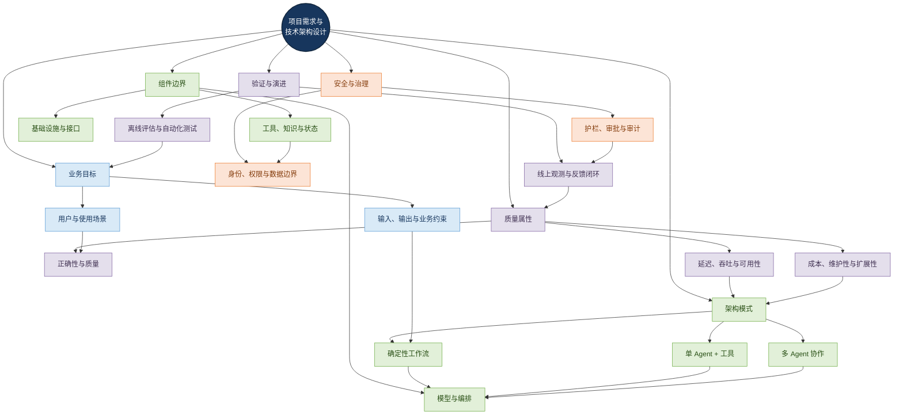
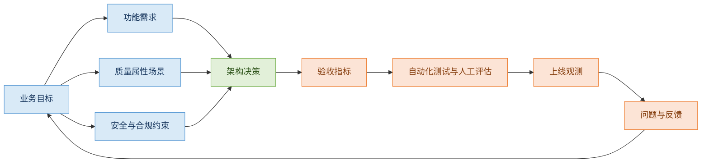
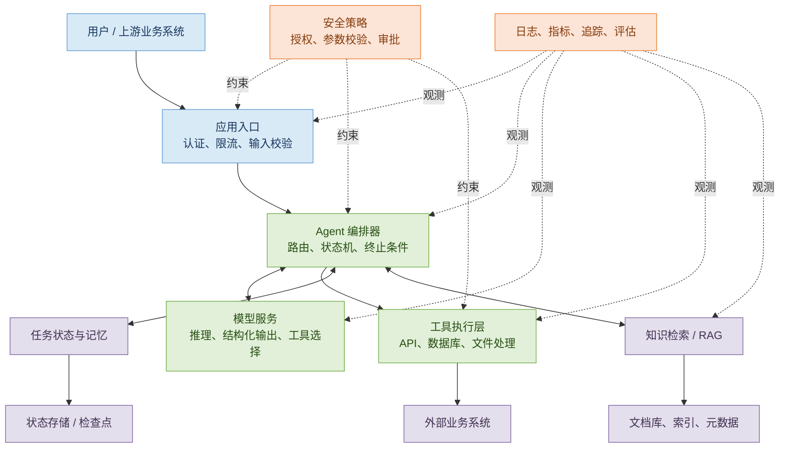
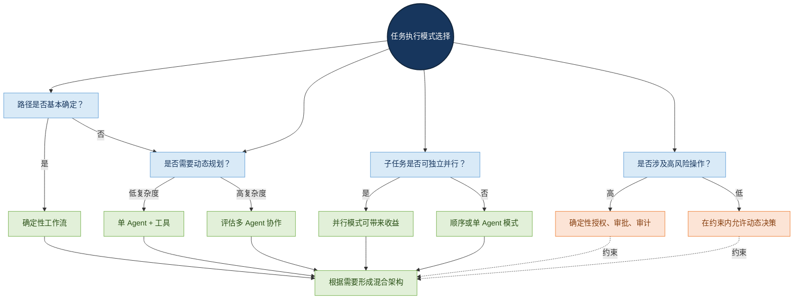
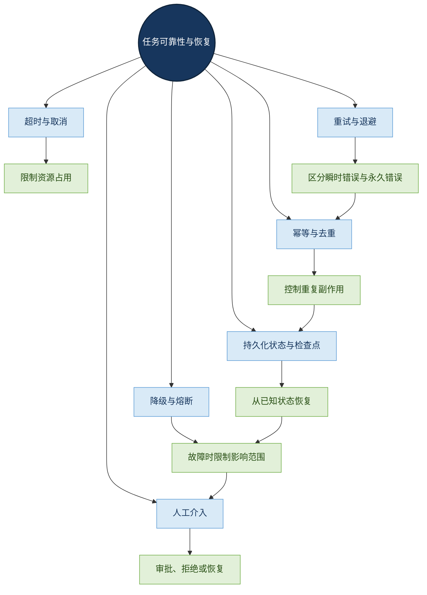
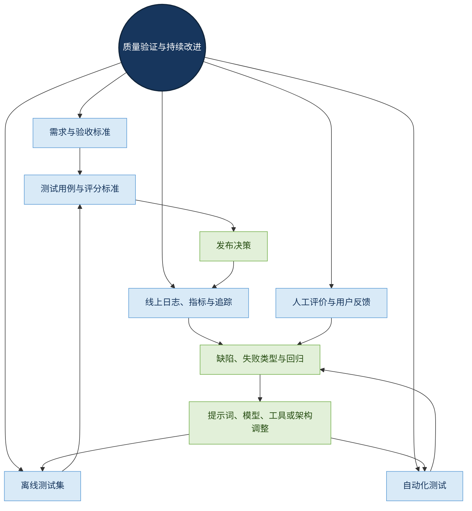
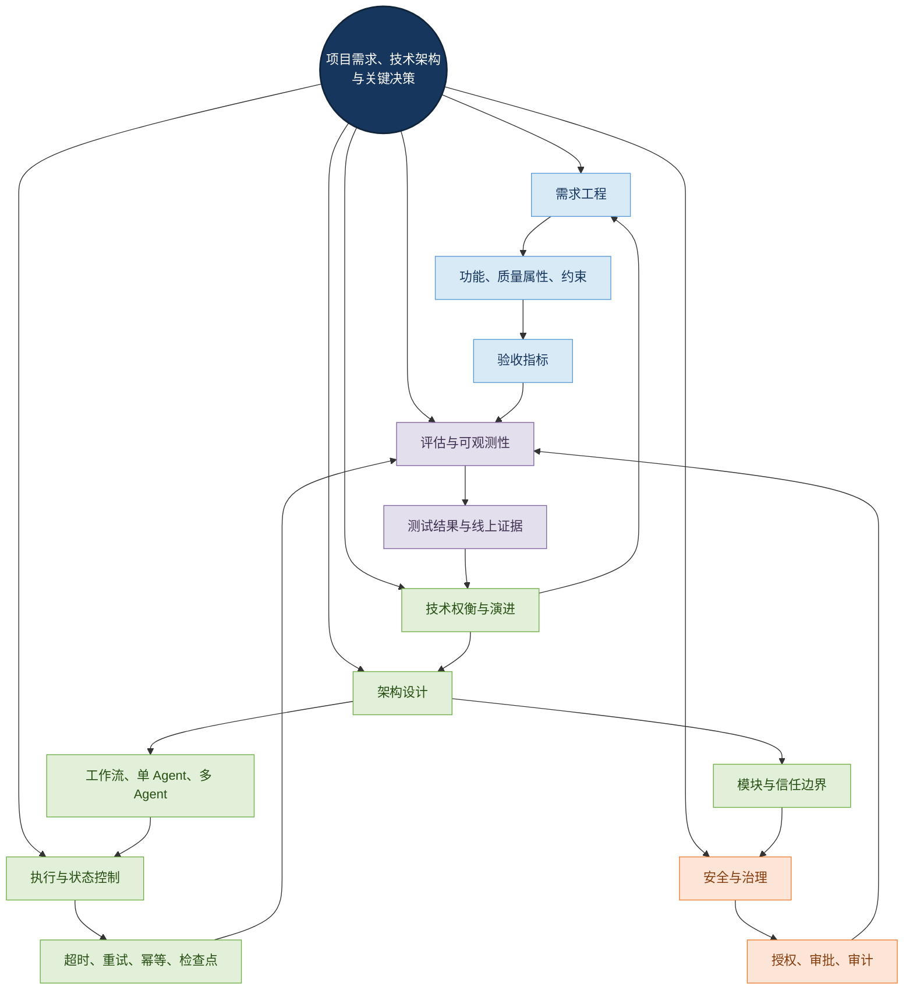

# 项目需求、技术架构与关键决策

> 学习目标：建立从业务问题到可验证技术方案的完整设计方法，理解 Agent 架构模式、组件边界、工程取舍、安全治理与持续评估之间的关系。
>
> 本文定位：第八章「项目与面试」的基础方法论。后续企业知识库助手、文档翻译 Agent、多 Agent 项目等案例，都可以复用本章的分析框架。

## 目录

- [1. 项目架构设计的核心问题](#1-项目架构设计的核心问题)
- [2. 从业务需求到可验证指标](#2-从业务需求到可验证指标)
- [3. Agent 系统的逻辑架构与职责边界](#3-agent-系统的逻辑架构与职责边界)
- [4. 架构模式与选型方法](#4-架构模式与选型方法)
- [5. 从需求到方案：架构设计过程](#5-从需求到方案架构设计过程)
- [6. 关键工程机制：状态、可靠性与安全](#6-关键工程机制状态可靠性与安全)
- [7. 可观测性、评估与持续改进](#7-可观测性评估与持续改进)
- [8. 典型项目中的架构落地](#8-典型项目中的架构落地)
- [9. 架构权衡与技术决策记录](#9-架构权衡与技术决策记录)
- [10. 常见误区与面试要点](#10-常见误区与面试要点)
- [11. 总结：形成可迁移的架构思维](#11-总结形成可迁移的架构思维)
- [参考资料](#参考资料)

---

## 1. 项目架构设计的核心问题

项目架构设计不是先选框架、模型或数据库，而是把业务目标转化为一套能够<strong>正确执行、可靠运行、安全受控、成本可接受、结果可验证</strong>的软件系统。

传统软件大多由开发者提前规定执行逻辑；Agent 系统则在程序控制逻辑中加入大语言模型（Large Language Model，LLM）的语义理解、工具选择与动态决策能力。因此，除了模块划分、接口、数据存储和部署，还必须处理模型输出的不确定性、工具执行风险、上下文管理、结果评估和调用成本。

### 1.1 中心辐射式知识图谱

<strong>图谱解读：</strong> 业务目标是架构设计的起点，质量属性决定设计约束，架构模式影响组件边界，安全与验证贯穿所有模块。评估结果又会反向推动需求细化和架构调整，因此架构不是单向流程，而是持续迭代的网络。

### 1.2 架构设计的基本原则

- <strong>先需求，后技术。</strong> 不因某个框架流行就强行采用。
- <strong>先职责边界，后部署拆分。</strong> 逻辑模块不等于独立微服务。
- <strong>模型负责不确定性，程序负责确定性约束。</strong> 权限校验、金额校验、状态转换等关键规则不能只依赖提示词。
- <strong>复杂度必须有收益支撑。</strong> 多 Agent、微服务、消息队列和复杂记忆系统都应由真实需求驱动。
- <strong>设计必须可验证。</strong> 重要需求应对应指标、测试方法和验收条件。

---

## 2. 从业务需求到可验证指标

需求分析要回答：谁使用系统、解决什么问题、输入输出是什么、哪些行为不允许发生，以及如何判断任务完成。

### 2.1 需求的四个层次

| 需求类别 | 要回答的问题 | 示例 |
|---|---|---|
| 功能需求 | 系统必须完成什么？ | 检索制度、翻译 PDF、调用业务 API |
| 质量属性需求 | 系统必须达到什么质量？ | 准确性、延迟、吞吐量、可用性 |
| 安全与合规需求 | 系统可以访问和执行什么？ | 租户隔离、最小权限、敏感信息保护 |
| 运营与成本需求 | 系统如何持续运行？ | Token 预算、并发限制、监控、回滚 |

质量属性（Quality Attributes）会影响系统分层、数据流、部署和技术选型。比如“支持 100 个并发用户”仍不够具体，还需区分同时在线用户与同时执行任务数，明确任务持续时间、模型调用次数、延迟目标、失败率和预算。

### 2.2 需求到验收标准的转换

| 原始需求 | 可验证的验收方式 |
|---|---|
| 回答准确 | 使用带标准答案和证据的测试集，评估正确性、检索质量与引用准确性 |
| 翻译保留格式 | 检查文本覆盖率、表格和图片保留率、版面偏差及人工复核通过率 |
| Agent 稳定 | 统计任务成功率、超时率、重试成功率和恢复成功率 |
| 成本可控 | 统计单任务模型调用次数、输入输出 Token、工具费用和平均成本 |
| 不越权访问 | 使用不同身份、角色和数据范围开展授权测试 |

<strong>需求追溯关系：</strong>

<strong>图谱解读：</strong> 需求不是写完就结束。每项关键需求都要有设计响应和验证证据；线上问题还可能揭示需求不完整或原先假设不成立。

### 2.3 指标设计的注意事项

- 指标必须有明确分母、统计窗口和数据来源。
- 平均延迟不能替代 P95、P99 等高分位延迟。
- “准确率”要定义评价对象、标注标准和失败类型。
- 单次模型输出成功不等于完整任务成功。
- 线上用户反馈有价值，但不能替代可重复的标准测试集。

---

## 3. Agent 系统的逻辑架构与职责边界

一个可维护的 Agent 系统通常由多个逻辑模块构成，但并不要求每个模块都独立部署。

### 3.1 典型逻辑模块

| 模块 | 主要职责 | 关键设计问题 |
|---|---|---|
| 应用入口层 | 接收请求、身份认证、输入校验 | 如何识别用户、租户与请求边界？ |
| Agent 编排层 | 规划、路由、执行控制、终止判断 | 谁决定下一步执行什么？ |
| 模型服务层 | 推理、结构化输出、工具选择 | 如何管理模型版本、格式和成本？ |
| 工具执行层 | 调用 API、数据库、文件处理和业务服务 | 如何校验参数、权限和副作用？ |
| 知识与状态层 | RAG、短期状态、长期记忆、任务持久化 | 哪些数据应保存、保存多久？ |
| 安全与质量层 | 输入输出校验、护栏、审批 | 哪些行为必须拦截或确认？ |
| 可观测与评估层 | 日志、指标、追踪、离线评估 | 如何定位错误并验证改进？ |
| 基础设施层 | 网络、存储、队列、部署、密钥管理 | 如何保证可靠性与隔离？ |

RAG 是 Retrieval-Augmented Generation（检索增强生成），通过检索外部知识为模型提供证据；它不是 Agent 的必需组件，只有当任务需要外部知识或可更新资料时才需要引入。短期执行状态、长期记忆和业务数据库也不是同一种数据，应按生命周期和一致性要求分别设计。

### 3.2 逻辑架构关系图

<strong>图谱解读：</strong> 编排器是控制流的关键节点，但不应绕过工具层的权限与参数校验。状态、知识检索和外部系统分别承担不同职责；可观测性和安全策略横向覆盖整个系统，而不是只属于某一个 Agent。

### 3.3 模型与程序的控制边界

建议把职责划分为三类：

1. <strong>模型适合的工作：</strong> 语义理解、意图识别、候选方案生成、非结构化内容分析。
2. <strong>程序适合的工作：</strong> 权限判断、输入校验、状态转换、预算限制、幂等控制和业务不变量检查。
3. <strong>模型与程序协作的工作：</strong> 模型提出工具调用意图，程序验证参数与权限后执行，再把结果交回模型解释或继续决策。

模型可以提出“读取某份合同”的工具调用，但服务端必须根据真实身份和资源权限判断是否允许。不能仅凭模型输出就授权访问。

---

## 4. 架构模式与选型方法

架构模式描述系统如何组织决策、执行与协作。选型要基于任务路径是否确定、子任务能否并行、风险是否可控以及额外成本是否值得。

### 4.1 常见模式比较

| 模式 | 工作机制 | 适用场景 | 主要代价 |
|---|---|---|---|
| 直接模型调用 | 单次或少量模型调用完成任务 | 分类、抽取、简单问答 | 不适合复杂执行 |
| 确定性工作流 | 程序定义固定步骤和分支 | 标准流程、固定文档处理 | 动态适应能力有限 |
| 单 Agent + 工具 | Agent 根据上下文选择工具并多轮执行 | 知识助手、业务查询 | 路径和调用次数可能不稳定 |
| 顺序多 Agent | 多个专业角色按顺序协作 | 解析、翻译、校验等阶段分明的任务 | 错误可能逐级传播 |
| 并行多 Agent | 多个 Agent 同时处理独立子任务 | 多来源研究、独立内容分析 | 结果合并和一致性成本 |
| 管理者—工作者 | 管理者动态分配任务，工作者执行 | 子任务数量或类型不固定 | 调度复杂、模型调用增加 |
| 混合架构 | 确定性工作流与 Agent 决策结合 | 企业级复杂任务 | 需要清楚的控制边界 |

### 4.2 架构模式选择图

<strong>图谱解读：</strong> 不存在适用于所有任务的唯一模式。任务路径、动态决策需求、并行机会和操作风险共同影响选型。多 Agent 应是经过收益评估后作出的选择，而不是默认起点。

### 4.3 什么时候值得拆分多个 Agent？

应重点评估以下条件：

- 不同子任务是否需要不同的专业指令、工具集或上下文；
- 子任务能否独立执行并带来实际延迟收益；
- 是否需要按职责隔离权限；
- 结果是否有清楚的合并与冲突解决规则；
- 质量收益是否超过协调成本和新增失败点。

“步骤多”不等于“需要多个 Agent”。如果任务顺序固定，程序工作流通常更容易测试和控制；如果不同阶段确实需要不同决策策略或独立权限，才更有理由拆分。

---

## 5. 从需求到方案：架构设计过程

### 5.1 建议的设计步骤

1. 明确业务目标、用户角色、输入输出和禁止行为。
2. 把目标转化为功能需求、质量属性和安全约束。
3. 将任务分解为子任务，区分确定性步骤与需要模型判断的步骤。
4. 选择满足要求的最简单架构模式。
5. 定义模块边界、接口、数据归属和信任边界。
6. 记录关键架构决策、替代方案和已知风险。
7. 设计测试、监控、回滚与恢复机制。
8. 通过原型、基准测试和真实场景验证关键假设，再决定是否扩展。

### 5.2 用不同架构视图回答不同问题

| 视图 | 回答的问题 |
|---|---|
| 系统上下文图 | 系统服务谁、依赖哪些外部系统？ |
| 容器或服务图 | 有哪些可部署单元？ |
| 组件关系图 | 每个单元内部有哪些职责？ |
| 时序图 | 一次请求如何在组件间流转？ |
| 状态图 | 任务如何运行、重试、暂停、恢复和失败？ |
| 部署图 | 网络、存储、权限和运行环境如何组织？ |

C4 模型通过系统上下文、容器、组件和代码等层次描述软件架构，适合避免将所有细节挤进一张图。参见 [C4 Model](https://c4model.com/)。

---

## 6. 关键工程机制：状态、可靠性与安全

### 6.1 状态、记忆与持久化的区别

| 类型 | 主要用途 | 生命周期 |
|---|---|---|
| 当前请求上下文 | 支持本次推理与工具调用 | 通常随请求结束 |
| 会话状态 | 维护同一会话中的进度与信息 | 跨多轮交互 |
| 任务状态与检查点 | 记录执行阶段、已完成步骤和恢复位置 | 跨中断与重启 |
| 长期记忆 | 保存经过筛选、后续仍有价值的信息 | 按策略长期保存 |
| 业务数据 | 保存合同、订单、文档等权威记录 | 由业务生命周期决定 |

这些概念不能混为一谈。聊天历史并不一定足以恢复一个已执行部分外部操作的任务；长期记忆也不应替代权威业务数据库。

### 6.2 可靠性机制之间的关系

<strong>图谱解读：</strong> 可靠性不是单一的重试机制。超时控制资源占用，重试处理可恢复错误，幂等控制重复副作用，检查点支持恢复，熔断与降级限制故障传播，高风险任务则可能需要人工决策。

### 6.3 常见机制及工程注意事项

- <strong>超时（Timeout）：</strong> 分别为模型、工具和整体任务设置合理时限，并支持取消不再需要的工作。
- <strong>有界重试（Bounded Retry）：</strong> 只重试可恢复错误，设置最大次数和退避策略，避免无限重试。
- <strong>幂等（Idempotency）：</strong> 对重要写操作使用幂等键或去重机制，避免网络超时后重试造成重复提交。
- <strong>熔断（Circuit Breaker）：</strong> 下游服务持续故障时暂时停止请求，避免故障扩大。
- <strong>降级（Fallback）：</strong> 在依赖不可用时提供明确的有限能力或失败状态，不能把不完整结果伪装成成功。
- <strong>检查点（Checkpoint）：</strong> 保存可恢复的任务状态、阶段输出和必要的执行元数据。
- <strong>人工介入（Human-in-the-loop）：</strong> 对高影响、不可逆或权限敏感操作提供审批、拒绝和恢复路径。

重试并不是所有错误的通用解法。参数错误和权限拒绝通常不应重复执行；外部副作用已经发生但响应丢失时，也不能仅凭“调用超时”就断定操作未执行。

### 6.4 安全必须进入架构

Agent 安全风险包括提示词注入（Prompt Injection）、权限过大、未经校验的模型输出、敏感信息泄露和过度自主（Excessive Agency）。

应当采用的控制措施包括：

- 工具遵循最小权限原则；
- 服务端校验参数和资源授权；
- 将外部文档和用户输入视为不可信数据；
- 对高风险写操作设置人工审批；
- 设置调用次数、执行时长和成本上限；
- 对关键行为保留审计记录；
- 对不同用户、租户和任务隔离数据与上下文。

提示词可以帮助模型理解安全要求，但不能替代服务端的访问控制。可参考 [OWASP GenAI Security Project](https://genai.owasp.org/) 与 [NIST AI Risk Management Framework](https://www.nist.gov/itl/ai-risk-management-framework)。

---

## 7. 可观测性、评估与持续改进

### 7.1 日志、指标和追踪各自解决什么问题？

| 能力 | 回答的问题 | 典型数据 |
|---|---|---|
| 日志（Logging） | 某个时间点发生了什么？ | 异常、工具结果、终止原因 |
| 指标（Metrics） | 系统整体表现如何？ | 成功率、延迟、Token、成本、队列长度 |
| 分布式追踪（Distributed Tracing） | 一次任务经过了哪些组件？ | Trace、Span、父子关系、各阶段耗时 |
| 评估（Evaluation） | 输出是否满足任务标准？ | 正确性、完整性、引用质量、格式符合度 |

应使用关联 ID 将一次任务中的模型调用、工具执行、检索、校验和重试关联起来。日志中不要无差别记录完整提示词、个人信息或敏感业务内容；需要遵循数据最小化、脱敏和访问控制策略。

### 7.2 测试与评估的层次

| 层次 | 验证对象 | 示例 |
|---|---|---|
| 单元测试 | 确定性逻辑 | 参数校验、权限判断、状态转换 |
| 集成测试 | 模块交互 | 检索、模型、工具和数据库协作 |
| 端到端测试 | 完整任务 | 从用户输入到最终交付 |
| 离线评估 | 固定测试集上的质量 | 正确性、召回率、引用和格式 |
| 压力与故障测试 | 高负载及异常行为 | 并发、超时、依赖故障、恢复 |
| 线上评估 | 真实运行表现 | 成功率、P95 延迟、成本、用户反馈 |

LLM 输出存在合理变化，因此评估应组合使用规则校验、标准答案、人工评价和经过校准的自动评分。可参考 [OpenAI Evaluation Best Practices](https://developers.openai.com/api/docs/guides/evaluation-best-practices)。

### 7.3 评估闭环图

<strong>图谱解读：</strong> 评估不是上线前的一次性检查。离线测试验证可重复的质量基线，线上观测暴露真实运行问题，人工评价补充自动指标难以覆盖的判断，最终驱动修复和回归测试。

---

## 8. 典型项目中的架构落地

以下是三类常见 Agent 项目的设计分析，用于展示通用原则如何映射到具体需求。

### 8.1 企业知识库助手

<strong>目标：</strong> 让员工使用自然语言查询企业制度、操作手册和技术文档，并获得可追溯的答案。

典型能力包括文档采集与解析、关键词和向量检索、重排序、模型生成、引用验证、权限过滤及质量评估。

核心因果链是：

- 文档解析错误会影响切分与索引；
- 索引与检索质量影响可用证据；
- 证据不足或不相关会降低回答可靠性；
- 权限过滤必须在数据访问链路中生效；
- 生成结果需要检查依据，而不能只看语言是否流畅。

工程上应分别评估解析完整性、检索召回与相关性、答案正确性和引用可信度。RAG 是一种知识增强方案，而不是自动保证答案正确的机制。

### 8.2 智能文档翻译 Agent

<strong>目标：</strong> 在翻译文本的同时，尽可能保留文档结构、表格、图片、图注和版面布局。

建议的职责划分：

- 程序控制文件识别、页面遍历和结构化解析；
- 模型处理语义理解、翻译和部分策略判断；
- 程序执行版面重建、数字和格式规则校验；
- 视觉模型辅助发现裁切、重叠和布局异常；
- 受限修正逻辑调整布局，并在失败时回退；
- 回归测试验证输出质量。

需要分别评估<strong>内容正确性</strong>与<strong>结构正确性</strong>。翻译准确但文本框错位、表格溢出或图注丢失，仍然属于任务失败。视觉修正也不能无限循环，应设置修正次数、质量阈值和安全回退策略。

### 8.3 多 Agent 协作系统

<strong>目标：</strong> 将复杂任务分配给规划、检索、分析、执行和验证等不同职责。

需要明确任务分配、通信协议、共享状态、上下文隔离、结果合并、冲突处理、超时、取消和预算限制。

多 Agent 并不天然更可靠。它会增加协调成本、状态复杂度和故障传播路径。只有当专业职责分离、并行处理或独立权限能带来可验证收益时，拆分才有价值。

---

## 9. 架构权衡与技术决策记录

### 9.1 常见技术取舍

| 决策维度 | 方案 A | 方案 B | 判断依据 |
|---|---|---|---|
| 控制方式 | 确定性工作流 | 动态 Agent | 执行路径是否可预知 |
| 系统拆分 | 模块化单体 | 微服务 | 团队、隔离和独立扩缩容需求 |
| 检索策略 | 关键词检索 | 向量或混合检索 | 数据类型、语义需求与质量结果 |
| 模型部署 | 云端 API | 自部署模型 | 数据边界、硬件、延迟与运维成本 |
| 任务执行 | 同步请求 | 异步队列 | 任务时长、交互方式与恢复要求 |
| 状态管理 | 仅内存 | 持久化状态与检查点 | 任务时长和恢复需求 |
| 质量控制 | 单次生成 | 生成后校验与修正 | 错误代价、质量要求和额外成本 |

技术选型不能只比较单次模型调用价格。单任务总成本可以近似写为：

$$
C_{\mathrm{task}} =
C_{\mathrm{model}} +
C_{\mathrm{tool}} +
C_{\mathrm{retrieval}} +
C_{\mathrm{compute}} +
C_{\mathrm{storage}} +
C_{\mathrm{review}}
$$

其中各项分别表示模型、工具、检索、计算、存储与人工审核成本。实际评估还应同时考虑任务成功率、延迟分位数、失败重试和维护成本。

### 9.2 架构决策记录（ADR）

Architecture Decision Record（ADR，架构决策记录）用于记录具有重要影响的技术选择。每份记录建议包括：

- 背景与待解决的问题；
- 约束和质量属性；
- 候选方案；
- 最终选择及理由；
- 预期收益和已知代价；
- 验证方式；
- 重新评估条件。

例如，记录“为什么采用单 Agent 而非多 Agent”“为什么使用混合检索”“为什么将页面解析设计为确定性流水线”。ADR 的价值不仅是保存结论，更是保留当时的约束与推理，避免团队反复讨论同一问题。参见 [Architecture Decision Records](https://adr.github.io/)。

### 9.3 选型的核心原则

- <strong>最小复杂度：</strong> 先实现满足需求的最小架构。
- <strong>明确边界：</strong> 分清模型决策、程序控制、工具执行和权限校验。
- <strong>可替换：</strong> 对模型、检索和存储等易变化依赖定义稳定接口。
- <strong>可验证：</strong> 重要行为必须有测试、指标或审计证据。
- <strong>可恢复：</strong> 为长任务、外部副作用和不可逆操作设计恢复策略。
- <strong>最小权限：</strong> Agent 只访问完成任务所需的资源。
- <strong>渐进演进：</strong> 用测量到的瓶颈驱动缓存、并行化、拆分或模型升级。

---

## 10. 常见误区与面试要点

### 10.1 常见误区

| 误区 | 为什么不合理 | 更好的做法 |
|---|---|---|
| 项目必须使用多 Agent | 增加协调成本但不一定改善质量 | 先验证单 Agent 或工作流是否足够 |
| 模型越强，系统越可靠 | 模型无法替代权限、状态和异常处理 | 用程序约束和评估闭环保障系统 |
| 架构图越复杂越企业级 | 复杂度可能带来更多故障点 | 以需求和可测量收益决定复杂度 |
| 提示词能解决所有安全问题 | 提示词不是授权边界 | 在服务端实施权限和参数校验 |
| 有重试就能保证成功 | 永久错误和副作用可能被放大 | 区分错误类型，配合幂等与补偿 |
| 只看平均延迟 | 长尾请求可能影响实际体验 | 同时监控 P50、P95、P99 |
| 回答流畅就代表正确 | 语言质量不能证明证据充分 | 分别评估检索、事实正确性和引用 |
| 只测试单次模型调用 | 无法发现完整任务中的状态与协作问题 | 增加集成、端到端和故障测试 |

### 10.2 面试回答建议结构

回答“如何设计一个企业级 Agent 系统”时，可以按以下逻辑组织：

1. <strong>需求与约束：</strong> 用户、场景、输入输出、质量指标、安全边界。
2. <strong>模式选型：</strong> 为什么选择工作流、单 Agent 或多 Agent。
3. <strong>模块划分：</strong> 编排、模型、工具、知识、状态、权限、观测。
4. <strong>关键机制：</strong> 超时、重试、幂等、持久化、人工审批。
5. <strong>验证方案：</strong> 离线评估、端到端测试、压力测试和线上指标。
6. <strong>权衡与演进：</strong> 主要替代方案、成本、瓶颈及后续优化条件。

回答应说明“为什么这样设计”，而不只是罗列技术名词。

---

## 11. 总结：形成可迁移的架构思维

### 11.1 本章知识网络

<strong>图谱解读：</strong> 需求定义系统要达到什么结果，架构决定如何组织职责，执行与状态控制保证任务能够推进和恢复，安全治理限定系统允许做什么，评估与观测提供证据，技术决策再根据证据推动下一轮演进。这些模块相互依赖，不应被视为孤立的知识点。

### 11.2 与其他 Agent 模块的关系

| 关联模块 | 本章提供的设计依据 |
|---|---|
| Agent 基础与工作模式 | 决定何时使用模型、工具、工作流或多 Agent |
| Tool / MCP | 明确工具接口、权限边界、参数校验和副作用控制 |
| RAG 与 Memory | 区分外部知识、会话状态、长期记忆和权威业务数据 |
| Context Engineering | 约束上下文组成、长度、隔离与信息传递 |
| Multi-Agent Frameworks | 提供协作模式的选型依据、状态与故障控制原则 |
| 可靠性与性能优化 | 将超时、重试、并发、成本和恢复机制纳入架构 |
| Observability 与 Evaluation | 将运行数据转化为可验证的质量改进 |
| Security 与 Permissions | 建立最小权限、审批、审计和数据保护边界 |
| Deployment 与 Operations | 将架构落实为部署、配置、监控、发布和回滚机制 |

### 11.3 最终认知

企业级 Agent 不是“模型加几个工具”就能自然形成的系统。它需要从业务目标出发，选择合适的控制模式，定义清晰的模块和信任边界，建立可恢复的执行机制，并通过测试、评估和线上观测持续验证。

<strong>架构设计的核心不是堆叠技术，而是在明确约束下做出可解释、可验证、可演进的工程决策。</strong>

---

## 参考资料

以下资料用于进一步阅读。本文以架构方法论为主，具体框架能力、产品接口和版本细节应以官方最新文档为准。

1. OpenAI，Agent 构建指南：<https://developers.openai.com/tracks/building-agents>
2. OpenAI，评估最佳实践：<https://developers.openai.com/api/docs/guides/evaluation-best-practices>
3. Google Cloud，Agentic AI 架构模式选择：<https://docs.cloud.google.com/architecture/choose-design-pattern-agentic-ai-system>
4. AWS，Generative AI Lens：<https://docs.aws.amazon.com/wellarchitected/latest/generative-ai-lens/>
5. C4 Model：<https://c4model.com/>
6. Architecture Decision Records：<https://adr.github.io/>
7. OWASP GenAI Security Project：<https://genai.owasp.org/>
8. NIST AI Risk Management Framework：<https://www.nist.gov/itl/ai-risk-management-framework>
9. LangGraph 持久化与检查点：<https://docs.langchain.com/oss/python/langgraph/persistence>
