# 企业知识库助手案例：从知识资产治理到可信 Agent 服务

> 第八章 · 02-Enterprise-Knowledge-Assistant.md  
> 定位：以企业知识库助手为贯穿案例，系统讨论需求、数据治理、解析、检索、可信生成、权限、Agent 执行、评估、部署与架构取舍。本文中的医疗设备企业案例是<strong>假设的设计场景</strong>，不是对任何已交付系统的事实声明。

## 导航

1. [项目定位与整体知识网络](#1-项目定位与整体知识网络)
2. [需求、质量属性与业务边界](#2-需求质量属性与业务边界)
3. [数据接入、解析与知识治理](#3-数据接入解析与知识治理)
4. [分块、索引与知识表示](#4-分块索引与知识表示)
5. [查询理解、混合检索与重排序](#5-查询理解混合检索与重排序)
6. [证据组织、可信生成与引用](#6-证据组织可信生成与引用)
7. [权限隔离、数据安全与注入防御](#7-权限隔离数据安全与注入防御)
8. [Agent 化：从知识问答到受控执行](#8-agent-化从知识问答到受控执行)
9. [状态、可靠性、性能与成本](#9-状态可靠性性能与成本)
10. [评估、观测与回归](#10-评估观测与回归)
11. [医疗设备企业项目落地示例](#11-医疗设备企业项目落地示例)
12. [技术选型、常见误区与面试](#12-技术选型常见误区与面试)
13. [总结与章节关联](#13-总结与章节关联)
14. [参考资料](#参考资料)

---

## 1. 项目定位与整体知识网络

企业知识库助手（Enterprise Knowledge Assistant）是面向企业内部知识资产的智能信息服务系统。它需要在真实身份与授权范围内，找到可靠的文档证据、生成可核查的回答，并在适当条件下协助完成业务流程。大语言模型（Large Language Model，LLM）负责语义理解与部分动态判断，但并不替代企业知识治理、权限控制和确定性业务规则。

检索增强生成（Retrieval-Augmented Generation，RAG）通过外部检索向模型提供事实依据；智能体（Agent）在此基础上可以规划步骤、调用工具和维护执行状态。二者可以结合，但并不等价。知识助手的成熟度可从知识搜索、证据问答、跨文档分析，逐步发展到受控业务执行。

### 1.1 总体中心辐射式知识网络

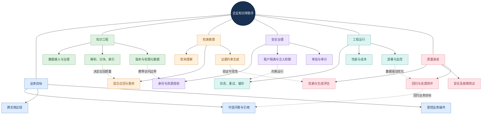

<strong>图谱解读：</strong> 知识资产质量决定检索质量；检索证据影响生成可信度；身份和权限约束每次数据访问；观测与评估再将线上问题反馈给解析、检索和架构设计。系统不是“文件上传—向量化—调用模型”的单链路，而是相互制约的工程网络。

### 1.2 与普通聊天机器人的关键区别

| 维度 | 通用聊天机器人 | 企业知识助手 |
|---|---|---|
| 知识依据 | 模型参数知识、公开信息 | 经授权的企业内部知识与实时业务数据 |
| 正确性 | 语言流畅度不代表事实正确 | 必须核验版本、证据、出处与业务规则 |
| 安全边界 | 常以单用户会话为主 | 多用户、多部门、多租户、文档级权限 |
| 数据生命周期 | 会话内容变化 | 文档新增、修改、撤销、删除、权限变更 |
| 质量保障 | 体验反馈 | 可复现测试集、线上观测、审计与回滚 |

核心原则：<strong>先保证合法访问正确证据，再让模型生成可信答案；先实现确定性控制，再引入动态 Agent 决策。</strong>

---

## 2. 需求、质量属性与业务边界

### 2.1 从业务问题倒推技术能力

员工问“最新设计变更制度是什么”，需要文档有效期和来源定位；问“型号 X 的报警阈值”，需要精确型号匹配、表格结构和单位核对；问“两个版本差异”，需要多文档证据配对；问“替我提交申请”，则涉及业务 API（Application Programming Interface，应用程序编程接口）与审批授权。业务任务的差异决定了检索策略、模型流程和风险控制，不应由同一个提示词包办所有行为。

| 需求类别 | 关键问题 | 设计响应 | 验收证据 |
|---|---|---|---|
| 功能 | 查询、对比、摘要、流程协助 | 意图路由、知识检索、工具集 | 端到端用例 |
| 质量 | 准确、完整、可追溯 | 结构解析、重排、引用验证 | Recall@K、引用准确率 |
| 时效 | 新版制度及时生效 | 增量索引、版本切换、失效机制 | 更新后可见性测试 |
| 安全 | 不得跨部门读取 | 身份校验、资源授权、审计 | 越权与跨租户测试 |
| 运行 | 高并发、低延迟、可恢复 | 缓存、异步队列、重试、限流 | P95、错误率、恢复率 |
| 成本 | 单次任务预算可控 | 分级模型、调用预算、检索预算 | 每成功任务成本 |

### 2.2 需求—架构—验证关系图

```mermaid
flowchart TB
    CORE(("需求与验收闭环"))
    CORE --- M0["业务场景"]
    M0 --> N0_0["制度问答"]
    M0 --> N0_1["技术参数定位"]
    M0 --> N0_2["版本对比"]
    CORE --- M1["质量属性"]
    M1 --> N1_0["准确与可追溯"]
    M1 --> N1_1["延迟与吞吐"]
    M1 --> N1_2["可用与可恢复"]
    CORE --- M2["安全约束"]
    M2 --> N2_0["身份与授权"]
    M2 --> N2_1["数据隔离"]
    M2 --> N2_2["审计与审批"]
    CORE --- M3["架构决策"]
    M3 --> N3_0["检索与生成策略"]
    M3 --> N3_1["数据与状态边界"]
    M3 --> N3_2["同步或异步流程"]
    CORE --- M4["验证证据"]
    M4 --> N4_0["测试集与基线"]
    M4 --> N4_1["故障和安全测试"]
    M4 --> N4_2["线上运行指标"]
    N0_1 -. "精确型号检索" .-> N3_0
    N2_0 -. "权限贯穿数据" .-> N3_1
    N1_0 -. "质量量化" .-> N4_0
    N4_2 -. "反馈需求" .-> N0_0
    classDef core fill:#183153,color:#ffffff,stroke:#10243a,stroke-width:3px
    classDef blue fill:#deecff,color:#17365d,stroke:#5687c4
    classDef green fill:#dff2e1,color:#255c34,stroke:#69a875
    classDef orange fill:#fff0dc,color:#805017,stroke:#d49a4e
    classDef purple fill:#eee5ff,color:#53367d,stroke:#9476c3
    classDef teal fill:#ddf5f2,color:#1d6058,stroke:#59a89f
    classDef rose fill:#ffe3e7,color:#8a3446,stroke:#d78091
    class CORE core
    class M0 blue
    class N0_0 blue
    class N0_1 blue
    class N0_2 blue
    class M1 green
    class N1_0 green
    class N1_1 green
    class N1_2 green
    class M2 orange
    class N2_0 orange
    class N2_1 orange
    class N2_2 orange
    class M3 purple
    class N3_0 purple
    class N3_1 purple
    class N3_2 purple
    class M4 teal
    class N4_0 teal
    class N4_1 teal
    class N4_2 teal
```

<strong>图谱解读：</strong> 每个业务需求应对应明确的架构选择和验收方法。尤其要区分“用户在线人数”和“同时运行的复杂任务数”，以及“回答流畅”和“回答可核查”这两组不同指标。

---

## 3. 数据接入、解析与知识治理

### 3.1 数据源、信任边界与接入机制

企业知识来源包括 Word、PDF、Excel、PPT、企业文件服务器、SharePoint/Confluence、业务数据库和工单系统。不同来源不仅格式不同，授权模型、更新频率、数据责任人也不同。应建立统一的数据源登记：来源 ID、所有者、分类等级、同步方式、权限映射、版本与保留策略。

常见接入方式包括定期扫描、事件触发、变更日志和 API 增量同步。初次全量导入解决存量问题；增量同步解决日常更新；删除传播与权限变更同步解决错误可见性和越权风险。增量任务必须幂等，不能因重复触发生成多个有效版本。

### 3.2 文档解析的语义保真

光学字符识别（Optical Character Recognition，OCR）用于识别扫描图像中的文字；版面分析用于恢复标题、段落、表格、图片、图注及阅读顺序。原生 Word/PDF 的结构化解析与扫描 PDF 的 OCR 应采用不同路径。复杂技术文档的目标不是只抽出字符，而是恢复“某个数值属于哪个表格列、哪个型号、哪个章节、哪个版本”。

| 信息类型 | 应保留的字段 | 丢失后的后果 |
|---|---|---|
| 文本内容 | 标题、正文、单位、符号 | 事实不完整或数值错误 |
| 结构 | 章节路径、页码、表格行列、图注关联 | 检索上下文断裂 |
| 治理 | 文档 ID、版本、生效日期、所有者 | 引用过期或错误版本 |
| 安全 | 租户、资源 ACL、敏感等级 | 越权检索与数据泄露 |
| 来源 | 原始 URI、页内定位、哈希 | 无法回溯或复核 |

### 3.3 数据治理网络

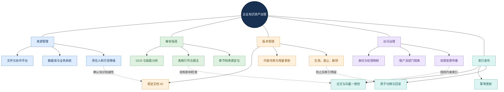

<strong>图谱解读：</strong> 文档结构、版本、权限和索引发布必须协同维护。只更新向量、不更新全文索引或 ACL（Access Control List，访问控制列表）会造成不同检索路径返回不一致甚至不合法的数据。

### 3.4 版本与一致性

建议使用稳定 `document_id` 关联原文，使用 `version_id` 标识不可变版本；每个检索块保留 `chunk_id`、章节路径、页码、来源 URI、版本和权限元数据。可采用“先构建新索引、验证成功、再切换别名”的发布方式减少部分更新窗口；缓存也要随版本和授权变更失效。索引更新的最终一致性窗口需要明确监控和业务容忍度，不能宣称任意时刻都绝对实时。

---

## 4. 分块、索引与知识表示

### 4.1 分块策略的本质

Chunking（知识分块）决定可检索单元的粒度。固定 Token 长度切分简单，但可能破坏条款和表格；递归切分按标题、段落和句子逐层分割；语义切分根据内容主题变化确定边界；结构感知切分优先保留制度条款、表格行列、图注；父子分块则用小块召回、较大父块补充上下文。

| 方法 | 优点 | 代价 | 典型适用场景 |
|---|---|---|---|
| 固定长度 | 实现简单、稳定 | 容易截断语义 | 简单纯文本 |
| 重叠切分 | 减少边界损失 | 索引冗余 | 长段落 |
| 递归切分 | 尊重自然结构 | 复杂表格仍易损坏 | 普通文档 |
| 语义切分 | 主题集中 | 计算成本与不稳定性 | 主题跳跃的文本 |
| 结构感知 | 章节、表格关系更完整 | 依赖解析质量 | 制度、规范、论文 |
| 父子分块 | 小粒度召回、大上下文阅读 | 存储与映射更复杂 | 长制度、跨段解释 |

### 4.2 Embedding 与索引

Embedding（向量嵌入）把文本表示为稠密向量，便于按语义相似度检索。常见相似度为余弦相似度：

$$
\mathrm{sim}(\mathbf{q},\mathbf{d})=\frac{\mathbf{q}\cdot\mathbf{d}}{\lVert\mathbf{q}\rVert_2\lVert\mathbf{d}\rVert_2}
$$

其中 $\mathbf{q}$ 和 $\mathbf{d}$ 分别是查询与文档向量。实际检索还依赖近似最近邻（Approximate Nearest Neighbor，ANN）索引，例如分层可导航小世界图（Hierarchical Navigable Small World，HNSW）；它通过图结构近似查找邻近向量，在召回、延迟与内存之间权衡。

全文索引通常基于倒排索引，适合精确编号、型号、法规名称；向量索引擅长语义改写；结构化索引用于版本、部门、日期、文档状态等过滤。三者在企业场景中互补，不应以向量数据库替代所有数据存储。

### 4.3 知识表示关联图

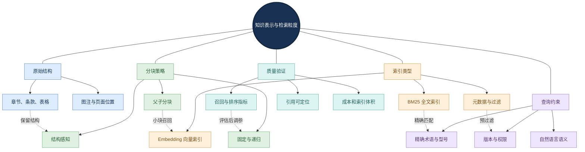

<strong>图谱解读：</strong> 切分策略必须与文档结构、索引类型和查询类型共同设计。分块过小会丢失上下文，过大会降低定位精度并增加模型输入成本；没有通用的最佳块长，应基于测试集调优。

---

## 5. 查询理解、混合检索与重排序

### 5.1 查询理解与路由

用户问题可能包含精确型号、语义描述、时间条件、跨文档比较和隐含的业务意图。Query Rewriting（查询改写）用于把口语化表达转成适合检索的表达；Query Decomposition（查询分解）将复杂问题拆成可验证子问题；Self-Query（自查询）尝试从自然语言提取结构化过滤条件。所有改写必须保留原始问题并接受回归评估，避免意图漂移。

例如“最新版设计变更流程和以前有什么区别”应先确定“最新版”的生效规则、历史比较版本及用户权限，再分别检索两组证据，最后对齐条款。对于“库存现在多少”一类动态精确数据，应调用授权的实时业务 API，而非依赖可能过期的向量片段。

### 5.2 BM25、混合检索与 RRF

BM25（Best Matching 25）是一种基于词项频率、逆文档频率和长度归一化的经典全文排序方法。它对设备型号、标准编号和专有名称尤其有价值。向量检索适合“温度过高会自动停机吗”与“超温保护触发停机”等不同表达。混合检索并行召回两类候选，再融合排名。

倒数排名融合（Reciprocal Rank Fusion，RRF）常用公式为：

$$
\mathrm{RRF}(d)=\sum_{i=1}^{m}\frac{1}{k+r_i(d)}
$$

其中 $r_i(d)$ 是候选 $d$ 在第 $i$ 个结果列表中的名次，未出现则不贡献该项；$k$ 是平滑常数，60 是常见经验值但不是强制最优。RRF 融合的是<strong>相对排名</strong>，不代表事实正确概率。

### 5.3 Reranking 与多轮检索

Reranker（重排序器）对召回候选进行更细致的相关性判断；Cross-Encoder（交叉编码器）常通过联合编码查询与候选文本进行匹配，质量潜力更高但推理成本也更高。第一阶段关注覆盖，第二阶段关注精排；如果正确证据未被召回，重排序无法凭空恢复它。

Multi-Hop Retrieval（多跳检索）利用前一轮证据继续查找相关材料；Agentic Retrieval（智能体式检索）让系统动态决定是否检索、检索什么以及何时停止。复杂任务可以采用，但必须设置轮次、Token 和时长预算，并防止检索结果不断漂移。

### 5.4 检索策略网络

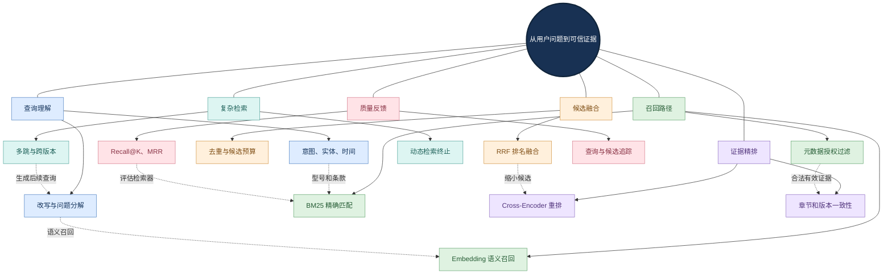

<strong>图谱解读：</strong> 查询理解决定检索目标，关键词与语义检索相互补充，授权过滤限定可见候选，融合和精排提高证据质量，多跳检索仅在复杂问题需要时启用。各阶段应分别记录耗时、候选数和质量指标。

---

## 6. 证据组织、可信生成与引用

### 6.1 Grounded Generation 与 Context Packing

Grounded Generation（基于证据的生成）要求答案中的事实性声明有检索材料支持。Context Packing（上下文组织）负责在有限 Token 预算内选择、去重、排序和压缩证据，保留必要的章节、版本与引用标识。它不同于入库阶段的 Chunking：前者决定模型读什么，后者决定知识怎样被索引。

建议将回答任务划分为四种结果：证据充分则回答并引用；证据部分充分则标明已知和未知；证据冲突则报告冲突与版本；证据不足则拒绝无依据的确定性结论。系统应能区分“没检索到”和“确认不存在”，两者不是一回事。

### 6.2 引用校验的粒度

引用存在不等于引用正确。可信引用至少验证来源是否存在、用户是否有权访问、版本是否有效、引用位置是否可打开、引用内容是否支持相应声明。可以把回答拆成可核查的事实声明，再逐条匹配支持证据；但自动评分器也可能出错，高风险业务仍需人工复核。

### 6.3 证据与生成关系网络

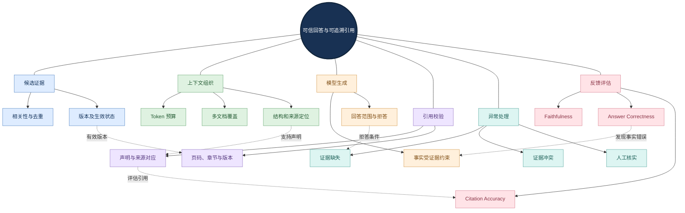

<strong>图谱解读：</strong> 答案的可追溯性由证据筛选、上下文组织、生成约束和引用验证共同决定。模型即使忠实复述了一份过期制度，也可能在业务事实层面答错，因此“忠实于证据”和“事实正确”必须分开评估。

---

## 7. 权限隔离、数据安全与注入防御

### 7.1 身份、授权与资源范围

RBAC（Role-Based Access Control，基于角色的访问控制）按岗位或角色授权；ABAC（Attribute-Based Access Control，基于属性的访问控制）综合用户、资源和环境属性；ACL 则记录资源允许或拒绝的访问主体。企业实际部署常将这些机制组合使用。身份认证负责确认“是谁”，授权负责决定“能访问什么”，不能互相替代。

推荐安全链路：验证身份 → 计算资源授权范围 → 在检索执行时约束候选 → 对文档获取再次授权 → 对工具调用独立授权 → 输出检查与审计。仅在生成后要求模型“不要泄露”是不够的，因为未授权材料可能已经进入上下文或日志。

### 7.2 Prompt Injection 与信任边界

Prompt Injection（提示词注入）可通过恶意检索片段、附件或网页诱导模型改变行为。企业文档属于低信任数据，不能获得系统指令或工具授权的地位。需要结合不可信内容隔离、最小权限、参数校验、外部调用限制、人工审批与审计。任何工具返回的文本也不应自动被提升为高优先级指令。

### 7.3 安全治理关系图

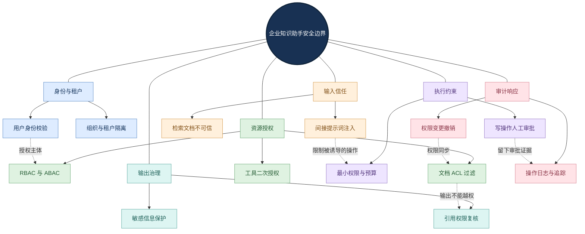

<strong>图谱解读：</strong> 安全不是检索后的单一过滤器，而是跨身份、索引、工具、上下文、输出和日志的信任边界。多租户隔离、权限撤销和敏感缓存失效必须由确定性程序机制保障。

---

## 8. Agent 化：从知识问答到受控执行

### 8.1 什么时候需要 Agent？

简单制度问答通常采用 2-Step RAG（检索后生成）即可。多种已知任务可采用 Router + Workflow（路由与确定性工作流）。需要根据中间证据动态规划、跨系统调用和调整步骤时，才考虑 Agentic RAG 或多 Agent 协作。Agent 不是性能和质量的免费提升，它会增加调用成本、状态复杂度和新的失败路径。

### 8.2 工具契约与状态控制

工具（Tool）应定义名称、用途、输入模式、授权主体、超时、幂等性、副作用和错误类型。Model Context Protocol（MCP，模型上下文协议）可作为连接外部工具和数据源的协议选项，但不自动提供企业级身份授权或业务审批。

| 工具 | 功能 | 关键约束 |
|---|---|---|
| `search_knowledge` | 在授权范围检索 | 用户身份、租户、版本 |
| `get_document` | 获取原文或指定片段 | 文档级授权与审计 |
| `compare_versions` | 对比新旧制度 | 版本有效性、条款映射 |
| `query_business_data` | 查询动态业务数据 | 只读权限、范围和脱敏 |
| `create_request` | 创建申请或工单 | 幂等键、参数校验、审批 |

### 8.3 Agent 协作关系图

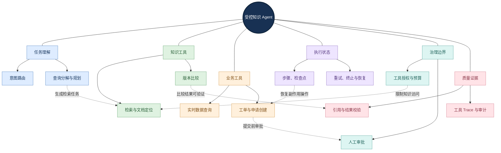

<strong>图谱解读：</strong> Agent 可以决定“下一步尝试什么”，但工具是否允许执行、是否已执行过、是否需要人工批准，都由程序和授权系统决定。高风险任务必须将决策建议与真实操作分离。

---

## 9. 状态、可靠性、性能与成本

### 9.1 可靠性机制

长任务应区分会话历史、任务执行状态、检查点、长期记忆与权威业务数据。重试（Retry）只适用于可恢复错误；超时（Timeout）限制资源占用；幂等（Idempotency）防止重复提交；熔断（Circuit Breaker）抑制故障传播；降级（Fallback）在依赖不可用时明确限制能力；人工介入（Human-in-the-Loop）处理高影响操作。外部写操作超时不能直接推断为未成功，应通过幂等键和状态查询确认。

### 9.2 性能关键路径

串行链路的近似耗时为：

$$
T_{\mathrm{total}}\approx T_{\mathrm{auth}}+T_{\mathrm{query}}+T_{\mathrm{retrieve}}+T_{\mathrm{rerank}}+T_{\mathrm{generate}}+T_{\mathrm{other}}
$$

实际并行召回、流式输出和异步任务应以关键路径测量为准。应监控首 Token 延迟、完整任务 P50/P95/P99、检索候选量、重排耗时、Token 消耗、失败率和成功任务平均成本。

单任务成本可近似拆解为：

$$
C_{\mathrm{task}}=C_{\mathrm{model}}+C_{\mathrm{retrieval}}+C_{\mathrm{compute}}+C_{\mathrm{storage}}+C_{\mathrm{tool}}+C_{\mathrm{review}}
$$

成本优化应结合成功率，不应只追求最少 Token。缓存需要纳入用户授权、租户、知识版本和失效策略；跨用户共享敏感回答缓存可能造成数据泄露。

### 9.3 工程运行网络

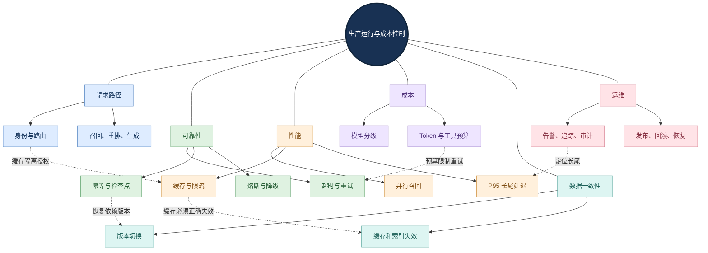

<strong>图谱解读：</strong> 缓存、重试和并行化不能脱离权限与版本一致性单独优化。企业系统应优先测量瓶颈和失败类型，再有针对性地引入复杂机制。

---

## 10. 评估、观测与回归

### 10.1 评估维度与关键算法

检索召回率 Recall@K 衡量标准相关文档在前 K 个结果中被找回的比例：

$$
\mathrm{Recall@K}=\frac{|R\cap D_K|}{|R|}
$$

其中 $R$ 是该查询的全部已标注相关文档集合，$D_K$ 是前 K 个检索结果。若只标注一个标准证据，也可以使用 Hit@K 判断是否命中，但它不能替代多相关文档场景的召回率。

平均倒数排名（Mean Reciprocal Rank，MRR）衡量首个相关结果出现得有多靠前：

$$
\mathrm{MRR}=\frac{1}{|Q|}\sum_{q\in Q}\frac{1}{\mathrm{rank}_q}
$$

其中 $\mathrm{rank}_q$ 是查询 $q$ 的首个相关结果名次；无命中时倒数排名按 0 处理。归一化折损累计增益（Normalized Discounted Cumulative Gain，NDCG）适合衡量具有不同相关性等级的排序结果。

| 层次 | 代表指标 | 典型问题 |
|---|---|---|
| 解析 | 文本覆盖率、表格结构准确率 | 入库内容是否完整？ |
| 召回 | Recall@K、Hit@K | 关键证据找到了吗？ |
| 排序 | MRR、NDCG@K | 关键证据排得够前吗？ |
| 生成 | Faithfulness、Answer Correctness | 是否忠于证据且事实正确？ |
| 引用 | Citation Accuracy、证据覆盖率 | 每条声明是否可核查？ |
| 安全 | 越权成功率、注入攻击成功率 | 能否阻止非法访问和操作？ |
| 运行 | 成功率、P95、成本、恢复率 | 能否稳定交付？ |

Faithfulness（证据忠实度）关注回答是否受到提供的上下文支持；Answer Correctness（答案正确性）关注答案与真实标准是否一致。自动评分模型也可能有偏差，应抽样人工校准。

### 10.2 测试集与回归闭环

测试集至少覆盖精确型号、语义改写、表格问答、多文档、多版本、无答案、权限拒绝、恶意片段、删除后不可见、工具超时和重复提交。每条用例建议记录查询、用户身份、授权范围、标准证据、预期答案、预期拒答/审批行为和失败类型。

### 10.3 质量闭环关系图

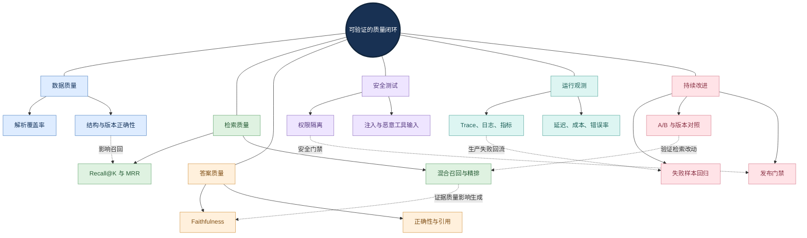

<strong>图谱解读：</strong> 数据、检索、生成、安全和运行指标共同构成质量证据。上线后发现的错误应脱敏并加入回归集；更换 Embedding、切分策略、重排模型或提示词时，都要比较新旧基线，避免局部改善引起其他场景退化。

---

## 11. 医疗设备企业项目落地示例

> 本节是用于说明设计方法的<strong>假设案例</strong>，不代表真实公司已实施或已达到相应指标。

### 11.1 需求背景与角色

某医疗设备企业希望为研发、质量、采购和行政员工提供制度查询、技术规范定位、版本对比和申请草稿能力。知识源包括质量体系文件、产品规格书、操作手册、采购制度与审批规则。系统必须遵守部门权限、制度生效日期与业务操作审批。

### 11.2 四条典型业务链路

| 场景 | 技术执行路径 | 验收重点 |
|---|---|---|
| 制度问答 | 身份 → 授权检索 → 重排 → 证据回答 | 有效版本、正确引用 |
| 型号参数 | 精确术语 → 混合召回 → 表格定位 → 单位核对 | 型号、行列、数值准确 |
| 版本比较 | 指定新旧版本 → 条款对齐 → 差异汇总 | 不混淆生效状态 |
| 申请协助 | 检索制度 → 收集字段 → 生成草稿 → 用户确认 → 授权提交 | 参数校验、审批、幂等 |

### 11.3 分阶段实施与架构取舍

<strong>阶段一：需求与数据治理。</strong> 明确业务场景、责任人、敏感等级、文档版本规则、权限继承和测试基线。  
<strong>阶段二：知识接入与检索基线。</strong> 完成原生/扫描解析、结构感知切分、全文与向量索引，先测 Recall@K。  
<strong>阶段三：可信问答。</strong> 引入混合检索、必要的 Reranker、证据约束生成、引用定位和拒答。  
<strong>阶段四：安全与运维。</strong> 完成身份授权、索引更新、日志追踪、缓存失效、故障测试和回滚。  
<strong>阶段五：Agent 扩展。</strong> 只对确有必要的多步任务增加工具规划、检查点、人工审批和业务系统调用。

### 11.4 案例架构网络

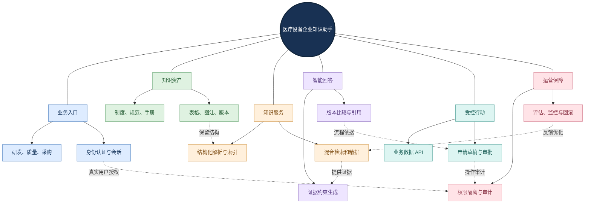

<strong>图谱解读：</strong> 案例的核心不是某个框架，而是业务身份、知识资产、检索服务、可信回答、受控行动和运营治理的协作。所有写操作都必须跨过独立的授权与审批边界。

### 11.5 验收用例设计

建议建立多角色测试身份，并准备覆盖制度问答、精确编号、扫描表格、跨版本冲突、无答案、越权访问、文档撤销、检索服务故障和业务操作重试的测试集。为每项需求绑定可测指标，避免在缺少真实测试的情况下宣称固定准确率、召回率或性能收益。

---

## 12. 技术选型、常见误区与面试

### 12.1 典型组件与取舍

| 层次 | 可研究方案 | 选型依据 |
|---|---|---|
| 文档解析 | Docling、MinerU、Unstructured | 格式覆盖、表格保真、资源消耗 |
| 全文检索 | Elasticsearch、OpenSearch | BM25、过滤、成熟运维 |
| 向量检索 | Qdrant、Milvus、pgvector | 数据规模、过滤、部署成本 |
| 检索编排 | LangChain、LlamaIndex、Haystack | 组件可替换性、可测试性 |
| Agent 控制 | LangGraph、AgentScope | 状态、恢复、工具调用约束 |
| 质量评估 | Ragas、LangSmith、内部测试平台 | 可重复评分、Trace、回归 |
| 观测 | OpenTelemetry 与监控平台 | 端到端追踪、成本与错误定位 |
| 托管服务 | AWS Bedrock Knowledge Bases、Azure AI Search | 运维负担、定制、数据边界 |

自建架构可深度定制并适配私有化需求，但需要维护解析、索引、权限、部署与评估；托管服务降低部分运维工作量，但需核对地区、功能版本、成本和供应商锁定风险。逻辑模块不等于独立微服务，初期可先采用模块化单体。

### 12.2 容易混淆的概念

| 概念 A | 概念 B | 本质区别 |
|---|---|---|
| 知识库 | RAG | 资产管理系统 vs 检索增强生成方法 |
| RAG | Agent | 证据增强问答 vs 动态规划与工具执行 |
| BM25 | 向量检索 | 词项匹配 vs 语义相似 |
| RRF | Reranker | 排名列表融合 vs 候选精细判断 |
| Chunking | Context Packing | 入库检索粒度 vs 推理上下文组织 |
| 引用存在 | 引用正确 | 有来源标记 vs 来源真正支持结论 |
| Faithfulness | Correctness | 忠于给定证据 vs 事实正确 |
| ACL 过滤 | 身份授权 | 限定候选资源 vs 验证主体及访问权 |
| 离线评估 | 线上监控 | 可复现基线 vs 真实运行发现问题 |

### 12.3 常见误区

1. <strong>“只要换更强模型就能修复知识问答。”</strong> 解析丢列、错误版本和越权访问无法靠更强模型根治。
2. <strong>“所有文档都用固定长度切分。”</strong> 制度条款、表格和图注需要结构感知。
3. <strong>“有向量检索就不需要 BM25。”</strong> 型号、标准编号和精确术语仍需要词项匹配。
4. <strong>“模型输出引用就证明可信。”</strong> 引用必须对应具体事实、正确版本和可访问位置。
5. <strong>“检索后过滤权限就足够。”</strong> 无授权内容不应进入模型上下文、缓存或日志。
6. <strong>“Agent 越多越企业级。”</strong> 多 Agent 只有在专业分工、并行或隔离收益被验证后才有价值。
7. <strong>“RAG 只测最终答案。”</strong> 必须分层评估解析、召回、排序、生成、引用和安全。
8. <strong>“重试保证业务成功。”</strong> 对外部写操作需幂等键、状态核对和补偿策略。

### 12.4 面试回答结构

回答“如何从零设计企业知识库助手”时，建议按照：业务需求与约束 → 数据源及权限治理 → 解析与分块 → 全文/向量混合检索 → 重排和可信引用 → Agent 工具与执行边界 → 可靠性、安全和运维 → 测试集与评估指标 → 技术取舍与演进。每个技术选择都要能回答“解决了什么真实问题、如何验证收益、增加了什么代价”。

---

## 13. 总结与章节关联

企业知识助手是一套以知识资产治理为基础、以检索证据为桥梁、以可信回答为直接价值、以受控 Agent 为扩展能力、以安全和评估为上线条件的系统。它的关键因果链是：<strong>数据质量 → 知识表示 → 检索质量 → 证据质量 → 答案可信度 → 业务可用性</strong>。权限、版本和运维机制横向约束每个阶段。

与本知识手册的联系：LLM 基础解释 Embedding 与推理；Agent 基础和工作范式解释路由与决策；核心组件解释 Tool、Context、State 和 Memory；知识与工具章节提供 RAG、检索与 MCP 原理；多 Agent 与框架章节提供编排方式；企业工程章节提供可靠性、性能、评估、安全与部署；本章将它们整合成一个可设计、可测试、可交付的真实业务案例。

<strong>最终原则：不要把“能回答”误认为“可信交付”；不要把“能调用工具”误认为“安全执行”。</strong>

---

## 参考资料

以下为权威资料与后续验证入口；各产品功能、地区可用性和版本限制应以实际部署时的官方文档为准。

1. AWS Bedrock Knowledge Bases：<https://docs.aws.amazon.com/bedrock/latest/userguide/knowledge-base.html>
2. AWS 知识库查询与过滤：<https://docs.aws.amazon.com/bedrock/latest/userguide/kb-test-config.html>
3. AWS ACL-aware Retrieval：<https://docs.aws.amazon.com/bedrock/latest/userguide/kb-managed-acl.html>
4. AWS Agentic Retrieval：<https://docs.aws.amazon.com/bedrock/latest/userguide/kb-test-agentic-retrieve.html>
5. Microsoft Azure AI Search — Hybrid Search：<https://learn.microsoft.com/en-us/azure/search/hybrid-search-overview>
6. Microsoft Azure AI Search — RRF：<https://learn.microsoft.com/en-us/azure/search/hybrid-search-ranking>
7. Microsoft RAG 评估指南：<https://learn.microsoft.com/en-us/azure/architecture/ai-ml/guide/rag/rag-llm-evaluation-phase>
8. Microsoft RAG 提示词与安全：<https://learn.microsoft.com/en-us/azure/architecture/ai-ml/guide/rag/rag-prompt-engineering>
9. Ragas 官方评估指标：<https://docs.ragas.io/en/latest/concepts/metrics/available_metrics/>
10. LangSmith 评估类型：<https://docs.langchain.com/langsmith/evaluation-types>
11. OWASP GenAI Security Project：<https://genai.owasp.org/>
12. NIST AI Risk Management Framework：<https://www.nist.gov/itl/ai-risk-management-framework>
13. LangGraph 持久化机制：<https://docs.langchain.com/oss/python/langgraph/persistence>
14. OpenTelemetry 官方文档：<https://opentelemetry.io/docs/>
15. C4 Model：<https://c4model.com/>

