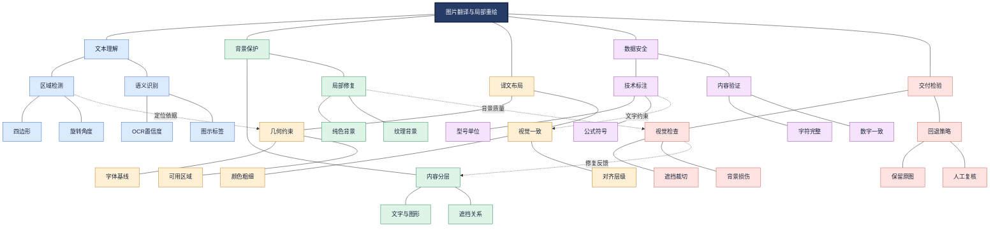
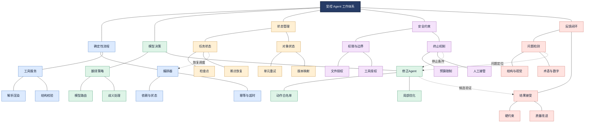

# 智能文档翻译 Agent：从可逆文档结构到可信交付的企业级工程体系

> 第八章 · 项目案例 03 · Document Translation Agent
>
> 本章以<strong>完整、可追溯、可验证的文档翻译交付</strong>为目标，系统讨论多格式解析、统一中间表示、上下文翻译、约束排版、Agent 修正、质量评估、可靠性与生产部署。案例和接口属于架构设计示例，不代表某个开源项目已实现全部能力。

## 阅读路线

1. 需求与质量契约 → 2. 格式识别与解析 → 3. 中间表示与可逆映射 → 4. 语言翻译与术语 → 5. 版面重建 → 6. 图片翻译 → 7. Agent 编排与修复 → 8. 质量评估 → 9. 测试与性能 → 10. 安全交付与工程选型。

## 1. 项目定位：为什么文档翻译不是文本翻译的简单扩展

<strong>智能文档翻译 Agent</strong>指在跨语言转换过程中，同时协调文档解析、语言转换、版面恢复、质量检测与异常修复的任务系统。它并不意味着每一步都必须由大语言模型自主决策；相反，企业级实现通常依赖<strong>确定性工具 + 模型能力 + 受约束的 Agent 决策</strong>。

原文可以在语义上正确，却因为表格错列、型号被修改、图注脱离图片或译文越界而无法交付。因此应将质量定义为多个相互制约的维度，而非单一的翻译分数。

```mermaid
flowchart TB
    C["企业级文档翻译 Agent"]
    C --- B0["业务质量"]
    B0 --- N0_0["语言准确"]
    N0_0 --- L0_0_0["术语一致"]
    N0_0 --- L0_0_1["上下文正确"]
    B0 --- N0_1["内容完整"]
    N0_1 --- L0_1_0["无漏译"]
    N0_1 --- L0_1_1["数字型号保护"]
    class B0,N0_0,N0_1,L0_0_0,L0_0_1,L0_1_0,L0_1_1 g0;
    C --- B1["文档理解"]
    B1 --- N1_0["格式识别"]
    N1_0 --- L1_0_0["DOCX / PDF / 图片"]
    B1 --- N1_1["结构恢复"]
    N1_1 --- L1_1_0["阅读顺序"]
    N1_1 --- L1_1_1["表格与图注"]
    class B1,N1_0,N1_1,L1_0_0,L1_1_0,L1_1_1 g1;
    C --- B2["翻译与重建"]
    B2 --- N2_0["语义翻译"]
    N2_0 --- L2_0_0["分层上下文"]
    N2_0 --- L2_0_1["译文对齐"]
    B2 --- N2_1["版面约束"]
    N2_1 --- L2_1_0["字体与文本框"]
    N2_1 --- L2_1_1["图文关系"]
    class B2,N2_0,N2_1,L2_0_0,L2_0_1,L2_1_0,L2_1_1 g2;
    C --- B3["Agent 治理"]
    B3 --- N3_0["策略路由"]
    N3_0 --- L3_0_0["解析器与模型选择"]
    B3 --- N3_1["闭环修正"]
    N3_1 --- L3_1_0["检查点"]
    N3_1 --- L3_1_1["有限重试"]
    class B3,N3_0,N3_1,L3_0_0,L3_1_0,L3_1_1 g3;
    C --- B4["企业交付"]
    B4 --- N4_0["质量门禁"]
    N4_0 --- L4_0_0["结构与视觉回归"]
    B4 --- N4_1["安全运维"]
    N4_1 --- L4_1_0["权限审计"]
    N4_1 --- L4_1_1["成本追踪"]
    class B4,N4_0,N4_1,L4_0_0,L4_1_0,L4_1_1 g4;
    N1_1 -. "结构约束" .-> N2_0
    N0_1 -. "可验证" .-> N4_0
    N3_1 -. "修正反馈" .-> N2_1
    N4_1 -. "资源预算" .-> N3_0
    classDef hub fill:#263b66,stroke:#152645,color:#ffffff,stroke-width:3px;
    classDef g0 fill:#dceafe,stroke:#4479c4,color:#17233a,stroke-width:1px;
    classDef g1 fill:#def4e7,stroke:#39946a,color:#17233a,stroke-width:1px;
    classDef g2 fill:#fff0d4,stroke:#c18a33,color:#17233a,stroke-width:1px;
    classDef g3 fill:#f5e3fb,stroke:#9d58b2,color:#17233a,stroke-width:1px;
    classDef g4 fill:#ffe3e0,stroke:#c9695f,color:#17233a,stroke-width:1px;
    class C hub;
```

<strong>图谱解读：</strong>中心任务由五条能力主线支撑。文档理解决定后续能否定位和回写；翻译与排版相互制约；质量门禁驱动修正闭环；企业治理则贯穿所有环节。跨分支连接表示依赖，而非简单执行先后。

### 1.1 质量契约与业务边界

| 质量维度 | 具体约束 | 可自动验证的证据 |
| --- | --- | --- |
| 语义正确 | 术语、否定、条件和数量关系不被改变 | 参考译文、术语规则、人工复核 |
| 内容完整 | 标题、正文、表格、图注、脚注等不漏译 | 源目标对象映射、覆盖率 |
| 结构稳定 | 标题层级、列表、表格合并关系、引用关系正确 | 结构树比较 |
| 视觉可用 | 不裁切、不严重重叠、可读性符合要求 | 几何检测、视觉回归 |
| 文件可交付 | 文件可打开、格式正确、可编辑性符合要求 | 重新解析与应用打开测试 |
| 安全合规 | 数据流向、授权、留存和审计符合约束 | 访问审计、脱敏与删除记录 |

<strong>重要区分：</strong>“保持格式”不等于所有坐标绝对不变。目标语言长度变化可能要求受控换行、调整字号或重新分页；应优先保证内容与结构的硬约束，再优化视觉相似性。

### 1.2 非功能需求与验收指标

应在立项时明确支持格式、语言方向、文档页数上限、同步/异步模式、P95 延迟、并发、预算、文件留存时间、权限隔离、可回滚范围及人工审核阈值。指标阈值应由测试集和业务风险共同决定，不能凭经验写成统一行业标准。

## 2. 多格式文档理解：解析质量决定翻译上限

### 2.1 格式特征与路由

DOCX 使用 Office Open XML（OOXML，Office 开放 XML）结构，可直接访问段落、Run（同一段落中的格式片段）、表格、样式及文档关系。PDF（Portable Document Format，便携式文档格式）偏向页面呈现，文本对象的绘制顺序未必等于阅读顺序；扫描型 PDF 还需要 OCR（Optical Character Recognition，光学字符识别）。VLM（Vision-Language Model，视觉语言模型）可以辅助理解复杂图文，但不能替代所有几何定位与结构校验。

| 输入 | 首选解析思路 | 不可忽视的对象 | 典型失败 |
| --- | --- | --- | --- |
| DOCX | 原生 OOXML 解析并回写 | Run、域、修订、脚注、锚点 | 破坏样式、域或批注 |
| 文本型 PDF | 文字/字体/坐标提取 + 布局分析 | 字形、阅读顺序、公式、跨页 | 错序、字体缺失 |
| 扫描 PDF | OCR + 布局/表格识别 | 文字区域、图片、行列 | OCR 漏字、表格错列 |
| 混合 PDF | 页面/区域级路由 | 隐藏文字层与图像层 | 重复识别、重复翻译 |
| 图片 | 文字检测 + OCR/VLM + 局部绘制 | 背景、旋转文字、图形 | 背景破坏、位置漂移 |
| XLSX/PPTX | 原生对象级处理 | 公式、单元格、Shape、母版 | 公式损坏、文本溢出 |

```mermaid
flowchart TB
    C["多格式解析与结构恢复"]
    C --- B0["文件路由"]
    B0 --- N0_0["文件探测"]
    N0_0 --- L0_0_0["MIME与签名"]
    N0_0 --- L0_0_1["文本层检测"]
    B0 --- N0_1["风险识别"]
    N0_1 --- L0_1_0["扫描比例"]
    N0_1 --- L0_1_1["加密与损坏"]
    class B0,N0_0,N0_1,L0_0_0,L0_0_1,L0_1_0,L0_1_1 g0;
    C --- B1["原生解析"]
    B1 --- N1_0["OOXML"]
    N1_0 --- L1_0_0["段落与Run"]
    N1_0 --- L1_0_1["域与关系"]
    B1 --- N1_1["PDF文字"]
    N1_1 --- L1_1_0["字体与坐标"]
    N1_1 --- L1_1_1["绘制顺序"]
    class B1,N1_0,N1_1,L1_0_0,L1_0_1,L1_1_0,L1_1_1 g1;
    C --- B2["视觉解析"]
    B2 --- N2_0["OCR"]
    N2_0 --- L2_0_0["文字框与置信度"]
    N2_0 --- L2_0_1["旋转检测"]
    B2 --- N2_1["布局模型"]
    N2_1 --- L2_1_0["表格网格"]
    N2_1 --- L2_1_1["图注归属"]
    class B2,N2_0,N2_1,L2_0_0,L2_0_1,L2_1_0,L2_1_1 g2;
    C --- B3["结构整合"]
    B3 --- N3_0["阅读顺序"]
    N3_0 --- L3_0_0["多栏"]
    N3_0 --- L3_0_1["跨页"]
    B3 --- N3_1["内容关联"]
    N3_1 --- L3_1_0["图文锚定"]
    N3_1 --- L3_1_1["表格语义"]
    class B3,N3_0,N3_1,L3_0_0,L3_0_1,L3_1_0,L3_1_1 g3;
    C --- B4["验证回退"]
    B4 --- N4_0["完整性"]
    N4_0 --- L4_0_0["页数与对象数"]
    N4_0 --- L4_0_1["乱码检测"]
    B4 --- N4_1["多引擎策略"]
    N4_1 --- L4_1_0["失败降级"]
    N4_1 --- L4_1_1["人工复核"]
    class B4,N4_0,N4_1,L4_0_0,L4_0_1,L4_1_0,L4_1_1 g4;
    N0_0 -. "决定路径" .-> N1_0
    N2_1 -. "几何辅助" .-> N3_0
    N1_1 -. "来源信息" .-> N3_1
    N4_0 -. "反馈" .-> N0_1
    classDef hub fill:#263b66,stroke:#152645,color:#ffffff,stroke-width:3px;
    classDef g0 fill:#dceafe,stroke:#4479c4,color:#17233a,stroke-width:1px;
    classDef g1 fill:#def4e7,stroke:#39946a,color:#17233a,stroke-width:1px;
    classDef g2 fill:#fff0d4,stroke:#c18a33,color:#17233a,stroke-width:1px;
    classDef g3 fill:#f5e3fb,stroke:#9d58b2,color:#17233a,stroke-width:1px;
    classDef g4 fill:#ffe3e0,stroke:#c9695f,color:#17233a,stroke-width:1px;
    class C hub;
```

<strong>关键原则：</strong>不同文件应保留原生优势。不要为了统一接口而把所有 DOCX 先转图片；也不要因为 PDF 有文字层就忽略页面结构。

<strong>图谱解读：</strong>路由决定是否使用原生结构或视觉识别；两类解析结果最终汇入阅读顺序和对象关系恢复。质量检测失败时应回退到其他解析策略，而不是继续把错误输入交给翻译模型。

### 2.2 阅读顺序与跨页问题

多栏论文中，PDF 内部文字绘制顺序可能交替出现左右栏；跨页表格的表头、续表与注释可能分布在不同页面。可综合几何位置、版面区域、标题层级、段落连续性和表格边界推断逻辑顺序。<strong>页面边界是视觉边界，不一定是语义边界</strong>；翻译单元应按逻辑结构构建。

### 2.3 开源解析与排版研究对象

- [Docling](https://github.com/docling-project/docling)：重点研究统一文档对象表示、布局、表格与阅读顺序。
- [MinerU](https://github.com/opendatalab/MinerU)：重点研究复杂 PDF、OCR、公式、表格与结构化输出。
- [BabelDOC](https://github.com/funstory-ai/BabelDOC)：重点研究布局保留 PDF 翻译、字体与排版重建。

这些项目的职责与边界不同，选型必须以实际文件集、许可证、依赖环境、解析精度和部署成本为依据；不能直接将“解析效果好”等同于“回写效果好”。

## 3. 统一中间表示 IR：连接解析、翻译与渲染的核心契约

IR（Intermediate Representation，中间表示）是一种在不同处理阶段间传递结构化信息的数据模型。它解决的不是“如何翻译一句话”，而是“翻译后如何准确找到并恢复原始文档对象”。

### 3.1 双层 IR 与稳定对象映射

建议将语义 IR 与布局 IR 分离：前者描述章节、段落、文本、表格和逻辑关系；后者描述页面、边界框、字体、颜色、绘制顺序和相邻对象约束。通过稳定对象 ID 和 Alignment（源目标对齐关系）连接两层。

| 对象 | 主要字段 | 作用 |
| --- | --- | --- |
| Document | id、版本、语言、来源 | 全局治理 |
| Page | id、尺寸、坐标系、旋转 | 页面定位 |
| Block / Paragraph | id、类型、层级、阅读顺序 | 语义组织 |
| TextSpan | 源文、字体、样式、bbox | 细粒度回写 |
| Table / Cell | 行列、合并、边界、单元格内容 | 表格保持 |
| Figure / Caption | 图像资源、锚点、关联 id | 图文关联 |
| TranslationUnit | 源对象 id、源文、译文、状态 | 翻译控制 |
| Alignment | source_id、target_id、置信度 | 可追溯性 |
| ValidationIssue | 对象 id、错误类型、严重度 | 定位修复 |

```mermaid
flowchart TB
    C["可逆文档中间表示 IR"]
    C --- B0["语义层"]
    B0 --- N0_0["逻辑树"]
    N0_0 --- L0_0_0["章节与段落"]
    N0_0 --- L0_0_1["阅读顺序"]
    B0 --- N0_1["翻译单元"]
    N0_1 --- L0_1_0["术语上下文"]
    N0_1 --- L0_1_1["源目标对齐"]
    class B0,N0_0,N0_1,L0_0_0,L0_0_1,L0_1_0,L0_1_1 g0;
    C --- B1["布局层"]
    B1 --- N1_0["页面几何"]
    N1_0 --- L1_0_0["边界框"]
    N1_0 --- L1_0_1["坐标变换"]
    B1 --- N1_1["视觉样式"]
    N1_1 --- L1_1_0["字体字号"]
    N1_1 --- L1_1_1["锚点与层级"]
    class B1,N1_0,N1_1,L1_0_0,L1_0_1,L1_1_0,L1_1_1 g1;
    C --- B2["资源层"]
    B2 --- N2_0["非文字对象"]
    N2_0 --- L2_0_0["图像与公式"]
    N2_0 --- L2_0_1["附件"]
    B2 --- N2_1["原始关系"]
    N2_1 --- L2_1_0["域与超链接"]
    N2_1 --- L2_1_1["表格合并"]
    class B2,N2_0,N2_1,L2_0_0,L2_0_1,L2_1_0,L2_1_1 g2;
    C --- B3["状态层"]
    B3 --- N3_0["版本与溯源"]
    N3_0 --- L3_0_0["对象ID"]
    N3_0 --- L3_0_1["文件哈希"]
    B3 --- N3_1["质量结果"]
    N3_1 --- L3_1_0["错误定位"]
    N3_1 --- L3_1_1["修正记录"]
    class B3,N3_0,N3_1,L3_0_0,L3_0_1,L3_1_0,L3_1_1 g3;
    C --- B4["输出适配"]
    B4 --- N4_0["DOCX回写"]
    N4_0 --- L4_0_0["样式保留"]
    N4_0 --- L4_0_1["可编辑性"]
    B4 --- N4_1["PDF/图片渲染"]
    N4_1 --- L4_1_0["字体嵌入"]
    N4_1 --- L4_1_1["区域绘制"]
    class B4,N4_0,N4_1,L4_0_0,L4_0_1,L4_1_0,L4_1_1 g4;
    N0_1 -. "对象映射" .-> N1_0
    N2_1 -. "关系恢复" .-> N4_0
    N3_1 -. "质量反馈" .-> N4_1
    N3_0 -. "版本绑定" .-> N0_0
    classDef hub fill:#263b66,stroke:#152645,color:#ffffff,stroke-width:3px;
    classDef g0 fill:#dceafe,stroke:#4479c4,color:#17233a,stroke-width:1px;
    classDef g1 fill:#def4e7,stroke:#39946a,color:#17233a,stroke-width:1px;
    classDef g2 fill:#fff0d4,stroke:#c18a33,color:#17233a,stroke-width:1px;
    classDef g3 fill:#f5e3fb,stroke:#9d58b2,color:#17233a,stroke-width:1px;
    classDef g4 fill:#ffe3e0,stroke:#c9695f,color:#17233a,stroke-width:1px;
    class C hub;
```

<strong>不变量：</strong>每个应翻译对象具有可追溯 ID；非翻译对象不得无意变化；表格结构和图文关联保持有效；每次修复仅修改被授权的对象范围。对于被合并、拆分的翻译单元，应保存一对多或多对一的映射，不能强行假设一对一。

<strong>图谱解读：</strong>语义层允许译文按逻辑段落处理，布局层保留回写条件，资源层保护非文本内容；状态层将错误定位到具体对象。输出适配器只负责把 IR 转为目标格式，避免翻译逻辑直接依赖 PDF 或 DOCX 绘制细节。

### 3.2 坐标系、对象关系与信息损失

PDF 页面可能存在旋转、裁切框和不同坐标原点，图片使用像素坐标，Word 更多依赖文档流与锚点。统一 IR 需要显式记录坐标系及变换，不能只保存四个数值。若解析时已经丢失脚注或图注关系，后续 LLM 通常无法可靠重建原始位置；应尽早检测信息损失。

### 3.3 与 BabelDOC 的关系

BabelDOC 的研究与实现可用于理解语义内容和布局元数据分离、公式占位符、跨页上下文及自适应排版的思路；但这里提出的字段表与双层 IR 是本章的<strong>工程抽象</strong>，不应误认为其官方数据模型逐项一致。参考 [BabelDOC 仓库](https://github.com/funstory-ai/BabelDOC)。

## 4. 翻译引擎：从句子质量到文档级一致性

NMT（Neural Machine Translation，神经机器翻译）模型针对翻译任务优化；LLM（Large Language Model，大语言模型）具备上下文理解、复杂指令和结构化输出能力。两者不存在无条件的质量优劣，应按语言对、专业领域、延迟和成本评测。

### 4.1 三层上下文

- <strong>文档级：</strong>领域、读者、风格、术语表、章节摘要。
- <strong>章节级：</strong>指代对象、缩略语定义、标题层级、相关图表。
- <strong>翻译单元级：</strong>源文、前后句、保护占位符、目标输出格式。

推荐“文档级分析 + 段落级翻译 + 对象级回写”。整页或整章直接翻译可能减少局部歧义，却提高输出对齐难度与失败重试成本；单句翻译则易丢失上下文。

### 4.2 术语、记忆与保护

Glossary（术语表）定义领域标准译法；TM（Translation Memory，翻译记忆库）保存人工确认的源译文对；Terminology Extraction（术语抽取）发现候选术语。术语表偏向规范，翻译记忆偏向复用，不应混淆。需要区分例如 verification（验证）与 validation（确认/确认活动等，具体依领域标准）的不同业务含义，不能机械统一。

型号、标准号、数值、单位、公式、URL、变量、书签及引用标记可通过占位符或结构化约束保护。占位符应具备唯一 ID、类型、原始值和恢复校验；对于必须本地化的日期、单位和语法形式，则应使用显式规则而非一律原样恢复。

```mermaid
flowchart TB
    C["上下文感知专业翻译"]
    C --- B0["模型策略"]
    B0 --- N0_0["NMT"]
    N0_0 --- L0_0_0["高吞吐"]
    N0_0 --- L0_0_1["稳定文本"]
    B0 --- N0_1["LLM"]
    N0_1 --- L0_1_0["复杂语义"]
    N0_1 --- L0_1_1["结构化约束"]
    class B0,N0_0,N0_1,L0_0_0,L0_0_1,L0_1_0,L0_1_1 g0;
    C --- B1["上下文"]
    B1 --- N1_0["文档级"]
    N1_0 --- L1_0_0["领域风格"]
    N1_0 --- L1_0_1["全局术语"]
    B1 --- N1_1["局部级"]
    N1_1 --- L1_1_0["章节摘要"]
    N1_1 --- L1_1_1["前后段落"]
    class B1,N1_0,N1_1,L1_0_0,L1_0_1,L1_1_0,L1_1_1 g1;
    C --- B2["一致性"]
    B2 --- N2_0["术语表"]
    N2_0 --- L2_0_0["标准译名"]
    N2_0 --- L2_0_1["禁用译名"]
    B2 --- N2_1["翻译记忆"]
    N2_1 --- L2_1_0["重复复用"]
    N2_1 --- L2_1_1["人工确认"]
    class B2,N2_0,N2_1,L2_0_0,L2_0_1,L2_1_0,L2_1_1 g2;
    C --- B3["内容保护"]
    B3 --- N3_0["占位符"]
    N3_0 --- L3_0_0["型号公式"]
    N3_0 --- L3_0_1["URL与变量"]
    B3 --- N3_1["结构化校验"]
    N3_1 --- L3_1_0["数字单位"]
    N3_1 --- L3_1_1["完整性"]
    class B3,N3_0,N3_1,L3_0_0,L3_0_1,L3_1_0,L3_1_1 g3;
    C --- B4["输出控制"]
    B4 --- N4_0["对齐"]
    N4_0 --- L4_0_0["源对象ID"]
    N4_0 --- L4_0_1["批量结果映射"]
    B4 --- N4_1["风险路由"]
    N4_1 --- L4_1_0["低置信度"]
    N4_1 --- L4_1_1["人工审核"]
    class B4,N4_0,N4_1,L4_0_0,L4_0_1,L4_1_0,L4_1_1 g4;
    N1_0 -. "术语注入" .-> N2_0
    N3_0 -. "可逆映射" .-> N4_0
    N0_1 -. "高风险策略" .-> N4_1
    N2_1 -. "缓存复用" .-> N0_0
    classDef hub fill:#263b66,stroke:#152645,color:#ffffff,stroke-width:3px;
    classDef g0 fill:#dceafe,stroke:#4479c4,color:#17233a,stroke-width:1px;
    classDef g1 fill:#def4e7,stroke:#39946a,color:#17233a,stroke-width:1px;
    classDef g2 fill:#fff0d4,stroke:#c18a33,color:#17233a,stroke-width:1px;
    classDef g3 fill:#f5e3fb,stroke:#9d58b2,color:#17233a,stroke-width:1px;
    classDef g4 fill:#ffe3e0,stroke:#c9695f,color:#17233a,stroke-width:1px;
    class C hub;
```

<strong>图谱解读：</strong>模型只是翻译执行器的一部分。上下文与术语约束提升一致性，占位符与对齐机制保护可回写性，风险路由将复杂内容送往更强模型或人工复核。翻译记忆复用前仍需校验领域和版本。

### 4.3 批量翻译与失败处理

批处理可减少 API 请求次数，但需要防止输出条目缺失、顺序变化、截断和模型合并句子。建议使用稳定 ID 的结构化输入输出，对每个单元独立记录状态，失败时按单元重试。缓存键至少应包含源文、源目标语言、术语版本、模型与提示词版本；涉及敏感内容还需隔离访问范围。

## 5. 约束排版：译文长度变化如何影响文档结构

中文与英文在词边界、字符宽度、换行、字体支持和语序上存在差异，译文长度变化是排版问题的根本原因之一。需要将“格式保持”表述为<strong>硬约束优先的布局优化</strong>。

### 5.1 硬约束与软约束

| 类型 | 示例 | 处理原则 |
| --- | --- | --- |
| 硬约束 | 内容不得丢失、文字不得裁切、重要对象不得遮挡 | 不满足则失败或复核 |
| 硬约束 | 表格行列与公式对象不可被错误修改 | 结构校验 |
| 软约束 | 字号、行距、位置与原版接近 | 在可读范围内优化 |
| 软约束 | 页数和分页尽量一致 | 不应以牺牲完整性换取一致 |

可以将局部版面重建形式化为加权目标：

$$
J = w_1 E_{\mathrm{overflow}} + w_2 E_{\mathrm{overlap}} + w_3 E_{\mathrm{alignment}} + w_4 E_{\mathrm{style}} + w_5 E_{\mathrm{readability}}
$$

其中各项分别度量溢出、重叠、对齐偏差、样式变化与可读性下降。该式是设计用的<strong>示意性优化目标</strong>，不代表标准算法；硬约束仍需单独检查，不能靠降低权重放宽。

### 5.2 文字宽度、换行与局部搜索

文字排版需要考虑字体度量、字距、行高、文本框宽度、换行规则与目标语言字体覆盖。候选动作可按代价从低到高尝试：调整换行 → 微调间距 → 有界字号调整 → 扩展文本框 → 局部对象重排 → 必要时分页。每次动作都应重新渲染并检查邻接对象，防止局部修复引发级联重叠。

### 5.3 不同格式的重建差异

```mermaid
flowchart TB
    C["版面约束与自适应重建"]
    C --- B0["输入条件"]
    B0 --- N0_0["目标语言"]
    N0_0 --- L0_0_0["长度变化"]
    N0_0 --- L0_0_1["字体覆盖"]
    B0 --- N0_1["原始布局"]
    N0_1 --- L0_1_0["对象几何"]
    N0_1 --- L0_1_1["视觉层级"]
    class B0,N0_0,N0_1,L0_0_0,L0_0_1,L0_1_0,L0_1_1 g0;
    C --- B1["硬约束"]
    B1 --- N1_0["内容保护"]
    N1_0 --- L1_0_0["不裁切"]
    N1_0 --- L1_0_1["不漏字"]
    B1 --- N1_1["结构保护"]
    N1_1 --- L1_1_0["表格关系"]
    N1_1 --- L1_1_1["图注锚定"]
    class B1,N1_0,N1_1,L1_0_0,L1_0_1,L1_1_0,L1_1_1 g1;
    C --- B2["优化变量"]
    B2 --- N2_0["文本变量"]
    N2_0 --- L2_0_0["字号行距"]
    N2_0 --- L2_0_1["换行字距"]
    B2 --- N2_1["空间变量"]
    N2_1 --- L2_1_0["文本框"]
    N2_1 --- L2_1_1["相邻对象"]
    class B2,N2_0,N2_1,L2_0_0,L2_0_1,L2_1_0,L2_1_1 g2;
    C --- B3["渲染适配"]
    B3 --- N3_0["DOCX"]
    N3_0 --- L3_0_0["流式重排"]
    N3_0 --- L3_0_1["样式继承"]
    B3 --- N3_1["PDF与图片"]
    N3_1 --- L3_1_0["字体嵌入"]
    N3_1 --- L3_1_1["局部绘制"]
    class B3,N3_0,N3_1,L3_0_0,L3_0_1,L3_1_0,L3_1_1 g3;
    C --- B4["闭环反馈"]
    B4 --- N4_0["几何校验"]
    N4_0 --- L4_0_0["越界检测"]
    N4_0 --- L4_0_1["重叠检测"]
    B4 --- N4_1["质量门禁"]
    N4_1 --- L4_1_0["可读性"]
    N4_1 --- L4_1_1["安全回退"]
    class B4,N4_0,N4_1,L4_0_0,L4_0_1,L4_1_0,L4_1_1 g4;
    N0_0 -. "约束条件" .-> N2_0
    N1_1 -. "结构映射" .-> N3_0
    N4_0 -. "反馈修正" .-> N2_1
    N4_1 -. "失败阻断" .-> N1_0
    classDef hub fill:#263b66,stroke:#152645,color:#ffffff,stroke-width:3px;
    classDef g0 fill:#dceafe,stroke:#4479c4,color:#17233a,stroke-width:1px;
    classDef g1 fill:#def4e7,stroke:#39946a,color:#17233a,stroke-width:1px;
    classDef g2 fill:#fff0d4,stroke:#c18a33,color:#17233a,stroke-width:1px;
    classDef g3 fill:#f5e3fb,stroke:#9d58b2,color:#17233a,stroke-width:1px;
    classDef g4 fill:#ffe3e0,stroke:#c9695f,color:#17233a,stroke-width:1px;
    class C hub;
```

DOCX 优先保留原生样式与对象关系，让办公软件布局引擎重新计算；PDF 固定页面需要处理字体嵌入、绘制坐标、文字覆盖和对象层级；图片则涉及背景修复。<strong>不能把一个通用“文本框替换”算法当作所有格式的可靠解法。</strong>

<strong>图谱解读：</strong>译文变化与原始布局共同形成输入约束；优化器只能在允许的变量范围内搜索；不同输出格式由专门渲染适配器负责；最终由几何与质量门禁决定是否接受候选结果。

## 6. 图片翻译：文字、背景与图形之间的像素级矛盾

图片文字往往与背景融合，不能直接像 DOCX 段落一样替换。基本路线是<strong>文本检测 → OCR/VLM 理解 → 语义翻译 → 背景恢复 → 译文绘制 → 校验</strong>。但这条路线是执行流程，不是独立的知识体系；其关键依赖关系如下。

<strong>图谱解读：</strong>OCR 的边界框同时约束背景修复和译文绘制；复杂纹理会影响修复质量；数字和标注的准确性独立于视觉美观。对于医疗设备标签或工程图，整图生成式重绘可能改变关键图形，宜优先使用局部、可验证的编辑。

### 6.1 必须保存的几何属性

文本边界框（Bounding Box）、四边形、旋转角、基线、阅读方向、字体颜色、图层顺序和相邻对象关系。只有文本字符串与矩形坐标不足以可靠处理倾斜标签和复杂图示。

### 6.2 生成式修复的边界

Inpainting（图像修复）可以尝试恢复原文字覆盖区域的背景，但复杂纹理和细线可能产生伪影。图像生成式翻译具有视觉自然的潜力，却不能保证数值、线条和标签完全不变；高风险技术文档应采用局部修改、确定性校验和必要人工复核。

## 7. Agent 化与任务状态：哪些决策值得交给模型

Agent（智能体）适合在多种工具或策略之间进行有依据的选择，例如解析器路由、翻译难度分级、失败原因分析与有限修复。固定格式检测、坐标计算、文件写入和硬约束验证更适合确定性程序。<strong>工具多不等于 Agent 多，Agent 数量多也不等于架构先进。</strong>

### 7.1 推荐的职责分工

| 角色 | 推荐实现 | 决策/输出边界 |
| --- | --- | --- |
| Orchestrator（编排器） | 状态机/工作流 | 任务依赖、超时、重试 |
| Parser Service | 解析工具 | 结构化 IR 与解析质量 |
| Translation Service | NMT/LLM + 校验器 | 译文、对齐、术语状态 |
| Layout Engine | 约束算法/渲染工具 | 候选布局与可重现渲染 |
| Validation Service | 规则 + VLM 辅助 | 结构、语义、视觉问题清单 |
| Repair Agent | 受限 Agent | 从白名单中选择局部修正动作 |
| Review Gateway | 人工复核接口 | 风险确认、修改批准 |

### 7.2 有限修复闭环

对问题对象记录页码、对象 ID、问题类别、严重度、允许动作和当前修复次数。修复前保存候选快照；修复后只接受满足硬约束且质量改善的结果，否则回滚。修复次数到达上限时进入人工复核，而非无限自循环。

<strong>图谱解读：</strong>确定性编排保证可控性，模型决策只发生在有选择空间的环节。状态管理保证失败后能够恢复，安全约束决定可调用的工具和修复预算，验证结果反向影响 Agent 下一步动作。

### 7.3 状态机与检查点

典型任务状态：`PENDING`、`PARSING`、`TRANSLATING`、`RENDERING`、`VALIDATING`、`REPAIRING`、`REVIEW_REQUIRED`、`COMPLETED`、`FAILED`、`CANCELLED`。任务状态、页面状态、翻译单元状态与外部文件副作用应分开存储。重试必须保证幂等（Idempotency，相同请求重复执行不会造成重复副作用）；对于已发布文件应使用版本化输出和原子切换。

## 8. 质量评估：从模型分数到可交付证据

单一翻译分数无法说明文档是否可交付。需要联合评价语言、内容、结构、视觉和文件可用性，并明确自动评估的局限。

### 8.1 语言质量指标

- BLEU（Bilingual Evaluation Understudy，双语评估替补）基于候选译文与参考译文的 n-gram 匹配，适合系统级参考比较，但对等义表达敏感。
- chrF（Character n-gram F-score，字符 n 元语法 F 分数）从字符级精确率和召回率衡量与参考译文的重合程度。
- COMET（Crosslingual Optimized Metric for Evaluation of Translation，跨语言优化翻译评估指标）利用神经模型学习与人工判断相关的质量分数；具体模型是否需要参考译文应查其配置。
- MQM（Multidimensional Quality Metrics，多维质量指标）按准确性、术语、流畅性、格式等错误类别与严重程度进行人工或辅助标注，便于解释错误原因。

<strong>重要区分：</strong>自动指标的高分不保证型号、剂量、条件或法规语义正确。高风险文档应有业务专家审校和责任记录。

### 8.2 结构与视觉指标

内容覆盖率可定义为已成功匹配且完成翻译的应译单元比例：

$$
C_{\mathrm{coverage}} = \frac{N_{\mathrm{translated\ units}}}{N_{\mathrm{required\ units}}}
$$

但覆盖率不能证明译文语义正确。视觉可通过对象越界率、非法重叠率、最小字号、图文关联保持率、页边距偏差等确定性指标衡量，再辅以 VLM 评审。图像像素差异不等于布局错误，因为目标语言天然会改变文字区域。

```mermaid
flowchart TB
    C["多维质量门禁与评估"]
    C --- B0["语言"]
    B0 --- N0_0["自动指标"]
    N0_0 --- L0_0_0["BLEU / chrF"]
    N0_0 --- L0_0_1["COMET"]
    B0 --- N0_1["错误分析"]
    N0_1 --- L0_1_0["MQM"]
    N0_1 --- L0_1_1["术语一致"]
    class B0,N0_0,N0_1,L0_0_0,L0_0_1,L0_1_0,L0_1_1 g0;
    C --- B1["内容"]
    B1 --- N1_0["完整性"]
    N1_0 --- L1_0_0["漏译检测"]
    N1_0 --- L1_0_1["对象覆盖"]
    B1 --- N1_1["高风险字段"]
    N1_1 --- L1_1_0["数字单位"]
    N1_1 --- L1_1_1["型号与公式"]
    class B1,N1_0,N1_1,L1_0_0,L1_0_1,L1_1_0,L1_1_1 g1;
    C --- B2["结构"]
    B2 --- N2_0["文档树"]
    N2_0 --- L2_0_0["标题列表"]
    N2_0 --- L2_0_1["表格合并"]
    B2 --- N2_1["关系保持"]
    N2_1 --- L2_1_0["图注锚点"]
    N2_1 --- L2_1_1["交叉引用"]
    class B2,N2_0,N2_1,L2_0_0,L2_0_1,L2_1_0,L2_1_1 g2;
    C --- B3["视觉"]
    B3 --- N3_0["几何规则"]
    N3_0 --- L3_0_0["溢出重叠"]
    N3_0 --- L3_0_1["字体可读"]
    B3 --- N3_1["模型辅助"]
    N3_1 --- L3_1_0["布局异常"]
    N3_1 --- L3_1_1["背景损伤"]
    class B3,N3_0,N3_1,L3_0_0,L3_0_1,L3_1_0,L3_1_1 g3;
    C --- B4["交付"]
    B4 --- N4_0["文件验证"]
    N4_0 --- L4_0_0["重新解析"]
    N4_0 --- L4_0_1["可编辑性"]
    B4 --- N4_1["验收决策"]
    N4_1 --- L4_1_0["自动通过"]
    N4_1 --- L4_1_1["人工复核"]
    class B4,N4_0,N4_1,L4_0_0,L4_0_1,L4_1_0,L4_1_1 g4;
    N0_1 -. "风险关联" .-> N1_1
    N2_1 -. "几何约束" .-> N3_0
    N3_1 -. "复核触发" .-> N4_1
    N1_0 -. "对象一致" .-> N4_0
    classDef hub fill:#263b66,stroke:#152645,color:#ffffff,stroke-width:3px;
    classDef g0 fill:#dceafe,stroke:#4479c4,color:#17233a,stroke-width:1px;
    classDef g1 fill:#def4e7,stroke:#39946a,color:#17233a,stroke-width:1px;
    classDef g2 fill:#fff0d4,stroke:#c18a33,color:#17233a,stroke-width:1px;
    classDef g3 fill:#f5e3fb,stroke:#9d58b2,color:#17233a,stroke-width:1px;
    classDef g4 fill:#ffe3e0,stroke:#c9695f,color:#17233a,stroke-width:1px;
    class C hub;
```

<strong>图谱解读：</strong>语言、内容、结构和视觉各自具有独立错误类型，不能互相替代。交付门禁综合这些证据，决定自动发布、再次修正还是人工复核。质量分数应与明确的失败类型同时记录。

### 8.3 质量评价的因果定位

若发现“表格数字错误”，需要判断是 OCR 识别错误、表格结构错列、翻译阶段改写数字，还是回写时映射错位。Trace（分布式追踪/执行链路记录）应贯穿源对象 ID、解析结果、翻译单元、渲染对象和校验结果，才能区分错误源头。

## 9. 自动化测试、性能与成本

### 9.1 测试矩阵与回归策略

| 测试层次 | 重点 | 典型用例 |
| --- | --- | --- |
| 单元测试 | 坐标、占位符、字体度量 | 旋转框、特殊符号 |
| 组件测试 | OCR、翻译、渲染 | 表格、图注、字体 |
| 集成测试 | IR 映射与模块接口 | 多页段落、跨页表格 |
| 端到端 | 真实文件交付 | 中英双向、扫描混合 |
| 视觉回归 | 裁切、遮挡、背景 | 双栏、复杂图片 |
| 故障注入 | 超时、OOM、损坏 | 中断恢复、幂等重试 |
| 安全测试 | 恶意文件、越权、泄露 | 上传隔离、访问控制 |

测试数据应覆盖 DOCX 的域、批注、修订、脚注和复杂布局，以及 PDF 的单栏、双栏、横向、扫描、混合、跨页结构和公式。记录测试集版本、模型、提示词、解析器、字体与代码提交 ID，保证可复现。

### 9.2 性能预算

串行链路的简化耗时模型：

$$
T_{\mathrm{total}} = T_{\mathrm{parse}} + T_{\mathrm{translate}} + T_{\mathrm{layout}} + T_{\mathrm{render}} + T_{\mathrm{validate}} + T_{\mathrm{repair}}
$$

并行场景应以关键路径和排队时间评估，不能直接将所有任务耗时求和。关键指标包括 P50/P95 延迟、首 Token 延迟、峰值内存、吞吐、修正轮数、单位页成本及成功交付成本。

### 9.3 优化的先后顺序

优先测量瓶颈，再考虑解析缓存、翻译记忆、批处理、页面级并行、增量渲染、模型分级路由和异步队列。缓存应绑定源文件哈希、术语版本、模型版本、权限上下文与配置，避免使用过期或跨用户敏感结果。

```mermaid
flowchart TB
    C["稳定性与性能优化网络"]
    C --- B0["计算资源"]
    B0 --- N0_0["解析成本"]
    N0_0 --- L0_0_0["OCR耗时"]
    N0_0 --- L0_0_1["CPU与内存"]
    B0 --- N0_1["模型成本"]
    N0_1 --- L0_1_0["Token"]
    N0_1 --- L0_1_1["首字延迟"]
    class B0,N0_0,N0_1,L0_0_0,L0_0_1,L0_1_0,L0_1_1 g0;
    C --- B1["复用机制"]
    B1 --- N1_0["解析缓存"]
    N1_0 --- L1_0_0["文件哈希"]
    N1_0 --- L1_0_1["引擎版本"]
    B1 --- N1_1["翻译记忆"]
    N1_1 --- L1_1_0["术语版本"]
    N1_1 --- L1_1_1["上下文匹配"]
    class B1,N1_0,N1_1,L1_0_0,L1_0_1,L1_1_0,L1_1_1 g1;
    C --- B2["并发调度"]
    B2 --- N2_0["任务队列"]
    N2_0 --- L2_0_0["限流重试"]
    N2_0 --- L2_0_1["优先级"]
    B2 --- N2_1["分块并行"]
    N2_1 --- L2_1_0["跨页依赖"]
    N2_1 --- L2_1_1["顺序恢复"]
    class B2,N2_0,N2_1,L2_0_0,L2_0_1,L2_1_0,L2_1_1 g2;
    C --- B3["可靠性"]
    B3 --- N3_0["检查点"]
    N3_0 --- L3_0_0["断点续跑"]
    N3_0 --- L3_0_1["幂等写入"]
    B3 --- N3_1["故障策略"]
    N3_1 --- L3_1_0["超时降级"]
    N3_1 --- L3_1_1["安全回退"]
    class B3,N3_0,N3_1,L3_0_0,L3_0_1,L3_1_0,L3_1_1 g3;
    C --- B4["观测指标"]
    B4 --- N4_0["阶段耗时"]
    N4_0 --- L4_0_0["P95"]
    N4_0 --- L4_0_1["关键路径"]
    B4 --- N4_1["交付成本"]
    N4_1 --- L4_1_0["重试次数"]
    N4_1 --- L4_1_1["成功率"]
    class B4,N4_0,N4_1,L4_0_0,L4_0_1,L4_1_0,L4_1_1 g4;
    N4_0 -. "定位瓶颈" .-> N0_0
    N1_0 -. "缓存版本" .-> N3_0
    N2_0 -. "预算约束" .-> N0_1
    N3_1 -. "失败归因" .-> N4_1
    classDef hub fill:#263b66,stroke:#152645,color:#ffffff,stroke-width:3px;
    classDef g0 fill:#dceafe,stroke:#4479c4,color:#17233a,stroke-width:1px;
    classDef g1 fill:#def4e7,stroke:#39946a,color:#17233a,stroke-width:1px;
    classDef g2 fill:#fff0d4,stroke:#c18a33,color:#17233a,stroke-width:1px;
    classDef g3 fill:#f5e3fb,stroke:#9d58b2,color:#17233a,stroke-width:1px;
    classDef g4 fill:#ffe3e0,stroke:#c9695f,color:#17233a,stroke-width:1px;
    class C hub;
```

<strong>图谱解读：</strong>性能优化并不是简单增加并发。缓存复用受版本与权限约束；并发受到跨页语义依赖限制；可靠性策略会影响总成本；观测数据决定优先优化哪一段。

## 10. 企业部署、安全与完整落地案例

### 10.1 安全边界

企业文档可能含有未公开技术资料和个人信息。需控制文件上传、格式探测、恶意内容、临时文件、第三方 API 数据流向、模型日志、下载授权、租户隔离、存储加密和数据删除。文档中的提示词注入内容应作为低信任数据处理，不得直接获得工具执行权限。对高风险文档，明确人工审校责任及审计记录。

### 10.2 假设案例：医疗设备技术说明书翻译

<strong>业务目标：</strong>将包含性能表格、警示语、图示标签与跨页章节的技术说明书由中文翻译为英文，保留可追溯来源并生成可交付 PDF/DOCX。

1. 接收文件并确认格式、权限和保留策略。
2. 解析文档结构，识别表格、图注、警示语和不可翻译字段。
3. 建立双层 IR，记录源对象 ID、版面信息与版本。
4. 从领域术语表加载经过审核的译名，对高风险参数设置保护规则。
5. 按章节上下文翻译，按对象 ID 回写。
6. 根据输出格式执行约束排版，生成候选文档。
7. 联合语言、内容、结构和视觉检查，定位问题对象。
8. 仅对允许修改的区域执行有限次修正；关键警示语与无法判定项进入人工复核。
9. 通过文件完整性和业务验收后发布，保存审计与质量报告。

<strong>验收不能只看整体美观：</strong>例如“最大允许温度”和“报警阈值”两个数值若发生错列，即使页面视觉高度相似也应判为严重失败。

### 10.3 工程选型决策表

| 决策 | 优先方案 | 何时改变选择 |
| --- | --- | --- |
| DOCX 处理 | 原生 OOXML 回写 | 文件损坏或特定对象无法原生处理 |
| 文本型 PDF | 字体/坐标解析 + 布局重建 | 文字层缺失或错乱时加入 OCR |
| 扫描 PDF | OCR + 版面恢复 | 特殊复杂图示需 VLM 辅助 |
| 翻译模型 | 评测驱动的 NMT/LLM 组合 | 专业质量或成本瓶颈发生变化 |
| Agent 架构 | 工作流为主、有限决策为辅 | 确实存在动态策略选择时 |
| 质量控制 | 规则 + 模型辅助 + 人工复核 | 风险等级决定门禁严格程度 |
| 运行模式 | 长任务异步化、对象级检查点 | 小文件低延迟需求可同步处理 |

## 11. 常见误区、面试讨论与跨章节关联

| 误区 | 为什么不成立 | 更合理的理解 |
| --- | --- | --- |
| OCR 识别成功就完成解析 | 阅读顺序和结构关系可能错误 | 解析必须恢复可回写结构 |
| 翻译模型越大，文档质量越高 | 排版、结构和字段保护不是单纯语言能力 | 多维质量由系统共同决定 |
| PDF 和 DOCX 可用同一替换策略 | 固定页面与流式文档机制不同 | 格式专用适配器 |
| 完全不改变坐标就是格式保持 | 译文长度可能导致裁切 | 硬约束优先的自适应排版 |
| VLM 打分高即可交付 | 可能漏掉数字和细小标注错误 | 确定性校验与人工复核 |
| 所有模块都要做成 Agent | 增加不确定性和运维成本 | 确定性流程 + 有限自主决策 |
| 自动修复可以无限迭代 | 可能越修越坏、成本失控 | 修正预算、快照和回退 |

### 11.1 适合项目面试的关键问题

1. 为什么引入 IR，而不是直接把 OCR 文本交给翻译模型？
2. 如何保证复杂表格和跨页段落不漏译、不串列？
3. 为什么 DOCX 与 PDF 需要不同的版面重建方案？
4. 翻译结果正确但发生裁切，如何定位和修复？
5. Agent 应负责什么决策，哪些能力应做成确定性工具？
6. 如何定义“翻译成功”，如何构建回归测试与质量门禁？
7. 如何处理模型超时、部分页面失败和重试产生的重复输出？
8. 如何控制企业机密文件外传与第三方模型的数据留存风险？

### 11.2 与 Agent 技术知识体系的关系

| 知识章节 | 在本案例中的落点 |
| --- | --- |
| LLM 基础 | NMT/LLM 选型、Token、结构化输出 |
| Agent 核心组件 | Context、Tool、State、Memory、Prompt |
| 工作模式 | 路由、工作流、人工审批与反馈闭环 |
| RAG/Memory | 术语库、翻译记忆、专业知识检索 |
| 多 Agent 与框架 | 受限修复、任务编排与状态恢复 |
| 企业工程 | 安全、可观测性、性能、回归和交付 |
| 项目架构 | 质量契约、模块边界、技术决策记录 |

```mermaid
flowchart TB
    C["文档翻译 Agent 知识总网络"]
    C --- B0["源文档"]
    B0 --- N0_0["格式体系"]
    N0_0 --- L0_0_0["OOXML / PDF"]
    N0_0 --- L0_0_1["扫描与图片"]
    B0 --- N0_1["解析能力"]
    N0_1 --- L0_1_0["阅读顺序"]
    N0_1 --- L0_1_1["结构关联"]
    class B0,N0_0,N0_1,L0_0_0,L0_0_1,L0_1_0,L0_1_1 g0;
    C --- B1["可逆IR"]
    B1 --- N1_0["语义结构"]
    N1_0 --- L1_0_0["对象ID"]
    N1_0 --- L1_0_1["翻译单元"]
    B1 --- N1_1["布局结构"]
    N1_1 --- L1_1_0["字体几何"]
    N1_1 --- L1_1_1["资源锚点"]
    class B1,N1_0,N1_1,L1_0_0,L1_0_1,L1_1_0,L1_1_1 g1;
    C --- B2["翻译质量"]
    B2 --- N2_0["专业语言"]
    N2_0 --- L2_0_0["术语与TM"]
    N2_0 --- L2_0_1["上下文"]
    B2 --- N2_1["数据约束"]
    N2_1 --- L2_1_0["数字公式"]
    N2_1 --- L2_1_1["占位符"]
    class B2,N2_0,N2_1,L2_0_0,L2_0_1,L2_1_0,L2_1_1 g2;
    C --- B3["视觉交付"]
    B3 --- N3_0["约束排版"]
    N3_0 --- L3_0_0["硬软约束"]
    N3_0 --- L3_0_1["字体与分页"]
    B3 --- N3_1["格式适配"]
    N3_1 --- L3_1_0["DOCX / PDF"]
    N3_1 --- L3_1_1["图片重绘"]
    class B3,N3_0,N3_1,L3_0_0,L3_0_1,L3_1_0,L3_1_1 g3;
    C --- B4["Agent闭环"]
    B4 --- N4_0["决策与状态"]
    N4_0 --- L4_0_0["策略路由"]
    N4_0 --- L4_0_1["检查点"]
    B4 --- N4_1["修复与回退"]
    N4_1 --- L4_1_0["局部修正"]
    N4_1 --- L4_1_1["人工审核"]
    class B4,N4_0,N4_1,L4_0_0,L4_0_1,L4_1_0,L4_1_1 g4;
    C --- B5["企业治理"]
    B5 --- N5_0["质量工程"]
    N5_0 --- L5_0_0["测试矩阵"]
    N5_0 --- L5_0_1["可观测性"]
    B5 --- N5_1["安全成本"]
    N5_1 --- L5_1_0["授权审计"]
    N5_1 --- L5_1_1["资源预算"]
    class B5,N5_0,N5_1,L5_0_0,L5_0_1,L5_1_0,L5_1_1 g5;
    N0_1 -. "结构输入" .-> N1_0
    N1_0 -. "上下文映射" .-> N2_0
    N2_1 -. "数据校验" .-> N5_0
    N3_0 -. "失败修正" .-> N4_1
    N4_0 -. "预算治理" .-> N5_1
    N1_1 -. "可逆回写" .-> N3_1
    classDef hub fill:#263b66,stroke:#152645,color:#ffffff,stroke-width:3px;
    classDef g0 fill:#dceafe,stroke:#4479c4,color:#17233a,stroke-width:1px;
    classDef g1 fill:#def4e7,stroke:#39946a,color:#17233a,stroke-width:1px;
    classDef g2 fill:#fff0d4,stroke:#c18a33,color:#17233a,stroke-width:1px;
    classDef g3 fill:#f5e3fb,stroke:#9d58b2,color:#17233a,stroke-width:1px;
    classDef g4 fill:#ffe3e0,stroke:#c9695f,color:#17233a,stroke-width:1px;
    classDef g5 fill:#e0f4f4,stroke:#388f98,color:#17233a,stroke-width:1px;
    class C hub;
```

<strong>总图解读：</strong>源文档结构进入可逆 IR，IR 同时服务翻译与视觉重建；Agent 依据质量反馈进行受限决策；企业治理贯穿全过程。系统的核心壁垒是<strong>结构保真、语义可信、约束排版和可验证闭环</strong>的组合，而非单个翻译模型。

## 12. 官方文档、开源项目与学术参考

> 以下链接用于继续核对实现细节、接口版本与许可证；具体性能和支持范围应以使用时的官方版本为准。

1. [BabelDOC GitHub](https://github.com/funstory-ai/BabelDOC) — PDF 翻译与布局恢复。
2. [Docling GitHub](https://github.com/docling-project/docling) — 文档解析、结构化表示。
3. [MinerU GitHub](https://github.com/opendatalab/MinerU) — PDF 解析、OCR、表格与公式。
4. [PyMuPDF 官方文档](https://pymupdf.readthedocs.io/en/latest/) — PDF 文字、几何与渲染接口。
5. [python-docx 官方文档](https://python-docx.readthedocs.io/en/latest/) — DOCX 对象访问；复杂 OOXML 功能需补充底层处理。
6. [Office Open XML 介绍（Microsoft）](https://learn.microsoft.com/en-us/office/open-xml/open-xml-sdk) — OOXML 文件与结构。
7. [W3C ITS 2.0](https://www.w3.org/TR/its20/) — 翻译相关元数据与术语。
8. [XLIFF 2.1（OASIS）](https://docs.oasis-open.org/xliff/xliff-core/v2.1/os/xliff-core-v2.1-os.html) — 本地化交换与翻译单元。
9. [COMET GitHub](https://github.com/Unbabel/COMET) — 神经翻译质量评估。
10. [COMET 论文](https://arxiv.org/abs/2009.09025) — 翻译质量评价研究。
11. [SacreBLEU GitHub](https://github.com/mjpost/sacrebleu) — BLEU、chrF 等可复现评估。
12. [MQM 官方站点](https://themqm.org/) — 多维翻译质量框架。
13. [LangGraph 文档](https://docs.langchain.com/oss/python/langgraph/overview) — 有状态编排与持久化。
14. [OpenTelemetry 文档](https://opentelemetry.io/docs/) — 指标、日志和追踪。
15. [OWASP LLM Top 10](https://genai.owasp.org/llm-top-10/) — 大模型应用安全风险。

---

<strong>本章核心结论：</strong>可靠的文档翻译系统应把“翻译正确”扩展为“内容可追溯、结构可恢复、布局可验证、错误可修复、任务可恢复、结果可交付”。IR 是模块之间的共同语言，质量门禁是 Agent 闭环的决策依据，安全与可靠性是进入企业生产环境的必要条件。

