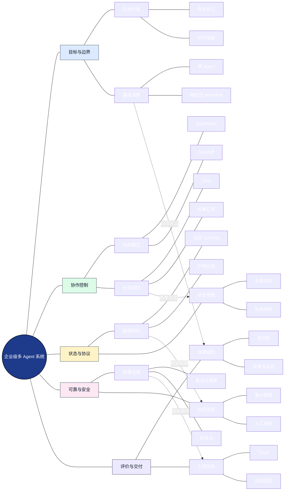
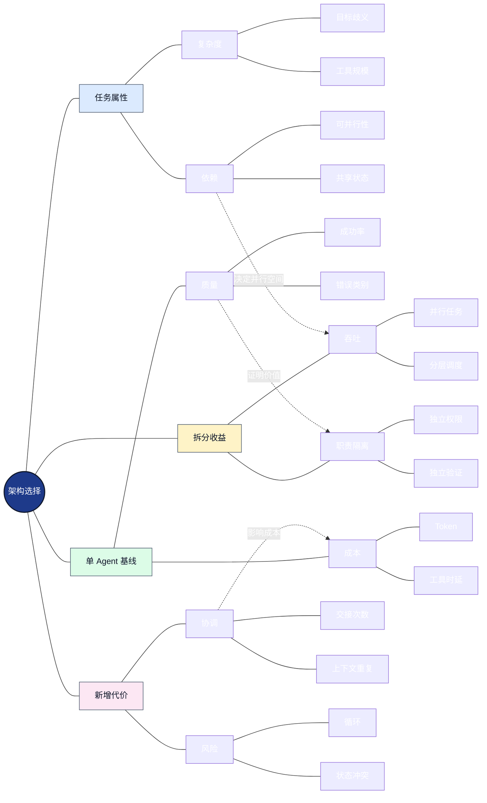
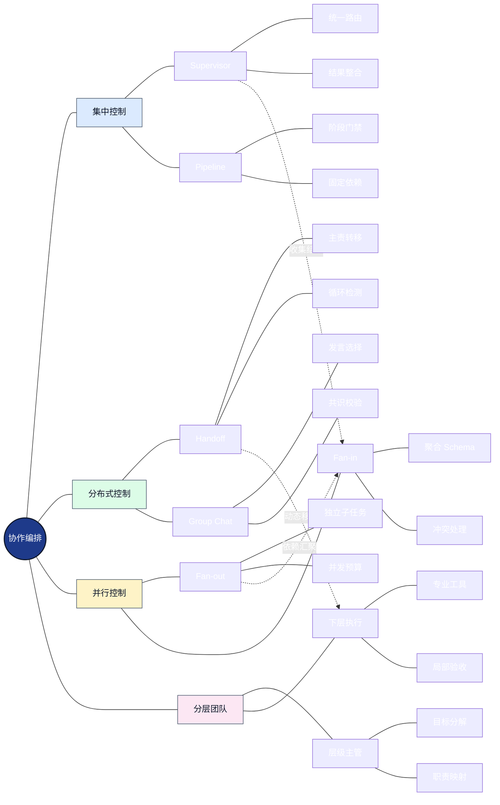
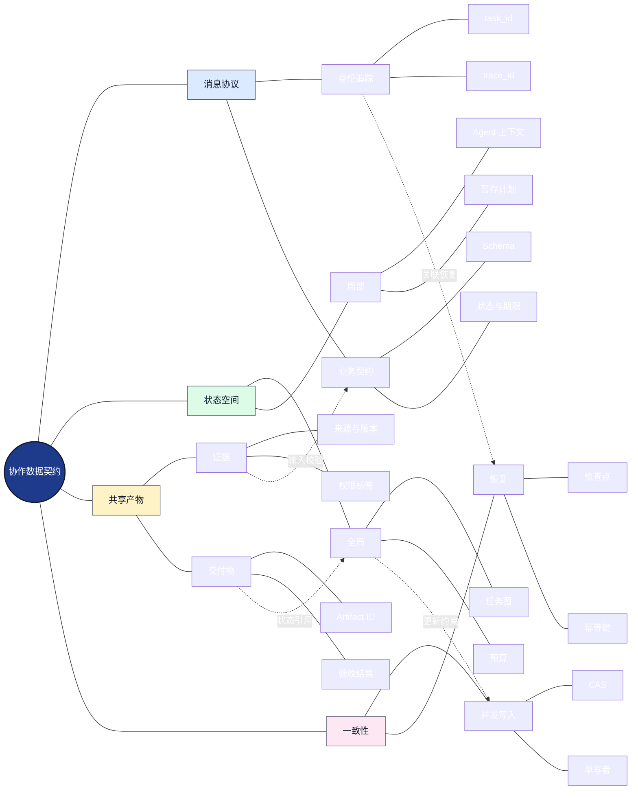
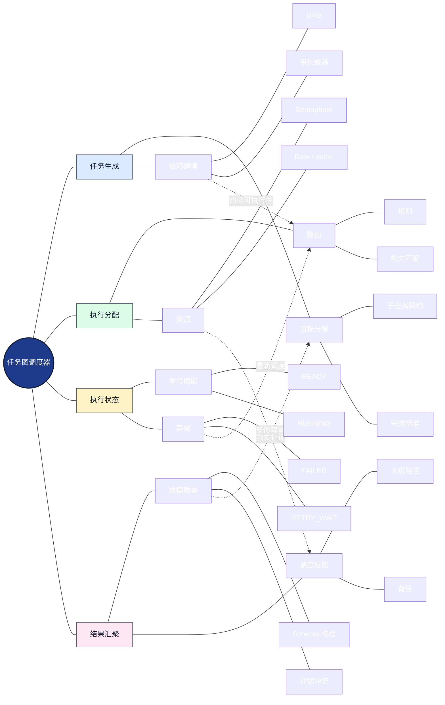
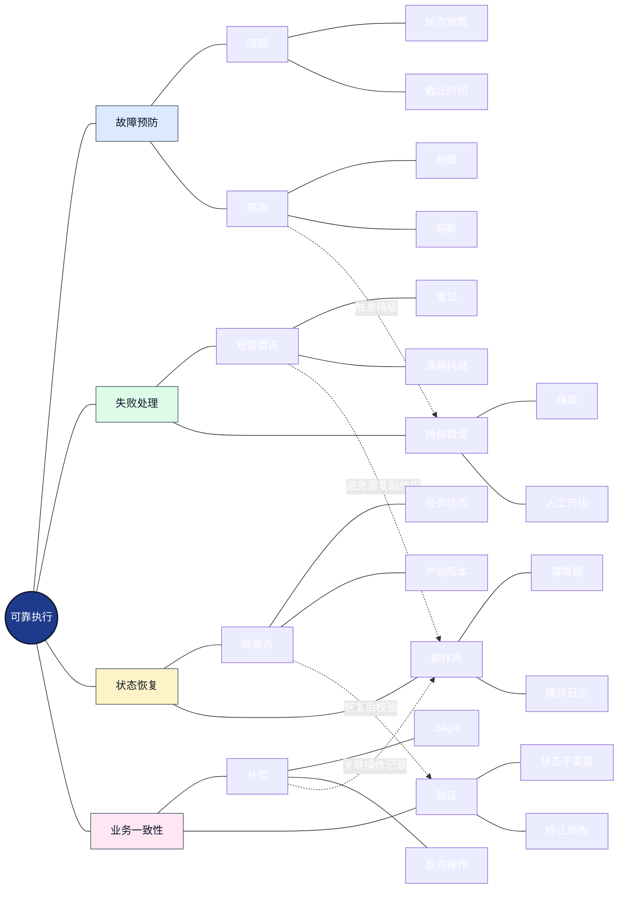
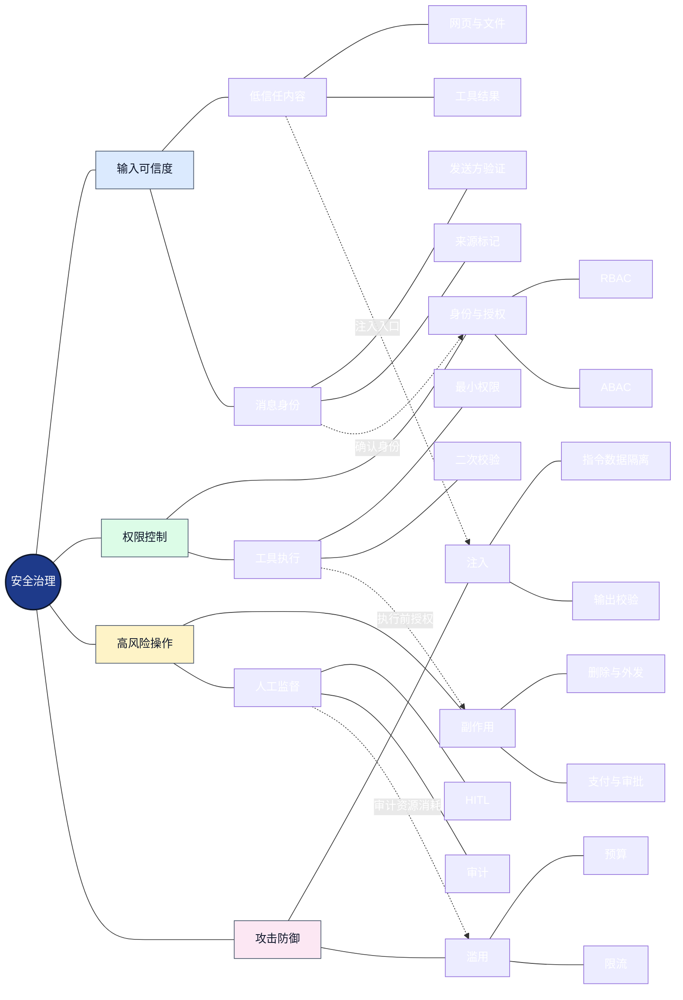
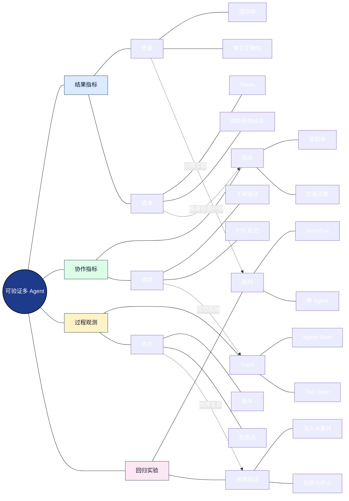
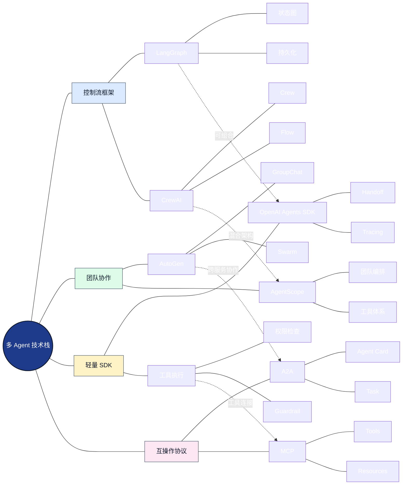
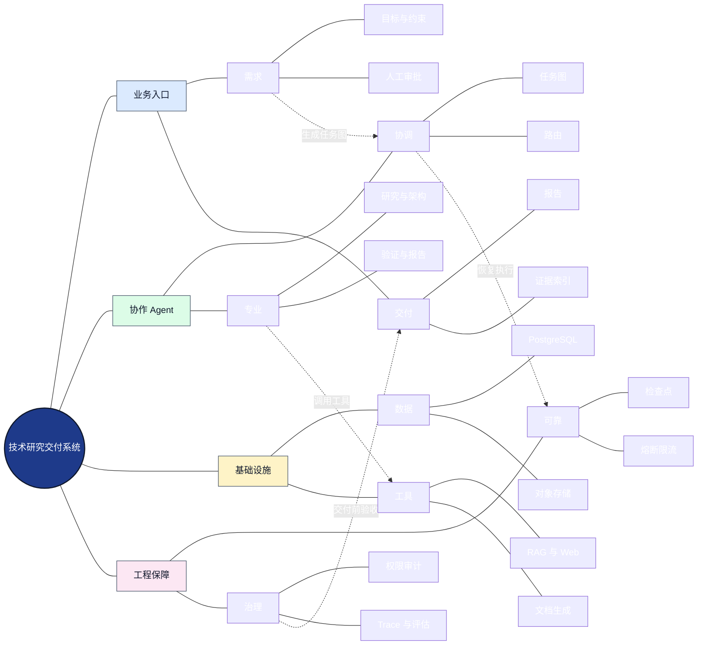

# 多 Agent 项目设计案例：从任务分解到企业级可靠协作

> 第 08 章 · 项目与面试 · `04-Multi-Agent-Project.md`  
> 研究范围：多 Agent 架构、协作协议、任务图、状态与一致性、可靠性、安全、可观测性、评估、框架选型与完整项目落地。  
> 本文以<strong>可验证的工程设计</strong>为主线。示例系统和公式是教学与架构建模方案，不代表特定框架的默认实现或已取得的生产指标。

## 阅读路线

从<strong>为什么需要多个 Agent</strong>出发，依次研究<strong>如何拆分任务 → 如何组织协作 → 如何定义通信与状态 → 如何调度与恢复 → 如何约束安全 → 如何评价收益 → 如何落地项目</strong>。多 Agent（Multi-Agent System，MAS，多智能体系统）不是“把几个大模型放在一起聊天”，而是将决策职责、上下文、工具权限和任务执行分配给多个可协作的主体。

| 学习层次 | 核心问题 | 对应章节 |
|---|---|---|
| 设计动机 | 单 Agent 为什么不够？ | 1 |
| 组织架构 | 谁决策、谁执行、谁验证？ | 2 |
| 协议与状态 | Agent 之间交换什么、保存什么？ | 3 |
| 调度算法 | 子任务如何分解、并行、汇聚？ | 4 |
| 生产可靠性 | 超时、失败、重试与副作用如何处理？ | 5 |
| 安全治理 | 如何防越权和跨 Agent 注入？ | 6 |
| 质量证明 | 如何与单 Agent 公平比较？ | 7 |
| 框架与案例 | 如何设计完整的企业项目？ | 8—10 |

### 全章核心知识网络

<strong>图谱解读：</strong>目标与边界决定是否需要多 Agent；协作控制决定任务如何流转；状态与协议决定能否正确交接；可靠性与安全约束执行；评价体系反过来检验拆分是否产生真实收益。图中的虚线表示跨模块约束关系，而不是单向执行步骤。

## 1. 从单 Agent 到多 Agent：演进动机与采用边界

### 1.1 四种不同的执行组织方式

<strong>单 Agent</strong>由一个决策主体使用工具完成目标。它可以进行多轮推理和工具调用，但所有职责集中在同一控制主体。<strong>Workflow（工作流）</strong>使用显式节点、条件与状态组织执行；其中的节点可以是普通函数，也可以是 Agent。<strong>多 Agent</strong>引入多个具有独立职责或局部决策权的主体。<strong>混合式多 Agent 工作流</strong>则用确定性编排承载关键控制，再在局部环节引入自主决策。

| 方案 | 控制权 | 优势 | 成本与风险 | 适用条件 |
|---|---|---|---|---|
| 单 Agent | 单一决策主体 | 简洁、上下文集中 | 工具膨胀、职责混杂 | 工具少、目标集中 |
| 确定性 Workflow | 代码或状态图 | 可预测、可回归 | 动态适应能力受限 | 流程稳定、规则明确 |
| 自主多 Agent | 多个决策主体 | 专业分工、动态交接 | 协调成本与循环风险 | 角色能力差异显著 |
| Workflow + 多 Agent | 编排器与局部 Agent 共同控制 | 可控且灵活 | 状态、接口设计复杂 | 企业级复杂任务 |

### 1.2 采用多 Agent 的必要条件

任务首先应具有可分解性：子任务能够以明确的输入、输出和完成条件交付。其次，角色之间最好存在不同的工具、权限、专业知识或可并行工作，否则拆分只会增加调用次数。第三，系统必须能度量收益，包括成功率、总耗时、成功任务成本和恢复能力。

<strong>决策顺序：</strong>先建立规则工作流或优化后的单 Agent 基线；识别职责拥挤、上下文干扰或独立审查需求；仅对确有收益的环节进行拆分。多 Agent 不是复杂度的默认答案。

### 1.3 成本收益的基本模型

设单 Agent 的成功概率为 $`p_s`$，每次尝试成本为 $`c_s`$；多 Agent 的成功概率为 $`p_m`$，每次尝试成本为 $`c_m`$。在相同任务分布、成功标准和可比成本口径下，成功任务的期望尝试成本可近似表示为：

$$
C_{\mathrm{success}} = \frac{c}{p}, \qquad p > 0
$$

这是<strong>独立同分布、允许重试且成本相对稳定</strong>条件下的近似分析。生产系统还需考虑固定部署成本、重试相关性、外部副作用和失败赔付。即使多 Agent 成功率较高，也不意味着其单位成功成本必然更低。

### 采用多 Agent 的决策网络

<strong>图谱解读：</strong>是否采用多 Agent 是一个需要实验支持的架构决策：任务可分解性提供可能性，基线测试提供比较标准，协作收益必须覆盖协调与治理成本。

## 2. 多 Agent 协作架构：控制权、角色与交接

### 2.1 常见模式的机制与区别

<strong>Supervisor/Worker（主管—执行者）</strong>让主管统一选择子 Agent，适合权限集中和任务汇总。<strong>Sequential Pipeline（顺序流水线）</strong>适合具有稳定依赖的处理阶段。<strong>Fan-out/Fan-in（并行分发与汇聚）</strong>适合独立检索、评审或候选生成。<strong>Handoff/Swarm（动态交接）</strong>允许当前主体将控制权移交给另一主体，适合会话主责变化。<strong>Group Chat/Debate（群组讨论或辩论）</strong>适合探索性方案比较，但会增加轮次和相关性错误。<strong>Hierarchical Team（层级团队）</strong>用于多层任务规划和专业团队组织。

| 模式 | 谁选择下一步 | 典型交互 | 失败点 | 治理方式 |
|---|---|---|---|---|
| Supervisor | 主管 Agent | 主管委派、收集结果 | 中央瓶颈 | 预算、候选白名单 |
| Pipeline | 编排器 | A → B → C | 上游错误传播 | 阶段验收 |
| Fan-out/Fan-in | 编排器 | A → B/C → D | 汇聚冲突、慢尾 | 汇聚 Schema、超时 |
| Handoff | 当前 Agent | A 交接 B | 交接循环 | 交接次数与权限检查 |
| Group Chat | 发言选择器或轮转规则 | 多轮讨论 | Token 膨胀、伪共识 | 停止条件、证据验证 |
| Hierarchical | 上级协调者 | 团队分级分工 | 层级过深 | 层级预算、责任归属 |

### 2.2 Handoff 与 Agent-as-Tool

<strong>Handoff（控制权移交）</strong>改变当前由哪个 Agent 继续承担会话或任务控制。<strong>Agent-as-Tool（将 Agent 封装为工具）</strong>则由调用方保留控制权，委派一个限定子任务并接收结果。二者可能都表现为调用另一个 Agent，但权限、上下文流向、失败恢复和用户交互归属不同。

例如，用户请求“请同时研究三种数据库并汇总”，主管调用三个研究 Agent 更适合 Agent-as-Tool；用户从技术咨询转向售后工单处理时，明确的 Handoff 可能更自然。OpenAI Agents SDK 官方将二者列为不同的多 Agent 组织方式。[来源：OpenAI Agents SDK 多 Agent](https://openai.github.io/openai-agents-python/multi_agent/)。

### 2.3 Agent 职责边界

每个 Agent 的设计至少明确：<strong>责任目标、可见输入、可用工具、权限范围、输出 Schema、完成条件、失败策略</strong>。如果两个 Agent 拥有几乎相同的目标、上下文和工具，则需重新审视拆分价值。

### 协作模式与控制权网络

<strong>图谱解读：</strong>不同模式的根本区别是控制权归属；实际项目可以将集中调度、并行执行和动态交接组合起来，但必须保证同一时刻的主责明确。

## 3. 消息协议、上下文与状态：协作的数据基础

### 3.1 通信不是自由聊天，而是带契约的任务交换

建议任务消息包括 `task_id`、`subtask_id`、`sender`、`receiver`、`objective`、`input_refs`、`constraints`、`expected_output`、`status`、`deadline`、`trace_id` 和 `idempotency_key`。其中 `input_refs` 优先引用存储的证据或产物，避免复制全部历史上下文。

<strong>Schema（结构模式）</strong>定义字段类型、必填项与约束；<strong>Contract（契约）</strong>还规定业务语义、权限、错误分类、超时与版本兼容性。仅要求模型返回 JSON 并不等于数据已经可靠：接收端仍需校验字段、引用和业务不变量。

### 3.2 三层状态模型

- <strong>全局任务状态：</strong>用户目标、任务图、任务预算、全局状态、产物索引、审批记录。
- <strong>Agent 私有状态：</strong>角色提示词、局部计划、局部推理上下文和暂存结果。
- <strong>共享产物状态：</strong>检索证据、结构化方案、文档、验证报告及其版本。

上下文（Context）是当前模型推理可见的信息窗口；状态（State）是系统需要持久维护的事实与执行进度；记忆（Memory）通常指跨步骤或跨任务复用的信息。三者有交集，但不能混为一谈。

### 3.3 一致性与并发写入

当两个 Agent 并发更新同一个全局状态字段时，可能发生<strong>Lost Update（更新丢失）</strong>。应采用单写者原则、不可变产物、版本号、比较并交换（Compare-and-Swap，CAS）或状态图规定的合并函数。可交换、可结合的增量数据更适合并行归并；具有业务顺序依赖的修改则应串行化。

### 3.4 交接中的安全边界

Agent 生成的文本不是高优先级系统指令。外部检索结果、工具输出和其他 Agent 的自然语言内容都应按其真实来源划分信任等级。跨 Agent 传递的应是<strong>任务数据与证据</strong>，而不是可以绕过权限的控制指令。

### 消息、上下文与状态网络

<strong>图谱解读：</strong>消息负责传递任务意图，状态负责记录生命周期，产物负责承载可复用结果，一致性机制负责防止并发执行破坏全局事实。

## 4. 任务分解、DAG 调度与并行算法

### 4.1 从自然语言目标到任务图

<strong>Task Decomposition（任务分解）</strong>将总目标转换为具有验收标准的子任务。<strong>DAG（Directed Acyclic Graph，有向无环图）</strong>以节点表示任务、以有向边表示依赖。任务图回答“先做什么”，状态机回答“当前做到了哪里”。

例如技术研究报告可拆成资料检索、方案分析、成本分析、引用核验和报告生成。方案分析与成本分析可以在证据充分后并行，而报告生成必须等待它们完成。任务图必须同时包含<strong>数据依赖、权限依赖和审批依赖</strong>，不能仅按文字描述决定并行。

### 4.2 关键路径与理论加速比

对 DAG 的全部起点到终点路径集合 $P$，在任务时长固定、无限资源、无协调开销的理想条件下，最短完工时间受关键路径约束：

$$
T_{\mathrm{critical}} = \max_{p \in P} \sum_{i \in p} t_i
$$

理论加速比可近似写为：

$$
S = \frac{T_{\mathrm{serial}}}{T_{\mathrm{parallel}}}
$$

真实执行还存在队列、API 限流、上下文准备、汇聚和失败重试。<strong>并行子任务越多不一定越快</strong>，因为最慢任务和共享资源往往决定最终延迟。

### 4.3 调度策略与约束

| 策略 | 依据 | 优势 | 风险 |
|---|---|---|---|
| 静态路由 | 预先配置 | 稳定、易测试 | 灵活性有限 |
| 规则路由 | 任务标签与业务规则 | 成本低、可解释 | 规则维护成本 |
| LLM 路由 | 语义与上下文 | 适应开放任务 | 不稳定、额外 Token |
| 能力匹配 | 技能、工具、权限 | 减少错配 | 能力目录需维护 |
| 负载感知 | 队列、并发、资源 | 改善吞吐 | 状态监控复杂 |
| 成本感知 | 成本、时延、质量 | 可优化预算 | 需要准确估计 |

### 4.4 并发与背压

Semaphore（信号量）限制同时运行的任务数；Rate Limiter（速率限制器）限制单位时间请求；Backpressure（背压）在下游处理能力不足时限制上游产生新任务。还应为不同租户、Agent 类型和工具配置独立配额，避免高成本任务挤占关键业务。

### 4.5 汇聚与冲突解决

Fan-in 不应仅拼接文本。聚合器需要检查子任务完整性、Schema、引用来源、版本一致性和冲突。遇到矛盾证据时，应保留冲突、请求补证或升级人工审核，而不是让总结 Agent 任意选择一个答案。

### 任务调度与资源约束网络

<strong>图谱解读：</strong>任务分解决定并行机会，调度器依据依赖和资源约束分配执行，状态机记录进度，结果汇聚提供质量反馈并影响后续任务生成。

## 5. 可靠性工程：失败、重试、检查点与补偿

### 5.1 终止条件与预算

Agent 协作必须设置成功验收、最大轮次、最大工具调用数、Token 上限、墙钟时间上限、无进展检测和安全中断。预算应在全局任务与子任务之间分层分配，防止一个 Agent 耗尽全部资源。

### 5.2 重试、幂等、熔断、舱壁与降级

| 机制 | 英文 | 解决的问题 | 关键设计 |
|---|---|---|---|
| 重试 | Retry | 短暂网络故障 | 指数退避、随机抖动、重试预算 |
| 幂等 | Idempotency | 重复调用导致副作用 | 幂等键、外部操作记录 |
| 熔断 | Circuit Breaker | 下游持续故障 | CLOSED、OPEN、HALF-OPEN |
| 舱壁 | Bulkhead | 一类任务耗尽资源 | 独立并发池与配额 |
| 超时 | Timeout | 无限等待 | 总截止时间与子步骤预算 |
| 降级 | Fallback | 主能力不可用 | 备用模型、受限功能 |
| 检查点 | Checkpoint | 中断后重复全部工作 | 状态持久化与恢复 |

重试与幂等必须一起设计。读取操作通常容易安全重试；发送邮件、创建订单、写入外部系统等操作必须判断是否已经生效。仅在客户端生成随机幂等键但不由服务端持久去重，不能真正保证幂等。

### 5.3 状态恢复与重放

恢复流程首先读取持久检查点，确认已提交产物、外部副作用和任务状态，再选择待恢复节点。对于可能重新执行的节点，必须保证其工具调用可重复、可检测或可补偿。LangGraph 官方文档提醒：恢复时可能从节点起点重放，因此副作用边界和节点粒度非常重要。[来源：LangGraph 持久化](https://docs.langchain.com/oss/python/langgraph/persistence)。

### 5.4 Saga 与补偿事务

Saga 是分布式业务流程中的补偿思路：每个可补偿操作配套反向业务操作。例如“创建申请 → 上传附件 → 发送通知”，通知失败后可以尝试撤销申请与附件，但已发送邮件无法保证被真正撤回。补偿提供<strong>业务一致性修复</strong>，不等同于数据库 ACID 事务的原子回滚。

### 5.5 可恢复执行的不变量

- 已成功提交的产物不应因重试无故覆盖。
- 每个外部副作用必须有可查询的执行记录。
- 状态转移需要满足允许的边和前置条件。
- 取消、超时和人工审批必须能阻止新的危险操作。
- 每个失败都有明确归因：模型、工具、协议、业务或安全。

### 可靠性与故障隔离网络

<strong>图谱解读：</strong>故障预防减少失败发生，失败处理控制影响范围，检查点恢复执行，幂等与补偿保证业务副作用不会因为恢复而失控。

## 6. 安全治理：Agent 间信任边界与权限模型

### 6.1 多 Agent 特有的风险放大

Prompt Injection（提示词注入）可通过外部网页、文档或工具结果影响 Agent 决策。多 Agent 中，恶意内容还可能借助交接消息进入其他 Agent 的上下文。Excessive Agency（过度自主权）则指 Agent 拥有超出任务需要的权限或执行自由度。OWASP LLM Top 10 对提示词注入、过度自主权和资源滥用等风险提供了系统化分类。[来源：OWASP LLM Top 10](https://genai.owasp.org/llm-top-10/)。

### 6.2 关键控制措施

<strong>最小权限（Least Privilege）</strong>要求每个 Agent 只能使用完成任务所必需的工具与数据。RBAC（Role-Based Access Control，基于角色的访问控制）按角色授权；ABAC（Attribute-Based Access Control，基于属性的访问控制）结合用户、任务、资源和环境属性判断。权限必须在<strong>真实工具执行边界</strong>校验，不能只依靠提示词约束。

### 6.3 数据与指令隔离

外部资料属于低信任数据；工具输出、Agent 生成文本和用户上传文档也应保留来源标签。其他 Agent 的回答不能自动提升为系统指令。对写操作、外发信息、删除和付款等高风险动作设置审批门槛，必要时采用 Human-in-the-Loop（HITL，人在回路）审批。

### 6.4 安全测试

构造恶意网页片段、伪造 Agent 消息、越权工具调用、跨租户资源引用、无限循环诱导和敏感数据外传等测试。安全评估应同时覆盖“是否拒绝不当操作”和“是否仍能完成合法任务”，避免一味拒绝造成可用性下降。

### 多 Agent 安全边界网络

<strong>图谱解读：</strong>安全的核心是把身份、内容可信度和工具权限分开处理。即使一个 Agent 的建议被另一个 Agent 接受，真实副作用仍必须通过授权与审批检查。

## 7. 质量评估与可观测性：证明协作收益

### 7.1 评估对象分层

<strong>最终结果评估</strong>衡量任务是否成功、答案是否准确、产物是否可用；<strong>过程评估</strong>衡量分解、路由、工具调用、交接、恢复与验证是否合理；<strong>系统评估</strong>衡量成本、延迟、吞吐、安全和稳定性。必须使用同一任务集对比规则 Workflow、优化后的单 Agent 与多 Agent 系统。

### 7.2 核心指标与公式

任务成功率定义为：

$$
\mathrm{SuccessRate} = \frac{N_{\mathrm{successful}}}{N_{\mathrm{total}}}
$$

成功任务平均成本应采用同一批任务的总成本除以成功数：

$$
\mathrm{CostPerSuccess} = \frac{C_{\mathrm{total}}}{N_{\mathrm{successful}}}
$$

当成功数为零时该指标未定义，应单独报告。对于成功率比较，还应给出样本量、置信区间和任务难度分布，不能把小样本差异当作稳定提升。

| 维度 | 主要指标 | 诊断目的 |
|---|---|---|
| 结果质量 | 任务成功率、事实错误率、引用准确率 | 是否真正完成目标 |
| 协作质量 | 错误路由率、无效交接率、重复工作量 | 分工是否合理 |
| 性能 | P50/P95 延迟、吞吐、关键路径 | 并行是否有效 |
| 成本 | Token、工具费用、成功任务成本 | 收益是否抵消协调成本 |
| 可靠性 | 重试率、恢复成功率、超时率 | 故障是否可控 |
| 安全 | 越权率、审批绕过率、泄漏事件 | 权限边界是否有效 |

### 7.3 独立验证的陷阱

多个 Agent 如果使用相同模型、相同证据和相同提示方式，可能产生<strong>相关性错误</strong>。因此，增加“审核 Agent”并不自动保证结果正确。有效验证应尽可能引入独立证据、规则检查、执行测试或不同的错误发现机制。

### 7.4 可观测性与 Trace

Trace（分布式追踪）关联一次完整任务，Span（跨度）记录单个 Agent 决策、模型调用或工具调用。还应结合 Metrics（指标）和 Logs（日志）记录延迟、错误类别、Token、成本、交接原因、状态版本和审批事件。OpenAI Agents SDK 提供模型调用、工具、交接与 Guardrail 等追踪能力。[来源：Tracing](https://openai.github.io/openai-agents-python/tracing/)。

### 7.5 回归测试矩阵

应覆盖单任务、依赖任务、并行汇聚、路由歧义、超时重试、长任务中断、重复副作用、无限交接、跨租户越权、恶意消息和预算耗尽。每次回归记录模型、提示词、框架、工具、数据集和代码版本，保证结果可复现。

### 评估与观测网络

<strong>图谱解读：</strong>评价结果必须能回溯到协作过程；追踪与状态日志使失败可定位，基线和回归使“多 Agent 更好”成为可证伪的工程假设。

## 8. 主流框架与跨框架协议：能力边界和选型

### 8.1 框架对照

| 框架 | 核心抽象 | 重点能力 | 选型关注点 |
|---|---|---|---|
| [LangGraph](https://docs.langchain.com/oss/python/langgraph/overview) | 状态图、节点、边 | 持久化、动态路由、人工中断 | 状态 Schema、重放语义 |
| [AutoGen](https://microsoft.github.io/autogen/stable/) | AgentChat、Teams | GroupChat、Swarm、Selector | 终止条件、实验性 API |
| [AgentScope](https://github.com/agentscope-ai/agentscope) | Agent 与编排组件 | Pipeline、团队协作、工具集成 | 版本与功能成熟度 |
| [CrewAI](https://docs.crewai.com/) | Crew、Flow | 角色分工、事件式流程 | Crew/Flow 边界 |
| [OpenAI Agents SDK](https://openai.github.io/openai-agents-python/) | Agent、Handoff、Tools | 交接、Agent-as-Tool、Tracing | 工具授权与 Guardrail 范围 |

框架选型不能只看是否支持多 Agent，还应比较：持久化、任务恢复、可观测性、工具协议、人工审批、测试便利性、部署模式、许可协议和团队技术栈。具体版本功能应以项目锁定版本的官方文档为准。

### 8.2 A2A 与 MCP 的互补关系

A2A（Agent-to-Agent Protocol，智能体间通信协议）主要面向独立 Agent 服务之间的能力发现、任务交换与成果交付，典型概念有 Agent Card、Task、Message、Part 和 Artifact。[A2A 官方文档](https://a2a-protocol.org/latest/topics/key-concepts/)。

MCP（Model Context Protocol，模型上下文协议）主要面向 AI 应用与工具、资源、提示词能力之间的标准化连接。[MCP 官方文档](https://modelcontextprotocol.io/)。一个 Agent 可以通过 A2A 接受任务，再通过 MCP 调用工具；二者关注的边界不同，但可以协作。

### 8.3 工程选型建议

如果最重要的是状态恢复与精确控制，优先评估状态图方案；如果最重要的是多角色对话协作，重点评估团队式框架；如果最重要的是轻量工具型专业 Agent，优先评估具备清晰交接与追踪能力的 SDK。不要为了框架统一而牺牲已有服务的可维护性。

### 框架能力与协议网络

<strong>图谱解读：</strong>框架负责本地或应用内编排，A2A 与 MCP 负责跨边界互操作；框架能力不是互斥的，应根据状态、协作与运维需求选择组合。

## 9. 企业级完整案例：技术研究与交付多 Agent 系统

### 9.1 业务需求与验收标准

假设企业用户提出：“调研三种技术方案，结合内部知识库和公开资料，输出有引用的架构建议与风险清单。”系统需要完成检索、证据校验、方案设计、成本评估、报告生成和人工审批。此案例用于说明设计方法，不代表已部署系统的实测结果。

验收标准包括：关键论断可追溯、方案满足约束、输出结构完整、禁止越权访问、失败可恢复、成本可统计、人工可审阅。

### 9.2 Agent 职责与工具

| Agent | 输入 | 输出 | 允许工具 | 主要约束 |
|---|---|---|---|---|
| Coordinator | 用户目标、预算 | 子任务图、汇总决策 | 任务图、状态查询 | 不直接绕过审批写外部系统 |
| Research | 研究问题、证据范围 | 来源清单、结构化证据 | Web、GitHub、RAG | 引用必须可核验 |
| Architecture | 证据、系统约束 | 方案与取舍 | 架构知识库 | 区分事实与推断 |
| Evaluation | 候选方案、验收规则 | 质量与风险报告 | 规则校验、测试 | 独立检查、记录失败原因 |
| Report | 已审核结论 | 可交付文档 | 文档生成、格式验证 | 不得无证据增补事实 |

### 9.3 分阶段执行

1. <strong>需求归一化：</strong>识别目标、数据权限、截止时间、输出要求和审批条件。
2. <strong>任务规划：</strong>生成 DAG、子任务契约、并行候选和预算。
3. <strong>证据获取：</strong>研究 Agent 收集公开资料与获授权的内部知识，标注来源、版本和置信依据。
4. <strong>方案分析：</strong>架构 Agent 基于证据设计候选方案；成本和风险评估可在依赖满足时并行。
5. <strong>独立核验：</strong>评估 Agent 检查引用、业务约束、矛盾信息与遗漏。
6. <strong>报告交付：</strong>报告 Agent 输出结构化文档；导出前执行格式与安全校验。
7. <strong>人工审批：</strong>涉及高风险结论或外部动作时由授权人员确认。

### 9.4 数据层与服务层

Application 提供 API、上传、进度和人工审批；Orchestration 维护任务图、预算和状态；Agent Layer 承担专业判断；Tool Layer 提供搜索、知识库和文档能力；State Layer 保存任务、事件和产物；Reliability Layer 管理重试、熔断与并发；Observability Layer 关联全链路 Trace；Evaluation Layer 管理黄金测试集与回归。

可以使用 PostgreSQL 保存任务及事件，Redis 用于短期缓存或速率协调，对象存储保存报告和证据快照。技术组件是参考实现，不是强制依赖。对外部工具必须在服务端实施身份与权限校验。

### 9.5 关键失败场景推演

<strong>场景 A：研究 Agent 超时。</strong>协调器根据子任务截止时间决定重试或降级，并保留已经获取的可验证证据；不能无限等待。

<strong>场景 B：两个研究 Agent 得出冲突结论。</strong>汇聚器保留证据冲突，要求检查来源、时间与适用范围，必要时请求人工判断；不应以“多数 Agent 同意”代替证据。

<strong>场景 C：报告已写入但任务状态未更新。</strong>恢复时先通过幂等键和产物版本检查实际写入状态，再补记任务结果，避免重复创建文件。

<strong>场景 D：恶意网页指示系统发送内部文件。</strong>研究 Agent 将网页内容作为数据处理，工具服务端拒绝越权外发；安全事件记录在审计日志中。

### 9.6 验证多 Agent 的收益

构建三组实验：规则工作流、单 Agent、五角色多 Agent。使用相同问题、相同外部资料、相同工具权限和相近预算，报告任务成功率、引用准确率、P95 时延、成功任务成本和恢复成功率。若多 Agent 仅增加调用成本而无显著质量收益，应简化架构。

### 完整企业项目的跨层知识网络

<strong>图谱解读：</strong>业务约束决定任务规划；专业 Agent 通过受控工具处理数据；可靠性与安全体系横向约束每一次执行；交付物必须经证据、结构和权限联合验收。

## 10. 工程取舍、常见误区与面试问题

### 10.1 高频取舍矩阵

| 决策点 | 方案 A | 方案 B | 建议依据 |
|---|---|---|---|
| 协作组织 | Supervisor | Swarm | 统一治理 vs 动态交接 |
| 任务执行 | 串行 | 并行 | 依赖、关键路径、限流 |
| 路由 | 规则 | LLM | 确定性、任务开放度、成本 |
| 上下文 | 全量共享 | 引用与摘要 | 隔离性、Token、可追溯 |
| 状态 | 内存 | 持久化 | 任务时长、恢复需求 |
| 质量验证 | 模型互评 | 独立证据 + 规则 | 错误相关性与可验证性 |
| 故障处理 | 全局重跑 | 局部恢复 | 副作用、缓存与检查点 |
| 交付 | 自动发布 | 人工审批 | 风险等级与合规要求 |

### 10.2 常见误区

- <strong>“Agent 越多越强”：</strong>协调成本和错误传播会同步增加。
- <strong>“并行一定更快”：</strong>依赖路径、限流和慢尾决定实际延迟。
- <strong>“多 Agent 讨论就是独立验证”：</strong>共享证据和模型会带来相关性错误。
- <strong>“使用框架就自动具备生产可靠性”：</strong>框架不能替代业务幂等、权限、恢复与监控设计。
- <strong>“Handoff 就是调用工具”：</strong>Handoff 改变控制权，而 Agent-as-Tool 保留调用方主责。
- <strong>“共享全部历史最安全”：</strong>过量上下文可能泄漏敏感信息并增加干扰。
- <strong>“重试不会有副作用”：</strong>外部写操作需要独立幂等保障。

### 10.3 面试问答

<strong>Q1：什么时候不用多 Agent？</strong> 当任务步骤固定、工具数量有限且单 Agent 已达到目标质量时，应优先使用简单工作流，避免无效协调。

<strong>Q2：Supervisor 和 Swarm 如何选？</strong> 关注控制权。集中治理、审计和权限控制优先 Supervisor；职责动态切换且交接边界清晰时可评估 Swarm。

<strong>Q3：如何防止两个 Agent 无限对话？</strong> 配置轮次、时间、Token 和交接次数上限，结合无进展检测、状态机和终止验收。

<strong>Q4：多 Agent 如何做并发控制？</strong> 在 DAG 就绪队列上调度，使用信号量、速率限制、租户配额和背压；汇聚阶段进行 Schema 与冲突检查。

<strong>Q5：任务执行中崩溃怎么办？</strong> 从检查点恢复状态，核对外部副作用记录，按幂等策略重放必要节点，并对不可恢复步骤升级人工处理。

<strong>Q6：审核 Agent 为什么可能无效？</strong> 若与执行 Agent 共享模型偏差和错误证据，可能共同产生错误。应引入独立证据、规则或可执行测试。

<strong>Q7：A2A 与 MCP 区别？</strong> A2A 侧重 Agent 间任务互操作，MCP 侧重模型应用与工具、资源能力互操作，二者可以组合。

<strong>Q8：如何证明多 Agent 有价值？</strong> 在相同数据集和约束下对比单 Agent 与工作流，报告质量、延迟、成功任务成本、稳定性和统计不确定性。

<strong>Q9：Agent 之间如何管理状态？</strong> 分离全局状态、局部上下文与共享产物；使用稳定 ID、版本与合并规则避免并发覆盖。

<strong>Q10：如何保障多 Agent 安全？</strong> 对每个真实工具调用执行最小权限校验，对低信任内容做指令数据隔离，对高风险动作配置人工审批和审计。

## 11. 核心知识网络总结与学习迁移

本章的知识逻辑是：<strong>业务复杂度决定是否拆分 → 职责边界决定协作模式 → 协作模式决定通信与状态需求 → 任务图决定调度与并行 → 副作用决定恢复与安全约束 → 评估结果决定是否继续采用多 Agent。</strong>

与知识手册其他章节的联系：第 01 章 LLM 基础决定模型能力与 Token 成本；第 02—03 章提供 Agent、Tool、Memory、Context 与 State 的基础；第 04 章 Workflow 与 Router 解释执行控制；第 05 章 RAG/MCP 提供外部知识和工具；第 06 章系统介绍多 Agent 范式与框架；第 07 章的可靠性、安全、观测和部署能力决定本章项目是否能生产落地；第 08 章其他案例则提供具体业务实践。

<strong>最终判断标准：</strong>好的多 Agent 项目不是拥有最多角色，而是在真实业务约束下，用最少必要的自主决策、明确的状态契约和可验证的工程机制，持续交付正确结果。

## 12. 参考资料与延伸阅读

### 官方框架与协议

1. [LangGraph Overview](https://docs.langchain.com/oss/python/langgraph/overview) — 状态图、编排与执行模型。
2. [LangGraph Persistence](https://docs.langchain.com/oss/python/langgraph/persistence) — 检查点、恢复和持久化。
3. [AutoGen 官方文档](https://microsoft.github.io/autogen/stable/) — AgentChat、Teams 与协作模式。
4. [AutoGen Teams](https://microsoft.github.io/autogen/stable/user-guide/agentchat-user-guide/tutorial/teams.html) — 团队组织与终止条件。
5. [AgentScope GitHub](https://github.com/agentscope-ai/agentscope) — Agent 框架与团队协作。
6. [CrewAI 官方文档](https://docs.crewai.com/) — Crew、Flow 与角色协作。
7. [OpenAI Agents SDK Multi-Agent](https://openai.github.io/openai-agents-python/multi_agent/) — Handoff 与 Agent-as-Tool。
8. [OpenAI Agents SDK Tracing](https://openai.github.io/openai-agents-python/tracing/) — Agent 与工具执行追踪。
9. [A2A Protocol](https://a2a-protocol.org/latest/topics/key-concepts/) — Agent Card、Task、Artifact。
10. [Model Context Protocol](https://modelcontextprotocol.io/) — 工具与资源互操作。

### 安全与工程基础

11. [OWASP Top 10 for LLM Applications](https://genai.owasp.org/llm-top-10/) — 提示词注入、过度自主权等风险。
12. [OpenTelemetry Documentation](https://opentelemetry.io/docs/) — Trace、Metrics 与 Logs。
13. [Microsoft Azure Architecture Center — Saga](https://learn.microsoft.com/en-us/azure/architecture/patterns/saga) — 分布式补偿事务。
14. [Microsoft Azure Architecture Center — Circuit Breaker](https://learn.microsoft.com/en-us/azure/architecture/patterns/circuit-breaker) — 熔断模式。
15. [Google SRE Book](https://sre.google/sre-book/table-of-contents/) — 可靠性与生产运维原则。

> <strong>资料使用说明：</strong>官方链接用于核对各框架和协议的定义及功能边界；文中的架构选择、数据 Schema、指标公式和企业案例为基于这些原理整理的工程设计建议，不应误认为官方框架强制规范。由于框架版本迭代较快，实施时需以锁定版本的 API 与文档为准。

