# 05｜可靠性、质量、成本与工程取舍：企业级 Agent 系统的工程决策体系

> 所属章节：08-Projects-and-Interviews / 05-Engineering-Tradeoffs  
> 核心问题：如何在<strong>业务质量、系统可靠性、性能、成本、安全与维护复杂度</strong>之间建立可量化、可验证、可持续的工程取舍？  
> 阅读路径：业务目标 → 指标与约束 → 可靠性机制 → 质量评价 → 性能与成本 → 架构选型 → 可观测性 → 企业实践。

## 导读：从“Agent 能运行”到“Agent 能交付”

大语言模型（Large Language Model，LLM）让软件能够解释自然语言、动态选择工具和生成内容，但模型调用成功并不等于业务任务完成。企业中的知识问答、文档翻译、研发辅助和审批自动化，不仅要求输出合理，还要求系统<strong>可用、可控、可恢复、可审计，并且在预算范围内长期运行</strong>。因此，本章不把重试、缓存、评估、并发等机制视为零散技巧，而将其纳入统一的工程决策体系。

最重要的认识是：<strong>可靠性、质量、成本、性能不是四个彼此独立的优化方向</strong>。例如增加验证步骤通常提升质量，但会增加延迟与模型费用；使用缓存可降低重复计算，却可能导致过期信息或跨租户泄露；增加并发可缩短关键路径，但也可能触发速率限制、争用内存或放大故障。设计者必须先明确业务约束，再使用指标和实验比较候选方案，而不是先选技术、后找理由。

本章的案例数据、阈值与预算数字均为<strong>教学示例</strong>，不代表任何模型或框架的实际测试结果。涉及供应商价格、版本和限流策略时，以官方最新说明为准。

## 1. 核心概念：工程质量目标及其依赖关系

### 1.1 六个维度如何区分

| 维度 | 英文术语 | 主要回答的问题 | 常见指标 | 不能混淆的概念 |
|---|---|---|---|---|
| 可靠性 | Reliability | 在给定条件下能否持续完成任务 | 任务成功率、恢复率 | 不等于 HTTP 200 |
| 可用性 | Availability | 用户是否能获得服务 | 可用请求比例、服务时间可用性 | 不等于回答正确 |
| 业务质量 | Quality | 结果是否满足业务验收 | 准确率、覆盖率、引用正确率 | 不等于模型主观评分 |
| 性能 | Performance | 任务处理有多快、容量多大 | P95、P99、吞吐量 | 不等于首字响应快 |
| 成本效率 | Cost Efficiency | 获得有效结果要花多少资源 | 每成功任务成本、资源利用率 | 不等于 Token 单价低 |
| 工程可治理性 | Governability | 能否审计、限制、恢复、升级 | 越权率、可追踪率、回滚成功率 | 不等于写了系统提示词 |

<strong>关键区分：</strong>系统可能具有 99.9% 的接口可用性，却只完成了 85% 的用户真实任务。对于 Agent，业务成功必须作为独立于传输成功的指标进行定义。

### 1.2 工程决策总知识网络

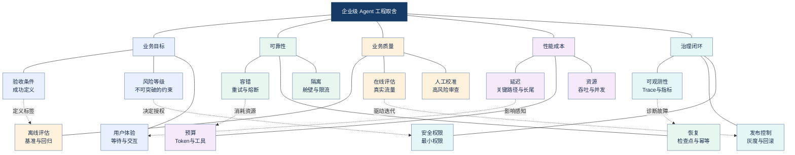

<strong>图谱解读：</strong>中心是工程取舍，外层是业务、可靠性、质量、性能成本与治理；跨分支边说明：业务验收定义质量，风险约束权限，容错消耗预算，而观测数据反过来指导发布与恢复。

### 1.3 多目标优化与帕累托前沿

多目标优化（Multi-objective Optimization）用于处理相互冲突的目标。令设计参数为 θ，成本为 C，延迟为 L，风险为 R，业务质量为 Q，可用性为 A。可以把选型表述为：

$$
\min_{\theta} \big(C(\theta),L(\theta),R(\theta)\big)
$$

同时满足质量与可用性硬约束：

$$
Q(\theta)\geq Q_{\min},\qquad A(\theta)\geq A_{\min}
$$

如果方案甲在所有目标上均不差于方案乙，且至少一项更好，则甲<strong>支配</strong>乙；不能被其他方案支配的候选集合构成帕累托前沿（Pareto Frontier）。这并不意味着前沿上的方案都适合当前业务：高风险业务的安全与准确性可能是硬门槛，只有通过门槛的方案才进入成本、延迟比较。

<strong>工程推导：</strong>先将安全、合规、数据权限、质量底线变成不可违反的约束；再在可行解中比较成本与延迟；最后以线上监控验证离线实验是否能够迁移到真实流量。简单的加权求和虽然便于实现，但如果把安全事故也折算成少量费用，可能掩盖不可接受的风险。

## 2. 业务指标体系：SLI、SLO、SLA 与错误预算

### 2.1 为什么要从业务任务定义指标

SLI（Service Level Indicator，服务等级指标）是对服务行为的实际度量；SLO（Service Level Objective，服务等级目标）是目标区间；SLA（Service Level Agreement，服务等级协议）是可能涉及合同责任的服务承诺；Error Budget（错误预算）是在目标周期内允许消耗的不可靠性额度。这四者不是同义词。

例如一个企业知识库助手，入口 API 返回成功只能说明服务端提供了响应；如果答案没有依据、引用了错误文档或越权访问了资料，仍应判定业务失败。推荐区分四类结果：传输成功、结构有效、任务完成、业务验收通过，并分别记录。

### 2.2 指标定义必须包含分母、窗口和验收标准

| 指标 | 分子 / 分母 | 典型误用 | 改进建议 |
|---|---|---|---|
| 请求可用率 | 可用请求 / 合格请求 | 把主动拒绝非法请求算故障 | 明确排除规则 |
| 任务成功率 | 通过验收的任务 / 进入统计的任务 | 只统计已完成任务 | 处理超时、取消和人工转交 |
| 工具成功率 | 合规完成的工具调用 / 有效调用 | 忽略重复副作用 | 关联业务操作 ID |
| P95 延迟 | 95% 请求耗时不超过的阈值 | 用平均值代替尾延迟 | 按任务类型分层 |
| 恢复成功率 | 恢复后通过验收的任务 / 可恢复失败任务 | 把重试次数当恢复能力 | 测试崩溃与断点恢复 |
| 证据支持率 | 有足够证据的回答 / 需证据回答 | 把引用存在等于引用正确 | 检查证据蕴含关系 |
| 安全违规率 | 违规操作 / 合格任务或操作 | 未区分严重程度 | 分严重级别单独统计 |

假设某月 10,000 个符合统计规则的任务，目标成功率为 99.5%，则允许失败任务数为：

$$
B_{\mathrm{fail}}=N(1-S)=10000\times(1-0.995)=50
$$

这属于<strong>按任务计数</strong>的错误预算，不等于时间可用性的错误预算；如果服务以分钟统计，则需使用另一套分母和观测方法。错误预算的意义不是鼓励失败，而是在持续交付与稳定性之间建立明确的风险边界。

### 2.3 SLO 与业务验收网络

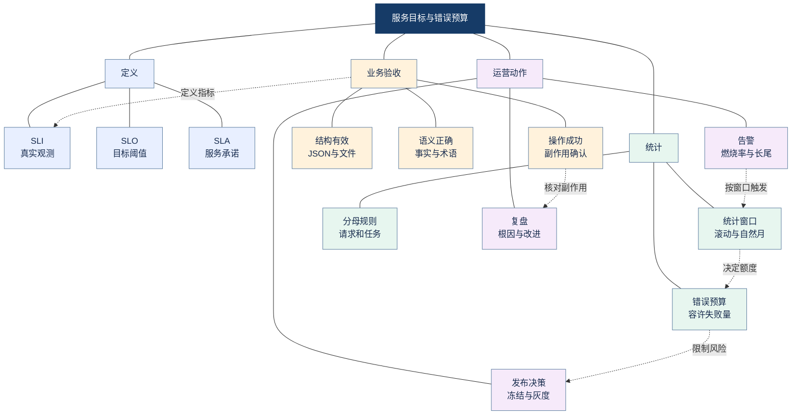

<strong>图谱解读：</strong>SLI 必须来自可复核的业务验收；SLO 决定预算，预算消耗反过来影响发布策略。长尾延迟、质量失误和安全事件不应无差别合并成一个百分比。

### 2.4 告警：避免只看失败率

可靠性监控需要结合<strong>短窗口和长窗口</strong>。短窗口快速发现突发故障，长窗口降低偶发抖动造成的误报。错误预算燃烧率（Burn Rate）衡量预算被消耗的速度，但计算时必须与 SLO 的时间窗口及指标口径保持一致。对 Agent 还应单独监控“返回成功但业务失败”的情况；否则系统会在仪表盘全部绿色时持续输出错误结果。

<strong>来源：</strong>[Google SRE：Embracing Risk](https://sre.google/sre-book/embracing-risk/)、[Google SRE：Service Level Objectives](https://sre.google/workbook/implementing-slos/)。

## 3. 可靠性：从故障分类到容错组合

### 3.1 先判断故障属于哪一层

| 层次 | 典型故障 | 可检测信号 | 优先机制 |
|---|---|---|---|
| 模型 | 格式错误、事实错误、上下文遗漏 | 结构校验、业务评估 | 约束输出、证据核验 |
| 工具 | 429、超时、参数错误 | 错误码、工具 Span | 限流、退避、参数校验 |
| RAG | 检索遗漏、文档过期、越权召回 | 召回率、索引版本、ACL | 混合检索、版本与权限过滤 |
| 编排 | 循环、错误路由、状态丢失 | 迭代数、状态转移 | 有界循环、检查点 |
| 数据 | 并发覆盖、重复写入 | 版本冲突、唯一键 | 乐观锁、幂等 |
| 资源 | 内存耗尽、队列堆积 | RSS、队列长度 | 背压、隔离、容量规划 |
| 业务 | 虽然执行成功但结果不可用 | 业务验收失败 | 人工接管、回滚与修复 |

同一症状不一定有同一根因。例如模型调用超时可能来自网络故障，也可能是上游无限并发造成的排队。先识别错误类别和可恢复性，再决定是否重试，避免把所有失败都归为“模型不稳定”。

### 3.2 重试：仅用于可恢复且安全的失败

Retry（重试）是对临时性失败的有限再次尝试；Exponential Backoff（指数退避）让等待时间逐次增长；Jitter（随机抖动）减少大规模客户端同时重试的同步冲击。

$$
t_k=\min(t_{\max},t_0 2^k)+J_k
$$

这里 t0 是初始等待、k 是从零开始的重试序号、Jk 是非负随机扰动；实际实现应再受<strong>总体截止时间</strong>限制。只有在工具具有幂等保障或能明确确认首次未生效时，才适合对有副作用操作自动重试。

### 3.3 熔断、舱壁、限流与背压

Circuit Breaker（熔断器）在下游持续失败时阻止新请求继续冲击服务，典型状态为 CLOSED（闭合）、OPEN（打开）、HALF-OPEN（半开探测）。Bulkhead（舱壁隔离）通过独立连接池、工作池或配额限制故障传播；Rate Limiting（速率限制）限制单位时间请求量；Backpressure（背压）让上游感知下游处理能力不足并减速或拒绝输入。

<strong>重要区别：</strong>熔断针对持续失败，限流针对请求速率，舱壁针对资源竞争，背压针对生产与消费速度失衡。它们不是互相替代的功能，而应组合设计。

### 3.4 容错机制网络

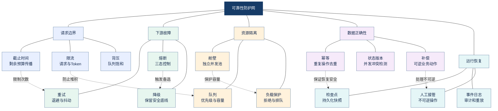

<strong>图谱解读：</strong>入口约束保护容量，下游容错处理瞬态和持续故障，幂等与检查点共同保证可恢复执行；不能只添加重试而不处理副作用。

### 3.5 超时、截止时间和重试预算

Connection Timeout（连接超时）、Read Timeout（读取超时）、Tool Timeout（工具超时）、Task Deadline（任务截止时间）属于不同层级。假设任务剩余 12 秒，内部工具不能独立使用 30 秒超时。可把剩余时间传给下游，并保留汇总与清理的时间预算。重试预算还应受最大次数、最大累计等待和最大额外费用三重约束。

### 3.6 降级不等于跳过验收

Fallback（降级）可以从高成本模型切换到低成本模型、从复杂检索切换到基本检索、从自动执行切换为人工处理。前提是降级后的结果仍满足安全和业务硬约束。医疗设备说明书中的型号、剂量、单位等信息如果无法校验，应进入待人工复核状态，而不是以“降级成功”掩盖质量风险。

<strong>来源：</strong>[Azure Circuit Breaker](https://learn.microsoft.com/en-us/azure/architecture/patterns/circuit-breaker)、[Azure Resiliency Patterns](https://learn.microsoft.com/en-us/azure/architecture/patterns/category/resiliency)。

## 4. 长任务一致性：状态机、检查点、幂等与 Saga

### 4.1 为什么持久化不等于业务恰好执行一次

Agent 工作流可能持续数分钟乃至数小时。Durable Execution（持久化执行）意味着运行状态可保存并在故障后继续；Checkpoint（检查点）是保存可恢复状态的机制。但<strong>状态持久化不自动保证外部副作用只执行一次</strong>。

考虑一个节点先创建工单，再保存检查点。如果工单创建成功后进程崩溃，恢复执行可能重复创建工单。此时需要业务幂等键、结果查询或外部系统的去重接口，而不是只依赖 Agent 框架。

### 4.2 状态与产物应分离

建议持久化四类信息：任务状态（生命周期与依赖）、Agent 局部状态（必要的上下文）、业务产物（文件和报告的不可变版本引用）、副作用账本（操作标识、请求与结果）。大型文档或模型上下文不宜无条件完整复制进每次检查点；应保存可重建的引用、哈希和版本信息。

| 任务状态 | 含义 | 可执行动作 |
|---|---|---|
| PENDING | 等待调度 | 检查依赖 |
| RUNNING | 正在执行 | 更新心跳和进度 |
| RETRY_WAIT | 等待安全重试 | 按策略重新排队 |
| REVIEW_REQUIRED | 需要人工介入 | 挂起并保留上下文 |
| SUCCEEDED | 验收通过 | 发布最终产物 |
| FAILED | 不可恢复或预算耗尽 | 记录根因与补偿 |
| CANCELLED | 用户或系统取消 | 清理、补偿和审计 |

### 4.3 幂等键与状态版本

Idempotency Key（幂等键）应对应<strong>业务操作</strong>，而不是每次网络尝试。比如 `tenant_id + task_id + operation_type + logical_step` 可用于表达稳定的逻辑操作身份，但实际键格式必须考虑租户隔离、唯一性、重放窗口和隐私。Optimistic Concurrency Control（乐观并发控制）通过版本号检查防止多个 Worker 覆盖同一任务状态。

### 4.4 Saga 补偿与不可逆操作

Saga 是协调多个局部事务的分布式业务模式：每个步骤成功后记录提交事实，后续失败时执行对应补偿动作。补偿不等于数据库 ACID 事务回滚。已发送的邮件、已被下载的文件、已触发的真实世界操作可能无法真正撤销；这类动作应提前设置审批、幂等和人工恢复策略。

### 4.5 可恢复执行知识网络

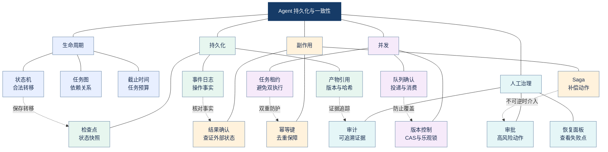

<strong>图谱解读：</strong>状态机描述允许的执行状态，检查点负责恢复，幂等键保护外部副作用，版本控制防止并发覆盖，Saga 处理跨服务的可补偿失败。

### 4.6 一个典型故障的正确恢复

场景：翻译 Agent 已完成 30 页中的 20 页，正在上传第 21 页结果时断电。恢复流程应先读取任务检查点，再检查第 21 页产物的版本、哈希和对象存储状态；如果上传已经成功，则只补记状态；如果未成功，则使用相同逻辑操作键重试上传；随后从剩余页面继续。最终合并阶段还要检查页码连续性、译文覆盖和文件有效性。

这种设计把<strong>可恢复性</strong>从“再次调用模型”提升为“可核验地继续完成业务任务”。

<strong>来源：</strong>[LangGraph Persistence](https://docs.langchain.com/oss/python/langgraph/persistence)、[Azure Saga](https://learn.microsoft.com/en-us/azure/architecture/patterns/saga)。

## 5. 质量工程：从模型分数到端到端业务验收

### 5.1 评价对象必须分层

质量不是一个单一指标。LLM 的语言表达、检索器的证据召回、工具的参数正确性、Agent 的规划与路由、最终业务交付，处于不同的因果链路上。只对最终答案打分，难以定位问题；只对中间组件打分，又可能无法说明用户目标是否完成。

| 层次 | 评价对象 | 指标示例 | 典型误判 |
|---|---|---|---|
| 模型层 | 生成与理解 | 事实一致、结构有效、术语正确 | 文笔流畅被当作正确 |
| 检索层 | 文档与证据 | Recall@K、MRR、NDCG、引用覆盖 | 找到相似段落被当作支持结论 |
| 工具层 | 调用与执行 | 工具选择率、参数有效率、副作用正确率 | 只看工具返回 200 |
| 编排层 | 路由与规划 | 依赖完整率、交接有效率、循环率 | 只看最终回复 |
| 任务层 | 真实目标 | Task Success Rate、人工接管率 | 把建议代替执行 |
| 系统层 | 长期交付 | SLO、P95、单位成功成本、违规率 | 用单次演示代替生产指标 |

### 5.2 离线评估、在线评估和人工复核

Offline Evaluation（离线评估）在固定样本、固定版本与明确标准下对比候选方案，适合回归测试与版本门禁。Online Evaluation（在线评估）观察真实请求分布、流量变化、用户反馈和长期稳定性。Human Review（人工复核）负责处理复杂、高风险或自动评分缺乏足够可信度的样本。

离线测试集至少包括正常样本、边界样本、历史事故样本、对抗样本和业务高风险样本。每条测试用例应记录输入、预期行为、可接受结果范围、禁止行为、评价方法和失败严重度。生产数据进入测试集前必须处理权限、隐私与保留期限。

### 5.3 LLM-as-a-Judge 的适用边界

LLM-as-a-Judge（以大语言模型充当评价者）适合按照明确 Rubric（评分准则）检查完整性、相关性、证据支持和表达质量；但它可能受到顺序偏差、提示词敏感性、模型偏好和同源错误影响。尤其在多个 Agent 共享同一错误证据时，审核 Agent 的一致认可并不意味着事实正确。

应优先使用确定性规则检查可确定的内容，例如 JSON Schema、数字和单位、文件可打开性、权限边界、工具参数、页面数、引用 URL 可访问性；再用模型评价语义；最后对关键样本人工校准。评价者模型本身也需要版本控制和抽样复测。

### 5.4 多层质量评估网络

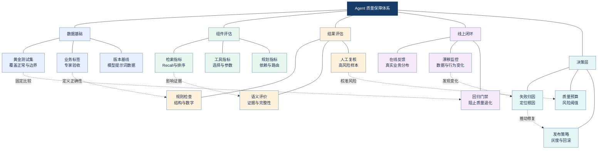

<strong>图谱解读：</strong>评价必须覆盖数据、组件、结果与线上反馈。规则校验提供可复核的确定性证据，模型评价覆盖语义维度，人工复核校准高风险决策。

### 5.5 检索指标与生成指标不可互相替代

Recall@K（前 K 条召回率）衡量相关资料被检索出的比例；MRR（Mean Reciprocal Rank，平均倒数排名）强调首个相关结果的排名；NDCG（Normalized Discounted Cumulative Gain，归一化折损累计增益）考虑多个相关结果的排序与相关等级。它们回答“证据找得如何”，不直接证明“答案说得正确”。生成端仍需检查 Faithfulness（证据忠实性）、Answer Relevance（回答相关性）、Citation Correctness（引用正确性）等维度。

### 5.6 统计严谨性与回归策略

评估结果应报告样本量、任务类别、失败分布与置信区间，避免只报告整体平均分。比较两个方案时尽量使用同一批样本、相同工具权限和相同成本口径。对于成本、延迟等长尾分布，可同时报告中位数、P95、P99 和异常比例；对于任务成功率，可报告成功数与总样本数，避免小样本的偶然波动被包装为确定性提升。

<strong>来源：</strong>[OpenAI Evals](https://github.com/openai/evals)、[Ragas 文档](https://docs.ragas.io/)、[LangSmith Evaluation](https://docs.smith.langchain.com/evaluation)。

## 6. 性能工程：关键路径、并发、长尾与容量

### 6.1 延迟、吞吐与并发是不同维度

Latency（延迟）是单任务耗时；Throughput（吞吐量）是单位时间完成的任务数；Concurrency（并发度）是同时进行的任务数。三者相互影响但并非同义。Little's Law（利特尔法则）在稳定、满足适用条件的系统中说明平均在制任务数、到达率和平均停留时间的关系：

$$
N=\lambda W
$$

其中 N 是平均系统内任务数，λ 是平均到达率，W 是平均停留时间。它不能被简单理解为“并发翻倍，吞吐一定翻倍”；当下游受限于 API 配额、CPU 或内存时，额外并发可能只增加排队。

### 6.2 Agent 延迟分解

对于简化的串行链路：

$$
T_{\mathrm{total}}=T_{\mathrm{queue}}+T_{\mathrm{parse}}+T_{\mathrm{retrieve}}+T_{\mathrm{model}}+T_{\mathrm{tool}}+T_{\mathrm{validate}}
$$

并行任务则需要分析 DAG（Directed Acyclic Graph，有向无环图）中的关键路径。理想无资源争用情况下：

$$
T_{\mathrm{critical}}=\max_{p\in P}\sum_{i\in p}t_i
$$

其中 P 为依赖路径集合，ti 为路径上各任务耗时。真实总时间还包括排队、重试、汇聚和资源竞争。优化时应优先缩短关键路径上的瓶颈，而不是平均地加速所有模块。

### 6.3 TTFT、TPOT 与用户体验

TTFT（Time to First Token，首 Token 时间）衡量开始输出的等待；TPOT（Time per Output Token，每输出 Token 时间）衡量生成阶段速度。流式输出（Streaming）可以改善等待体验，但通常不能直接证明端到端任务完成时间缩短。对异步长任务，应展示明确的阶段进度、失败原因和可恢复状态，而不是输出无法验证的百分比。

### 6.4 优化优先级

OpenAI 官方延迟优化建议包括减少输入和输出 Token、减少请求次数、并行化、提高生成速度、改善用户等待体验，以及在不需要时避免调用模型。将其用于 Agent 时，还应结合业务质量与权限约束：减少上下文可能丢失证据，减少调用次数可能削弱验证，缓存可能产生过期或越权复用。

### 6.5 性能瓶颈与优化网络

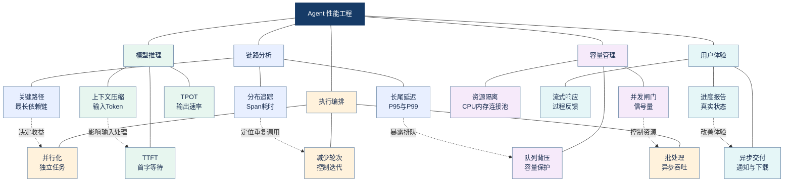

<strong>图谱解读：</strong>性能优化必须由真实链路数据驱动；并行只有在依赖允许且资源充足时才能缩短关键路径，流式输出改善感知但不替代端到端耗时指标。

### 6.6 排队与资源容量规划

当到达速率长期接近或超过处理能力时，排队时延可能快速上升。应为不同任务建立独立队列和优先级，限制单租户占用，设置队列等待上限，并提供明确的拒绝与重试建议。对于 OCR、PDF 渲染和图像处理等内存密集型工作负载，应单独限制 Worker 数量，避免模型推理与文档解析相互抢占资源。

<strong>来源：</strong>[OpenAI Latency Optimization](https://developers.openai.com/api/docs/guides/latency-optimization)、[OpenTelemetry](https://opentelemetry.io/docs/)。

## 7. 成本工程：从 Token 单价到每成功任务成本

### 7.1 完整成本必须覆盖整条任务链路

模型 Token 费用通常只是可见成本的一部分。企业 Agent 还要消耗检索、重排、向量索引、OCR、图像处理、外部工具 API、缓存、对象存储、日志、队列、人工复核与运维资源。完整成本可以建模为：

$$
C_{\mathrm{total}}=C_{\mathrm{model}}+C_{\mathrm{retrieval}}+C_{\mathrm{tools}}+C_{\mathrm{compute}}+C_{\mathrm{storage}}+C_{\mathrm{operations}}
$$

若不同服务存在固定月费，应在评估周期内合理分摊；如果没有一致的分摊口径，就不能直接比较不同架构的单位成本。

### 7.2 每成功任务成本比单次调用价格更有意义

$$
C_{\mathrm{success}}=\frac{C_{\mathrm{all}}}{N_{\mathrm{success}}}
$$

其中 Call 为同一评估周期全部有效业务任务消耗的总成本，Nsuccess 为通过业务验收的任务数。失败任务的模型调用、重试和人工修复成本都应计入分子。举例：方案甲总花费 100 元、成功 80 个任务，单位成功成本为 1.25 元；方案乙总花费 120 元、成功 110 个任务，约为 1.09 元。数字仅为示例，说明低单价不一定代表高成本效率。

### 7.3 Prompt Caching 与业务结果缓存

Prompt Caching（提示词缓存）复用模型处理相同前缀时的部分计算；Result Caching（业务结果缓存）直接复用已计算的业务产物；Semantic Caching（语义缓存）尝试复用语义相近请求的结果。三者的缓存键、有效期、隔离和风险不同。对于企业知识库，缓存键应考虑租户、用户权限、知识库版本、提示词版本、模型版本与检索策略；对于文档翻译，缓存应关联原文哈希、目标语言、术语库版本和翻译策略。

### 7.4 成本预算与任务预算

每个任务可设置最大模型调用次数、输入输出 Token、工具费用、重试预算和最长执行时间。多 Agent 协作尤其需要限制上下文重复传递与无效对话；即使最终任务成功，也可能因过多协调轮次而失去经济性。高风险任务允许更高预算，但应明确预算提升换来了哪一项可验证的质量收益。

### 7.5 成本构成与治理网络

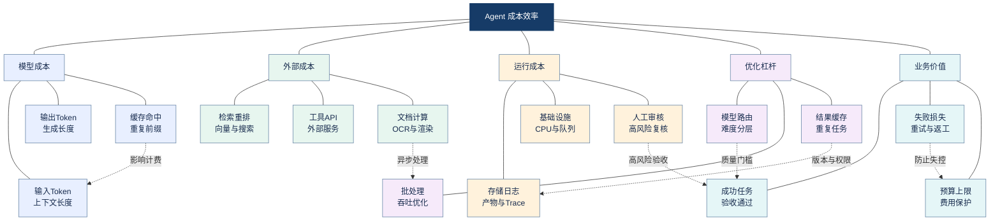

<strong>图谱解读：</strong>成本不能只看模型价格。模型、工具、计算和人工审核共同决定总费用，而质量验收决定分母，因此应优化每成功任务成本。

### 7.6 云端 API 与本地部署的总拥有成本

TCO（Total Cost of Ownership，总拥有成本）包括购买或租用硬件、运维人力、部署维护、监控、备份、模型更新、容量冗余和停机风险。云端 API 的优势通常是弹性与维护负担较低；自部署的优势可能是数据控制、定制和在特定稳定负载下的成本结构。没有 GPU、可用内存很小的开发环境，适合做轻量模型和架构验证，不宜据此推断大规模生产部署成本。

<strong>来源：</strong>[OpenAI Prompt Caching](https://developers.openai.com/api/docs/guides/prompt-caching)、[AWS Well-Architected](https://docs.aws.amazon.com/wellarchitected/latest/framework/welcome.html)。

## 8. 架构决策：模型、工作流、Agent 与部署形态如何选择

### 8.1 最简单可行基线优先

Baseline（基线）是最简单且可重复测量的候选方案。对于规则明确的业务，应先尝试传统程序或固定 Workflow（工作流）；只有存在开放式推理、动态工具选择或任务规划需求时，再引入 Agent。多 Agent（多个专业决策主体协作）必须证明职责分离、并行或独立校验带来了超过协调成本的净收益。

### 8.2 决策矩阵

| 维度 | 方案一 | 方案二 | 选择依据 |
|---|---|---|---|
| 执行控制 | 固定工作流 | 动态 Agent | 是否需要开放式决策 |
| 协作结构 | 单 Agent | 多 Agent | 专业边界与净收益 |
| 模型选择 | 小模型 | 大模型 | 质量门槛与复杂度 |
| 服务形态 | 云端 API | 私有化部署 | 数据政策、TCO、弹性 |
| 知识获取 | 单路检索 | 混合检索与重排 | 证据覆盖与时延 |
| 质量保障 | 一次输出 | 验证与修复 | 风险等级与返工成本 |
| 执行交付 | 同步 | 异步 | 用户等待容忍度 |
| 失败处理 | 自动恢复 | 人工接管 | 操作可逆性与风险 |
| 数据状态 | 内存状态 | 持久化状态 | 长任务与恢复需求 |

### 8.3 ADR：记录为什么这样选

ADR（Architecture Decision Record，架构决策记录）应记录背景、约束、备选方案、关键证据、最终决定、已知风险、回滚条件与复评时间。例如选用云端翻译 API 而非本地小模型，理由不应只写“更准确”，而应附上同一测试集的术语正确率、吞吐、单位成功成本、隐私政策和部署条件。ADR 可以防止未来团队在不了解原始约束的情况下重复争论或错误推翻方案。

### 8.4 架构取舍知识网络

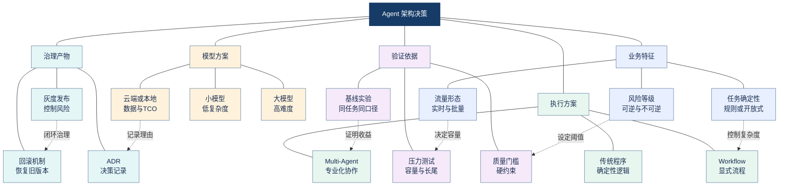

<strong>图谱解读：</strong>业务特征先限定候选架构，基线和质量门槛决定可行方案，ADR 记录选择依据，灰度和回滚把一次性选型变成持续治理。

### 8.5 不能忽略的隐藏工程成本

架构复杂度会影响测试难度、人员交接、故障定位、权限审计、供应商锁定和升级风险。多 Agent 的新增收益必须扣除路由错误、上下文重复、协调延迟、状态一致性与可观测性开销。评估“新技术是否值得引入”时，建议同时记录初始开发成本和后续维护成本。

## 9. 可观测性与持续优化：把系统变成可诊断对象

### 9.1 Logs、Metrics、Traces 的不同职责

Logs（日志）记录离散事件，Metrics（指标）描述聚合行为，Traces（分布式追踪）重建一次请求跨组件的调用链。Span（跨度）是 Trace 中的一段操作，例如一次检索、模型调用或工具执行。OpenTelemetry（开放遥测）提供统一的可观测性数据采集生态，其生成式 AI 语义约定正在覆盖模型、Token 与工具等领域。

### 9.2 Agent Trace 最小字段

| 类别 | 推荐字段 | 用途 |
|---|---|---|
| 身份关联 | trace_id、task_id、agent_id、tenant_id | 跨服务定位 |
| 版本信息 | model_version、prompt_version、tool_version | 复现与回归 |
| 调用信息 | tool_name、status、error_type、retry_count | 失败归因 |
| 性能信息 | queue_time、duration、TTFT、token_count | 瓶颈分析 |
| 成本信息 | input_tokens、output_tokens、cached_tokens、cost | 费用归因 |
| 质量信息 | eval_result、validation_status、human_review | 业务验收 |
| 治理信息 | permission_decision、audit_ref、checkpoint_id | 权限与恢复 |

生产日志应遵循数据最小化、脱敏、访问控制和保留策略。不要直接记录密钥、完整敏感文档或所有推理上下文。

### 9.3 可观测性与优化闭环网络

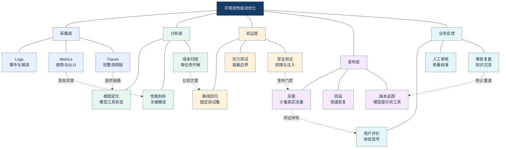

<strong>图谱解读：</strong>观测不止为了排错，而是把真实问题转化为可重复的实验，再用灰度和回滚控制上线风险，形成持续优化闭环。

### 9.4 从异常到工程决策的标准路径

当 P95 延迟上升时，先查看请求分层与任务类型，再使用 Trace 区分排队、解析、检索、模型、工具和验证耗时；之后检查是否与模型版本、并发、文档复杂度或限流事件相关。定位根因后，只修改一个或少量可归因因素，执行离线回归与压力测试，再小流量发布。否则一次性更换模型、提示词和并发参数，即使指标改善也难以知道是哪项修改起作用。

<strong>来源：</strong>[OpenTelemetry Documentation](https://opentelemetry.io/docs/)、[OpenTelemetry GenAI Semantic Conventions](https://opentelemetry.io/docs/specs/semconv/gen-ai/)。

## 10. 安全、权限与预算治理：不可被性能优化突破的边界

### 10.1 过度自主权与无界消耗

Agent 可能被不可信文档中的 Prompt Injection（提示词注入）诱导执行额外工具调用、泄露资料或进入重复循环。Excessive Agency（过度自主权）指系统授予模型过多工具、权限或执行自由；Unbounded Consumption（无界资源消耗）指系统缺少有效资源与费用约束。OWASP LLM Top 10 对这类风险提供了威胁分类与缓解思路。

### 10.2 七类硬预算

| 预算 | 典型控制方式 | 超限行为 |
|---|---|---|
| Token | 输入输出计数 | 终止或压缩上下文 |
| 费用 | 单任务与单租户上限 | 拒绝新调用或人工审批 |
| 时间 | 端到端 Deadline | 取消与保存检查点 |
| 工具调用 | 最大次数、白名单 | 停止工具执行 |
| 迭代轮次 | 最大决策循环 | 无进展终止 |
| 并发 | Semaphore、配额 | 排队、限流或拒绝 |
| 权限 | 工具级授权与审计 | 拒绝越权操作 |

这些预算必须在模型外部由执行器或服务端强制实施。System Prompt 可以表达偏好，但不能替代授权与限流机制。

### 10.3 高风险工具的控制流程

发送邮件、删除文件、修改数据库、采购和审批等工具需要按<strong>用户身份、业务对象、操作类型、参数范围</strong>授权。执行前校验输入与权限，执行时记录幂等键，执行后核验结果并写入审计。对不可逆或高影响动作，应配置 Human-in-the-loop（人在回路）审批；人工确认不等于完全免除后续审计。

### 10.4 安全与预算网络

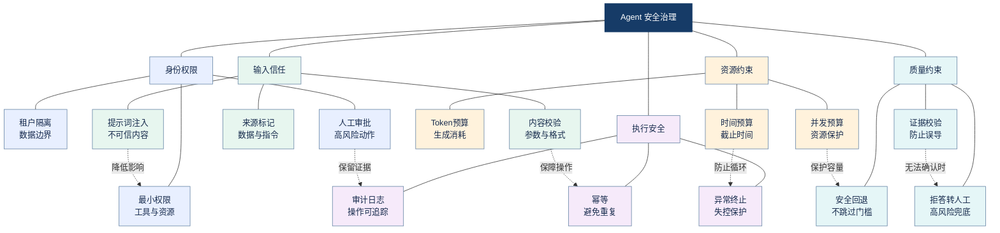

<strong>图谱解读：</strong>安全治理同时约束权限、输入信任、资源消耗和结果质量；不能用提示词替代服务端的权限、预算和审计。

<strong>来源：</strong>[OWASP Top 10 for LLM Applications](https://genai.owasp.org/llm-top-10/)、[AWS Agentic AI Lens](https://docs.aws.amazon.com/wellarchitected/latest/agentic-ai-lens/conclusion.html)。

## 11. 三类企业案例：同一方法论下的不同优先级

### 11.1 案例 A：企业知识库助手

<strong>目标：</strong>在正确权限范围内提供有证据支持的回答。业务成功至少包括正确的权限过滤、证据召回、答案与证据一致、适当拒答。设计取舍在于：混合检索与 Reranker（重排器）可能改善证据质量，但会增加延迟和资源成本；Agentic RAG（由 Agent 动态选择检索策略的检索增强生成）可以处理复杂问题，却可能增加调用轮次。

<strong>推荐实验：</strong>对比向量检索、混合检索、混合检索加重排、Agentic RAG 四种候选；使用同一批问题、相同知识版本和权限上下文，报告证据召回、引用正确率、任务成功率、P95 和每成功任务成本。对越权请求进行独立安全测试，不能用平均准确率抵消越权事故。

### 11.2 案例 B：智能文档翻译 Agent

<strong>目标：</strong>语义准确、术语一致、数字与型号不变、文档结构和版式可交付。Word 原生结构解析通常更容易保留可编辑对象；PDF 可能需要阅读顺序、布局坐标与字体处理；扫描件还涉及 OCR（Optical Character Recognition，光学字符识别）和视觉理解。不同文件类型不应强行共用同一解析路径。

<strong>关键取舍：</strong>使用较大模型可能改善复杂语义，但提高成本；逐页视觉校验可能提高排版质量，却显著增加延迟；因此更合理的做法是按风险分层校验、缓存解析和术语结果、仅对失败页面进行有界修复，并保留回退到原始布局或人工审核的能力。

<strong>推荐验收：</strong>文本覆盖率、术语正确率、数字和单位一致率、页面完整性、重叠裁切数量、文件可打开性、人工复核率、P95、单位成功文档成本。对于企业涉密资料，云端模型是否可用首先由数据安全政策决定，而不是单纯比较单价。

### 11.3 案例 C：多 Agent 研发辅助系统

<strong>目标：</strong>研究、架构、验证和报告多个专业任务协同完成。Supervisor（主管协调）可集中控制任务分配；Agent-as-Tool（将专业 Agent 作为工具调用）适合主管保留控制权；Handoff（控制权移交）适合动态切换负责人。多 Agent 并不保证比单 Agent 更准确，应通过对照实验验证职责分离是否减少错误或缩短关键路径。

<strong>推荐实验：</strong>固定 Workflow、优化单 Agent、Supervisor 多 Agent 三组方案；同一任务集比较成功率、交接次数、平均及 P95 延迟、工具调用数、重复检索率、每成功任务成本与故障恢复率。独立审核 Agent 应使用可追溯证据和明确规则，避免所有 Agent 共享同一错误来源而一致误判。

### 11.4 三类项目的取舍网络

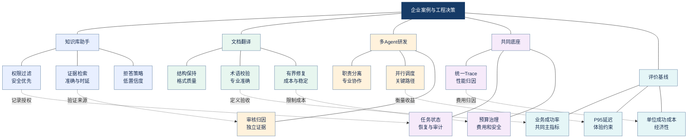

<strong>图谱解读：</strong>三类项目的优先目标不同，但都依赖统一的任务状态、Trace、预算和业务验收。评价指标应随业务风险调整，而不是照搬单一通用分数。

### 11.5 一份可落地的决策实验记录

建议每次架构调整都形成最小实验记录：问题陈述、业务约束、基线版本、候选方案、测试集及分层分布、模型和工具版本、成功判定规则、质量与安全门槛、P50/P95/P99、费用分摊口径、故障注入结果、决策与回滚条件。实验结果还应记录<strong>失败案例</strong>，而不是只展示平均指标的改善。

例如：如果更换翻译模型后平均语义评分上升，但数字误译率提高，那么在技术文档场景中可能仍应拒绝上线；如果多 Agent 方案成功率提升很小但成本翻倍，除非它显著改善高风险样本，否则应优先保留更简单的架构。

## 12. 常见误区、面试问题与工程检查清单

### 12.1 常见误区与纠偏

| 误区 | 正确认知 | 验证方式 |
|---|---|---|
| HTTP 200 等于成功 | 还需业务验收 | 独立记录任务成功率 |
| 失败就多重试 | 重试可能放大故障 | 限次、幂等、截止时间 |
| 熔断等于限流 | 控制对象不同 | 故障注入与压测 |
| 检查点保证恰好一次 | 外部副作用可能重复 | 崩溃窗口测试 |
| LLM 评分等于客观真值 | 评价器有偏差 | 规则与人工校准 |
| 多 Agent 天然更强 | 协调可能大于收益 | 与单 Agent 同集对照 |
| 平均延迟低就够 | 长尾决定最差体验 | P95/P99 与队列指标 |
| Token 单价最低最划算 | 失败和返工也有成本 | 每成功任务成本 |
| 缓存越多越好 | 过期与越权复用风险 | 版本、租户、权限测试 |
| 系统提示词能保证安全 | 权限必须外部强制 | 工具级授权测试 |
| 降级可以跳过校验 | 安全质量门槛不可突破 | 风险场景演练 |
| 模型升级只需测几个例子 | 分布漂移与回归风险 | 分层测试与灰度 |

### 12.2 面试问题：由原理深入到架构决策

<strong>Q1：如何为 Agent 定义 SLO？</strong> 先定义业务任务成功与合格样本，再选择可观测 SLI、统计窗口、阈值和告警；同时监控接口可用性、长尾延迟与高风险错误。不要把“有回答”当作“答对”。

<strong>Q2：429 与 5xx 如何处理？</strong> 先按可恢复性分类；429 通常需要遵守服务端限流提示并实施退避与配额控制，部分 5xx 可有限重试；持续失败时熔断，避免请求风暴。必须受总体截止时间和重试预算约束。

<strong>Q3：重试为什么依赖幂等？</strong> 因为请求超时不代表业务操作未执行，重复执行可能造成重复订单、重复邮件或文件覆盖。幂等键和结果确认是保障业务效果的关键。

<strong>Q4：熔断、舱壁、限流、背压的区别？</strong> 熔断阻断故障下游；舱壁隔离资源；限流约束速率；背压控制上下游生产消费失衡。生产环境通常需要组合。

<strong>Q5：Agent 执行工具后崩溃怎么办？</strong> 保存任务状态和操作账本，恢复前查询外部操作是否已完成，使用稳定幂等键避免重复副作用，并通过补偿或人工介入处理不可逆操作。

<strong>Q6：如何证明多 Agent 比单 Agent 值得？</strong> 在相同任务集、模型资源和工具权限下对照，比较业务成功率、尾延迟、交接开销、恢复能力和单位成功成本；若收益不显著，保留更简单方案。

<strong>Q7：如何评估 RAG 与最终回答？</strong> 检索端使用召回与排序指标；生成端检查事实一致、证据支持和引用准确；端到端再评估真实任务是否完成。

<strong>Q8：如何控制文档翻译成本？</strong> 按文件类型路由解析，缓存稳定中间结果，批量翻译，局部校验与修复，并设置每文档 Token、时延和修复次数预算；高风险字段必须校验。

<strong>Q9：如何定位 P95 上升？</strong> 用 Trace 拆解排队、模型、检索、工具和验证耗时，按任务类型、模型版本和文件复杂度分层；找出关键路径与资源瓶颈后做单变量实验。

<strong>Q10：如何做架构取舍？</strong> 先列业务硬约束和质量门槛，建立基线，再对候选方案进行质量、成本、延迟、风险的同口径实验，记录 ADR，灰度上线并设回滚条件。

### 12.3 上线前检查清单

- [ ] 任务成功的业务验收规则可执行且可复核。
- [ ] SLI、SLO、统计窗口和告警分母已定义。
- [ ] 重试、超时、熔断、限流和背压策略已测试。
- [ ] 所有有副作用工具具备幂等或结果确认机制。
- [ ] 长任务检查点与崩溃恢复通过故障注入。
- [ ] 模型、提示词、工具和知识库版本可追溯。
- [ ] 离线基线、历史事故与高风险样本覆盖充分。
- [ ] P95/P99、吞吐、队列与资源监控可用。
- [ ] 成本包含失败重试、工具、计算和人工成本。
- [ ] 权限、租户隔离、预算和人工审批由服务端执行。
- [ ] 灰度发布、回滚、审计和事故复盘流程已明确。

## 13. 与 Agent 知识体系的横向关联及最终总结

本章不是与前面章节平行的“运维补充”，而是把所有 Agent 技术连接到企业交付目标的决策层。LLM 基础决定模型能力、上下文与 Token 成本；Agent 基础决定工具调用和行动风险；核心组件决定 Memory、State、Tool 的隔离和恢复；工作范式决定规划、路由和验证开销；RAG 决定证据质量；多 Agent 决定协调成本与状态一致性；企业工程决定安全、监控和部署策略。

### 13.1 跨章节综合知识网络

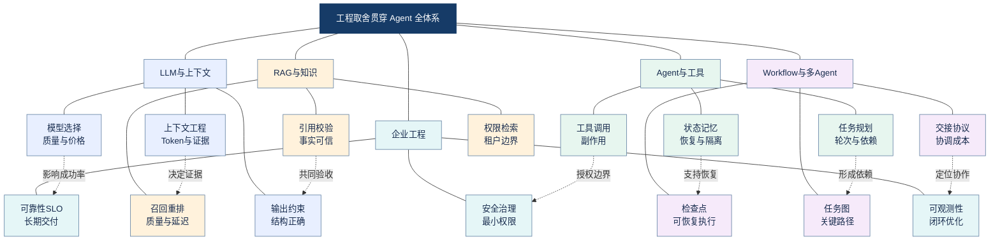

<strong>图谱解读：</strong>工程取舍是全手册的交汇点：模型、RAG、工具、状态、工作流和多 Agent 都必须接受同一套业务验收、预算、权限和可观测性约束。

### 13.2 一张表记住核心取舍

| 决策问题 | 首先检查 | 再比较 | 典型结论 |
|---|---|---|---|
| 是否需要 Agent | 规则能否覆盖 | 动态决策收益 | 固定任务先用 Workflow |
| 是否需要多 Agent | 职责能否清晰分离 | 成功率与协调成本 | 无净收益不增加 Agent |
| 是否升级模型 | 高风险样本是否不达标 | 单位成功成本 | 先验证再升级 |
| 是否增加校验 | 错误代价有多大 | 延迟与成本 | 高风险优先验证 |
| 是否并行 | 任务依赖是否允许 | 关键路径与限流 | 仅并行独立任务 |
| 是否缓存 | 数据是否可安全复用 | 时效、权限与命中率 | 版本化与租户隔离 |
| 是否自动重试 | 失败是否瞬态 | 幂等与预算 | 有副作用先确认 |
| 是否允许降级 | 硬约束是否保持 | 质量与可用性 | 不突破安全底线 |

### 13.3 最终结论

<strong>企业级 Agent 工程不是把尽可能多的技术堆在一起，而是把不确定的模型行为约束在可测量、可恢复、可审计的业务系统中。</strong> 首先用 SLO 和业务验收定义“什么叫成功”；其次用重试、熔断、隔离、幂等和检查点保证故障可控；再通过分层评估判断质量，用 Trace 和成本归因找出真实瓶颈；最后在硬约束内比较不同架构，并通过回归、灰度和回滚持续验证决策。只有这一闭环建立起来，Agent 才能从演示程序发展为可长期维护的企业系统。

## 14. 官方文档、开源项目与进一步阅读

以下资料优先选择官方文档、标准组织和开源项目。不同文档的更新节奏不同，具体 API、计费和版本细节应在实施时重新核对。

| 资料 | 重点主题 | 链接 |
|---|---|---|
| Google SRE — Embracing Risk | 可靠性与错误预算 | https://sre.google/sre-book/embracing-risk/ |
| Google SRE Workbook — Implementing SLOs | SLI/SLO 设计 | https://sre.google/workbook/implementing-slos/ |
| Microsoft Azure — Resiliency Patterns | 重试、隔离、补偿 | https://learn.microsoft.com/en-us/azure/architecture/patterns/category/resiliency |
| Microsoft Azure — Circuit Breaker | 熔断状态与恢复 | https://learn.microsoft.com/en-us/azure/architecture/patterns/circuit-breaker |
| Microsoft Azure — Saga | 跨服务补偿事务 | https://learn.microsoft.com/en-us/azure/architecture/patterns/saga |
| LangGraph — Persistence | 检查点与执行恢复 | https://docs.langchain.com/oss/python/langgraph/persistence |
| OpenAI — Latency Optimization | LLM 延迟优化 | https://developers.openai.com/api/docs/guides/latency-optimization |
| OpenAI — Prompt Caching | 提示词缓存 | https://developers.openai.com/api/docs/guides/prompt-caching |
| OpenAI Evals | 模型与系统评估 | https://github.com/openai/evals |
| Ragas | RAG 评价指标与实践 | https://docs.ragas.io/ |
| LangSmith Evaluation | 离线与在线评估 | https://docs.smith.langchain.com/evaluation |
| OpenTelemetry — Documentation | Traces、Metrics、Logs | https://opentelemetry.io/docs/ |
| OpenTelemetry — GenAI SemConv | 生成式 AI 语义约定 | https://opentelemetry.io/docs/specs/semconv/gen-ai/ |
| AWS — Agentic AI Lens | Agent 架构质量与治理 | https://docs.aws.amazon.com/wellarchitected/latest/agentic-ai-lens/conclusion.html |
| AWS Well-Architected | 云架构取舍框架 | https://docs.aws.amazon.com/wellarchitected/latest/framework/welcome.html |
| OWASP LLM Top 10 | 提示词注入、过度自主与资源消耗 | https://genai.owasp.org/llm-top-10/ |

### 建议的延伸研究

可继续阅读排队论与容量规划、统计显著性与置信区间、分布式事务与消息交付语义、基于风险的测试策略、FinOps（云财务运营）、OpenTelemetry 语义约定演进，以及针对 Agent 的威胁建模。它们分别为性能、评估、一致性、质量、成本和安全提供更扎实的理论基础。

