# 核心知识、项目难点与面试问答

> 章节定位：Agent-Engineering-Handbook / 08-Projects-and-Interviews / 06-Interview-Questions.md  
> 学习目标：从“知道概念”进阶到“能解释原理、画出架构、定位故障、证明取舍”。  
> 资料口径：以官方文档和公开论文为主要依据；项目案例是工程示范，不冒充实际生产数据。  
> 使用方式：先阅读知识网络，再尝试不看答案口述，最后结合项目 Trace、代码和实验记录补充个人证据。

## 阅读导航

1. [面试能力模型与回答方法](#一面试能力模型与回答方法)
2. [LLM 基础、推理与微调](#二llm-基础推理与微调)
3. [Agent 原理、规划与编排](#三agent-原理规划与编排)
4. [Tool Calling、MCP 与权限](#四tool-callingmcp-与权限)
5. [RAG、检索与知识库](#五rag检索与知识库)
6. [Context、Memory 与状态](#六contextmemory-与状态)
7. [Multi-Agent 与框架选型](#七multi-agent-与框架选型)
8. [可靠性、性能、成本与安全](#八可靠性性能成本与安全)
9. [评估、测试、可观测性与发布](#九评估测试可观测性与发布)
10. [三个企业级项目深挖](#十三个企业级项目深挖)
11. [系统设计与故障排查](#十一系统设计与故障排查)
12. [面试误区、证据清单与复习路径](#十二面试误区证据清单与复习路径)
13. [参考资料与知识关联](#十三参考资料与知识关联)

---

## 一、面试能力模型与回答方法

技术面试不是知识点背诵竞赛。对于 Agent 项目，面试官往往从“为什么采用该架构”开始，沿着“原理 → 关键实现 → 异常 → 指标 → 备选方案”连续追问。一个可信的答案必须同时交代业务边界、技术机制和验证证据。

<strong>六段式回答法：</strong>问题背景（输入、输出、风险）→ 技术原理（为什么有效）→ 架构设计（谁负责决策）→ 关键实现（数据和状态如何流转）→ 验证（基线、指标、样本）→ 取舍（成本、风险、备选方案）。例如回答“为什么使用 Hybrid Search”，不能只说“更准确”，还应解释词项匹配与语义召回的互补、RRF 融合、Reranker 成本以及 Recall@K 的实验对照。

<strong>项目数据的证据等级：</strong>可复现实验记录与测试集定义 > 有明确口径的离线统计 > 单次运行截图 > 主观印象。没有真实测量就写“待测”，不能编造准确率、QPS、成本和用户规模。

### 1.1 面试能力的中心辐射知识网络

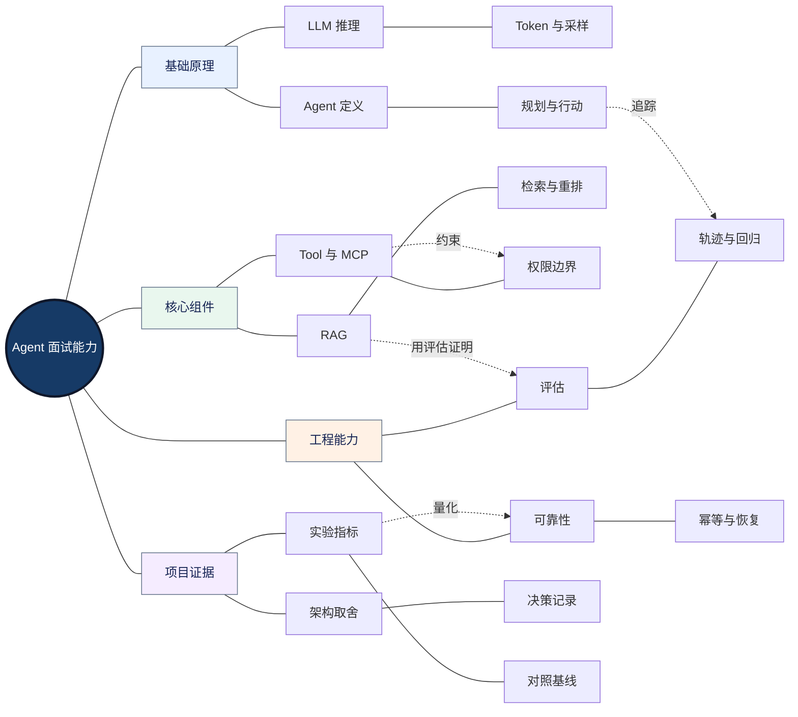

<strong>图谱解读：</strong>基础原理解释“为什么”，组件解释“如何实现”，工程能力解释“如何稳定交付”，项目证据解释“凭什么相信”。跨分支连线表示面试官通常从某个知识点追问到验证和安全边界。

### 1.2 术语与回答层级

| 回答层级 | 面试官关注 | 合格证据 |
|---|---|---|
| 概念层 | 定义与区别 | 准确的适用边界 |
| 机制层 | 数据如何流转 | 状态、调用、失败路径 |
| 实现层 | 怎样编码与部署 | 接口契约、异常处理、日志 |
| 评估层 | 如何知道方案有效 | 数据集、指标、对照实验 |
| 决策层 | 为什么不是另一种方案 | 质量、延迟、成本、安全取舍 |

后文每题使用“简答—原理与边界—项目落地—延伸追问”的结构，便于口头回答和二次深入。

## 二、LLM 基础、推理与微调

大语言模型（Large Language Model，LLM）是 Agent 的概率推理与生成组件，但 Agent 的状态管理、工具执行和业务授权通常属于模型外部的确定性系统。理解模型边界，是后续 Tool、RAG 和 Workflow 设计的前置条件。

### 2.1 模型能力与工程约束网络

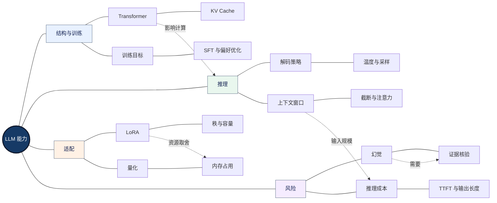

<strong>图谱解读：</strong>模型参数、上下文和解码决定能力与成本的基础边界；RAG 提供外部证据，校验机制负责业务正确性，两者都不能简单等同于“模型不再犯错”。

#### Q001｜Transformer 的 Self-Attention 为什么适合长距离依赖？

<strong>面试简答：</strong>注意力使每个位置按相关性聚合其他位置的信息，而非仅依赖固定距离的局部连接。

<strong>原理与边界：</strong>标准注意力通常包含 Q、K、V 投影与缩放点积；全序列注意力的时间/显存开销通常随序列长度呈平方增长，但实际推理会受到缓存和优化内核影响。

<strong>项目落地：</strong>长文档 Agent 不应无条件把所有页面拼成一次输入，应结合检索、结构分块和上下文预算。

<strong>延伸追问：</strong>KV Cache 如何影响首 Token 时间和后续生成速度？

#### Q002｜Temperature、Top-p 与贪心解码有什么区别？

<strong>面试简答：</strong>温度调整 logits 分布尖锐程度；Top-p 在累计概率质量范围内采样；贪心每步取最大概率 token。

<strong>原理与边界：</strong>温度低通常降低随机性，但不保证事实正确，也不保证严格确定性；采样参数变化还会影响工具参数稳定性。

<strong>项目落地：</strong>结构化提取可优先受约束输出和校验，创意生成可适度提高多样性。

<strong>延伸追问：</strong>如何区分模型随机性与系统外部状态变化？

#### Q003｜什么是 Token，为什么上下文也会计费？

<strong>面试简答：</strong>Token 是模型处理的离散文本单元；输入提示词、历史、检索片段和输出通常分别计入相应计费口径。

<strong>原理与边界：</strong>不同 tokenizer 的切分不同；字符数不能直接等同 Token 数。缓存命中也不必然等于免费。

<strong>项目落地：</strong>统计一次任务的 system、history、RAG、tool results、output token，评估每成功任务成本。

<strong>延伸追问：</strong>如何设计上下文裁剪而不损失关键约束？

#### Q004｜Prompt Engineering 与微调分别解决什么问题？

<strong>面试简答：</strong>Prompt 主要调整任务指令和上下文；微调通过训练改变模型行为分布。

<strong>原理与边界：</strong>微调不是可靠的事实数据库更新机制；频繁变化的企业知识通常更适合外部检索，领域风格或格式可考虑微调。

<strong>项目落地：</strong>先做 Prompt 与 RAG 基线，固定评估集后再决定是否投入微调。

<strong>延伸追问：</strong>什么情况下微调会降低非目标任务能力？

#### Q005｜LoRA 的核心机制与参数取舍是什么？

<strong>面试简答：</strong>LoRA（Low-Rank Adaptation，低秩适配）冻结主权重，仅学习低秩增量矩阵。

<strong>原理与边界：</strong>常见形式为权重增量 BA 并按 alpha/r 缩放；rank 影响可训练容量与开销，训练质量还受数据、学习率和训练目标影响。

<strong>项目落地：</strong>应报告训练/验证分布、拒答样本、过拟合现象和推理开销，而不只报告 loss。

<strong>延伸追问：</strong>LoRA 与全量微调、QLoRA 的内存取舍？

#### Q006｜量化为什么能降低部署内存，代价是什么？

<strong>面试简答：</strong>量化使用较低位宽表示模型权重或激活，降低存储和带宽需求。

<strong>原理与边界：</strong>不同量化方案对精度、算子支持、CPU/GPU 性能影响不同；低位宽不必然意味着端到端速度更快。

<strong>项目落地：</strong>CPU-only 部署先测内存峰值、首 Token、输出速度和专业术语准确率。

<strong>延伸追问：</strong>模型文件大小为什么不等于运行内存占用？

#### Q007｜为什么更大的模型不一定是 Agent 的最佳选择？

<strong>面试简答：</strong>任务成功率取决于模型能力、工具、检索、流程、校验和运行约束的整体组合。

<strong>原理与边界：</strong>大模型可能提高复杂推理表现，但增加费用和延迟；简单分类和路由可交给更小模型或规则。

<strong>项目落地：</strong>在同一测试集上比较质量、P95、成本和失败模式，必要时按任务难度路由。

<strong>延伸追问：</strong>怎样防止小模型路由错误带来的质量下降？

#### Q008｜如何区分模型幻觉、检索错误与工具错误？

<strong>面试简答：</strong>依据 Trace 将问题定位到证据获取、模型生成、工具调用或状态编排。

<strong>原理与边界：</strong>幻觉是输出缺乏充分依据；错误证据也可能诱导“看似有引用”的错误结论，必须做证据一致性检查。

<strong>项目落地：</strong>保存检索候选、工具输入输出、版本和评价标签，并按故障类别统计。

<strong>延伸追问：</strong>如何构造可重复的失败回归集？

## 三、Agent 原理、规划与编排

Agent（智能体）可视为在目标与约束下，根据观察、内部状态与可用行动集合决定下一步操作的系统。模型提供决策建议，外部控制器决定是否执行、如何校验与何时终止。Workflow（工作流）以程序规定主路径；两者可以组合：确定性主流程内嵌有限自主决策节点。

### 3.1 决策与编排模式网络

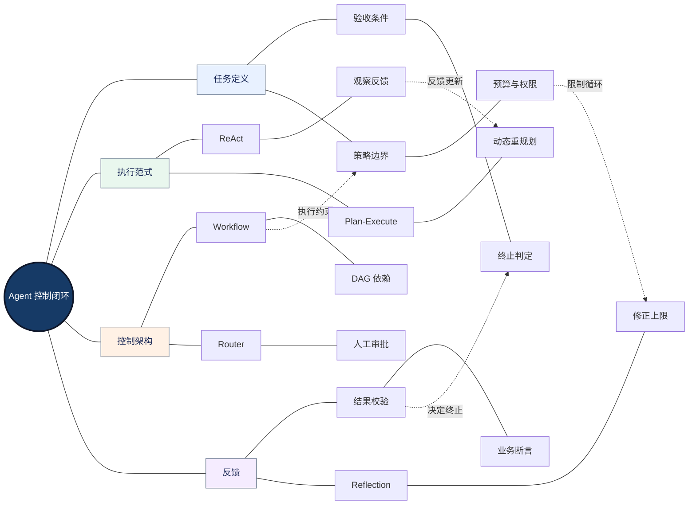

<strong>图谱解读：</strong>规划、行动、观察与校验构成闭环；Workflow 约束可预测路径，Agent 负责不确定决策；必须明确退出条件和预算，防止无界循环。

#### Q009｜Agent 和普通聊天模型有什么本质区别？

<strong>面试简答：</strong>Agent 能在受控边界内选择并执行行动；聊天模型仅生成输出并不自动产生外部副作用。

<strong>原理与边界：</strong>关键不是模型调用次数，而是状态、目标、工具与控制策略的组合；也不存在所有人统一接受的唯一 Agent 定义。

<strong>项目落地：</strong>展示一次从任务路由到工具执行、校验、终止的完整 Trace。

<strong>延伸追问：</strong>固定 Workflow 中嵌入 LLM 节点是否算 Agent？

#### Q010｜ReAct 的优势与失败模式是什么？

<strong>面试简答：</strong>ReAct（Reasoning and Acting，推理与行动交替）通过行动结果更新后续决策。

<strong>原理与边界：</strong>适合信息不完整、需动态查询的任务；常见问题是循环调用、错误工具选择、上下文膨胀与无法终止。

<strong>项目落地：</strong>设置最大迭代、工具白名单、结构化状态和最终验收条件。

<strong>延伸追问：</strong>什么时候用固定流程替代 ReAct？

#### Q011｜Plan-and-Execute 何时优于直接 ReAct？

<strong>面试简答：</strong>当任务具有可拆分的依赖和可复用计划时，先规划再执行便于并行与监控。

<strong>原理与边界：</strong>计划可能与实时环境不一致，需要重规划触发条件和任务依赖校验；不是计划越长越好。

<strong>项目落地：</strong>文档翻译可先生成页面任务 DAG，再并行翻译独立页并汇总校验。

<strong>延伸追问：</strong>计划失败时回滚到哪一层？

#### Q012｜Reflection 是否一定能提高质量？

<strong>面试简答：</strong>不一定。反思可能发现错误，也可能放大已有偏差并增加费用。

<strong>原理与边界：</strong>有效反思需要独立证据、明确 Rubric、可操作的修改建议与终止上限；同模型重复自评并不自动构成独立验证。

<strong>项目落地：</strong>仅对低分页面执行最多 N 轮修复，并保留上一版安全回退。

<strong>延伸追问：</strong>如何证明修正 Agent 的净收益？

#### Q013｜如何设计 Router，避免错误分流？

<strong>面试简答：</strong>将任务识别为有限类型并绑定对应工作流，低置信度进入澄清或安全兜底。

<strong>原理与边界：</strong>规则、分类模型与 LLM 路由各有成本与覆盖边界；需记录混淆矩阵和误路由代价。

<strong>项目落地：</strong>文件类型先用确定性解析识别，复杂意图再交给模型。

<strong>延伸追问：</strong>路由错误如何在执行前发现？

#### Q014｜Agent 什么时候应该停止执行？

<strong>面试简答：</strong>达到可验证目标、不可恢复错误、人工接管条件或资源预算边界时停止。

<strong>原理与边界：</strong>终止条件不能只靠模型主观判断；应由状态机和业务断言共同控制。

<strong>项目落地：</strong>完成文档翻译必须同时满足可打开、内容覆盖和关键校验通过。

<strong>延伸追问：</strong>校验器也不可靠时怎么办？

#### Q015｜Workflow 与 Agent 如何组合最稳妥？

<strong>面试简答：</strong>确定性步骤由程序控制，开放式推理和例外处理由 Agent 承担。

<strong>原理与边界：</strong>可以降低不可预测的调用路径，但程序规则过硬也会限制复杂任务适应性。

<strong>项目落地：</strong>文档解析→翻译→渲染由流程编排，复杂布局修复交给受限 Agent。

<strong>延伸追问：</strong>哪些节点适合并行，哪些必须串行？

#### Q016｜如何设计任务状态机？

<strong>面试简答：</strong>定义明确的状态、事件、守卫条件和允许的状态转移。

<strong>原理与边界：</strong>常见状态包括 pending、running、waiting_approval、succeeded、failed、cancelled；终态不可随意重入。

<strong>项目落地：</strong>数据库保存 task_id、版本、重试计数、检查点和操作记录。

<strong>延伸追问：</strong>进程崩溃后如何判断任务真实状态？

## 四、Tool Calling、MCP 与权限

Tool Calling（工具调用）是 Agent 与外部世界交互的边界。Function Calling（函数调用）通常指模型依据函数签名输出结构化调用意图；真正执行、鉴权、参数校验和副作用管理应由应用程序负责。MCP（Model Context Protocol，模型上下文协议）则标准化客户端与外部工具、资源、提示模板的交互，并不自动保证调用安全。

### 4.1 工具调用信任边界网络

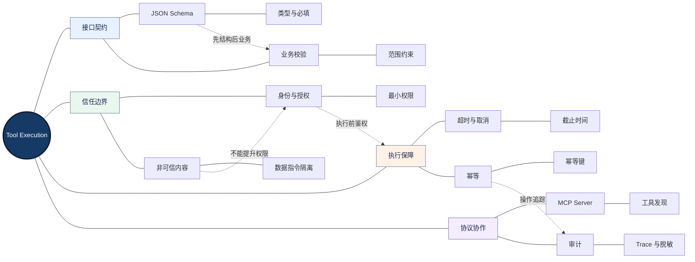

<strong>图谱解读：</strong>模型生成调用建议不等于执行成功；Schema 负责结构约束，业务校验负责语义正确，鉴权负责权限，幂等负责副作用安全。

#### Q017｜Function Calling 的完整调用链是什么？

<strong>面试简答：</strong>模型选择工具并生成参数，宿主应用验证与执行，结果返回模型或工作流。

<strong>原理与边界：</strong>模型输出是提议，不是可信命令；工具错误、权限失败和业务状态必须由宿主处理。

<strong>项目落地：</strong>使用 Pydantic 或 JSON Schema 做结构校验，再进行业务授权。

<strong>延伸追问：</strong>模型返回合法 JSON 但业务上危险怎么办？

#### Q018｜JSON Schema 能否替代业务校验？

<strong>面试简答：</strong>不能。Schema 校验类型、字段、格式等约束，无法覆盖所有权限与业务不变量。

<strong>原理与边界：</strong>例如 amount 为正数不代表用户有权转账，合法路径字符串不代表允许访问该文件。

<strong>项目落地：</strong>对路径进行目录沙箱检查，对订单操作检查租户和操作者权限。

<strong>延伸追问：</strong>为什么校验必须在执行侧？

#### Q019｜MCP 与普通 HTTP API 的区别是什么？

<strong>面试简答：</strong>MCP 提供面向模型应用的工具/资源交互规范；HTTP API 是通用网络接口形式。

<strong>原理与边界：</strong>MCP 可以封装 HTTP API，但不会替代身份认证、业务鉴权和网络安全；也不等于 Agent-to-Agent 协议。

<strong>项目落地：</strong>统一封装企业知识检索、审批和文档操作工具，保留独立权限策略。

<strong>延伸追问：</strong>MCP Server 被攻陷后如何限制影响面？

#### Q020｜工具超时与重试如何设计？

<strong>面试简答：</strong>按错误类别设置超时、指数退避与随机抖动，并传播总体截止时间。

<strong>原理与边界：</strong>429 可能有 Retry-After；永久参数错误不应重试；重试必须遵守预算与幂等约束。

<strong>项目落地：</strong>记录 attempt、error_class、deadline、idempotency_key。

<strong>延伸追问：</strong>请求已执行但响应丢失怎么办？

#### Q021｜为什么创建订单类工具必须幂等？

<strong>面试简答：</strong>重复执行不能产生多个有效订单。

<strong>原理与边界：</strong>可使用唯一业务请求键、数据库唯一约束、状态查询和操作日志；“恰好一次”业务效果需要跨边界协调。

<strong>项目落地：</strong>在调用前记录 operation_id，恢复后先核对外部系统状态。

<strong>延伸追问：</strong>数据库提交成功而 checkpoint 失败怎么办？

#### Q022｜如何防御 Prompt Injection？

<strong>面试简答：</strong>将检索结果和工具返回视为非可信数据，不能让其改变系统级权限。

<strong>原理与边界：</strong>Prompt 提醒只是防线之一；需要工具级鉴权、敏感数据出口控制、白名单和审计。

<strong>项目落地：</strong>恶意文档指令不得触发邮件发送或越权文件读取。

<strong>延伸追问：</strong>怎样构造越权回归测试？

#### Q023｜Handoff 与 Tool Call 有什么差别？

<strong>面试简答：</strong>Handoff 将控制权交给另一 Agent；Agent-as-Tool 则由管理者保持主控。

<strong>原理与边界：</strong>差别影响终止责任、上下文传递、Guardrail 范围和 Trace 结构。

<strong>项目落地：</strong>高风险业务由主控 Agent 保持最终审批权，专家只返回建议。

<strong>延伸追问：</strong>多次交接循环如何防止？

## 五、RAG、检索与知识库

RAG（Retrieval-Augmented Generation，检索增强生成）将外部证据引入模型上下文。工程核心不是“接上向量数据库”，而是建立从文档结构到检索相关性、引用一致性和权限控制的可测链路。

### 5.1 RAG 质量归因网络

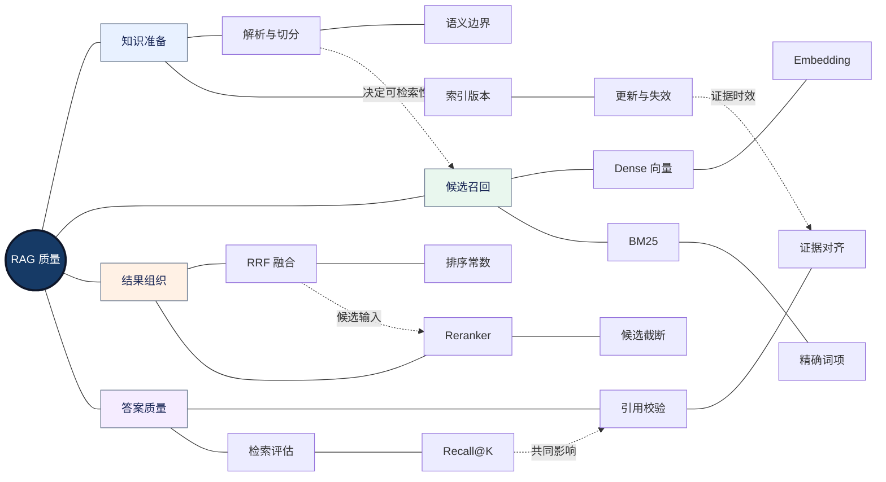

<strong>图谱解读：</strong>数据切分决定检索粒度；Dense 与 BM25 互补；融合和重排改善候选顺序；最终仍需验证证据是否真正支持答案。

### 5.2 必备公式与适用前提

<strong>余弦相似度：</strong>比较向量方向；适合表示归一化后的语义近似，但相似度高不等于事实支持。

$$
\mathrm{cos}(\mathbf{x},\mathbf{y})=\frac{\mathbf{x}\cdot\mathbf{y}}{\lVert\mathbf{x}\rVert\lVert\mathbf{y}\rVert}
$$

<strong>倒数排名融合（Reciprocal Rank Fusion，RRF）：</strong>对不同检索器返回的名次求加权或未加权的倒数和，避免直接混合不可比的原始分数。以下为未加权形式。

$$
\mathrm{RRF}(d)=\sum_{j=1}^{m}\frac{1}{k+\mathrm{rank}_{j}(d)}
$$

其中未出现在某一路候选集的文档不参与该路求和；k 为平滑常数，需要与评估设置一致。

<strong>Recall@K：</strong>在已标注的相关文档集合中，前 K 个检索结果覆盖了多少相关文档。若一个问题需要多份证据，仅命中其中一份不代表最终答案完整。

$$
\mathrm{Recall@K}=\frac{|R_K\cap G|}{|G|},\qquad |G|>0
$$

其中 R_K 为前 K 个检索结果集合，G 为相关文档真值集合。

#### Q024｜为什么不能把整个企业知识库塞进 Prompt？

<strong>面试简答：</strong>上下文长度、成本、干扰和权限风险使全量拼接不可扩展。

<strong>原理与边界：</strong>即使窗口容纳得下，相关信息也可能被大量无关内容稀释；应优先召回相关证据。

<strong>项目落地：</strong>按用户权限过滤候选，再检索、重排、生成与核验。

<strong>延伸追问：</strong>长上下文模型出现后 RAG 还有价值吗？

#### Q025｜Chunk 大小如何选择？

<strong>面试简答：</strong>由文档结构、问题类型、检索模型和上下文预算共同决定。

<strong>原理与边界：</strong>小块利于定位但易丢上下文；大块保留语义但增加噪声和 Token 成本。

<strong>项目落地：</strong>按标题、段落、表格和图注结构切分，用相同评估集做消融。

<strong>延伸追问：</strong>跨页表格应如何切分？

#### Q026｜BM25 与向量检索的区别？

<strong>面试简答：</strong>BM25 是基于词项统计的稀疏检索；向量检索侧重语义相近。

<strong>原理与边界：</strong>BM25 对编号、型号和术语常有优势；Dense 对同义改写更有帮助；两者都可能召回错误文档。

<strong>项目落地：</strong>医疗设备型号优先验证精确词项，普通自然语言问题引入语义检索。

<strong>延伸追问：</strong>混合检索一定优于单路吗？

#### Q027｜RRF 为什么常用于 Hybrid Search？

<strong>面试简答：</strong>RRF 基于排名融合，减少不同检索器分数尺度不一致的问题。

<strong>原理与边界：</strong>RRF 不利用分数校准，可能受到候选截断和排名质量影响；不能代替精排。

<strong>项目落地：</strong>记录单路和融合 Recall@K、MRR、P95，验证是否有净收益。

<strong>延伸追问：</strong>何时选择加权融合或学习排序？

#### Q028｜Cross-Encoder Reranker 的代价是什么？

<strong>面试简答：</strong>对查询与候选文档联合编码打分，通常提升精排能力，但增加计算延迟。

<strong>原理与边界：</strong>Reranker 依赖第一阶段召回；没召回的正确文档无法靠重排补救。

<strong>项目落地：</strong>先扩大候选召回，再控制精排 topN 与批处理。

<strong>延伸追问：</strong>如何区分召回不足与排序错误？

#### Q029｜如何防止 RAG 引用看似正确但结论错误？

<strong>面试简答：</strong>必须检查引用片段是否实际蕴含答案中的关键断言。

<strong>原理与边界：</strong>相关性不等于蕴含；证据可能过期、互相矛盾或仅支持部分结论。

<strong>项目落地：</strong>对数字、日期、型号做程序核对；证据不足时明确拒答或转人工。

<strong>延伸追问：</strong>引用核验如何构造金标准？

#### Q030｜企业知识库权限过滤应该放在哪里？

<strong>面试简答：</strong>原则上在可信服务端检索边界执行强制访问控制，不能仅靠 Prompt 隐藏结果。

<strong>原理与边界：</strong>检索后过滤可能导致未授权内容进入中间日志、缓存或重排器；还可能造成召回不足。

<strong>项目落地：</strong>使用租户和文档 ACL 元数据过滤，缓存键包含授权上下文。

<strong>延伸追问：</strong>向量库不支持复杂 ACL 时怎么办？

#### Q031｜索引更新如何保证知识时效性？

<strong>面试简答：</strong>建立文档版本、增量索引、删除传播、缓存失效和回滚机制。

<strong>原理与边界：</strong>更新并非原子完成时可能出现新旧片段混用；需要版本快照或可验证的一致性策略。

<strong>项目落地：</strong>每条 Chunk 关联 doc_id、version、updated_at 和来源。

<strong>延伸追问：</strong>如何处理文档撤销后的残留缓存？

#### Q032｜RAG 的离线评估如何设计？

<strong>面试简答：</strong>拆分检索层、生成层和端到端业务层，避免单一准确率掩盖问题。

<strong>原理与边界：</strong>使用 Recall@K、MRR、NDCG、引用正确率、答案完整性与拒答正确率，并标注样本分布。

<strong>项目落地：</strong>包含精确型号、跨文档、多跳、权限和无答案样本。

<strong>延伸追问：</strong>LLM-as-a-Judge 怎样与人工校准？

## 六、Context、Memory 与状态

Context（上下文）是本次模型调用可见的信息；Memory（记忆）是跨步骤或跨会话存取信息的机制；Checkpoint（检查点）是执行状态的持久化快照。三者存在交集，但不能互相替代。

### 6.1 上下文、记忆与状态网络

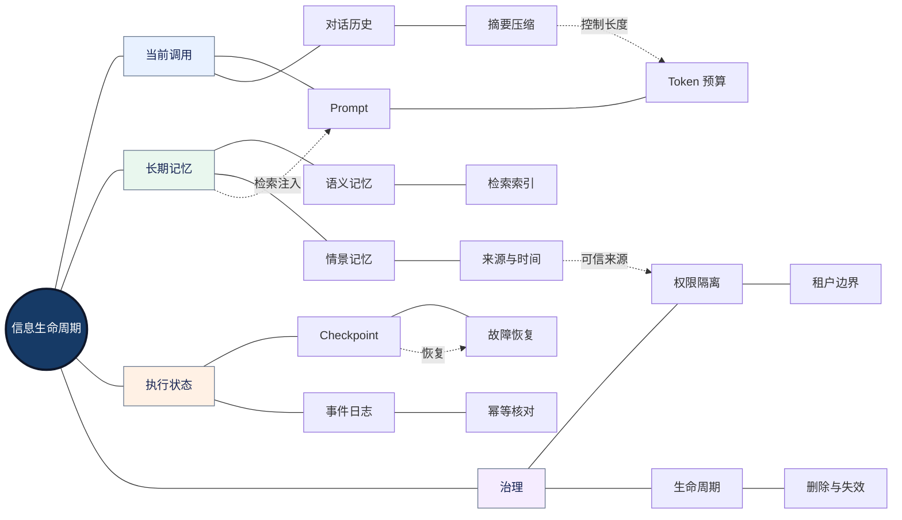

<strong>图谱解读：</strong>当前上下文是一次推理输入；记忆是可选择性检索的信息；检查点用于恢复任务进度。把全部历史直接注入 Prompt 既昂贵又可能带来隐私风险。

#### Q033｜Context 与 Memory 的核心区别？

<strong>面试简答：</strong>Context 是一次模型调用的输入视野；Memory 是信息存储、检索和更新机制。

<strong>原理与边界：</strong>记忆不等于把历史对话全量放入上下文；写入与检索需要筛选、权限和生命周期。

<strong>项目落地：</strong>长任务保存结构化状态，必要时按相关性取回记忆。

<strong>延伸追问：</strong>什么信息应该遗忘而不是永久保存？

#### Q034｜短期记忆、长期记忆与 Checkpoint 的区别？

<strong>面试简答：</strong>短期记忆服务当前任务，长期记忆服务跨任务信息，Checkpoint 记录执行恢复点。

<strong>原理与边界：</strong>Checkpoint 可能保存消息和状态，但不能自动解决外部副作用的重复执行。

<strong>项目落地：</strong>线程级状态与跨线程知识存储分开设计。

<strong>延伸追问：</strong>状态恢复与会话记忆如何隔离？

#### Q035｜上下文压缩会带来什么风险？

<strong>面试简答：</strong>摘要可能丢失否定条件、数字、责任人和工具状态。

<strong>原理与边界：</strong>应保留不可丢的系统约束、待完成事项、精确实体与引用来源，并在关键节点重新检索原文。

<strong>项目落地：</strong>文档翻译保留术语表、单位与章节结构，不用纯自然语言摘要替代。

<strong>延伸追问：</strong>如何测试摘要压缩前后的任务成功率？

#### Q036｜长期记忆如何避免污染与过期？

<strong>面试简答：</strong>记忆写入需要可信来源、冲突处理、版本和删除策略。

<strong>原理与边界：</strong>从非可信网页直接抽取“用户偏好”可能被攻击；历史事实也可能不再有效。

<strong>项目落地：</strong>为记忆保存 provenance、时间戳、权限域、置信度和撤销接口。

<strong>延伸追问：</strong>同一事实出现冲突时如何裁决？

#### Q037｜长任务为什么需要持久化执行？

<strong>面试简答：</strong>进程崩溃、人工审批和异步等待要求任务能从检查点恢复。

<strong>原理与边界：</strong>持久化不等于任意代码行精确恢复；节点可能重放，因此外部操作需幂等。

<strong>项目落地：</strong>状态机、事件日志、任务表、操作表联合实现可恢复工作流。

<strong>延伸追问：</strong>在什么时刻写入 checkpoint 最安全？

#### Q038｜如何处理多 Agent 共享状态冲突？

<strong>面试简答：</strong>明确状态所有权、版本和合并策略，避免并发覆盖。

<strong>原理与边界：</strong>可使用不可变事件、乐观锁、单写者或聚合节点；简单字典共享在高并发下不可靠。

<strong>项目落地：</strong>并行子 Agent 返回独立结果，由汇聚节点合并并检查版本。

<strong>延伸追问：</strong>多个 Agent 修改同一文档怎么办？

## 七、Multi-Agent 与框架选型

Multi-Agent（多智能体系统）不是单 Agent 的天然升级，而是将任务、上下文和权限拆分为多个自治或半自治角色的架构选择。关键是衡量专业分工收益能否超过协调成本。

### 7.1 多 Agent 协作与控制权网络

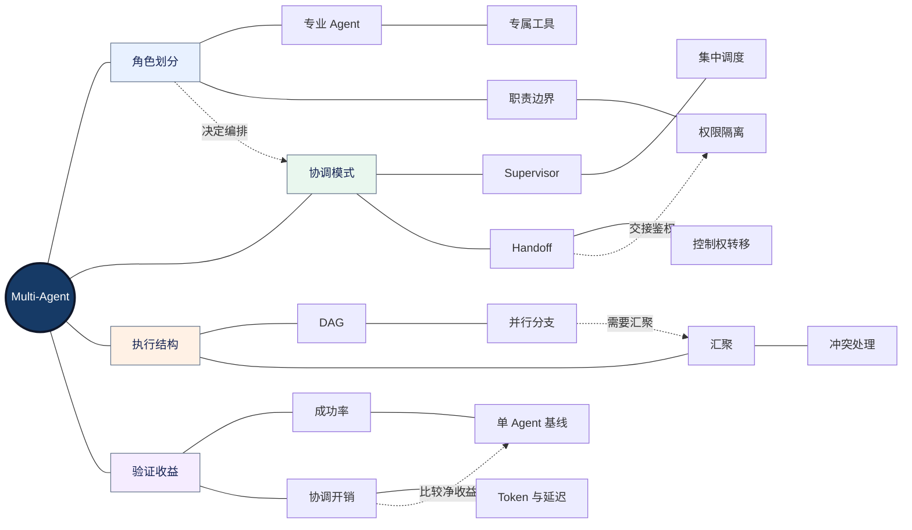

<strong>图谱解读：</strong>角色分工必须匹配真实任务边界；Supervisor 保留中央控制，Handoff 转移控制；并行执行要处理汇聚、共享状态和限流；最终必须与单 Agent 基线对照。

#### Q039｜为什么不总是使用 Multi-Agent？

<strong>面试简答：</strong>更多 Agent 可能增加交接、重复上下文、工具调用和状态复杂度。

<strong>原理与边界：</strong>只有专业分工、并行性或权限隔离带来可测收益时才值得引入。

<strong>项目落地：</strong>同样任务集对比固定 Workflow、单 Agent、多 Agent 的成功率与成本。

<strong>延伸追问：</strong>如何量化协调开销？

#### Q040｜Supervisor 与 Handoff 的本质区别？

<strong>面试简答：</strong>Supervisor 统一分配任务并汇总；Handoff 将当前控制权交给目标 Agent。

<strong>原理与边界：</strong>交接意味着终止、审计、权限和上下文边界改变；不只是“调用另一个模型”。

<strong>项目落地：</strong>高风险动作由中央审批，低风险专家咨询可 Agent-as-Tool。

<strong>延伸追问：</strong>Handoff 循环如何检测？

#### Q041｜并行 Agent 一定能缩短延迟吗？

<strong>面试简答：</strong>只有独立任务且资源足够时才可能缩短关键路径。

<strong>原理与边界：</strong>总耗时取决于最长依赖路径、队列、汇聚与限流；并发还可能提高失败率。

<strong>项目落地：</strong>把独立页面翻译并行化，但目录生成和最终打包等待汇聚。

<strong>延伸追问：</strong>如何根据 API TPM/RPM 设置并发？

#### Q042｜多 Agent 如何避免重复检索和信息不一致？

<strong>面试简答：</strong>共享经过授权的证据索引与检索结果引用，保持明确版本。

<strong>原理与边界：</strong>共享缓存要考虑租户权限、文档更新和 Agent 角色边界。

<strong>项目落地：</strong>研究 Agent 输出结构化 evidence_id，报告 Agent 根据证据生成。

<strong>延伸追问：</strong>不同 Agent 对同一证据结论相反怎么办？

#### Q043｜LangGraph、AutoGen、CrewAI、AgentScope 如何选？

<strong>面试简答：</strong>从控制模型、持久化、工具生态、部署和团队复杂度比较，不存在通用最优。

<strong>原理与边界：</strong>LangGraph 偏显式状态图与持久化；其他框架各有角色协作、事件或工作流抽象，具体能力随版本变化。

<strong>项目落地：</strong>先实现最小基线，再通过状态恢复、可观测性和维护成本决定框架。

<strong>延伸追问：</strong>什么情况下原生 Python Workflow 更好？

#### Q044｜多 Agent 如何设置终止与预算？

<strong>面试简答：</strong>全局任务预算和各子 Agent 局部预算同时生效。

<strong>原理与边界：</strong>子 Agent 不应自行无限重试；交接次数、最大深度、Token、时间和工具调用必须受控。

<strong>项目落地：</strong>在 Supervisor 维护全局 deadline 和 remaining_budget。

<strong>延伸追问：</strong>子 Agent 消耗完预算如何优雅降级？

#### Q045｜多 Agent 结果冲突如何处理？

<strong>面试简答：</strong>根据证据来源、任务责任、校验规则和必要的人审解决。

<strong>原理与边界：</strong>多数投票不保证正确，多个 Agent 可能共享同一模型偏差。

<strong>项目落地：</strong>关键数字采用程序核验，专家结论附证据与不确定性。

<strong>延伸追问：</strong>怎样设计真正独立的交叉校验？

## 八、可靠性、性能、成本与安全

生产系统的核心是“有界地完成正确任务”。可用性（Availability）表示服务可获得程度；可靠性（Reliability）强调在指定条件和时间内维持预期功能；业务质量衡量任务是否真正达成。HTTP 200 不等于业务成功。

### 8.1 生产级约束与故障防护网络

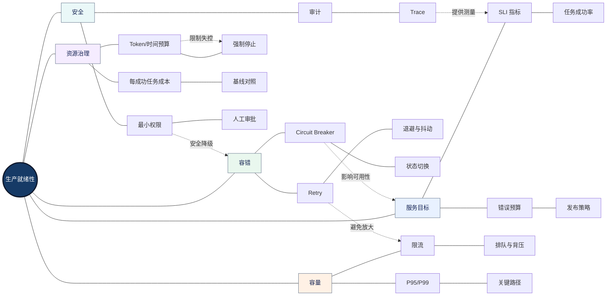

<strong>图谱解读：</strong>可靠性与性能并不独立：错误重试会增加负载，负载升高导致排队，排队导致超时，再触发重试。预算、背压和熔断用于切断这一故障放大链。

### 8.2 可靠性与成本的必要数学基础

<strong>独立步骤的联合成功率：</strong>当各步骤成功事件独立，且所有步骤必须成功时，可近似用乘积；真实系统错误往往相关，必须检验前提。

$$
P_{\mathrm{all}}=\prod_{i=1}^{n}p_i
$$

<strong>一般情形的条件概率链式法则：</strong>

$$
P(A_1,\ldots,A_n)=P(A_1)\prod_{i=2}^{n}P(A_i\mid A_1,\ldots,A_{i-1})
$$

<strong>Little 定律：</strong>在稳定且满足适用条件的排队系统中，平均在系统内的任务数等于平均吞吐率乘平均停留时间。

$$
L=\lambda W
$$

<strong>每成功任务成本：</strong>应包含失败重试和相关资源消耗，避免只比较 Token 单价。

$$
C_{\mathrm{success}}=\frac{C_{\mathrm{total}}}{N_{\mathrm{success}}},\qquad N_{\mathrm{success}}>0
$$

<strong>指数退避：</strong>实际实现应加入随机抖动，并受最大重试次数、Retry-After 和任务截止时间约束。

$$
t_k=\min(t_{\max},t_0\,2^k)
$$

#### Q046｜SLI、SLO 与 SLA 有什么区别？

<strong>面试简答：</strong>SLI 是实际测量指标；SLO 是目标；SLA 是带承诺性质的协议。

<strong>原理与边界：</strong>业务任务成功率与时间可用性口径不同，错误预算必须绑定明确统计周期。

<strong>项目落地：</strong>设置“合法文档完成并通过校验”的 SLI，而不只看 API 状态码。

<strong>延伸追问：</strong>怎样制定错误预算策略？

#### Q047｜Retry、Circuit Breaker、Bulkhead 有何区别？

<strong>面试简答：</strong>重试处理暂时故障；熔断隔离持续失败；舱壁限制故障影响范围。

<strong>原理与边界：</strong>三者需配合限流和超时，错误组合可能放大故障。

<strong>项目落地：</strong>图片解析与问答使用不同并发池，外部 API 失败时熔断。

<strong>延伸追问：</strong>熔断半开状态如何探测？

#### Q048｜为什么工具重试会导致雪崩？

<strong>面试简答：</strong>下游变慢触发超时，重试增加流量，进一步拖慢下游。

<strong>原理与边界：</strong>应结合指数退避、随机抖动、全局重试预算、队列背压和熔断。

<strong>项目落地：</strong>对 429 尊重 Retry-After，避免多个 Worker 同步重试。

<strong>延伸追问：</strong>如何通过故障注入验证？

#### Q049｜P95 与平均延迟哪个更重要？

<strong>面试简答：</strong>两者反映不同维度；P95 能揭示多数用户中的长尾体验。

<strong>原理与边界：</strong>仅看均值可能掩盖少数极慢任务；还应按任务类型、文件大小和阶段分层统计。

<strong>项目落地：</strong>对文档解析、翻译、渲染分别记录分位数和队列耗时。

<strong>延伸追问：</strong>P99 不稳定时如何采样？

#### Q050｜TTFT 与端到端延迟有什么区别？

<strong>面试简答：</strong>TTFT 是首 Token 时间；端到端延迟包含工具、检索、排队和最终校验。

<strong>原理与边界：</strong>流式输出改善感知等待，不一定缩短任务完成时间。

<strong>项目落地：</strong>对多页翻译报告“首次进度反馈”和“最终文件完成”两个指标。

<strong>延伸追问：</strong>如何定位关键路径？

#### Q051｜如何降低 Agent 的实际总成本？

<strong>面试简答：</strong>减少无效模型调用、控制输出长度、复用缓存、路由模型并优化失败重试。

<strong>原理与边界：</strong>成本必须包括检索、工具、存储、校验和人工成本；缓存要考虑命中与时效性。

<strong>项目落地：</strong>对高频简单任务走规则/小模型，复杂任务使用更强模型。

<strong>延伸追问：</strong>如何计算缓存净收益？

#### Q052｜为什么 Prompt 限制不能替代资源预算？

<strong>面试简答：</strong>模型可能忽略指令，预算必须由宿主程序强制执行。

<strong>原理与边界：</strong>设置 token、tool_calls、iterations、deadline、cost 等硬上限，触发时安全终止。

<strong>项目落地：</strong>布局修正最多有限轮，失败返回人工处理标记。

<strong>延伸追问：</strong>预算耗尽前能否保存部分成果？

#### Q053｜如何设计人工审批和最小权限？

<strong>面试简答：</strong>敏感操作在工具执行边界鉴权，并对高风险副作用要求显式批准。

<strong>原理与边界：</strong>模型或检索内容不得自我提升权限；审批结果应绑定具体参数和操作 ID。

<strong>项目落地：</strong>删除文档、外发邮件、改生产配置需独立审批与审计。

<strong>延伸追问：</strong>审批期间任务恢复如何防止重放？

#### Q054｜什么是 Saga 补偿事务？

<strong>面试简答：</strong>将跨服务长事务拆为局部操作，并为可补偿步骤定义逆向处理。

<strong>原理与边界：</strong>补偿不是数据库回滚的完全等价物；外部邮件等不可逆副作用需单独策略。

<strong>项目落地：</strong>创建工单→上传附件→通知，失败时按业务规则补偿或人工接管。

<strong>延伸追问：</strong>补偿也失败怎么办？

## 九、评估、测试、可观测性与发布

Agent Evaluation（智能体评估）需要区分结果质量、过程质量和系统质量。LLM-as-a-Judge（大模型评价器）可以辅助语义评分，但必须以明确 Rubric（评分准则）和人工校准降低偏差。Trace（分布式执行轨迹）用于定位过程，Evaluation（评价）用于判断过程是否符合目标。

### 9.1 评估与持续交付网络

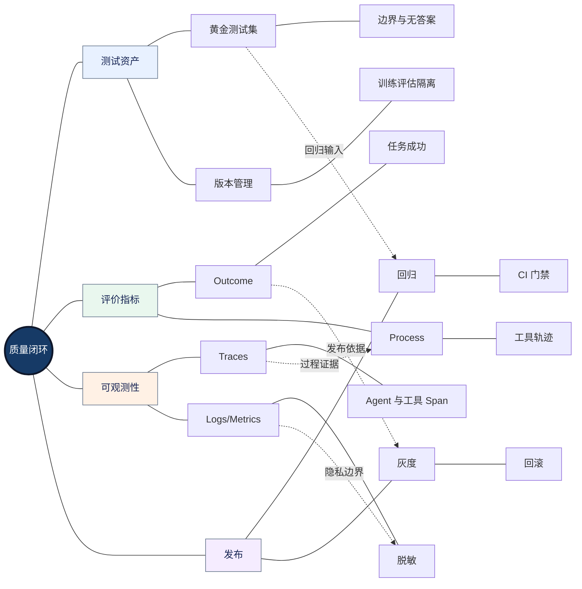

<strong>图谱解读：</strong>测试集是比较的基准，Trace 是归因证据，质量指标是决策信号，灰度与回滚是风险控制；版本关联使问题可以重现。

#### Q055｜如何设计 Agent 的分层评估？

<strong>面试简答：</strong>分模型、组件、端到端任务和系统运行四层评价。

<strong>原理与边界：</strong>单个工具调用正确不代表最终任务成功；最终答案正确也可能伴随越权或多余操作。

<strong>项目落地：</strong>检索测 Recall@K，工具测参数合法率，业务测验收通过率。

<strong>延伸追问：</strong>指标冲突时如何设硬门槛？

#### Q056｜LLM-as-a-Judge 有哪些偏差？

<strong>面试简答：</strong>可能存在位置、措辞、模型同源和评价标准偏差。

<strong>原理与边界：</strong>要用明确评分 Rubric、盲评、人工校准、重复抽样与程序规则组合。

<strong>项目落地：</strong>对文档漏译和数字准确性优先使用确定性校验。

<strong>延伸追问：</strong>两个 Judge 意见不一致怎么办？

#### Q057｜Trace Grading 与只评价最终答案有何不同？

<strong>面试简答：</strong>Trace Grading 检查中间路由、工具、交接和状态行为。

<strong>原理与边界：</strong>可定位“答案正确但过程越权/浪费资源”的情况，也便于聚类系统性故障。

<strong>项目落地：</strong>按 trace_id 关联每个 tool_call、token 和异常类型。

<strong>延伸追问：</strong>如何避免记录敏感原文？

#### Q058｜回归测试集如何构建？

<strong>面试简答：</strong>覆盖正常、边界、异常、安全、性能和历史失败样本。

<strong>原理与边界：</strong>样本需要来源、期望行为、版本和可复现输入；不能只用容易成功的演示案例。

<strong>项目落地：</strong>翻译测试覆盖扫描 PDF、复杂表格、跨页、图注和混合文档。

<strong>延伸追问：</strong>评估集泄漏会造成什么问题？

#### Q059｜如何做故障注入？

<strong>面试简答：</strong>在受控环境模拟 429、500、超时、响应损坏、Worker 崩溃和状态存储异常。

<strong>原理与边界：</strong>关注安全失败、恢复正确性、重试上限和副作用，而非仅观察是否自动恢复。

<strong>项目落地：</strong>测试订单创建成功但响应丢失后是否重复创建。

<strong>延伸追问：</strong>故障注入的退出条件是什么？

#### Q060｜如何发布新的模型或 Prompt？

<strong>面试简答：</strong>版本化模型、Prompt、工具 Schema、检索索引与评价规则，先离线再灰度。

<strong>原理与边界：</strong>监控质量、延迟、成本和安全门槛，触发回滚；不能只看离线平均分。

<strong>项目落地：</strong>用固定测试集和少量受控流量比较候选版本。

<strong>延伸追问：</strong>数据分布漂移时如何发现？

#### Q061｜OpenTelemetry 在 Agent 中起什么作用？

<strong>面试简答：</strong>OpenTelemetry（开放遥测）统一 Trace、Metric 和 Log 的采集与关联。

<strong>原理与边界：</strong>生成式 AI 语义约定仍可能演进，生产需固定字段版本并做好敏感信息脱敏。

<strong>项目落地：</strong>trace_id→task_id→agent_id→tool_call_id 串联整个执行链。

<strong>延伸追问：</strong>如何统计每个节点的费用？

#### Q062｜为什么公开 Benchmark 不能证明生产就绪？

<strong>面试简答：</strong>公开测试任务与真实权限、业务数据、负载和故障分布不同。

<strong>原理与边界：</strong>基准成绩仅对其样本、评分和环境成立；需企业自有测试集和在线监控补充。

<strong>项目落地：</strong>以真实文档类型、权限场景和错误样本构建专用评估集。

<strong>延伸追问：</strong>怎样防止为了测试集过拟合？

## 十、三个企业级项目深挖

项目题应使用可审计的“架构—数据—异常—指标—取舍”证据链。以下为可复用的工程回答模板，不代表任何项目已实际完成对应能力或达到某个数值。

### 10.1 项目深挖总网络

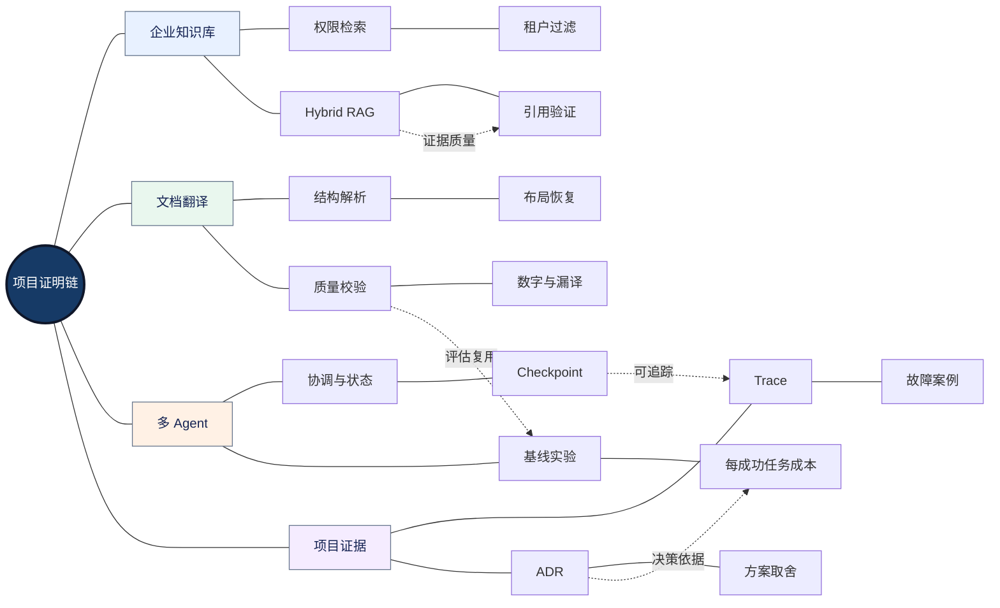

<strong>图谱解读：</strong>三个项目共享权限、状态、评估和可靠性底座；面试重点不只是展示架构，而是解释失败案例和对照实验。

### 10.2 企业知识库助手：业务目标与关键难点

<strong>推荐架构：</strong>文档采集与解析 → 分块与索引 → 权限过滤 → Hybrid Search → Reranker → 证据组织 → LLM 回答 → 引用核验 → 日志与评估。可选 Router 将 FAQ、知识检索和需人工审批的操作分流。

<strong>必须区分：</strong>RAG 解决知识可获得性问题，权限系统解决谁能获得知识，评价系统解决答案是否正确，三者缺一不可。

#### Q063｜如何从零设计企业知识库助手？

<strong>面试简答：</strong>先明确用户角色、知识来源、权限边界和验收问题，再建立可评估的检索生成链路。

<strong>原理与边界：</strong>优先保证文档版本、权限过滤和引用可追溯，复杂 Agentic RAG 需在基线不足时引入。

<strong>项目落地：</strong>以 FAQ/检索/工单三类业务路由为例，分别定义输入输出和风险。

<strong>延伸追问：</strong>为什么不直接微调企业知识？

#### Q064｜向量库不可用时如何降级？

<strong>面试简答：</strong>根据业务要求使用关键词检索、只读缓存或明确告知不可用。

<strong>原理与边界：</strong>降级不得绕过权限和引用校验；错误的“编造答案”不是可接受降级。

<strong>项目落地：</strong>对检索超时设置熔断，保留用户可理解的失败状态。

<strong>延伸追问：</strong>缓存是否可能泄露其他部门内容？

#### Q065｜知识库的评价集怎么做？

<strong>面试简答：</strong>覆盖精确术语、多跳、无答案、过期文档、权限与跨部门问题。

<strong>原理与边界：</strong>必须分别评价检索与回答，标注答案证据及允许拒答情形。

<strong>项目落地：</strong>对每个问题保存 gold_doc_ids、expected_facts 和 permission_context。

<strong>延伸追问：</strong>如何发现新知识上线后的回归？

### 10.3 文档翻译 Agent：结构保真与质量闭环

<strong>推荐架构：</strong>文件类型识别 → 结构解析/OCR → 阅读顺序与版面建模 → 分块翻译 → 术语与数字校验 → 文档重建 → 视觉对比 → 有界修复 → 可交付性验证。

Word（DOCX）通常包含可编辑 OOXML 结构，PDF 更多描述页面上的绘制结果；扫描 PDF 还需图像文字识别。不同输入不应强行共用同一解析策略。文档中的图片可以选择保留原图、仅翻译图注，或针对含文字图片进行独立图像翻译，必须在业务要求中明确。

#### Q066｜Word 与 PDF 为什么不能使用完全相同的解析方式？

<strong>面试简答：</strong>DOCX 以结构化文档对象为主，PDF 以页面绘制与布局为主。

<strong>原理与边界：</strong>PDF 的文本顺序不一定等于阅读顺序；扫描件可能没有可提取文本。

<strong>项目落地：</strong>按文件特征路由 OOXML 解析、文本型 PDF 解析或 OCR。

<strong>延伸追问：</strong>混合 PDF 如何逐页识别？

#### Q067｜如何保证翻译后表格、图注和跨页内容不丢失？

<strong>面试简答：</strong>保留结构 ID 与阅读顺序，翻译只替换语义内容，重建时维护对象关系。

<strong>原理与边界：</strong>跨页表格需识别续表，图注需绑定图像；直接按页字符串替换易破坏结构。

<strong>项目落地：</strong>构建 document tree，节点保存类型、bbox、style、source_text、translation。

<strong>延伸追问：</strong>如何处理复杂域、批注与修订？

#### Q068｜翻译后排版错位的根因有哪些？

<strong>面试简答：</strong>语言长度变化、字体度量、行高、文本框约束、表格宽度与渲染差异。

<strong>原理与边界：</strong>字号缩小不是万能方案；应先判断是容器约束、换行策略还是对象重叠。

<strong>项目落地：</strong>先做确定性布局修正，复杂情况交给有界修正 Agent。

<strong>延伸追问：</strong>如何定义视觉质量评分 Rubric？

#### Q069｜如何检查漏译、数字、单位和型号错误？

<strong>面试简答：</strong>结合结构覆盖、规则校验、术语表和语义复核。

<strong>原理与边界：</strong>模型自评不能替代确定性核对；数字、单位、型号、表格单元格可建立逐项对齐。

<strong>项目落地：</strong>对每个源节点记录翻译状态和校验错误码，低置信度进入人工复核。

<strong>延伸追问：</strong>数学公式和图片内文字如何处理？

#### Q070｜如何避免布局修正 Agent 无限循环？

<strong>面试简答：</strong>限定修正次数、可修改属性、质量阈值和安全回退条件。

<strong>原理与边界：</strong>每轮比较实际缺陷是否减少，若没有改善则停止或回退上一版本。

<strong>项目落地：</strong>只重渲染失败页，记录每次修改前后 bbox 和截图差异。

<strong>延伸追问：</strong>怎样证明修正 Agent 比规则修正更好？

#### Q071｜如何定位文档翻译性能瓶颈？

<strong>面试简答：</strong>分阶段统计解析、模型、排版、渲染、校验、重试和队列时间。

<strong>原理与边界：</strong>优化应针对关键路径，不能因为模型贵就认定模型是瓶颈。

<strong>项目落地：</strong>记录每页耗时与文档复杂度，测试缓存和并行带来的净收益。

<strong>延伸追问：</strong>什么时候异步任务优于同步 API？

### 10.4 多 Agent 企业研发助手：协作收益与故障恢复

<strong>推荐架构：</strong>入口 Router → Supervisor → 检索/分析/执行等专家 → 汇聚校验 → 人工审批（必要时）→ 最终输出；底层统一状态、Trace、预算与工具鉴权。

<strong>关键实验：</strong>同一任务集比较固定 Workflow、单 Agent 和多 Agent 的成功率、P95、工具次数、Token 与每成功任务成本；只有明确净收益才选择更复杂架构。

#### Q072｜如何拆分三个 Agent 的职责？

<strong>面试简答：</strong>按照输入输出契约、工具权限和可独立验收的子任务划分。

<strong>原理与边界：</strong>按“看起来像三个角色”硬拆会产生冗余；共享状态应最小化。

<strong>项目落地：</strong>研究 Agent 收集证据，执行 Agent 调工具，审核 Agent 做验收。

<strong>延伸追问：</strong>审核 Agent 是否应该拥有写权限？

#### Q073｜子 Agent 超时或失败怎么办？

<strong>面试简答：</strong>由协调层根据任务重要性执行重试、降级、重新分派或终止。

<strong>原理与边界：</strong>失败不能被隐藏为成功；应保存失败类型、剩余预算和已完成子任务。

<strong>项目落地：</strong>汇聚节点将部分完成标记为 partial，必要时人工接管。

<strong>延伸追问：</strong>怎样避免重试导致重复副作用？

#### Q074｜多 Agent 的收益如何验证？

<strong>面试简答：</strong>与同任务集的单 Agent 和固定 Workflow 比较业务成功率与总资源。

<strong>原理与边界：</strong>不能只看模型回答“更完整”，应使用独立验收和置信区间。

<strong>项目落地：</strong>做任务类型分层，观察复杂任务是否受益而简单任务反而变慢。

<strong>延伸追问：</strong>怎样设计公平的 Token 预算对照？

## 十一、系统设计与故障排查

开放式系统设计题重点是边界条件、负载估算、状态一致性和降级策略。先问清任务规模、用户权限、延迟 SLO、数据敏感性、部署环境与预算，再选模型和框架。

### 11.1 系统设计决策网络

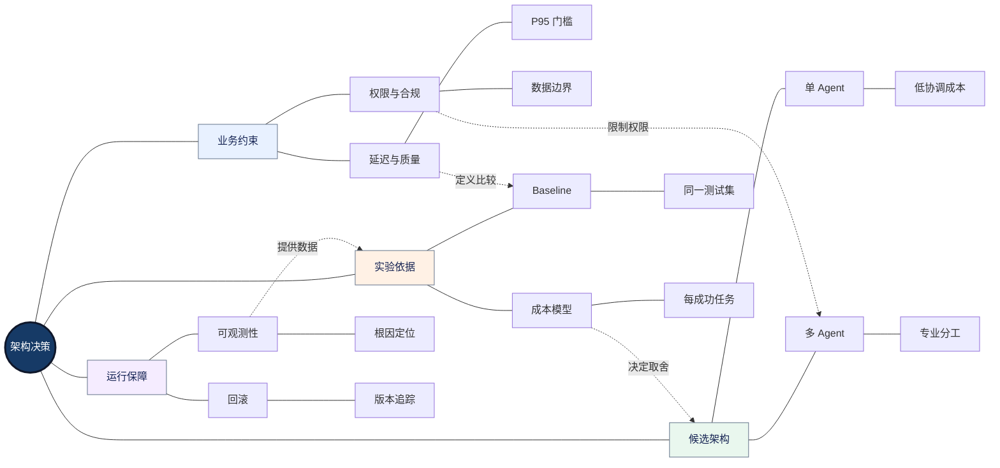

<strong>图谱解读：</strong>系统设计先有约束再有方案，先有基线再有优化，先有监控再有可靠迭代；架构复杂度本身不是目标。

#### Q075｜设计一个支持千级并发用户的企业 Agent 平台，先问什么？

<strong>面试简答：</strong>先确认并发定义、请求到达率、任务时长、模型限额、权限、SLO 与预算。

<strong>原理与边界：</strong>并发用户不等于同时运行模型请求；需根据队列、吞吐和峰值流量估算容量。

<strong>项目落地：</strong>分离 API 层、任务队列、Worker、状态存储与模型网关。

<strong>延伸追问：</strong>如何估算 Worker 数和队列长度？

#### Q076｜线上 P95 延迟突然升高如何定位？

<strong>面试简答：</strong>按入口排队、检索、模型、工具、校验与下游限流逐段定位。

<strong>原理与边界：</strong>需要对比同任务类型和同文档复杂度，避免流量分布变化造成误判。

<strong>项目落地：</strong>查看 Trace 的 span duration、retry、queue_time、tokens。

<strong>延伸追问：</strong>怎样区分模型服务变慢与输入变长？

#### Q077｜工具返回 200，但用户任务失败，如何排查？

<strong>面试简答：</strong>检查业务状态、工具语义、数据版本、后续编排与最终验收。

<strong>原理与边界：</strong>HTTP 成功不代表业务状态满足要求；异步工具可能只接受任务未完成。

<strong>项目落地：</strong>将 accepted、running、completed、failed 区分为明确状态。

<strong>延伸追问：</strong>如何处理最终一致性？

#### Q078｜系统在外部副作用后崩溃如何恢复？

<strong>面试简答：</strong>使用持久化操作 ID、幂等键和外部状态核对后决定重试。

<strong>原理与边界：</strong>单纯恢复 Checkpoint 可能重放节点；不能依赖“恰好一次”幻想。

<strong>项目落地：</strong>订单工具先写操作表，再执行，恢复时核对操作结果。

<strong>延伸追问：</strong>如何处理外部系统不支持幂等键？

#### Q079｜模型升级后质量下降如何定位？

<strong>面试简答：</strong>固定数据集与版本记录，分别比较模型、Prompt、工具 Schema、检索和评价器。

<strong>原理与边界：</strong>需要控制其他变量，区分随机波动与系统性退化；必要时灰度回滚。

<strong>项目落地：</strong>对失败样本进行聚类，查看是否集中于工具参数或长上下文。

<strong>延伸追问：</strong>如何估计变化的统计不确定性？

#### Q080｜如何在质量、成本、延迟之间做取舍？

<strong>面试简答：</strong>先设不可突破的安全和质量门槛，再比较满足门槛的帕累托候选方案。

<strong>原理与边界：</strong>不同业务权重不同；实时客服与高风险文档处理不应共用同一优化目标。

<strong>项目落地：</strong>使用 ADR 记录假设、数据、替代方案和最终决策。

<strong>延伸追问：</strong>为什么平均得分最高的方案未必最好？

## 十二、面试误区、证据清单与复习路径

### 12.1 常见错误回答及修正

| 容易失分的说法 | 更严谨的回答 |
|---|---|
| “用了 LLM 就是 Agent” | 说明状态、行动选择、工具和控制权边界 |
| “RAG 可以消除幻觉” | RAG 提供证据，但召回、引用和推理仍可能出错 |
| “向量检索比 BM25 先进” | 语义与精确词项互补，取决于任务分布 |
| “用了 LangGraph 就自动安全恢复” | Checkpoint 不能替代幂等与外部副作用核对 |
| “多 Agent 一定更强” | 必须比较协调开销与业务成功率净收益 |
| “JSON Schema 保证安全” | Schema 不替代鉴权和业务校验 |
| “重试越多越可靠” | 无界重试会放大负载和副作用 |
| “模型评分高就能上线” | 需业务验收、人工校准、安全测试与灰度 |
| “Token 单价最低就是最省钱” | 应比较每成功任务总成本 |
| “我做到了 99% 准确率” | 必须解释样本、口径、基线与不确定性 |

### 12.2 项目证据准备清单

- <strong>架构证据：</strong>系统组件图、任务状态机、数据流和权限边界。
- <strong>代码证据：</strong>Router、Tool Schema、幂等控制、Checkpoint、错误分类、预算强制执行。
- <strong>实验证据：</strong>测试集版本、任务分层、基线、消融实验、失败样本。
- <strong>运维证据：</strong>Trace 示例、P95、错误类型分布、成本归因与故障注入记录。
- <strong>决策证据：</strong>ADR、为什么不用另一方案、回滚与安全降级。

### 12.3 三轮复习策略

<strong>第一轮：概念网络。</strong>能不看资料解释 Agent、RAG、Tool、Memory、Workflow、Multi-Agent、Evals 的区别与联系。

<strong>第二轮：工程追问。</strong>每个概念至少能回答一次失败场景、一个替代方案、一个可测指标；能画出执行和恢复的数据流。

<strong>第三轮：项目答辩。</strong>为每个项目准备 3 分钟架构概述、10 分钟深挖和 1 个真实故障案例。所有量化结果必须能追溯到测试记录。

### 12.4 关联前面章节的学习地图

| 本章面试主题 | 前置知识模块 | 复习重点 |
|---|---|---|
| LLM 与微调 | 01-LLM-Fundamentals | Transformer、采样、LoRA、推理成本 |
| Agent 与 ReAct | 02-Agent-Fundamentals / 04-Agent-Working-Patterns | 决策循环、规划、终止 |
| Tool 与 MCP | 03-Agent-Core-Components / 05-Agent-Knowledge-and-Tools | Schema、协议、鉴权 |
| RAG / Memory / Context | 03-Agent-Core-Components / 05-Agent-Knowledge-and-Tools | 检索评价、信息生命周期 |
| Multi-Agent | 06-Multi-Agent-and-Frameworks | Supervisor、Handoff、状态合并 |
| 企业可靠性 | 07-Enterprise-Engineering-and-Deployment | SLO、Trace、灰度、安全 |
| 项目与取舍 | 08-Projects-and-Interviews | 架构决策、项目证据、指标 |

---

## 十三、参考资料与知识关联

以下链接优先采用官方资料或公开论文。部分框架接口和安全规范持续演进，实际开发应固定依赖版本，并以当前发行文档核对。论文提出的方法可作为研究线索，不等于已被所有企业环境验证。

| 资料 | 核心用途 |
|---|---|
| [Attention Is All You Need](https://arxiv.org/abs/1706.03762) | Transformer 与注意力机制 |
| [LoRA](https://arxiv.org/abs/2106.09685) | 低秩参数高效微调 |
| [ReAct](https://arxiv.org/abs/2210.03629) | 推理与行动交替 |
| [RAG 原始论文](https://arxiv.org/abs/2005.11401) | 检索增强生成 |
| [BM25 / Elasticsearch](https://www.elastic.co/guide/en/elasticsearch/reference/current/index-modules-similarity.html) | 词项相关性与稀疏检索 |
| [LangGraph Persistence](https://docs.langchain.com/oss/python/langgraph/persistence) | Checkpointer 与 Store |
| [LangGraph Interrupts](https://docs.langchain.com/oss/python/langgraph/interrupts) | 人工审批与恢复边界 |
| [OpenAI Agents SDK Multi-Agent](https://openai.github.io/openai-agents-python/multi_agent/) | Handoff 与 Agent-as-Tool |
| [OpenAI Agents SDK Guardrails](https://openai.github.io/openai-agents-python/guardrails/) | 安全检查范围 |
| [Microsoft AutoGen](https://microsoft.github.io/autogen/stable/) | 多 Agent 交互 |
| [CrewAI](https://docs.crewai.com/) | Crew 与 Flow |
| [AgentScope](https://github.com/agentscope-ai/agentscope) | Agent 开发框架 |
| [MCP Specification](https://modelcontextprotocol.io/specification/) | 工具与资源协议 |
| [Google SRE Workbook](https://sre.google/workbook/table-of-contents/) | SLO 与错误预算 |
| [Azure Circuit Breaker](https://learn.microsoft.com/en-us/azure/architecture/patterns/circuit-breaker) | 熔断设计 |
| [Azure Reliability Patterns](https://learn.microsoft.com/en-us/azure/architecture/patterns/category/resiliency) | Retry、Bulkhead、Saga |
| [OpenAI Agent Evals](https://developers.openai.com/api/docs/guides/agent-evals) | Agent 评估 |
| [OpenAI Trace Grading](https://developers.openai.com/api/docs/guides/trace-grading) | 过程评价 |
| [OpenTelemetry GenAI](https://opentelemetry.io/docs/specs/semconv/gen-ai/) | 生成式 AI 语义约定 |
| [OWASP AI Agent Security](https://cheatsheetseries.owasp.org/cheatsheets/AI_Agent_Security_Cheat_Sheet.html) | Agent 安全边界 |
| [OWASP Agentic Top 10](https://genai.owasp.org/resource/owasp-top-10-for-agentic-applications-for-2026/) | Agent 风险分类 |
| [GAIA Benchmark](https://huggingface.co/gaia-benchmark) | 通用助手任务评估 |

### 13.1 本章核心结论

Agent 面试能力的底层依赖是模型和算法原理；中间层是 RAG、Tool、Memory、Context、Workflow 与 Multi-Agent 的组合；生产层是安全、可恢复性、可观测性、评估和成本治理；项目层则用架构、实验与故障案例证明这些选择合理。

<strong>最重要的四组区分：</strong>模型输出不等于业务执行；检索相关不等于证据支持；持久化状态不等于副作用恰好一次；复杂架构不等于更好的任务成功率。所有项目最终都应回答“为什么这样设计、哪里可能失败、如何验证比基线更好”。

